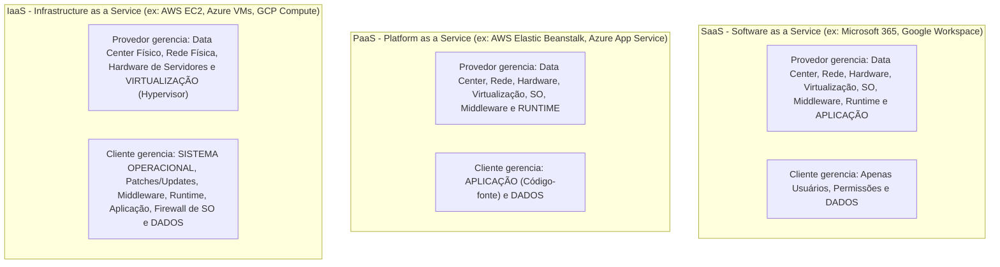
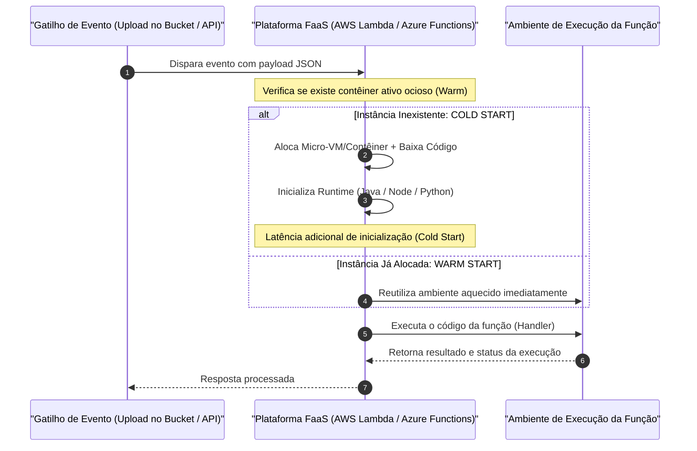
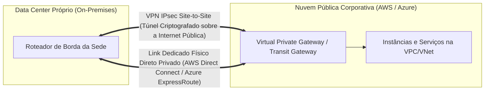

# 05 - Computação em Nuvem, Serverless e Ambientes Híbridos

> **Matéria:** Sistemas Operacionais, Redes e Computação em Nuvem  
> **Cargo:** B02 – Técnico de Controle Externo – Especialidade: Tecnologia da Informação  
> **Arquivo:** `05_computacao_em_nuvem_modelos_serverless_e_hibridos.md`  

---

## 📌 Ementa / Itens do Edital
- Fundamentos e características essenciais da Computação em Nuvem (NIST SP 800-145)
- Modelos de Serviço em Nuvem: IaaS, PaaS e SaaS
- Modelos de Implantação: Nuvem Pública, Privada, Comunitária e Híbrida
- Computação sem Servidor (Serverless / FaaS)
- Estratégias de escalabilidade (Vertical vs. Horizontal) e Alta Disponibilidade
- Integração entre ambientes locais (On-Premises) e nuvem pública
- Monitoramento de infraestrutura e custos em nuvem (FinOps)

---

## 🧭 Sumário

1. [Fundamentos de Computação em Nuvem (NIST SP 800-145)](#1-fundamentos-de-computacao-em-nuvem-nist-sp-800-145)
    1. [Definição Canônica do NIST](#11-definicao-canonica-do-nist)
    2. [As Cinco Características Essenciais](#12-as-cinco-caracteristicas-essenciais)
    3. [Os Quatro Modelos de Implantação (Pública, Privada, Comunitária, Híbrida)](#13-os-quatro-modelos-de-implantacao-publica-privada-comunitaria-hibrida)
    4. [Teste 454](#Teste-454)
    5. [Teste 455](#Teste-455)
2. [Modelos de Serviço e Matriz de Responsabilidade Compartilhada](#2-modelos-de-servico-e-matriz-de-responsabilidade-compartilhada)
    1. [IaaS, PaaS e SaaS: Estrutura e Escopos de Controle](#21-iaas-paas-e-saas-estrutura-e-escopos-de-controle)
    2. [Matriz de Responsabilidade Compartilhada (Shared Responsibility Model)](#22-matriz-de-responsabilidade-compartilhada-shared-responsibility-model)
    3. [Teste 456](#Teste-456)
    4. [Teste 457](#Teste-457)
3. [Computação Serverless (FaaS - Function as a Service)](#3-computacao-serverless-faas-function-as-a-service)
    1. [Paradigma: Execução Orientada a Eventos e Abstração de Infraestrutura](#31-paradigma-execucao-orientada-a-eventos-e-abstracao-de-infraestrutura)
    2. [Escala Automática a Zero (Scale-to-Zero) e Cobrança Fracionada](#32-escala-automatica-a-zero-scale-to-zero-e-cobranca-fracionada)
    3. [O Desafio do Cold Start e Estratégias de Mitigação](#33-o-desafio-do-cold-start-e-estrategias-de-mitigacao)
    4. [Teste 458](#Teste-458)
    5. [Teste 459](#Teste-459)
4. [Arquiteturas de Alta Disponibilidade e Escalabilidade em Nuvem](#4-arquiteturas-de-alta-disponibilidade-e-escalabilidade-em-nuvem)
    1. [Topologia Física Global: Regiões, Zonas de Disponibilidade (AZs) e Pontos de Presença](#41-topologia-fisica-global-regioes-zonas-de-disponibilidade-azs-e-pontos-de-presenca)
    2. [Escalabilidade Vertical (Scale-Up) vs. Horizontal (Scale-Out)](#42-escalabilidade-vertical-scale-up-vs-horizontal-scale-out)
    3. [Padrões de Resiliência: Multi-AZ e Recuperação de Desastres](#43-padroes-de-resiliencia-multi-az-e-recuperacao-de-desastres)
    4. [Teste 460](#Teste-460)
    5. [Teste 461](#Teste-461)
5. [Integração Híbrida e Governança Financeira (FinOps)](#5-integracao-hibrida-e-governanca-financeira-finops)
    1. [Conectividade Corporativa Híbrida: VPN IPsec vs. Links Dedicados Diretos](#51-conectividade-corporativa-hibrida-vpn-ipsec-vs-links-dedicados-diretos)
    2. [Modelos de Compra em Nuvem: On-Demand, Instâncias Reservadas e Spot](#52-modelos-de-compra-em-nuvem-on-demand-instancias-reservadas-e-spot)
    3. [FinOps: Transição CapEx para OpEx e Dimensionamento Correto (Rightsizing)](#53-finops-transicao-capex-para-opex-e-dimensionamento-correto-rightsizing)
    4. [Teste 462](#Teste-462)
    5. [Teste 463](#Teste-463)
    6. [Teste 464](#Teste-464)
6. [Fontes Recomendadas na Internet](#6-fontes-recomendadas-na-internet)

---

## 1. Fundamentos de Computação em Nuvem (NIST SP 800-145)

### 1.1 Definição Canônica do NIST

A publicação técnica especial **NIST SP 800-145** (*The NIST Definition of Cloud Computing*) consolidou o consenso acadêmico e de mercado sobre a computação em nuvem:
> *"Computação em nuvem é um modelo para habilitar acesso de rede ubíquo, conveniente e sob demanda a um conjunto compartilhado de recursos de computação configuráveis (por exemplo, redes, servidores, armazenamento, aplicativos e serviços) que podem ser rapidamente provisionados e liberados com esforço de gerenciamento mínimo ou interação do provedor de serviços."*

### 1.2 As Cinco Características Essenciais

Para ser legitimamente classificado como computação em nuvem, um ambiente tecnológico deve contemplar obrigatoriamente as cinco características essenciais normatizadas pelo NIST:

| Característica Essencial | Definição Canônica do NIST | Impacto Operacional / Exemplo |
|---|---|---|
| **1. Autoatendimento sob Demanda** (*On-Demand Self-Service*) | O consumidor pode provisionar recursos computacionais (tempo de CPU, instâncias, armazenamento) de forma unilateral e automática, **sem intervenção humana** de operadores do provedor. | Administrador cria uma máquina virtual via portal web ou CLI em 2 minutos. |
| **2. Amplo Acesso à Rede** (*Broad Network Access*) | Os recursos estão disponíveis na rede e são acessíveis por meio de mecanismos padronizados que promovem o uso por plataformas heterogêneas de clientes finos ou espessos. | Acesso corporativo uniforme via navegadores web, celulares, tablets ou estações de trabalho. |
| **3. Agrupamento de Recursos em Pool** (*Resource Pooling*) | Os recursos computacionais do provedor são agrupados para atender múltiplos clientes em um modelo **multilocatário (*multi-tenant*)**, com diferentes recursos físicos e virtuais atribuídos e reatribuídos dinamicamente. Independência de localização física. | Vários clientes compartilham o mesmo servidor físico isolados por hipervisores; o cliente desconhece a sala exata do servidor. |
| **4. Elasticidade Rápida** (*Rapid Elasticity*) | Capacidades podem ser provisionadas e liberadas de forma elástica, em alguns casos automaticamente, para **escalar rapidamente para fora e para dentro** conforme a demanda. Para o consumidor, os recursos parecem ilimitados. | Durante picos de tráfego, o *Auto Scaling* adiciona 20 servidores web em minutos e desliga-os à noite quando a demanda cai. |
| **5. Serviço Mensurado** (*Measured Service*) | Os sistemas em nuvem controlam e otimizam automaticamente o uso de recursos utilizando capacidade de medição (métricas de CPU, armazenamento, largura de banda, contas de usuário). O uso é monitorado, controlado e relatado com transparência. | Faturamento transparente no modelo *Pay-as-you-go* (pague estritamente pelos gigabytes e horas consumidos). |

### 1.3 Os Quatro Modelos de Implantação (Pública, Privada, Comunitária, Híbrida)

1. **Nuvem Pública (*Public Cloud*):** Infraestrutura aberta ao público em geral ou a grandes grupos industriais, pertencente e operada por um provedor comercial de nuvem (AWS, Microsoft Azure, Google Cloud, Oracle Cloud).
2. **Nuvem Privada (*Private Cloud*):** Infraestrutura provisionada para **uso exclusivo por uma única organização** com múltiplas unidades ou departamentos (ex.: data center corporativo governamental operado com OpenStack ou VMware). Pode ser gerenciada pela própria organização ou por terceiros.
3. **Nuvem Comunitária (*Community Cloud*):** Infraestrutura compartilhada exclusivamente por organizações que possuem missões, exigências de segurança, políticas ou conformidades regulatórias comuns (ex.: nuvem compartilhada entre os Tribunais de Contas dos Estados para auditoria concorrente).
4. **Nuvem Híbrida (*Hybrid Cloud*):** Composição de duas ou mais infraestruturas de nuvem distintas (privada, comunitária ou pública) que permanecem entidades independentes, mas são integradas por tecnologias padronizadas que asseguram a portabilidade de dados e aplicações (ex.: manter o banco de dados sigiloso na nuvem privada interna e expandir servidores web para a nuvem pública durante picos sazonais - técnica conhecida como *cloud bursting*).

---

### Teste 454
**(FCC – TRT-3 – Analista Judiciario Tecnologia da Informacao – 2015)**
A computação na nuvem apresenta a grande vantagem de acessar os recursos computacionais (processamento, banco de dados, etc) a partir da internet sem a necessidade de instalar programas e aplicações nos computadores e dispositivos. Dentre os diferentes tipos de serviços da computação na nuvem, quando recursos de hardware são acessados na nuvem, está se utilizando o tipo de serviço

* **A)** DevaaS.
* **B)** IaaS.
* **C)** CaaS.
* **D)** SaaS.
* **E)** PaaS.

---

> **Comentário Detalhado:**
>
> - **A)** **Incorreta.** A opção apresenta proposição em desacordo com os fundamentos teóricos e técnicos do tópico ao afirmar que "DevaaS". De acordo com a teoria estudada em *1.3 Os Quatro Modelos de Implantação (Pública, Privada, Comunitária, Híbrida)*, nuvem Híbrida (*Hybrid Cloud*): Composição de duas ou mais infraestruturas de nuvem distintas (privada, comunitária ou pública) que permanecem entidades independentes, mas são integradas por tecnologias padronizadas que asseguram a portabilidade de dados e aplicações (ex.: manter o banco de dados sigiloso na nuvem privada interna e expandir servidores web para a nuvem pública durante picos sazonais - técnica conhecida como *cloud bursting*).
> - **B)** **Correta.** Conforme fundamentado na seção *1.2 As Cinco Características Essenciais* deste guia, 5. Serviço Mensurado (*Measured Service*): Os sistemas em nuvem controlam e otimizam automaticamente o uso de recursos utilizando capacidade de medição (métricas de CPU, armazenamento, largura de banda, contas de usuário). Dessa forma, está plenamente correta a assertiva da banca (FCC – TRT-3/2015) ao estabelecer que "IaaS".
> - **C)** **Incorreta.** A opção apresenta proposição em desacordo com os fundamentos teóricos e técnicos do tópico ao afirmar que "CaaS". De acordo com a teoria estudada em *2.1 IaaS, PaaS e SaaS: Estrutura e Escopos de Controle*, o cliente instala, configura e mantém o Sistema Operacional convidado, middlewares, bancos de dados e aplicações.
> - **D)** **Incorreta.** A opção apresenta proposição em desacordo com os fundamentos teóricos e técnicos do tópico ao afirmar que "SaaS". De acordo com a teoria estudada em *2.1 IaaS, PaaS e SaaS: Estrutura e Escopos de Controle*, toda a pilha técnica (do hardware ao código) é mantida pelo provedor; o cliente gerencia apenas os usuários autorizados e seus dados operacionais.
> - **E)** **Incorreta.** A opção apresenta proposição em desacordo com os fundamentos teóricos e técnicos do tópico ao afirmar que "PaaS". De acordo com a teoria estudada em *6. Fontes Recomendadas na Internet*, nIST SP 800-145 - The NIST Definition of Cloud Computing - Definição seminal do NIST contemplando os 5 atributos essenciais, 3 modelos de serviço (IaaS, PaaS, SaaS) e 4 modelos de implantação.
>
> **Gabarito: B**

---

### Teste 455
**(FGV – TJ-MT – Analista Judiciario Tecnologia da Informacao – 2024)**
A computação em nuvem é uma tecnologia que permite o acesso remoto a recursos de computação, como armazenamento, processamento e software, por meio da internet. Existem diversos modelos de serviço em computação em nuvem. A ideia por trás dos Modelos de Serviço em Computação em Nuvem é fornecer diferentes níveis de abstração e gerenciamento de recursos de TI para atender às diversas necessidades das organizações e desenvolvedores. Nos modelos de serviço em computação em nuvem, a Plataforma como Serviço (PaaS)

* **A)** oferece ao usuário controle total sobre a infraestrutura física e virtual, permitindo que configure e gerencie servidores e armazenamento conforme necessário.
* **B)** disponibiliza um ambiente para desenvolvimento, teste e implementação de aplicações, sem a necessidade de gerenciar a infraestrutura subjacente.
* **C)** oferece um software completo via internet, pronto para uso, como e-mails e ferramentas de produtividade, sem a necessidade de instalação local.
* **D)** fornece recursos básicos de armazenamento e rede para que os usuários possam instalar e executar seus próprios sistemas operacionais e aplicações.
* **E)** permite ao usuário gerenciar somente a camada de segurança e backup, delegando o controle da infraestrutura para o provedor de nuvem.

---

> **Comentário Detalhado:**
>
> - **A)** **Incorreta.** A opção apresenta proposição em desacordo com os fundamentos teóricos e técnicos do tópico ao afirmar que "oferece ao usuário controle total sobre a infraestrutura física e virtual, permitindo que configure e gerencie...". De acordo com a teoria estudada em *1.1 Definição Canônica do NIST*, *"Computação em nuvem é um modelo para habilitar acesso de rede ubíquo, conveniente e sob demanda a um conjunto compartilhado de recursos de computação configuráveis (por exemplo, redes, servidores, armazenamento, aplicativos e serviços) que podem ser rapidamente provisionados e liberados com esforço de gerenciamento mínimo ou interação do provedor de serviços."*.
> - **B)** **Incorreta.** A opção apresenta proposição em desacordo com os fundamentos teóricos e técnicos do tópico ao afirmar que "disponibiliza um ambiente para desenvolvimento, teste e implementação de aplicações, sem a necessidade de...". De acordo com a teoria estudada em *3.1 Paradigma: Execução Orientada a Eventos e Abstração de Infraestrutura*, na computação sem servidor (Serverless / FaaS), o conceito de servidor físico ou máquina virtual é totalmente abstraído para a equipe de tecnologia. O desenvolvimento organiza-se em torno de pequenas funções de código atômicas disparadas em resposta a Eventos.
> - **C)** **Incorreta.** A opção apresenta proposição em desacordo com os fundamentos teóricos e técnicos do tópico ao afirmar que "oferece um software completo via internet, pronto para uso, como e-mails e ferramentas de produtividade, sem a...". De acordo com a teoria estudada em *2.1 IaaS, PaaS e SaaS: Estrutura e Escopos de Controle*, saaS (*Software as a Service*): O provedor disponibiliza um software de aplicação completo e funcional acessível pela Internet (ex.: navegadores web).
> - **D)** **Incorreta.** A opção apresenta proposição em desacordo com os fundamentos teóricos e técnicos do tópico ao afirmar que "fornece recursos básicos de armazenamento e rede para que os usuários possam instalar e executar seus próprios...". De acordo com a teoria estudada em *1.2 As Cinco Características Essenciais*, 5. Serviço Mensurado (*Measured Service*): Os sistemas em nuvem controlam e otimizam automaticamente o uso de recursos utilizando capacidade de medição (métricas de CPU, armazenamento, largura de banda, contas de usuário).
> - **E)** **Correta.** Conforme fundamentado na seção *1.3 Os Quatro Modelos de Implantação (Pública, Privada, Comunitária, Híbrida)* deste guia, nuvem Comunitária (*Community Cloud*): Infraestrutura compartilhada exclusivamente por organizações que possuem missões, exigências de segurança, políticas ou conformidades regulatórias comuns (ex.: nuvem compartilhada entre os Tribunais de Contas dos Estados para auditoria concorrente). Dessa forma, está plenamente correta a assertiva da banca (FGV – TJ-MT/2024) ao estabelecer que "permite ao usuário gerenciar somente a camada de segurança e backup, delegando o controle da infraestrutura para o...".
>
> **Gabarito: E**

---

## 2. Modelos de Serviço e Matriz de Responsabilidade Compartilhada

### 2.1 IaaS, PaaS e SaaS: Estrutura e Escopos de Controle

- **IaaS (*Infrastructure as a Service*):** O provedor entrega infraestrutura computacional bruta (máquinas virtuais, capacidade de processamento, armazenamento em bloco e interfaces de rede). O cliente instala, configura e mantém o Sistema Operacional convidado, middlewares, bancos de dados e aplicações.
- **PaaS (*Platform as a Service*):** O provedor entrega uma plataforma de desenvolvimento e execução pronta (runtimes como Node.js, Python, Java, .NET, acompanhados de bancos gerenciados). O desenvolvedor não se preocupa com o sistema operacional, atualizações de segurança ou virtualização; seu foco restringe-se exclusivamente ao código da aplicação e às configurações de negócio.
- **SaaS (*Software as a Service*):** O provedor disponibiliza um software de aplicação completo e funcional acessível pela Internet (ex.: navegadores web). Toda a pilha técnica (do hardware ao código) é mantida pelo provedor; o cliente gerencia apenas os usuários autorizados e seus dados operacionais.

### 2.2 Matriz de Responsabilidade Compartilhada (Shared Responsibility Model)

A segurança cibernética em nuvem fundamenta-se na **Responsabilidade Compartilhada**:

| Componente da Pilha | Ambiente Local (*On-Premises*) | IaaS | PaaS | SaaS |
|---|:---:|:---:|:---:|:---:|
| **Segurança Física do Data Center** | Cliente | **Provedor** | **Provedor** | **Provedor** |
| **Rede Física e Hardware de Servidores** | Cliente | **Provedor** | **Provedor** | **Provedor** |
| **Camada de Hipervisor / Virtualização** | Cliente | **Provedor** | **Provedor** | **Provedor** |
| **Sistema Operacional do Servidor (Guest OS)** | Cliente | **Cliente** | **Provedor** | **Provedor** |
| **Middleware e Runtimes de Execução** | Cliente | **Cliente** | **Provedor** | **Provedor** |
| **Código da Aplicação** | Cliente | **Cliente** | **Cliente** | **Provedor** |
| **Controle de Acessos e Identidades (IAM)** | Cliente | **Cliente** | **Cliente** | **Compartilhado / Cliente** |
| **Classificação, Governança e Dados** | **Cliente** | **Cliente** | **Cliente** | **Cliente** |

> 🚨 **ALERTA DE PROVA / PEGADINHA FCC:**  
> A responsabilidade pelos **DADOS e pela Classificação da Informação** pertence **SEMPRE E EXCLUSIVAMENTE AO CLIENTE**, em qualquer modelo (IaaS, PaaS ou SaaS). O provedor de nuvem jamais assume o dever legal sobre as autorizações concedidas pelo próprio cliente dentro de seus sistemas.

---

### Teste 456
**(FGV – TJ-RR – Analista Judiciario Infraestrutura de Tecnologia da Informacao – 2024)**
A equipe de desenvolvimento do TJ-RR precisa de uma solução de computação em nuvem que permita a criação e o gerenciamento de sua própria aplicação, mas prefere concentrar seus esforços exclusivamente no desenvolvimento do software, sem a necessidade de gerenciar detalhes da infraestrutura subjacente, como servidores, balanceamento de carga ou atualizações de sistema operacional. Além disso, essa solução deve oferecer escalabilidade para lidar com picos de demanda, integração com ferramentas de desenvolvimento, e a possibilidade de implantar rapidamente novas versões da aplicação. Assinale a afirmativa correta acerca do modelo de serviço em nuvem mais adequado para esse cenário.

* **A)** Infrastructure as a Service (IaaS) seria o mais indicado, pois possibilita que a equipe de desenvolvimento configure seu ambiente de infraestrutura virtual.
* **B)** Software as a Service (SaaS) oferece a maior simplicidade, já que a equipe de desenvolvimento pode utilizar aplicações prontas, com mínima necessidade de ajustes na infraestrutura.
* **C)** Platform as a Service (PaaS) facilita o gerenciamento de servidores e redes, permitindo que a organização desenvolva e execute suas próprias aplicações, sem preocupações com infraestrutura física, mas com responsabilidade total sobre os sistemas operacionais.
* **D)** Infrastructure as a Service (IaaS) proporciona flexibilidade na configuração de infraestrutura, permitindo à organização adaptar os recursos de hardware virtual conforme as necessidades da aplicação, sem precisar gerenciar balanceamento de carga.
* **E)** Platform as a Service (PaaS) é a solução mais apropriada, uma vez que disponibiliza um ambiente completo de desenvolvimento e execução, eliminando a necessidade de gerenciamento de servidores, balanceamento de carga e sistemas operacionais, enquanto garante a escalabilidade e integração com ferramentas de desenvolvimento.

---

> **Comentário Detalhado:**
>
> - **A)** **Incorreta.** A opção apresenta proposição em desacordo com os fundamentos teóricos e técnicos do tópico ao afirmar que "Infrastructure as a Service (IaaS) seria o mais indicado, pois possibilita que a equipe de desenvolvimento...". De acordo com a teoria estudada em *3.1 Paradigma: Execução Orientada a Eventos e Abstração de Infraestrutura*, na computação sem servidor (Serverless / FaaS), o conceito de servidor físico ou máquina virtual é totalmente abstraído para a equipe de tecnologia. O desenvolvimento organiza-se em torno de pequenas funções de código atômicas disparadas em resposta a Eventos.
> - **B)** **Incorreta.** A opção apresenta proposição em desacordo com os fundamentos teóricos e técnicos do tópico ao afirmar que "Software as a Service (SaaS) oferece a maior simplicidade, já que a equipe de desenvolvimento pode utilizar...". De acordo com a teoria estudada em *2.1 IaaS, PaaS e SaaS: Estrutura e Escopos de Controle*, saaS (*Software as a Service*): O provedor disponibiliza um software de aplicação completo e funcional acessível pela Internet (ex.: navegadores web).
> - **C)** **Incorreta.** A opção apresenta proposição em desacordo com os fundamentos teóricos e técnicos do tópico ao afirmar que "Platform as a Service (PaaS) facilita o gerenciamento de servidores e redes, permitindo que a organização...". De acordo com a teoria estudada em *1.1 Definição Canônica do NIST*, *"Computação em nuvem é um modelo para habilitar acesso de rede ubíquo, conveniente e sob demanda a um conjunto compartilhado de recursos de computação configuráveis (por exemplo, redes, servidores, armazenamento, aplicativos e serviços) que podem ser rapidamente provisionados e liberados com esforço de gerenciamento mínimo ou interação do provedor de serviços."*.
> - **D)** **Incorreta.** A opção apresenta proposição em desacordo com os fundamentos teóricos e técnicos do tópico ao afirmar que "Infrastructure as a Service (IaaS) proporciona flexibilidade na configuração de infraestrutura, permitindo à...". De acordo com a teoria estudada em *2.1 IaaS, PaaS e SaaS: Estrutura e Escopos de Controle*, iaaS (*Infrastructure as a Service*): O provedor entrega infraestrutura computacional bruta (máquinas virtuais, capacidade de processamento, armazenamento em bloco e interfaces de rede).
> - **E)** **Correta.** Conforme fundamentado na seção *2.1 IaaS, PaaS e SaaS: Estrutura e Escopos de Controle* deste guia, paaS (*Platform as a Service*): O provedor entrega uma plataforma de desenvolvimento e execução pronta (runtimes como Node.js, Python, Java, .NET, acompanhados de bancos gerenciados). Dessa forma, está plenamente correta a assertiva da banca (FGV – TJ-RR/2024) ao estabelecer que "Platform as a Service (PaaS) é a solução mais apropriada, uma vez que disponibiliza um ambiente completo de...".
>
> **Gabarito: E**

---

### Teste 457
**(FGV – TJ-DFT – Analista Judiciario Suporte Em Tecnologia da Informacao – 2022)**
O órgão XPTO do Poder Judiciário está implementando tecnologia em nuvem para prover serviços para outros órgãos. Os serviços ofertados consistirão em um ambiente no qual os clientes receberão máquinas virtuais, com suas áreas de armazenamento definidas (storage) e as interfaces de rede de acordo com os ambientes (produtivos ou não produtivos), nas quais poderão instalar os sistemas operacionais e suas aplicações para disponibilizarem serviços para seus clientes. De acordo com a NIST SP 800-145, o modelo de serviço de nuvem implementado pelo órgão XPTO é o:

* **A)** infrastructure as a service;
* **B)** on-demand self-service;
* **C)** software as a service;
* **D)** platform as a service;
* **E)** measured service.

---

> **Comentário Detalhado:**
>
> - **A)** **Correta.** Conforme fundamentado na seção *2.1 IaaS, PaaS e SaaS: Estrutura e Escopos de Controle* deste guia, iaaS (*Infrastructure as a Service*): O provedor entrega infraestrutura computacional bruta (máquinas virtuais, capacidade de processamento, armazenamento em bloco e interfaces de rede). Dessa forma, está plenamente correta a assertiva da banca (FGV – TJ-DFT/2022) ao estabelecer que "infrastructure as a service".
> - **B)** **Incorreta.** A opção apresenta proposição em desacordo com os fundamentos teóricos e técnicos do tópico ao afirmar que "on-demand self-service". De acordo com a teoria estudada em *1.2 As Cinco Características Essenciais*, autoatendimento sob Demanda (*On-Demand Self-Service*): O consumidor pode provisionar recursos computacionais (tempo de CPU, instâncias, armazenamento) de forma unilateral e automática, sem intervenção humana de operadores do provedor. — Administrador cria uma máquina virtual via portal web ou CLI em 2 minutos.
> - **C)** **Incorreta.** A opção apresenta proposição em desacordo com os fundamentos teóricos e técnicos do tópico ao afirmar que "software as a service". De acordo com a teoria estudada em *2.1 IaaS, PaaS e SaaS: Estrutura e Escopos de Controle*, saaS (*Software as a Service*): O provedor disponibiliza um software de aplicação completo e funcional acessível pela Internet (ex.: navegadores web).
> - **D)** **Incorreta.** A opção apresenta proposição em desacordo com os fundamentos teóricos e técnicos do tópico ao afirmar que "platform as a service". De acordo com a teoria estudada em *2.1 IaaS, PaaS e SaaS: Estrutura e Escopos de Controle*, paaS (*Platform as a Service*): O provedor entrega uma plataforma de desenvolvimento e execução pronta (runtimes como Node.js, Python, Java, .NET, acompanhados de bancos gerenciados).
> - **E)** **Incorreta.** A opção apresenta proposição em desacordo com os fundamentos teóricos e técnicos do tópico ao afirmar que "measured service". De acordo com a teoria estudada em *1.2 As Cinco Características Essenciais*, 5. Serviço Mensurado (*Measured Service*): Os sistemas em nuvem controlam e otimizam automaticamente o uso de recursos utilizando capacidade de medição (métricas de CPU, armazenamento, largura de banda, contas de usuário).
>
> **Gabarito: A**

---

## 3. Computação Serverless (FaaS - Function as a Service)

### 3.1 Paradigma: Execução Orientada a Eventos e Abstração de Infraestrutura

Na computação sem servidor (**Serverless / FaaS**), o conceito de servidor físico ou máquina virtual é totalmente abstraído para a equipe de tecnologia. O desenvolvimento organiza-se em torno de pequenas funções de código atômicas disparadas em resposta a **Eventos**:

- Requisições HTTP tratadas por um API Gateway;
- Eventos de armazenamento de arquivos (upload em buckets S3 ou Azure Blobs);
- Mensagens inseridas em filas assíncronas (SQS, RabbitMQ, Kafka);
- Alterações em registros de bancos de dados NoSQL (DynamoDB Streams);
- Gatilhos temporais agendados.

### 3.2 Escala Automática a Zero (Scale-to-Zero) e Cobrança Fracionada

As arquiteturas Serverless destacam-se por duas características econômicas e operacionais revolucionárias:

- **Redução de Escala a Zero (*Scale-to-Zero*):** Se o tribunal passa a madrugada inteira ou o fim de semana sem receber nenhuma requisição nas funções, nenhuma instância computacional permanece ligada na nuvem. A cobrança pelo serviço durante esse período é de exatamente **R$ 0,00**.
- **Faturamento Fino e Fracionado:** O valor cobrado é proporcional aos milissegundos efetivos de processamento do código da função multiplicado pelo montante de memória RAM alocada.
- **Arquitetura Stateless (Sem Estado):** Como o contêiner subjacente à função pode ser destruído a qualquer instante pela nuvem, as funções devem ser estritamente sem estado (*stateless*). Qualquer dado que precise persistir deve ser gravado em serviços externos duráveis (bancos de dados, caches Redis, storages).

### 3.3 O Desafio do Cold Start e Estratégias de Mitigação

- **Cold Start (Inicialização a Frio):** Ocorre quando uma requisição chega e a plataforma precisa criar uma nova micro-VM/contêiner do zero, baixar o pacote de código e inicializar a máquina virtual da linguagem (especialmente perceptível em linguagens com runtimes pesados como Java e .NET). Isso introduz uma latência inicial transitória.
- **Warm Start:** Se novas requisições chegarem logo em seguida, a plataforma reutiliza o ambiente já instanciado e aquecido (*Warm Container*), executando o código instantaneamente.
- **Mitigações de Cold Start:** Utilização de *Provisioned Concurrency* (manutenção de instâncias pré-aquecidas pagas pelo provedor), redução de bibliotecas importadas e escolha de runtimes leves com partida ultrarrápida (Node.js, Go, Python).

---

### Teste 458
**(FGV – TJ-RR – Analista Judiciario Infraestrutura de Tecnologia da Informacao – 2024)**
Um contêiner é um ambiente de software onde é possível instalar uma aplicação ou microsserviço e contém todas as dependências da biblioteca, os binários e uma configuração básica, necessária para a sua execução. Em relação ao uso de contêineres, analise as afirmativas a seguir. I. Permite uma capacidade de carga muito maior, a diminuição de custos e a facilidade de manuseio. II. Padroniza o ambiente de execução da aplicação e facilita a implantação (deploy) de forma independente. III. Permite o isolamento da aplicação, dependências e recursos como em uma máquina virtual, mas de maneira mais custosa. Está correto o que se afirma em

* **A)** I, apenas.
* **B)** II, apenas.
* **C)** I e II, apenas.
* **D)** II e III, apenas.
* **E)** I, II e III.

---

> **Comentário Detalhado:**
>
> - **A)** **Incorreta.** A opção incorre em restrição indevida ao limitar o escopo conceitual ao afirmar que "I, apenas". De acordo com a teoria estudada em *3.3 O Desafio do Cold Start e Estratégias de Mitigação*, cold Start (Inicialização a Frio): Ocorre quando uma requisição chega e a plataforma precisa criar uma nova micro-VM/contêiner do zero, baixar o pacote de código e inicializar a máquina virtual da linguagem (especialmente perceptível em linguagens com runtimes pesados como Java e .NET).
> - **B)** **Incorreta.** A opção incorre em restrição indevida ao limitar o escopo conceitual ao afirmar que "II, apenas". De acordo com a teoria estudada em *4.2 Escalabilidade Vertical (Scale-Up) vs. Horizontal (Scale-Out)*, limite Máximo: Possui um teto físico rígido determinado pelo maior tamanho de máquina física existente no catálogo do provedor. — Virtualmente ilimitado. Permite escalar para dezenas, centenas ou milhares de nós computacionais.
> - **C)** **Correta.** Conforme fundamentado na seção *1.2 As Cinco Características Essenciais* deste guia, autoatendimento sob Demanda (*On-Demand Self-Service*): O consumidor pode provisionar recursos computacionais (tempo de CPU, instâncias, armazenamento) de forma unilateral e automática, sem intervenção humana de operadores do provedor. — Administrador cria uma máquina virtual via portal web ou CLI em 2 minutos. Dessa forma, está plenamente correta a assertiva da banca (FGV – TJ-RR/2024) ao estabelecer que "I e II, apenas".
> - **D)** **Incorreta.** A opção incorre em restrição indevida ao limitar o escopo conceitual ao afirmar que "II e III, apenas". De acordo com a teoria estudada em *3.1 Paradigma: Execução Orientada a Eventos e Abstração de Infraestrutura*, na computação sem servidor (Serverless / FaaS), o conceito de servidor físico ou máquina virtual é totalmente abstraído para a equipe de tecnologia. O desenvolvimento organiza-se em torno de pequenas funções de código atômicas disparadas em resposta a Eventos.
> - **E)** **Incorreta.** A opção apresenta proposição em desacordo com os fundamentos teóricos e técnicos do tópico ao afirmar que "I, II e III". De acordo com a teoria estudada em *5.3 FinOps: Transição CapEx para OpEx e Dimensionamento Correto (Rightsizing)*, *OpEx (Operational Expenditure):* Despesas operacionais recorrentes, pagas conforme o uso real (*Pay-as-you-go*), proporcionando agilidade orçamentária e redução de custos ociosos.
>
> **Gabarito: C**

---

### Teste 459
**(FGV – TCE-PA – Auditor de Controle Externo Administrativa Ciencia de Dados – 2024)**
A eficiência no armazenamento de dados é crucial para muitas organizações. Tecnologias como Amazon S3, CEPH e HDFS apresentam soluções adequadas a diferentes necessidades. Sobre esses modelos de armazenamento, avalie as afirmativas a seguir. I. O Amazon Simple Storage Service utiliza um sistema de arquivos distribuídos, o que proporciona uma escalabilidade praticamente ilimitada. II. O modelo CEPH é indicado para organizações que lidam com dados altamente sensíveis, como informações financeiras, jurídicas ou dados governamentais. III. Dividir arquivos grandes em blocos de tamanho fixo aumenta a eficiência do HDFS no processamento de grandes volumes de dados, ou Big Data. Está correto o que se afirma em

* **A)** I, apenas.
* **B)** I e II, apenas.
* **C)** III, apenas.
* **D)** II e III, apenas.
* **E)** I, II e III.

---

> **Comentário Detalhado:**
>
> - **A)** **Incorreta.** A opção incorre em restrição indevida ao limitar o escopo conceitual ao afirmar que "I, apenas". De acordo com a teoria estudada em *3.1 Paradigma: Execução Orientada a Eventos e Abstração de Infraestrutura*, eventos de armazenamento de arquivos (upload em buckets S3 ou Azure Blobs).
> - **B)** **Incorreta.** A opção incorre em restrição indevida ao limitar o escopo conceitual ao afirmar que "I e II, apenas". De acordo com a teoria estudada em *1.3 Os Quatro Modelos de Implantação (Pública, Privada, Comunitária, Híbrida)*, nuvem Híbrida (*Hybrid Cloud*): Composição de duas ou mais infraestruturas de nuvem distintas (privada, comunitária ou pública) que permanecem entidades independentes, mas são integradas por tecnologias padronizadas que asseguram a portabilidade de dados e aplicações (ex.: manter o banco de dados sigiloso na nuvem privada interna e expandir servidores web para a nuvem pública durante picos sazonais - técnica conhecida como *cloud bursting*).
> - **C)** **Incorreta.** A opção incorre em restrição indevida ao limitar o escopo conceitual ao afirmar que "III, apenas". De acordo com a teoria estudada em *1.2 As Cinco Características Essenciais*, agrupamento de Recursos em Pool (*Resource Pooling*): Os recursos computacionais do provedor são agrupados para atender múltiplos clientes em um modelo multilocatário (*multi-tenant*), com diferentes recursos físicos e virtuais atribuídos e reatribuídos dinamicamente.
> - **D)** **Correta.** Conforme fundamentado na seção *2.1 IaaS, PaaS e SaaS: Estrutura e Escopos de Controle* deste guia, iaaS (*Infrastructure as a Service*): O provedor entrega infraestrutura computacional bruta (máquinas virtuais, capacidade de processamento, armazenamento em bloco e interfaces de rede). Dessa forma, está plenamente correta a assertiva da banca (FGV – TCE-PA/2024) ao estabelecer que "II e III, apenas".
> - **E)** **Incorreta.** A opção apresenta proposição em desacordo com os fundamentos teóricos e técnicos do tópico ao afirmar que "I, II e III". De acordo com a teoria estudada em *4.1 Topologia Física Global: Regiões, Zonas de Disponibilidade (AZs) e Pontos de Presença*, pontos de Presença (*Edge Locations / PoPs*): Data centers distribuídos em centenas de cidades globais responsáveis por aproximar o conteúdo do usuário final por meio de redes de entrega de conteúdo (CDN), realizando cache e terminação SSL próxima ao cliente.
>
> **Gabarito: D**

---

## 4. Arquiteturas de Alta Disponibilidade e Escalabilidade em Nuvem

### 4.1 Topologia Física Global: Regiões, Zonas de Disponibilidade (AZs) e Pontos de Presença

A infraestrutura dos grandes provedores de nuvem (AWS, Microsoft Azure, Google Cloud) é estruturada em níveis hierárquicos de isolamento físico:

- **Região (*Region*):** Área geográfica delimitada no planeta (ex.: Região de São Paulo `sa-east-1`, Virgínia `us-east-1`), totalmente isolada e independente de outras regiões para evitar falhas em cascata.
- **Zona de Disponibilidade (*Availability Zone - AZ*):** Cada região abriga múltiplas (no mínimo duas, geralmente três ou mais) Zonas de Disponibilidade.  
    - Uma AZ é composta por **um ou mais data centers físicos discretos**, com suprimento elétrico independente (subestações e geradores próprios), refrigeração dedicada e conectividade de rede redundante.
    - As AZs de uma mesma região são interconectadas por enlaces de fibra óptica de altíssima velocidade e ultra-baixa latência (< 2 milissegundos).
- **Pontos de Presença (*Edge Locations / PoPs*):** Data centers distribuídos em centenas de cidades globais responsáveis por aproximar o conteúdo do usuário final por meio de redes de entrega de conteúdo (**CDN**), realizando cache e terminação SSL próxima ao cliente.

### 4.2 Escalabilidade Vertical (Scale-Up) vs. Horizontal (Scale-Out)

| Dimensão | Escalabilidade Vertical (*Scale-Up / Scale-Down*) | Escalabilidade Horizontal (*Scale-Out / Scale-In*) |
|---|---|---|
| **Conceito Operacional** | Adicionar mais poder de processamento (vCPUs), memória RAM ou disco a uma **mesma máquina virtual existente**. | Adicionar **mais instâncias virtuais idênticas em paralelo**, distribuindo a carga sob um balanceador de carga. |
| **Disponibilidade / Downtime** | Na maioria das vezes exige reiniciar ou paralisar o servidor temporariamente para aplicar o novo tamanho de hardware. | **Zero downtime**. Novas instâncias entram e saem do pool de atendimento dinamicamente sem interromper o serviço. |
| **Limite Máximo** | Possui um **teto físico rígido** determinado pelo maior tamanho de máquina física existente no catálogo do provedor. | **Virtualmente ilimitado**. Permite escalar para dezenas, centenas ou milhares de nós computacionais. |
| **Tolerância a Falhas** | Fraca: a máquina única permanece como Ponto Único de Falha (*Single Point of Failure*). | Excelente: se uma instância quebrar, as demais continuam absorvendo as requisições com suporte a *Auto Scaling*. |

### 4.3 Padrões de Resiliência: Multi-AZ e Recuperação de Desastres

- **Arquitetura Multi-AZ:** Distribuição de servidores web e instâncias de banco de dados por pelo menos duas Zonas de Disponibilidade distintas dentro da mesma região. Em caso de desastre físico em um data center (alagamento, explosão de subestação), a outra AZ assume a carga imediatamente sem perda de dados.
- **Recuperação de Desastres Multi-Região:** Utilizada para requisitos de continuidade de negócio críticos onde a perda de uma região geográfica inteira é tolerada através de replicação remota de dados com base nas métricas corporativas de **RTO** (*Recovery Time Objective*) e **RPO** (*Recovery Point Objective*).

---

### Teste 460
**(CEBRASPE – TRT-8 – Analista Judiciario Area Apoio Especializado Tecnologia da Informacao – 2022)**
Um analista de determinado TRT foi instado a realizar um planejamento de migração da carga de trabalho do ambiente local do tribunal para um ambiente de nuvem pública, como AWS, Azure ou Google Cloud. Um dos requisitos dessa migração era que as cargas de trabalho a serem migradas fossem modificadas o mínimo possível, apenas o bastante para operarem no ambiente de destino. Com base nas informações precedentes e considerando-se que a carga de trabalho mencionada na situação hipotética apresentada pode operar no ambiente de destino (nuvem) no estado em que se encontra e(ou) com pouca necessidade de mudança, não sendo possível refatorá-la, é correto afirmar que a estratégia mais adequada para a migração dessa carga de trabalho é denominada

* **A)** lift-and-shift.
* **B)** improve-and-move.
* **C)** rip-and-replace.
* **D)** replace.
* **E)** build e buy.

---

> **Comentário Detalhado:**
>
> - **A)** **Correta.** Conforme fundamentado na seção *4.1 Topologia Física Global: Regiões, Zonas de Disponibilidade (AZs) e Pontos de Presença* deste guia, a infraestrutura dos grandes provedores de nuvem (AWS, Microsoft Azure, Google Cloud) é estruturada em níveis hierárquicos de isolamento físico. Dessa forma, está plenamente correta a assertiva da banca (CEBRASPE – TRT-8/2022) ao estabelecer que "lift-and-shift".
> - **B)** **Incorreta.** A opção apresenta proposição em desacordo com os fundamentos teóricos e técnicos do tópico ao afirmar que "improve-and-move". De acordo com a teoria estudada em *1.3 Os Quatro Modelos de Implantação (Pública, Privada, Comunitária, Híbrida)*, nuvem Pública (*Public Cloud*): Infraestrutura aberta ao público em geral ou a grandes grupos industriais, pertencente e operada por um provedor comercial de nuvem (AWS, Microsoft Azure, Google Cloud, Oracle Cloud).
> - **C)** **Incorreta.** A opção apresenta proposição em desacordo com os fundamentos teóricos e técnicos do tópico ao afirmar que "rip-and-replace". De acordo com a teoria estudada em *6. Fontes Recomendadas na Internet*, nIST SP 800-146 - Cloud Computing Synopsis and Recommendations - Recomendações técnicas detalhadas para adoção de nuvens públicas, privadas, híbridas e comunitárias.
> - **D)** **Incorreta.** A opção apresenta proposição em desacordo com os fundamentos teóricos e técnicos do tópico ao afirmar que "replace". De acordo com a teoria estudada em *6. Fontes Recomendadas na Internet*, bUYYA, Rajkumar; VECCHIOLA, Christian; SELVI, S. Thamarai. Mastering Cloud Computing: Foundations and Applications Programming. Burlington: Morgan Kaufmann, 2013. (Cap. 4 - Cloud Computing Architecture; Cap. 8 - Virtualization).
> - **E)** **Incorreta.** A opção apresenta proposição em desacordo com os fundamentos teóricos e técnicos do tópico ao afirmar que "build e buy". De acordo com a teoria estudada em *4.3 Padrões de Resiliência: Multi-AZ e Recuperação de Desastres*, recuperação de Desastres Multi-Região: Utilizada para requisitos de continuidade de negócio críticos onde a perda de uma região geográfica inteira é tolerada através de replicação remota de dados com base nas métricas corporativas de RTO (*Recovery Time Objective*) e RPO (*Recovery Point Objective*).
>
> **Gabarito: A**

---

### Teste 461
**(FGV – TCE-PA – Auditor de Controle Externo Administrativa Ciencia de Dados – 2024)**
Associe os conceitos a seguir às respectivas características. 1. Data Lake 2. Data Mart ( ) Surgiu como uma alternativa aos armazéns de dados tradicionais, permitindo o armazenamento de grandes volumes de dados de qualquer tipo e tamanho. ( ) São criados para tornar os dados mais facilmente acessíveis para geração de relatórios, além de fornecer um estágio adicional de transformação além das tubulações ETL iniciais. ( ) Tipo de armazenamento de dados frequentemente usado para suportar camadas de apresentação do ambiente de data warehouse. ( ) Fornece um local central de armazenamento para dados brutos, com o mínimo de transformação, se houver. A associação correta, na ordem dada, é:

* **A)** 1 – 2 – 2 – 1.
* **B)** 1 – 2 – 1 – 2.
* **C)** 2 – 2 – 1 – 1.
* **D)** 1 – 1 – 2 – 2.
* **E)** 2 – 1 – 1 – 2.

---

> **Comentário Detalhado:**
>
> - **A)** **Correta.** Conforme fundamentado na seção *4.1 Topologia Física Global: Regiões, Zonas de Disponibilidade (AZs) e Pontos de Presença* deste guia, zona de Disponibilidade (*Availability Zone - AZ*): Cada região abriga múltiplas (no mínimo duas, geralmente três ou mais) Zonas de Disponibilidade. Dessa forma, está plenamente correta a assertiva da banca (FGV – TCE-PA/2024) ao estabelecer que "1 – 2 – 2 – 1".
> - **B)** **Incorreta.** A opção apresenta proposição em desacordo com os fundamentos teóricos e técnicos do tópico ao afirmar que "1 – 2 – 1 – 2". De acordo com a teoria estudada em *2.2 Matriz de Responsabilidade Compartilhada (Shared Responsibility Model)*, componente da Pilha: Ambiente Local (*On-Premises*) — IaaS — PaaS — SaaS.
> - **C)** **Incorreta.** A opção apresenta proposição em desacordo com os fundamentos teóricos e técnicos do tópico ao afirmar que "2 – 2 – 1 – 1". De acordo com a teoria estudada em *4.1 Topologia Física Global: Regiões, Zonas de Disponibilidade (AZs) e Pontos de Presença*, uma AZ é composta por um ou mais data centers físicos discretos, com suprimento elétrico independente (subestações e geradores próprios), refrigeração dedicada e conectividade de rede redundante.
> - **D)** **Incorreta.** A opção apresenta proposição em desacordo com os fundamentos teóricos e técnicos do tópico ao afirmar que "1 – 1 – 2 – 2". De acordo com a teoria estudada em *1.1 Definição Canônica do NIST*, *"Computação em nuvem é um modelo para habilitar acesso de rede ubíquo, conveniente e sob demanda a um conjunto compartilhado de recursos de computação configuráveis (por exemplo, redes, servidores, armazenamento, aplicativos e serviços) que podem ser rapidamente provisionados e liberados com esforço de gerenciamento mínimo ou interação do provedor de serviços."*.
> - **E)** **Incorreta.** A opção apresenta proposição em desacordo com os fundamentos teóricos e técnicos do tópico ao afirmar que "2 – 1 – 1 – 2". De acordo com a teoria estudada em *1.2 As Cinco Características Essenciais*, amplo Acesso à Rede (*Broad Network Access*): Os recursos estão disponíveis na rede e são acessíveis por meio de mecanismos padronizados que promovem o uso por plataformas heterogêneas de clientes finos ou espessos. — Acesso corporativo uniforme via navegadores web, celulares, tablets ou estações de trabalho.
>
> **Gabarito: A**

---

## 5. Integração Híbrida e Governança Financeira (FinOps)

### 5.1 Conectividade Corporativa Híbrida: VPN IPsec vs. Links Dedicados Diretos

1. **VPN IPsec Site-to-Site:** Estabelece um túnel criptografado seguro **através da Internet pública**. Possui baixo custo e rapidez de implantação, mas fica sujeita a oscilações de latência (*jitter*), perda de pacotes e instabilidades dos provedores de trânsito da Internet.
2. **Conexões Físicas Dedicadas (AWS Direct Connect / Azure ExpressRoute):** Circuito de telecomunicação físico dedicado e direto entre o data center corporativo e o ponto de interconexão do provedor de nuvem.  
   > 🚨 **VANTAGEM CANÔNICA FCC:** Esse tráfego **NÃO PASSA PELA INTERNET PÚBLICA**! Fornece largura de banda garantida e previsível (1 Gbps a 100 Gbps), latência determinística mínima e altíssima segurança física.

### 5.2 Modelos de Compra em Nuvem: On-Demand, Instâncias Reservadas e Spot

- **Sob Demanda (*On-Demand*):** Paga estritamente pelas horas ou segundos consumidos, sem compromisso de permanência nem custo inicial. Flexibilidade máxima com o preço de tabela unitário mais elevado.
- **Instâncias Reservadas (*Reserved Instances*) / Savings Plans:** O cliente assume um **compromisso formal de uso contínuo por prazos de 1 ou 3 anos**. Em troca, os provedores concedem descontos expressivos de até **72%** sobre o valor da hora. É a opção ideal para servidores com carga permanente previsível (bancos de dados centrais).
- **Instâncias Spot / Preemptíveis:** O provedor comercializa a capacidade computacional ociosa de seus data centers com descontos extremos de até **90%**. Contudo, **o provedor tem a prerrogativa de interromper ou desligar a instância a qualquer momento** (com aviso prévio de apenas 2 minutos) quando a capacidade for requisitada por clientes pagantes sob demanda. Deve ser utilizada exclusivamente para tarefas assíncronas tolerantes a falhas (renderização, processamento em lote, pipelines analíticos).

### 5.3 FinOps: Transição CapEx para OpEx e Dimensionamento Correto (Rightsizing)

- **Transição Financeira: CapEx $\rightarrow$ OpEx:**
    - *CapEx (Capital Expenditure):* Despesas de capital com aquisição física pesada de hardware, licenças perpétuas, geradores e salas-cofre, depreciados contabilmente ao longo de anos.
    - *OpEx (Operational Expenditure):* Despesas operacionais recorrentes, pagas conforme o uso real (*Pay-as-you-go*), proporcionando agilidade orçamentária e redução de custos ociosos.
- **Dimensionamento Correto (*Rightsizing*):** Prática sistemática de inspecionar a telemetria de consumo (percentual real de uso de CPU e memória RAM) e redimensionar instâncias superdimensionadas para tipos menores e mais aderentes à necessidade real, eliminando desperdício orçamentário.

---

### Teste 462
**(FGV – TCE-SC – Auditor Fiscal de Controle Externo Ciencias da Computacao Sistemas de Informacao – 2026)**
O TCE-SC decidiu migrar seu sistema de e-mail interno para o Microsoft Office 365, deixando de gerenciar servidores físicos e sistemas operacionais para esse fim. Esse modelo de computação em nuvem, no qual o usuário consome a aplicação final via web, é classificado como

* **A)** IaaS (Infrastructure as a Service).
* **B)** PaaS (Platform as a Service).
* **C)** SaaS (Software as a Service).
* **D)** BaaS (Backend as a Service).
* **E)** On-premises.

---

> **Comentário Detalhado:**
>
> - **A)** **Correta.** Conforme fundamentado na seção *2.1 IaaS, PaaS e SaaS: Estrutura e Escopos de Controle* deste guia, iaaS (*Infrastructure as a Service*): O provedor entrega infraestrutura computacional bruta (máquinas virtuais, capacidade de processamento, armazenamento em bloco e interfaces de rede). Dessa forma, está plenamente correta a assertiva da banca (FGV – TCE-SC/2026) ao estabelecer que "IaaS (Infrastructure as a Service)".
> - **B)** **Incorreta.** A opção apresenta proposição em desacordo com os fundamentos teóricos e técnicos do tópico ao afirmar que "PaaS (Platform as a Service)". De acordo com a teoria estudada em *2.1 IaaS, PaaS e SaaS: Estrutura e Escopos de Controle*, paaS (*Platform as a Service*): O provedor entrega uma plataforma de desenvolvimento e execução pronta (runtimes como Node.js, Python, Java, .NET, acompanhados de bancos gerenciados).
> - **C)** **Incorreta.** A opção apresenta proposição em desacordo com os fundamentos teóricos e técnicos do tópico ao afirmar que "SaaS (Software as a Service)". De acordo com a teoria estudada em *2.1 IaaS, PaaS e SaaS: Estrutura e Escopos de Controle*, saaS (*Software as a Service*): O provedor disponibiliza um software de aplicação completo e funcional acessível pela Internet (ex.: navegadores web).
> - **D)** **Incorreta.** A opção apresenta proposição em desacordo com os fundamentos teóricos e técnicos do tópico ao afirmar que "BaaS (Backend as a Service)". De acordo com a teoria estudada em *1.2 As Cinco Características Essenciais*, 5. Serviço Mensurado (*Measured Service*): Os sistemas em nuvem controlam e otimizam automaticamente o uso de recursos utilizando capacidade de medição (métricas de CPU, armazenamento, largura de banda, contas de usuário).
> - **E)** **Incorreta.** A opção apresenta proposição em desacordo com os fundamentos teóricos e técnicos do tópico ao afirmar que "On-premises". De acordo com a teoria estudada em *2.2 Matriz de Responsabilidade Compartilhada (Shared Responsibility Model)*, componente da Pilha: Ambiente Local (*On-Premises*) — IaaS — PaaS — SaaS.
>
> **Gabarito: A**

---

### Teste 463
**(FGV – TJ-RR – Analista Judiciario Gestao e Governanca de Tecnologia da Informacao – 2024)**
A computação em nuvem permite armazenamento, processamento e acesso flexível a dados e aplicações remotamente. Sobre os conceitos envolvidos na computação em nuvem, é correto afirmar que

* **A)** em nuvens públicas, os recursos de computação são hospedados em provedores externos, enquanto em nuvens privadas estes recursos devem ser hospedados localmente.
* **B)** modelos PaaS (Plataform as a Service) e IaaS (Infrastructure as a Service) só podem ser empregados em nuvens públicas.
* **C)** nuvens públicas permitem maior personalização graças ao acesso compartilhado da plataforma, ao contrário de nuvens privadas.
* **D)** modelos SaaS na nuvem privada são mais caros que na nuvem pública, porém modelos IaaS e PaaS apresentam custos semelhantes em ambos os tipos de nuvem.
* **E)** nuvens privadas minimizam ou eliminam o multitenancy, enquanto nas nuvens públicas o multitenancy é um conceito central.

---

> **Comentário Detalhado:**
>
> - **A)** **Incorreta.** A opção apresenta proposição em desacordo com os fundamentos teóricos e técnicos do tópico ao afirmar que "em nuvens públicas, os recursos de computação são hospedados em provedores externos, enquanto em nuvens privadas...". De acordo com a teoria estudada em *1.1 Definição Canônica do NIST*, *"Computação em nuvem é um modelo para habilitar acesso de rede ubíquo, conveniente e sob demanda a um conjunto compartilhado de recursos de computação configuráveis (por exemplo, redes, servidores, armazenamento, aplicativos e serviços) que podem ser rapidamente provisionados e liberados com esforço de gerenciamento mínimo ou interação do provedor de serviços."*.
> - **B)** **Incorreta.** A opção apresenta proposição em desacordo com os fundamentos teóricos e técnicos do tópico ao afirmar que "modelos PaaS (Plataform as a Service) e IaaS (Infrastructure as a Service) só podem ser empregados em nuvens...". De acordo com a teoria estudada em *2.1 IaaS, PaaS e SaaS: Estrutura e Escopos de Controle*, iaaS (*Infrastructure as a Service*): O provedor entrega infraestrutura computacional bruta (máquinas virtuais, capacidade de processamento, armazenamento em bloco e interfaces de rede).
> - **C)** **Incorreta.** A opção apresenta proposição em desacordo com os fundamentos teóricos e técnicos do tópico ao afirmar que "nuvens públicas permitem maior personalização graças ao acesso compartilhado da plataforma, ao contrário de nuvens...". De acordo com a teoria estudada em *4.2 Escalabilidade Vertical (Scale-Up) vs. Horizontal (Scale-Out)*, limite Máximo: Possui um teto físico rígido determinado pelo maior tamanho de máquina física existente no catálogo do provedor. — Virtualmente ilimitado. Permite escalar para dezenas, centenas ou milhares de nós computacionais.
> - **D)** **Incorreta.** A opção apresenta proposição em desacordo com os fundamentos teóricos e técnicos do tópico ao afirmar que "modelos SaaS na nuvem privada são mais caros que na nuvem pública, porém modelos IaaS e PaaS apresentam custos...". De acordo com a teoria estudada em *1.3 Os Quatro Modelos de Implantação (Pública, Privada, Comunitária, Híbrida)*, nuvem Híbrida (*Hybrid Cloud*): Composição de duas ou mais infraestruturas de nuvem distintas (privada, comunitária ou pública) que permanecem entidades independentes, mas são integradas por tecnologias padronizadas que asseguram a portabilidade de dados e aplicações (ex.: manter o banco de dados sigiloso na nuvem privada interna e expandir servidores web para a nuvem pública durante picos sazonais - técnica conhecida como *cloud bursting*).
> - **E)** **Correta.** Conforme fundamentado na seção *6. Fontes Recomendadas na Internet* deste guia, nIST SP 800-146 - Cloud Computing Synopsis and Recommendations - Recomendações técnicas detalhadas para adoção de nuvens públicas, privadas, híbridas e comunitárias. Dessa forma, está plenamente correta a assertiva da banca (FGV – TJ-RR/2024) ao estabelecer que "nuvens privadas minimizam ou eliminam o multitenancy, enquanto nas nuvens públicas o multitenancy é um conceito...".
>
> **Gabarito: E**

---

### Teste 464
**(FGV – TRF-1 – Analista Judiciario Area Apoio Especializado Especialidade Suporte Em Tecnologia da Informacao – 2024)**
Uma das vantagens de serviços providos na nuvem é a possibilidade de utilizar recursos físicos e virtuais compartilhados entre vários consumidores, os quais podem ser atribuídos e retirados dinamicamente de acordo com a demanda do consumidor. De acordo com o NIST SP 800-145, a característica essencial da computação em nuvem descrita é:

* **A)** measured service;
* **B)** rapid elasticity;
* **C)** broad network Access;
* **D)** on-demand self-service;
* **E)** resource pooling.

---

> **Comentário Detalhado:**
>
> - **A)** **Incorreta.** A opção apresenta proposição em desacordo com os fundamentos teóricos e técnicos do tópico ao afirmar que "measured service". De acordo com a teoria estudada em *1.2 As Cinco Características Essenciais*, 5. Serviço Mensurado (*Measured Service*): Os sistemas em nuvem controlam e otimizam automaticamente o uso de recursos utilizando capacidade de medição (métricas de CPU, armazenamento, largura de banda, contas de usuário).
> - **B)** **Correta.** Conforme fundamentado na seção *1.2 As Cinco Características Essenciais* deste guia, 4. Elasticidade Rápida (*Rapid Elasticity*): Capacidades podem ser provisionadas e liberadas de forma elástica, em alguns casos automaticamente, para escalar rapidamente para fora e para dentro conforme a demanda. Dessa forma, está plenamente correta a assertiva da banca (FGV – TRF-1/2024) ao estabelecer que "rapid elasticity".
> - **C)** **Incorreta.** A opção apresenta proposição em desacordo com os fundamentos teóricos e técnicos do tópico ao afirmar que "broad network Access". De acordo com a teoria estudada em *1.2 As Cinco Características Essenciais*, amplo Acesso à Rede (*Broad Network Access*): Os recursos estão disponíveis na rede e são acessíveis por meio de mecanismos padronizados que promovem o uso por plataformas heterogêneas de clientes finos ou espessos. — Acesso corporativo uniforme via navegadores web, celulares, tablets ou estações de trabalho.
> - **D)** **Incorreta.** A opção apresenta proposição em desacordo com os fundamentos teóricos e técnicos do tópico ao afirmar que "on-demand self-service". De acordo com a teoria estudada em *1.2 As Cinco Características Essenciais*, autoatendimento sob Demanda (*On-Demand Self-Service*): O consumidor pode provisionar recursos computacionais (tempo de CPU, instâncias, armazenamento) de forma unilateral e automática, sem intervenção humana de operadores do provedor. — Administrador cria uma máquina virtual via portal web ou CLI em 2 minutos.
> - **E)** **Incorreta.** A opção apresenta proposição em desacordo com os fundamentos teóricos e técnicos do tópico ao afirmar que "resource pooling". De acordo com a teoria estudada em *1.2 As Cinco Características Essenciais*, agrupamento de Recursos em Pool (*Resource Pooling*): Os recursos computacionais do provedor são agrupados para atender múltiplos clientes em um modelo multilocatário (*multi-tenant*), com diferentes recursos físicos e virtuais atribuídos e reatribuídos dinamicamente.
>
> **Gabarito: B**

---

## 6. Fontes Recomendadas na Internet

* [NIST SP 800-145 - The NIST Definition of Cloud Computing](https://csrc.nist.gov/pubs/sp/800/145/final) - Definição seminal do NIST contemplando os 5 atributos essenciais, 3 modelos de serviço (IaaS, PaaS, SaaS) e 4 modelos de implantação.
* [Martin Fowler - Serverless Architectures](https://martinfowler.com/articles/serverless.html) - Artigo seminal e abrangente de Martin Fowler e Mike Roberts sobre arquitetura, padrões e desafios do paradigma Serverless.
* [Governo Digital - Computação em Nuvem no Setor Público](https://www.gov.br/governodigital/pt-br/infraestrutura-nacional-de-dados/ambiente-tecnologico/nuvem) - Diretrizes e estratégia federal de contratação e adoção de infraestrutura em nuvem.
* [AWS Official Documentation - O que é Computação Serverless?](https://aws.amazon.com/pt/serverless/) - Conceitos e arquitetura de computação sem servidor, automação orientada a eventos e escalabilidade sob demanda.
* [NIST SP 800-146 - Cloud Computing Synopsis and Recommendations](https://csrc.nist.gov/pubs/sp/800/146/final) - Recomendações técnicas detalhadas para adoção de nuvens públicas, privadas, híbridas e comunitárias.
* VERAS, Manoel. **Cloud Computing: Nova Arquitetura de TI**. Rio de Janeiro: Brasport, 2016. (Cap. 1 a 4 - Modelos de Entrega e Implantação em Nuvem).
* FOWLER, Martin. **Patterns of Enterprise Application Architecture**. Boston: Addison-Wesley, 2002. (Cap. 3 a 5 - Estruturas de Distribuição e Escalabilidade).
* BUYYA, Rajkumar; VECCHIOLA, Christian; SELVI, S. Thamarai. **Mastering Cloud Computing: Foundations and Applications Programming**. Burlington: Morgan Kaufmann, 2013. (Cap. 4 - Cloud Computing Architecture; Cap. 8 - Virtualization).
