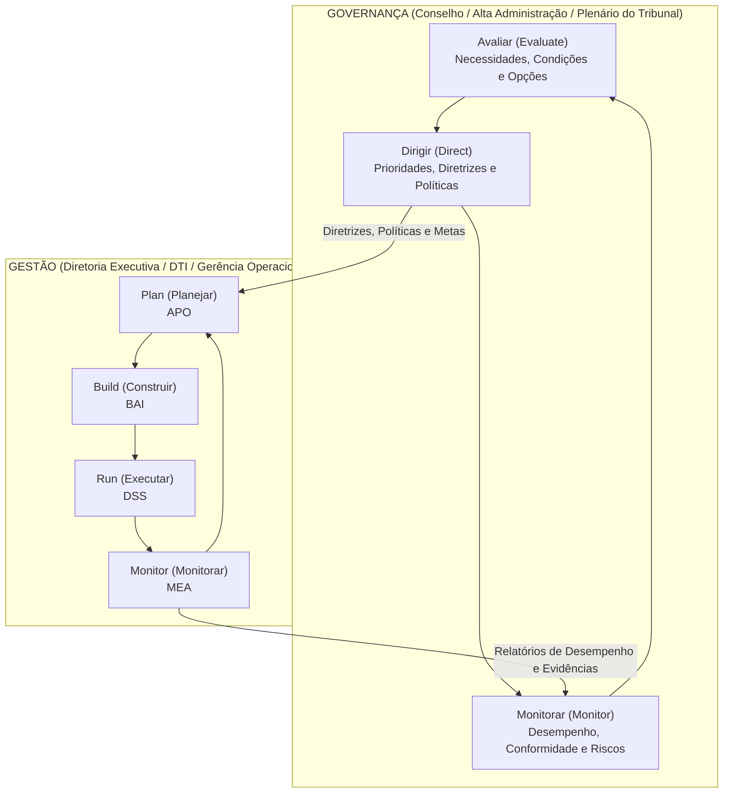
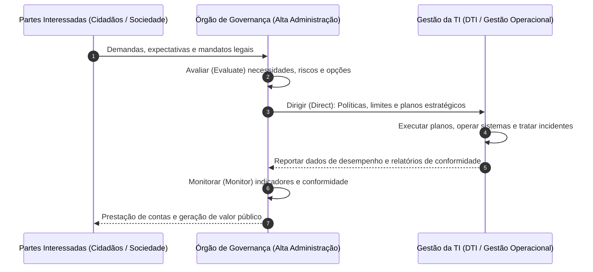
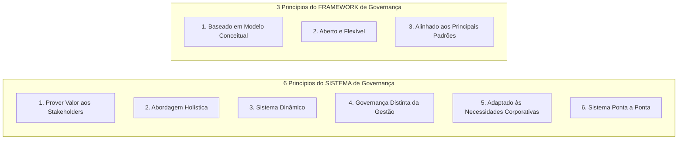
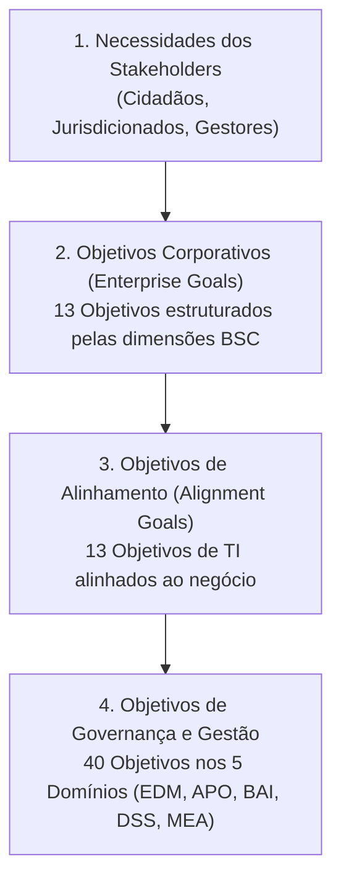
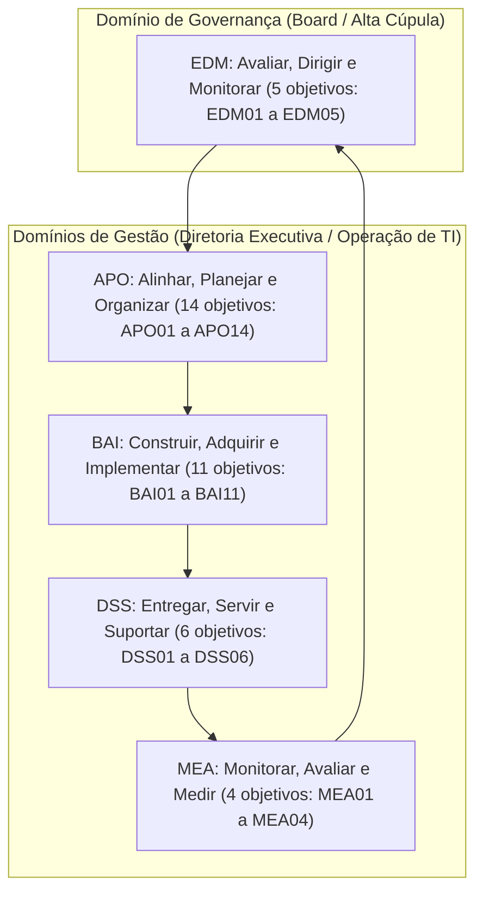
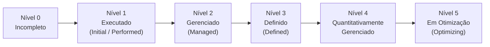

# 01 - Fundamentos de Governança, COBIT 2019 e ISO/IEC 38500:2024

> **Matéria:** Governança de Tecnologia da Informação  
> **Cargo:** B02 – Técnico de Controle Externo – Especialidade: Tecnologia da Informação  
> **Arquivo:** `01_fundamentos_governanca_cobit_2019_e_iso_38500.md`  

---

## 📌 Ementa / Itens do Edital
- Governança de TI vs. Gestão de TI: conceitos e alinhamento estratégico institucional
- Norma ABNT NBR ISO/IEC 38500:2024 (Governança Corporativa de Tecnologia da Informação)
- Framework COBIT 2019 (ISACA):
    - Princípios de Governança e do Framework
    - Componentes do Sistema de Governança e Fatores de Design (Design Factors)
    - Áreas de Foco (Focus Areas) e Cascatamento de Objetivos (Goals Cascade)
    - Os 40 Objetivos de Governança e Gestão (5 Domínios: EDM, APO, BAI, DSS, MEA)
    - Gestão de Desempenho do COBIT (CPM) e Níveis de Capacidade CMMI

---

## 🧭 Sumário

1. [Fundamentos da Governança de TI e Alinhamento Estratégico](#1-fundamentos-da-governanca-de-ti-e-alinhamento-estrategico)
1. [Distinção Essencial entre Governança e Gestão](#1-1-distincao-essencial-entre-governanca-e-gestao)
1. [Alinhamento Estratégico e Criação de Valor Público](#1-2-alinhamento-estrategico-e-criacao-de-valor-publico)
    1. [Teste 465](#Teste-465)
2. [Norma ABNT NBR ISO/IEC 38500:2024](#2-norma-abnt-nbr-isoiec-385002024)
2. [Escopo e Modelo de Governança (Ciclo EDM)](#2-1-escopo-e-modelo-de-governanca-ciclo-edm)
    1. [Teste 466](#Teste-466)
2. [Os Seis Princípios da Boa Governança de TI](#2-2-os-seis-principios-da-boa-governanca-de-ti)
    1. [Teste 467](#Teste-467)
3. [Framework COBIT 2019 (ISACA)](#3-framework-cobit-2019-isaca)
3. [Princípios do Sistema e do Framework de Governança](#3-1-principios-do-sistema-e-do-framework-de-governanca)
    1. [Teste 468](#Teste-468)
3. [Componentes do Sistema de Governança (7 Componentes)](#3-2-componentes-do-sistema-de-governanca-7-componentes)
    1. [Teste 469](#Teste-469)
3. [Fatores de Design (11 Design Factors) e Áreas de Foco (Focus Areas)](#3-3-fatores-de-design-11-design-factors-e-areas-de-foco-focus-areas)
    1. [Teste 470](#Teste-470)
3. [Cascatamento de Objetivos (Goals Cascade)](#3-4-cascatamento-de-objetivos-goals-cascade)
    1. [Teste 471](#Teste-471)
3. [Os 40 Objetivos de Governança e Gestão nos 5 Domínios](#3-5-os-40-objetivos-de-governanca-e-gestao-nos-5-dominios)
    1. [Teste 472](#Teste-472)
3. [Gestão de Desempenho do COBIT (CPM) e Níveis de Capacidade CMMI](#3-6-gestao-de-desempenho-do-cobit-cpm-e-niveis-de-capacidade-cmmi)
    1. [Teste 473](#Teste-473)
    2. [Teste 474](#Teste-474)
6. [Fontes Recomendadas na Internet](#6-fontes-recomendadas-na-internet)

---

## 1. Fundamentos da Governança de TI e Alinhamento Estratégico

---

## 1.1 Distinção Essencial entre Governança e Gestão

A separação entre **Governança** e **Gestão** é o pilar estruturante de maior incidência em provas da Fundação Carlos Chagas (FCC) na disciplina de Governança de TI. Trata-se de responsabilidades, papéis e ciclos operacionais completamente distintos, embora fortemente integrados.

#### Tabela Comparativa: Governança de TI versus Gestão de TI

| Dimensão de Análise | Governança de TI (*Governance*) | Gestão de TI (*Management*) |
| :--- | :--- | :--- |
| **Papel Primário** | Direcionamento estratégico, supervisão, liderança institucional e prestação de contas (*Accountability*). | Execução técnica, coordenação operacional, manutenção de rotinas e entrega diária de serviços. |
| **Responsável Típico** | Alta Administração, Conselho de Administração, Plenário e Comitês Estratégicos de Governança. | Diretoria Executiva de TI (CIO/DTI), gerentes de projetos, equipes de desenvolvimento e suporte. |
| **Atividades Centrais** | **EDM**: Avaliar (*Evaluate*), Dirigir (*Direct*) e Monitorar (*Monitor*). | **PBRM**: Planejar (*Plan*), Construir (*Build*), Executar (*Run*) e Monitorar (*Monitor*). |
| **Horizonte Temporal** | Longo prazo (visão plurianual, sustentabilidade e impacto institucional). | Curto e médio prazo (sprints de desenvolvimento, chamados operacionais, metas contratuais imediatas). |
| **Objetivo Maior** | **Criação de Valor**: Realização de benefícios com balanceamento e otimização de riscos e recursos. | Eficiência técnica, cumprimento estrito de SLAs, produtividade e estabilidade dos sistemas em produção. |
| **Ponto de Partida** | Necessidades das partes interessadas (*stakeholders*: cidadãos, magistrados, auditores, jurisdicionados). | Diretrizes, limites orçamentários, apetite a risco e prioridades deliberadas pela governança. |

> 🚨 **ALERTA DE PROVA / PEGADINHA FCC:**  
> A banca frequentemente tenta confundir o candidato atribuindo à Governança tarefas de execução (como configurar roteadores, gerenciar chamados de help desk ou planejar sprints). Lembre-se: a governança **define o que fazer e em qual direção ir**, avaliando, dirigindo e monitorando. A gestão cuida do **como fazer**, planejando, construindo, executando e monitorando o trabalho diário.

---

---

## 1.2 Alinhamento Estratégico e Criação de Valor Público

No setor público, e em especial nos órgãos de controle externo como o TCE-GO, o alinhamento estratégico da Tecnologia da Informação não tem como meta o lucro, mas sim a **criação de valor público**. Isso significa garantir que os recursos aplicados em tecnologia resultem em fiscalizações mais ágeis, auditorias digitais baseadas em cruzamento massivo de dados, transparência ativa ao cidadão e prestação jurisdicional de excelência.

O alinhamento estratégico é teorizado pelo clássico **Modelo de Alinhamento Estratégico (SAM - *Strategic Alignment Model*) de Henderson & Venkatraman**, que articula quatro domínios fundamentais:

1. **Estratégia do Negócio:** Escopo corporativo, competências distintivas e governança corporativa.
2. **Estratégia de TI:** Escopo de tecnologia, competências sistêmicas e governança de TI.
3. **Infraestrutura e Processos Organizacionais:** Estrutura administrativa, processos de trabalho corporativos e habilidades dos servidores.
4. **Infraestrutura e Processos de TI:** Arquitetura tecnológica, processos operacionais de TI e habilidades da equipe técnica.

A governança assegura a integração bidirecional contínua entre a estratégia institucional e a estratégia de TI, evitando que a área técnica formule objetivos isolados ou desconectados das reais prioridades de fiscalização e auditoria do Tribunal.

---

## 2. Norma ABNT NBR ISO/IEC 38500:2024

---

### Teste 001
**(FGV – TCE/GO – 2024 – Analista de Controle Externo - Tecnologia da Informação)**
Considerando as metodologias de gestão de projetos e de TI, COBIT, ITIL e PMBOK possuem abordagens distintas para a gestão de riscos. Assinale a opção que descreve corretamente a diferença fundamental entre esses três frameworks.

* **A)** COBIT foca na governança de riscos gerais em TI, enquanto ITIL aborda a gestão de riscos nos serviços de TI e PMBOK se concentra na gestão de projetos em geral, sem especialização em TI.
* **B)** ITIL é usado para análise quantitativa de riscos, ao contrário do COBIT e do PMBOK, que se concentram em análises qualitativas.
* **C)** PMBOK não inclui processos de gestão de riscos, diferentemente do COBIT e do ITIL que oferecem guias detalhados sobre o tema.
* **D)** COBIT, ITIL e PMBOK são equivalentes e intercambiáveis quando se trata de gestão de riscos, sendo uma questão de preferência pessoal a escolha entre eles.
* **E)** ITIL e COBIT são focados em TI, com ITIL voltado exclusivamente para a gestão de riscos em serviços de TI e COBIT para a governança de riscos TI, enquanto PMBOK é um guia de práticas para a gestão de projetos em geral.

---

> **Comentário Detalhado:**
>
> - **A)** **Correta.** Conforme fundamentado na seção *3. Framework COBIT 2019 (ISACA)* deste guia, o COBIT 2019 ( Control Objectives for Information and Related Technologies ) é o framework líder mundial de governança e gestão corporativa de informação e tecnologia (I&T), publicado pela ISACA. O COBIT não é prescritivo em nível de codificação ou configuração de servidores; ele funciona como um framework guarda chuva integrador, alinhando padrões técnicos (como ITIL, PMBOK, TOGAF e ISO 27001) às metas institucionais. Dessa forma, está plenamente correta a assertiva da banca (FGV – TCE/GO/2024) ao estabelecer que "COBIT foca na governança de riscos gerais em TI, enquanto ITIL aborda a gestão de riscos nos serviços de TI e...".
> - **B)** **Incorreta.** A opção apresenta proposição em desacordo com os fundamentos teóricos e técnicos do tópico ao afirmar que "ITIL é usado para análise quantitativa de riscos, ao contrário do COBIT e do PMBOK, que se concentram em análises...". De acordo com a teoria estudada em *Tabela Comparativa dos Princípios do COBIT 2019*, 3. Sistema dinâmico: Sempre que um ou mais fatores de design mudarem, o impacto sobre o sistema de governança deve ser reavaliado.: 3. Alinhado aos principais padrões: Deve harmonizar se com os padrões de referência (ISO, ITIL, TOGAF, PMBOK, NIST).
> - **C)** **Incorreta.** A opção apresenta proposição em desacordo com os fundamentos teóricos e técnicos do tópico ao afirmar que "PMBOK não inclui processos de gestão de riscos, diferentemente do COBIT e do ITIL que oferecem guias detalhados...". De acordo com a teoria estudada em *3.5 Os 40 Objetivos de Governança e Gestão nos 5 Domínios*, o COBIT 2019 organiza seus 40 objetivos em 5 Domínios. O primeiro pertence exclusivamente à Governança, enquanto os demais quatro integram a Gestão.
> - **D)** **Incorreta.** A opção apresenta proposição em desacordo com os fundamentos teóricos e técnicos do tópico ao afirmar que "COBIT, ITIL e PMBOK são equivalentes e intercambiáveis quando se trata de gestão de riscos, sendo uma questão de...". De acordo com a teoria estudada em *6. Fontes Recomendadas na Internet*, iSACA COBIT Framework Resources Visão geral oficial do COBIT 2019, princípios de governança, objetivos de gestão e fatores de desenho.
> - **E)** **Incorreta.** A opção incorre em restrição indevida ao limitar o escopo conceitual ao afirmar que "ITIL e COBIT são focados em TI, com ITIL voltado exclusivamente para a gestão de riscos em serviços de TI e COBIT...". De acordo com a teoria estudada em *Tabela Comparativa: Governança de TI versus Gestão de TI*, responsável Típico: Alta Administração, Conselho de Administração, Plenário e Comitês Estratégicos de Governança. — Diretoria Executiva de TI (CIO/DTI), gerentes de projetos, equipes de desenvolvimento e suporte.
>
> **Gabarito: A**

---

### Teste 002
**(FGV – TCE/GO – 2024 – Analista de Controle Externo - Tecnologia da Informação)**
Quando uma organização busca implementar um Planejamento Estratégico de Tecnologia da Informação (PETI), é essencial considerar o alinhamento estratégico entre a área de TI e os negócios. Marque a ação que garante esse alinhamento e apoia a governança de TI.

* **A)** Implementação de práticas ITIL em comunicação com as equipes de operações de infraestrutura.
* **B)** Desenvolvimento de políticas e procedimentos de TI que reflitam as estratégias definidas pelo framework ITIL
* **C)** Centralização das decisões de TI usando o framework COBIT combinado com ITIL para as áreas de gestão.
* **D)** Reestruturação da equipe de TI em alinhamento com operações e desenvolvimento.
* **E)** Integração dos frameworks COBIT e ITIL para estabelecer processos que suportem os objetivos estratégicos de negócios e TI.

---

> **Comentário Detalhado:**
>
> - **A)** **Incorreta.** A opção apresenta proposição em desacordo com os fundamentos teóricos e técnicos do tópico ao afirmar que "Implementação de práticas ITIL em comunicação com as equipes de operações de infraestrutura". De acordo com a teoria estudada em *1.2 Alinhamento Estratégico e Criação de Valor Público*, infraestrutura e Processos Organizacionais: Estrutura administrativa, processos de trabalho corporativos e habilidades dos servidores.
> - **B)** **Incorreta.** A opção apresenta proposição em desacordo com os fundamentos teóricos e técnicos do tópico ao afirmar que "Desenvolvimento de políticas e procedimentos de TI que reflitam as estratégias definidas pelo framework ITIL". De acordo com a teoria estudada em *3. Framework COBIT 2019 (ISACA)*, o COBIT 2019 ( Control Objectives for Information and Related Technologies ) é o framework líder mundial de governança e gestão corporativa de informação e tecnologia (I&T), publicado pela ISACA. O COBIT não é prescritivo em nível de codificação ou configuração de servidores; ele funciona como um framework guarda chuva integrador, alinhando padrões técnicos (como ITIL, PMBOK, TOGAF e ISO 27001) às metas institucionais.
> - **C)** **Incorreta.** A opção apresenta proposição em desacordo com os fundamentos teóricos e técnicos do tópico ao afirmar que "Centralização das decisões de TI usando o framework COBIT combinado com ITIL para as áreas de gestão". De acordo com a teoria estudada em *Áreas de Foco (Focus Areas)*, uma Área de Foco descreve um tópico, domínio de governança ou desafio tecnológico específico que requer a seleção e priorização de um conjunto direcionado de componentes e objetivos de governança do COBIT 2019. Exemplos de áreas de foco publicadas pela ISACA incluem: Segurança da Informação ( Information Security ), DevOps, Pequenas e Médias Empresas (PMEs) e Governança de Nuvem ( Cloud Governance ). As áreas de foco podem ser ilimitadas e são expandidas continuamente pela comunidade.
> - **D)** **Incorreta.** A opção apresenta proposição em desacordo com os fundamentos teóricos e técnicos do tópico ao afirmar que "Reestruturação da equipe de TI em alinhamento com operações e desenvolvimento". De acordo com a teoria estudada em *1.2 Alinhamento Estratégico e Criação de Valor Público*, infraestrutura e Processos de TI: Arquitetura tecnológica, processos operacionais de TI e habilidades da equipe técnica.
> - **E)** **Correta.** Conforme fundamentado na seção *1.2 Alinhamento Estratégico e Criação de Valor Público* deste guia, a governança assegura a integração bidirecional contínua entre a estratégia institucional e a estratégia de TI, evitando que a área técnica formule objetivos isolados ou desconectados das reais prioridades de fiscalização e auditoria do Tribunal. Dessa forma, está plenamente correta a assertiva da banca (FGV – TCE/GO/2024) ao estabelecer que "Integração dos frameworks COBIT e ITIL para estabelecer processos que suportem os objetivos estratégicos de...".
>
> **Gabarito: E**

---

### Teste 003
**(FGV – TCE/GO – 2024 – Analista de Controle Externo - Tecnologia da Informação)**
Considere as práticas de atribuição de funções de TI na gestão de responsabilidades sob as perspectivas do COBIT, ITIL e PMBOK. Na aplicação dessas práticas é correto que se deve

* **A)** integrar os papéis de desenvolvimento e a operação de sistemas para um funcionário garantindo eficiência e rapidez na resolução de problemas.
* **B)** designar diferentes equipes para gerenciamento de incidentes e gerenciamento de problemas para, respectivamente, a análise e a correção de falhas.
* **C)** concentrar as responsabilidades de gestão de mudanças e liberação de software em um único papel, dado que integram as mesmas funções.
* **D)** permitir que o desenvolvedor de software faça uma prévia da auditoria de código de forma a acelerar o processo e economizar recursos.
* **E)** delegar a um gestor a responsabilidade de aprovação de projetos de TI logo após o controle de custos facilitando a tomada de decisão.

---

> **Comentário Detalhado:**
>
> - **A)** **Incorreta.** A opção apresenta proposição em desacordo com os fundamentos teóricos e técnicos do tópico ao afirmar que "integrar os papéis de desenvolvimento e a operação de sistemas para um funcionário garantindo eficiência e rapidez...". De acordo com a teoria estudada em *Tabela Comparativa: Governança de TI versus Gestão de TI*, objetivo Maior: Criação de Valor: Realização de benefícios com balanceamento e otimização de riscos e recursos. — Eficiência técnica, cumprimento estrito de SLAs, produtividade e estabilidade dos sistemas em produção.
> - **B)** **Correta.** Conforme fundamentado na seção *Os 11 Fatores de Design (Design Factors)* deste guia, problemas relacionados a I&T ( I&T Related Issues ): Histórico de falhas, projetos com estouro de orçamento ou carência de competências. Dessa forma, está plenamente correta a assertiva da banca (FGV – TCE/GO/2024) ao estabelecer que "designar diferentes equipes para gerenciamento de incidentes e gerenciamento de problemas para, respectivamente, a...".
> - **C)** **Incorreta.** A opção apresenta proposição em desacordo com os fundamentos teóricos e técnicos do tópico ao afirmar que "concentrar as responsabilidades de gestão de mudanças e liberação de software em um único papel, dado que integram...". De acordo com a teoria estudada em *2.2 Os Seis Princípios da Boa Governança de TI*, 6: Comportamento Humano ( Human Behaviour ) — As políticas, práticas e decisões de TI respeitam os fatores humanos, culturais e as necessidades de todas as pessoas envolvidas. — Treinamento, usabilidade, ergonomia, acessibilidade e gestão de mudanças comportamentais no trabalho.
> - **D)** **Incorreta.** A opção apresenta proposição em desacordo com os fundamentos teóricos e técnicos do tópico ao afirmar que "permitir que o desenvolvedor de software faça uma prévia da auditoria de código de forma a acelerar o processo e...". De acordo com a teoria estudada em *Níveis de Capacidade de Processo (CPM / CMMI: 0 a 5)*, 1: Executado ( Initial / Performed ) — O processo atinge seu propósito através de um conjunto incompleto de atividades; atua de forma intuitiva, sem padronização formal.
> - **E)** **Incorreta.** A opção apresenta proposição em desacordo com os fundamentos teóricos e técnicos do tópico ao afirmar que "delegar a um gestor a responsabilidade de aprovação de projetos de TI logo após o controle de custos facilitando a...". De acordo com a teoria estudada em *Tabela Comparativa: Governança de TI versus Gestão de TI*, responsável Típico: Alta Administração, Conselho de Administração, Plenário e Comitês Estratégicos de Governança. — Diretoria Executiva de TI (CIO/DTI), gerentes de projetos, equipes de desenvolvimento e suporte.
>
> **Gabarito: B**

---

### Teste 004
**(FGV – TCE/GO – 2024 – Analista de Controle Externo - Tecnologia da Informação)**
Assinale a opção que descreve corretamente um ponto principal característico de COBIT 2019, ITIL v4 e PMBOK.

* **A)** COBIT 2019 é centrado na governança de TI, ITIL v4 foca na gestão de serviços de TI e PMBOK orienta sobre a gestão de projetos tradicionais.
* **B)** COBIT 2019 é um guia para auditoria de TI, ITIL v4 é um framework para desenvolvimento de software, e PMBOK é uma metodologia ágil.
* **C)** COBIT 2019, ITIL v4 e PMBOK são frameworks que priorizam a implementação de práticas ágeis e DevOps em suas abordagens.
* **D)** COBIT 2019, ITIL v4 e PMBOK são estruturas voltadas exclusivamente para o controle financeiro de projetos de TI.
* **E)** COBIT 2019 define princípios de governança corporativa, ITIL v4 prioriza a gestão de serviços de TI focada no cliente, e PMBOK foca na entrega de valor através da gestão de projetos. Desenvolvimento Web e Mobile

---

> **Comentário Detalhado:**
>
> - **A)** **Correta.** Conforme fundamentado na seção *3. Framework COBIT 2019 (ISACA)* deste guia, o COBIT 2019 ( Control Objectives for Information and Related Technologies ) é o framework líder mundial de governança e gestão corporativa de informação e tecnologia (I&T), publicado pela ISACA. O COBIT não é prescritivo em nível de codificação ou configuração de servidores; ele funciona como um framework guarda chuva integrador, alinhando padrões técnicos (como ITIL, PMBOK, TOGAF e ISO 27001) às metas institucionais. Dessa forma, está plenamente correta a assertiva da banca (FGV – TCE/GO/2024) ao estabelecer que "COBIT 2019 é centrado na governança de TI, ITIL v4 foca na gestão de serviços de TI e PMBOK orienta sobre a gestão...".
> - **B)** **Incorreta.** A opção apresenta proposição em desacordo com os fundamentos teóricos e técnicos do tópico ao afirmar que "COBIT 2019 é um guia para auditoria de TI, ITIL v4 é um framework para desenvolvimento de software, e PMBOK é uma...". De acordo com a teoria estudada em *Tabela Comparativa dos Princípios do COBIT 2019*, 3. Sistema dinâmico: Sempre que um ou mais fatores de design mudarem, o impacto sobre o sistema de governança deve ser reavaliado.: 3. Alinhado aos principais padrões: Deve harmonizar se com os padrões de referência (ISO, ITIL, TOGAF, PMBOK, NIST).
> - **C)** **Incorreta.** A opção apresenta proposição em desacordo com os fundamentos teóricos e técnicos do tópico ao afirmar que "COBIT 2019, ITIL v4 e PMBOK são frameworks que priorizam a implementação de práticas ágeis e DevOps em suas...". De acordo com a teoria estudada em *Os 11 Fatores de Design (Design Factors)*, métodos de implementação de TI ( IT Implementation Methods ): Abordagens ágeis (DevOps, Scrum) vs. métodos tradicionais preditivos (cascata/waterfall).
> - **D)** **Incorreta.** A opção incorre em restrição indevida ao limitar o escopo conceitual ao afirmar que "COBIT 2019, ITIL v4 e PMBOK são estruturas voltadas exclusivamente para o controle financeiro de projetos de TI". De acordo com a teoria estudada em *3.5 Os 40 Objetivos de Governança e Gestão nos 5 Domínios*, o COBIT 2019 organiza seus 40 objetivos em 5 Domínios. O primeiro pertence exclusivamente à Governança, enquanto os demais quatro integram a Gestão.
> - **E)** **Incorreta.** A opção apresenta proposição em desacordo com os fundamentos teóricos e técnicos do tópico ao afirmar que "COBIT 2019 define princípios de governança corporativa, ITIL v4 prioriza a gestão de serviços de TI focada no...". De acordo com a teoria estudada em *Tabela Comparativa: Governança de TI versus Gestão de TI*, responsável Típico: Alta Administração, Conselho de Administração, Plenário e Comitês Estratégicos de Governança. — Diretoria Executiva de TI (CIO/DTI), gerentes de projetos, equipes de desenvolvimento e suporte.
>
> **Gabarito: A**

---

### Teste 005
**(CEBRASPE – TRF 6ª – 2025 – Analista Judiciário - Apoio Especializado - Governança e Gestão de Tecnologia da Informação)**
Entre os objetivos de gestão do COBIT 2019, está o de gerenciar orçamento e custos, os quais devem ser planejados, controlados e otimizados, visando garantir um alinhamento ao orçamento da organização.

* **C)** Certo
* **E)** Errado

---

> **Comentário Detalhado:**
>
> - **C)** **Correta.** O item está **Certo**. Conforme fundamentado na seção *Relação Detalhada dos 40 Objetivos do COBIT 2019*, aPO06: Gerenciar o Orçamento e os Custos. Dessa forma, está plenamente correta a assertiva da banca (CEBRASPE – TRF 6ª/2025) ao afirmar que "Entre os objetivos de gestão do COBIT 2019, está o de gerenciar orçamento e custos, os quais devem ser...".
> - **E)** **Incorreta.** A assertiva não incorre em erro conceitual, guardando conformidade com a teoria estudada.
>
> **Gabarito: C**

---

### Teste 006
**(CEBRASPE – TRF 6ª – 2025 – Analista Judiciário - Apoio Especializado - Governança e Gestão de Tecnologia da Informação)**
A cadeia de valor de serviço do ITIL v4 é formada pelas práticas, pelos princípios orientadores, pela governança e pela melhoria contínua.

* **C)** Certo
* **E)** Errado

---

> **Comentário Detalhado:**
>
> - **C)** **Incorreta.** A proposição apresenta proposição em desacordo com os fundamentos teóricos e técnicos do tópico ao afirmar que "A cadeia de valor de serviço do ITIL v4 é formada pelas práticas, pelos princípios orientadores, pela...". De acordo com a teoria em *1.2 Alinhamento Estratégico e Criação de Valor Público*, a governança assegura a integração bidirecional contínua entre a estratégia institucional e a estratégia de TI, evitando que a área técnica formule objetivos isolados ou desconectados das reais prioridades de fiscalização e auditoria do Tribunal.
> - **E)** **Correta.** O item está **Errado** (gabarito oficial: **E**), pois contraria a disciplina teórica aplicável.
>
> **Gabarito: E**

---

### Teste 007
**(CEBRASPE – TRF 6ª – 2025 – Analista Judiciário - Apoio Especializado - Governança e Gestão de Tecnologia da Informação)**
O COBIT 2019 tem, entre outras, a privacidade de dados e a segurança cibernética como áreas de foco.

* **C)** Certo
* **E)** Errado

---

> **Comentário Detalhado:**
>
> - **C)** **Correta.** O item está **Certo**. Conforme fundamentado na seção *Áreas de Foco (Focus Areas)*, uma Área de Foco descreve um tópico, domínio de governança ou desafio tecnológico específico que requer a seleção e priorização de um conjunto direcionado de componentes e objetivos de governança do COBIT 2019. Exemplos de áreas de foco publicadas pela ISACA incluem: Segurança da Informação ( Information Security ), DevOps, Pequenas e Médias Empresas (PMEs) e Governança de Nuvem ( Cloud Governance ). As áreas de foco podem ser ilimitadas e são expandidas continuamente pela comunidade. Dessa forma, está plenamente correta a assertiva da banca (CEBRASPE – TRF 6ª/2025) ao afirmar que "O COBIT 2019 tem, entre outras, a privacidade de dados e a segurança cibernética como áreas de foco".
> - **E)** **Incorreta.** A assertiva não incorre em erro conceitual, guardando conformidade com a teoria estudada.
>
> **Gabarito: C**

---

### Teste 008
**(CEBRASPE – TRF 6ª – 2025 – Analista Judiciário - Apoio Especializado - Governança e Gestão de Tecnologia da Informação)**
Dentre as dimensões do ITIL v4, os fluxos de processos e valor referem-se ao relacionamento da organização com outras entidades envolvidas no ciclo de vida dos serviços.

* **C)** Certo
* **E)** Errado

---

> **Comentário Detalhado:**
>
> - **C)** **Incorreta.** A proposição apresenta proposição em desacordo com os fundamentos teóricos e técnicos do tópico ao afirmar que "Dentre as dimensões do ITIL v4, os fluxos de processos e valor referem se ao relacionamento da organização...". De acordo com a teoria em *3.2 Componentes do Sistema de Governança (7 Componentes)*, informação: Dados e fluxos informacionais consumidos e produzidos pela organização (relevância, segurança, precisão, completude).
> - **E)** **Correta.** O item está **Errado** (gabarito oficial: **E**), pois contraria a disciplina teórica aplicável.
>
> **Gabarito: E**

---

### Teste 009
**(CEBRASPE – TRF 6ª – 2025 – Analista Judiciário - Apoio Especializado - Governança e Gestão de Tecnologia da Informação)**
Otimizar e automatizar é um dos princípios orientadores do ITIL v4.

* **C)** Certo
* **E)** Errado

---

> **Comentário Detalhado:**
>
> - **C)** **Correta.** O item está **Certo**. Conforme fundamentado na seção *Tabela Comparativa dos Princípios do COBIT 2019*, 3. Sistema dinâmico: Sempre que um ou mais fatores de design mudarem, o impacto sobre o sistema de governança deve ser reavaliado.: 3. Alinhado aos principais padrões: Deve harmonizar se com os padrões de referência (ISO, ITIL, TOGAF, PMBOK, NIST). Dessa forma, está plenamente correta a assertiva da banca (CEBRASPE – TRF 6ª/2025) ao afirmar que "Otimizar e automatizar é um dos princípios orientadores do ITIL v4".
> - **E)** **Incorreta.** A assertiva não incorre em erro conceitual, guardando conformidade com a teoria estudada.
>
> **Gabarito: C**

---

### Teste 010
**(CEBRASPE – TRF 6ª – 2025 – Analista Judiciário - Apoio Especializado - Governança e Gestão de Tecnologia da Informação)**
No gerenciamento de riscos, que é uma das práticas de gerenciamento de serviços do ITIL, os riscos são devidamente identificados e tratados.

* **C)** Certo
* **E)** Errado

---

> **Comentário Detalhado:**
>
> - **C)** **Incorreta.** A proposição apresenta proposição em desacordo com os fundamentos teóricos e técnicos do tópico ao afirmar que "No gerenciamento de riscos, que é uma das práticas de gerenciamento de serviços do ITIL, os riscos são...". De acordo com a teoria em *3. Framework COBIT 2019 (ISACA)*, o COBIT 2019 ( Control Objectives for Information and Related Technologies ) é o framework líder mundial de governança e gestão corporativa de informação e tecnologia (I&T), publicado pela ISACA. O COBIT não é prescritivo em nível de codificação ou configuração de servidores; ele funciona como um framework guarda chuva integrador, alinhando padrões técnicos (como ITIL, PMBOK, TOGAF e ISO 27001) às metas institucionais.
> - **E)** **Correta.** O item está **Errado** (gabarito oficial: **E**), pois contraria a disciplina teórica aplicável.
>
> **Gabarito: E**

---

### Teste 011
**(CEBRASPE – STJ – 2024 – Analista Judiciário - Apoio Especializado - Suporte em Tecnologia da Informação)**
No COBIT 2019, o princípio Aplicar modelo único integrado estabelece que os componentes como processos, estruturas, arquiteturas e pessoas devem funcionar em conjunto para a construção de um sistema de governança eficiente.

* **C)** Certo
* **E)** Errado

---

> **Comentário Detalhado:**
>
> - **C)** **Incorreta.** A proposição apresenta proposição em desacordo com os fundamentos teóricos e técnicos do tópico ao afirmar que "No COBIT 2019, o princípio Aplicar modelo único integrado estabelece que os componentes como processos...". De acordo com a teoria em *Os 11 Fatores de Design (Design Factors)*, o COBIT 2019 não adota o modelo "tamanho único" ( one size fits all ). Para viabilizar a adaptação ( tailoring ) do sistema de governança à realidade de cada órgão ou empresa, são utilizados 11 Fatores de Design.
> - **E)** **Correta.** O item está **Errado** (gabarito oficial: **E**), pois contraria a disciplina teórica aplicável.
>
> **Gabarito: E**

---

### Teste 012
**(CEBRASPE – STJ – 2024 – Analista Judiciário - Apoio Especializado - Suporte em Tecnologia da Informação)**
As práticas de gerenciamento de serviço do ITIL v4 incluem gerenciamento de infraestrutura e de plataforma. Em relação ao gerenciamento de projetos e à modelagem de processos de negócio, julgue os itens que se seguem.

* **C)** Certo
* **E)** Errado

---

> **Comentário Detalhado:**
>
> - **C)** **Incorreta.** A proposição apresenta proposição em desacordo com os fundamentos teóricos e técnicos do tópico ao afirmar que "As práticas de gerenciamento de serviço do ITIL v4 incluem gerenciamento de infraestrutura e de plataforma...". De acordo com a teoria em *Relação Detalhada dos 40 Objetivos do COBIT 2019*, dSS06: Gerenciar os Controles de Processos de Negócio.
> - **E)** **Correta.** O item está **Errado** (gabarito oficial: **E**), pois contraria a disciplina teórica aplicável.
>
> **Gabarito: E**

---

### Teste 013
**(FGV – TJ/AP – 2023 – Analista Judiciario Apoio Especializado Tecnologia Da Informacao Telecomunicacoes)**
Os processos de governança de serviços de TI são divididos em 4 domínios, de acordo com o guia COBIT. Os processos do domínio de planejar e organizar têm como objetivos gerais:

* **A)** apresentar como a infraestrutura de TI contribui para o atendimento dos objetivos institucionais da organização;
* **B)** identificar, desenvolver ou adquirir soluções de TI que acompanham as mudanças da organização;
* **C)** realizar a implantação de novos serviços de TI, levando em conta também aspectos de treinamento e segurança;
* **D)** monitorar o funcionamento dos serviços de TI, analisando a aderência aos requisitos definidos para a área;
* **E)** realizar a contratação de serviços de TI com base nas expectativas de uma determinada organização.

---

> **Comentário Detalhado:**
>
> - **A)** **Correta.** Conforme fundamentado na seção *2.2 Os Seis Princípios da Boa Governança de TI* deste guia, 2: Estratégia ( Strategy ) — A estratégia de TI deve estar perfeitamente alinhada e suportar as necessidades atuais e as aspirações futuras da estratégia corporativa. — TI não cria estratégia isolada; a TI viabiliza os objetivos institucionais e o plano de diretrizes do órgão. Dessa forma, está plenamente correta a assertiva da banca (FGV – TJ/AP/2023) ao estabelecer que "apresentar como a infraestrutura de TI contribui para o atendimento dos objetivos institucionais da organização".
> - **B)** **Incorreta.** A opção apresenta proposição em desacordo com os fundamentos teóricos e técnicos do tópico ao afirmar que "identificar, desenvolver ou adquirir soluções de TI que acompanham as mudanças da organização". De acordo com a teoria estudada em *3.5 Os 40 Objetivos de Governança e Gestão nos 5 Domínios*, bAI["BAI: Construir, Adquirir e Implementar (11 objetivos: BAI01 a BAI11)"].
> - **C)** **Incorreta.** A opção apresenta proposição em desacordo com os fundamentos teóricos e técnicos do tópico ao afirmar que "realizar a implantação de novos serviços de TI, levando em conta também aspectos de treinamento e segurança". De acordo com a teoria estudada em *Relação Detalhada dos 40 Objetivos do COBIT 2019*, dSS05: Gerenciar os Serviços de Segurança.
> - **D)** **Incorreta.** A opção apresenta proposição em desacordo com os fundamentos teóricos e técnicos do tópico ao afirmar que "monitorar o funcionamento dos serviços de TI, analisando a aderência aos requisitos definidos para a área". De acordo com a teoria estudada em *3.2 Componentes do Sistema de Governança (7 Componentes)*, serviços, Infraestrutura e Aplicações: A infraestrutura tecnológica, redes, data centers, ferramentas de software e aplicações corporativas.
> - **E)** **Incorreta.** A opção apresenta proposição em desacordo com os fundamentos teóricos e técnicos do tópico ao afirmar que "realizar a contratação de serviços de TI com base nas expectativas de uma determinada organização". De acordo com a teoria estudada em *2.2 Os Seis Princípios da Boa Governança de TI*, 4: Desempenho ( Performance ) — A TI atende às necessidades da organização, entregando serviços com os níveis de serviço e capacidade exigidos pelo negócio. — Monitoramento contínuo de disponibilidade, tempo de resposta e eficácia dos sistemas em produção.
>
> **Gabarito: A**

---

### Teste 014
**(FGV – TJ/AP – 2023 – Analista Judiciario Apoio Especializado Tecnologia Da Informacao Telecomunicacoes)**
O COBIT 4.1 é um framework de Governança de TI que oferece padrões de boas práticas através de um modelo de Domínios, Processos e Atividades. Com relação ao Modelo de Maturidade do COBIT 4.1, analise os itens a seguir: I. No nível 1, Inicial/Ad hoc, os processos seguem um caminho padrão. II. No nível 3, Processo Definido, os processos são documentados e comunicados. III. No nível 4, Gerenciado e Mensurável, os processos são monitorados e medidos. Está correto o que se afirma em:

* **A)** somente I;
* **B)** somente II;
* **C)** somente I e III;
* **D)** somente II e III;
* **E)** I, II e III.

---

> **Comentário Detalhado:**
>
> - **A)** **Incorreta.** A opção incorre em restrição indevida ao limitar o escopo conceitual ao afirmar que "somente I". De acordo com a teoria estudada em *3.2 Componentes do Sistema de Governança (7 Componentes)*, processos: Conjuntos estruturados de práticas e atividades concebidos para atingir determinados objetivos e produzir saídas úteis.
> - **B)** **Incorreta.** A opção incorre em restrição indevida ao limitar o escopo conceitual ao afirmar que "somente II". De acordo com a teoria estudada em *3. Framework COBIT 2019 (ISACA)*, o COBIT 2019 ( Control Objectives for Information and Related Technologies ) é o framework líder mundial de governança e gestão corporativa de informação e tecnologia (I&T), publicado pela ISACA. O COBIT não é prescritivo em nível de codificação ou configuração de servidores; ele funciona como um framework guarda chuva integrador, alinhando padrões técnicos (como ITIL, PMBOK, TOGAF e ISO 27001) às metas institucionais.
> - **C)** **Incorreta.** A opção incorre em restrição indevida ao limitar o escopo conceitual ao afirmar que "somente I e III". De acordo com a teoria estudada em *Tabela Comparativa dos Princípios do COBIT 2019*, a banca FCC frequentemente afirma em enunciados que "Baseado em Modelo Conceitual" ou "Aberto e Flexível" são princípios do Sistema de Governança . Errado! Esses são princípios do Framework de Governança. Da mesma forma, "Sistema Dinâmico" e "Abordagem Holística" pertencem ao Sistema, e não ao framework!.
> - **D)** **Correta.** Conforme fundamentado na seção *Níveis de Capacidade de Processo (CPM / CMMI: 0 a 5)* deste guia, 1: Executado ( Initial / Performed ) — O processo atinge seu propósito através de um conjunto incompleto de atividades; atua de forma intuitiva, sem padronização formal. Dessa forma, está plenamente correta a assertiva da banca (FGV – TJ/AP/2023) ao estabelecer que "somente II e III".
> - **E)** **Incorreta.** A opção apresenta proposição em desacordo com os fundamentos teóricos e técnicos do tópico ao afirmar que "I, II e III". De acordo com a teoria estudada em *3.6 Gestão de Desempenho do COBIT (CPM) e Níveis de Capacidade CMMI*, n2 N3["Nível 3<br/ Definido<br/ (Defined)"].
>
> **Gabarito: D**

---

### Teste 015
**(CEBRASPE – TRF/6 – 2025 – Analista Judiciario Apoio Especializado Tecnologia Da Informacao)**
O ITIL v4 define uma estrutura de práticas que auxiliam as organizações a fornecerem serviços de TI de qualidade, focando exclusivamente em processos de TI.

* **C)** Certo
* **E)** Errado

---

> **Comentário Detalhado:**
>
> - **C)** **Incorreta.** A proposição incorre em restrição indevida ao limitar o escopo conceitual ao afirmar que "O ITIL v4 define uma estrutura de práticas que auxiliam as organizações a fornecerem serviços de TI de...". De acordo com a teoria em *1.2 Alinhamento Estratégico e Criação de Valor Público*, infraestrutura e Processos Organizacionais: Estrutura administrativa, processos de trabalho corporativos e habilidades dos servidores.
> - **E)** **Correta.** O item está **Errado** (gabarito oficial: **E**), pois contraria a disciplina teórica aplicável.
>
> **Gabarito: E**

---

### Teste 016
**(CEBRASPE – TRF/6 – 2025 – Analista Judiciario Apoio Especializado Tecnologia Da Informacao)**
O COBIT 2019 define domínios que cobrem todas as atividades de governança e gestão de TI, e cada domínio contém processos e objetivos de controle específicos para garantir a governança eficaz da tecnologia da informação.

* **C)** Certo
* **E)** Errado

---

> **Comentário Detalhado:**
>
> - **C)** **Incorreta.** A proposição apresenta proposição em desacordo com os fundamentos teóricos e técnicos do tópico ao afirmar que "O COBIT 2019 define domínios que cobrem todas as atividades de governança e gestão de TI, e cada domínio...". De acordo com a teoria em *Áreas de Foco (Focus Areas)*, uma Área de Foco descreve um tópico, domínio de governança ou desafio tecnológico específico que requer a seleção e priorização de um conjunto direcionado de componentes e objetivos de governança do COBIT 2019. Exemplos de áreas de foco publicadas pela ISACA incluem: Segurança da Informação ( Information Security ), DevOps, Pequenas e Médias Empresas (PMEs) e Governança de Nuvem ( Cloud Governance ). As áreas de foco podem ser ilimitadas e são expandidas continuamente pela comunidade.
> - **E)** **Correta.** O item está **Errado** (gabarito oficial: **E**), pois contraria a disciplina teórica aplicável.
>
> **Gabarito: E**

---

### Teste 017
**(CEBRASPE – TRF/6 – 2025 – Analista Judiciario Apoio Especializado Tecnologia Da Informacao)**
O COBIT 2019 estabelece que os recursos de tecnologia da informação devem ser utilizados de forma alinhada aos

* **C)** Certo
* **E)** Errado

---

> **Comentário Detalhado:**
>
> - **C)** **Correta.** O item está **Certo**. Conforme fundamentado na seção *1.2 Alinhamento Estratégico e Criação de Valor Público*, no setor público, e em especial nos órgãos de controle externo como o TCE GO, o alinhamento estratégico da Tecnologia da Informação não tem como meta o lucro, mas sim a criação de valor público. Isso significa garantir que os recursos aplicados em tecnologia resultem em fiscalizações mais ágeis, auditorias digitais baseadas em cruzamento massivo de dados, transparência ativa ao cidadão e prestação jurisdicional de excelência. Dessa forma, está plenamente correta a assertiva da banca (CEBRASPE – TRF/6/2025) ao afirmar que "O COBIT 2019 estabelece que os recursos de tecnologia da informação devem ser utilizados de forma alinhada aos".
> - **E)** **Incorreta.** A assertiva não incorre em erro conceitual, guardando conformidade com a teoria estudada.
>
> **Gabarito: C**

---

### Teste 018
**(FCC – TRT 14ª – 2016 – Analista Judiciário - Apoio Especializado - Tecnologia da Informação)**
Uma organização atingiu o nível 1 de capacidade de processo do COBIT 5. Isso significa dizer que

* **A)** o atributo de desempenho do processo foi amplamente atingido; o processo está sendo realizado com sucesso e os resultados esperados estão sendo obtidos pela organização.
* **B)** não há uma diferença significativa entre a capacidade de processo nível 1 e os níveis de capacidade mais altos.
* **C)** houve um engano, pois o COBIT 5 trabalha com níveis de maturidade e não com níveis de capacidade.
* **D)** todos os cinco atributos de desempenho dos dois processos foram amplamente atingidos; a organização progride com sucesso e os resultados esperados estão sendo obtidos.
* **E)** a organização atingiu o nível de capacidade Processo Gerenciado e seus produtos de trabalho estão adequadamente estabelecidos, controlados e mantidos.

---

> **Comentário Detalhado:**
>
> - **A)** **Correta.** Conforme fundamentado na seção *2.1 Escopo e Modelo de Governança (Ciclo EDM)* deste guia, monitorar ( Monitor ): Acompanhar periodicamente se a gestão está operando em conformidade com as diretrizes e se os objetivos de desempenho planejados estão sendo atingidos. Dessa forma, está plenamente correta a assertiva da banca (FCC – TRT 14ª/2016) ao estabelecer que "o atributo de desempenho do processo foi amplamente atingido; o processo está sendo realizado com sucesso e os...".
> - **B)** **Incorreta.** A opção apresenta proposição em desacordo com os fundamentos teóricos e técnicos do tópico ao afirmar que "não há uma diferença significativa entre a capacidade de processo nível 1 e os níveis de capacidade mais altos". De acordo com a teoria estudada em *Níveis de Capacidade de Processo (CPM / CMMI: 0 a 5)*, nível: Classificação — Descrição Prática do Desempenho do Processo.
> - **C)** **Incorreta.** A opção apresenta proposição em desacordo com os fundamentos teóricos e técnicos do tópico ao afirmar que "houve um engano, pois o COBIT 5 trabalha com níveis de maturidade e não com níveis de capacidade". De acordo com a teoria estudada em *3.6 Gestão de Desempenho do COBIT (CPM) e Níveis de Capacidade CMMI*, no COBIT 2019, o modelo de medição de capacidade e maturidade migrou da ISO/IEC 33000 (usada no COBIT 5) para a escala alinhada ao CMMI ( Capability Maturity Model Integration ).
> - **D)** **Incorreta.** A opção apresenta proposição em desacordo com os fundamentos teóricos e técnicos do tópico ao afirmar que "todos os cinco atributos de desempenho dos dois processos foram amplamente atingidos; a organização progride com...". De acordo com a teoria estudada em *Níveis de Capacidade de Processo (CPM / CMMI: 0 a 5)*, 3: Definido ( Defined ) — O processo é bem caracterizado, compreendido e executado com base em procedimentos padronizados em toda a organização ( organizational standards ).
> - **E)** **Incorreta.** A opção apresenta proposição em desacordo com os fundamentos teóricos e técnicos do tópico ao afirmar que "a organização atingiu o nível de capacidade Processo Gerenciado e seus produtos de trabalho estão adequadamente...". De acordo com a teoria estudada em *Níveis de Capacidade de Processo (CPM / CMMI: 0 a 5)*, 2: Gerenciado ( Managed ) — O processo é planejado, executado, monitorado e ajustado para atingir objetivos específicos. Os produtos de trabalho são controlados e mantidos adequadamente.
>
> **Gabarito: A**

---

### Teste 019
**(FCC – TRT 14ª – 2016 – Analista Judiciário - Apoio Especializado - Tecnologia da Informação)**
De acordo com a ITIL v3, atualizada em 2011, o Catálogo de Serviços é

* **A)** parte do Portfólio de Serviço e contém informações sobre serviços de TI: 1. voltados para o cliente, que são visíveis para o negócio e 2. de suporte, requeridos pelo provedor de serviço para entregar serviços voltados para o cliente.
* **B)** estruturado por um banco de dados com informações sobre todos os serviços de TI já implantados, em produção e obsoletos, sem incluir serviços disponíveis para implantação.
* **C)** o responsável por fornecer e manter o Portfólio de Serviços e por garantir que esteja disponível àqueles autorizados.
* **D)** um documento que contém detalhes de um serviço novo ou modificado recentemente.
* **E)** usado para gerenciar o ciclo de vida completo de todos os serviços de TI, incluindo duas categorias: 1. Funil de Serviço (proposto ou em desenvolvimento) e 2. Portfólio de Serviço (em produção ou disponível para implantação).

---

> **Comentário Detalhado:**
>
> - **A)** **Correta.** Conforme fundamentado na seção *2.2 Os Seis Princípios da Boa Governança de TI* deste guia, 4: Desempenho ( Performance ) — A TI atende às necessidades da organização, entregando serviços com os níveis de serviço e capacidade exigidos pelo negócio. — Monitoramento contínuo de disponibilidade, tempo de resposta e eficácia dos sistemas em produção. Dessa forma, está plenamente correta a assertiva da banca (FCC – TRT 14ª/2016) ao estabelecer que "parte do Portfólio de Serviço e contém informações sobre serviços de TI: 1. voltados para o cliente, que são...".
> - **B)** **Incorreta.** A opção apresenta proposição em desacordo com os fundamentos teóricos e técnicos do tópico ao afirmar que "estruturado por um banco de dados com informações sobre todos os serviços de TI já implantados, em produção e...". De acordo com a teoria estudada em *Tabela Comparativa dos Princípios do COBIT 2019*, 6. Sistema ponta a ponta: Cobre todas as informações e tecnologias de toda a organização, e não apenas o departamento de TI.: —.
> - **C)** **Incorreta.** A opção apresenta proposição em desacordo com os fundamentos teóricos e técnicos do tópico ao afirmar que "o responsável por fornecer e manter o Portfólio de Serviços e por garantir que esteja disponível àqueles...". De acordo com a teoria estudada em *Tabela Comparativa: Governança de TI versus Gestão de TI*, responsável Típico: Alta Administração, Conselho de Administração, Plenário e Comitês Estratégicos de Governança. — Diretoria Executiva de TI (CIO/DTI), gerentes de projetos, equipes de desenvolvimento e suporte.
> - **D)** **Incorreta.** A opção apresenta proposição em desacordo com os fundamentos teóricos e técnicos do tópico ao afirmar que "um documento que contém detalhes de um serviço novo ou modificado recentemente". De acordo com a teoria estudada em *3.2 Componentes do Sistema de Governança (7 Componentes)*, pessoas, Habilidades e Competências: Capital humano, competências técnicas e conhecimentos requeridos para a execução das práticas.
> - **E)** **Incorreta.** A opção apresenta proposição em desacordo com os fundamentos teóricos e técnicos do tópico ao afirmar que "usado para gerenciar o ciclo de vida completo de todos os serviços de TI, incluindo duas categorias: 1. Funil de...". De acordo com a teoria estudada em *2.2 Os Seis Princípios da Boa Governança de TI*, 3: Aquisição ( Acquisition ) — As aquisições de TI são feitas por razões válidas, com base em análise apropriada e contínua do Custo Total de Propriedade (TCO) e retorno esperado. — Veda compras impulsivas ou sem Estudo Técnico Preliminar (ETP) fundamentado. Exige análise de ciclo de vida completo.
>
> **Gabarito: A**

---

### Teste 020
**(FCC – TRT 14ª – 2016 – Analista Judiciário - Apoio Especializado - Tecnologia da Informação)**
O modelo de qualidade de software MPS.BR

* **A)** não é compatível com a Norma NBR ISO/IEC 12207:2009.
* **B)** adota a ITIL v3 como padrão de gerenciamento da qualidade de serviços de TI.
* **C)** não pode ser aplicado em nenhum Tribunal Regional do Trabalho.
* **D)** não atende às necessidades das empresas brasileiras, que preferem a adoção do CMMI.
* **E)** não conflita com as metodologias ágeis de software, podendo ser utilizado junto com o Scrum.

---

> **Comentário Detalhado:**
>
> - **A)** **Incorreta.** A opção apresenta proposição em desacordo com os fundamentos teóricos e técnicos do tópico ao afirmar que "não é compatível com a Norma NBR ISO/IEC 12207:2009". De acordo com a teoria estudada em *2.1 Escopo e Modelo de Governança (Ciclo EDM)*, a norma ABNT NBR ISO/IEC 38500:2024 fornece princípios e diretrizes para os órgãos deliberativos e membros da alta administração das organizações (públicas ou privadas, de qualquer porte ou setor) sobre a utilização aceitável, eficaz e eficiente da TI.
> - **B)** **Incorreta.** A opção apresenta proposição em desacordo com os fundamentos teóricos e técnicos do tópico ao afirmar que "adota a ITIL v3 como padrão de gerenciamento da qualidade de serviços de TI". De acordo com a teoria estudada em *Tabela Comparativa dos Princípios do COBIT 2019*, 3. Sistema dinâmico: Sempre que um ou mais fatores de design mudarem, o impacto sobre o sistema de governança deve ser reavaliado.: 3. Alinhado aos principais padrões: Deve harmonizar se com os padrões de referência (ISO, ITIL, TOGAF, PMBOK, NIST).
> - **C)** **Correta.** Conforme fundamentado na seção *2.2 Os Seis Princípios da Boa Governança de TI* deste guia, 1: Responsabilidade ( Responsibility ) — Indivíduos e comitês compreendem e aceitam suas responsabilidades relativas à oferta e demanda de TI. Autoridade delegada deve ser proporcional à responsabilidade. — Não pode haver ambiguidade de papéis; a responsabilidade de governança jamais pode ser transferida ou terceirizada a fornecedores externos. Dessa forma, está plenamente correta a assertiva da banca (FCC – TRT 14ª/2016) ao estabelecer que "não pode ser aplicado em nenhum Tribunal Regional do Trabalho".
> - **D)** **Incorreta.** A opção apresenta proposição em desacordo com os fundamentos teóricos e técnicos do tópico ao afirmar que "não atende às necessidades das empresas brasileiras, que preferem a adoção do CMMI". De acordo com a teoria estudada em *Áreas de Foco (Focus Areas)*, uma Área de Foco descreve um tópico, domínio de governança ou desafio tecnológico específico que requer a seleção e priorização de um conjunto direcionado de componentes e objetivos de governança do COBIT 2019. Exemplos de áreas de foco publicadas pela ISACA incluem: Segurança da Informação ( Information Security ), DevOps, Pequenas e Médias Empresas (PMEs) e Governança de Nuvem ( Cloud Governance ). As áreas de foco podem ser ilimitadas e são expandidas continuamente pela comunidade.
> - **E)** **Incorreta.** A opção apresenta proposição em desacordo com os fundamentos teóricos e técnicos do tópico ao afirmar que "não conflita com as metodologias ágeis de software, podendo ser utilizado junto com o Scrum". De acordo com a teoria estudada em *Os 11 Fatores de Design (Design Factors)*, métodos de implementação de TI ( IT Implementation Methods ): Abordagens ágeis (DevOps, Scrum) vs. métodos tradicionais preditivos (cascata/waterfall).
>
> **Gabarito: C**

---

### Teste 021
**(FCC – TRT 23ª – 2016 – Analista Judiciário - Apoio Especializado - Tecnologia da Informação)**
Conforme sugerido pelo COBIT 5, os dois objetivos de TI, relacionados de forma primária ou secundária ao seu Processo Gerenciar Fornecedores, são:

* **A)** Conhecimento, expertise e iniciativas para inovação dos negócios; Equipes de TI e de negócios motivadas e qualificadas.
* **B)** Prestação de serviços de TI em consonância com os requisitos de negócio; Conhecimento, expertise e iniciativas para inovação dos negócios.
* **C)** Alinhamento da estratégia de TI e de negócios; Capacitação e apoio aos processos de negócio através da integração de aplicativos e tecnologia nos processos de negócio.
* **D)** Equipes de TI e de negócios motivadas e qualificadas; Capacitação e apoio aos processos de negócio através da integração de aplicativos e tecnologia nos processos de negócio.
* **E)** Capacitação e apoio aos processos de negócio através da integração de aplicativos e tecnologia nos processos de negócio; Prestação de serviços de TI em consonância com os requisitos de negócio.

---

> **Comentário Detalhado:**
>
> - **A)** **Incorreta.** A opção apresenta proposição em desacordo com os fundamentos teóricos e técnicos do tópico ao afirmar que "Conhecimento, expertise e iniciativas para inovação dos negócios; Equipes de TI e de negócios motivadas e...". De acordo com a teoria estudada em *Os 11 Fatores de Design (Design Factors)*, estratégia corporativa ( Enterprise Strategy ): Liderança em custos, diferenciação, inovação ou prestação de serviços essenciais.
> - **B)** **Incorreta.** A opção apresenta proposição em desacordo com os fundamentos teóricos e técnicos do tópico ao afirmar que "Prestação de serviços de TI em consonância com os requisitos de negócio; Conhecimento, expertise e iniciativas...". De acordo com a teoria estudada em *Níveis de Capacidade de Processo (CPM / CMMI: 0 a 5)*, 1: Executado ( Initial / Performed ) — O processo atinge seu propósito através de um conjunto incompleto de atividades; atua de forma intuitiva, sem padronização formal.
> - **C)** **Incorreta.** A opção apresenta proposição em desacordo com os fundamentos teóricos e técnicos do tópico ao afirmar que "Alinhamento da estratégia de TI e de negócios; Capacitação e apoio aos processos de negócio através da integração...". De acordo com a teoria estudada em *1.2 Alinhamento Estratégico e Criação de Valor Público*, a governança assegura a integração bidirecional contínua entre a estratégia institucional e a estratégia de TI, evitando que a área técnica formule objetivos isolados ou desconectados das reais prioridades de fiscalização e auditoria do Tribunal.
> - **D)** **Incorreta.** A opção apresenta proposição em desacordo com os fundamentos teóricos e técnicos do tópico ao afirmar que "Equipes de TI e de negócios motivadas e qualificadas; Capacitação e apoio aos processos de negócio através da...". De acordo com a teoria estudada em *1.2 Alinhamento Estratégico e Criação de Valor Público*, no setor público, e em especial nos órgãos de controle externo como o TCE GO, o alinhamento estratégico da Tecnologia da Informação não tem como meta o lucro, mas sim a criação de valor público. Isso significa garantir que os recursos aplicados em tecnologia resultem em fiscalizações mais ágeis, auditorias digitais baseadas em cruzamento massivo de dados, transparência ativa ao cidadão e prestação jurisdicional de excelência.
> - **E)** **Correta.** Conforme fundamentado na seção *Relação Detalhada dos 40 Objetivos do COBIT 2019* deste guia, dSS06: Gerenciar os Controles de Processos de Negócio. Dessa forma, está plenamente correta a assertiva da banca (FCC – TRT 23ª/2016) ao estabelecer que "Capacitação e apoio aos processos de negócio através da integração de aplicativos e tecnologia nos processos de...".
>
> **Gabarito: E**

---

### Teste 022
**(FCC – TRT 23ª – 2016 – Analista Judiciário - Apoio Especializado - Tecnologia da Informação)**
No contexto da ITIL v3 − edição 2011, para se obter hardware nos tempos acordados que serão refletidos no Acordo de Nível de Serviço − ANS (Service Level Agreement − SLA) com seus clientes é necessário que a área Provedora de Serviço de TI e o departamento de compras de uma mesma organização estabeleçam entre si

* **A)** um Acordo de Nível Operacional − (Operational Level Agreement − OLA).
* **B)** uma Revisão de Serviço − (Service review).
* **C)** um Plano de Melhoria de Serviço − PMS − (Service Improvement Plan − SIP).
* **D)** uma Monitoração do ANS − (SLA monitoring).
* **E)** um Contrato de Apoio − (Underpinning Contract − UC).

---

> **Comentário Detalhado:**
>
> - **A)** **Correta.** Conforme fundamentado na seção *3. Framework COBIT 2019 (ISACA)* deste guia, o COBIT 2019 ( Control Objectives for Information and Related Technologies ) é o framework líder mundial de governança e gestão corporativa de informação e tecnologia (I&T), publicado pela ISACA. O COBIT não é prescritivo em nível de codificação ou configuração de servidores; ele funciona como um framework guarda chuva integrador, alinhando padrões técnicos (como ITIL, PMBOK, TOGAF e ISO 27001) às metas institucionais. Dessa forma, está plenamente correta a assertiva da banca (FCC – TRT 23ª/2016) ao estabelecer que "um Acordo de Nível Operacional − (Operational Level Agreement − OLA)".
> - **B)** **Incorreta.** A opção apresenta proposição em desacordo com os fundamentos teóricos e técnicos do tópico ao afirmar que "uma Revisão de Serviço − (Service review)". De acordo com a teoria estudada em *2.2 Os Seis Princípios da Boa Governança de TI*, 4: Desempenho ( Performance ) — A TI atende às necessidades da organização, entregando serviços com os níveis de serviço e capacidade exigidos pelo negócio. — Monitoramento contínuo de disponibilidade, tempo de resposta e eficácia dos sistemas em produção.
> - **C)** **Incorreta.** A opção apresenta proposição em desacordo com os fundamentos teóricos e técnicos do tópico ao afirmar que "um Plano de Melhoria de Serviço − PMS − (Service Improvement Plan − SIP)". De acordo com a teoria estudada em *2.2 Os Seis Princípios da Boa Governança de TI*, 2: Estratégia ( Strategy ) — A estratégia de TI deve estar perfeitamente alinhada e suportar as necessidades atuais e as aspirações futuras da estratégia corporativa. — TI não cria estratégia isolada; a TI viabiliza os objetivos institucionais e o plano de diretrizes do órgão.
> - **D)** **Incorreta.** A opção apresenta proposição em desacordo com os fundamentos teóricos e técnicos do tópico ao afirmar que "uma Monitoração do ANS − (SLA monitoring)". De acordo com a teoria estudada em *3.6 Gestão de Desempenho do COBIT (CPM) e Níveis de Capacidade CMMI*, n0["Nível 0<br/ Incompleto"] N1["Nível 1<br/ Executado<br/ (Initial / Performed)"].
> - **E)** **Incorreta.** A opção apresenta proposição em desacordo com os fundamentos teóricos e técnicos do tópico ao afirmar que "um Contrato de Apoio − (Underpinning Contract − UC)". De acordo com a teoria estudada em *3.6 Gestão de Desempenho do COBIT (CPM) e Níveis de Capacidade CMMI*, n1 N2["Nível 2<br/ Gerenciado<br/ (Managed)"].
>
> **Gabarito: A**

---

### Teste 023
**(FCC – TRT 6ª – 2012 – Analista Judiciário - Apoio Especializado/Tecnologia da Informação)**
De acordo com o ITIL v3, uma das características de um processo é

* **A)** possuir um conjunto de capacidades organizacionais especializadas para proporcionar valor aos clientes na forma de serviços.
* **B)** definir papéis, autoridades associadas e responsabilidade para um desempenho específico e seus resultados.
* **C)** responder a um evento específico.
* **D)** ser autossuficiente, com capacidades e recursos necessários para o seu desempenho e eventuais resultados.
* **E)** definir papéis e prover estrutura e estabilidade para as organizações.

---

> **Comentário Detalhado:**
>
> - **A)** **Incorreta.** A opção apresenta proposição em desacordo com os fundamentos teóricos e técnicos do tópico ao afirmar que "possuir um conjunto de capacidades organizacionais especializadas para proporcionar valor aos clientes na forma de...". De acordo com a teoria estudada em *Níveis de Capacidade de Processo (CPM / CMMI: 0 a 5)*, 1: Executado ( Initial / Performed ) — O processo atinge seu propósito através de um conjunto incompleto de atividades; atua de forma intuitiva, sem padronização formal.
> - **B)** **Correta.** Conforme fundamentado na seção *2.2 Os Seis Princípios da Boa Governança de TI* deste guia, 1: Responsabilidade ( Responsibility ) — Indivíduos e comitês compreendem e aceitam suas responsabilidades relativas à oferta e demanda de TI. Autoridade delegada deve ser proporcional à responsabilidade. — Não pode haver ambiguidade de papéis; a responsabilidade de governança jamais pode ser transferida ou terceirizada a fornecedores externos. Dessa forma, está plenamente correta a assertiva da banca (FCC – TRT 6ª/2012) ao estabelecer que "definir papéis, autoridades associadas e responsabilidade para um desempenho específico e seus resultados".
> - **C)** **Incorreta.** A opção apresenta proposição em desacordo com os fundamentos teóricos e técnicos do tópico ao afirmar que "responder a um evento específico". De acordo com a teoria estudada em *Áreas de Foco (Focus Areas)*, uma Área de Foco descreve um tópico, domínio de governança ou desafio tecnológico específico que requer a seleção e priorização de um conjunto direcionado de componentes e objetivos de governança do COBIT 2019. Exemplos de áreas de foco publicadas pela ISACA incluem: Segurança da Informação ( Information Security ), DevOps, Pequenas e Médias Empresas (PMEs) e Governança de Nuvem ( Cloud Governance ). As áreas de foco podem ser ilimitadas e são expandidas continuamente pela comunidade.
> - **D)** **Incorreta.** A opção apresenta proposição em desacordo com os fundamentos teóricos e técnicos do tópico ao afirmar que "ser autossuficiente, com capacidades e recursos necessários para o seu desempenho e eventuais resultados". De acordo com a teoria estudada em *Tabela Comparativa dos Princípios do COBIT 2019*, 3. Sistema dinâmico: Sempre que um ou mais fatores de design mudarem, o impacto sobre o sistema de governança deve ser reavaliado.: 3. Alinhado aos principais padrões: Deve harmonizar se com os padrões de referência (ISO, ITIL, TOGAF, PMBOK, NIST).
> - **E)** **Incorreta.** A opção apresenta proposição em desacordo com os fundamentos teóricos e técnicos do tópico ao afirmar que "definir papéis e prover estrutura e estabilidade para as organizações". De acordo com a teoria estudada em *Tabela Comparativa: Governança de TI versus Gestão de TI*, objetivo Maior: Criação de Valor: Realização de benefícios com balanceamento e otimização de riscos e recursos. — Eficiência técnica, cumprimento estrito de SLAs, produtividade e estabilidade dos sistemas em produção.
>
> **Gabarito: B**

---

### Teste 024
**(FCC – TRT 6ª – 2012 – Analista Judiciário - Apoio Especializado/Tecnologia da Informação)**
Para a transição de serviços, segundo o ITIL, o Gerenciamento de Ativos (Asset Management) é

* **A)** As aplicações são os sistemas automatizados do usuário e procedimentos manuais que processam a informação.
* **B)** Melhor alinhamento, baseado em um foco de negócios.
* **C)** Propriedade clara e responsabilidades, com base na orientação do processo.
* **D)** Aceitação geral com terceiros e órgãos reguladores.
* **E)** Entendimento compartilhado entre todos os interessados (stakeholders), com base em uma linguagem comum.

---

> **Comentário Detalhado:**
>
> - **A)** **Incorreta.** A opção apresenta proposição em desacordo com os fundamentos teóricos e técnicos do tópico ao afirmar que "As aplicações são os sistemas automatizados do usuário e procedimentos manuais que processam a informação". De acordo com a teoria estudada em *Áreas de Foco (Focus Areas)*, uma Área de Foco descreve um tópico, domínio de governança ou desafio tecnológico específico que requer a seleção e priorização de um conjunto direcionado de componentes e objetivos de governança do COBIT 2019. Exemplos de áreas de foco publicadas pela ISACA incluem: Segurança da Informação ( Information Security ), DevOps, Pequenas e Médias Empresas (PMEs) e Governança de Nuvem ( Cloud Governance ). As áreas de foco podem ser ilimitadas e são expandidas continuamente pela comunidade.
> - **B)** **Correta.** Conforme fundamentado na seção *2.2 Os Seis Princípios da Boa Governança de TI* deste guia, nº: Princípio — Significado / Exigência Normativa — Foco de Cobrança FCC. Dessa forma, está plenamente correta a assertiva da banca (FCC – TRT 6ª/2012) ao estabelecer que "Melhor alinhamento, baseado em um foco de negócios".
> - **C)** **Incorreta.** A opção apresenta proposição em desacordo com os fundamentos teóricos e técnicos do tópico ao afirmar que "Propriedade clara e responsabilidades, com base na orientação do processo". De acordo com a teoria estudada em *2.2 Os Seis Princípios da Boa Governança de TI*, 3: Aquisição ( Acquisition ) — As aquisições de TI são feitas por razões válidas, com base em análise apropriada e contínua do Custo Total de Propriedade (TCO) e retorno esperado. — Veda compras impulsivas ou sem Estudo Técnico Preliminar (ETP) fundamentado. Exige análise de ciclo de vida completo.
> - **D)** **Incorreta.** A opção apresenta proposição em desacordo com os fundamentos teóricos e técnicos do tópico ao afirmar que "Aceitação geral com terceiros e órgãos reguladores". De acordo com a teoria estudada em *1.2 Alinhamento Estratégico e Criação de Valor Público*, no setor público, e em especial nos órgãos de controle externo como o TCE GO, o alinhamento estratégico da Tecnologia da Informação não tem como meta o lucro, mas sim a criação de valor público. Isso significa garantir que os recursos aplicados em tecnologia resultem em fiscalizações mais ágeis, auditorias digitais baseadas em cruzamento massivo de dados, transparência ativa ao cidadão e prestação jurisdicional de excelência.
> - **E)** **Incorreta.** A opção apresenta proposição em desacordo com os fundamentos teóricos e técnicos do tópico ao afirmar que "Entendimento compartilhado entre todos os interessados (stakeholders), com base em uma linguagem comum". De acordo com a teoria estudada em *Tabela Comparativa dos Princípios do COBIT 2019*, 1. Prover valor aos stakeholders: O sistema deve gerar valor a partir do uso de I&T balanceando benefícios, riscos e uso otimizado de recursos.: 1. Baseado em um modelo conceitual: Deve identificar os principais componentes e relacionamentos para garantir consistência e automação.
>
> **Gabarito: B**

---

### Teste 025
**(FCC – TRT 6ª – 2012 – Analista Judiciário - Apoio Especializado/Tecnologia da Informação)**
Segundo o COBIT em relação ao domínio Adquirir e Implementar (AI), para concretizar a estratégia de TI, soluções de TI precisam ser identificadas, desenvolvidas ou adquiridas, bem como implementadas e integradas ao processo de negócio. Além disso, alterações e manutenção de sistemas existentes estão cobertas por este domínio para garantir que as soluções continuem a cumprir os objetivos de negócio. Este domínio tipicamente aborda questões como:

* **A)** A qualidade dos sistemas de TI é adequada às necessidades do negócio?
* **B)** Os novos projetos irão produzir soluções que atendam às necessidades de negócios?
* **C)** Os riscos de TI estão entendidos e sendo gerenciados?
* **D)** As estratégias de negócio e TI estão alinhadas?
* **E)** Os serviços de TI estão sendo executados em alinhamento com as prioridades do negócio?

---

> **Comentário Detalhado:**
>
> - **A)** **Incorreta.** A opção apresenta proposição em desacordo com os fundamentos teóricos e técnicos do tópico ao afirmar que "A qualidade dos sistemas de TI é adequada às necessidades do negócio?". De acordo com a teoria estudada em *2.2 Os Seis Princípios da Boa Governança de TI*, 4: Desempenho ( Performance ) — A TI atende às necessidades da organização, entregando serviços com os níveis de serviço e capacidade exigidos pelo negócio. — Monitoramento contínuo de disponibilidade, tempo de resposta e eficácia dos sistemas em produção.
> - **B)** **Incorreta.** A opção apresenta proposição em desacordo com os fundamentos teóricos e técnicos do tópico ao afirmar que "Os novos projetos irão produzir soluções que atendam às necessidades de negócios?". De acordo com a teoria estudada em *Relação Detalhada dos 40 Objetivos do COBIT 2019*, bAI03: Gerenciar a Identificação e Construção de Soluções.
> - **C)** **Correta.** Conforme fundamentado na seção *2.1 Escopo e Modelo de Governança (Ciclo EDM)* deste guia, monitorar ( Monitor ): Acompanhar periodicamente se a gestão está operando em conformidade com as diretrizes e se os objetivos de desempenho planejados estão sendo atingidos. Dessa forma, está plenamente correta a assertiva da banca (FCC – TRT 6ª/2012) ao estabelecer que "Os riscos de TI estão entendidos e sendo gerenciados?".
> - **D)** **Incorreta.** A opção apresenta proposição em desacordo com os fundamentos teóricos e técnicos do tópico ao afirmar que "As estratégias de negócio e TI estão alinhadas?". De acordo com a teoria estudada em *Relação Detalhada dos 40 Objetivos do COBIT 2019*, dSS06: Gerenciar os Controles de Processos de Negócio.
> - **E)** **Incorreta.** A opção apresenta proposição em desacordo com os fundamentos teóricos e técnicos do tópico ao afirmar que "Os serviços de TI estão sendo executados em alinhamento com as prioridades do negócio?". De acordo com a teoria estudada em *1.2 Alinhamento Estratégico e Criação de Valor Público*, estratégia do Negócio: Escopo corporativo, competências distintivas e governança corporativa.
>
> **Gabarito: C**

---

### Teste 026
**(FCC – TRT 9ª – 2015 – Analista Judiciário - Apoio Especializado - Tecnologia da Informação)**
Seguindo as boas práticas preconizadas pelo COBIT 5, um Analista da área de TI elencou as seguintes perguntas: − Como posso saber se as operações de um parceiro comercial são seguras e confiáveis? − Como posso saber se a organização cumpre as regras e regulamentos aplicáveis? − Como posso saber se a organização mantém um sistema eficiente de controle interno? − Os parceiros comerciais têm a cadeia de informações entre eles sob controle? De acordo com o COBIT 5, estas perguntas

* **A)** são dirigidas às partes interessadas externas. Estão relacionadas aos objetivos corporativos, versam sobre governança e gestão de TI da organização e servem como entrada para a cascata de objetivos.
* **B)** visam unificar a criação de valor para as diversas partes interessadas de uma organização. Gestão de contratos é negociar e decidir entre os interesses de valor das diferentes partes interessadas externas.
* **C)** indicam que o sistema de governança de TI deve considerar apenas as partes interessadas externas ao tomar decisões sobre a avaliação dos recursos, benefícios e riscos.
* **D)** referem-se às necessidades das partes interessadas internas e norteiam a cascata de objetivos do COBIT 5, que é o mecanismo de tradução das necessidades dos stakeholders em objetivos corporativos amplos e gerais.
* **E)** refletem a cascata de objetivos, que deve ser seguida à risca, pois contém o mapeamento universal entre os objetivos corporativos e os objetivos de TI e entre os objetivos de TI e os habilitadores do COBIT 5.

---

> **Comentário Detalhado:**
>
> - **A)** **Correta.** Conforme fundamentado na seção *3.4 Cascatamento de Objetivos (Goals Cascade)* deste guia, o mecanismo do COBIT 2019 traduz as necessidades das partes interessadas em ações e objetivos práticos de TI por meio de quatro níveis em cascata. Dessa forma, está plenamente correta a assertiva da banca (FCC – TRT 9ª/2015) ao estabelecer que "são dirigidas às partes interessadas externas. Estão relacionadas aos objetivos corporativos, versam sobre...".
> - **B)** **Incorreta.** A opção apresenta proposição em desacordo com os fundamentos teóricos e técnicos do tópico ao afirmar que "visam unificar a criação de valor para as diversas partes interessadas de uma organização. Gestão de contratos é...". De acordo com a teoria estudada em *Tabela Comparativa: Governança de TI versus Gestão de TI*, ponto de Partida: Necessidades das partes interessadas ( stakeholders : cidadãos, magistrados, auditores, jurisdicionados). — Diretrizes, limites orçamentários, apetite a risco e prioridades deliberadas pela governança.
> - **C)** **Incorreta.** A opção incorre em restrição indevida ao limitar o escopo conceitual ao afirmar que "indicam que o sistema de governança de TI deve considerar apenas as partes interessadas externas ao tomar decisões...". De acordo com a teoria estudada em *Tabela Comparativa dos Princípios do COBIT 2019*, 1. Prover valor aos stakeholders: O sistema deve gerar valor a partir do uso de I&T balanceando benefícios, riscos e uso otimizado de recursos.: 1. Baseado em um modelo conceitual: Deve identificar os principais componentes e relacionamentos para garantir consistência e automação.
> - **D)** **Incorreta.** A opção apresenta proposição em desacordo com os fundamentos teóricos e técnicos do tópico ao afirmar que "referem se às necessidades das partes interessadas internas e norteiam a cascata de objetivos do COBIT 5, que é o...". De acordo com a teoria estudada em *3.4 Cascatamento de Objetivos (Goals Cascade)*, n["1. Necessidades dos Stakeholders<br/ (Cidadãos, Jurisdicionados, Gestores)"] EG["2. Objetivos Corporativos (Enterprise Goals)<br/ 13 Objetivos estruturados pelas dimensões BSC"].
> - **E)** **Incorreta.** A opção apresenta proposição em desacordo com os fundamentos teóricos e técnicos do tópico ao afirmar que "refletem a cascata de objetivos, que deve ser seguida à risca, pois contém o mapeamento universal entre os...". De acordo com a teoria estudada em *Relação Detalhada dos 40 Objetivos do COBIT 2019*, eDM05: Garantir o Engajamento das Partes Interessadas ( Stakeholder Engagement ).
>
> **Gabarito: A**

---

### Teste 027
**(FGV – TRF/1 – 2024 – Analista Judiciario Area Apoio Especializado Especialidade Suporte Em Tecnologia Da Informacao)**
Os princípios de governança do COBIT 2019® descrevem os principais requisitos de um sistema de governança para informações e tecnologia da organização. O princípio “sistema de governança dinâmico” determina que um sistema de governança deve:

* **A)** atender às necessidades das partes interessadas;
* **B)** distinguir claramente entre as atividades e estruturas de governança e gestão;
* **C)** ser construído a partir de vários componentes, que podem ser de diferentes tipos e que trabalham juntos;
* **D)** ser capaz de considerar os impactos da alteração de um ou mais fatores de desenho no sistema de governança;
* **E)** ser adaptado para as necessidades da organização usando um conjunto de fatores de desenho como parâmetros para adaptar e priorizar os componentes do sistema de governança.

---

> **Comentário Detalhado:**
>
> - **A)** **Incorreta.** A opção apresenta proposição em desacordo com os fundamentos teóricos e técnicos do tópico ao afirmar que "atender às necessidades das partes interessadas". De acordo com a teoria estudada em *Tabela Comparativa dos Princípios do COBIT 2019*, 5. Adaptado às necessidades corporativas: Deve ser customizado conforme o contexto organizacional por meio de fatores de design ( tailoring ).: —.
> - **B)** **Incorreta.** A opção apresenta proposição em desacordo com os fundamentos teóricos e técnicos do tópico ao afirmar que "distinguir claramente entre as atividades e estruturas de governança e gestão". De acordo com a teoria estudada em *6. Fontes Recomendadas na Internet*, iSACA COBIT Framework Resources Visão geral oficial do COBIT 2019, princípios de governança, objetivos de gestão e fatores de desenho.
> - **C)** **Incorreta.** A opção apresenta proposição em desacordo com os fundamentos teóricos e técnicos do tópico ao afirmar que "ser construído a partir de vários componentes, que podem ser de diferentes tipos e que trabalham juntos". De acordo com a teoria estudada em *Tabela Comparativa dos Princípios do COBIT 2019*, 2. Abordagem holística: O sistema é construído a partir de múltiplos tipos de componentes integrados entre si.: 2. Aberto e flexível: Deve permitir a inclusão de novos conteúdos e tecnologias emergentes sem desestruturar o núcleo original.
> - **D)** **Correta.** Conforme fundamentado na seção *Tabela Comparativa dos Princípios do COBIT 2019* deste guia, 3. Sistema dinâmico: Sempre que um ou mais fatores de design mudarem, o impacto sobre o sistema de governança deve ser reavaliado.: 3. Alinhado aos principais padrões: Deve harmonizar se com os padrões de referência (ISO, ITIL, TOGAF, PMBOK, NIST). Dessa forma, está plenamente correta a assertiva da banca (FGV – TRF/1/2024) ao estabelecer que "ser capaz de considerar os impactos da alteração de um ou mais fatores de desenho no sistema de governança".
> - **E)** **Incorreta.** A opção apresenta proposição em desacordo com os fundamentos teóricos e técnicos do tópico ao afirmar que "ser adaptado para as necessidades da organização usando um conjunto de fatores de desenho como parâmetros para...". De acordo com a teoria estudada em *Áreas de Foco (Focus Areas)*, uma Área de Foco descreve um tópico, domínio de governança ou desafio tecnológico específico que requer a seleção e priorização de um conjunto direcionado de componentes e objetivos de governança do COBIT 2019. Exemplos de áreas de foco publicadas pela ISACA incluem: Segurança da Informação ( Information Security ), DevOps, Pequenas e Médias Empresas (PMEs) e Governança de Nuvem ( Cloud Governance ). As áreas de foco podem ser ilimitadas e são expandidas continuamente pela comunidade.
>
> **Gabarito: D**

---

### Teste 028
**(FGV – TRF/1 – 2024 – Analista Judiciario Area Apoio Especializado Especialidade Suporte Em Tecnologia Da Informacao)**
De acordo com a ITIL 4, para criar valor, uma organização deve fazer mais do que simplesmente fornecer um serviço. Deve também cooperar com os consumidores nas relações de serviço. Assim, existem interações entre prestador de serviços e consumidores para criação de valor. O gerenciamento de relacionamento de serviços:

* **A)** são as atividades conjuntas realizadas por um prestador de serviços e um consumidor de serviços para garantir a cocriação contínua de valor com base em ofertas de serviços acordadas e disponíveis;
* **B)** é a cooperação entre um provedor de serviços e um consumidor de serviços, incluindo a prestação de serviços e o consumo de serviço;
* **C)** são ações implementadas por uma terceira parte, que elabora os relatórios de desempenho dos serviços prestados, assim como as sugestões dadas pelo consumidor para melhoria dos serviços;
* **D)** é uma das práticas realizadas pelo prestador de serviço, para garantir a cocriação contínua de valor com base no feedback dado pelo consumidor sobre o desempenho dos serviços prestados;
* **E)** inclui as ações implementadas para melhoria do relacionamento entre fornecedores e consumidores.

---

> **Comentário Detalhado:**
>
> - **A)** **Correta.** Conforme fundamentado na seção *1.2 Alinhamento Estratégico e Criação de Valor Público* deste guia, no setor público, e em especial nos órgãos de controle externo como o TCE GO, o alinhamento estratégico da Tecnologia da Informação não tem como meta o lucro, mas sim a criação de valor público. Isso significa garantir que os recursos aplicados em tecnologia resultem em fiscalizações mais ágeis, auditorias digitais baseadas em cruzamento massivo de dados, transparência ativa ao cidadão e prestação jurisdicional de excelência. Dessa forma, está plenamente correta a assertiva da banca (FGV – TRF/1/2024) ao estabelecer que "são as atividades conjuntas realizadas por um prestador de serviços e um consumidor de serviços para garantir a...".
> - **B)** **Incorreta.** A opção apresenta proposição em desacordo com os fundamentos teóricos e técnicos do tópico ao afirmar que "é a cooperação entre um provedor de serviços e um consumidor de serviços, incluindo a prestação de serviços e o...". De acordo com a teoria estudada em *2.2 Os Seis Princípios da Boa Governança de TI*, 4: Desempenho ( Performance ) — A TI atende às necessidades da organização, entregando serviços com os níveis de serviço e capacidade exigidos pelo negócio. — Monitoramento contínuo de disponibilidade, tempo de resposta e eficácia dos sistemas em produção.
> - **C)** **Incorreta.** A opção apresenta proposição em desacordo com os fundamentos teóricos e técnicos do tópico ao afirmar que "são ações implementadas por uma terceira parte, que elabora os relatórios de desempenho dos serviços prestados...". De acordo com a teoria estudada em *1.2 Alinhamento Estratégico e Criação de Valor Público*, a governança assegura a integração bidirecional contínua entre a estratégia institucional e a estratégia de TI, evitando que a área técnica formule objetivos isolados ou desconectados das reais prioridades de fiscalização e auditoria do Tribunal.
> - **D)** **Incorreta.** A opção apresenta proposição em desacordo com os fundamentos teóricos e técnicos do tópico ao afirmar que "é uma das práticas realizadas pelo prestador de serviço, para garantir a cocriação contínua de valor com base no...". De acordo com a teoria estudada em *2.2 Os Seis Princípios da Boa Governança de TI*, 3: Aquisição ( Acquisition ) — As aquisições de TI são feitas por razões válidas, com base em análise apropriada e contínua do Custo Total de Propriedade (TCO) e retorno esperado. — Veda compras impulsivas ou sem Estudo Técnico Preliminar (ETP) fundamentado. Exige análise de ciclo de vida completo.
> - **E)** **Incorreta.** A opção apresenta proposição em desacordo com os fundamentos teóricos e técnicos do tópico ao afirmar que "inclui as ações implementadas para melhoria do relacionamento entre fornecedores e consumidores". De acordo com a teoria estudada em *Tabela Comparativa dos Princípios do COBIT 2019*, 1. Prover valor aos stakeholders: O sistema deve gerar valor a partir do uso de I&T balanceando benefícios, riscos e uso otimizado de recursos.: 1. Baseado em um modelo conceitual: Deve identificar os principais componentes e relacionamentos para garantir consistência e automação.
>
> **Gabarito: A**

---

### Teste 029
**(FGV – TJ/RR – 2024 – Analista Judiciario Gestao E Governanca De Tecnologia Da Informacao)**
O COBIT 2019 é um framework de governança e gestão de Tecnologia da Informação (TI) que fornece um conjunto de princípios, práticas e ferramentas para ajudar as organizações a alcançarem seus objetivos estratégicos por meio do gerenciamento eficaz da informação e tecnologia. Ele se concentra em garantir que a TI esteja alinhada com as metas da empresa, gerando valor e gerenciando riscos de forma eficiente. Entre os domínios que agrupam os objetivos da gestão no COBIT 2019 listados a seguir, assinale aquele que foca em como os objetivos estratégicos são traduzidos em planos táticos e operacionais, garantindo o alinhamento entre TI e os objetivos do negócio.

* **A)** Alinhar, Planejar e Organizar (APO -Align, Plan, and Organize).
* **B)** Construir, Adquirir e Implantar (BAI -Buid, Acquire, and Implement).
* **C)** Entregar, Prestar Serviço e Dar e Suporte (DSS - Deliver, Service, and Support).
* **D)** Monitorar, Avaliar e Melhorar (MEA -Monitor, Evaluate, and Assess).
* **E)** Construir, Adquirir e Melhorar (BEA – Bild, Evaluate and Assess).

---

> **Comentário Detalhado:**
>
> - **A)** **Correta.** Conforme fundamentado na seção *3.5 Os 40 Objetivos de Governança e Gestão nos 5 Domínios* deste guia, aPO["APO: Alinhar, Planejar e Organizar (14 objetivos: APO01 a APO14)"]. Dessa forma, está plenamente correta a assertiva da banca (FGV – TJ/RR/2024) ao estabelecer que "Alinhar, Planejar e Organizar (APO Align, Plan, and Organize)".
> - **B)** **Incorreta.** A opção apresenta proposição em desacordo com os fundamentos teóricos e técnicos do tópico ao afirmar que "Construir, Adquirir e Implantar (BAI Buid, Acquire, and Implement)". De acordo com a teoria estudada em *1.1 Distinção Essencial entre Governança e Gestão*, p["Plan (Planejar)<br/ APO"] B["Build (Construir)<br/ BAI"].
> - **C)** **Incorreta.** A opção apresenta proposição em desacordo com os fundamentos teóricos e técnicos do tópico ao afirmar que "Entregar, Prestar Serviço e Dar e Suporte (DSS Deliver, Service, and Support)". De acordo com a teoria estudada em *3.5 Os 40 Objetivos de Governança e Gestão nos 5 Domínios*, dSS["DSS: Entregar, Servir e Suportar (6 objetivos: DSS01 a DSS06)"].
> - **D)** **Incorreta.** A opção apresenta proposição em desacordo com os fundamentos teóricos e técnicos do tópico ao afirmar que "Monitorar, Avaliar e Melhorar (MEA Monitor, Evaluate, and Assess)". De acordo com a teoria estudada em *Tabela Comparativa: Governança de TI versus Gestão de TI*, atividades Centrais: EDM: Avaliar ( Evaluate ), Dirigir ( Direct ) e Monitorar ( Monitor ). — PBRM: Planejar ( Plan ), Construir ( Build ), Executar ( Run ) e Monitorar ( Monitor ).
> - **E)** **Incorreta.** A opção apresenta proposição em desacordo com os fundamentos teóricos e técnicos do tópico ao afirmar que "Construir, Adquirir e Melhorar (BEA – Bild, Evaluate and Assess)". De acordo com a teoria estudada em *3.5 Os 40 Objetivos de Governança e Gestão nos 5 Domínios*, bAI["BAI: Construir, Adquirir e Implementar (11 objetivos: BAI01 a BAI11)"].
>
> **Gabarito: A**

---

### Teste 030
**(FGV – TJ/RR – 2024 – Analista Judiciario Gestao E Governanca De Tecnologia Da Informacao)**
No COBIT 2019, há 40 objetivos de governança e gestão, cada um com um propósito específico dentro de sua abrangência. Entre os objetivos de governança e gestão apresentados abaixo, assinale aquele que tem o propósito de alcançar os resultados definidos do projeto reduzindo o risco de atrasos inesperados e custos, melhorando as comunicações e envolvimento de empresas e usuários finais, garantindo o valor e a qualidade das entregas do projeto e maximizando a sua contribuição para os programas e investimentos definidos portfólio.

* **A)** Risco gerenciado.
* **B)** Programas gerenciados.
* **C)** Projetos gerenciados.
* **D)** Orçamento e Custos gerenciados.
* **E)** Problemas gerenciados.

---

> **Comentário Detalhado:**
>
> - **A)** **Incorreta.** A opção apresenta proposição em desacordo com os fundamentos teóricos e técnicos do tópico ao afirmar que "Risco gerenciado". De acordo com a teoria estudada em *Tabela Comparativa: Governança de TI versus Gestão de TI*, ponto de Partida: Necessidades das partes interessadas ( stakeholders : cidadãos, magistrados, auditores, jurisdicionados). — Diretrizes, limites orçamentários, apetite a risco e prioridades deliberadas pela governança.
> - **B)** **Incorreta.** A opção apresenta proposição em desacordo com os fundamentos teóricos e técnicos do tópico ao afirmar que "Programas gerenciados". De acordo com a teoria estudada em *Áreas de Foco (Focus Areas)*, uma Área de Foco descreve um tópico, domínio de governança ou desafio tecnológico específico que requer a seleção e priorização de um conjunto direcionado de componentes e objetivos de governança do COBIT 2019. Exemplos de áreas de foco publicadas pela ISACA incluem: Segurança da Informação ( Information Security ), DevOps, Pequenas e Médias Empresas (PMEs) e Governança de Nuvem ( Cloud Governance ). As áreas de foco podem ser ilimitadas e são expandidas continuamente pela comunidade.
> - **C)** **Correta.** Conforme fundamentado na seção *Relação Detalhada dos 40 Objetivos do COBIT 2019* deste guia, bAI11: Gerenciar Projetos (Separado de Programas no COBIT 2019). Dessa forma, está plenamente correta a assertiva da banca (FGV – TJ/RR/2024) ao estabelecer que "Projetos gerenciados".
> - **D)** **Incorreta.** A opção apresenta proposição em desacordo com os fundamentos teóricos e técnicos do tópico ao afirmar que "Orçamento e Custos gerenciados". De acordo com a teoria estudada em *Relação Detalhada dos 40 Objetivos do COBIT 2019*, aPO06: Gerenciar o Orçamento e os Custos.
> - **E)** **Incorreta.** A opção apresenta proposição em desacordo com os fundamentos teóricos e técnicos do tópico ao afirmar que "Problemas gerenciados". De acordo com a teoria estudada em *Os 11 Fatores de Design (Design Factors)*, problemas relacionados a I&T ( I&T Related Issues ): Histórico de falhas, projetos com estouro de orçamento ou carência de competências.
>
> **Gabarito: C**

---

### Teste 031
**(FGV – TJ/RR – 2024 – Analista Judiciario Gestao E Governanca De Tecnologia Da Informacao)**
Considerando aspectos da entrega de serviços segundo a metodologia ITIL v4, avalie as seguintes afirmativas: I. Um serviço é o ato de entregar alguma coisa de valor para o consumidor. II. Os serviços são sempre físicos e possuem valor material. III. O serviço não precisa ser inerentemente tecnológico. Está correto o que se afirma em

* **A)** I, apenas.
* **B)** II, apenas.
* **C)** III, apenas.
* **D)** I e II, apenas.
* **E)** I e III, apenas.

---

> **Comentário Detalhado:**
>
> - **A)** **Incorreta.** A opção incorre em restrição indevida ao limitar o escopo conceitual ao afirmar que "I, apenas". De acordo com a teoria estudada em *Áreas de Foco (Focus Areas)*, uma Área de Foco descreve um tópico, domínio de governança ou desafio tecnológico específico que requer a seleção e priorização de um conjunto direcionado de componentes e objetivos de governança do COBIT 2019. Exemplos de áreas de foco publicadas pela ISACA incluem: Segurança da Informação ( Information Security ), DevOps, Pequenas e Médias Empresas (PMEs) e Governança de Nuvem ( Cloud Governance ). As áreas de foco podem ser ilimitadas e são expandidas continuamente pela comunidade.
> - **B)** **Incorreta.** A opção incorre em restrição indevida ao limitar o escopo conceitual ao afirmar que "II, apenas". De acordo com a teoria estudada em *Tabela Comparativa: Governança de TI versus Gestão de TI*, papel Primário: Direcionamento estratégico, supervisão, liderança institucional e prestação de contas ( Accountability ). — Execução técnica, coordenação operacional, manutenção de rotinas e entrega diária de serviços.
> - **C)** **Incorreta.** A opção incorre em restrição indevida ao limitar o escopo conceitual ao afirmar que "III, apenas". De acordo com a teoria estudada em *2.2 Os Seis Princípios da Boa Governança de TI*, 4: Desempenho ( Performance ) — A TI atende às necessidades da organização, entregando serviços com os níveis de serviço e capacidade exigidos pelo negócio. — Monitoramento contínuo de disponibilidade, tempo de resposta e eficácia dos sistemas em produção.
> - **D)** **Incorreta.** A opção incorre em restrição indevida ao limitar o escopo conceitual ao afirmar que "I e II, apenas". De acordo com a teoria estudada em *2.1 Escopo e Modelo de Governança (Ciclo EDM)*, avaliar ( Evaluate ): Examinar continuamente as circunstâncias presentes e futuras, considerando demandas dos stakeholders, tendências tecnológicas, requisitos legais e restrições financeiras.
> - **E)** **Correta.** Conforme fundamentado na seção *Tabela Comparativa dos Princípios do COBIT 2019* deste guia, 3. Sistema dinâmico: Sempre que um ou mais fatores de design mudarem, o impacto sobre o sistema de governança deve ser reavaliado.: 3. Alinhado aos principais padrões: Deve harmonizar se com os padrões de referência (ISO, ITIL, TOGAF, PMBOK, NIST). Dessa forma, está plenamente correta a assertiva da banca (FGV – TJ/RR/2024) ao estabelecer que "I e III, apenas".
>
> **Gabarito: E**

---

### Teste 032
**(CEBRASPE – STF – 2013 – Analista Judiciario Suporte Em Tecnologia Da Informacao)**
O COBIT 5 possui cinco domínios, sendo um deles o domínio Avaliar, Direcionar e Monitorar (EDM – Evaluate, Direct and Monitor), afeto diretamente à governança e relacionado a ISO 38500.

* **C)** Certo
* **E)** Errado

---

> **Comentário Detalhado:**
>
> - **C)** **Correta.** O item está **Certo**. Conforme fundamentado na seção *Tabela Comparativa: Governança de TI versus Gestão de TI*, atividades Centrais: EDM: Avaliar ( Evaluate ), Dirigir ( Direct ) e Monitorar ( Monitor ). — PBRM: Planejar ( Plan ), Construir ( Build ), Executar ( Run ) e Monitorar ( Monitor ). Dessa forma, está plenamente correta a assertiva da banca (CEBRASPE – STF/2013) ao afirmar que "O COBIT 5 possui cinco domínios, sendo um deles o domínio Avaliar, Direcionar e Monitorar (EDM – Evaluate...".
> - **E)** **Incorreta.** A assertiva não incorre em erro conceitual, guardando conformidade com a teoria estudada.
>
> **Gabarito: C**

---

### Teste 033
**(CEBRASPE – STF – 2013 – Analista Judiciario Suporte Em Tecnologia Da Informacao)**
A ISO 38500 visa promover o uso eficaz, eficiente e aceitável da tecnologia da informação (TI) e possui, como princípios da boa governança corporativa de TI, a responsabilidade, a estratégia e a aquisição.

* **C)** Certo
* **E)** Errado

---

> **Comentário Detalhado:**
>
> - **C)** **Correta.** O item está **Certo**. Conforme fundamentado na seção *2.1 Escopo e Modelo de Governança (Ciclo EDM)*, a norma ABNT NBR ISO/IEC 38500:2024 fornece princípios e diretrizes para os órgãos deliberativos e membros da alta administração das organizações (públicas ou privadas, de qualquer porte ou setor) sobre a utilização aceitável, eficaz e eficiente da TI. Dessa forma, está plenamente correta a assertiva da banca (CEBRASPE – STF/2013) ao afirmar que "A ISO 38500 visa promover o uso eficaz, eficiente e aceitável da tecnologia da informação (TI) e possui, como...".
> - **E)** **Incorreta.** A assertiva não incorre em erro conceitual, guardando conformidade com a teoria estudada.
>
> **Gabarito: C**

---

### Teste 034
**(CEBRASPE – STF – 2013 – Analista Judiciario Suporte Em Tecnologia Da Informacao)**
O COBIT possui como princípio e enfoque exclusivo as funções inerentes a TI. Na versão 5, o COBIT integra, em um framework único, o BSC, o VAL IT e o COSO, devido ao fato de o cenário atual recomendar que a TI seja parte estratégica das organizações e de reconhecer a importância do alinhamento entre a TI e o negócio.

* **C)** Certo
* **E)** Errado

---

> **Comentário Detalhado:**
>
> - **C)** **Incorreta.** A proposição apresenta proposição em desacordo com os fundamentos teóricos e técnicos do tópico ao afirmar que "O COBIT possui como princípio e enfoque exclusivo as funções inerentes a TI. Na versão 5, o COBIT integra, em...". De acordo com a teoria em *1.2 Alinhamento Estratégico e Criação de Valor Público*, estratégia do Negócio: Escopo corporativo, competências distintivas e governança corporativa.
> - **E)** **Correta.** O item está **Errado** (gabarito oficial: **E**), pois contraria a disciplina teórica aplicável.
>
> **Gabarito: E**

---

### Teste 035
**(CEBRASPE – STF – 2013 – Analista Judiciario Suporte Em Tecnologia Da Informacao)**
O desenho do serviço é influenciado por alterações nas necessidades de negócio e melhorias de serviços. O ITIL preconiza que deve ser adotada uma abordagem estruturada e holística para o desenho dos serviços, com vistas a garantir a consistência e a integração com o negócio.

* **C)** Certo
* **E)** Errado

---

> **Comentário Detalhado:**
>
> - **C)** **Correta.** O item está **Certo**. Conforme fundamentado na seção *2.2 Os Seis Princípios da Boa Governança de TI*, 4: Desempenho ( Performance ) — A TI atende às necessidades da organização, entregando serviços com os níveis de serviço e capacidade exigidos pelo negócio. — Monitoramento contínuo de disponibilidade, tempo de resposta e eficácia dos sistemas em produção. Dessa forma, está plenamente correta a assertiva da banca (CEBRASPE – STF/2013) ao afirmar que "O desenho do serviço é influenciado por alterações nas necessidades de negócio e melhorias de serviços. O...".
> - **E)** **Incorreta.** A assertiva não incorre em erro conceitual, guardando conformidade com a teoria estudada.
>
> **Gabarito: C**

---

### Teste 036
**(CEBRASPE – STJ – 2015 – Analista Judiciario Suporte Em Tecnologia Da Informacao)**
De acordo com a norma ISO 38500, os desenvolvimentos em TI devem ser submetidos a uma avaliação focada na realidade atual do negócio de modo a oferecer suporte ao referido negócio.

* **C)** Certo
* **E)** Errado

---

> **Comentário Detalhado:**
>
> - **C)** **Incorreta.** A proposição apresenta proposição em desacordo com os fundamentos teóricos e técnicos do tópico ao afirmar que "De acordo com a norma ISO 38500, os desenvolvimentos em TI devem ser submetidos a uma avaliação focada na...". De acordo com a teoria em *2.1 Escopo e Modelo de Governança (Ciclo EDM)*, a norma ABNT NBR ISO/IEC 38500:2024 fornece princípios e diretrizes para os órgãos deliberativos e membros da alta administração das organizações (públicas ou privadas, de qualquer porte ou setor) sobre a utilização aceitável, eficaz e eficiente da TI.
> - **E)** **Correta.** O item está **Errado** (gabarito oficial: **E**), pois contraria a disciplina teórica aplicável.
>
> **Gabarito: E**

---

### Teste 037
**(CEBRASPE – STJ – 2015 – Analista Judiciario Suporte Em Tecnologia Da Informacao)**
A aplicação do modelo de avaliação de capacidades de processos do COBIT 5 é insuficiente para fornecer um quadro completo a respeito da governança de uma organização.

* **C)** Certo
* **E)** Errado

---

> **Comentário Detalhado:**
>
> - **C)** **Correta.** O item está **Certo**. Conforme fundamentado na seção *2.2 Os Seis Princípios da Boa Governança de TI*, 3: Aquisição ( Acquisition ) — As aquisições de TI são feitas por razões válidas, com base em análise apropriada e contínua do Custo Total de Propriedade (TCO) e retorno esperado. — Veda compras impulsivas ou sem Estudo Técnico Preliminar (ETP) fundamentado. Exige análise de ciclo de vida completo. Dessa forma, está plenamente correta a assertiva da banca (CEBRASPE – STJ/2015) ao afirmar que "A aplicação do modelo de avaliação de capacidades de processos do COBIT 5 é insuficiente para fornecer um...".
> - **E)** **Incorreta.** A assertiva não incorre em erro conceitual, guardando conformidade com a teoria estudada.
>
> **Gabarito: C**

---

### Teste 038
**(CEBRASPE – TJ/DFT – 2015 – Analista Judiciario Suporte Em Tecnologia Da Informacao)**
A ISO 38500 aponta como princípios, entre outros, a responsabilidade e a aquisição. O primeiro versa sobre indivíduos dentro da organização, que compreendem e aceitam suas responsabilidades com respeito ao fornecimento e à demanda de TI. O segundo diz respeito à aquisição realizada por razões válidas, embasadas em análise apropriada e contínua.

* **C)** Certo
* **E)** Errado

---

> **Comentário Detalhado:**
>
> - **C)** **Correta.** O item está **Certo**. Conforme fundamentado na seção *2.2 Os Seis Princípios da Boa Governança de TI*, 1: Responsabilidade ( Responsibility ) — Indivíduos e comitês compreendem e aceitam suas responsabilidades relativas à oferta e demanda de TI. Autoridade delegada deve ser proporcional à responsabilidade. — Não pode haver ambiguidade de papéis; a responsabilidade de governança jamais pode ser transferida ou terceirizada a fornecedores externos. Dessa forma, está plenamente correta a assertiva da banca (CEBRASPE – TJ/DFT/2015) ao afirmar que "A ISO 38500 aponta como princípios, entre outros, a responsabilidade e a aquisição. O primeiro versa sobre...".
> - **E)** **Incorreta.** A assertiva não incorre em erro conceitual, guardando conformidade com a teoria estudada.
>
> **Gabarito: C**

---

### Teste 039
**(CEBRASPE – TJ/DFT – 2015 – Analista Judiciario Suporte Em Tecnologia Da Informacao)**
O COBIT 5 descreve um modelo único e integrado de princípios que permite governar e gerir a TI de forma holística para toda a organização, o que abrange todas as áreas responsáveis pelas funções de TI e considera tanto os interesses internos quanto os interesses externos relacionados à TI.

* **C)** Certo
* **E)** Errado

---

> **Comentário Detalhado:**
>
> - **C)** **Correta.** O item está **Certo**. Conforme fundamentado na seção *Tabela Comparativa dos Princípios do COBIT 2019*, 6. Sistema ponta a ponta: Cobre todas as informações e tecnologias de toda a organização, e não apenas o departamento de TI.: —. Dessa forma, está plenamente correta a assertiva da banca (CEBRASPE – TJ/DFT/2015) ao afirmar que "O COBIT 5 descreve um modelo único e integrado de princípios que permite governar e gerir a TI de forma...".
> - **E)** **Incorreta.** A assertiva não incorre em erro conceitual, guardando conformidade com a teoria estudada.
>
> **Gabarito: C**

---

### Teste 040
**(CEBRASPE – TJ/DFT – 2015 – Analista Judiciario Suporte Em Tecnologia Da Informacao)**
No ITIL, o gerenciamento de continuidade de negócio é responsável por garantir que os serviços de TI atendam às necessidades atuais e futuras do negócio dentro do orçamento planejado, e por gerenciar a redução de riscos a um nível aceitável. Em relação a gerenciamento de projetos com base no PMBOK 5, julgue os itens a seguir.

* **C)** Certo
* **E)** Errado

---

> **Comentário Detalhado:**
>
> - **C)** **Incorreta.** A proposição apresenta proposição em desacordo com os fundamentos teóricos e técnicos do tópico ao afirmar que "No ITIL, o gerenciamento de continuidade de negócio é responsável por garantir que os serviços de TI atendam...". De acordo com a teoria em *2.2 Os Seis Princípios da Boa Governança de TI*, 2: Estratégia ( Strategy ) — A estratégia de TI deve estar perfeitamente alinhada e suportar as necessidades atuais e as aspirações futuras da estratégia corporativa. — TI não cria estratégia isolada; a TI viabiliza os objetivos institucionais e o plano de diretrizes do órgão.
> - **E)** **Correta.** O item está **Errado** (gabarito oficial: **E**), pois contraria a disciplina teórica aplicável.
>
> **Gabarito: E**

---

### Teste 041
**(FGV – TJ/DFT – 2022 – Analista Judiciario Suporte Em Tecnologia Da Informacao)**
Segundo o ITIL versão 4, a prática que define metas claras e baseadas no negócio para o desempenho dos serviços, permitindo que a entrega de um serviço seja devidamente avaliada, monitorada e gerenciada com relação a essas metas, é o gerenciamento de:

* **A)** capacidade de serviço;
* **B)** configuração de serviço;
* **C)** continuidade de serviço;
* **D)** desempenho de serviço;
* **E)** nível de serviço.

---

> **Comentário Detalhado:**
>
> - **A)** **Incorreta.** A opção apresenta proposição em desacordo com os fundamentos teóricos e técnicos do tópico ao afirmar que "capacidade de serviço". De acordo com a teoria estudada em *Níveis de Capacidade de Processo (CPM / CMMI: 0 a 5)*, nível: Classificação — Descrição Prática do Desempenho do Processo.
> - **B)** **Incorreta.** A opção apresenta proposição em desacordo com os fundamentos teóricos e técnicos do tópico ao afirmar que "configuração de serviço". De acordo com a teoria estudada em *3. Framework COBIT 2019 (ISACA)*, o COBIT 2019 ( Control Objectives for Information and Related Technologies ) é o framework líder mundial de governança e gestão corporativa de informação e tecnologia (I&T), publicado pela ISACA. O COBIT não é prescritivo em nível de codificação ou configuração de servidores; ele funciona como um framework guarda chuva integrador, alinhando padrões técnicos (como ITIL, PMBOK, TOGAF e ISO 27001) às metas institucionais.
> - **C)** **Incorreta.** A opção apresenta proposição em desacordo com os fundamentos teóricos e técnicos do tópico ao afirmar que "continuidade de serviço". De acordo com a teoria estudada em *Relação Detalhada dos 40 Objetivos do COBIT 2019*, dSS04: Gerenciar a Continuidade.
> - **D)** **Incorreta.** A opção apresenta proposição em desacordo com os fundamentos teóricos e técnicos do tópico ao afirmar que "desempenho de serviço". De acordo com a teoria estudada em *3.6 Gestão de Desempenho do COBIT (CPM) e Níveis de Capacidade CMMI*, n0["Nível 0<br/ Incompleto"] N1["Nível 1<br/ Executado<br/ (Initial / Performed)"].
> - **E)** **Correta.** Conforme fundamentado na seção *2.2 Os Seis Princípios da Boa Governança de TI* deste guia, 4: Desempenho ( Performance ) — A TI atende às necessidades da organização, entregando serviços com os níveis de serviço e capacidade exigidos pelo negócio. — Monitoramento contínuo de disponibilidade, tempo de resposta e eficácia dos sistemas em produção. Dessa forma, está plenamente correta a assertiva da banca (FGV – TJ/DFT/2022) ao estabelecer que "nível de serviço".
>
> **Gabarito: E**

---

### Teste 042
**(FGV – TJ/MT – 2024 – Analista Judiciario Tecnologia Da Informacao)**
A ITIL (Information Technology Infrastructure Library) define um conjunto de práticas para o gerenciamento de serviços de TI, orientando organizações na entrega de valor aos clientes. O propósito da prática de “Gerenciamento de Incidentes” na versão mais recente do ITIL é

* **A)** proteger a organização contra ameaças de segurança, garantindo a integridade e confidencialidade dos dados.
* **B)** identificar e corrigir falhas na infraestrutura de TI antes que afetem os usuários finais.
* **C)** analisar causas de problemas recorrentes para reduzir a frequência de incidentes e melhorar a experiência do usuário.
* **D)** minimizar o impacto negativo de interrupções, restaurando a operação normal de serviço o mais rápido possível.
* **E)** planejar e implementar mudanças nos serviços de TI de forma estruturada e com o mínimo de interrupções.

---

> **Comentário Detalhado:**
>
> - **A)** **Incorreta.** A opção apresenta proposição em desacordo com os fundamentos teóricos e técnicos do tópico ao afirmar que "proteger a organização contra ameaças de segurança, garantindo a integridade e confidencialidade dos dados". De acordo com a teoria estudada em *3.2 Componentes do Sistema de Governança (7 Componentes)*, informação: Dados e fluxos informacionais consumidos e produzidos pela organização (relevância, segurança, precisão, completude).
> - **B)** **Incorreta.** A opção apresenta proposição em desacordo com os fundamentos teóricos e técnicos do tópico ao afirmar que "identificar e corrigir falhas na infraestrutura de TI antes que afetem os usuários finais". De acordo com a teoria estudada em *1.2 Alinhamento Estratégico e Criação de Valor Público*, no setor público, e em especial nos órgãos de controle externo como o TCE GO, o alinhamento estratégico da Tecnologia da Informação não tem como meta o lucro, mas sim a criação de valor público. Isso significa garantir que os recursos aplicados em tecnologia resultem em fiscalizações mais ágeis, auditorias digitais baseadas em cruzamento massivo de dados, transparência ativa ao cidadão e prestação jurisdicional de excelência.
> - **C)** **Incorreta.** A opção apresenta proposição em desacordo com os fundamentos teóricos e técnicos do tópico ao afirmar que "analisar causas de problemas recorrentes para reduzir a frequência de incidentes e melhorar a experiência do...". De acordo com a teoria estudada em *Relação Detalhada dos 40 Objetivos do COBIT 2019*, dSS02: Gerenciar as Requisições de Serviços e Incidentes.
> - **D)** **Correta.** Conforme fundamentado na seção *Tabela Comparativa dos Princípios do COBIT 2019* deste guia, 3. Sistema dinâmico: Sempre que um ou mais fatores de design mudarem, o impacto sobre o sistema de governança deve ser reavaliado.: 3. Alinhado aos principais padrões: Deve harmonizar se com os padrões de referência (ISO, ITIL, TOGAF, PMBOK, NIST). Dessa forma, está plenamente correta a assertiva da banca (FGV – TJ/MT/2024) ao estabelecer que "minimizar o impacto negativo de interrupções, restaurando a operação normal de serviço o mais rápido possível".
> - **E)** **Incorreta.** A opção apresenta proposição em desacordo com os fundamentos teóricos e técnicos do tópico ao afirmar que "planejar e implementar mudanças nos serviços de TI de forma estruturada e com o mínimo de interrupções". De acordo com a teoria estudada em *2.2 Os Seis Princípios da Boa Governança de TI*, 4: Desempenho ( Performance ) — A TI atende às necessidades da organização, entregando serviços com os níveis de serviço e capacidade exigidos pelo negócio. — Monitoramento contínuo de disponibilidade, tempo de resposta e eficácia dos sistemas em produção.
>
> **Gabarito: D**

---

### Teste 043
**(FGV – TJ/MT – 2024 – Analista Judiciario Tecnologia Da Informacao)**
Na versão mais recente do COBIT, os processos são organizados em domínios que ajudam a estruturar as atividades de governança e gestão de TI. O seguinte processo pertence ao domínio “Alinhar, Planejar e Organizar” e é essencial para assegurar que os projetos e investimentos em TI estejam alinhados aos objetivos estratégicos da organização ao

* **A)** gerenciar o portfólio de TI, assegurando que os investimentos e projetos estejam alinhados com as metas estratégicas e que contribuam para a geração de valor.
* **B)** avaliar o desempenho dos fornecedores de TI para garantir que os serviços prestados estejam de acordo com as expectativas organizacionais.
* **C)** desenvolver e implementar novas soluções tecnológicas que suportem os processos de negócio da organização.
* **D)** fornecer suporte e resolver incidentes técnicos de forma a minimizar o impacto nas operações diárias.
* **E)** avaliar continuamente o desempenho das soluções de TI e garantir a conformidade com padrões de qualidade internos.

---

> **Comentário Detalhado:**
>
> - **A)** **Correta.** Conforme fundamentado na seção *Relação Detalhada dos 40 Objetivos do COBIT 2019* deste guia, bAI11: Gerenciar Projetos (Separado de Programas no COBIT 2019). Dessa forma, está plenamente correta a assertiva da banca (FGV – TJ/MT/2024) ao estabelecer que "gerenciar o portfólio de TI, assegurando que os investimentos e projetos estejam alinhados com as metas...".
> - **B)** **Incorreta.** A opção apresenta proposição em desacordo com os fundamentos teóricos e técnicos do tópico ao afirmar que "avaliar o desempenho dos fornecedores de TI para garantir que os serviços prestados estejam de acordo com as...". De acordo com a teoria estudada em *1.2 Alinhamento Estratégico e Criação de Valor Público*, infraestrutura e Processos Organizacionais: Estrutura administrativa, processos de trabalho corporativos e habilidades dos servidores.
> - **C)** **Incorreta.** A opção apresenta proposição em desacordo com os fundamentos teóricos e técnicos do tópico ao afirmar que "desenvolver e implementar novas soluções tecnológicas que suportem os processos de negócio da organização". De acordo com a teoria estudada em *Relação Detalhada dos 40 Objetivos do COBIT 2019*, dSS06: Gerenciar os Controles de Processos de Negócio.
> - **D)** **Incorreta.** A opção apresenta proposição em desacordo com os fundamentos teóricos e técnicos do tópico ao afirmar que "fornecer suporte e resolver incidentes técnicos de forma a minimizar o impacto nas operações diárias". De acordo com a teoria estudada em *Tabela Comparativa: Governança de TI versus Gestão de TI*, responsável Típico: Alta Administração, Conselho de Administração, Plenário e Comitês Estratégicos de Governança. — Diretoria Executiva de TI (CIO/DTI), gerentes de projetos, equipes de desenvolvimento e suporte.
> - **E)** **Incorreta.** A opção apresenta proposição em desacordo com os fundamentos teóricos e técnicos do tópico ao afirmar que "avaliar continuamente o desempenho das soluções de TI e garantir a conformidade com padrões de qualidade internos". De acordo com a teoria estudada em *Relação Detalhada dos 40 Objetivos do COBIT 2019*, mEA01: Monitorar, Avaliar e Medir o Desempenho e a Conformidade.
>
> **Gabarito: A**

---

### Teste 044
**(FCC – TRT 1ª – 2014 – Analista Judiciário - Tecnologia da Informação)**
No ITIL v3, o processo de Gerenciamento de Fornece- dores é descrito na publicação

* **A)** Estratégia de Serviços.
* **B)** Projeto de Serviços. _________________________________________________________
* **C)** Transição de Serviços.
* **D)** TEMP.
* **E)** MAIN.

---

> **Comentário Detalhado:**
>
> - **A)** **Incorreta.** A opção apresenta proposição em desacordo com os fundamentos teóricos e técnicos do tópico ao afirmar que "Estratégia de Serviços". De acordo com a teoria estudada em *Os 11 Fatores de Design (Design Factors)*, estratégia corporativa ( Enterprise Strategy ): Liderança em custos, diferenciação, inovação ou prestação de serviços essenciais.
> - **B)** **Correta.** Conforme fundamentado na seção *Tabela Comparativa: Governança de TI versus Gestão de TI* deste guia, papel Primário: Direcionamento estratégico, supervisão, liderança institucional e prestação de contas ( Accountability ). — Execução técnica, coordenação operacional, manutenção de rotinas e entrega diária de serviços. Dessa forma, está plenamente correta a assertiva da banca (FCC – TRT 1ª/2014) ao estabelecer que "Projeto de Serviços".
> - **C)** **Incorreta.** A opção apresenta proposição em desacordo com os fundamentos teóricos e técnicos do tópico ao afirmar que "Transição de Serviços". De acordo com a teoria estudada em *Relação Detalhada dos 40 Objetivos do COBIT 2019*, bAI07: Gerenciar a Aceitação e Transição da Mudança de TI.
> - **D)** **Incorreta.** A opção apresenta proposição em desacordo com os fundamentos teóricos e técnicos do tópico ao afirmar que "TEMP". De acordo com a teoria estudada em *2.2 Os Seis Princípios da Boa Governança de TI*, 4: Desempenho ( Performance ) — A TI atende às necessidades da organização, entregando serviços com os níveis de serviço e capacidade exigidos pelo negócio. — Monitoramento contínuo de disponibilidade, tempo de resposta e eficácia dos sistemas em produção.
> - **E)** **Incorreta.** A opção apresenta proposição em desacordo com os fundamentos teóricos e técnicos do tópico ao afirmar que "MAIN". De acordo com a teoria estudada em *3.2 Componentes do Sistema de Governança (7 Componentes)*, serviços, Infraestrutura e Aplicações: A infraestrutura tecnológica, redes, data centers, ferramentas de software e aplicações corporativas.
>
> **Gabarito: B**

---

### Teste 045
**(CEBRASPE – TRT/10 – 2013 – Analista Judiciario Tecnologia Da Informacao)**
No ITIL v3, o processo de gerenciamento financeiro de serviços de tecnologia da informação (TI) está relacionado à fa s e d e d e s e n h o d e s e rv i ç o , e o p r o c e s s o d e g e re n c ia m e n to d e c o n t i n u i d a d e d e se r v iç o s d e T I e s t á r e l a c i o n a d o c o m a f as e d e estratégia de serviço.

* **C)** Certo
* **E)** Errado

---

> **Comentário Detalhado:**
>
> - **C)** **Incorreta.** A proposição apresenta proposição em desacordo com os fundamentos teóricos e técnicos do tópico ao afirmar que "No ITIL v3, o processo de gerenciamento financeiro de serviços de tecnologia da informação (TI) está...". De acordo com a teoria em *3. Framework COBIT 2019 (ISACA)*, o COBIT 2019 ( Control Objectives for Information and Related Technologies ) é o framework líder mundial de governança e gestão corporativa de informação e tecnologia (I&T), publicado pela ISACA. O COBIT não é prescritivo em nível de codificação ou configuração de servidores; ele funciona como um framework guarda chuva integrador, alinhando padrões técnicos (como ITIL, PMBOK, TOGAF e ISO 27001) às metas institucionais.
> - **E)** **Correta.** O item está **Errado** (gabarito oficial: **E**), pois contraria a disciplina teórica aplicável.
>
> **Gabarito: E**

---

### Teste 046
**(FCC – TRT 13ª – 2014 – Analista Judiciário - Tecnologia da Informação)**
No Cobit 4.1, um analista observou o controle sobre Gerenciar o Investimento de TI. Por sua observação, em tal contexto, ele entendeu que devem ser satisfeitos os requisitos de negócio para TI descritos por:

* **A)** Melhorar continua e visivelmente a relação custo-benefício da TI e sua contribuição para a lucratividade do negócio com serviços integrados e padronizados que atendam às expectativas do usuário final.
* **B)** Estabelecer e manter uma estrutura para gerenciar os programas de investimentos em TI que contemple custos, benefícios, prioridade dentro do orçamento, um processo formal de definição orçamentária e gerenciamento de acordo com o orçamento.
* **C)** Decidir o portfólio e investimentos em TI de forma eficaz e eficiente e, elaborar e rastrear os orçamentos de TI em linha com estratégias de TI e decisões de investimento.
* **D)** Definir o critério de investimento formal (ROI − Retorno sobre Investimento, período de recuperação de investimento, NPV − Valor Presente Líquido).
* **E)** Definir o percentual de desvio do valor orçamentário comparado com o orçamento total, bem como obter a redução percentual do custo unitário dos serviços de TI entregues.

---

> **Comentário Detalhado:**
>
> - **A)** **Correta.** Conforme fundamentado na seção *2.2 Os Seis Princípios da Boa Governança de TI* deste guia, 3: Aquisição ( Acquisition ) — As aquisições de TI são feitas por razões válidas, com base em análise apropriada e contínua do Custo Total de Propriedade (TCO) e retorno esperado. — Veda compras impulsivas ou sem Estudo Técnico Preliminar (ETP) fundamentado. Exige análise de ciclo de vida completo. Dessa forma, está plenamente correta a assertiva da banca (FCC – TRT 13ª/2014) ao estabelecer que "Melhorar continua e visivelmente a relação custo benefício da TI e sua contribuição para a lucratividade do...".
> - **B)** **Incorreta.** A opção apresenta proposição em desacordo com os fundamentos teóricos e técnicos do tópico ao afirmar que "Estabelecer e manter uma estrutura para gerenciar os programas de investimentos em TI que contemple custos...". De acordo com a teoria estudada em *Relação Detalhada dos 40 Objetivos do COBIT 2019*, aPO06: Gerenciar o Orçamento e os Custos.
> - **C)** **Incorreta.** A opção apresenta proposição em desacordo com os fundamentos teóricos e técnicos do tópico ao afirmar que "Decidir o portfólio e investimentos em TI de forma eficaz e eficiente e, elaborar e rastrear os orçamentos de TI...". De acordo com a teoria estudada em *2.1 Escopo e Modelo de Governança (Ciclo EDM)*, a norma ABNT NBR ISO/IEC 38500:2024 fornece princípios e diretrizes para os órgãos deliberativos e membros da alta administração das organizações (públicas ou privadas, de qualquer porte ou setor) sobre a utilização aceitável, eficaz e eficiente da TI.
> - **D)** **Incorreta.** A opção apresenta proposição em desacordo com os fundamentos teóricos e técnicos do tópico ao afirmar que "Definir o critério de investimento formal (ROI − Retorno sobre Investimento, período de recuperação de...". De acordo com a teoria estudada em *2.2 Os Seis Princípios da Boa Governança de TI*, 4: Desempenho ( Performance ) — A TI atende às necessidades da organização, entregando serviços com os níveis de serviço e capacidade exigidos pelo negócio. — Monitoramento contínuo de disponibilidade, tempo de resposta e eficácia dos sistemas em produção.
> - **E)** **Incorreta.** A opção apresenta proposição em desacordo com os fundamentos teóricos e técnicos do tópico ao afirmar que "Definir o percentual de desvio do valor orçamentário comparado com o orçamento total, bem como obter a redução...". De acordo com a teoria estudada em *Níveis de Capacidade de Processo (CPM / CMMI: 0 a 5)*, 3: Definido ( Defined ) — O processo é bem caracterizado, compreendido e executado com base em procedimentos padronizados em toda a organização ( organizational standards ).
>
> **Gabarito: A**

---

### Teste 047
**(FCC – TRT 13ª – 2014 – Analista Judiciário - Tecnologia da Informação)**
Observe as seguintes considerações do modelo de maturidade do processo Cobit 4.1, Definir um Plano Estratégico de TI: I. O planejamento estratégico de TI é uma prática padrão cujas exceções são detectadas pela Direção. É uma função da Direção com nível sênior de responsabilidade. A Direção é capaz de monitorar o processo de planejamento estratégico de TI, tomar decisões baseadas nesse processo e medir sua efetividade. Os planejamentos de TI, de curto e longo prazos, são cascateados de cima para baixo na organização, com atualizações quando necessário. A estratégia de TI e a estratégia global da organização estão se tornando gradativamente mais coordenadas por abordar processos de negócio, capacidades de valor agregado e alavancar o uso de aplicativos e tecnologias na reengenharia dos processos de negócios. Há um processo bem definido para determinar o uso dos recursos internos e externos no desenvolvimento de sistema e operações. II. O planejamento estratégico de TI é compartilhado com a Direção do Negócio conforme a necessidade. A atualização dos planos de TI acontece em resposta aos pedidos da Direção. As decisões estratégicas são tomadas projeto a projeto, sem consistência com uma estratégia corporativa. Os riscos e benefícios do usuário nas principais decisões estratégicas são determinados de forma intuitiva. As considerações I e II referem-se, respectivamente, aos níveis

* **A)** Interface.
* **B)** Pacote.
* **C)** Caso de uso.
* **D)** Máquina de estados.
* **E)** Classes.

---

> **Comentário Detalhado:**
>
> - **A)** **Incorreta.** A opção apresenta proposição em desacordo com os fundamentos teóricos e técnicos do tópico ao afirmar que "Interface". De acordo com a teoria estudada em *Níveis de Capacidade de Processo (CPM / CMMI: 0 a 5)*, 3: Definido ( Defined ) — O processo é bem caracterizado, compreendido e executado com base em procedimentos padronizados em toda a organização ( organizational standards ).
> - **B)** **Incorreta.** A opção apresenta proposição em desacordo com os fundamentos teóricos e técnicos do tópico ao afirmar que "Pacote". De acordo com a teoria estudada em *1.2 Alinhamento Estratégico e Criação de Valor Público*, no setor público, e em especial nos órgãos de controle externo como o TCE GO, o alinhamento estratégico da Tecnologia da Informação não tem como meta o lucro, mas sim a criação de valor público. Isso significa garantir que os recursos aplicados em tecnologia resultem em fiscalizações mais ágeis, auditorias digitais baseadas em cruzamento massivo de dados, transparência ativa ao cidadão e prestação jurisdicional de excelência.
> - **C)** **Correta.** Conforme fundamentado na seção *Tabela Comparativa dos Princípios do COBIT 2019* deste guia, 1. Prover valor aos stakeholders: O sistema deve gerar valor a partir do uso de I&T balanceando benefícios, riscos e uso otimizado de recursos.: 1. Baseado em um modelo conceitual: Deve identificar os principais componentes e relacionamentos para garantir consistência e automação. Dessa forma, está plenamente correta a assertiva da banca (FCC – TRT 13ª/2014) ao estabelecer que "Caso de uso".
> - **D)** **Incorreta.** A opção apresenta proposição em desacordo com os fundamentos teóricos e técnicos do tópico ao afirmar que "Máquina de estados". De acordo com a teoria estudada em *1.2 Alinhamento Estratégico e Criação de Valor Público*, estratégia do Negócio: Escopo corporativo, competências distintivas e governança corporativa.
> - **E)** **Incorreta.** A opção apresenta proposição em desacordo com os fundamentos teóricos e técnicos do tópico ao afirmar que "Classes". De acordo com a teoria estudada em *Níveis de Capacidade de Processo (CPM / CMMI: 0 a 5)*, 1: Executado ( Initial / Performed ) — O processo atinge seu propósito através de um conjunto incompleto de atividades; atua de forma intuitiva, sem padronização formal.
>
> **Gabarito: C**

---

### Teste 048
**(FCC – TRT 13ª – 2014 – Analista Judiciário - Tecnologia da Informação)**
De acordo com a ITIL v3, 2011, o ciclo PDCA − Plan-Do-Check-Act está mais fortemente relacionado com

* **A)** operação de serviço.
* **B)** transição de serviço.
* **C)** estratégia de serviço.
* **D)** desenho de serviço.
* **E)** melhoria contínua de serviço.

---

> **Comentário Detalhado:**
>
> - **A)** **Incorreta.** A opção apresenta proposição em desacordo com os fundamentos teóricos e técnicos do tópico ao afirmar que "operação de serviço". De acordo com a teoria estudada em *2.2 Os Seis Princípios da Boa Governança de TI*, 4: Desempenho ( Performance ) — A TI atende às necessidades da organização, entregando serviços com os níveis de serviço e capacidade exigidos pelo negócio. — Monitoramento contínuo de disponibilidade, tempo de resposta e eficácia dos sistemas em produção.
> - **B)** **Incorreta.** A opção apresenta proposição em desacordo com os fundamentos teóricos e técnicos do tópico ao afirmar que "transição de serviço". De acordo com a teoria estudada em *Relação Detalhada dos 40 Objetivos do COBIT 2019*, bAI07: Gerenciar a Aceitação e Transição da Mudança de TI.
> - **C)** **Incorreta.** A opção apresenta proposição em desacordo com os fundamentos teóricos e técnicos do tópico ao afirmar que "estratégia de serviço". De acordo com a teoria estudada em *1.2 Alinhamento Estratégico e Criação de Valor Público*, a governança assegura a integração bidirecional contínua entre a estratégia institucional e a estratégia de TI, evitando que a área técnica formule objetivos isolados ou desconectados das reais prioridades de fiscalização e auditoria do Tribunal.
> - **D)** **Incorreta.** A opção apresenta proposição em desacordo com os fundamentos teóricos e técnicos do tópico ao afirmar que "desenho de serviço". De acordo com a teoria estudada em *6. Fontes Recomendadas na Internet*, iSACA COBIT Framework Resources Visão geral oficial do COBIT 2019, princípios de governança, objetivos de gestão e fatores de desenho.
> - **E)** **Correta.** Conforme fundamentado na seção *2.2 Os Seis Princípios da Boa Governança de TI* deste guia, 3: Aquisição ( Acquisition ) — As aquisições de TI são feitas por razões válidas, com base em análise apropriada e contínua do Custo Total de Propriedade (TCO) e retorno esperado. — Veda compras impulsivas ou sem Estudo Técnico Preliminar (ETP) fundamentado. Exige análise de ciclo de vida completo. Dessa forma, está plenamente correta a assertiva da banca (FCC – TRT 13ª/2014) ao estabelecer que "melhoria contínua de serviço".
>
> **Gabarito: E**

---

### Teste 049
**(FCC – TRT 13ª – 2014 – Analista Judiciário - Tecnologia da Informação)**
Considere as definições seguintes, cada qual em seu contexto específico, aplicáveis à gestão de negócios e de tecnologia da informação e comunicação. I. É embasado em quatro perspectivas (financeira, clientes, processos internos e aprendizado/crescimento), formando um conjunto coeso e interdependente, com seus objetivos e indicadores se inter-relacionando e formando um fluxo ou diagrama de causa e efeito que se inicia na perspectiva do aprendizado e crescimento e termina na perspectiva financeira. II. Seu objetivo é fornecer uma visão completa do ambiente atual de Tecnologia da Informação e Comunicação e ao mesmo tempo compará-lo a cenários alternativos que possam otimizar o retorno dos investimentos já feitos e dos ainda a serem realizados. Visa orientar a identificação das informações estratégicas, táticas e operacionais necessárias à instituição e também permitir a definição de projetos e prioridades, bem como o acompanhamento das ações e o controle dos investimentos. III. Gerenciar serviços terceirizados significa assegurar que os serviços prestados por fornecedores satisfaçam aos requisitos do negócio. Isso requer um processo efetivo de gestão da terceirização. Esse processo é realizado definindo-se claramente os papéis, responsabilidades e expectativas nos acordos de terceirização bem como revisando e monitorando tais acordos quanto à efetividade e à conformidade. A gestão eficaz dos serviços terceirizados minimiza os riscos de negócio associados aos fornecedores que não cumprem seu papel. As definições I, II e III correspondem, respectivamente, a

* **A)** ITIL - COBIT - BPMN
* **B)** COBIT - BSC - PDTIC
* **C)** BSC - ITIL - BPMN
* **D)** BPMN - PDTIC - BSC
* **E)** BSC - PDTIC - COBIT

---

> **Comentário Detalhado:**
>
> - **A)** **Incorreta.** A opção apresenta proposição em desacordo com os fundamentos teóricos e técnicos do tópico ao afirmar que "ITIL COBIT BPMN". De acordo com a teoria estudada em *3. Framework COBIT 2019 (ISACA)*, o COBIT 2019 ( Control Objectives for Information and Related Technologies ) é o framework líder mundial de governança e gestão corporativa de informação e tecnologia (I&T), publicado pela ISACA. O COBIT não é prescritivo em nível de codificação ou configuração de servidores; ele funciona como um framework guarda chuva integrador, alinhando padrões técnicos (como ITIL, PMBOK, TOGAF e ISO 27001) às metas institucionais.
> - **B)** **Incorreta.** A opção apresenta proposição em desacordo com os fundamentos teóricos e técnicos do tópico ao afirmar que "COBIT BSC PDTIC". De acordo com a teoria estudada em *Áreas de Foco (Focus Areas)*, uma Área de Foco descreve um tópico, domínio de governança ou desafio tecnológico específico que requer a seleção e priorização de um conjunto direcionado de componentes e objetivos de governança do COBIT 2019. Exemplos de áreas de foco publicadas pela ISACA incluem: Segurança da Informação ( Information Security ), DevOps, Pequenas e Médias Empresas (PMEs) e Governança de Nuvem ( Cloud Governance ). As áreas de foco podem ser ilimitadas e são expandidas continuamente pela comunidade.
> - **C)** **Incorreta.** A opção apresenta proposição em desacordo com os fundamentos teóricos e técnicos do tópico ao afirmar que "BSC ITIL BPMN". De acordo com a teoria estudada em *Tabela Comparativa dos Princípios do COBIT 2019*, 3. Sistema dinâmico: Sempre que um ou mais fatores de design mudarem, o impacto sobre o sistema de governança deve ser reavaliado.: 3. Alinhado aos principais padrões: Deve harmonizar se com os padrões de referência (ISO, ITIL, TOGAF, PMBOK, NIST).
> - **D)** **Incorreta.** A opção apresenta proposição em desacordo com os fundamentos teóricos e técnicos do tópico ao afirmar que "BPMN PDTIC BSC". De acordo com a teoria estudada em *3.4 Cascatamento de Objetivos (Goals Cascade)*, n["1. Necessidades dos Stakeholders<br/ (Cidadãos, Jurisdicionados, Gestores)"] EG["2. Objetivos Corporativos (Enterprise Goals)<br/ 13 Objetivos estruturados pelas dimensões BSC"].
> - **E)** **Correta.** Conforme fundamentado na seção *3.4 Cascatamento de Objetivos (Goals Cascade)* deste guia, 2. 13 Objetivos Corporativos ( Enterprise Goals ): Classificados sob as 4 dimensões do Balanced Scorecard (Financeira, Clientes, Processos Internos, Aprendizado e Crescimento). Dessa forma, está plenamente correta a assertiva da banca (FCC – TRT 13ª/2014) ao estabelecer que "BSC PDTIC COBIT".
>
> **Gabarito: E**

---

### Teste 050
**(FGV – TRT/13 – 2022 – Analista Judiciario Tecnologia Da Informacao)**
O COBIT 2019 é um framework utilizado em muitas organizações. Sobre este framework, é correto afirmar que

* **A)** é uma estrutura para organizar os processos de negócios do ambiente de TI.
* **B)** descreve as ferramentas tecnológicas indispensáveis para construir e manter software com qualidade.
* **C)** indica as certificações de sustentabilidade necessárias para demonstrar que a empresa respeita as questões ambientais.
* **D)** prescreve as decisões técnicas e administrativas que devem implementadas no departamento de TI.
* **E)** define os componentes para construir e sustentar um sistema de governança e gestão da informação.

---

> **Comentário Detalhado:**
>
> - **A)** **Incorreta.** A opção apresenta proposição em desacordo com os fundamentos teóricos e técnicos do tópico ao afirmar que "é uma estrutura para organizar os processos de negócios do ambiente de TI". De acordo com a teoria estudada em *3.2 Componentes do Sistema de Governança (7 Componentes)*, informação: Dados e fluxos informacionais consumidos e produzidos pela organização (relevância, segurança, precisão, completude).
> - **B)** **Incorreta.** A opção apresenta proposição em desacordo com os fundamentos teóricos e técnicos do tópico ao afirmar que "descreve as ferramentas tecnológicas indispensáveis para construir e manter software com qualidade". De acordo com a teoria estudada em *3.2 Componentes do Sistema de Governança (7 Componentes)*, serviços, Infraestrutura e Aplicações: A infraestrutura tecnológica, redes, data centers, ferramentas de software e aplicações corporativas.
> - **C)** **Incorreta.** A opção apresenta proposição em desacordo com os fundamentos teóricos e técnicos do tópico ao afirmar que "indica as certificações de sustentabilidade necessárias para demonstrar que a empresa respeita as questões...". De acordo com a teoria estudada em *Os 11 Fatores de Design (Design Factors)*, o COBIT 2019 não adota o modelo "tamanho único" ( one size fits all ). Para viabilizar a adaptação ( tailoring ) do sistema de governança à realidade de cada órgão ou empresa, são utilizados 11 Fatores de Design.
> - **D)** **Incorreta.** A opção apresenta proposição em desacordo com os fundamentos teóricos e técnicos do tópico ao afirmar que "prescreve as decisões técnicas e administrativas que devem implementadas no departamento de TI". De acordo com a teoria estudada em *3.2 Componentes do Sistema de Governança (7 Componentes)*, pessoas, Habilidades e Competências: Capital humano, competências técnicas e conhecimentos requeridos para a execução das práticas.
> - **E)** **Correta.** Conforme fundamentado na seção *3.2 Componentes do Sistema de Governança (7 Componentes)* deste guia, para construir, operar e manter um sistema de governança funcional, o COBIT 2019 define 7 categorias de Componentes (denominados "Habilitadores" no antigo COBIT 5). Dessa forma, está plenamente correta a assertiva da banca (FGV – TRT/13/2022) ao estabelecer que "define os componentes para construir e sustentar um sistema de governança e gestão da informação".
>
> **Gabarito: E**

---

### Teste 051
**(FGV – TRT/13 – 2022 – Analista Judiciario Tecnologia Da Informacao)**
De acordo com o ITIL 4, a prática que visa a garantir que a organização tenha a combinação certa de programas, projetos, produtos e serviços para executar a estratégia da organização é o gerenciamento de

* **A)** ativos.
* **B)** catálogo de serviço.
* **C)** configuração.
* **D)** portfólio.
* **E)** release.

---

> **Comentário Detalhado:**
>
> - **A)** **Incorreta.** A opção apresenta proposição em desacordo com os fundamentos teóricos e técnicos do tópico ao afirmar que "ativos". De acordo com a teoria estudada em *2.2 Os Seis Princípios da Boa Governança de TI*, 4: Desempenho ( Performance ) — A TI atende às necessidades da organização, entregando serviços com os níveis de serviço e capacidade exigidos pelo negócio. — Monitoramento contínuo de disponibilidade, tempo de resposta e eficácia dos sistemas em produção.
> - **B)** **Incorreta.** A opção apresenta proposição em desacordo com os fundamentos teóricos e técnicos do tópico ao afirmar que "catálogo de serviço". De acordo com a teoria estudada em *Os 11 Fatores de Design (Design Factors)*, estratégia corporativa ( Enterprise Strategy ): Liderança em custos, diferenciação, inovação ou prestação de serviços essenciais.
> - **C)** **Incorreta.** A opção apresenta proposição em desacordo com os fundamentos teóricos e técnicos do tópico ao afirmar que "configuração". De acordo com a teoria estudada em *3. Framework COBIT 2019 (ISACA)*, o COBIT 2019 ( Control Objectives for Information and Related Technologies ) é o framework líder mundial de governança e gestão corporativa de informação e tecnologia (I&T), publicado pela ISACA. O COBIT não é prescritivo em nível de codificação ou configuração de servidores; ele funciona como um framework guarda chuva integrador, alinhando padrões técnicos (como ITIL, PMBOK, TOGAF e ISO 27001) às metas institucionais.
> - **D)** **Correta.** Conforme fundamentado na seção *Relação Detalhada dos 40 Objetivos do COBIT 2019* deste guia, bAI11: Gerenciar Projetos (Separado de Programas no COBIT 2019). Dessa forma, está plenamente correta a assertiva da banca (FGV – TRT/13/2022) ao estabelecer que "portfólio".
> - **E)** **Incorreta.** A opção apresenta proposição em desacordo com os fundamentos teóricos e técnicos do tópico ao afirmar que "release". De acordo com a teoria estudada em *Níveis de Capacidade de Processo (CPM / CMMI: 0 a 5)*, nível: Classificação — Descrição Prática do Desempenho do Processo.
>
> **Gabarito: D**

---

### Teste 052
**(FCC – TRT 16ª – 2014 – Analista Judiciário - Tecnologia da Informação)**
De acordo com o CobiT 4.1, as organizações não podem atingir seus requisitos de negócios e governança sem adotar e implementar um modelo para governança e controle de TI para fazer uma ligação com os requisitos de negócios, identificar os I recursos mais importantes a serem aprimorados e definir os objetivos de a serem considerados, dentre outros aspectos.  II A estratégia da organização deve ser traduzida pela área de negócios em objetivos relacionados às iniciativas de TI. Esses  III objetivos devem levar a uma clara definição dos próprios objetivos , o que por sua vez irá definir os recursos e capacidades  de TI, ou a arquitetura de TI para a organização, necessários para executar de maneira bem-sucedida a parte que cabe à TI na sua estratégia. As lacunas I, II e III são, correta e respectivamente, preenchidas por:

* **A)** de controles gerenciais - de negócios - de TI
* **B)** de negócios - de controle - tecnológicos
* **C)** de maturidade - estratégicos - de TI
* **D)** de capacidade - de controle - estratégicos
* **E)** de TI - de controles gerenciais - de negócios

---

> **Comentário Detalhado:**
>
> - **A)** **Correta.** Conforme fundamentado na seção *Relação Detalhada dos 40 Objetivos do COBIT 2019* deste guia, dSS06: Gerenciar os Controles de Processos de Negócio. Dessa forma, está plenamente correta a assertiva da banca (FCC – TRT 16ª/2014) ao estabelecer que "de controles gerenciais de negócios de TI".
> - **B)** **Incorreta.** A opção apresenta proposição em desacordo com os fundamentos teóricos e técnicos do tópico ao afirmar que "de negócios de controle tecnológicos". De acordo com a teoria estudada em *Áreas de Foco (Focus Areas)*, uma Área de Foco descreve um tópico, domínio de governança ou desafio tecnológico específico que requer a seleção e priorização de um conjunto direcionado de componentes e objetivos de governança do COBIT 2019. Exemplos de áreas de foco publicadas pela ISACA incluem: Segurança da Informação ( Information Security ), DevOps, Pequenas e Médias Empresas (PMEs) e Governança de Nuvem ( Cloud Governance ). As áreas de foco podem ser ilimitadas e são expandidas continuamente pela comunidade.
> - **C)** **Incorreta.** A opção apresenta proposição em desacordo com os fundamentos teóricos e técnicos do tópico ao afirmar que "de maturidade estratégicos de TI". De acordo com a teoria estudada em *3.6 Gestão de Desempenho do COBIT (CPM) e Níveis de Capacidade CMMI*, no COBIT 2019, o modelo de medição de capacidade e maturidade migrou da ISO/IEC 33000 (usada no COBIT 5) para a escala alinhada ao CMMI ( Capability Maturity Model Integration ).
> - **D)** **Incorreta.** A opção apresenta proposição em desacordo com os fundamentos teóricos e técnicos do tópico ao afirmar que "de capacidade de controle estratégicos". De acordo com a teoria estudada em *Níveis de Capacidade de Processo (CPM / CMMI: 0 a 5)*, 3: Definido ( Defined ) — O processo é bem caracterizado, compreendido e executado com base em procedimentos padronizados em toda a organização ( organizational standards ).
> - **E)** **Incorreta.** A opção apresenta proposição em desacordo com os fundamentos teóricos e técnicos do tópico ao afirmar que "de TI de controles gerenciais de negócios". De acordo com a teoria estudada em *Tabela Comparativa dos Princípios do COBIT 2019*, 1. Prover valor aos stakeholders: O sistema deve gerar valor a partir do uso de I&T balanceando benefícios, riscos e uso otimizado de recursos.: 1. Baseado em um modelo conceitual: Deve identificar os principais componentes e relacionamentos para garantir consistência e automação.
>
> **Gabarito: A**

---

### Teste 053
**(FCC – TRT 16ª – 2014 – Analista Judiciário - Tecnologia da Informação)**
Em um certo dia de trabalho no TRT da 16a Região, ocorreu uma falha em um disco de um conjunto espelhado gerando uma I interrupção não planejada de um serviço de TI que operava neste disco. De acordo com a ITIL v3, ocorreu um , que possui  II um ciclo de vida expandido composto pelas etapas: . No dia seguinte, novamente ocorreu a falha no mesmo disco, mais de  uma vez. A equipe de TI buscou, então, investigar a sua causa raiz. De acordo com a ITIL v3 a investigação desta causa raiz III IV deve ser conduzida pelo processo , que pertence ao estágio .   As lacunas I, II, III e IV são, correta e respectivamente, preenchidas por:

* **A)** continuidade de serviço de TI, Gerenciamento de disponibilidade e Gerenciamento de continuidade de negócio, todos do estágio Desenho de Serviços.
* **B)** configuração e ativos de serviços de TI (do estágio Transição de Serviços), Gerenciamento de liberação e implantação (do estágio Transição de Serviços) e Gerenciamento de continuidade de serviço de TI (do estágio Desenho de Serviços).
* **C)** continuidade de serviço de TI, Gerenciamento de liberação e implantação, Gerenciamento de continuidade de negócio, todos do estágio Transição de Serviços.
* **D)** continuidade de negócio (do estágio Transição de Serviços), Gerenciamento de disponibilidade (do estágio Operação de Serviços) e Gerenciamento de continuidade de serviço de TI (do estágio Transição de Serviços).
* **E)** configuração e ativos de serviços de TI (do estágio Operação de Serviços), Gerenciamento de liberação e implantação (do estágio Operação de Serviços) e Gerenciamento de continuidade (do estágio Desenho de Serviços).

---

> **Comentário Detalhado:**
>
> - **A)** **Incorreta.** A opção apresenta proposição em desacordo com os fundamentos teóricos e técnicos do tópico ao afirmar que "continuidade de serviço de TI, Gerenciamento de disponibilidade e Gerenciamento de continuidade de negócio, todos...". De acordo com a teoria estudada em *2.2 Os Seis Princípios da Boa Governança de TI*, 4: Desempenho ( Performance ) — A TI atende às necessidades da organização, entregando serviços com os níveis de serviço e capacidade exigidos pelo negócio. — Monitoramento contínuo de disponibilidade, tempo de resposta e eficácia dos sistemas em produção.
> - **B)** **Incorreta.** A opção apresenta proposição em desacordo com os fundamentos teóricos e técnicos do tópico ao afirmar que "configuração e ativos de serviços de TI (do estágio Transição de Serviços), Gerenciamento de liberação e...". De acordo com a teoria estudada em *Tabela Comparativa dos Princípios do COBIT 2019*, 3. Sistema dinâmico: Sempre que um ou mais fatores de design mudarem, o impacto sobre o sistema de governança deve ser reavaliado.: 3. Alinhado aos principais padrões: Deve harmonizar se com os padrões de referência (ISO, ITIL, TOGAF, PMBOK, NIST).
> - **C)** **Incorreta.** A opção apresenta proposição em desacordo com os fundamentos teóricos e técnicos do tópico ao afirmar que "continuidade de serviço de TI, Gerenciamento de liberação e implantação, Gerenciamento de continuidade de negócio...". De acordo com a teoria estudada em *3.5 Os 40 Objetivos de Governança e Gestão nos 5 Domínios*, subgraph MGT["Domínios de Gestão (Diretoria Executiva / Operação de TI)"].
> - **D)** **Incorreta.** A opção apresenta proposição em desacordo com os fundamentos teóricos e técnicos do tópico ao afirmar que "continuidade de negócio (do estágio Transição de Serviços), Gerenciamento de disponibilidade (do estágio Operação...". De acordo com a teoria estudada em *Relação Detalhada dos 40 Objetivos do COBIT 2019*, bAI07: Gerenciar a Aceitação e Transição da Mudança de TI.
> - **E)** **Correta.** Conforme fundamentado na seção *3. Framework COBIT 2019 (ISACA)* deste guia, o COBIT 2019 ( Control Objectives for Information and Related Technologies ) é o framework líder mundial de governança e gestão corporativa de informação e tecnologia (I&T), publicado pela ISACA. O COBIT não é prescritivo em nível de codificação ou configuração de servidores; ele funciona como um framework guarda chuva integrador, alinhando padrões técnicos (como ITIL, PMBOK, TOGAF e ISO 27001) às metas institucionais. Dessa forma, está plenamente correta a assertiva da banca (FCC – TRT 16ª/2014) ao estabelecer que "configuração e ativos de serviços de TI (do estágio Operação de Serviços), Gerenciamento de liberação e...".
>
> **Gabarito: E**

---

### Teste 054
**(FCC – TRT 16ª – 2014 – Analista Judiciário - Tecnologia da Informação)**
Considere as definições abaixo. I. Uma “constelação” é definida como uma coleção de componentes que são usados para construir modelos, materiais de treinamento e documentos relacionados à avaliação para uma área de interesse. Por exemplo, aquisição, desenvolvimento, serviços. II. Uma de suas metas é definir e aprimorar um modelo de melhoria e avaliação de processo de software, visando preferencialmente às micro, pequenas e médias empresas, de forma a atender as suas necessidades de negócio e ser reconhecido nacional e internacionalmente como um modelo aplicável à indústria de software. As definições I e II referem-se, respectivamente, ao

* **A)** MPS.BR e ao CMMI.
* **B)** PMBoK e ao CobiT.
* **C)** CMMI e ao MPS.BR.
* **D)** CobiT e ao MPS.BR.
* **E)** PMBoK e ao CMMI.

---

> **Comentário Detalhado:**
>
> - **A)** **Incorreta.** A opção apresenta proposição em desacordo com os fundamentos teóricos e técnicos do tópico ao afirmar que "MPS.BR e ao CMMI". De acordo com a teoria estudada em *Níveis de Capacidade de Processo (CPM / CMMI: 0 a 5)*, 1: Executado ( Initial / Performed ) — O processo atinge seu propósito através de um conjunto incompleto de atividades; atua de forma intuitiva, sem padronização formal.
> - **B)** **Incorreta.** A opção apresenta proposição em desacordo com os fundamentos teóricos e técnicos do tópico ao afirmar que "PMBoK e ao CobiT". De acordo com a teoria estudada em *3. Framework COBIT 2019 (ISACA)*, o COBIT 2019 ( Control Objectives for Information and Related Technologies ) é o framework líder mundial de governança e gestão corporativa de informação e tecnologia (I&T), publicado pela ISACA. O COBIT não é prescritivo em nível de codificação ou configuração de servidores; ele funciona como um framework guarda chuva integrador, alinhando padrões técnicos (como ITIL, PMBOK, TOGAF e ISO 27001) às metas institucionais.
> - **C)** **Correta.** Conforme fundamentado na seção *Áreas de Foco (Focus Areas)* deste guia, uma Área de Foco descreve um tópico, domínio de governança ou desafio tecnológico específico que requer a seleção e priorização de um conjunto direcionado de componentes e objetivos de governança do COBIT 2019. Exemplos de áreas de foco publicadas pela ISACA incluem: Segurança da Informação ( Information Security ), DevOps, Pequenas e Médias Empresas (PMEs) e Governança de Nuvem ( Cloud Governance ). As áreas de foco podem ser ilimitadas e são expandidas continuamente pela comunidade. Dessa forma, está plenamente correta a assertiva da banca (FCC – TRT 16ª/2014) ao estabelecer que "CMMI e ao MPS.BR".
> - **D)** **Incorreta.** A opção apresenta proposição em desacordo com os fundamentos teóricos e técnicos do tópico ao afirmar que "CobiT e ao MPS.BR". De acordo com a teoria estudada em *3.6 Gestão de Desempenho do COBIT (CPM) e Níveis de Capacidade CMMI*, no COBIT 2019, o modelo de medição de capacidade e maturidade migrou da ISO/IEC 33000 (usada no COBIT 5) para a escala alinhada ao CMMI ( Capability Maturity Model Integration ).
> - **E)** **Incorreta.** A opção apresenta proposição em desacordo com os fundamentos teóricos e técnicos do tópico ao afirmar que "PMBoK e ao CMMI". De acordo com a teoria estudada em *Tabela Comparativa dos Princípios do COBIT 2019*, 3. Sistema dinâmico: Sempre que um ou mais fatores de design mudarem, o impacto sobre o sistema de governança deve ser reavaliado.: 3. Alinhado aos principais padrões: Deve harmonizar se com os padrões de referência (ISO, ITIL, TOGAF, PMBOK, NIST).
>
> **Gabarito: C**

---

### Teste 055
**(FCC – TRT 2ª – 2014 – Analista Judiciário - Tecnologia da Informação)**
O CobiT é uma metodologia que promove um conjunto de padrões e boas práticas para o gerenciamento e o uso corporativo e transparente da TI, sendo considerado um padrão para o gerenciamento de TI, alinhado às estratégias de negócios. O processo que endereça as questões relacionadas à informação é o

* **A)** PO1 − Definir o Modelo Corporativo da Arquitetura da Informação.
* **B)** PO3 − Definir o Esquema de Classificação de Dados.
* **C)** PO10 − Definir o Dicionário de Dados Corporativo.
* **D)** PO5 − Comunicar Objetivos e Direcionamentos Gerenciais.
* **E)** PO2 − Definir a Arquitetura da Informação.

---

> **Comentário Detalhado:**
>
> - **A)** **Incorreta.** A opção apresenta proposição em desacordo com os fundamentos teóricos e técnicos do tópico ao afirmar que "PO1 − Definir o Modelo Corporativo da Arquitetura da Informação". De acordo com a teoria estudada em *1.2 Alinhamento Estratégico e Criação de Valor Público*, estratégia do Negócio: Escopo corporativo, competências distintivas e governança corporativa.
> - **B)** **Incorreta.** A opção apresenta proposição em desacordo com os fundamentos teóricos e técnicos do tópico ao afirmar que "PO3 − Definir o Esquema de Classificação de Dados". De acordo com a teoria estudada em *1.2 Alinhamento Estratégico e Criação de Valor Público*, no setor público, e em especial nos órgãos de controle externo como o TCE GO, o alinhamento estratégico da Tecnologia da Informação não tem como meta o lucro, mas sim a criação de valor público. Isso significa garantir que os recursos aplicados em tecnologia resultem em fiscalizações mais ágeis, auditorias digitais baseadas em cruzamento massivo de dados, transparência ativa ao cidadão e prestação jurisdicional de excelência.
> - **C)** **Incorreta.** A opção apresenta proposição em desacordo com os fundamentos teóricos e técnicos do tópico ao afirmar que "PO10 − Definir o Dicionário de Dados Corporativo". De acordo com a teoria estudada em *3.2 Componentes do Sistema de Governança (7 Componentes)*, informação: Dados e fluxos informacionais consumidos e produzidos pela organização (relevância, segurança, precisão, completude).
> - **D)** **Incorreta.** A opção apresenta proposição em desacordo com os fundamentos teóricos e técnicos do tópico ao afirmar que "PO5 − Comunicar Objetivos e Direcionamentos Gerenciais". De acordo com a teoria estudada em *3. Framework COBIT 2019 (ISACA)*, o COBIT 2019 ( Control Objectives for Information and Related Technologies ) é o framework líder mundial de governança e gestão corporativa de informação e tecnologia (I&T), publicado pela ISACA. O COBIT não é prescritivo em nível de codificação ou configuração de servidores; ele funciona como um framework guarda chuva integrador, alinhando padrões técnicos (como ITIL, PMBOK, TOGAF e ISO 27001) às metas institucionais.
> - **E)** **Correta.** Conforme fundamentado na seção *Áreas de Foco (Focus Areas)* deste guia, uma Área de Foco descreve um tópico, domínio de governança ou desafio tecnológico específico que requer a seleção e priorização de um conjunto direcionado de componentes e objetivos de governança do COBIT 2019. Exemplos de áreas de foco publicadas pela ISACA incluem: Segurança da Informação ( Information Security ), DevOps, Pequenas e Médias Empresas (PMEs) e Governança de Nuvem ( Cloud Governance ). As áreas de foco podem ser ilimitadas e são expandidas continuamente pela comunidade. Dessa forma, está plenamente correta a assertiva da banca (FCC – TRT 2ª/2014) ao estabelecer que "PO2 − Definir a Arquitetura da Informação".
>
> **Gabarito: E**

---

### Teste 056
**(FCC – TRT 2ª – 2014 – Analista Judiciário - Tecnologia da Informação)**
No Gerenciamento de Liberação e Implantação da ITIL v3, é proposto o Modelo V de Serviço para o planejamento da construção e teste dos serviços. Critério de Revisão I de Serviço Validar Serviços, Pacotes, Ofertas e Contratos II Critério de Aceite Teste de Aceite de Serviço III Critério Operacional Teste de Aceite Operacional Critério de Teste de Desenhar Liberação Liberação Teste de Pacote do Serviço de Liberação Desenvolver Liberação Teste de do Serviço Componente Construir e Testar Serviço No Modelo V, acima, as lacunas I, II e III são preenchidas, correta e respectivamente, com:

* **A)** Definir Escopo da Liberação, Planejar Liberação, Definir Requisitos da Liberação.
* **B)** Definir Escopo da Liberação, Definir Requisitos da Liberação, Definir Requisitos do Serviço.
* **C)** Definir Requisitos da Liberação, Definir Requisitos do Negócio, Definir Requisitos do Serviço.
* **D)** Definir Requisitos do Negócio, Definir Requisitos do Serviço, Definir Solução do Serviço.
* **E)** Definir Requisitos do Negócio, Definir Requisitos do Sistema, Definir Requisitos do Serviço.

---

> **Comentário Detalhado:**
>
> - **A)** **Incorreta.** A opção apresenta proposição em desacordo com os fundamentos teóricos e técnicos do tópico ao afirmar que "Definir Escopo da Liberação, Planejar Liberação, Definir Requisitos da Liberação". De acordo com a teoria estudada em *2.1 Escopo e Modelo de Governança (Ciclo EDM)*, avaliar ( Evaluate ): Examinar continuamente as circunstâncias presentes e futuras, considerando demandas dos stakeholders, tendências tecnológicas, requisitos legais e restrições financeiras.
> - **B)** **Incorreta.** A opção apresenta proposição em desacordo com os fundamentos teóricos e técnicos do tópico ao afirmar que "Definir Escopo da Liberação, Definir Requisitos da Liberação, Definir Requisitos do Serviço". De acordo com a teoria estudada em *1.2 Alinhamento Estratégico e Criação de Valor Público*, estratégia do Negócio: Escopo corporativo, competências distintivas e governança corporativa.
> - **C)** **Incorreta.** A opção apresenta proposição em desacordo com os fundamentos teóricos e técnicos do tópico ao afirmar que "Definir Requisitos da Liberação, Definir Requisitos do Negócio, Definir Requisitos do Serviço". De acordo com a teoria estudada em *Os 11 Fatores de Design (Design Factors)*, requisitos de conformidade ( Compliance Requirements ): Rigidez regulatória externa (ex.: setor público sujeito à fiscalização do TCU/TCE vs. startups).
> - **D)** **Correta.** Conforme fundamentado na seção *2.2 Os Seis Princípios da Boa Governança de TI* deste guia, 4: Desempenho ( Performance ) — A TI atende às necessidades da organização, entregando serviços com os níveis de serviço e capacidade exigidos pelo negócio. — Monitoramento contínuo de disponibilidade, tempo de resposta e eficácia dos sistemas em produção. Dessa forma, está plenamente correta a assertiva da banca (FCC – TRT 2ª/2014) ao estabelecer que "Definir Requisitos do Negócio, Definir Requisitos do Serviço, Definir Solução do Serviço".
> - **E)** **Incorreta.** A opção apresenta proposição em desacordo com os fundamentos teóricos e técnicos do tópico ao afirmar que "Definir Requisitos do Negócio, Definir Requisitos do Sistema, Definir Requisitos do Serviço". De acordo com a teoria estudada em *3.4 Cascatamento de Objetivos (Goals Cascade)*, eG AG["3. Objetivos de Alinhamento (Alignment Goals)<br/ 13 Objetivos de TI alinhados ao negócio"].
>
> **Gabarito: D**

---

### Teste 057
**(FCC – TRT 24ª – 2017 – Analista Judiciário - Tecnologia da Informação)**
A norma NBR ISO/IEC 38500:2009 fornece uma estrutura de princípios para que dirigentes possam utilizá-los na avaliação, gerenciamento e monitoramento do uso da TI em suas organizações. A norma indica seis princípios da boa governança cor- porativa de TI que são aplicáveis à maioria das organizações, que são:

* **A)** Estratégia, Planejamento, Conformidade, Capacitação, Comprometimento, Melhoria Continuada.
* **B)** Responsabilidade, Estratégia, Aquisição, Desempenho, Conformidade e Comportamento Humano.
* **C)** Responsabilidade, Estratégia, Planejamento, Monitoramento, Conformidade e Comportamento Humano.
* **D)** Estratégia, Projeto, Desenvolvimento, Implantação, Transição e Monitoramento Contínuo.
* **E)** Estratégia, Responsabilidade, Compliance, Capacitação Continua, Monitoramento e Comprometimento.

---

> **Comentário Detalhado:**
>
> - **A)** **Incorreta.** A opção apresenta proposição em desacordo com os fundamentos teóricos e técnicos do tópico ao afirmar que "Estratégia, Planejamento, Conformidade, Capacitação, Comprometimento, Melhoria Continuada". De acordo com a teoria estudada em *2.2 Os Seis Princípios da Boa Governança de TI*, 4: Desempenho ( Performance ) — A TI atende às necessidades da organização, entregando serviços com os níveis de serviço e capacidade exigidos pelo negócio. — Monitoramento contínuo de disponibilidade, tempo de resposta e eficácia dos sistemas em produção.
> - **B)** **Incorreta.** A opção apresenta proposição em desacordo com os fundamentos teóricos e técnicos do tópico ao afirmar que "Responsabilidade, Estratégia, Aquisição, Desempenho, Conformidade e Comportamento Humano". De acordo com a teoria estudada em *2.2 Os Seis Princípios da Boa Governança de TI*, a FCC adora cobrar a lista exata dos 6 princípios da ISO/IEC 38500 trocando palavras como "Comportamento Humano" por "Comportamento Financeiro", "Econômico" ou inventando termos como "Agilidade" e "Virtualização". Grave o mnemônico: R E A D C H ( Responsibility, Strategy, Acquisition, Performance, Conformance, Human Behaviour ).
> - **C)** **Incorreta.** A opção apresenta proposição em desacordo com os fundamentos teóricos e técnicos do tópico ao afirmar que "Responsabilidade, Estratégia, Planejamento, Monitoramento, Conformidade e Comportamento Humano". De acordo com a teoria estudada em *2.2 Os Seis Princípios da Boa Governança de TI*, 6: Comportamento Humano ( Human Behaviour ) — As políticas, práticas e decisões de TI respeitam os fatores humanos, culturais e as necessidades de todas as pessoas envolvidas. — Treinamento, usabilidade, ergonomia, acessibilidade e gestão de mudanças comportamentais no trabalho.
> - **D)** **Incorreta.** A opção apresenta proposição em desacordo com os fundamentos teóricos e técnicos do tópico ao afirmar que "Estratégia, Projeto, Desenvolvimento, Implantação, Transição e Monitoramento Contínuo". De acordo com a teoria estudada em *2.2 Os Seis Princípios da Boa Governança de TI*, 1: Responsabilidade ( Responsibility ) — Indivíduos e comitês compreendem e aceitam suas responsabilidades relativas à oferta e demanda de TI. Autoridade delegada deve ser proporcional à responsabilidade. — Não pode haver ambiguidade de papéis; a responsabilidade de governança jamais pode ser transferida ou terceirizada a fornecedores externos.
> - **E)** **Correta.** Conforme fundamentado na seção *2.1 Escopo e Modelo de Governança (Ciclo EDM)* deste guia, a norma ABNT NBR ISO/IEC 38500:2024 fornece princípios e diretrizes para os órgãos deliberativos e membros da alta administração das organizações (públicas ou privadas, de qualquer porte ou setor) sobre a utilização aceitável, eficaz e eficiente da TI. Dessa forma, está plenamente correta a assertiva da banca (FCC – TRT 24ª/2017) ao estabelecer que "Estratégia, Responsabilidade, Compliance, Capacitação Continua, Monitoramento e Comprometimento".
>
> **Gabarito: E**

---

### Teste 058
**(FCC – TRT 24ª – 2017 – Analista Judiciário - Tecnologia da Informação)**
O guia do COBIT 5 traz considerações acerca dos modelos de capacidade x maturidade, sobre os quais é correto afirmar que

* **A)** Mudanças.
* **B)** Suporte Técnico.
* **C)** Liberação e Implementação.
* **D)** Configuração.
* **E)** Incidentes e Requisições de Serviço.

---

> **Comentário Detalhado:**
>
> - **A)** **Incorreta.** A opção apresenta proposição em desacordo com os fundamentos teóricos e técnicos do tópico ao afirmar que "Mudanças". De acordo com a teoria estudada em *Relação Detalhada dos 40 Objetivos do COBIT 2019*, bAI06: Gerenciar as Mudanças de TI ( IT Changes ).
> - **B)** **Incorreta.** A opção apresenta proposição em desacordo com os fundamentos teóricos e técnicos do tópico ao afirmar que "Suporte Técnico". De acordo com a teoria estudada em *Relação Detalhada dos 40 Objetivos do COBIT 2019*, bAI10: Gerenciar a Configuração.
> - **C)** **Incorreta.** A opção apresenta proposição em desacordo com os fundamentos teóricos e técnicos do tópico ao afirmar que "Liberação e Implementação". De acordo com a teoria estudada em *Os 11 Fatores de Design (Design Factors)*, métodos de implementação de TI ( IT Implementation Methods ): Abordagens ágeis (DevOps, Scrum) vs. métodos tradicionais preditivos (cascata/waterfall).
> - **D)** **Correta.** Conforme fundamentado na seção *3. Framework COBIT 2019 (ISACA)* deste guia, o COBIT 2019 ( Control Objectives for Information and Related Technologies ) é o framework líder mundial de governança e gestão corporativa de informação e tecnologia (I&T), publicado pela ISACA. O COBIT não é prescritivo em nível de codificação ou configuração de servidores; ele funciona como um framework guarda chuva integrador, alinhando padrões técnicos (como ITIL, PMBOK, TOGAF e ISO 27001) às metas institucionais. Dessa forma, está plenamente correta a assertiva da banca (FCC – TRT 24ª/2017) ao estabelecer que "Configuração".
> - **E)** **Incorreta.** A opção apresenta proposição em desacordo com os fundamentos teóricos e técnicos do tópico ao afirmar que "Incidentes e Requisições de Serviço". De acordo com a teoria estudada em *Relação Detalhada dos 40 Objetivos do COBIT 2019*, dSS02: Gerenciar as Requisições de Serviços e Incidentes.
>
> **Gabarito: D**

---

### Teste 059
**(FCC – TRT 3ª – 2015 – Analista Judiciário - Tecnologia da Informação)**
No que diz respeito ao objetivo da Norma ABNT NBR ISO/IEC 38500:2009, considere: I. Estabelecer as regras e princípios de Tecnologia da Informação − TI na organização, com respeito à formação dos padrões das estruturas de dados, de arquiteturas de rede e de metadados corporativos no âmbito técnico-operacional. II. Fornecer uma estrutura de princípios para os dirigentes usarem na avaliação, gerenciamento e monitoramento do uso da tecnologia da informação em suas organizações. III. Informar e orientar os envolvidos no projeto e na implementação de gerenciamento de políticas, processos e estruturas que suportam a governança. Está correto o que consta APENAS em

* **A)** II.
* **B)** I e II.
* **C)** II e III.
* **D)** I.
* **E)** III.

---

> **Comentário Detalhado:**
>
> - **A)** **Incorreta.** A opção apresenta proposição em desacordo com os fundamentos teóricos e técnicos do tópico ao afirmar que "II". De acordo com a teoria estudada em *6. Fontes Recomendadas na Internet*, aSSOCIAÇÃO BRASILEIRA DE NORMAS TÉCNICAS. ABNT NBR ISO/IEC 38500:2018: Governança corporativa de tecnologia da informação. Rio de Janeiro: ABNT, 2018.
> - **B)** **Incorreta.** A opção apresenta proposição em desacordo com os fundamentos teóricos e técnicos do tópico ao afirmar que "I e II". De acordo com a teoria estudada em *3. Framework COBIT 2019 (ISACA)*, o COBIT 2019 ( Control Objectives for Information and Related Technologies ) é o framework líder mundial de governança e gestão corporativa de informação e tecnologia (I&T), publicado pela ISACA. O COBIT não é prescritivo em nível de codificação ou configuração de servidores; ele funciona como um framework guarda chuva integrador, alinhando padrões técnicos (como ITIL, PMBOK, TOGAF e ISO 27001) às metas institucionais.
> - **C)** **Correta.** Conforme fundamentado na seção *2.1 Escopo e Modelo de Governança (Ciclo EDM)* deste guia, a norma ABNT NBR ISO/IEC 38500:2024 fornece princípios e diretrizes para os órgãos deliberativos e membros da alta administração das organizações (públicas ou privadas, de qualquer porte ou setor) sobre a utilização aceitável, eficaz e eficiente da TI. Dessa forma, está plenamente correta a assertiva da banca (FCC – TRT 3ª/2015) ao estabelecer que "II e III".
> - **D)** **Incorreta.** A opção apresenta proposição em desacordo com os fundamentos teóricos e técnicos do tópico ao afirmar que "I". De acordo com a teoria estudada em *6. Fontes Recomendadas na Internet*, fERNANDES, Aguinaldo Aragon; ABREU, Vladimir Ferraz de. Implantando a Governança de TI: da Estratégia aos Processos. 4. ed. Rio de Janeiro: Brasport, 2014. (Cap. 1 a 4 Fundamentos de Governança, COBIT e ISO/IEC 38500).
> - **E)** **Incorreta.** A opção apresenta proposição em desacordo com os fundamentos teóricos e técnicos do tópico ao afirmar que "III". De acordo com a teoria estudada em *2.2 Os Seis Princípios da Boa Governança de TI*, a ISO/IEC 38500 prescreve seis princípios fundamentais que orientam a tomada de decisão da alta administração.
>
> **Gabarito: C**

---

### Teste 060
**(FCC – TRT 3ª – 2015 – Analista Judiciário - Tecnologia da Informação)**
Quanto ao desempenho da organização, a Norma ABNT NBR ISO/IEC 38500:2009 estabelece que

* **A)** o princípio de governança de TI é a caracterização adequada dos padrões de TI utilizados pela organização. Quanto mais rígidos forem esses padrões tanto mais seguras serão as informações processadas, mais sustentável será o negócio e maior será o desempenho de TI no atendimento das necessidades de negócio.
* **B)** a apropriada governança corporativa de TI possibilita o aumento do desempenho dos equipamentos, consequentemente minimizando os custos de utilização dos recursos de hardware, software e mão de obra, seja própria ou de terceiros contratados, o que aumenta a continuidade e sustentabilidade do negócio.
* **C)** a correta operação dos equipamentos ajuda a aumentar a durabilidade dos ativos de TI, aumentando o período de depreciação o que, ao longo do tempo, minimiza os custos de aquisição, além de auxiliar no desempenho quanto ao processamento das informações e, também, aumentar a segurança dos dados processados.
* **D)** a apropriada governança corporativa de TI ajuda os dirigentes a garantir que o uso da TI contribua positivamente para o bom desempenho da organização, através de continuidade e sustentabilidade do negócio, alinhamento da TI com as necessidades do negócio e correta implementação e operação dos ativos de TI, entre outros.
* **E)** as regras e princípios corporativos já estabilizados na organização não devem gerar dependência no restabelecimento da ordem e governança corporativos. Eles devem, sim, ser utilizados como princípios orientadores na formação inicial das regras de governança de TI até o momento da implantação definitiva da nova arquitetura de negócios e, depois, descartados.

---

> **Comentário Detalhado:**
>
> - **A)** **Incorreta.** A opção apresenta proposição em desacordo com os fundamentos teóricos e técnicos do tópico ao afirmar que "o princípio de governança de TI é a caracterização adequada dos padrões de TI utilizados pela organização. Quanto...". De acordo com a teoria estudada em *1.2 Alinhamento Estratégico e Criação de Valor Público*, no setor público, e em especial nos órgãos de controle externo como o TCE GO, o alinhamento estratégico da Tecnologia da Informação não tem como meta o lucro, mas sim a criação de valor público. Isso significa garantir que os recursos aplicados em tecnologia resultem em fiscalizações mais ágeis, auditorias digitais baseadas em cruzamento massivo de dados, transparência ativa ao cidadão e prestação jurisdicional de excelência.
> - **B)** **Incorreta.** A opção apresenta proposição em desacordo com os fundamentos teóricos e técnicos do tópico ao afirmar que "a apropriada governança corporativa de TI possibilita o aumento do desempenho dos equipamentos, consequentemente...". De acordo com a teoria estudada em *2.1 Escopo e Modelo de Governança (Ciclo EDM)*, a norma ABNT NBR ISO/IEC 38500:2024 fornece princípios e diretrizes para os órgãos deliberativos e membros da alta administração das organizações (públicas ou privadas, de qualquer porte ou setor) sobre a utilização aceitável, eficaz e eficiente da TI.
> - **C)** **Incorreta.** A opção apresenta proposição em desacordo com os fundamentos teóricos e técnicos do tópico ao afirmar que "a correta operação dos equipamentos ajuda a aumentar a durabilidade dos ativos de TI, aumentando o período de...". De acordo com a teoria estudada em *3.2 Componentes do Sistema de Governança (7 Componentes)*, informação: Dados e fluxos informacionais consumidos e produzidos pela organização (relevância, segurança, precisão, completude).
> - **D)** **Correta.** Conforme fundamentado na seção *2.2 Os Seis Princípios da Boa Governança de TI* deste guia, 4: Desempenho ( Performance ) — A TI atende às necessidades da organização, entregando serviços com os níveis de serviço e capacidade exigidos pelo negócio. — Monitoramento contínuo de disponibilidade, tempo de resposta e eficácia dos sistemas em produção. Dessa forma, está plenamente correta a assertiva da banca (FCC – TRT 3ª/2015) ao estabelecer que "a apropriada governança corporativa de TI ajuda os dirigentes a garantir que o uso da TI contribua positivamente...".
> - **E)** **Incorreta.** A opção apresenta proposição em desacordo com os fundamentos teóricos e técnicos do tópico ao afirmar que "as regras e princípios corporativos já estabilizados na organização não devem gerar dependência no...". De acordo com a teoria estudada em *Tabela Comparativa dos Princípios do COBIT 2019*, 1. Prover valor aos stakeholders: O sistema deve gerar valor a partir do uso de I&T balanceando benefícios, riscos e uso otimizado de recursos.: 1. Baseado em um modelo conceitual: Deve identificar os principais componentes e relacionamentos para garantir consistência e automação.
>
> **Gabarito: D**

---

### Teste 061
**(FCC – TRT 3ª – 2015 – Analista Judiciário - Tecnologia da Informação)**
No COBIT 5, um processo pode atingir seis níveis de capacidade, incluindo uma designação de ‘processo incompleto’ caso suas práticas não atinjam o objetivo do processo. Porém, quando o processo implementado atinge seu objetivo, todavia ainda não de forma administrativa, ele é designado como Processo

* **A)** Previsível.
* **B)** Estabelecido.
* **C)** Gerenciado.
* **D)** Otimizado.
* **E)** Executado.

---

> **Comentário Detalhado:**
>
> - **A)** **Incorreta.** A opção apresenta proposição em desacordo com os fundamentos teóricos e técnicos do tópico ao afirmar que "Previsível". De acordo com a teoria estudada em *Níveis de Capacidade de Processo (CPM / CMMI: 0 a 5)*, 2: Gerenciado ( Managed ) — O processo é planejado, executado, monitorado e ajustado para atingir objetivos específicos. Os produtos de trabalho são controlados e mantidos adequadamente.
> - **B)** **Incorreta.** A opção apresenta proposição em desacordo com os fundamentos teóricos e técnicos do tópico ao afirmar que "Estabelecido". De acordo com a teoria estudada em *3.6 Gestão de Desempenho do COBIT (CPM) e Níveis de Capacidade CMMI*, n0["Nível 0<br/ Incompleto"] N1["Nível 1<br/ Executado<br/ (Initial / Performed)"].
> - **C)** **Incorreta.** A opção apresenta proposição em desacordo com os fundamentos teóricos e técnicos do tópico ao afirmar que "Gerenciado". De acordo com a teoria estudada em *Níveis de Capacidade de Processo (CPM / CMMI: 0 a 5)*, 3: Definido ( Defined ) — O processo é bem caracterizado, compreendido e executado com base em procedimentos padronizados em toda a organização ( organizational standards ).
> - **D)** **Incorreta.** A opção apresenta proposição em desacordo com os fundamentos teóricos e técnicos do tópico ao afirmar que "Otimizado". De acordo com a teoria estudada em *Níveis de Capacidade de Processo (CPM / CMMI: 0 a 5)*, 0: Incompleto ( Incomplete ) — O trabalho não atinge o propósito geral do processo. Poucas ou nenhuma atividade foram concluídas.
> - **E)** **Correta.** Conforme fundamentado na seção *Níveis de Capacidade de Processo (CPM / CMMI: 0 a 5)* deste guia, 1: Executado ( Initial / Performed ) — O processo atinge seu propósito através de um conjunto incompleto de atividades; atua de forma intuitiva, sem padronização formal. Dessa forma, está plenamente correta a assertiva da banca (FCC – TRT 3ª/2015) ao estabelecer que "Executado".
>
> **Gabarito: E**

---

### Teste 062
**(FCC – TRT 4ª – 2015 – Analista Judiciário - Tecnologia Da Informação)**
De acordo com a ITIL v3, um Acordo de Nível de Serviço (ANS) é um compromisso entre um provedor de serviço de TI e um cliente. Um ANS I pode definir de um incidente, problema ou mudança com base em impacto e urgência para identificar os tempos  requeridos para que ações adequadas sejam tomadas. II documenta , um compromisso que é baseado nos requisitos de nível de serviço, necessário para garantir que o desenho do  serviço de TI atenda a seu propósito. As lacunas I e II correspondem, correta e respectivamente, a

* **A)** é baseado em um método de avaliar a organização, permitindo que ela seja pontuada de um nível de maturidade Ad-hoc (0) a Otimizado (4). Este enfoque é igual ao do modelo SEI-CMMI, para medir a maturidade da capacidade de desenvolvimento de software.
* **B)** provê uma definição genérica para as escalas de maturidade, as quais são iguais às do CMMI, mas interpretadas de acordo com a natureza dos processos de gerenciamento de TI. Um modelo específico é fornecido derivando dessa escala genérica para cada um dos 38 processos COBIT.
* **C)** assim como o do CMMI, provê escalas bastante granulares, que são mais fáceis de utilizar e sugerem uma desejável precisão, já que o propósito do modelo é identificar onde estão os problemas e como definir prioridades para os aprimoramentos.
* **D)** da mesma forma que o enfoque original SEI-CMMI, tem a intenção de medir os níveis de maneira precisa, de forma a certificar que aquele nível foi exatamente atingido. A avaliação de maturidade do COBIT espera resultar em um perfil em que todas as condições para diversos níveis de maturidade sejam atingidas.
* **E)** possui níveis de maturidade, designados como perfis de processos de TI, que a organização reconheceria como descrição de possíveis situações atuais e futuras. Eles não são designados como um modelo em que não se pode avançar para o próximo nível sem antes ter cumprido todas as condições do nível inferior.

---

> **Comentário Detalhado:**
>
> - **A)** **Incorreta.** A opção apresenta proposição em desacordo com os fundamentos teóricos e técnicos do tópico ao afirmar que "é baseado em um método de avaliar a organização, permitindo que ela seja pontuada de um nível de maturidade Ad hoc...". De acordo com a teoria estudada em *Tabela Comparativa dos Princípios do COBIT 2019*, 1. Prover valor aos stakeholders: O sistema deve gerar valor a partir do uso de I&T balanceando benefícios, riscos e uso otimizado de recursos.: 1. Baseado em um modelo conceitual: Deve identificar os principais componentes e relacionamentos para garantir consistência e automação.
> - **B)** **Incorreta.** A opção apresenta proposição em desacordo com os fundamentos teóricos e técnicos do tópico ao afirmar que "provê uma definição genérica para as escalas de maturidade, as quais são iguais às do CMMI, mas interpretadas de...". De acordo com a teoria estudada em *3.6 Gestão de Desempenho do COBIT (CPM) e Níveis de Capacidade CMMI*, no COBIT 2019, o modelo de medição de capacidade e maturidade migrou da ISO/IEC 33000 (usada no COBIT 5) para a escala alinhada ao CMMI ( Capability Maturity Model Integration ).
> - **C)** **Incorreta.** A opção apresenta proposição em desacordo com os fundamentos teóricos e técnicos do tópico ao afirmar que "assim como o do CMMI, provê escalas bastante granulares, que são mais fáceis de utilizar e sugerem uma desejável...". De acordo com a teoria estudada em *Níveis de Capacidade de Processo (CPM / CMMI: 0 a 5)*, 1: Executado ( Initial / Performed ) — O processo atinge seu propósito através de um conjunto incompleto de atividades; atua de forma intuitiva, sem padronização formal.
> - **D)** **Correta.** Conforme fundamentado na seção *Tabela Comparativa dos Princípios do COBIT 2019* deste guia, a banca FCC frequentemente afirma em enunciados que "Baseado em Modelo Conceitual" ou "Aberto e Flexível" são princípios do Sistema de Governança . Errado! Esses são princípios do Framework de Governança. Da mesma forma, "Sistema Dinâmico" e "Abordagem Holística" pertencem ao Sistema, e não ao framework!. Dessa forma, está plenamente correta a assertiva da banca (FCC – TRT 4ª/2015) ao estabelecer que "da mesma forma que o enfoque original SEI CMMI, tem a intenção de medir os níveis de maneira precisa, de forma a...".
> - **E)** **Incorreta.** A opção apresenta proposição em desacordo com os fundamentos teóricos e técnicos do tópico ao afirmar que "possui níveis de maturidade, designados como perfis de processos de TI, que a organização reconheceria como...". De acordo com a teoria estudada em *Níveis de Capacidade de Processo (CPM / CMMI: 0 a 5)*, nível: Classificação — Descrição Prática do Desempenho do Processo.
>
> **Gabarito: D**

---

### Teste 063
**(FGV – TCE/PA – 2024 – Auditor de Controle Externo - Administrativa - Ciência de Dados)**
Conjuntos de boas práticas, diretrizes e ferramentas de governança e gestão de TI são mapeados por meio de frameworks para auxiliar a implantação de tais instrumentos nas empresas. Um dos principais frameworks na indústria é o COBIT 2019. O principal objetivo do framework COBIT 2019 na governança e gestão de TI é

* **A)** estabelecer padrões internacionais para desenvolvimento de software.
* **B)** fornecer metodologias para análise de mercado de TI.
* **C)** definir diretrizes para a gestão e controle de tecnologia da informação.
* **D)** implementar práticas para otimização de infraestrutura de rede.
* **E)** padronizar processos para conformidade fiscal em TI.

---

> **Comentário Detalhado:**
>
> - **A)** **Incorreta.** A opção apresenta proposição em desacordo com os fundamentos teóricos e técnicos do tópico ao afirmar que "estabelecer padrões internacionais para desenvolvimento de software". De acordo com a teoria estudada em *3.2 Componentes do Sistema de Governança (7 Componentes)*, princípios, Políticas e Estruturas: Instrumentos normativos que traduzem comportamentos e diretrizes desejadas em orientações práticas cotidianas.
> - **B)** **Incorreta.** A opção apresenta proposição em desacordo com os fundamentos teóricos e técnicos do tópico ao afirmar que "fornecer metodologias para análise de mercado de TI". De acordo com a teoria estudada em *6. Fontes Recomendadas na Internet*, aSSOCIAÇÃO BRASILEIRA DE NORMAS TÉCNICAS. ABNT NBR ISO/IEC 38500:2018: Governança corporativa de tecnologia da informação. Rio de Janeiro: ABNT, 2018.
> - **C)** **Correta.** Conforme fundamentado na seção *3. Framework COBIT 2019 (ISACA)* deste guia, o COBIT 2019 ( Control Objectives for Information and Related Technologies ) é o framework líder mundial de governança e gestão corporativa de informação e tecnologia (I&T), publicado pela ISACA. O COBIT não é prescritivo em nível de codificação ou configuração de servidores; ele funciona como um framework guarda chuva integrador, alinhando padrões técnicos (como ITIL, PMBOK, TOGAF e ISO 27001) às metas institucionais. Dessa forma, está plenamente correta a assertiva da banca (FGV – TCE/PA/2024) ao estabelecer que "definir diretrizes para a gestão e controle de tecnologia da informação".
> - **D)** **Incorreta.** A opção apresenta proposição em desacordo com os fundamentos teóricos e técnicos do tópico ao afirmar que "implementar práticas para otimização de infraestrutura de rede". De acordo com a teoria estudada em *Tabela Comparativa: Governança de TI versus Gestão de TI*, objetivo Maior: Criação de Valor: Realização de benefícios com balanceamento e otimização de riscos e recursos. — Eficiência técnica, cumprimento estrito de SLAs, produtividade e estabilidade dos sistemas em produção.
> - **E)** **Incorreta.** A opção apresenta proposição em desacordo com os fundamentos teóricos e técnicos do tópico ao afirmar que "padronizar processos para conformidade fiscal em TI". De acordo com a teoria estudada em *2.1 Escopo e Modelo de Governança (Ciclo EDM)*, monitorar ( Monitor ): Acompanhar periodicamente se a gestão está operando em conformidade com as diretrizes e se os objetivos de desempenho planejados estão sendo atingidos.
>
> **Gabarito: C**

---

### Teste 064
**(FGV – TCE/PA – 2024 – Auditor de Controle Externo - Administrativa - Ciência de Dados)**
Considerando a legislação aplicável a licitações de bens e serviços de Tecnologia da Informação e Comunicação (TIC), analise as afirmativas a seguir. I. Um acordo de nível de serviço (ANS), segundo a ITIL v4, é um acordo documentado entre um provedor de serviços de TIC e um cliente que define os serviços a serem prestados e o nível de qualidade que o provedor deve se comprometer a cumprir na prestação destes serviços. Em documentos da fase interna de processos licitatórios para a contratação de Centrais de Serviços (Service Desk), como Estudos Técnicos Preliminares ou Termos de Referência, é esperado encontrar requisitos da solução de TIC no formato de ANS. II. Na fase interna de licitações de bens e serviços de TIC no poder público, a adoção da Lei 14.133/2021 e da IN SGD/ME nº 94/2022 são mandatórias. Além destes documentos, a equipe técnica responsável deve adotar princípios orientadores e boas práticas de gerenciamento de serviços de TIC. Para isto, a lei brasileira exige que os órgãos públicos mantenham servidores capacitados, exclusivamente, nesta metodologia ITIL v4 de gerenciamento de serviços de TIC. III. Segundo a IN SGD/ME nº 94/2022, é vedada a contratação de soluções de autenticação em aplicações destinadas a serviços públicos digitais, salvo nos casos em que o órgão ou entidade tenha obtido autorização prévia pelo Órgão Central do SISP. Está correto o que se afirma em

* **A)** I, apenas.
* **B)** II, apenas.
* **C)** I e II, apenas.
* **D)** I e III, apenas.
* **E)** II e III, apenas.

---

> **Comentário Detalhado:**
>
> - **A)** **Incorreta.** A opção incorre em restrição indevida ao limitar o escopo conceitual ao afirmar que "I, apenas". De acordo com a teoria estudada em *3. Framework COBIT 2019 (ISACA)*, o COBIT 2019 ( Control Objectives for Information and Related Technologies ) é o framework líder mundial de governança e gestão corporativa de informação e tecnologia (I&T), publicado pela ISACA. O COBIT não é prescritivo em nível de codificação ou configuração de servidores; ele funciona como um framework guarda chuva integrador, alinhando padrões técnicos (como ITIL, PMBOK, TOGAF e ISO 27001) às metas institucionais.
> - **B)** **Incorreta.** A opção incorre em restrição indevida ao limitar o escopo conceitual ao afirmar que "II, apenas". De acordo com a teoria estudada em *1.2 Alinhamento Estratégico e Criação de Valor Público*, no setor público, e em especial nos órgãos de controle externo como o TCE GO, o alinhamento estratégico da Tecnologia da Informação não tem como meta o lucro, mas sim a criação de valor público. Isso significa garantir que os recursos aplicados em tecnologia resultem em fiscalizações mais ágeis, auditorias digitais baseadas em cruzamento massivo de dados, transparência ativa ao cidadão e prestação jurisdicional de excelência.
> - **C)** **Incorreta.** A opção incorre em restrição indevida ao limitar o escopo conceitual ao afirmar que "I e II, apenas". De acordo com a teoria estudada em *2.2 Os Seis Princípios da Boa Governança de TI*, 3: Aquisição ( Acquisition ) — As aquisições de TI são feitas por razões válidas, com base em análise apropriada e contínua do Custo Total de Propriedade (TCO) e retorno esperado. — Veda compras impulsivas ou sem Estudo Técnico Preliminar (ETP) fundamentado. Exige análise de ciclo de vida completo.
> - **D)** **Correta.** Conforme fundamentado na seção *2.2 Os Seis Princípios da Boa Governança de TI* deste guia, 5: Conformidade ( Conformance ) — A TI opera em estrita conformidade com toda a legislação, regulações e políticas internas aplicáveis (LGPD, Marco Civil, Lei 14.133/2021). — As práticas de governança devem assegurar aderência legal e auditoria formal periódica. Dessa forma, está plenamente correta a assertiva da banca (FGV – TCE/PA/2024) ao estabelecer que "I e III, apenas".
> - **E)** **Incorreta.** A opção incorre em restrição indevida ao limitar o escopo conceitual ao afirmar que "II e III, apenas". De acordo com a teoria estudada em *Tabela Comparativa dos Princípios do COBIT 2019*, 3. Sistema dinâmico: Sempre que um ou mais fatores de design mudarem, o impacto sobre o sistema de governança deve ser reavaliado.: 3. Alinhado aos principais padrões: Deve harmonizar se com os padrões de referência (ISO, ITIL, TOGAF, PMBOK, NIST).
>
> **Gabarito: D**

---

### Teste 065
**(FGV – TCE/SC – 2026 – Auditor Fiscal de Controle Externo - Ciências da Computação, Sistemas de Informação...)**
Numa auditoria de Governança de TI em uma autarquia estadual, o TCE-SC observa a necessidade de segregação entre as atividades de alta gestão e as atividades operacionais. De acordo com o Modelo de Referência do COBIT 2019, a estrutura do framework estabelece uma distinção clara entre as instâncias responsáveis por avaliar, direcionar e monitorar (EDM) e as instâncias responsáveis por planejar, construir, executar e monitorar (PBRM). Essa separação fundamental entre o direcionamento estratégico e a execução operacional refere-se, respectivamente, às áreas de

* **A)** Processos e Procedimentos.
* **B)** Governança e Gestão.
* **C)** Riscos e Controles.
* **D)** Stakeholders e Acionistas.
* **E)** Infraestrutura e Aplicações.

---

> **Comentário Detalhado:**
>
> - **A)** **Incorreta.** A opção apresenta proposição em desacordo com os fundamentos teóricos e técnicos do tópico ao afirmar que "Processos e Procedimentos". De acordo com a teoria estudada em *Tabela Comparativa: Governança de TI versus Gestão de TI*, papel Primário: Direcionamento estratégico, supervisão, liderança institucional e prestação de contas ( Accountability ). — Execução técnica, coordenação operacional, manutenção de rotinas e entrega diária de serviços.
> - **B)** **Correta.** Conforme fundamentado na seção *Tabela Comparativa: Governança de TI versus Gestão de TI* deste guia, atividades Centrais: EDM: Avaliar ( Evaluate ), Dirigir ( Direct ) e Monitorar ( Monitor ). — PBRM: Planejar ( Plan ), Construir ( Build ), Executar ( Run ) e Monitorar ( Monitor ). Dessa forma, está plenamente correta a assertiva da banca (FGV – TCE/SC/2026) ao estabelecer que "Governança e Gestão".
> - **C)** **Incorreta.** A opção apresenta proposição em desacordo com os fundamentos teóricos e técnicos do tópico ao afirmar que "Riscos e Controles". De acordo com a teoria estudada em *1.1 Distinção Essencial entre Governança e Gestão*, d M["Monitorar (Monitor)<br/ Desempenho, Conformidade e Riscos"].
> - **D)** **Incorreta.** A opção apresenta proposição em desacordo com os fundamentos teóricos e técnicos do tópico ao afirmar que "Stakeholders e Acionistas". De acordo com a teoria estudada em *Tabela Comparativa dos Princípios do COBIT 2019*, 4. Governança distinta da gestão: O sistema mantém clara separação estrutural e conceitual entre governança e gestão.: —.
> - **E)** **Incorreta.** A opção apresenta proposição em desacordo com os fundamentos teóricos e técnicos do tópico ao afirmar que "Infraestrutura e Aplicações". De acordo com a teoria estudada em *3.2 Componentes do Sistema de Governança (7 Componentes)*, serviços, Infraestrutura e Aplicações: A infraestrutura tecnológica, redes, data centers, ferramentas de software e aplicações corporativas.
>
> **Gabarito: B**

---

### Teste 066
**(FGV – TCE/SC – 2026 – Auditor Fiscal de Controle Externo - Ciências da Computação, Sistemas de Informação...)**
Um auditor analisa a eficiência da entrega de serviços de TI no Tribunal e foca na forma como a organização cria valor para os seus usuários finais. No ITIL 4, o conceito que descreve o conjunto de componentes e atividades da organização que trabalham juntos para facilitar a criação de valor por meio de serviços de TI é

* **A)** o Ciclo de Vida do Serviço.
* **B)** a Gestão de Mudanças.
* **C)** o Sistema de Valor de Serviço (SVS).
* **D)** a Central de Serviços (Service Desk).
* **E)** o Acordo de Nível de Serviço (SLA).

---

> **Comentário Detalhado:**
>
> - **A)** **Incorreta.** A opção apresenta proposição em desacordo com os fundamentos teóricos e técnicos do tópico ao afirmar que "o Ciclo de Vida do Serviço". De acordo com a teoria estudada em *2.2 Os Seis Princípios da Boa Governança de TI*, 3: Aquisição ( Acquisition ) — As aquisições de TI são feitas por razões válidas, com base em análise apropriada e contínua do Custo Total de Propriedade (TCO) e retorno esperado. — Veda compras impulsivas ou sem Estudo Técnico Preliminar (ETP) fundamentado. Exige análise de ciclo de vida completo.
> - **B)** **Incorreta.** A opção apresenta proposição em desacordo com os fundamentos teóricos e técnicos do tópico ao afirmar que "a Gestão de Mudanças". De acordo com a teoria estudada em *Tabela Comparativa: Governança de TI versus Gestão de TI*, objetivo Maior: Criação de Valor: Realização de benefícios com balanceamento e otimização de riscos e recursos. — Eficiência técnica, cumprimento estrito de SLAs, produtividade e estabilidade dos sistemas em produção.
> - **C)** **Correta.** Conforme fundamentado na seção *2.2 Os Seis Princípios da Boa Governança de TI* deste guia, 4: Desempenho ( Performance ) — A TI atende às necessidades da organização, entregando serviços com os níveis de serviço e capacidade exigidos pelo negócio. — Monitoramento contínuo de disponibilidade, tempo de resposta e eficácia dos sistemas em produção. Dessa forma, está plenamente correta a assertiva da banca (FGV – TCE/SC/2026) ao estabelecer que "o Sistema de Valor de Serviço (SVS)".
> - **D)** **Incorreta.** A opção apresenta proposição em desacordo com os fundamentos teóricos e técnicos do tópico ao afirmar que "a Central de Serviços (Service Desk)". De acordo com a teoria estudada em *3.2 Componentes do Sistema de Governança (7 Componentes)*, serviços, Infraestrutura e Aplicações: A infraestrutura tecnológica, redes, data centers, ferramentas de software e aplicações corporativas.
> - **E)** **Incorreta.** A opção apresenta proposição em desacordo com os fundamentos teóricos e técnicos do tópico ao afirmar que "o Acordo de Nível de Serviço (SLA)". De acordo com a teoria estudada em *Tabela Comparativa dos Princípios do COBIT 2019*, 1. Prover valor aos stakeholders: O sistema deve gerar valor a partir do uso de I&T balanceando benefícios, riscos e uso otimizado de recursos.: 1. Baseado em um modelo conceitual: Deve identificar os principais componentes e relacionamentos para garantir consistência e automação.
>
> **Gabarito: C**

---

## 2.1 Escopo e Modelo de Governança (Ciclo EDM)

A norma **ABNT NBR ISO/IEC 38500:2024** fornece princípios e diretrizes para os órgãos deliberativos e membros da alta administração das organizações (públicas ou privadas, de qualquer porte ou setor) sobre a utilização aceitável, eficaz e eficiente da TI.

A governança atua segundo o modelo cíclico **EDM**:

- **Avaliar (*Evaluate*):** Examinar continuamente as circunstâncias presentes e futuras, considerando demandas dos stakeholders, tendências tecnológicas, requisitos legais e restrições financeiras.
- **Dirigir (*Direct*):** Atribuir responsabilidades e orientar a preparação e execução de estratégias, planos de TI e políticas institucionais.
- **Monitorar (*Monitor*):** Acompanhar periodicamente se a gestão está operando em conformidade com as diretrizes e se os objetivos de desempenho planejados estão sendo atingidos.

---

## 2.2 Os Seis Princípios da Boa Governança de TI

A ISO/IEC 38500 prescreve **seis princípios** fundamentais que orientam a tomada de decisão da alta administração:

| Nº | Princípio | Significado / Exigência Normativa | Foco de Cobrança FCC |
| :---: | :--- | :--- | :--- |
| **1** | **Responsabilidade** (*Responsibility*) | Indivíduos e comitês compreendem e aceitam suas responsabilidades relativas à oferta e demanda de TI. Autoridade delegada deve ser proporcional à responsabilidade. | Não pode haver ambiguidade de papéis; a responsabilidade de governança jamais pode ser transferida ou terceirizada a fornecedores externos. |
| **2** | **Estratégia** (*Strategy*) | A estratégia de TI deve estar perfeitamente alinhada e suportar as necessidades atuais e as aspirações futuras da estratégia corporativa. | TI não cria estratégia isolada; a TI viabiliza os objetivos institucionais e o plano de diretrizes do órgão. |
| **3** | **Aquisição** (*Acquisition*) | As aquisições de TI são feitas por razões válidas, com base em análise apropriada e contínua do Custo Total de Propriedade (TCO) e retorno esperado. | Veda compras impulsivas ou sem Estudo Técnico Preliminar (ETP) fundamentado. Exige análise de ciclo de vida completo. |
| **4** | **Desempenho** (*Performance*) | A TI atende às necessidades da organização, entregando serviços com os níveis de serviço e capacidade exigidos pelo negócio. | Monitoramento contínuo de disponibilidade, tempo de resposta e eficácia dos sistemas em produção. |
| **5** | **Conformidade** (*Conformance*) | A TI opera em estrita conformidade com toda a legislação, regulações e políticas internas aplicáveis (LGPD, Marco Civil, Lei 14.133/2021). | As práticas de governança devem assegurar aderência legal e auditoria formal periódica. |
| **6** | **Comportamento Humano** (*Human Behaviour*) | As políticas, práticas e decisões de TI respeitam os fatores humanos, culturais e as necessidades de todas as pessoas envolvidas. | Treinamento, usabilidade, ergonomia, acessibilidade e gestão de mudanças comportamentais no trabalho. |

> 🚨 **ALERTA DE PROVA / PEGADINHA FCC:**  
> A FCC adora cobrar a lista exata dos 6 princípios da ISO/IEC 38500 trocando palavras como "Comportamento Humano" por "Comportamento Financeiro", "Econômico" ou inventando termos como "Agilidade" e "Virtualização". Grave o mnemônico: **R-E-A-D-C-H** (*Responsibility, Strategy, Acquisition, Performance, Conformance, Human Behaviour*).

---

## 3. Framework COBIT 2019 (ISACA)

O **COBIT 2019** (*Control Objectives for Information and Related Technologies*) é o framework líder mundial de governança e gestão corporativa de informação e tecnologia (I&T), publicado pela ISACA. O COBIT não é prescritivo em nível de codificação ou configuração de servidores; ele funciona como um **framework guarda-chuva** integrador, alinhando padrões técnicos (como ITIL, PMBOK, TOGAF e ISO 27001) às metas institucionais.

---

## 3.1 Princípios do Sistema e do Framework de Governança

Uma das maiores inovações do COBIT 2019 foi dividir formalmente os princípios em duas categorias:

1. **6 Princípios para o Sistema de Governança** (*Governance System Principles*).
2. **3 Princípios para o Framework de Governança** (*Governance Framework Principles*).

#### Tabela Comparativa dos Princípios do COBIT 2019

| Princípios do **Sistema** de Governança (6) | Princípios do **Framework** de Governança (3) |
| :--- | :--- |
| **1. Prover valor aos stakeholders:** O sistema deve gerar valor a partir do uso de I&T balanceando benefícios, riscos e uso otimizado de recursos. | **1. Baseado em um modelo conceitual:** Deve identificar os principais componentes e relacionamentos para garantir consistência e automação. |
| **2. Abordagem holística:** O sistema é construído a partir de múltiplos tipos de componentes integrados entre si. | **2. Aberto e flexível:** Deve permitir a inclusão de novos conteúdos e tecnologias emergentes sem desestruturar o núcleo original. |
| **3. Sistema dinâmico:** Sempre que um ou mais fatores de design mudarem, o impacto sobre o sistema de governança deve ser reavaliado. | **3. Alinhado aos principais padrões:** Deve harmonizar-se com os padrões de referência (ISO, ITIL, TOGAF, PMBOK, NIST). |
| **4. Governança distinta da gestão:** O sistema mantém clara separação estrutural e conceitual entre governança e gestão. | — |
| **5. Adaptado às necessidades corporativas:** Deve ser customizado conforme o contexto organizacional por meio de fatores de design (*tailoring*). | — |
| **6. Sistema ponta a ponta:** Cobre todas as informações e tecnologias de toda a organização, e não apenas o departamento de TI. | — |

> 🚨 **ALERTA DE PROVA / PEGADINHA FCC:**  
> A banca FCC frequentemente afirma em enunciados que "Baseado em Modelo Conceitual" ou "Aberto e Flexível" são princípios do *Sistema de Governança*. **Errado!** Esses são princípios do **Framework de Governança**. Da mesma forma, "Sistema Dinâmico" e "Abordagem Holística" pertencem ao **Sistema**, e não ao framework!

---

## 3.2 Componentes do Sistema de Governança (7 Componentes)

Para construir, operar e manter um sistema de governança funcional, o COBIT 2019 define **7 categorias de Componentes** (denominados "Habilitadores" no antigo COBIT 5):

1. **Processos:** Conjuntos estruturados de práticas e atividades concebidos para atingir determinados objetivos e produzir saídas úteis.
2. **Estruturas Organizacionais:** Entidades e comitês formais responsáveis pela tomada de decisão (Comitê de Governança Digital, Plenário, DTI).
3. **Princípios, Políticas e Estruturas:** Instrumentos normativos que traduzem comportamentos e diretrizes desejadas em orientações práticas cotidianas.
4. **Informação:** Dados e fluxos informacionais consumidos e produzidos pela organização (relevância, segurança, precisão, completude).
5. **Cultura, Ética e Comportamento:** Posturas éticas, hábitos e traços culturais dos servidores e da liderança corporativa.
6. **Pessoas, Habilidades e Competências:** Capital humano, competências técnicas e conhecimentos requeridos para a execução das práticas.
7. **Serviços, Infraestrutura e Aplicações:** A infraestrutura tecnológica, redes, data centers, ferramentas de software e aplicações corporativas.

---

## 3.3 Fatores de Design (11 Design Factors) e Áreas de Foco (Focus Areas)

#### Os 11 Fatores de Design (*Design Factors*)
O COBIT 2019 não adota o modelo "tamanho único" (*one size fits all*). Para viabilizar a adaptação (*tailoring*) do sistema de governança à realidade de cada órgão ou empresa, são utilizados **11 Fatores de Design**:

1. **Estratégia corporativa (*Enterprise Strategy*):** Liderança em custos, diferenciação, inovação ou prestação de serviços essenciais.
2. **Objetivos corporativos (*Enterprise Goals*):** As prioridades desdobradas no Balanced Scorecard.
3. **Perfil de risco (*Risk Profile*):** O apetite e a tolerância a riscos de TI da instituição.
4. **Problemas relacionados a I&T (*I&T-Related Issues*):** Histórico de falhas, projetos com estouro de orçamento ou carência de competências.
5. **Cenário de ameaças (*Threat Landscape*):** Grau de exposição a ataques cibernéticos e espionagem de dados.
6. **Requisitos de conformidade (*Compliance Requirements*):** Rigidez regulatória externa (ex.: setor público sujeito à fiscalização do TCU/TCE vs. startups).
7. **Papel da TI (*Role of IT*):** Papel estratégico (TI como motor essencial da missão) vs. suporte (*back-office* básico).
8. **Modelo de fornecimento de TI (*Sourcing Model for IT*):** Terceirização (outsourcing), equipes próprias (insourcing), nuvem ou modelo híbrido.
9. **Métodos de implementação de TI (*IT Implementation Methods*):** Abordagens ágeis (DevOps, Scrum) vs. métodos tradicionais preditivos (cascata/waterfall).
10. **Estratégia de adoção de tecnologia (*Technology Adoption Strategy*):** Inovador pioneiro (*first mover*), seguidor rápido (*fast follower*) ou adotante conservador (*slow adopter*).
11. **Tamanho da organização (*Enterprise Size*):** Grande corporação / órgão público de grande porte vs. pequenas e médias organizações.

#### Áreas de Foco (*Focus Areas*)
Uma **Área de Foco** descreve um tópico, domínio de governança ou desafio tecnológico específico que requer a seleção e priorização de um conjunto direcionado de componentes e objetivos de governança do COBIT 2019. Exemplos de áreas de foco publicadas pela ISACA incluem: Segurança da Informação (*Information Security*), DevOps, Pequenas e Médias Empresas (PMEs) e Governança de Nuvem (*Cloud Governance*). As áreas de foco podem ser ilimitadas e são expandidas continuamente pela comunidade.

---

## 3.4 Cascatamento de Objetivos (Goals Cascade)

O mecanismo do COBIT 2019 traduz as necessidades das partes interessadas em ações e objetivos práticos de TI por meio de quatro níveis em cascata:

- **1. Necessidades dos Stakeholders:** Criam os direcionadores corporativos e estratégicos do órgão.
- **2. 13 Objetivos Corporativos (*Enterprise Goals*):** Classificados sob as 4 dimensões do *Balanced Scorecard* (Financeira, Clientes, Processos Internos, Aprendizado e Crescimento).
- **3. 13 Objetivos de Alinhamento (*Alignment Goals*):** Objetivos técnicos de TI alinhados diretamente aos objetivos corporativos (no COBIT 5 eram 17 objetivos de TI; no COBIT 2019 foram otimizados para 13).
- **4. 40 Objetivos de Governança e Gestão:** Cada um associado a um processo e aos componentes do sistema.

---

## 3.5 Os 40 Objetivos de Governança e Gestão nos 5 Domínios

O COBIT 2019 organiza seus 40 objetivos em **5 Domínios**. O primeiro pertence exclusivamente à **Governança**, enquanto os demais quatro integram a **Gestão**:

#### Relação Detalhada dos 40 Objetivos do COBIT 2019

##### Domínio de Governança: EDM (*Evaluate, Direct and Monitor*) - 5 Objetivos
1. **EDM01:** Garantir a Definição e Manutenção do Framework de Governança.
2. **EDM02:** Garantir a Realização de Benefícios.
3. **EDM03:** Garantir a Otimização de Riscos.
4. **EDM04:** Garantir a Otimização de Recursos.
5. **EDM05:** Garantir o Engajamento das Partes Interessadas (*Stakeholder Engagement*).

##### Domínio de Gestão 1: APO (*Align, Plan and Organize*) - 14 Objetivos
1. **APO01:** Gerenciar o Framework de Gestão de I&T.
2. **APO02:** Gerenciar a Estratégia.
3. **APO03:** Gerenciar a Arquitetura Corporativa.
4. **APO04:** Gerenciar a Inovação.
5. **APO05:** Gerenciar o Portfólio.
6. **APO06:** Gerenciar o Orçamento e os Custos.
7. **APO07:** Gerenciar os Recursos Humanos.
8. **APO08:** Gerenciar os Relacionamentos.
9. **APO09:** Gerenciar os Acordos de Serviços (SLAs).
10. **APO10:** Gerenciar os Fornecedores.
11. **APO11:** Gerenciar a Qualidade.
12. **APO12:** Gerenciar os Riscos.
13. **APO13:** Gerenciar a Segurança.
14. **APO14:** Gerenciar os Dados *(Objetivo introduzido expressamente no COBIT 2019)*.

##### Domínio de Gestão 2: BAI (*Build, Acquire and Implement*) - 11 Objetivos
1. **BAI01:** Gerenciar Programas.
2. **BAI02:** Gerenciar a Definição de Requisitos.
3. **BAI03:** Gerenciar a Identificação e Construção de Soluções.
4. **BAI04:** Gerenciar a Disponibilidade e a Capacidade.
5. **BAI05:** Gerenciar a Mudança Organizacional.
6. **BAI06:** Gerenciar as Mudanças de TI (*IT Changes*).
7. **BAI07:** Gerenciar a Aceitação e Transição da Mudança de TI.
8. **BAI08:** Gerenciar o Conhecimento.
9. **BAI09:** Gerenciar os Ativos.
10. **BAI10:** Gerenciar a Configuração.
11. **BAI11:** Gerenciar Projetos *(Separado de Programas no COBIT 2019)*.

##### Domínio de Gestão 3: DSS (*Deliver, Service and Support*) - 6 Objetivos
1. **DSS01:** Gerenciar as Operações.
2. **DSS02:** Gerenciar as Requisições de Serviços e Incidentes.
3. **DSS03:** Gerenciar Problemas.
4. **DSS04:** Gerenciar a Continuidade.
5. **DSS05:** Gerenciar os Serviços de Segurança.
6. **DSS06:** Gerenciar os Controles de Processos de Negócio.

##### Domínio de Gestão 4: MEA (*Monitor, Evaluate and Assess*) - 4 Objetivos
1. **MEA01:** Monitorar, Avaliar e Medir o Desempenho e a Conformidade.
2. **MEA02:** Monitorar, Avaliar e Medir o Sistema de Controle Interno.
3. **MEA03:** Monitorar, Avaliar e Medir a Conformidade com Requisitos Externos.
4. **MEA04:** Monitorar, Avaliar e Medir a Garantia (*Assurance*).

---

## 3.6 Gestão de Desempenho do COBIT (CPM) e Níveis de Capacidade CMMI

No COBIT 2019, o modelo de medição de capacidade e maturidade migrou da ISO/IEC 33000 (usada no COBIT 5) para a escala alinhada ao **CMMI** (*Capability Maturity Model Integration*).

#### Níveis de Capacidade de Processo (CPM / CMMI: 0 a 5)

| Nível | Classificação | Descrição Prática do Desempenho do Processo |
| :---: | :--- | :--- |
| **0** | **Incompleto** (*Incomplete*) | O trabalho não atinge o propósito geral do processo. Poucas ou nenhuma atividade foram concluídas. |
| **1** | **Executado** (*Initial / Performed*) | O processo atinge seu propósito através de um conjunto incompleto de atividades; atua de forma intuitiva, sem padronização formal. |
| **2** | **Gerenciado** (*Managed*) | O processo é planejado, executado, monitorado e ajustado para atingir objetivos específicos. Os produtos de trabalho são controlados e mantidos adequadamente. |
| **3** | **Definido** (*Defined*) | O processo é bem caracterizado, compreendido e executado com base em procedimentos padronizados em toda a organização (*organizational standards*). |
| **4** | **Quantitativamente Gerenciado** (*Quantitatively Managed*) | O processo é controlado quantitativamente por meio de métricas estatísticas e técnicas de controle de qualidade, sendo altamente previsível. |
| **5** | **Em Otimização** (*Optimizing*) | O processo é continuamente aprimorado com base na compreensão quantitativa das causas de variações e na adoção de inovações tecnológicas. |

---

## 6. Fontes Recomendadas na Internet

* [ISACA - COBIT Framework Resources](https://www.isaca.org/resources/cobit) - Visão geral oficial do COBIT 2019, princípios de governança, objetivos de gestão e fatores de desenho.
* [TCU - Governança Pública e de TI no TCU](https://portal.tcu.gov.br/governanca/governanca-no-tcu/) - Referencial institucional do TCU para avaliação e controle da governança nas organizações públicas.
* [Decreto nº 12.198/2024 (Estratégia Nacional de Governo Digital)](https://www.planalto.gov.br/ccivil_03/_ato2023-2026/2024/decreto/d12198.htm) - Institui a Estratégia Nacional de Governo Digital para o ciclo 2024-2027.
* [Decreto Federal nº 9.203/2017 (Governança Pública)](https://www.planalto.gov.br/ccivil_03/_ato2015-2018/2017/decreto/d9203.htm) - Dispõe sobre a política de governança da administração pública federal e mecanismos de liderança, estratégia e controle.
* [Governo Digital - Sistema de Administração dos Recursos de TIC (SISP)](https://www.gov.br/governodigital/pt-br/estrategias-e-governanca-digital/sisp/sobre-o-sisp) - Estrutura de governança e alinhamento estratégico de TI no setor público.
* FERNANDES, Aguinaldo Aragon; ABREU, Vladimir Ferraz de. **Implantando a Governança de TI: da Estratégia aos Processos**. 4. ed. Rio de Janeiro: Brasport, 2014. (Cap. 1 a 4 - Fundamentos de Governança, COBIT e ISO/IEC 38500).
* ISACA. **COBIT 2019 Framework: Introduction and Methodology**. Schaumburg: ISACA, 2018. (Cap. 2 - Principles; Cap. 4 - Governance and Management Objectives).
* ASSOCIAÇÃO BRASILEIRA DE NORMAS TÉCNICAS. **ABNT NBR ISO/IEC 38500:2018**: Governança corporativa de tecnologia da informação. Rio de Janeiro: ABNT, 2018.
