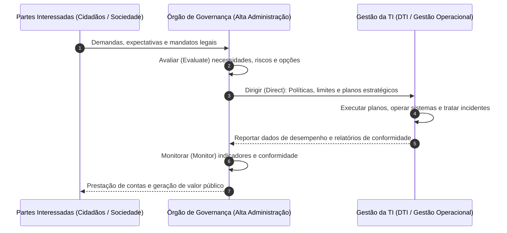
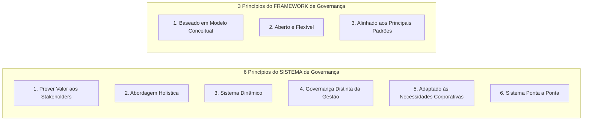
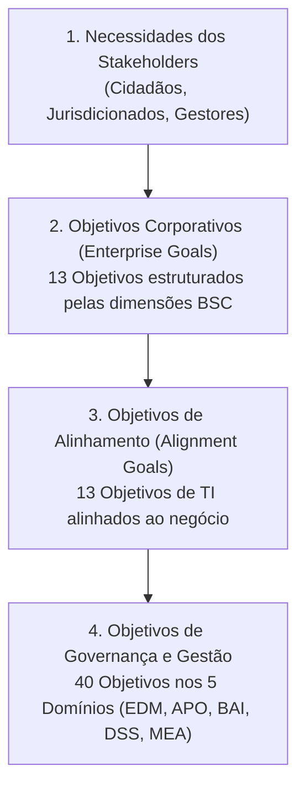
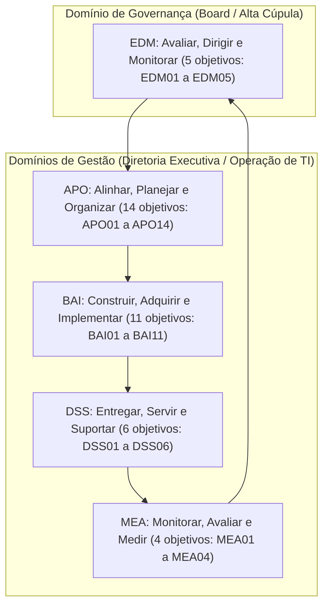
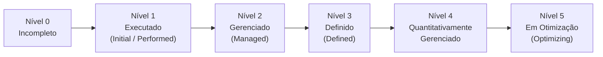

# 01 - Fundamentos de Governança, COBIT 2019 e ISO/IEC 38500:2024

> **Matéria:** Governança de Tecnologia da Informação  
> **Cargo:** B02 – Técnico de Controle Externo – Especialidade: Tecnologia da Informação  
> **Arquivo:** `01_fundamentos_governanca_cobit_2019_e_iso_38500.md`  

---

## 📌 Ementa / Itens do Edital
- Governança de TI vs. Gestão de TI: conceitos e alinhamento estratégico institucional
- Norma ABNT NBR ISO/IEC 38500:2024 (Governança Corporativa de Tecnologia da Informação)
- Framework COBIT 2019 (ISACA):
    - Princípios de Governança e do Framework
    - Componentes do Sistema de Governança e Fatores de Design (Design Factors)
    - Áreas de Foco (Focus Areas) e Cascatamento de Objetivos (Goals Cascade)
    - Os 40 Objetivos de Governança e Gestão (5 Domínios: EDM, APO, BAI, DSS, MEA)
    - Gestão de Desempenho do COBIT (CPM) e Níveis de Capacidade CMMI

---

## 🧭 Sumário

1. [Fundamentos da Governança de TI e Alinhamento Estratégico](#1-fundamentos-da-governanca-de-ti-e-alinhamento-estrategico)
1. [Distinção Essencial entre Governança e Gestão](#1-1-distincao-essencial-entre-governanca-e-gestao)
1. [Alinhamento Estratégico e Criação de Valor Público](#1-2-alinhamento-estrategico-e-criacao-de-valor-publico)
    1. [Teste 465](#Teste-465)
2. [Norma ABNT NBR ISO/IEC 38500:2024](#2-norma-abnt-nbr-isoiec-385002024)
2. [Escopo e Modelo de Governança (Ciclo EDM)](#2-1-escopo-e-modelo-de-governanca-ciclo-edm)
    1. [Teste 466](#Teste-466)
2. [Os Seis Princípios da Boa Governança de TI](#2-2-os-seis-principios-da-boa-governanca-de-ti)
    1. [Teste 467](#Teste-467)
3. [Framework COBIT 2019 (ISACA)](#3-framework-cobit-2019-isaca)
3. [Princípios do Sistema e do Framework de Governança](#3-1-principios-do-sistema-e-do-framework-de-governanca)
    1. [Teste 468](#Teste-468)
3. [Componentes do Sistema de Governança (7 Componentes)](#3-2-componentes-do-sistema-de-governanca-7-componentes)
    1. [Teste 469](#Teste-469)
3. [Fatores de Design (11 Design Factors) e Áreas de Foco (Focus Areas)](#3-3-fatores-de-design-11-design-factors-e-areas-de-foco-focus-areas)
    1. [Teste 470](#Teste-470)
3. [Cascatamento de Objetivos (Goals Cascade)](#3-4-cascatamento-de-objetivos-goals-cascade)
    1. [Teste 471](#Teste-471)
3. [Os 40 Objetivos de Governança e Gestão nos 5 Domínios](#3-5-os-40-objetivos-de-governanca-e-gestao-nos-5-dominios)
    1. [Teste 472](#Teste-472)
3. [Gestão de Desempenho do COBIT (CPM) e Níveis de Capacidade CMMI](#3-6-gestao-de-desempenho-do-cobit-cpm-e-niveis-de-capacidade-cmmi)
    1. [Teste 473](#Teste-473)
    2. [Teste 474](#Teste-474)
6. [Fontes Recomendadas na Internet](#6-fontes-recomendadas-na-internet)

---

## 1. Fundamentos da Governança de TI e Alinhamento Estratégico

---

### Teste 001
**(FGV – TCE/GO – 2024 – Analista de Controle Externo - Tecnologia da Informação)**
Assinale a opção que descreve corretamente um ponto principal característico de COBIT 2019, ITIL v4 e PMBOK.

* **A)** COBIT 2019 é centrado na governança de TI, ITIL v4 foca na gestão de serviços de TI e PMBOK orienta sobre a gestão de projetos tradicionais.
* **B)** COBIT 2019 é um guia para auditoria de TI, ITIL v4 é um framework para desenvolvimento de software, e PMBOK é uma metodologia ágil.
* **C)** COBIT 2019, ITIL v4 e PMBOK são frameworks que priorizam a implementação de práticas ágeis e DevOps em suas abordagens.
* **D)** COBIT 2019, ITIL v4 e PMBOK são estruturas voltadas exclusivamente para o controle financeiro de projetos de TI.
* **E)** COBIT 2019 define princípios de governança corporativa, ITIL v4 prioriza a gestão de serviços de TI focada no cliente, e PMBOK foca na entrega de valor através da gestão de projetos. Desenvolvimento Web e Mobile

---

> **Comentário Detalhado:**
>
> - **A)** **Correta.** Conforme fundamentado na seção *3. Framework COBIT 2019 (ISACA)* deste guia, o COBIT 2019 ( Control Objectives for Information and Related Technologies ) é o framework líder mundial de governança e gestão corporativa de informação e tecnologia (I&T), publicado pela ISACA. O COBIT não é prescritivo em nível de codificação ou configuração de servidores; ele funciona como um framework guarda chuva integrador, alinhando padrões técnicos (como ITIL, PMBOK, TOGAF e ISO 27001) às metas institucionais. Dessa forma, está plenamente correta a assertiva da banca (FGV – TCE/GO/2024) ao estabelecer que "COBIT 2019 é centrado na governança de TI, ITIL v4 foca na gestão de serviços de TI e PMBOK orienta sobre a gestão...".
> - **B)** **Incorreta.** A opção apresenta proposição em desacordo com os fundamentos teóricos e técnicos do tópico ao afirmar que "COBIT 2019 é um guia para auditoria de TI, ITIL v4 é um framework para desenvolvimento de software, e PMBOK é uma...". De acordo com a teoria estudada em *Tabela Comparativa dos Princípios do COBIT 2019*, 3. Sistema dinâmico: Sempre que um ou mais fatores de design mudarem, o impacto sobre o sistema de governança deve ser reavaliado.: 3. Alinhado aos principais padrões: Deve harmonizar se com os padrões de referência (ISO, ITIL, TOGAF, PMBOK, NIST).
> - **C)** **Incorreta.** A opção apresenta proposição em desacordo com os fundamentos teóricos e técnicos do tópico ao afirmar que "COBIT 2019, ITIL v4 e PMBOK são frameworks que priorizam a implementação de práticas ágeis e DevOps em suas...". De acordo com a teoria estudada em *Os 11 Fatores de Design (Design Factors)*, métodos de implementação de TI ( IT Implementation Methods ): Abordagens ágeis (DevOps, Scrum) vs. métodos tradicionais preditivos (cascata/waterfall).
> - **D)** **Incorreta.** A opção incorre em restrição indevida ao limitar o escopo conceitual ao afirmar que "COBIT 2019, ITIL v4 e PMBOK são estruturas voltadas exclusivamente para o controle financeiro de projetos de TI". De acordo com a teoria estudada em *3.5 Os 40 Objetivos de Governança e Gestão nos 5 Domínios*, o COBIT 2019 organiza seus 40 objetivos em 5 Domínios. O primeiro pertence exclusivamente à Governança, enquanto os demais quatro integram a Gestão.
> - **E)** **Incorreta.** A opção apresenta proposição em desacordo com os fundamentos teóricos e técnicos do tópico ao afirmar que "COBIT 2019 define princípios de governança corporativa, ITIL v4 prioriza a gestão de serviços de TI focada no...". De acordo com a teoria estudada em *Tabela Comparativa: Governança de TI versus Gestão de TI*, responsável Típico: Alta Administração, Conselho de Administração, Plenário e Comitês Estratégicos de Governança. — Diretoria Executiva de TI (CIO/DTI), gerentes de projetos, equipes de desenvolvimento e suporte.
>
> **Gabarito: A**

---

### Teste 002
**(CEBRASPE – STJ – 2024 – Analista Judiciário - Apoio Especializado - Suporte em Tecnologia da Informação)**
No COBIT 2019, o princípio Aplicar modelo único integrado estabelece que os componentes como processos, estruturas, arquiteturas e pessoas devem funcionar em conjunto para a construção de um sistema de governança eficiente.

* **C)** Certo
* **E)** Errado

---

> **Comentário Detalhado:**
>
> - **C)** **Incorreta.** A proposição apresenta proposição em desacordo com os fundamentos teóricos e técnicos do tópico ao afirmar que "No COBIT 2019, o princípio Aplicar modelo único integrado estabelece que os componentes como processos...". De acordo com a teoria em *Os 11 Fatores de Design (Design Factors)*, o COBIT 2019 não adota o modelo "tamanho único" ( one size fits all ). Para viabilizar a adaptação ( tailoring ) do sistema de governança à realidade de cada órgão ou empresa, são utilizados 11 Fatores de Design.
> - **E)** **Correta.** O item está **Errado** (gabarito oficial: **E**), pois contraria a disciplina teórica aplicável.
>
> **Gabarito: E**

---

### Teste 003
**(CEBRASPE – TRF/6 – 2025 – Analista Judiciario Apoio Especializado Tecnologia Da Informacao)**
O COBIT 2019 estabelece que os recursos de tecnologia da informação devem ser utilizados de forma alinhada aos

* **C)** Certo
* **E)** Errado

---

> **Comentário Detalhado:**
>
> - **C)** **Correta.** O item está **Certo**. Conforme fundamentado na seção *1.2 Alinhamento Estratégico e Criação de Valor Público*, no setor público, e em especial nos órgãos de controle externo como o TCE GO, o alinhamento estratégico da Tecnologia da Informação não tem como meta o lucro, mas sim a criação de valor público. Isso significa garantir que os recursos aplicados em tecnologia resultem em fiscalizações mais ágeis, auditorias digitais baseadas em cruzamento massivo de dados, transparência ativa ao cidadão e prestação jurisdicional de excelência. Dessa forma, está plenamente correta a assertiva da banca (CEBRASPE – TRF/6/2025) ao afirmar que "O COBIT 2019 estabelece que os recursos de tecnologia da informação devem ser utilizados de forma alinhada aos".
> - **E)** **Incorreta.** A assertiva não incorre em erro conceitual, guardando conformidade com a teoria estudada.
>
> **Gabarito: C**

---

### Teste 004
**(FCC – TRT 23ª – 2016 – Analista Judiciário - Apoio Especializado - Tecnologia da Informação)**
Conforme sugerido pelo COBIT 5, os dois objetivos de TI, relacionados de forma primária ou secundária ao seu Processo Gerenciar Fornecedores, são:

* **A)** Conhecimento, expertise e iniciativas para inovação dos negócios; Equipes de TI e de negócios motivadas e qualificadas.
* **B)** Prestação de serviços de TI em consonância com os requisitos de negócio; Conhecimento, expertise e iniciativas para inovação dos negócios.
* **C)** Alinhamento da estratégia de TI e de negócios; Capacitação e apoio aos processos de negócio através da integração de aplicativos e tecnologia nos processos de negócio.
* **D)** Equipes de TI e de negócios motivadas e qualificadas; Capacitação e apoio aos processos de negócio através da integração de aplicativos e tecnologia nos processos de negócio.
* **E)** Capacitação e apoio aos processos de negócio através da integração de aplicativos e tecnologia nos processos de negócio; Prestação de serviços de TI em consonância com os requisitos de negócio.

---

> **Comentário Detalhado:**
>
> - **A)** **Incorreta.** A opção apresenta proposição em desacordo com os fundamentos teóricos e técnicos do tópico ao afirmar que "Conhecimento, expertise e iniciativas para inovação dos negócios; Equipes de TI e de negócios motivadas e...". De acordo com a teoria estudada em *Os 11 Fatores de Design (Design Factors)*, estratégia corporativa ( Enterprise Strategy ): Liderança em custos, diferenciação, inovação ou prestação de serviços essenciais.
> - **B)** **Incorreta.** A opção apresenta proposição em desacordo com os fundamentos teóricos e técnicos do tópico ao afirmar que "Prestação de serviços de TI em consonância com os requisitos de negócio; Conhecimento, expertise e iniciativas...". De acordo com a teoria estudada em *Níveis de Capacidade de Processo (CPM / CMMI: 0 a 5)*, 1: Executado ( Initial / Performed ) — O processo atinge seu propósito através de um conjunto incompleto de atividades; atua de forma intuitiva, sem padronização formal.
> - **C)** **Incorreta.** A opção apresenta proposição em desacordo com os fundamentos teóricos e técnicos do tópico ao afirmar que "Alinhamento da estratégia de TI e de negócios; Capacitação e apoio aos processos de negócio através da integração...". De acordo com a teoria estudada em *1.2 Alinhamento Estratégico e Criação de Valor Público*, a governança assegura a integração bidirecional contínua entre a estratégia institucional e a estratégia de TI, evitando que a área técnica formule objetivos isolados ou desconectados das reais prioridades de fiscalização e auditoria do Tribunal.
> - **D)** **Incorreta.** A opção apresenta proposição em desacordo com os fundamentos teóricos e técnicos do tópico ao afirmar que "Equipes de TI e de negócios motivadas e qualificadas; Capacitação e apoio aos processos de negócio através da...". De acordo com a teoria estudada em *1.2 Alinhamento Estratégico e Criação de Valor Público*, no setor público, e em especial nos órgãos de controle externo como o TCE GO, o alinhamento estratégico da Tecnologia da Informação não tem como meta o lucro, mas sim a criação de valor público. Isso significa garantir que os recursos aplicados em tecnologia resultem em fiscalizações mais ágeis, auditorias digitais baseadas em cruzamento massivo de dados, transparência ativa ao cidadão e prestação jurisdicional de excelência.
> - **E)** **Correta.** Conforme fundamentado na seção *Relação Detalhada dos 40 Objetivos do COBIT 2019* deste guia, dSS06: Gerenciar os Controles de Processos de Negócio. Dessa forma, está plenamente correta a assertiva da banca (FCC – TRT 23ª/2016) ao estabelecer que "Capacitação e apoio aos processos de negócio através da integração de aplicativos e tecnologia nos processos de...".
>
> **Gabarito: E**

---

### Teste 005
**(FCC – TRT 6ª – 2012 – Analista Judiciário - Apoio Especializado/Tecnologia da Informação)**
Segundo o COBIT em relação ao domínio Adquirir e Implementar (AI), para concretizar a estratégia de TI, soluções de TI precisam ser identificadas, desenvolvidas ou adquiridas, bem como implementadas e integradas ao processo de negócio. Além disso, alterações e manutenção de sistemas existentes estão cobertas por este domínio para garantir que as soluções continuem a cumprir os objetivos de negócio. Este domínio tipicamente aborda questões como:

* **A)** A qualidade dos sistemas de TI é adequada às necessidades do negócio?
* **B)** Os novos projetos irão produzir soluções que atendam às necessidades de negócios?
* **C)** Os riscos de TI estão entendidos e sendo gerenciados?
* **D)** As estratégias de negócio e TI estão alinhadas?
* **E)** Os serviços de TI estão sendo executados em alinhamento com as prioridades do negócio?

---

> **Comentário Detalhado:**
>
> - **A)** **Incorreta.** A opção apresenta proposição em desacordo com os fundamentos teóricos e técnicos do tópico ao afirmar que "A qualidade dos sistemas de TI é adequada às necessidades do negócio?". De acordo com a teoria estudada em *2.2 Os Seis Princípios da Boa Governança de TI*, 4: Desempenho ( Performance ) — A TI atende às necessidades da organização, entregando serviços com os níveis de serviço e capacidade exigidos pelo negócio. — Monitoramento contínuo de disponibilidade, tempo de resposta e eficácia dos sistemas em produção.
> - **B)** **Incorreta.** A opção apresenta proposição em desacordo com os fundamentos teóricos e técnicos do tópico ao afirmar que "Os novos projetos irão produzir soluções que atendam às necessidades de negócios?". De acordo com a teoria estudada em *Relação Detalhada dos 40 Objetivos do COBIT 2019*, bAI03: Gerenciar a Identificação e Construção de Soluções.
> - **C)** **Correta.** Conforme fundamentado na seção *2.1 Escopo e Modelo de Governança (Ciclo EDM)* deste guia, monitorar ( Monitor ): Acompanhar periodicamente se a gestão está operando em conformidade com as diretrizes e se os objetivos de desempenho planejados estão sendo atingidos. Dessa forma, está plenamente correta a assertiva da banca (FCC – TRT 6ª/2012) ao estabelecer que "Os riscos de TI estão entendidos e sendo gerenciados?".
> - **D)** **Incorreta.** A opção apresenta proposição em desacordo com os fundamentos teóricos e técnicos do tópico ao afirmar que "As estratégias de negócio e TI estão alinhadas?". De acordo com a teoria estudada em *Relação Detalhada dos 40 Objetivos do COBIT 2019*, dSS06: Gerenciar os Controles de Processos de Negócio.
> - **E)** **Incorreta.** A opção apresenta proposição em desacordo com os fundamentos teóricos e técnicos do tópico ao afirmar que "Os serviços de TI estão sendo executados em alinhamento com as prioridades do negócio?". De acordo com a teoria estudada em *1.2 Alinhamento Estratégico e Criação de Valor Público*, estratégia do Negócio: Escopo corporativo, competências distintivas e governança corporativa.
>
> **Gabarito: C**

---

### Teste 006
**(CEBRASPE – TJ/DFT – 2015 – Analista Judiciario Suporte Em Tecnologia Da Informacao)**
O COBIT 5 descreve um modelo único e integrado de princípios que permite governar e gerir a TI de forma holística para toda a organização, o que abrange todas as áreas responsáveis pelas funções de TI e considera tanto os interesses internos quanto os interesses externos relacionados à TI.

* **C)** Certo
* **E)** Errado

---

> **Comentário Detalhado:**
>
> - **C)** **Correta.** O item está **Certo**. Conforme fundamentado na seção *Tabela Comparativa dos Princípios do COBIT 2019*, 6. Sistema ponta a ponta: Cobre todas as informações e tecnologias de toda a organização, e não apenas o departamento de TI.: —. Dessa forma, está plenamente correta a assertiva da banca (CEBRASPE – TJ/DFT/2015) ao afirmar que "O COBIT 5 descreve um modelo único e integrado de princípios que permite governar e gerir a TI de forma...".
> - **E)** **Incorreta.** A assertiva não incorre em erro conceitual, guardando conformidade com a teoria estudada.
>
> **Gabarito: C**

---

### Teste 007
**(FCC – TRT 13ª – 2014 – Analista Judiciário - Tecnologia da Informação)**
No Cobit 4.1, um analista observou o controle sobre Gerenciar o Investimento de TI. Por sua observação, em tal contexto, ele entendeu que devem ser satisfeitos os requisitos de negócio para TI descritos por:

* **A)** Melhorar continua e visivelmente a relação custo-benefício da TI e sua contribuição para a lucratividade do negócio com serviços integrados e padronizados que atendam às expectativas do usuário final.
* **B)** Estabelecer e manter uma estrutura para gerenciar os programas de investimentos em TI que contemple custos, benefícios, prioridade dentro do orçamento, um processo formal de definição orçamentária e gerenciamento de acordo com o orçamento.
* **C)** Decidir o portfólio e investimentos em TI de forma eficaz e eficiente e, elaborar e rastrear os orçamentos de TI em linha com estratégias de TI e decisões de investimento.
* **D)** Definir o critério de investimento formal (ROI − Retorno sobre Investimento, período de recuperação de investimento, NPV − Valor Presente Líquido).
* **E)** Definir o percentual de desvio do valor orçamentário comparado com o orçamento total, bem como obter a redução percentual do custo unitário dos serviços de TI entregues.

---

> **Comentário Detalhado:**
>
> - **A)** **Correta.** Conforme fundamentado na seção *2.2 Os Seis Princípios da Boa Governança de TI* deste guia, 3: Aquisição ( Acquisition ) — As aquisições de TI são feitas por razões válidas, com base em análise apropriada e contínua do Custo Total de Propriedade (TCO) e retorno esperado. — Veda compras impulsivas ou sem Estudo Técnico Preliminar (ETP) fundamentado. Exige análise de ciclo de vida completo. Dessa forma, está plenamente correta a assertiva da banca (FCC – TRT 13ª/2014) ao estabelecer que "Melhorar continua e visivelmente a relação custo benefício da TI e sua contribuição para a lucratividade do...".
> - **B)** **Incorreta.** A opção apresenta proposição em desacordo com os fundamentos teóricos e técnicos do tópico ao afirmar que "Estabelecer e manter uma estrutura para gerenciar os programas de investimentos em TI que contemple custos...". De acordo com a teoria estudada em *Relação Detalhada dos 40 Objetivos do COBIT 2019*, aPO06: Gerenciar o Orçamento e os Custos.
> - **C)** **Incorreta.** A opção apresenta proposição em desacordo com os fundamentos teóricos e técnicos do tópico ao afirmar que "Decidir o portfólio e investimentos em TI de forma eficaz e eficiente e, elaborar e rastrear os orçamentos de TI...". De acordo com a teoria estudada em *2.1 Escopo e Modelo de Governança (Ciclo EDM)*, a norma ABNT NBR ISO/IEC 38500:2024 fornece princípios e diretrizes para os órgãos deliberativos e membros da alta administração das organizações (públicas ou privadas, de qualquer porte ou setor) sobre a utilização aceitável, eficaz e eficiente da TI.
> - **D)** **Incorreta.** A opção apresenta proposição em desacordo com os fundamentos teóricos e técnicos do tópico ao afirmar que "Definir o critério de investimento formal (ROI − Retorno sobre Investimento, período de recuperação de...". De acordo com a teoria estudada em *2.2 Os Seis Princípios da Boa Governança de TI*, 4: Desempenho ( Performance ) — A TI atende às necessidades da organização, entregando serviços com os níveis de serviço e capacidade exigidos pelo negócio. — Monitoramento contínuo de disponibilidade, tempo de resposta e eficácia dos sistemas em produção.
> - **E)** **Incorreta.** A opção apresenta proposição em desacordo com os fundamentos teóricos e técnicos do tópico ao afirmar que "Definir o percentual de desvio do valor orçamentário comparado com o orçamento total, bem como obter a redução...". De acordo com a teoria estudada em *Níveis de Capacidade de Processo (CPM / CMMI: 0 a 5)*, 3: Definido ( Defined ) — O processo é bem caracterizado, compreendido e executado com base em procedimentos padronizados em toda a organização ( organizational standards ).
>
> **Gabarito: A**

---

### Teste 008
**(FCC – TRT 2ª – 2014 – Analista Judiciário - Tecnologia da Informação)**
O CobiT é uma metodologia que promove um conjunto de padrões e boas práticas para o gerenciamento e o uso corporativo e transparente da TI, sendo considerado um padrão para o gerenciamento de TI, alinhado às estratégias de negócios. O processo que endereça as questões relacionadas à informação é o

* **A)** PO1 − Definir o Modelo Corporativo da Arquitetura da Informação.
* **B)** PO3 − Definir o Esquema de Classificação de Dados.
* **C)** PO10 − Definir o Dicionário de Dados Corporativo.
* **D)** PO5 − Comunicar Objetivos e Direcionamentos Gerenciais.
* **E)** PO2 − Definir a Arquitetura da Informação.

---

> **Comentário Detalhado:**
>
> - **A)** **Incorreta.** A opção apresenta proposição em desacordo com os fundamentos teóricos e técnicos do tópico ao afirmar que "PO1 − Definir o Modelo Corporativo da Arquitetura da Informação". De acordo com a teoria estudada em *1.2 Alinhamento Estratégico e Criação de Valor Público*, estratégia do Negócio: Escopo corporativo, competências distintivas e governança corporativa.
> - **B)** **Incorreta.** A opção apresenta proposição em desacordo com os fundamentos teóricos e técnicos do tópico ao afirmar que "PO3 − Definir o Esquema de Classificação de Dados". De acordo com a teoria estudada em *1.2 Alinhamento Estratégico e Criação de Valor Público*, no setor público, e em especial nos órgãos de controle externo como o TCE GO, o alinhamento estratégico da Tecnologia da Informação não tem como meta o lucro, mas sim a criação de valor público. Isso significa garantir que os recursos aplicados em tecnologia resultem em fiscalizações mais ágeis, auditorias digitais baseadas em cruzamento massivo de dados, transparência ativa ao cidadão e prestação jurisdicional de excelência.
> - **C)** **Incorreta.** A opção apresenta proposição em desacordo com os fundamentos teóricos e técnicos do tópico ao afirmar que "PO10 − Definir o Dicionário de Dados Corporativo". De acordo com a teoria estudada em *3.2 Componentes do Sistema de Governança (7 Componentes)*, informação: Dados e fluxos informacionais consumidos e produzidos pela organização (relevância, segurança, precisão, completude).
> - **D)** **Incorreta.** A opção apresenta proposição em desacordo com os fundamentos teóricos e técnicos do tópico ao afirmar que "PO5 − Comunicar Objetivos e Direcionamentos Gerenciais". De acordo com a teoria estudada em *3. Framework COBIT 2019 (ISACA)*, o COBIT 2019 ( Control Objectives for Information and Related Technologies ) é o framework líder mundial de governança e gestão corporativa de informação e tecnologia (I&T), publicado pela ISACA. O COBIT não é prescritivo em nível de codificação ou configuração de servidores; ele funciona como um framework guarda chuva integrador, alinhando padrões técnicos (como ITIL, PMBOK, TOGAF e ISO 27001) às metas institucionais.
> - **E)** **Correta.** Conforme fundamentado na seção *Áreas de Foco (Focus Areas)* deste guia, uma Área de Foco descreve um tópico, domínio de governança ou desafio tecnológico específico que requer a seleção e priorização de um conjunto direcionado de componentes e objetivos de governança do COBIT 2019. Exemplos de áreas de foco publicadas pela ISACA incluem: Segurança da Informação ( Information Security ), DevOps, Pequenas e Médias Empresas (PMEs) e Governança de Nuvem ( Cloud Governance ). As áreas de foco podem ser ilimitadas e são expandidas continuamente pela comunidade. Dessa forma, está plenamente correta a assertiva da banca (FCC – TRT 2ª/2014) ao estabelecer que "PO2 − Definir a Arquitetura da Informação".
>
> **Gabarito: E**

---

## 1.1 Distinção Essencial entre Governança e Gestão

A separação entre **Governança** e **Gestão** é o pilar estruturante de maior incidência em provas da Fundação Carlos Chagas (FCC) na disciplina de Governança de TI. Trata-se de responsabilidades, papéis e ciclos operacionais completamente distintos, embora fortemente integrados.

```mermaid
flowchart TD
    subgraph GOVERNANCA["GOVERNANÇA (Conselho / Alta Administração / Plenário do Tribunal)"]
        direction TB
        E["Avaliar (Evaluate)<br/>Necessidades, Condições e Opções"] --> D["Dirigir (Direct)<br/>Prioridades, Diretrizes e Políticas"]
        D --> M["Monitorar (Monitor)<br/>Desempenho, Conformidade e Riscos"]
        M --> E
    end

    subgraph GESTAO["GESTÃO (Diretoria Executiva / DTI / Gerência Operacional)"]
        direction LR
        P["Plan (Planejar)<br/>APO"] --> B["Build (Construir)<br/>BAI"]
        B --> R["Run (Executar)<br/>DSS"]
        R --> Mon["Monitor (Monitorar)<br/>MEA"]
        Mon --> P
    end

    D -- "Diretrizes, Políticas e Metas" --> P
    Mon -- "Relatórios de Desempenho e Evidências" --> M
```

#### Tabela Comparativa: Governança de TI versus Gestão de TI

| Dimensão de Análise | Governança de TI (*Governance*) | Gestão de TI (*Management*) |
| :--- | :--- | :--- |
| **Papel Primário** | Direcionamento estratégico, supervisão, liderança institucional e prestação de contas (*Accountability*). | Execução técnica, coordenação operacional, manutenção de rotinas e entrega diária de serviços. |
| **Responsável Típico** | Alta Administração, Conselho de Administração, Plenário e Comitês Estratégicos de Governança. | Diretoria Executiva de TI (CIO/DTI), gerentes de projetos, equipes de desenvolvimento e suporte. |
| **Atividades Centrais** | **EDM**: Avaliar (*Evaluate*), Dirigir (*Direct*) e Monitorar (*Monitor*). | **PBRM**: Planejar (*Plan*), Construir (*Build*), Executar (*Run*) e Monitorar (*Monitor*). |
| **Horizonte Temporal** | Longo prazo (visão plurianual, sustentabilidade e impacto institucional). | Curto e médio prazo (sprints de desenvolvimento, chamados operacionais, metas contratuais imediatas). |
| **Objetivo Maior** | **Criação de Valor**: Realização de benefícios com balanceamento e otimização de riscos e recursos. | Eficiência técnica, cumprimento estrito de SLAs, produtividade e estabilidade dos sistemas em produção. |
| **Ponto de Partida** | Necessidades das partes interessadas (*stakeholders*: cidadãos, magistrados, auditores, jurisdicionados). | Diretrizes, limites orçamentários, apetite a risco e prioridades deliberadas pela governança. |

> 🚨 **ALERTA DE PROVA / PEGADINHA FCC:**  
> A banca frequentemente tenta confundir o candidato atribuindo à Governança tarefas de execução (como configurar roteadores, gerenciar chamados de help desk ou planejar sprints). Lembre-se: a governança **define o que fazer e em qual direção ir**, avaliando, dirigindo e monitorando. A gestão cuida do **como fazer**, planejando, construindo, executando e monitorando o trabalho diário.

---

---

## 1.2 Alinhamento Estratégico e Criação de Valor Público

No setor público, e em especial nos órgãos de controle externo como o TCE-GO, o alinhamento estratégico da Tecnologia da Informação não tem como meta o lucro, mas sim a **criação de valor público**. Isso significa garantir que os recursos aplicados em tecnologia resultem em fiscalizações mais ágeis, auditorias digitais baseadas em cruzamento massivo de dados, transparência ativa ao cidadão e prestação jurisdicional de excelência.

O alinhamento estratégico é teorizado pelo clássico **Modelo de Alinhamento Estratégico (SAM - *Strategic Alignment Model*) de Henderson & Venkatraman**, que articula quatro domínios fundamentais:

1. **Estratégia do Negócio:** Escopo corporativo, competências distintivas e governança corporativa.
2. **Estratégia de TI:** Escopo de tecnologia, competências sistêmicas e governança de TI.
3. **Infraestrutura e Processos Organizacionais:** Estrutura administrativa, processos de trabalho corporativos e habilidades dos servidores.
4. **Infraestrutura e Processos de TI:** Arquitetura tecnológica, processos operacionais de TI e habilidades da equipe técnica.

A governança assegura a integração bidirecional contínua entre a estratégia institucional e a estratégia de TI, evitando que a área técnica formule objetivos isolados ou desconectados das reais prioridades de fiscalização e auditoria do Tribunal.

---

## 2. Norma ABNT NBR ISO/IEC 38500:2024

---

## 2.1 Escopo e Modelo de Governança (Ciclo EDM)

A norma **ABNT NBR ISO/IEC 38500:2024** fornece princípios e diretrizes para os órgãos deliberativos e membros da alta administração das organizações (públicas ou privadas, de qualquer porte ou setor) sobre a utilização aceitável, eficaz e eficiente da TI.

A governança atua segundo o modelo cíclico **EDM**:

- **Avaliar (*Evaluate*):** Examinar continuamente as circunstâncias presentes e futuras, considerando demandas dos stakeholders, tendências tecnológicas, requisitos legais e restrições financeiras.
- **Dirigir (*Direct*):** Atribuir responsabilidades e orientar a preparação e execução de estratégias, planos de TI e políticas institucionais.
- **Monitorar (*Monitor*):** Acompanhar periodicamente se a gestão está operando em conformidade com as diretrizes e se os objetivos de desempenho planejados estão sendo atingidos.

---

## 2.2 Os Seis Princípios da Boa Governança de TI

A ISO/IEC 38500 prescreve **seis princípios** fundamentais que orientam a tomada de decisão da alta administração:

| Nº | Princípio | Significado / Exigência Normativa | Foco de Cobrança FCC |
| :---: | :--- | :--- | :--- |
| **1** | **Responsabilidade** (*Responsibility*) | Indivíduos e comitês compreendem e aceitam suas responsabilidades relativas à oferta e demanda de TI. Autoridade delegada deve ser proporcional à responsabilidade. | Não pode haver ambiguidade de papéis; a responsabilidade de governança jamais pode ser transferida ou terceirizada a fornecedores externos. |
| **2** | **Estratégia** (*Strategy*) | A estratégia de TI deve estar perfeitamente alinhada e suportar as necessidades atuais e as aspirações futuras da estratégia corporativa. | TI não cria estratégia isolada; a TI viabiliza os objetivos institucionais e o plano de diretrizes do órgão. |
| **3** | **Aquisição** (*Acquisition*) | As aquisições de TI são feitas por razões válidas, com base em análise apropriada e contínua do Custo Total de Propriedade (TCO) e retorno esperado. | Veda compras impulsivas ou sem Estudo Técnico Preliminar (ETP) fundamentado. Exige análise de ciclo de vida completo. |
| **4** | **Desempenho** (*Performance*) | A TI atende às necessidades da organização, entregando serviços com os níveis de serviço e capacidade exigidos pelo negócio. | Monitoramento contínuo de disponibilidade, tempo de resposta e eficácia dos sistemas em produção. |
| **5** | **Conformidade** (*Conformance*) | A TI opera em estrita conformidade com toda a legislação, regulações e políticas internas aplicáveis (LGPD, Marco Civil, Lei 14.133/2021). | As práticas de governança devem assegurar aderência legal e auditoria formal periódica. |
| **6** | **Comportamento Humano** (*Human Behaviour*) | As políticas, práticas e decisões de TI respeitam os fatores humanos, culturais e as necessidades de todas as pessoas envolvidas. | Treinamento, usabilidade, ergonomia, acessibilidade e gestão de mudanças comportamentais no trabalho. |

> 🚨 **ALERTA DE PROVA / PEGADINHA FCC:**  
> A FCC adora cobrar a lista exata dos 6 princípios da ISO/IEC 38500 trocando palavras como "Comportamento Humano" por "Comportamento Financeiro", "Econômico" ou inventando termos como "Agilidade" e "Virtualização". Grave o mnemônico: **R-E-A-D-C-H** (*Responsibility, Strategy, Acquisition, Performance, Conformance, Human Behaviour*).

---

## 3. Framework COBIT 2019 (ISACA)

O **COBIT 2019** (*Control Objectives for Information and Related Technologies*) é o framework líder mundial de governança e gestão corporativa de informação e tecnologia (I&T), publicado pela ISACA. O COBIT não é prescritivo em nível de codificação ou configuração de servidores; ele funciona como um **framework guarda-chuva** integrador, alinhando padrões técnicos (como ITIL, PMBOK, TOGAF e ISO 27001) às metas institucionais.

---

### Teste 009
**(FGV – TJ/AP – 2023 – Analista Judiciario Apoio Especializado Tecnologia Da Informacao Telecomunicacoes)**
O COBIT 4.1 é um framework de Governança de TI que oferece padrões de boas práticas através de um modelo de Domínios, Processos e Atividades. Com relação ao Modelo de Maturidade do COBIT 4.1, analise os itens a seguir: I. No nível 1, Inicial/Ad hoc, os processos seguem um caminho padrão. II. No nível 3, Processo Definido, os processos são documentados e comunicados. III. No nível 4, Gerenciado e Mensurável, os processos são monitorados e medidos. Está correto o que se afirma em:

* **A)** somente I;
* **B)** somente II;
* **C)** somente I e III;
* **D)** somente II e III;
* **E)** I, II e III.

---

> **Comentário Detalhado:**
>
> - **A)** **Incorreta.** A opção incorre em restrição indevida ao limitar o escopo conceitual ao afirmar que "somente I". De acordo com a teoria estudada em *Níveis de Capacidade de Processo (CPM / CMMI: 0 a 5)*, 1: Executado ( Initial / Performed ) — O processo atinge seu propósito através de um conjunto incompleto de atividades; atua de forma intuitiva, sem padronização formal.
> - **B)** **Incorreta.** A opção incorre em restrição indevida ao limitar o escopo conceitual ao afirmar que "somente II". De acordo com a teoria estudada em *3.2 Componentes do Sistema de Governança (7 Componentes)*, processos: Conjuntos estruturados de práticas e atividades concebidos para atingir determinados objetivos e produzir saídas úteis.
> - **C)** **Incorreta.** A opção incorre em restrição indevida ao limitar o escopo conceitual ao afirmar que "somente I e III". De acordo com a teoria estudada em *Tabela Comparativa dos Princípios do COBIT 2019*, a banca FCC frequentemente afirma em enunciados que "Baseado em Modelo Conceitual" ou "Aberto e Flexível" são princípios do Sistema de Governança . Errado! Esses são princípios do Framework de Governança. Da mesma forma, "Sistema Dinâmico" e "Abordagem Holística" pertencem ao Sistema, e não ao framework!.
> - **D)** **Correta.** Conforme fundamentado na seção *3. Framework COBIT 2019 (ISACA)* deste guia, o COBIT 2019 ( Control Objectives for Information and Related Technologies ) é o framework líder mundial de governança e gestão corporativa de informação e tecnologia (I&T), publicado pela ISACA. O COBIT não é prescritivo em nível de codificação ou configuração de servidores; ele funciona como um framework guarda chuva integrador, alinhando padrões técnicos (como ITIL, PMBOK, TOGAF e ISO 27001) às metas institucionais. Dessa forma, está plenamente correta a assertiva da banca (FGV – TJ/AP/2023) ao estabelecer que "somente II e III".
> - **E)** **Incorreta.** A opção apresenta proposição em desacordo com os fundamentos teóricos e técnicos do tópico ao afirmar que "I, II e III". De acordo com a teoria estudada em *3.6 Gestão de Desempenho do COBIT (CPM) e Níveis de Capacidade CMMI*, n2 N3["Nível 3<br/ Definido<br/ (Defined)"].
>
> **Gabarito: D**

---

### Teste 010
**(FGV – TJ/RR – 2024 – Analista Judiciario Gestao E Governanca De Tecnologia Da Informacao)**
O COBIT 2019 é um framework de governança e gestão de Tecnologia da Informação (TI) que fornece um conjunto de princípios, práticas e ferramentas para ajudar as organizações a alcançarem seus objetivos estratégicos por meio do gerenciamento eficaz da informação e tecnologia. Ele se concentra em garantir que a TI esteja alinhada com as metas da empresa, gerando valor e gerenciando riscos de forma eficiente. Entre os domínios que agrupam os objetivos da gestão no COBIT 2019 listados a seguir, assinale aquele que foca em como os objetivos estratégicos são traduzidos em planos táticos e operacionais, garantindo o alinhamento entre TI e os objetivos do negócio.

* **A)** Alinhar, Planejar e Organizar (APO -Align, Plan, and Organize).
* **B)** Construir, Adquirir e Implantar (BAI -Buid, Acquire, and Implement).
* **C)** Entregar, Prestar Serviço e Dar e Suporte (DSS - Deliver, Service, and Support).
* **D)** Monitorar, Avaliar e Melhorar (MEA -Monitor, Evaluate, and Assess).
* **E)** Construir, Adquirir e Melhorar (BEA – Bild, Evaluate and Assess).

---

> **Comentário Detalhado:**
>
> - **A)** **Correta.** Conforme fundamentado na seção *3.5 Os 40 Objetivos de Governança e Gestão nos 5 Domínios* deste guia, aPO["APO: Alinhar, Planejar e Organizar (14 objetivos: APO01 a APO14)"]. Dessa forma, está plenamente correta a assertiva da banca (FGV – TJ/RR/2024) ao estabelecer que "Alinhar, Planejar e Organizar (APO Align, Plan, and Organize)".
> - **B)** **Incorreta.** A opção apresenta proposição em desacordo com os fundamentos teóricos e técnicos do tópico ao afirmar que "Construir, Adquirir e Implantar (BAI Buid, Acquire, and Implement)". De acordo com a teoria estudada em *1.1 Distinção Essencial entre Governança e Gestão*, p["Plan (Planejar)<br/ APO"] B["Build (Construir)<br/ BAI"].
> - **C)** **Incorreta.** A opção apresenta proposição em desacordo com os fundamentos teóricos e técnicos do tópico ao afirmar que "Entregar, Prestar Serviço e Dar e Suporte (DSS Deliver, Service, and Support)". De acordo com a teoria estudada em *3.5 Os 40 Objetivos de Governança e Gestão nos 5 Domínios*, dSS["DSS: Entregar, Servir e Suportar (6 objetivos: DSS01 a DSS06)"].
> - **D)** **Incorreta.** A opção apresenta proposição em desacordo com os fundamentos teóricos e técnicos do tópico ao afirmar que "Monitorar, Avaliar e Melhorar (MEA Monitor, Evaluate, and Assess)". De acordo com a teoria estudada em *Tabela Comparativa: Governança de TI versus Gestão de TI*, atividades Centrais: EDM: Avaliar ( Evaluate ), Dirigir ( Direct ) e Monitorar ( Monitor ). — PBRM: Planejar ( Plan ), Construir ( Build ), Executar ( Run ) e Monitorar ( Monitor ).
> - **E)** **Incorreta.** A opção apresenta proposição em desacordo com os fundamentos teóricos e técnicos do tópico ao afirmar que "Construir, Adquirir e Melhorar (BEA – Bild, Evaluate and Assess)". De acordo com a teoria estudada em *3. Framework COBIT 2019 (ISACA)*, o COBIT 2019 ( Control Objectives for Information and Related Technologies ) é o framework líder mundial de governança e gestão corporativa de informação e tecnologia (I&T), publicado pela ISACA. O COBIT não é prescritivo em nível de codificação ou configuração de servidores; ele funciona como um framework guarda chuva integrador, alinhando padrões técnicos (como ITIL, PMBOK, TOGAF e ISO 27001) às metas institucionais.
>
> **Gabarito: A**

---

### Teste 011
**(FGV – TRT/13 – 2022 – Analista Judiciario Tecnologia Da Informacao)**
O COBIT 2019 é um framework utilizado em muitas organizações. Sobre este framework, é correto afirmar que

* **A)** é uma estrutura para organizar os processos de negócios do ambiente de TI.
* **B)** descreve as ferramentas tecnológicas indispensáveis para construir e manter software com qualidade.
* **C)** indica as certificações de sustentabilidade necessárias para demonstrar que a empresa respeita as questões ambientais.
* **D)** prescreve as decisões técnicas e administrativas que devem implementadas no departamento de TI.
* **E)** define os componentes para construir e sustentar um sistema de governança e gestão da informação.

---

> **Comentário Detalhado:**
>
> - **A)** **Incorreta.** A opção apresenta proposição em desacordo com os fundamentos teóricos e técnicos do tópico ao afirmar que "é uma estrutura para organizar os processos de negócios do ambiente de TI". De acordo com a teoria estudada em *3.2 Componentes do Sistema de Governança (7 Componentes)*, informação: Dados e fluxos informacionais consumidos e produzidos pela organização (relevância, segurança, precisão, completude).
> - **B)** **Incorreta.** A opção apresenta proposição em desacordo com os fundamentos teóricos e técnicos do tópico ao afirmar que "descreve as ferramentas tecnológicas indispensáveis para construir e manter software com qualidade". De acordo com a teoria estudada em *3.2 Componentes do Sistema de Governança (7 Componentes)*, serviços, Infraestrutura e Aplicações: A infraestrutura tecnológica, redes, data centers, ferramentas de software e aplicações corporativas.
> - **C)** **Incorreta.** A opção apresenta proposição em desacordo com os fundamentos teóricos e técnicos do tópico ao afirmar que "indica as certificações de sustentabilidade necessárias para demonstrar que a empresa respeita as questões...". De acordo com a teoria estudada em *Os 11 Fatores de Design (Design Factors)*, o COBIT 2019 não adota o modelo "tamanho único" ( one size fits all ). Para viabilizar a adaptação ( tailoring ) do sistema de governança à realidade de cada órgão ou empresa, são utilizados 11 Fatores de Design.
> - **D)** **Incorreta.** A opção apresenta proposição em desacordo com os fundamentos teóricos e técnicos do tópico ao afirmar que "prescreve as decisões técnicas e administrativas que devem implementadas no departamento de TI". De acordo com a teoria estudada em *3.2 Componentes do Sistema de Governança (7 Componentes)*, pessoas, Habilidades e Competências: Capital humano, competências técnicas e conhecimentos requeridos para a execução das práticas.
> - **E)** **Correta.** Conforme fundamentado na seção *3.2 Componentes do Sistema de Governança (7 Componentes)* deste guia, para construir, operar e manter um sistema de governança funcional, o COBIT 2019 define 7 categorias de Componentes (denominados "Habilitadores" no antigo COBIT 5). Dessa forma, está plenamente correta a assertiva da banca (FGV – TRT/13/2022) ao estabelecer que "define os componentes para construir e sustentar um sistema de governança e gestão da informação".
>
> **Gabarito: E**

---

## 3.1 Princípios do Sistema e do Framework de Governança

Uma das maiores inovações do COBIT 2019 foi dividir formalmente os princípios em duas categorias:

1. **6 Princípios para o Sistema de Governança** (*Governance System Principles*).
2. **3 Princípios para o Framework de Governança** (*Governance Framework Principles*).

#### Tabela Comparativa dos Princípios do COBIT 2019

| Princípios do **Sistema** de Governança (6) | Princípios do **Framework** de Governança (3) |
| :--- | :--- |
| **1. Prover valor aos stakeholders:** O sistema deve gerar valor a partir do uso de I&T balanceando benefícios, riscos e uso otimizado de recursos. | **1. Baseado em um modelo conceitual:** Deve identificar os principais componentes e relacionamentos para garantir consistência e automação. |
| **2. Abordagem holística:** O sistema é construído a partir de múltiplos tipos de componentes integrados entre si. | **2. Aberto e flexível:** Deve permitir a inclusão de novos conteúdos e tecnologias emergentes sem desestruturar o núcleo original. |
| **3. Sistema dinâmico:** Sempre que um ou mais fatores de design mudarem, o impacto sobre o sistema de governança deve ser reavaliado. | **3. Alinhado aos principais padrões:** Deve harmonizar-se com os padrões de referência (ISO, ITIL, TOGAF, PMBOK, NIST). |
| **4. Governança distinta da gestão:** O sistema mantém clara separação estrutural e conceitual entre governança e gestão. | — |
| **5. Adaptado às necessidades corporativas:** Deve ser customizado conforme o contexto organizacional por meio de fatores de design (*tailoring*). | — |
| **6. Sistema ponta a ponta:** Cobre todas as informações e tecnologias de toda a organização, e não apenas o departamento de TI. | — |

> 🚨 **ALERTA DE PROVA / PEGADINHA FCC:**  
> A banca FCC frequentemente afirma em enunciados que "Baseado em Modelo Conceitual" ou "Aberto e Flexível" são princípios do *Sistema de Governança*. **Errado!** Esses são princípios do **Framework de Governança**. Da mesma forma, "Sistema Dinâmico" e "Abordagem Holística" pertencem ao **Sistema**, e não ao framework!

---

## 3.2 Componentes do Sistema de Governança (7 Componentes)

Para construir, operar e manter um sistema de governança funcional, o COBIT 2019 define **7 categorias de Componentes** (denominados "Habilitadores" no antigo COBIT 5):

1. **Processos:** Conjuntos estruturados de práticas e atividades concebidos para atingir determinados objetivos e produzir saídas úteis.
2. **Estruturas Organizacionais:** Entidades e comitês formais responsáveis pela tomada de decisão (Comitê de Governança Digital, Plenário, DTI).
3. **Princípios, Políticas e Estruturas:** Instrumentos normativos que traduzem comportamentos e diretrizes desejadas em orientações práticas cotidianas.
4. **Informação:** Dados e fluxos informacionais consumidos e produzidos pela organização (relevância, segurança, precisão, completude).
5. **Cultura, Ética e Comportamento:** Posturas éticas, hábitos e traços culturais dos servidores e da liderança corporativa.
6. **Pessoas, Habilidades e Competências:** Capital humano, competências técnicas e conhecimentos requeridos para a execução das práticas.
7. **Serviços, Infraestrutura e Aplicações:** A infraestrutura tecnológica, redes, data centers, ferramentas de software e aplicações corporativas.

---

## 3.3 Fatores de Design (11 Design Factors) e Áreas de Foco (Focus Areas)

#### Os 11 Fatores de Design (*Design Factors*)
O COBIT 2019 não adota o modelo "tamanho único" (*one size fits all*). Para viabilizar a adaptação (*tailoring*) do sistema de governança à realidade de cada órgão ou empresa, são utilizados **11 Fatores de Design**:

1. **Estratégia corporativa (*Enterprise Strategy*):** Liderança em custos, diferenciação, inovação ou prestação de serviços essenciais.
2. **Objetivos corporativos (*Enterprise Goals*):** As prioridades desdobradas no Balanced Scorecard.
3. **Perfil de risco (*Risk Profile*):** O apetite e a tolerância a riscos de TI da instituição.
4. **Problemas relacionados a I&T (*I&T-Related Issues*):** Histórico de falhas, projetos com estouro de orçamento ou carência de competências.
5. **Cenário de ameaças (*Threat Landscape*):** Grau de exposição a ataques cibernéticos e espionagem de dados.
6. **Requisitos de conformidade (*Compliance Requirements*):** Rigidez regulatória externa (ex.: setor público sujeito à fiscalização do TCU/TCE vs. startups).
7. **Papel da TI (*Role of IT*):** Papel estratégico (TI como motor essencial da missão) vs. suporte (*back-office* básico).
8. **Modelo de fornecimento de TI (*Sourcing Model for IT*):** Terceirização (outsourcing), equipes próprias (insourcing), nuvem ou modelo híbrido.
9. **Métodos de implementação de TI (*IT Implementation Methods*):** Abordagens ágeis (DevOps, Scrum) vs. métodos tradicionais preditivos (cascata/waterfall).
10. **Estratégia de adoção de tecnologia (*Technology Adoption Strategy*):** Inovador pioneiro (*first mover*), seguidor rápido (*fast follower*) ou adotante conservador (*slow adopter*).
11. **Tamanho da organização (*Enterprise Size*):** Grande corporação / órgão público de grande porte vs. pequenas e médias organizações.

#### Áreas de Foco (*Focus Areas*)
Uma **Área de Foco** descreve um tópico, domínio de governança ou desafio tecnológico específico que requer a seleção e priorização de um conjunto direcionado de componentes e objetivos de governança do COBIT 2019. Exemplos de áreas de foco publicadas pela ISACA incluem: Segurança da Informação (*Information Security*), DevOps, Pequenas e Médias Empresas (PMEs) e Governança de Nuvem (*Cloud Governance*). As áreas de foco podem ser ilimitadas e são expandidas continuamente pela comunidade.

---

## 3.4 Cascatamento de Objetivos (Goals Cascade)

O mecanismo do COBIT 2019 traduz as necessidades das partes interessadas em ações e objetivos práticos de TI por meio de quatro níveis em cascata:

- **1. Necessidades dos Stakeholders:** Criam os direcionadores corporativos e estratégicos do órgão.
- **2. 13 Objetivos Corporativos (*Enterprise Goals*):** Classificados sob as 4 dimensões do *Balanced Scorecard* (Financeira, Clientes, Processos Internos, Aprendizado e Crescimento).
- **3. 13 Objetivos de Alinhamento (*Alignment Goals*):** Objetivos técnicos de TI alinhados diretamente aos objetivos corporativos (no COBIT 5 eram 17 objetivos de TI; no COBIT 2019 foram otimizados para 13).
- **4. 40 Objetivos de Governança e Gestão:** Cada um associado a um processo e aos componentes do sistema.

---

## 3.5 Os 40 Objetivos de Governança e Gestão nos 5 Domínios

O COBIT 2019 organiza seus 40 objetivos em **5 Domínios**. O primeiro pertence exclusivamente à **Governança**, enquanto os demais quatro integram a **Gestão**:

#### Relação Detalhada dos 40 Objetivos do COBIT 2019

##### Domínio de Governança: EDM (*Evaluate, Direct and Monitor*) - 5 Objetivos
1. **EDM01:** Garantir a Definição e Manutenção do Framework de Governança.
2. **EDM02:** Garantir a Realização de Benefícios.
3. **EDM03:** Garantir a Otimização de Riscos.
4. **EDM04:** Garantir a Otimização de Recursos.
5. **EDM05:** Garantir o Engajamento das Partes Interessadas (*Stakeholder Engagement*).

##### Domínio de Gestão 1: APO (*Align, Plan and Organize*) - 14 Objetivos
1. **APO01:** Gerenciar o Framework de Gestão de I&T.
2. **APO02:** Gerenciar a Estratégia.
3. **APO03:** Gerenciar a Arquitetura Corporativa.
4. **APO04:** Gerenciar a Inovação.
5. **APO05:** Gerenciar o Portfólio.
6. **APO06:** Gerenciar o Orçamento e os Custos.
7. **APO07:** Gerenciar os Recursos Humanos.
8. **APO08:** Gerenciar os Relacionamentos.
9. **APO09:** Gerenciar os Acordos de Serviços (SLAs).
10. **APO10:** Gerenciar os Fornecedores.
11. **APO11:** Gerenciar a Qualidade.
12. **APO12:** Gerenciar os Riscos.
13. **APO13:** Gerenciar a Segurança.
14. **APO14:** Gerenciar os Dados *(Objetivo introduzido expressamente no COBIT 2019)*.

##### Domínio de Gestão 2: BAI (*Build, Acquire and Implement*) - 11 Objetivos
1. **BAI01:** Gerenciar Programas.
2. **BAI02:** Gerenciar a Definição de Requisitos.
3. **BAI03:** Gerenciar a Identificação e Construção de Soluções.
4. **BAI04:** Gerenciar a Disponibilidade e a Capacidade.
5. **BAI05:** Gerenciar a Mudança Organizacional.
6. **BAI06:** Gerenciar as Mudanças de TI (*IT Changes*).
7. **BAI07:** Gerenciar a Aceitação e Transição da Mudança de TI.
8. **BAI08:** Gerenciar o Conhecimento.
9. **BAI09:** Gerenciar os Ativos.
10. **BAI10:** Gerenciar a Configuração.
11. **BAI11:** Gerenciar Projetos *(Separado de Programas no COBIT 2019)*.

##### Domínio de Gestão 3: DSS (*Deliver, Service and Support*) - 6 Objetivos
1. **DSS01:** Gerenciar as Operações.
2. **DSS02:** Gerenciar as Requisições de Serviços e Incidentes.
3. **DSS03:** Gerenciar Problemas.
4. **DSS04:** Gerenciar a Continuidade.
5. **DSS05:** Gerenciar os Serviços de Segurança.
6. **DSS06:** Gerenciar os Controles de Processos de Negócio.

##### Domínio de Gestão 4: MEA (*Monitor, Evaluate and Assess*) - 4 Objetivos
1. **MEA01:** Monitorar, Avaliar e Medir o Desempenho e a Conformidade.
2. **MEA02:** Monitorar, Avaliar e Medir o Sistema de Controle Interno.
3. **MEA03:** Monitorar, Avaliar e Medir a Conformidade com Requisitos Externos.
4. **MEA04:** Monitorar, Avaliar e Medir a Garantia (*Assurance*).

---

### Teste 012
**(FGV – TCE/GO – 2024 – Analista de Controle Externo - Tecnologia da Informação)**
Considerando as metodologias de gestão de projetos e de TI, COBIT, ITIL e PMBOK possuem abordagens distintas para a gestão de riscos. Assinale a opção que descreve corretamente a diferença fundamental entre esses três frameworks.

* **A)** COBIT foca na governança de riscos gerais em TI, enquanto ITIL aborda a gestão de riscos nos serviços de TI e PMBOK se concentra na gestão de projetos em geral, sem especialização em TI.
* **B)** ITIL é usado para análise quantitativa de riscos, ao contrário do COBIT e do PMBOK, que se concentram em análises qualitativas.
* **C)** PMBOK não inclui processos de gestão de riscos, diferentemente do COBIT e do ITIL que oferecem guias detalhados sobre o tema.
* **D)** COBIT, ITIL e PMBOK são equivalentes e intercambiáveis quando se trata de gestão de riscos, sendo uma questão de preferência pessoal a escolha entre eles.
* **E)** ITIL e COBIT são focados em TI, com ITIL voltado exclusivamente para a gestão de riscos em serviços de TI e COBIT para a governança de riscos TI, enquanto PMBOK é um guia de práticas para a gestão de projetos em geral.

---

> **Comentário Detalhado:**
>
> - **A)** **Correta.** Conforme fundamentado na seção *3. Framework COBIT 2019 (ISACA)* deste guia, o COBIT 2019 ( Control Objectives for Information and Related Technologies ) é o framework líder mundial de governança e gestão corporativa de informação e tecnologia (I&T), publicado pela ISACA. O COBIT não é prescritivo em nível de codificação ou configuração de servidores; ele funciona como um framework guarda chuva integrador, alinhando padrões técnicos (como ITIL, PMBOK, TOGAF e ISO 27001) às metas institucionais. Dessa forma, está plenamente correta a assertiva da banca (FGV – TCE/GO/2024) ao estabelecer que "COBIT foca na governança de riscos gerais em TI, enquanto ITIL aborda a gestão de riscos nos serviços de TI e...".
> - **B)** **Incorreta.** A opção apresenta proposição em desacordo com os fundamentos teóricos e técnicos do tópico ao afirmar que "ITIL é usado para análise quantitativa de riscos, ao contrário do COBIT e do PMBOK, que se concentram em análises...". De acordo com a teoria estudada em *Tabela Comparativa dos Princípios do COBIT 2019*, 3. Sistema dinâmico: Sempre que um ou mais fatores de design mudarem, o impacto sobre o sistema de governança deve ser reavaliado.: 3. Alinhado aos principais padrões: Deve harmonizar se com os padrões de referência (ISO, ITIL, TOGAF, PMBOK, NIST).
> - **C)** **Incorreta.** A opção apresenta proposição em desacordo com os fundamentos teóricos e técnicos do tópico ao afirmar que "PMBOK não inclui processos de gestão de riscos, diferentemente do COBIT e do ITIL que oferecem guias detalhados...". De acordo com a teoria estudada em *3.5 Os 40 Objetivos de Governança e Gestão nos 5 Domínios*, o COBIT 2019 organiza seus 40 objetivos em 5 Domínios. O primeiro pertence exclusivamente à Governança, enquanto os demais quatro integram a Gestão.
> - **D)** **Incorreta.** A opção apresenta proposição em desacordo com os fundamentos teóricos e técnicos do tópico ao afirmar que "COBIT, ITIL e PMBOK são equivalentes e intercambiáveis quando se trata de gestão de riscos, sendo uma questão de...". De acordo com a teoria estudada em *6. Fontes Recomendadas na Internet*, iSACA COBIT Framework Resources Visão geral oficial do COBIT 2019, princípios de governança, objetivos de gestão e fatores de desenho.
> - **E)** **Incorreta.** A opção incorre em restrição indevida ao limitar o escopo conceitual ao afirmar que "ITIL e COBIT são focados em TI, com ITIL voltado exclusivamente para a gestão de riscos em serviços de TI e COBIT...". De acordo com a teoria estudada em *Tabela Comparativa: Governança de TI versus Gestão de TI*, responsável Típico: Alta Administração, Conselho de Administração, Plenário e Comitês Estratégicos de Governança. — Diretoria Executiva de TI (CIO/DTI), gerentes de projetos, equipes de desenvolvimento e suporte.
>
> **Gabarito: A**

---

### Teste 013
**(FGV – TCE/GO – 2024 – Analista de Controle Externo - Tecnologia da Informação)**
Considere as práticas de atribuição de funções de TI na gestão de responsabilidades sob as perspectivas do COBIT, ITIL e PMBOK. Na aplicação dessas práticas é correto que se deve

* **A)** integrar os papéis de desenvolvimento e a operação de sistemas para um funcionário garantindo eficiência e rapidez na resolução de problemas.
* **B)** designar diferentes equipes para gerenciamento de incidentes e gerenciamento de problemas para, respectivamente, a análise e a correção de falhas.
* **C)** concentrar as responsabilidades de gestão de mudanças e liberação de software em um único papel, dado que integram as mesmas funções.
* **D)** permitir que o desenvolvedor de software faça uma prévia da auditoria de código de forma a acelerar o processo e economizar recursos.
* **E)** delegar a um gestor a responsabilidade de aprovação de projetos de TI logo após o controle de custos facilitando a tomada de decisão.

---

> **Comentário Detalhado:**
>
> - **A)** **Incorreta.** A opção apresenta proposição em desacordo com os fundamentos teóricos e técnicos do tópico ao afirmar que "integrar os papéis de desenvolvimento e a operação de sistemas para um funcionário garantindo eficiência e rapidez...". De acordo com a teoria estudada em *Tabela Comparativa: Governança de TI versus Gestão de TI*, objetivo Maior: Criação de Valor: Realização de benefícios com balanceamento e otimização de riscos e recursos. — Eficiência técnica, cumprimento estrito de SLAs, produtividade e estabilidade dos sistemas em produção.
> - **B)** **Correta.** Conforme fundamentado na seção *Os 11 Fatores de Design (Design Factors)* deste guia, problemas relacionados a I&T ( I&T Related Issues ): Histórico de falhas, projetos com estouro de orçamento ou carência de competências. Dessa forma, está plenamente correta a assertiva da banca (FGV – TCE/GO/2024) ao estabelecer que "designar diferentes equipes para gerenciamento de incidentes e gerenciamento de problemas para, respectivamente, a...".
> - **C)** **Incorreta.** A opção apresenta proposição em desacordo com os fundamentos teóricos e técnicos do tópico ao afirmar que "concentrar as responsabilidades de gestão de mudanças e liberação de software em um único papel, dado que integram...". De acordo com a teoria estudada em *3.5 Os 40 Objetivos de Governança e Gestão nos 5 Domínios*, o COBIT 2019 organiza seus 40 objetivos em 5 Domínios. O primeiro pertence exclusivamente à Governança, enquanto os demais quatro integram a Gestão.
> - **D)** **Incorreta.** A opção apresenta proposição em desacordo com os fundamentos teóricos e técnicos do tópico ao afirmar que "permitir que o desenvolvedor de software faça uma prévia da auditoria de código de forma a acelerar o processo e...". De acordo com a teoria estudada em *Níveis de Capacidade de Processo (CPM / CMMI: 0 a 5)*, 1: Executado ( Initial / Performed ) — O processo atinge seu propósito através de um conjunto incompleto de atividades; atua de forma intuitiva, sem padronização formal.
> - **E)** **Incorreta.** A opção apresenta proposição em desacordo com os fundamentos teóricos e técnicos do tópico ao afirmar que "delegar a um gestor a responsabilidade de aprovação de projetos de TI logo após o controle de custos facilitando a...". De acordo com a teoria estudada em *Tabela Comparativa: Governança de TI versus Gestão de TI*, responsável Típico: Alta Administração, Conselho de Administração, Plenário e Comitês Estratégicos de Governança. — Diretoria Executiva de TI (CIO/DTI), gerentes de projetos, equipes de desenvolvimento e suporte.
>
> **Gabarito: B**

---

### Teste 014
**(CEBRASPE – TRF 6ª – 2025 – Analista Judiciário - Apoio Especializado - Governança e Gestão de Tecnologia da Informação)**
Entre os objetivos de gestão do COBIT 2019, está o de gerenciar orçamento e custos, os quais devem ser planejados, controlados e otimizados, visando garantir um alinhamento ao orçamento da organização.

* **C)** Certo
* **E)** Errado

---

> **Comentário Detalhado:**
>
> - **C)** **Correta.** O item está **Certo**. Conforme fundamentado na seção *Relação Detalhada dos 40 Objetivos do COBIT 2019*, aPO06: Gerenciar o Orçamento e os Custos. Dessa forma, está plenamente correta a assertiva da banca (CEBRASPE – TRF 6ª/2025) ao afirmar que "Entre os objetivos de gestão do COBIT 2019, está o de gerenciar orçamento e custos, os quais devem ser...".
> - **E)** **Incorreta.** A assertiva não incorre em erro conceitual, guardando conformidade com a teoria estudada.
>
> **Gabarito: C**

---

### Teste 015
**(CEBRASPE – TRF/6 – 2025 – Analista Judiciario Apoio Especializado Tecnologia Da Informacao)**
O COBIT 2019 define domínios que cobrem todas as atividades de governança e gestão de TI, e cada domínio contém processos e objetivos de controle específicos para garantir a governança eficaz da tecnologia da informação.

* **C)** Certo
* **E)** Errado

---

> **Comentário Detalhado:**
>
> - **C)** **Incorreta.** A proposição apresenta proposição em desacordo com os fundamentos teóricos e técnicos do tópico ao afirmar que "O COBIT 2019 define domínios que cobrem todas as atividades de governança e gestão de TI, e cada domínio...". De acordo com a teoria em *Áreas de Foco (Focus Areas)*, uma Área de Foco descreve um tópico, domínio de governança ou desafio tecnológico específico que requer a seleção e priorização de um conjunto direcionado de componentes e objetivos de governança do COBIT 2019. Exemplos de áreas de foco publicadas pela ISACA incluem: Segurança da Informação ( Information Security ), DevOps, Pequenas e Médias Empresas (PMEs) e Governança de Nuvem ( Cloud Governance ). As áreas de foco podem ser ilimitadas e são expandidas continuamente pela comunidade.
> - **E)** **Correta.** O item está **Errado** (gabarito oficial: **E**), pois contraria a disciplina teórica aplicável.
>
> **Gabarito: E**

---

### Teste 016
**(FGV – TJ/RR – 2024 – Analista Judiciario Gestao E Governanca De Tecnologia Da Informacao)**
No COBIT 2019, há 40 objetivos de governança e gestão, cada um com um propósito específico dentro de sua abrangência. Entre os objetivos de governança e gestão apresentados abaixo, assinale aquele que tem o propósito de alcançar os resultados definidos do projeto reduzindo o risco de atrasos inesperados e custos, melhorando as comunicações e envolvimento de empresas e usuários finais, garantindo o valor e a qualidade das entregas do projeto e maximizando a sua contribuição para os programas e investimentos definidos portfólio.

* **A)** Risco gerenciado.
* **B)** Programas gerenciados.
* **C)** Projetos gerenciados.
* **D)** Orçamento e Custos gerenciados.
* **E)** Problemas gerenciados.

---

> **Comentário Detalhado:**
>
> - **A)** **Incorreta.** A opção apresenta proposição em desacordo com os fundamentos teóricos e técnicos do tópico ao afirmar que "Risco gerenciado". De acordo com a teoria estudada em *Tabela Comparativa: Governança de TI versus Gestão de TI*, ponto de Partida: Necessidades das partes interessadas ( stakeholders : cidadãos, magistrados, auditores, jurisdicionados). — Diretrizes, limites orçamentários, apetite a risco e prioridades deliberadas pela governança.
> - **B)** **Incorreta.** A opção apresenta proposição em desacordo com os fundamentos teóricos e técnicos do tópico ao afirmar que "Programas gerenciados". De acordo com a teoria estudada em *Áreas de Foco (Focus Areas)*, uma Área de Foco descreve um tópico, domínio de governança ou desafio tecnológico específico que requer a seleção e priorização de um conjunto direcionado de componentes e objetivos de governança do COBIT 2019. Exemplos de áreas de foco publicadas pela ISACA incluem: Segurança da Informação ( Information Security ), DevOps, Pequenas e Médias Empresas (PMEs) e Governança de Nuvem ( Cloud Governance ). As áreas de foco podem ser ilimitadas e são expandidas continuamente pela comunidade.
> - **C)** **Correta.** Conforme fundamentado na seção *Relação Detalhada dos 40 Objetivos do COBIT 2019* deste guia, bAI11: Gerenciar Projetos (Separado de Programas no COBIT 2019). Dessa forma, está plenamente correta a assertiva da banca (FGV – TJ/RR/2024) ao estabelecer que "Projetos gerenciados".
> - **D)** **Incorreta.** A opção apresenta proposição em desacordo com os fundamentos teóricos e técnicos do tópico ao afirmar que "Orçamento e Custos gerenciados". De acordo com a teoria estudada em *Relação Detalhada dos 40 Objetivos do COBIT 2019*, aPO06: Gerenciar o Orçamento e os Custos.
> - **E)** **Incorreta.** A opção apresenta proposição em desacordo com os fundamentos teóricos e técnicos do tópico ao afirmar que "Problemas gerenciados". De acordo com a teoria estudada em *Os 11 Fatores de Design (Design Factors)*, problemas relacionados a I&T ( I&T Related Issues ): Histórico de falhas, projetos com estouro de orçamento ou carência de competências.
>
> **Gabarito: C**

---

### Teste 017
**(CEBRASPE – STF – 2013 – Analista Judiciario Suporte Em Tecnologia Da Informacao)**
O COBIT 5 possui cinco domínios, sendo um deles o domínio Avaliar, Direcionar e Monitorar (EDM – Evaluate, Direct and Monitor), afeto diretamente à governança e relacionado a ISO 38500.

* **C)** Certo
* **E)** Errado

---

> **Comentário Detalhado:**
>
> - **C)** **Correta.** O item está **Certo**. Conforme fundamentado na seção *Tabela Comparativa: Governança de TI versus Gestão de TI*, atividades Centrais: EDM: Avaliar ( Evaluate ), Dirigir ( Direct ) e Monitorar ( Monitor ). — PBRM: Planejar ( Plan ), Construir ( Build ), Executar ( Run ) e Monitorar ( Monitor ). Dessa forma, está plenamente correta a assertiva da banca (CEBRASPE – STF/2013) ao afirmar que "O COBIT 5 possui cinco domínios, sendo um deles o domínio Avaliar, Direcionar e Monitorar (EDM – Evaluate...".
> - **E)** **Incorreta.** A assertiva não incorre em erro conceitual, guardando conformidade com a teoria estudada.
>
> **Gabarito: C**

---

## 3.6 Gestão de Desempenho do COBIT (CPM) e Níveis de Capacidade CMMI

No COBIT 2019, o modelo de medição de capacidade e maturidade migrou da ISO/IEC 33000 (usada no COBIT 5) para a escala alinhada ao **CMMI** (*Capability Maturity Model Integration*).

#### Níveis de Capacidade de Processo (CPM / CMMI: 0 a 5)

| Nível | Classificação | Descrição Prática do Desempenho do Processo |
| :---: | :--- | :--- |
| **0** | **Incompleto** (*Incomplete*) | O trabalho não atinge o propósito geral do processo. Poucas ou nenhuma atividade foram concluídas. |
| **1** | **Executado** (*Initial / Performed*) | O processo atinge seu propósito através de um conjunto incompleto de atividades; atua de forma intuitiva, sem padronização formal. |
| **2** | **Gerenciado** (*Managed*) | O processo é planejado, executado, monitorado e ajustado para atingir objetivos específicos. Os produtos de trabalho são controlados e mantidos adequadamente. |
| **3** | **Definido** (*Defined*) | O processo é bem caracterizado, compreendido e executado com base em procedimentos padronizados em toda a organização (*organizational standards*). |
| **4** | **Quantitativamente Gerenciado** (*Quantitatively Managed*) | O processo é controlado quantitativamente por meio de métricas estatísticas e técnicas de controle de qualidade, sendo altamente previsível. |
| **5** | **Em Otimização** (*Optimizing*) | O processo é continuamente aprimorado com base na compreensão quantitativa das causas de variações e na adoção de inovações tecnológicas. |

---

## 6. Fontes Recomendadas na Internet

* [ISACA - COBIT Framework Resources](https://www.isaca.org/resources/cobit) - Visão geral oficial do COBIT 2019, princípios de governança, objetivos de gestão e fatores de desenho.
* [TCU - Governança Pública e de TI no TCU](https://portal.tcu.gov.br/governanca/governanca-no-tcu/) - Referencial institucional do TCU para avaliação e controle da governança nas organizações públicas.
* [Decreto nº 12.198/2024 (Estratégia Nacional de Governo Digital)](https://www.planalto.gov.br/ccivil_03/_ato2023-2026/2024/decreto/d12198.htm) - Institui a Estratégia Nacional de Governo Digital para o ciclo 2024-2027.
* [Decreto Federal nº 9.203/2017 (Governança Pública)](https://www.planalto.gov.br/ccivil_03/_ato2015-2018/2017/decreto/d9203.htm) - Dispõe sobre a política de governança da administração pública federal e mecanismos de liderança, estratégia e controle.
* [Governo Digital - Sistema de Administração dos Recursos de TIC (SISP)](https://www.gov.br/governodigital/pt-br/estrategias-e-governanca-digital/sisp/sobre-o-sisp) - Estrutura de governança e alinhamento estratégico de TI no setor público.
* FERNANDES, Aguinaldo Aragon; ABREU, Vladimir Ferraz de. **Implantando a Governança de TI: da Estratégia aos Processos**. 4. ed. Rio de Janeiro: Brasport, 2014. (Cap. 1 a 4 - Fundamentos de Governança, COBIT e ISO/IEC 38500).
* ISACA. **COBIT 2019 Framework: Introduction and Methodology**. Schaumburg: ISACA, 2018. (Cap. 2 - Principles; Cap. 4 - Governance and Management Objectives).
* ASSOCIAÇÃO BRASILEIRA DE NORMAS TÉCNICAS. **ABNT NBR ISO/IEC 38500:2018**: Governança corporativa de tecnologia da informação. Rio de Janeiro: ABNT, 2018.
