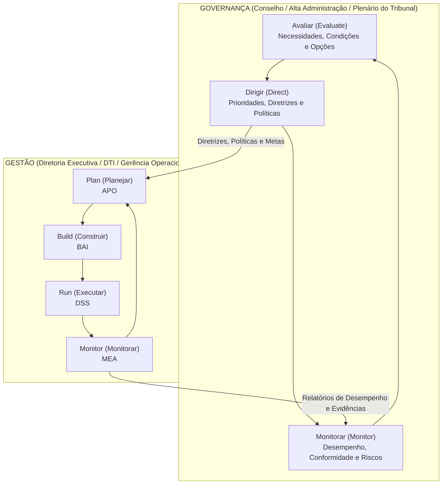
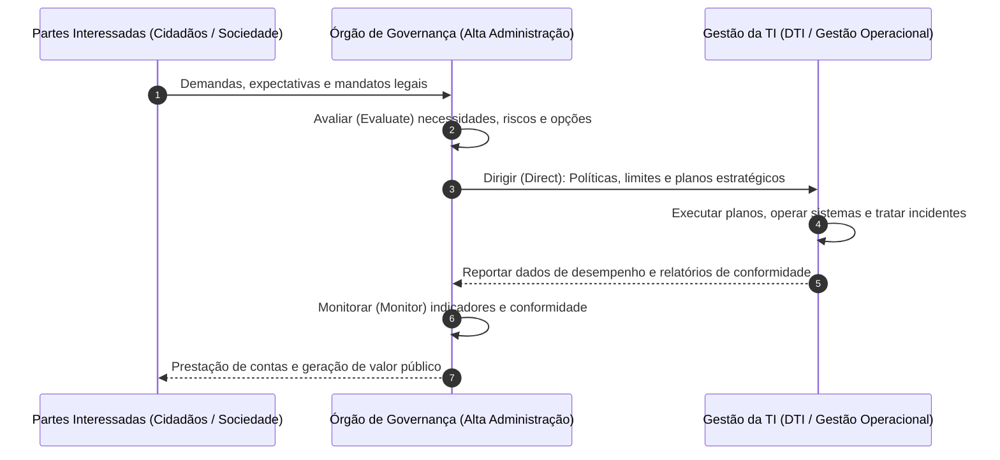
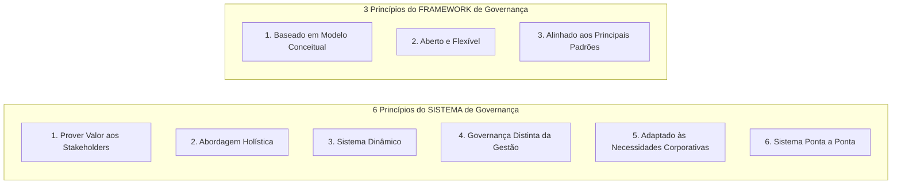
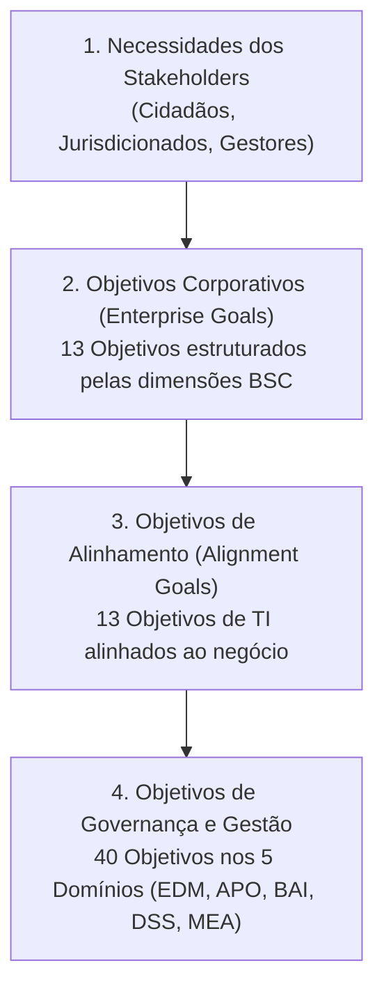
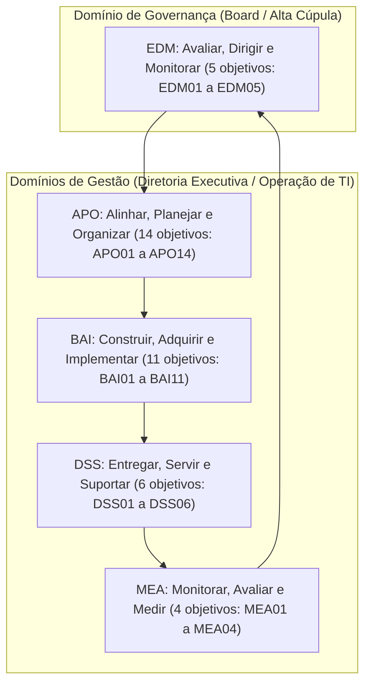
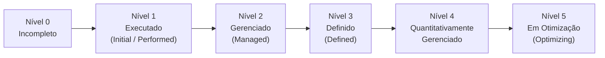

# 01 - Fundamentos de Governança, COBIT 2019 e ISO/IEC 38500:2024

> **Matéria:** Governança de Tecnologia da Informação  
> **Cargo:** B02 – Técnico de Controle Externo – Especialidade: Tecnologia da Informação  
> **Arquivo:** `01_fundamentos_governanca_cobit_2019_e_iso_38500.md`  

---

## 📌 Ementa / Itens do Edital
- Governança de TI vs. Gestão de TI: conceitos e alinhamento estratégico institucional
- Norma ABNT NBR ISO/IEC 38500:2024 (Governança Corporativa de Tecnologia da Informação)
- Framework COBIT 2019 (ISACA):
    - Princípios de Governança e do Framework
    - Componentes do Sistema de Governança e Fatores de Design (Design Factors)
    - Áreas de Foco (Focus Areas) e Cascatamento de Objetivos (Goals Cascade)
    - Os 40 Objetivos de Governança e Gestão (5 Domínios: EDM, APO, BAI, DSS, MEA)
    - Gestão de Desempenho do COBIT (CPM) e Níveis de Capacidade CMMI

---

## 🧭 Sumário

1. [Fundamentos da Governança de TI e Alinhamento Estratégico](#1-fundamentos-da-governanca-de-ti-e-alinhamento-estrategico)
1. [Distinção Essencial entre Governança e Gestão](#1-1-distincao-essencial-entre-governanca-e-gestao)
1. [Alinhamento Estratégico e Criação de Valor Público](#1-2-alinhamento-estrategico-e-criacao-de-valor-publico)
    1. [Teste 465](#Teste-465)
2. [Norma ABNT NBR ISO/IEC 38500:2024](#2-norma-abnt-nbr-isoiec-385002024)
2. [Escopo e Modelo de Governança (Ciclo EDM)](#2-1-escopo-e-modelo-de-governanca-ciclo-edm)
    1. [Teste 466](#Teste-466)
2. [Os Seis Princípios da Boa Governança de TI](#2-2-os-seis-principios-da-boa-governanca-de-ti)
    1. [Teste 467](#Teste-467)
3. [Framework COBIT 2019 (ISACA)](#3-framework-cobit-2019-isaca)
3. [Princípios do Sistema e do Framework de Governança](#3-1-principios-do-sistema-e-do-framework-de-governanca)
    1. [Teste 468](#Teste-468)
3. [Componentes do Sistema de Governança (7 Componentes)](#3-2-componentes-do-sistema-de-governanca-7-componentes)
    1. [Teste 469](#Teste-469)
3. [Fatores de Design (11 Design Factors) e Áreas de Foco (Focus Areas)](#3-3-fatores-de-design-11-design-factors-e-areas-de-foco-focus-areas)
    1. [Teste 470](#Teste-470)
3. [Cascatamento de Objetivos (Goals Cascade)](#3-4-cascatamento-de-objetivos-goals-cascade)
    1. [Teste 471](#Teste-471)
3. [Os 40 Objetivos de Governança e Gestão nos 5 Domínios](#3-5-os-40-objetivos-de-governanca-e-gestao-nos-5-dominios)
    1. [Teste 472](#Teste-472)
3. [Gestão de Desempenho do COBIT (CPM) e Níveis de Capacidade CMMI](#3-6-gestao-de-desempenho-do-cobit-cpm-e-niveis-de-capacidade-cmmi)
    1. [Teste 473](#Teste-473)
    2. [Teste 474](#Teste-474)
6. [Fontes Recomendadas na Internet](#6-fontes-recomendadas-na-internet)

---

## 1. Fundamentos da Governança de TI e Alinhamento Estratégico

---

## 1.1 Distinção Essencial entre Governança e Gestão

A separação entre **Governança** e **Gestão** é o pilar estruturante de maior incidência em provas da Fundação Carlos Chagas (FCC) na disciplina de Governança de TI. Trata-se de responsabilidades, papéis e ciclos operacionais completamente distintos, embora fortemente integrados.

#### Tabela Comparativa: Governança de TI versus Gestão de TI

| Dimensão de Análise | Governança de TI (*Governance*) | Gestão de TI (*Management*) |
| :--- | :--- | :--- |
| **Papel Primário** | Direcionamento estratégico, supervisão, liderança institucional e prestação de contas (*Accountability*). | Execução técnica, coordenação operacional, manutenção de rotinas e entrega diária de serviços. |
| **Responsável Típico** | Alta Administração, Conselho de Administração, Plenário e Comitês Estratégicos de Governança. | Diretoria Executiva de TI (CIO/DTI), gerentes de projetos, equipes de desenvolvimento e suporte. |
| **Atividades Centrais** | **EDM**: Avaliar (*Evaluate*), Dirigir (*Direct*) e Monitorar (*Monitor*). | **PBRM**: Planejar (*Plan*), Construir (*Build*), Executar (*Run*) e Monitorar (*Monitor*). |
| **Horizonte Temporal** | Longo prazo (visão plurianual, sustentabilidade e impacto institucional). | Curto e médio prazo (sprints de desenvolvimento, chamados operacionais, metas contratuais imediatas). |
| **Objetivo Maior** | **Criação de Valor**: Realização de benefícios com balanceamento e otimização de riscos e recursos. | Eficiência técnica, cumprimento estrito de SLAs, produtividade e estabilidade dos sistemas em produção. |
| **Ponto de Partida** | Necessidades das partes interessadas (*stakeholders*: cidadãos, magistrados, auditores, jurisdicionados). | Diretrizes, limites orçamentários, apetite a risco e prioridades deliberadas pela governança. |

> 🚨 **ALERTA DE PROVA / PEGADINHA FCC:**  
> A banca frequentemente tenta confundir o candidato atribuindo à Governança tarefas de execução (como configurar roteadores, gerenciar chamados de help desk ou planejar sprints). Lembre-se: a governança **define o que fazer e em qual direção ir**, avaliando, dirigindo e monitorando. A gestão cuida do **como fazer**, planejando, construindo, executando e monitorando o trabalho diário.

---

---

## 1.2 Alinhamento Estratégico e Criação de Valor Público

No setor público, e em especial nos órgãos de controle externo como o TCE-GO, o alinhamento estratégico da Tecnologia da Informação não tem como meta o lucro, mas sim a **criação de valor público**. Isso significa garantir que os recursos aplicados em tecnologia resultem em fiscalizações mais ágeis, auditorias digitais baseadas em cruzamento massivo de dados, transparência ativa ao cidadão e prestação jurisdicional de excelência.

O alinhamento estratégico é teorizado pelo clássico **Modelo de Alinhamento Estratégico (SAM - *Strategic Alignment Model*) de Henderson & Venkatraman**, que articula quatro domínios fundamentais:

1. **Estratégia do Negócio:** Escopo corporativo, competências distintivas e governança corporativa.
2. **Estratégia de TI:** Escopo de tecnologia, competências sistêmicas e governança de TI.
3. **Infraestrutura e Processos Organizacionais:** Estrutura administrativa, processos de trabalho corporativos e habilidades dos servidores.
4. **Infraestrutura e Processos de TI:** Arquitetura tecnológica, processos operacionais de TI e habilidades da equipe técnica.

A governança assegura a integração bidirecional contínua entre a estratégia institucional e a estratégia de TI, evitando que a área técnica formule objetivos isolados ou desconectados das reais prioridades de fiscalização e auditoria do Tribunal.

---

### Teste 465
**(FCC – TRT 23ª – 2016 – Analista Judiciário - Apoio Especializado - Tecnologia da Informação)**
Conforme sugerido pelo COBIT 5, os dois objetivos de TI, relacionados de forma primária ou secundária ao seu Processo Gerenciar Fornecedores, são:

* **A)** Conhecimento, expertise e iniciativas para inovação dos negócios; Equipes de TI e de negócios motivadas e qualificadas.
* **B)** Prestação de serviços de TI em consonância com os requisitos de negócio; Conhecimento, expertise e iniciativas para inovação dos negócios.
* **C)** Alinhamento da estratégia de TI e de negócios; Capacitação e apoio aos processos de negócio através da integração de aplicativos e tecnologia nos processos de negócio.
* **D)** Equipes de TI e de negócios motivadas e qualificadas; Capacitação e apoio aos processos de negócio através da integração de aplicativos e tecnologia nos processos de negócio.
* **E)** Capacitação e apoio aos processos de negócio através da integração de aplicativos e tecnologia nos processos de negócio; Prestação de serviços de TI em consonância com os requisitos de negócio.

---

> **Comentário Detalhado:**
>
> - **A)** **Incorreta.** A opção apresenta proposição em desacordo com os fundamentos teóricos e técnicos do tópico ao afirmar que "Conhecimento, expertise e iniciativas para inovação dos negócios; Equipes de TI e de negócios motivadas e...". De acordo com a teoria estudada em *Os 11 Fatores de Design (Design Factors)*, estratégia corporativa (*Enterprise Strategy*): Liderança em custos, diferenciação, inovação ou prestação de serviços essenciais.
> - **B)** **Incorreta.** A opção apresenta proposição em desacordo com os fundamentos teóricos e técnicos do tópico ao afirmar que "Prestação de serviços de TI em consonância com os requisitos de negócio; Conhecimento, expertise e iniciativas...". De acordo com a teoria estudada em *1.2 Alinhamento Estratégico e Criação de Valor Público*, isso significa garantir que os recursos aplicados em tecnologia resultem em fiscalizações mais ágeis, auditorias digitais baseadas em cruzamento massivo de dados, transparência ativa ao cidadão e prestação jurisdicional de excelência.
> - **C)** **Incorreta.** A opção apresenta proposição em desacordo com os fundamentos teóricos e técnicos do tópico ao afirmar que "Alinhamento da estratégia de TI e de negócios; Capacitação e apoio aos processos de negócio através da integração...". De acordo com a teoria estudada em *1.2 Alinhamento Estratégico e Criação de Valor Público*, a governança assegura a integração bidirecional contínua entre a estratégia institucional e a estratégia de TI, evitando que a área técnica formule objetivos isolados ou desconectados das reais prioridades de fiscalização e auditoria do Tribunal.
> - **D)** **Incorreta.** A opção apresenta proposição em desacordo com os fundamentos teóricos e técnicos do tópico ao afirmar que "Equipes de TI e de negócios motivadas e qualificadas; Capacitação e apoio aos processos de negócio através da...". De acordo com a teoria estudada em *Níveis de Capacidade de Processo (CPM / CMMI: 0 a 5)*, 1: Executado (*Initial / Performed*) — O processo atinge seu propósito através de um conjunto incompleto de atividades; atua de forma intuitiva, sem padronização formal.
> - **E)** **Correta.** Conforme fundamentado na seção *Relação Detalhada dos 40 Objetivos do COBIT 2019* deste guia, dSS06: Gerenciar os Controles de Processos de Negócio. Dessa forma, está plenamente correta a assertiva da banca (FCC – TRT 23ª/2016) ao estabelecer que "Capacitação e apoio aos processos de negócio através da integração de aplicativos e tecnologia nos processos de...".
>
> **Gabarito: E**

---

## 2. Norma ABNT NBR ISO/IEC 38500:2024

---

## 2.1 Escopo e Modelo de Governança (Ciclo EDM)

A norma **ABNT NBR ISO/IEC 38500:2024** fornece princípios e diretrizes para os órgãos deliberativos e membros da alta administração das organizações (públicas ou privadas, de qualquer porte ou setor) sobre a utilização aceitável, eficaz e eficiente da TI.

A governança atua segundo o modelo cíclico **EDM**:

- **Avaliar (*Evaluate*):** Examinar continuamente as circunstâncias presentes e futuras, considerando demandas dos stakeholders, tendências tecnológicas, requisitos legais e restrições financeiras.
- **Dirigir (*Direct*):** Atribuir responsabilidades e orientar a preparação e execução de estratégias, planos de TI e políticas institucionais.
- **Monitorar (*Monitor*):** Acompanhar periodicamente se a gestão está operando em conformidade com as diretrizes e se os objetivos de desempenho planejados estão sendo atingidos.

---

### Teste 466
**(CEBRASPE – STF – 2013 – Analista Judiciario Suporte Em Tecnologia Da Informacao)**
O COBIT 5 possui cinco domínios, sendo um deles o domínio Avaliar, Direcionar e Monitorar (EDM – Evaluate, Direct and Monitor), afeto diretamente à governança e relacionado a ISO 38500.

* **C)** Certo
* **E)** Errado

---

> **Comentário Detalhado:**
>
> - **C)** **Correta.** O item está **Certo**. Conforme fundamentado na seção *Tabela Comparativa: Governança de TI versus Gestão de TI* deste guia, atividades Centrais: EDM: Avaliar (*Evaluate*), Dirigir (*Direct*) e Monitorar (*Monitor*). — PBRM: Planejar (*Plan*), Construir (*Build*), Executar (*Run*) e Monitorar (*Monitor*). Dessa forma, está plenamente correta a proposição da banca (CEBRASPE – STF/2013) ao afirmar que "O COBIT 5 possui cinco domínios, sendo um deles o domínio Avaliar, Direcionar e Monitorar (EDM – Evaluate...".
> - **E)** **Incorreta.** A marcação como **Errado** não procede, visto que a assertiva guarda integral conformidade com a teoria estudada em *2.1 Escopo e Modelo de Governança (Ciclo EDM)*, segundo a qual monitorar (*Monitor*): Acompanhar periodicamente se a gestão está operando em conformidade com as diretrizes e se os objetivos de desempenho planejados estão sendo atingidos.
>
> **Gabarito: C**

---

## 2.2 Os Seis Princípios da Boa Governança de TI

A ISO/IEC 38500 prescreve **seis princípios** fundamentais que orientam a tomada de decisão da alta administração:

| Nº | Princípio | Significado / Exigência Normativa | Foco de Cobrança FCC |
| :---: | :--- | :--- | :--- |
| **1** | **Responsabilidade** (*Responsibility*) | Indivíduos e comitês compreendem e aceitam suas responsabilidades relativas à oferta e demanda de TI. Autoridade delegada deve ser proporcional à responsabilidade. | Não pode haver ambiguidade de papéis; a responsabilidade de governança jamais pode ser transferida ou terceirizada a fornecedores externos. |
| **2** | **Estratégia** (*Strategy*) | A estratégia de TI deve estar perfeitamente alinhada e suportar as necessidades atuais e as aspirações futuras da estratégia corporativa. | TI não cria estratégia isolada; a TI viabiliza os objetivos institucionais e o plano de diretrizes do órgão. |
| **3** | **Aquisição** (*Acquisition*) | As aquisições de TI são feitas por razões válidas, com base em análise apropriada e contínua do Custo Total de Propriedade (TCO) e retorno esperado. | Veda compras impulsivas ou sem Estudo Técnico Preliminar (ETP) fundamentado. Exige análise de ciclo de vida completo. |
| **4** | **Desempenho** (*Performance*) | A TI atende às necessidades da organização, entregando serviços com os níveis de serviço e capacidade exigidos pelo negócio. | Monitoramento contínuo de disponibilidade, tempo de resposta e eficácia dos sistemas em produção. |
| **5** | **Conformidade** (*Conformance*) | A TI opera em estrita conformidade com toda a legislação, regulações e políticas internas aplicáveis (LGPD, Marco Civil, Lei 14.133/2021). | As práticas de governança devem assegurar aderência legal e auditoria formal periódica. |
| **6** | **Comportamento Humano** (*Human Behaviour*) | As políticas, práticas e decisões de TI respeitam os fatores humanos, culturais e as necessidades de todas as pessoas envolvidas. | Treinamento, usabilidade, ergonomia, acessibilidade e gestão de mudanças comportamentais no trabalho. |

> 🚨 **ALERTA DE PROVA / PEGADINHA FCC:**  
> A FCC adora cobrar a lista exata dos 6 princípios da ISO/IEC 38500 trocando palavras como "Comportamento Humano" por "Comportamento Financeiro", "Econômico" ou inventando termos como "Agilidade" e "Virtualização". Grave o mnemônico: **R-E-A-D-C-H** (*Responsibility, Strategy, Acquisition, Performance, Conformance, Human Behaviour*).

---

### Teste 467
**(FCC – TRT 14ª – 2016 – Analista Judiciário - Apoio Especializado - Tecnologia da Informação)**
O modelo de qualidade de software MPS.BR

* **A)** não é compatível com a Norma NBR ISO/IEC 12207:2009.
* **B)** adota a ITIL v3 como padrão de gerenciamento da qualidade de serviços de TI.
* **C)** não pode ser aplicado em nenhum Tribunal Regional do Trabalho.
* **D)** não atende às necessidades das empresas brasileiras, que preferem a adoção do CMMI.
* **E)** não conflita com as metodologias ágeis de software, podendo ser utilizado junto com o Scrum.

---

> **Comentário Detalhado:**
>
> - **A)** **Incorreta.** A opção apresenta proposição em desacordo com os fundamentos teóricos e técnicos do tópico ao afirmar que "não é compatível com a Norma NBR ISO/IEC 12207:2009". De acordo com a teoria estudada em *2.1 Escopo e Modelo de Governança (Ciclo EDM)*, a norma ABNT NBR ISO/IEC 38500:2024 fornece princípios e diretrizes para os órgãos deliberativos e membros da alta administração das organizações (públicas ou privadas, de qualquer porte ou setor) sobre a utilização aceitável, eficaz e eficiente da TI.
> - **B)** **Incorreta.** A opção apresenta proposição em desacordo com os fundamentos teóricos e técnicos do tópico ao afirmar que "adota a ITIL v3 como padrão de gerenciamento da qualidade de serviços de TI". De acordo com a teoria estudada em *Tabela Comparativa dos Princípios do COBIT 2019*, 3. Sistema dinâmico: Sempre que um ou mais fatores de design mudarem, o impacto sobre o sistema de governança deve ser reavaliado.: 3. Alinhado aos principais padrões: Deve harmonizar-se com os padrões de referência (ISO, ITIL, TOGAF, PMBOK, NIST).
> - **C)** **Correta.** Conforme fundamentado na seção *2.2 Os Seis Princípios da Boa Governança de TI* deste guia, autoridade delegada deve ser proporcional à responsabilidade. — Não pode haver ambiguidade de papéis; a responsabilidade de governança jamais pode ser transferida ou terceirizada a fornecedores externos. Dessa forma, está plenamente correta a assertiva da banca (FCC – TRT 14ª/2016) ao estabelecer que "não pode ser aplicado em nenhum Tribunal Regional do Trabalho".
> - **D)** **Incorreta.** A opção apresenta proposição em desacordo com os fundamentos teóricos e técnicos do tópico ao afirmar que "não atende às necessidades das empresas brasileiras, que preferem a adoção do CMMI". De acordo com a teoria estudada em *2.2 Os Seis Princípios da Boa Governança de TI*, 4: Desempenho (*Performance*) — A TI atende às necessidades da organização, entregando serviços com os níveis de serviço e capacidade exigidos pelo negócio. — Monitoramento contínuo de disponibilidade, tempo de resposta e eficácia dos sistemas em produção.
> - **E)** **Incorreta.** A opção apresenta proposição em desacordo com os fundamentos teóricos e técnicos do tópico ao afirmar que "não conflita com as metodologias ágeis de software, podendo ser utilizado junto com o Scrum". De acordo com a teoria estudada em *Os 11 Fatores de Design (Design Factors)*, métodos de implementação de TI (*IT Implementation Methods*): Abordagens ágeis (DevOps, Scrum) vs. métodos tradicionais preditivos (cascata/waterfall).
>
> **Gabarito: C**

---

## 3. Framework COBIT 2019 (ISACA)

O **COBIT 2019** (*Control Objectives for Information and Related Technologies*) é o framework líder mundial de governança e gestão corporativa de informação e tecnologia (I&T), publicado pela ISACA. O COBIT não é prescritivo em nível de codificação ou configuração de servidores; ele funciona como um **framework guarda-chuva** integrador, alinhando padrões técnicos (como ITIL, PMBOK, TOGAF e ISO 27001) às metas institucionais.

---

## 3.1 Princípios do Sistema e do Framework de Governança

Uma das maiores inovações do COBIT 2019 foi dividir formalmente os princípios em duas categorias:

1. **6 Princípios para o Sistema de Governança** (*Governance System Principles*).
2. **3 Princípios para o Framework de Governança** (*Governance Framework Principles*).

#### Tabela Comparativa dos Princípios do COBIT 2019

| Princípios do **Sistema** de Governança (6) | Princípios do **Framework** de Governança (3) |
| :--- | :--- |
| **1. Prover valor aos stakeholders:** O sistema deve gerar valor a partir do uso de I&T balanceando benefícios, riscos e uso otimizado de recursos. | **1. Baseado em um modelo conceitual:** Deve identificar os principais componentes e relacionamentos para garantir consistência e automação. |
| **2. Abordagem holística:** O sistema é construído a partir de múltiplos tipos de componentes integrados entre si. | **2. Aberto e flexível:** Deve permitir a inclusão de novos conteúdos e tecnologias emergentes sem desestruturar o núcleo original. |
| **3. Sistema dinâmico:** Sempre que um ou mais fatores de design mudarem, o impacto sobre o sistema de governança deve ser reavaliado. | **3. Alinhado aos principais padrões:** Deve harmonizar-se com os padrões de referência (ISO, ITIL, TOGAF, PMBOK, NIST). |
| **4. Governança distinta da gestão:** O sistema mantém clara separação estrutural e conceitual entre governança e gestão. | — |
| **5. Adaptado às necessidades corporativas:** Deve ser customizado conforme o contexto organizacional por meio de fatores de design (*tailoring*). | — |
| **6. Sistema ponta a ponta:** Cobre todas as informações e tecnologias de toda a organização, e não apenas o departamento de TI. | — |

> 🚨 **ALERTA DE PROVA / PEGADINHA FCC:**  
> A banca FCC frequentemente afirma em enunciados que "Baseado em Modelo Conceitual" ou "Aberto e Flexível" são princípios do *Sistema de Governança*. **Errado!** Esses são princípios do **Framework de Governança**. Da mesma forma, "Sistema Dinâmico" e "Abordagem Holística" pertencem ao **Sistema**, e não ao framework!

---

### Teste 468
**(CEBRASPE – STJ – 2024 – Analista Judiciário - Apoio Especializado - Suporte em Tecnologia da Informação)**
No COBIT 2019, o princípio Aplicar modelo único integrado estabelece que os componentes como processos, estruturas, arquiteturas e pessoas devem funcionar em conjunto para a construção de um sistema de governança eficiente.

* **C)** Certo
* **E)** Errado

---

> **Comentário Detalhado:**
>
> - **C)** **Incorreta.** A marcação como **Certo** não procede, pois o enunciado apresenta proposição em desacordo com os fundamentos teóricos e técnicos do tópico ao afirmar que "No COBIT 2019, o princípio Aplicar modelo único integrado estabelece que os componentes como processos...". De acordo com a teoria estudada em *Áreas de Foco (Focus Areas)*, uma Área de Foco descreve um tópico, domínio de governança ou desafio tecnológico específico que requer a seleção e priorização de um conjunto direcionado de componentes e objetivos de governança do COBIT 2019.
> - **E)** **Correta.** O item está **Errado** (gabarito oficial: **E**). Conforme fundamentado na seção *Os 11 Fatores de Design (Design Factors)* deste guia, o COBIT 2019 não adota o modelo "tamanho único" (*one size fits all*). Para viabilizar a adaptação (*tailoring*) do sistema de governança à realidade de cada órgão ou empresa, são utilizados 11 Fatores de Design. Portanto, a assertiva examinada pela banca (CEBRASPE – STJ/2024) viola os preceitos técnicos do tópico.
>
> **Gabarito: E**

---

## 3.2 Componentes do Sistema de Governança (7 Componentes)

Para construir, operar e manter um sistema de governança funcional, o COBIT 2019 define **7 categorias de Componentes** (denominados "Habilitadores" no antigo COBIT 5):

1. **Processos:** Conjuntos estruturados de práticas e atividades concebidos para atingir determinados objetivos e produzir saídas úteis.
2. **Estruturas Organizacionais:** Entidades e comitês formais responsáveis pela tomada de decisão (Comitê de Governança Digital, Plenário, DTI).
3. **Princípios, Políticas e Estruturas:** Instrumentos normativos que traduzem comportamentos e diretrizes desejadas em orientações práticas cotidianas.
4. **Informação:** Dados e fluxos informacionais consumidos e produzidos pela organização (relevância, segurança, precisão, completude).
5. **Cultura, Ética e Comportamento:** Posturas éticas, hábitos e traços culturais dos servidores e da liderança corporativa.
6. **Pessoas, Habilidades e Competências:** Capital humano, competências técnicas e conhecimentos requeridos para a execução das práticas.
7. **Serviços, Infraestrutura e Aplicações:** A infraestrutura tecnológica, redes, data centers, ferramentas de software e aplicações corporativas.

---

### Teste 469
**(FGV – TJ/AP – 2023 – Analista Judiciario Apoio Especializado Tecnologia Da Informacao Telecomunicacoes)**
Os processos de governança de serviços de TI são divididos em 4 domínios, de acordo com o guia COBIT. Os processos do domínio de planejar e organizar têm como objetivos gerais:

* **A)** apresentar como a infraestrutura de TI contribui para o atendimento dos objetivos institucionais da organização;
* **B)** identificar, desenvolver ou adquirir soluções de TI que acompanham as mudanças da organização;
* **C)** realizar a implantação de novos serviços de TI, levando em conta também aspectos de treinamento e segurança;
* **D)** monitorar o funcionamento dos serviços de TI, analisando a aderência aos requisitos definidos para a área;
* **E)** realizar a contratação de serviços de TI com base nas expectativas de uma determinada organização.

---

> **Comentário Detalhado:**
>
> - **A)** **Correta.** Conforme fundamentado na seção *2.2 Os Seis Princípios da Boa Governança de TI* deste guia, 2: Estratégia (*Strategy*) — A estratégia de TI deve estar perfeitamente alinhada e suportar as necessidades atuais e as aspirações futuras da estratégia corporativa. — TI não cria estratégia isolada; a TI viabiliza os objetivos institucionais e o plano de diretrizes do órgão. Dessa forma, está plenamente correta a assertiva da banca (FGV – TJ/AP/2023) ao estabelecer que "apresentar como a infraestrutura de TI contribui para o atendimento dos objetivos institucionais da organização".
> - **B)** **Incorreta.** A opção apresenta proposição em desacordo com os fundamentos teóricos e técnicos do tópico ao afirmar que "identificar, desenvolver ou adquirir soluções de TI que acompanham as mudanças da organização". De acordo com a teoria estudada em *Relação Detalhada dos 40 Objetivos do COBIT 2019*, bAI03: Gerenciar a Identificação e Construção de Soluções.
> - **C)** **Incorreta.** A opção apresenta proposição em desacordo com os fundamentos teóricos e técnicos do tópico ao afirmar que "realizar a implantação de novos serviços de TI, levando em conta também aspectos de treinamento e segurança". De acordo com a teoria estudada em *Relação Detalhada dos 40 Objetivos do COBIT 2019*, dSS05: Gerenciar os Serviços de Segurança.
> - **D)** **Incorreta.** A opção apresenta proposição em desacordo com os fundamentos teóricos e técnicos do tópico ao afirmar que "monitorar o funcionamento dos serviços de TI, analisando a aderência aos requisitos definidos para a área". De acordo com a teoria estudada em *3.2 Componentes do Sistema de Governança (7 Componentes)*, serviços, Infraestrutura e Aplicações: A infraestrutura tecnológica, redes, data centers, ferramentas de software e aplicações corporativas.
> - **E)** **Incorreta.** A opção apresenta proposição em desacordo com os fundamentos teóricos e técnicos do tópico ao afirmar que "realizar a contratação de serviços de TI com base nas expectativas de uma determinada organização". De acordo com a teoria estudada em *2.2 Os Seis Princípios da Boa Governança de TI*, 4: Desempenho (*Performance*) — A TI atende às necessidades da organização, entregando serviços com os níveis de serviço e capacidade exigidos pelo negócio. — Monitoramento contínuo de disponibilidade, tempo de resposta e eficácia dos sistemas em produção.
>
> **Gabarito: A**

---

## 3.3 Fatores de Design (11 Design Factors) e Áreas de Foco (Focus Areas)

#### Os 11 Fatores de Design (*Design Factors*)
O COBIT 2019 não adota o modelo "tamanho único" (*one size fits all*). Para viabilizar a adaptação (*tailoring*) do sistema de governança à realidade de cada órgão ou empresa, são utilizados **11 Fatores de Design**:

1. **Estratégia corporativa (*Enterprise Strategy*):** Liderança em custos, diferenciação, inovação ou prestação de serviços essenciais.
2. **Objetivos corporativos (*Enterprise Goals*):** As prioridades desdobradas no Balanced Scorecard.
3. **Perfil de risco (*Risk Profile*):** O apetite e a tolerância a riscos de TI da instituição.
4. **Problemas relacionados a I&T (*I&T-Related Issues*):** Histórico de falhas, projetos com estouro de orçamento ou carência de competências.
5. **Cenário de ameaças (*Threat Landscape*):** Grau de exposição a ataques cibernéticos e espionagem de dados.
6. **Requisitos de conformidade (*Compliance Requirements*):** Rigidez regulatória externa (ex.: setor público sujeito à fiscalização do TCU/TCE vs. startups).
7. **Papel da TI (*Role of IT*):** Papel estratégico (TI como motor essencial da missão) vs. suporte (*back-office* básico).
8. **Modelo de fornecimento de TI (*Sourcing Model for IT*):** Terceirização (outsourcing), equipes próprias (insourcing), nuvem ou modelo híbrido.
9. **Métodos de implementação de TI (*IT Implementation Methods*):** Abordagens ágeis (DevOps, Scrum) vs. métodos tradicionais preditivos (cascata/waterfall).
10. **Estratégia de adoção de tecnologia (*Technology Adoption Strategy*):** Inovador pioneiro (*first mover*), seguidor rápido (*fast follower*) ou adotante conservador (*slow adopter*).
11. **Tamanho da organização (*Enterprise Size*):** Grande corporação / órgão público de grande porte vs. pequenas e médias organizações.

#### Áreas de Foco (*Focus Areas*)
Uma **Área de Foco** descreve um tópico, domínio de governança ou desafio tecnológico específico que requer a seleção e priorização de um conjunto direcionado de componentes e objetivos de governança do COBIT 2019. Exemplos de áreas de foco publicadas pela ISACA incluem: Segurança da Informação (*Information Security*), DevOps, Pequenas e Médias Empresas (PMEs) e Governança de Nuvem (*Cloud Governance*). As áreas de foco podem ser ilimitadas e são expandidas continuamente pela comunidade.

---

### Teste 470
**(FCC – TRT 16ª – 2014 – Analista Judiciário - Tecnologia da Informação)**
De acordo com o CobiT 4.1, as organizações não podem atingir seus requisitos de negócios e governança sem adotar e implementar um modelo para governança e controle de TI para fazer uma ligação com os requisitos de negócios, identificar os I recursos mais importantes a serem aprimorados e definir os objetivos de a serem considerados, dentre outros aspectos.  II A estratégia da organização deve ser traduzida pela área de negócios em objetivos relacionados às iniciativas de TI. Esses  III objetivos devem levar a uma clara definição dos próprios objetivos , o que por sua vez irá definir os recursos e capacidades  de TI, ou a arquitetura de TI para a organização, necessários para executar de maneira bem-sucedida a parte que cabe à TI na sua estratégia. As lacunas I, II e III são, correta e respectivamente, preenchidas por:

* **A)** de controles gerenciais - de negócios - de TI
* **B)** de negócios - de controle - tecnológicos
* **C)** de maturidade - estratégicos - de TI
* **D)** de capacidade - de controle - estratégicos
* **E)** de TI - de controles gerenciais - de negócios

---

> **Comentário Detalhado:**
>
> - **A)** **Correta.** Conforme fundamentado na seção *Relação Detalhada dos 40 Objetivos do COBIT 2019* deste guia, dSS06: Gerenciar os Controles de Processos de Negócio. Dessa forma, está plenamente correta a assertiva da banca (FCC – TRT 16ª/2014) ao estabelecer que "de controles gerenciais - de negócios - de TI".
> - **B)** **Incorreta.** A opção apresenta proposição em desacordo com os fundamentos teóricos e técnicos do tópico ao afirmar que "de negócios - de controle - tecnológicos". De acordo com a teoria estudada em *Tabela Comparativa dos Princípios do COBIT 2019*, 3. Sistema dinâmico: Sempre que um ou mais fatores de design mudarem, o impacto sobre o sistema de governança deve ser reavaliado.: 3. Alinhado aos principais padrões: Deve harmonizar-se com os padrões de referência (ISO, ITIL, TOGAF, PMBOK, NIST).
> - **C)** **Incorreta.** A opção apresenta proposição em desacordo com os fundamentos teóricos e técnicos do tópico ao afirmar que "de maturidade - estratégicos - de TI". De acordo com a teoria estudada em *3.6 Gestão de Desempenho do COBIT (CPM) e Níveis de Capacidade CMMI*, no COBIT 2019, o modelo de medição de capacidade e maturidade migrou da ISO/IEC 33000 (usada no COBIT 5) para a escala alinhada ao CMMI (*Capability Maturity Model Integration*).
> - **D)** **Incorreta.** A opção apresenta proposição em desacordo com os fundamentos teóricos e técnicos do tópico ao afirmar que "de capacidade - de controle - estratégicos". De acordo com a teoria estudada em *Níveis de Capacidade de Processo (CPM / CMMI: 0 a 5)*, 3: Definido (*Defined*) — O processo é bem caracterizado, compreendido e executado com base em procedimentos padronizados em toda a organização (*organizational standards*).
> - **E)** **Incorreta.** A opção apresenta proposição em desacordo com os fundamentos teóricos e técnicos do tópico ao afirmar que "de TI - de controles gerenciais - de negócios". De acordo com a teoria estudada em *Tabela Comparativa dos Princípios do COBIT 2019*, baseado em um modelo conceitual: Deve identificar os principais componentes e relacionamentos para garantir consistência e automação.
>
> **Gabarito: A**

---

## 3.4 Cascatamento de Objetivos (Goals Cascade)

O mecanismo do COBIT 2019 traduz as necessidades das partes interessadas em ações e objetivos práticos de TI por meio de quatro níveis em cascata:

- **1. Necessidades dos Stakeholders:** Criam os direcionadores corporativos e estratégicos do órgão.
- **2. 13 Objetivos Corporativos (*Enterprise Goals*):** Classificados sob as 4 dimensões do *Balanced Scorecard* (Financeira, Clientes, Processos Internos, Aprendizado e Crescimento).
- **3. 13 Objetivos de Alinhamento (*Alignment Goals*):** Objetivos técnicos de TI alinhados diretamente aos objetivos corporativos (no COBIT 5 eram 17 objetivos de TI; no COBIT 2019 foram otimizados para 13).
- **4. 40 Objetivos de Governança e Gestão:** Cada um associado a um processo e aos componentes do sistema.

---

### Teste 471
**(FCC – TRT 9ª – 2015 – Analista Judiciário - Apoio Especializado - Tecnologia da Informação)**
Seguindo as boas práticas preconizadas pelo COBIT 5, um Analista da área de TI elencou as seguintes perguntas: − Como posso saber se as operações de um parceiro comercial são seguras e confiáveis? − Como posso saber se a organização cumpre as regras e regulamentos aplicáveis? − Como posso saber se a organização mantém um sistema eficiente de controle interno? − Os parceiros comerciais têm a cadeia de informações entre eles sob controle? De acordo com o COBIT 5, estas perguntas

* **A)** são dirigidas às partes interessadas externas. Estão relacionadas aos objetivos corporativos, versam sobre governança e gestão de TI da organização e servem como entrada para a cascata de objetivos.
* **B)** visam unificar a criação de valor para as diversas partes interessadas de uma organização. Gestão de contratos é negociar e decidir entre os interesses de valor das diferentes partes interessadas externas.
* **C)** indicam que o sistema de governança de TI deve considerar apenas as partes interessadas externas ao tomar decisões sobre a avaliação dos recursos, benefícios e riscos.
* **D)** referem-se às necessidades das partes interessadas internas e norteiam a cascata de objetivos do COBIT 5, que é o mecanismo de tradução das necessidades dos stakeholders em objetivos corporativos amplos e gerais.
* **E)** refletem a cascata de objetivos, que deve ser seguida à risca, pois contém o mapeamento universal entre os objetivos corporativos e os objetivos de TI e entre os objetivos de TI e os habilitadores do COBIT 5.

---

> **Comentário Detalhado:**
>
> - **A)** **Correta.** Conforme fundamentado na seção *3.4 Cascatamento de Objetivos (Goals Cascade)* deste guia, o mecanismo do COBIT 2019 traduz as necessidades das partes interessadas em ações e objetivos práticos de TI por meio de quatro níveis em cascata. Dessa forma, está plenamente correta a assertiva da banca (FCC – TRT 9ª/2015) ao estabelecer que "são dirigidas às partes interessadas externas. Estão relacionadas aos objetivos corporativos, versam sobre...".
> - **B)** **Incorreta.** A opção apresenta proposição em desacordo com os fundamentos teóricos e técnicos do tópico ao afirmar que "visam unificar a criação de valor para as diversas partes interessadas de uma organização. Gestão de contratos é...". De acordo com a teoria estudada em *Tabela Comparativa: Governança de TI versus Gestão de TI*, ponto de Partida: Necessidades das partes interessadas (*stakeholders*: cidadãos, magistrados, auditores, jurisdicionados). — Diretrizes, limites orçamentários, apetite a risco e prioridades deliberadas pela governança.
> - **C)** **Incorreta.** A opção incorre em restrição indevida ao limitar o escopo conceitual ao afirmar que "indicam que o sistema de governança de TI deve considerar apenas as partes interessadas externas ao tomar decisões...". De acordo com a teoria estudada em *Tabela Comparativa dos Princípios do COBIT 2019*, 1. Prover valor aos stakeholders: O sistema deve gerar valor a partir do uso de I&T balanceando benefícios, riscos e uso otimizado de recursos.: 1.
> - **D)** **Incorreta.** A opção apresenta proposição em desacordo com os fundamentos teóricos e técnicos do tópico ao afirmar que "referem-se às necessidades das partes interessadas internas e norteiam a cascata de objetivos do COBIT 5, que é o...". De acordo com a teoria estudada em *3.4 Cascatamento de Objetivos (Goals Cascade)*, 1. Necessidades dos Stakeholders: Criam os direcionadores corporativos e estratégicos do órgão.
> - **E)** **Incorreta.** A opção apresenta proposição em desacordo com os fundamentos teóricos e técnicos do tópico ao afirmar que "refletem a cascata de objetivos, que deve ser seguida à risca, pois contém o mapeamento universal entre os...". De acordo com a teoria estudada em *Relação Detalhada dos 40 Objetivos do COBIT 2019*, eDM05: Garantir o Engajamento das Partes Interessadas (*Stakeholder Engagement*).
>
> **Gabarito: A**

---

## 3.5 Os 40 Objetivos de Governança e Gestão nos 5 Domínios

O COBIT 2019 organiza seus 40 objetivos em **5 Domínios**. O primeiro pertence exclusivamente à **Governança**, enquanto os demais quatro integram a **Gestão**:

#### Relação Detalhada dos 40 Objetivos do COBIT 2019

##### Domínio de Governança: EDM (*Evaluate, Direct and Monitor*) - 5 Objetivos
1. **EDM01:** Garantir a Definição e Manutenção do Framework de Governança.
2. **EDM02:** Garantir a Realização de Benefícios.
3. **EDM03:** Garantir a Otimização de Riscos.
4. **EDM04:** Garantir a Otimização de Recursos.
5. **EDM05:** Garantir o Engajamento das Partes Interessadas (*Stakeholder Engagement*).

##### Domínio de Gestão 1: APO (*Align, Plan and Organize*) - 14 Objetivos
1. **APO01:** Gerenciar o Framework de Gestão de I&T.
2. **APO02:** Gerenciar a Estratégia.
3. **APO03:** Gerenciar a Arquitetura Corporativa.
4. **APO04:** Gerenciar a Inovação.
5. **APO05:** Gerenciar o Portfólio.
6. **APO06:** Gerenciar o Orçamento e os Custos.
7. **APO07:** Gerenciar os Recursos Humanos.
8. **APO08:** Gerenciar os Relacionamentos.
9. **APO09:** Gerenciar os Acordos de Serviços (SLAs).
10. **APO10:** Gerenciar os Fornecedores.
11. **APO11:** Gerenciar a Qualidade.
12. **APO12:** Gerenciar os Riscos.
13. **APO13:** Gerenciar a Segurança.
14. **APO14:** Gerenciar os Dados *(Objetivo introduzido expressamente no COBIT 2019)*.

##### Domínio de Gestão 2: BAI (*Build, Acquire and Implement*) - 11 Objetivos
1. **BAI01:** Gerenciar Programas.
2. **BAI02:** Gerenciar a Definição de Requisitos.
3. **BAI03:** Gerenciar a Identificação e Construção de Soluções.
4. **BAI04:** Gerenciar a Disponibilidade e a Capacidade.
5. **BAI05:** Gerenciar a Mudança Organizacional.
6. **BAI06:** Gerenciar as Mudanças de TI (*IT Changes*).
7. **BAI07:** Gerenciar a Aceitação e Transição da Mudança de TI.
8. **BAI08:** Gerenciar o Conhecimento.
9. **BAI09:** Gerenciar os Ativos.
10. **BAI10:** Gerenciar a Configuração.
11. **BAI11:** Gerenciar Projetos *(Separado de Programas no COBIT 2019)*.

##### Domínio de Gestão 3: DSS (*Deliver, Service and Support*) - 6 Objetivos
1. **DSS01:** Gerenciar as Operações.
2. **DSS02:** Gerenciar as Requisições de Serviços e Incidentes.
3. **DSS03:** Gerenciar Problemas.
4. **DSS04:** Gerenciar a Continuidade.
5. **DSS05:** Gerenciar os Serviços de Segurança.
6. **DSS06:** Gerenciar os Controles de Processos de Negócio.

##### Domínio de Gestão 4: MEA (*Monitor, Evaluate and Assess*) - 4 Objetivos
1. **MEA01:** Monitorar, Avaliar e Medir o Desempenho e a Conformidade.
2. **MEA02:** Monitorar, Avaliar e Medir o Sistema de Controle Interno.
3. **MEA03:** Monitorar, Avaliar e Medir a Conformidade com Requisitos Externos.
4. **MEA04:** Monitorar, Avaliar e Medir a Garantia (*Assurance*).

---

### Teste 472
**(FGV – TJ/RR – 2024 – Analista Judiciario Gestao E Governanca De Tecnologia Da Informacao)**
O COBIT 2019 é um framework de governança e gestão de Tecnologia da Informação (TI) que fornece um conjunto de princípios, práticas e ferramentas para ajudar as organizações a alcançarem seus objetivos estratégicos por meio do gerenciamento eficaz da informação e tecnologia. Ele se concentra em garantir que a TI esteja alinhada com as metas da empresa, gerando valor e gerenciando riscos de forma eficiente. Entre os domínios que agrupam os objetivos da gestão no COBIT 2019 listados a seguir, assinale aquele que foca em como os objetivos estratégicos são traduzidos em planos táticos e operacionais, garantindo o alinhamento entre TI e os objetivos do negócio.

* **A)** Alinhar, Planejar e Organizar (APO -Align, Plan, and Organize).
* **B)** Construir, Adquirir e Implantar (BAI -Buid, Acquire, and Implement).
* **C)** Entregar, Prestar Serviço e Dar e Suporte (DSS - Deliver, Service, and Support).
* **D)** Monitorar, Avaliar e Melhorar (MEA -Monitor, Evaluate, and Assess).
* **E)** Construir, Adquirir e Melhorar (BEA – Bild, Evaluate and Assess).

---

> **Comentário Detalhado:**
>
> - **A)** **Correta.** Conforme fundamentado na seção *Tabela Comparativa: Governança de TI versus Gestão de TI* deste guia, atividades Centrais: EDM: Avaliar (*Evaluate*), Dirigir (*Direct*) e Monitorar (*Monitor*). — PBRM: Planejar (*Plan*), Construir (*Build*), Executar (*Run*) e Monitorar (*Monitor*). Dessa forma, está plenamente correta a assertiva da banca (FGV – TJ/RR/2024) ao estabelecer que "Alinhar, Planejar e Organizar (APO -Align, Plan, and Organize)".
> - **B)** **Incorreta.** A opção apresenta proposição em desacordo com os fundamentos teóricos e técnicos do tópico ao afirmar que "Construir, Adquirir e Implantar (BAI -Buid, Acquire, and Implement)". De acordo com a teoria estudada em *3. Framework COBIT 2019 (ISACA)*, o COBIT 2019 (*Control Objectives for Information and Related Technologies*) é o framework líder mundial de governança e gestão corporativa de informação e tecnologia (I&T), publicado pela ISACA.
> - **C)** **Incorreta.** A opção apresenta proposição em desacordo com os fundamentos teóricos e técnicos do tópico ao afirmar que "Entregar, Prestar Serviço e Dar e Suporte (DSS - Deliver, Service, and Support)". De acordo com a teoria estudada em *2.1 Escopo e Modelo de Governança (Ciclo EDM)*, a norma ABNT NBR ISO/IEC 38500:2024 fornece princípios e diretrizes para os órgãos deliberativos e membros da alta administração das organizações (públicas ou privadas, de qualquer porte ou setor) sobre a utilização aceitável, eficaz e eficiente da TI.
> - **D)** **Incorreta.** A opção apresenta proposição em desacordo com os fundamentos teóricos e técnicos do tópico ao afirmar que "Monitorar, Avaliar e Melhorar (MEA -Monitor, Evaluate, and Assess)". De acordo com a teoria estudada em *2.1 Escopo e Modelo de Governança (Ciclo EDM)*, monitorar (*Monitor*): Acompanhar periodicamente se a gestão está operando em conformidade com as diretrizes e se os objetivos de desempenho planejados estão sendo atingidos.
> - **E)** **Incorreta.** A opção apresenta proposição em desacordo com os fundamentos teóricos e técnicos do tópico ao afirmar que "Construir, Adquirir e Melhorar (BEA – Bild, Evaluate and Assess)". De acordo com a teoria estudada em *3.2 Componentes do Sistema de Governança (7 Componentes)*, para construir, operar e manter um sistema de governança funcional, o COBIT 2019 define 7 categorias de Componentes (denominados "Habilitadores" no antigo COBIT 5).
>
> **Gabarito: A**

---

## 3.6 Gestão de Desempenho do COBIT (CPM) e Níveis de Capacidade CMMI

No COBIT 2019, o modelo de medição de capacidade e maturidade migrou da ISO/IEC 33000 (usada no COBIT 5) para a escala alinhada ao **CMMI** (*Capability Maturity Model Integration*).

#### Níveis de Capacidade de Processo (CPM / CMMI: 0 a 5)

| Nível | Classificação | Descrição Prática do Desempenho do Processo |
| :---: | :--- | :--- |
| **0** | **Incompleto** (*Incomplete*) | O trabalho não atinge o propósito geral do processo. Poucas ou nenhuma atividade foram concluídas. |
| **1** | **Executado** (*Initial / Performed*) | O processo atinge seu propósito através de um conjunto incompleto de atividades; atua de forma intuitiva, sem padronização formal. |
| **2** | **Gerenciado** (*Managed*) | O processo é planejado, executado, monitorado e ajustado para atingir objetivos específicos. Os produtos de trabalho são controlados e mantidos adequadamente. |
| **3** | **Definido** (*Defined*) | O processo é bem caracterizado, compreendido e executado com base em procedimentos padronizados em toda a organização (*organizational standards*). |
| **4** | **Quantitativamente Gerenciado** (*Quantitatively Managed*) | O processo é controlado quantitativamente por meio de métricas estatísticas e técnicas de controle de qualidade, sendo altamente previsível. |
| **5** | **Em Otimização** (*Optimizing*) | O processo é continuamente aprimorado com base na compreensão quantitativa das causas de variações e na adoção de inovações tecnológicas. |

---

### Teste 473
**(FGV – TJ/AP – 2023 – Analista Judiciario Apoio Especializado Tecnologia Da Informacao Telecomunicacoes)**
O COBIT 4.1 é um framework de Governança de TI que oferece padrões de boas práticas através de um modelo de Domínios, Processos e Atividades. Com relação ao Modelo de Maturidade do COBIT 4.1, analise os itens a seguir: I. No nível 1, Inicial/Ad hoc, os processos seguem um caminho padrão. II. No nível 3, Processo Definido, os processos são documentados e comunicados. III. No nível 4, Gerenciado e Mensurável, os processos são monitorados e medidos. Está correto o que se afirma em:

* **A)** somente I;
* **B)** somente II;
* **C)** somente I e III;
* **D)** somente II e III;
* **E)** I, II e III.

---

> **Comentário Detalhado:**
>
> - **A)** **Incorreta.** A opção incorre em restrição indevida ao limitar o escopo conceitual ao afirmar que "somente I". De acordo com a teoria estudada em *3. Framework COBIT 2019 (ISACA)*, o COBIT não é prescritivo em nível de codificação ou configuração de servidores; ele funciona como um framework guarda-chuva integrador, alinhando padrões técnicos (como ITIL, PMBOK, TOGAF e ISO 27001) às metas institucionais.
> - **B)** **Incorreta.** A opção incorre em restrição indevida ao limitar o escopo conceitual ao afirmar que "somente II". De acordo com a teoria estudada em *Tabela Comparativa dos Princípios do COBIT 2019*, a banca FCC frequentemente afirma em enunciados que "Baseado em Modelo Conceitual" ou "Aberto e Flexível" são princípios do *Sistema de Governança*. Errado! Esses são princípios do Framework de Governança.
> - **C)** **Incorreta.** A opção incorre em restrição indevida ao limitar o escopo conceitual ao afirmar que "somente I e III". De acordo com a teoria estudada em *3.6 Gestão de Desempenho do COBIT (CPM) e Níveis de Capacidade CMMI*, no COBIT 2019, o modelo de medição de capacidade e maturidade migrou da ISO/IEC 33000 (usada no COBIT 5) para a escala alinhada ao CMMI (*Capability Maturity Model Integration*).
> - **D)** **Correta.** Conforme fundamentado na seção *Níveis de Capacidade de Processo (CPM / CMMI: 0 a 5)* deste guia, 1: Executado (*Initial / Performed*) — O processo atinge seu propósito através de um conjunto incompleto de atividades; atua de forma intuitiva, sem padronização formal. Dessa forma, está plenamente correta a assertiva da banca (FGV – TJ/AP/2023) ao estabelecer que "somente II e III".
> - **E)** **Incorreta.** A opção apresenta proposição em desacordo com os fundamentos teóricos e técnicos do tópico ao afirmar que "I, II e III". De acordo com a teoria estudada em *3.2 Componentes do Sistema de Governança (7 Componentes)*, processos: Conjuntos estruturados de práticas e atividades concebidos para atingir determinados objetivos e produzir saídas úteis.
>
> **Gabarito: D**

---

#### Escala de Avaliação de Atividades e Práticas
Cada atividade é avaliada conforme a escala percentual de alcance:

- **N (Não Atingido / *Not Achieved*):** Evidência de alcance de $0\%$ a $15\%$.
- **P (Parcialmente Atingido / *Partially Achieved*):** Evidência de alcance de $> 15\%$ a $50\%$.
- **L (Praticamente Atingido / *Largely Achieved*):** Evidência de alcance de $> 50\%$ a $85\%$.
- **F (Totalmente Atingido / *Fully Achieved*):** Evidência de alcance de $> 85\%$ a $100\%$.

---

### Teste 474
**(FCC – TRT 16ª – 2014 – Analista Judiciário - Tecnologia da Informação)**
Um sistema orientado a objetos pode ser modelado a partir de três modelos distintos, embora relacionados, cada qual capturando aspectos importantes e necessários para uma descrição completa do sistema. Estes modelos são: I Modelo de : descreve a estrutura dos objetos − sua identidade, seus relacionamentos com outros objetos, seus atributos e  suas operações. O objetivo na construção deste modelo é capturar os conceitos do mundo real que são importantes para a aplicação. A UML 2.0, para descrever este modelo, utiliza os diagramas de ...... . II Modelo de : descreve os aspectos dos objetos que tratam do tempo e da sequência de operações − eventos que marcam  mudanças, estados que definem o contexto para eventos e a organização de eventos e estados. A UML 2.0, para descrever este modelo, utiliza os diagramas de ...... . III Modelo de : descreve como os objetos individuais colaboram para alcançar o comportamento do sistema como um todo. A  UML 2.0, para descrever este modelo, utiliza os diagramas de ...... . A correspondência entre os modelos I, II e III e os diagramas que completam as lacunas são, correta e respectivamente, apresentada em: I II III Modelo Diagramas Modelo Diagramas Modelo Diagramas Objetos, de

* **A)** a definição dos processos segue os requisitos para um modelo de referência de processo apresentados na ISO/IEC 20968, declarando o propósito e os resultados esperados de sua execução.
* **B)** a capacidade do processo é a caracterização da sua habilidade para alcançar os objetivos atuais de negócio. Está relacionada com o atendimento aos requisitos associados aos processos de um determinado nível de capacidade.
* **C)** a escala de maturidade se inicia no nível A e progride até o nível G. Para cada um destes 7 níveis de maturidade é atribuído um perfil de processos que indicam onde a organização deve colocar o esforço de melhoria.
* **D)** o progresso e o alcance de um determinado nível de maturidade são obtidos quando são atendidos os propósitos e todos os resultados esperados dos respectivos processos e os resultados esperados dos atributos de processos estabelecidos para aquele nível.
* **E)** os processos são descritos em termos de propósito e resultados. O propósito estabelece os resultados a serem obtidos com a efetiva implementação do processo. Os resultados descrevem o objetivo geral a ser atingido durante a execução do processo.

---

> **Comentário Detalhado:**
>
> - **A)** **Incorreta.** A opção apresenta proposição em desacordo com os fundamentos teóricos e técnicos do tópico ao afirmar que "a definição dos processos segue os requisitos para um modelo de referência de processo apresentados na ISO/IEC...". De acordo com a teoria estudada em *Tabela Comparativa dos Princípios do COBIT 2019*, 3. Sistema dinâmico: Sempre que um ou mais fatores de design mudarem, o impacto sobre o sistema de governança deve ser reavaliado.: 3. Alinhado aos principais padrões: Deve harmonizar-se com os padrões de referência (ISO, ITIL, TOGAF, PMBOK, NIST).
> - **B)** **Incorreta.** A opção apresenta proposição em desacordo com os fundamentos teóricos e técnicos do tópico ao afirmar que "a capacidade do processo é a caracterização da sua habilidade para alcançar os objetivos atuais de negócio. Está...". De acordo com a teoria estudada em *Níveis de Capacidade de Processo (CPM / CMMI: 0 a 5)*, nível: Classificação — Descrição Prática do Desempenho do Processo.
> - **C)** **Incorreta.** A opção apresenta proposição em desacordo com os fundamentos teóricos e técnicos do tópico ao afirmar que "a escala de maturidade se inicia no nível A e progride até o nível G. Para cada um destes 7 níveis de maturidade é...". De acordo com a teoria estudada em *3.6 Gestão de Desempenho do COBIT (CPM) e Níveis de Capacidade CMMI*, no COBIT 2019, o modelo de medição de capacidade e maturidade migrou da ISO/IEC 33000 (usada no COBIT 5) para a escala alinhada ao CMMI (*Capability Maturity Model Integration*).
> - **D)** **Incorreta.** A opção apresenta proposição em desacordo com os fundamentos teóricos e técnicos do tópico ao afirmar que "o progresso e o alcance de um determinado nível de maturidade são obtidos quando são atendidos os propósitos e...". De acordo com a teoria estudada em *Níveis de Capacidade de Processo (CPM / CMMI: 0 a 5)*, 1: Executado (*Initial / Performed*) — O processo atinge seu propósito através de um conjunto incompleto de atividades; atua de forma intuitiva, sem padronização formal.
> - **E)** **Correta.** Conforme fundamentado na seção *Níveis de Capacidade de Processo (CPM / CMMI: 0 a 5)* deste guia, 0: Incompleto (*Incomplete*) — O trabalho não atinge o propósito geral do processo. Poucas ou nenhuma atividade foram concluídas. Dessa forma, está plenamente correta a assertiva da banca (FCC – TRT 16ª/2014) ao estabelecer que "os processos são descritos em termos de propósito e resultados. O propósito estabelece os resultados a serem...".
>
> **Gabarito: E**

---

## 6. Fontes Recomendadas na Internet

* [ISACA - COBIT Framework Resources](https://www.isaca.org/resources/cobit) - Visão geral oficial do COBIT 2019, princípios de governança, objetivos de gestão e fatores de desenho.
* [TCU - Governança Pública e de TI no TCU](https://portal.tcu.gov.br/governanca/governanca-no-tcu/) - Referencial institucional do TCU para avaliação e controle da governança nas organizações públicas.
* [Decreto nº 12.198/2024 (Estratégia Nacional de Governo Digital)](https://www.planalto.gov.br/ccivil_03/_ato2023-2026/2024/decreto/d12198.htm) - Institui a Estratégia Nacional de Governo Digital para o ciclo 2024-2027.
* [Decreto Federal nº 9.203/2017 (Governança Pública)](https://www.planalto.gov.br/ccivil_03/_ato2015-2018/2017/decreto/d9203.htm) - Dispõe sobre a política de governança da administração pública federal e mecanismos de liderança, estratégia e controle.
* [Governo Digital - Sistema de Administração dos Recursos de TIC (SISP)](https://www.gov.br/governodigital/pt-br/estrategias-e-governanca-digital/sisp/sobre-o-sisp) - Estrutura de governança e alinhamento estratégico de TI no setor público.
* FERNANDES, Aguinaldo Aragon; ABREU, Vladimir Ferraz de. **Implantando a Governança de TI: da Estratégia aos Processos**. 4. ed. Rio de Janeiro: Brasport, 2014. (Cap. 1 a 4 - Fundamentos de Governança, COBIT e ISO/IEC 38500).
* ISACA. **COBIT 2019 Framework: Introduction and Methodology**. Schaumburg: ISACA, 2018. (Cap. 2 - Principles; Cap. 4 - Governance and Management Objectives).
* ASSOCIAÇÃO BRASILEIRA DE NORMAS TÉCNICAS. **ABNT NBR ISO/IEC 38500:2018**: Governança corporativa de tecnologia da informação. Rio de Janeiro: ABNT, 2018.
