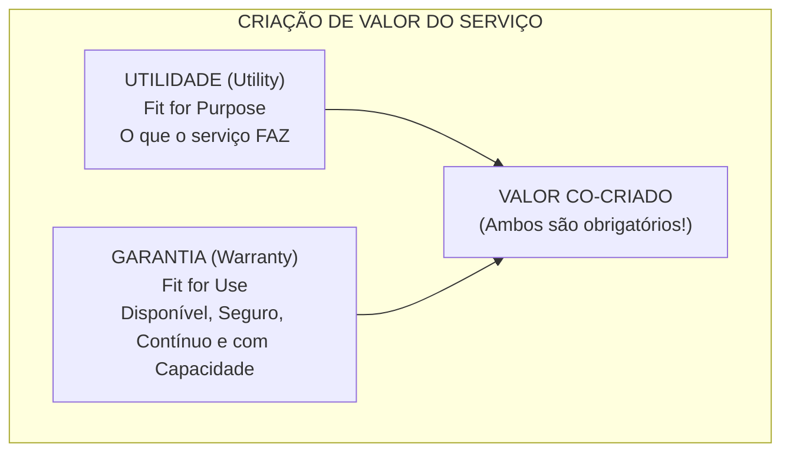
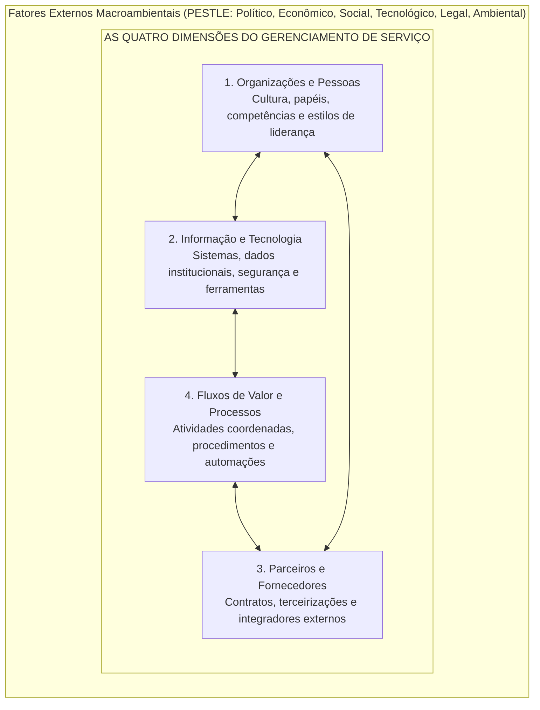
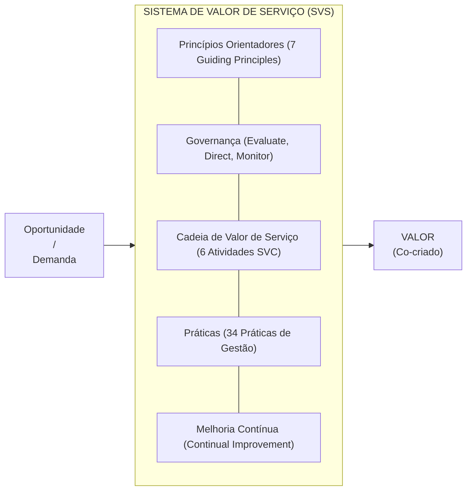
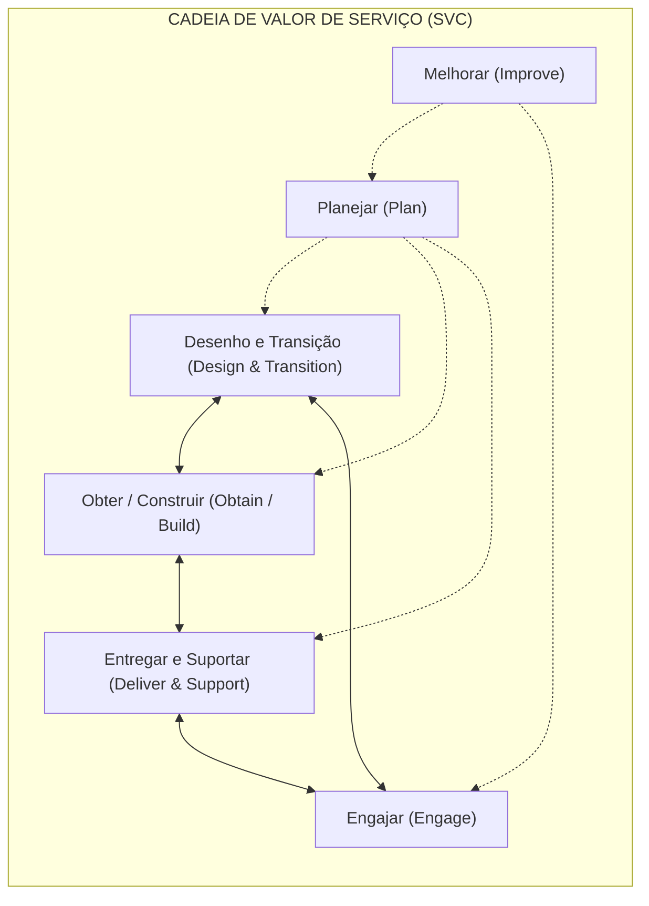
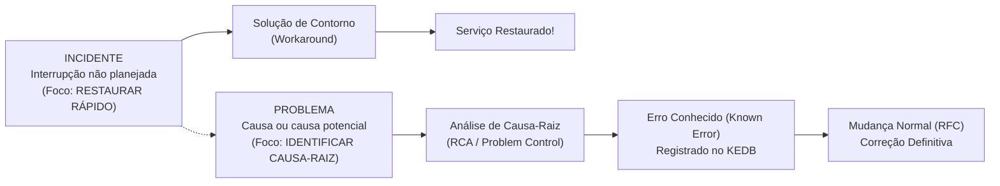
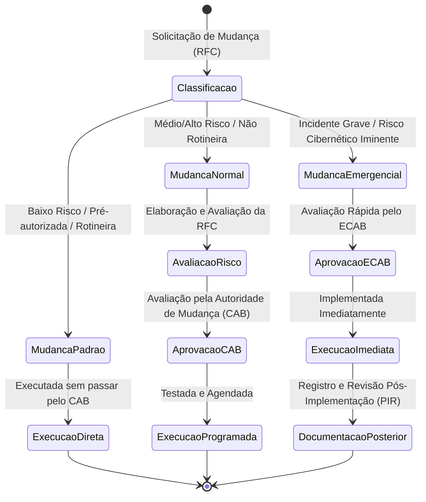

# 02 - Gestão de Serviços de TI e Práticas da ITIL v4

> **Matéria:** Governança de Tecnologia da Informação  
> **Cargo:** B02 – Técnico de Controle Externo – Especialidade: Tecnologia da Informação  
> **Arquivo:** `02_gestao_de_servicos_de_ti_itil_v4.md`  

---

## 📌 Ementa / Itens do Edital
- Framework ITIL v4 (Information Technology Infrastructure Library)
- Conceitos fundamentais de serviço, utilidade e garantia (Utility & Warranty)
- Sistema de Valor de Serviço (SVS - Service Value System)
- As Quatro Dimensões do Gerenciamento de Serviço
- Cadeia de Valor de Serviço (SVC - Service Value Chain)
- Os 7 Princípios Orientadores da ITIL v4
- Práticas de Gerenciamento de Serviços:
    - Central de Serviços (Service Desk)
    - Gerenciamento de Incidentes (Incident Management)
    - Gerenciamento de Problemas (Problem Management) e KEDB
    - Habilitação de Mudanças (Change Enablement)
    - Gerenciamento de Configuração de Serviço (CMDB e CIs)
    - Gerenciamento de Ativos de TI (ITAM)
    - Gerenciamento de Nível de Serviço (SLA, OLA, UC)
    - Gerenciamento de Continuidade de Serviços de TI (ITSCM: RPO e RTO)

---

## 🧭 Sumário

1. [O Modelo Central da ITIL v4](#1-o-modelo-central-da-itil-v4)
1. [Conceitos de Serviço, Co-criação de Valor, Utilidade e Garantia](#1-1-conceitos-de-servico-co-criacao-de-valor-utilidade-e-garantia)
    1. [Teste 475](#Teste-475)
1. [As Quatro Dimensões do Gerenciamento de Serviço](#1-2-as-quatro-dimensoes-do-gerenciamento-de-servico)
    1. [Teste 476](#Teste-476)
1. [O Sistema de Valor de Serviço (SVS)](#1-3-o-sistema-de-valor-de-servico-svs)
1. [Os 7 Princípios Orientadores (Guiding Principles)](#1-4-os-7-principios-orientadores-guiding-principles)
    1. [Teste 477](#Teste-477)
1. [A Cadeia de Valor de Serviço (SVC - 6 Atividades Operacionais)](#1-5-a-cadeia-de-valor-de-servico-svc-6-atividades-operacionais)
    1. [Teste 478](#Teste-478)
2. [Práticas Essenciais de Gerenciamento de Serviços da ITIL v4](#2-praticas-essenciais-de-gerenciamento-de-servicos-da-itil-v4)
2. [Central de Serviços (Service Desk)](#2-1-central-de-servicos-service-desk)
    1. [Teste 479](#Teste-479)
2. [Gerenciamento de Incidentes vs. Gerenciamento de Problemas](#2-2-gerenciamento-de-incidentes-vs-gerenciamento-de-problemas)
    1. [Teste 480](#Teste-480)
2. [Habilitação de Mudanças (Change Enablement)](#2-3-habilitacao-de-mudancas-change-enablement)
    1. [Teste 481](#Teste-481)
2. [Gerenciamento de Configuração de Serviço (CMDB) vs. Ativos de TI (ITAM)](#2-4-gerenciamento-de-configuracao-de-servico-cmdb-vs-ativos-de-ti-itam)
    1. [Teste 482](#Teste-482)
2. [Gerenciamento de Nível de Serviço (SLA, OLA e UC)](#2-5-gerenciamento-de-nivel-de-servico-sla-ola-e-uc)
    1. [Teste 483](#Teste-483)
2. [Gerenciamento de Continuidade de Serviços de TI (ITSCM: RTO e RPO)](#2-6-gerenciamento-de-continuidade-de-servicos-de-ti-itscm-rto-e-rpo)
    1. [Teste 484](#Teste-484)
6. [Fontes Recomendadas na Internet](#6-fontes-recomendadas-na-internet)

---

## 1. O Modelo Central da ITIL v4

A **ITIL v4** (*Information Technology Infrastructure Library*) representa uma evolução substancial da biblioteca de boas práticas de Gerenciamento de Serviços de TI (ITSM). Em substituição ao modelo puramente linear baseado nos 5 estágios do ciclo de vida da ITIL v3 (Estratégia, Desenho, Transição, Operação e Melhoria Contínua), a ITIL v4 consolida uma abordagem ágil, holística, flexível e orientada à **co-criação mútua de valor**.

---

## 1.1 Conceitos de Serviço, Co-criação de Valor, Utilidade e Garantia

#### Definições Fundamentais da ITIL v4

- **Serviço (*Service*):** Meio para permitir a **co-criação de valor**, facilitando os resultados que os clientes desejam alcançar, sem que eles precisem assumir a gestão de custos e riscos específicos.
- **Co-criação de Valor:** O valor não é gerado e empurrado unilateralmente pelo provedor de TI. Ele é co-criado ativamente por meio de parceria e interação constante entre o provedor e o consumidor do serviço.
- **Utilidade (*Utility*):** A funcionalidade oferecida por um produto ou serviço para atender a uma necessidade real de negócio. Reflete **o que o serviço faz** (*Fit for Purpose* - aptidão para o propósito).
- **Garantia (*Warranty*):** A segurança de que o produto ou serviço atenderá aos requisitos acordados quanto à sua disponibilidade, capacidade, continuidade e segurança. Reflete **como o serviço é entregue e mantido** (*Fit for Use* - aptidão para o uso).

> 🚨 **ALERTA DE PROVA / PEGADINHA FCC:**  
> A FCC adora afirmar que um serviço de TI pode gerar valor pleno ao negócio apenas possuindo excelente **Utilidade**, mesmo com falhas de Garantia. **ERRADO!** O valor requer simultaneamente Utilidade (*Fit for Purpose*) e Garantia (*Fit for Use*). Se um sistema de processo eletrônico tem todas as telas e funções que os auditores precisam (utilidade), mas cai a cada meia hora ou vaza dados (falha de garantia), o serviço gera valor zero ou negativo.

---

### Teste 475
**(FGV – TCE/SC – 2026 – Auditor Fiscal de Controle Externo - Ciências da Computação, Sistemas de Informação...)**
Um auditor analisa a eficiência da entrega de serviços de TI no Tribunal e foca na forma como a organização cria valor para os seus usuários finais. No ITIL 4, o conceito que descreve o conjunto de componentes e atividades da organização que trabalham juntos para facilitar a criação de valor por meio de serviços de TI é

* **A)** o Ciclo de Vida do Serviço.
* **B)** a Gestão de Mudanças.
* **C)** o Sistema de Valor de Serviço (SVS).
* **D)** a Central de Serviços (Service Desk).
* **E)** o Acordo de Nível de Serviço (SLA).

---

> **Comentário Detalhado:**
>
> - **A)** **Incorreta.** A opção apresenta proposição em desacordo com os fundamentos teóricos e técnicos do tópico ao afirmar que "o Ciclo de Vida do Serviço". De acordo com a teoria estudada em *1.3 O Sistema de Valor de Serviço (SVS)*, governança (*Governance*): O sistema pelo qual a organização é dirigida e controlada (alinhamento ao ciclo EDM da ISO/IEC 38500).
> - **B)** **Incorreta.** A opção apresenta proposição em desacordo com os fundamentos teóricos e técnicos do tópico ao afirmar que "a Gestão de Mudanças". De acordo com a teoria estudada em *Definições Fundamentais da ITIL v4*, serviço (*Service*): Meio para permitir a co-criação de valor, facilitando os resultados que os clientes desejam alcançar, sem que eles precisem assumir a gestão de custos e riscos específicos.
> - **C)** **Correta.** Conforme fundamentado na seção *1.3 O Sistema de Valor de Serviço (SVS)* deste guia, o SVS (*Service Value System*) descreve como todos os componentes e atividades da organização atuam harmonicamente para transformar oportunidades e demandas em valor real para a sociedade e clientes. Dessa forma, está plenamente correta a assertiva da banca (FGV – TCE/SC/2026) ao estabelecer que "o Sistema de Valor de Serviço (SVS)".
> - **D)** **Incorreta.** A opção apresenta proposição em desacordo com os fundamentos teóricos e técnicos do tópico ao afirmar que "a Central de Serviços (Service Desk)". De acordo com a teoria estudada em *1.3 O Sistema de Valor de Serviço (SVS)*, entradas: Oportunidades (chances de agregar valor) e Demanda (necessidade manifesta de novos serviços ou correções por parte dos usuários).
> - **E)** **Incorreta.** A opção apresenta proposição em desacordo com os fundamentos teóricos e técnicos do tópico ao afirmar que "o Acordo de Nível de Serviço (SLA)". De acordo com a teoria estudada em *1.3 O Sistema de Valor de Serviço (SVS)*, práticas (*Practices*): Conjuntos de recursos organizacionais desenhados para realizar tarefas específicas (a ITIL v4 substitui o conceito de "processos" da v3 pelo termo mais abrangente "práticas").
>
> **Gabarito: C**

---

## 1.2 As Quatro Dimensões do Gerenciamento de Serviço

Para viabilizar uma abordagem holística, equilibrada e evitar o isolamento de equipes em silos técnicos, a ITIL v4 exige que qualquer produto ou serviço seja gerenciado considerando **Quatro Dimensões**:

1. **Organizações e Pessoas:** Estrutura formal do órgão ou empresa, cultura corporativa compartilhada, definição inequívoca de papéis e responsabilidades, comunicação interpessoal, competências técnicas e estilos de liderança.
2. **Informação e Tecnologia:** O ecossistema de informações gerado e processado (bancos de dados, integridade, conformidade com a LGPD) e as tecnologias de suporte aos serviços (computação em nuvem, ferramentas de automação, monitoramento e IA).
3. **Parceiros e Fornecedores:** Relações contratuais com entidades externas que participam da concepção, desenvolvimento, entrega e suporte dos serviços (fábricas de software, provedores de nuvem, consultorias de TIC).
4. **Fluxos de Valor e Processos:** Como as diversas áreas da organização coordenam suas atividades por meio de fluxos de valor (*Value Streams*) e procedimentos operacionais padronizados para entregar resultados tangíveis.

Essas quatro dimensões sofrem pressão contínua de fatores externos incontroláveis descritos pelo acrônimo **PESTLE** (*Political, Economic, Social, Technological, Legal, Environmental*).

---

### Teste 476
**(FGV – TCE/GO – 2024 – Analista de Controle Externo - Tecnologia da Informação)**
Considere as práticas de atribuição de funções de TI na gestão de responsabilidades sob as perspectivas do COBIT, ITIL e PMBOK. Na aplicação dessas práticas é correto que se deve

* **A)** integrar os papéis de desenvolvimento e a operação de sistemas para um funcionário garantindo eficiência e rapidez na resolução de problemas.
* **B)** designar diferentes equipes para gerenciamento de incidentes e gerenciamento de problemas para, respectivamente, a análise e a correção de falhas.
* **C)** concentrar as responsabilidades de gestão de mudanças e liberação de software em um único papel, dado que integram as mesmas funções.
* **D)** permitir que o desenvolvedor de software faça uma prévia da auditoria de código de forma a acelerar o processo e economizar recursos.
* **E)** delegar a um gestor a responsabilidade de aprovação de projetos de TI logo após o controle de custos facilitando a tomada de decisão.

---

> **Comentário Detalhado:**
>
> - **A)** **Incorreta.** A opção apresenta proposição em desacordo com os fundamentos teóricos e técnicos do tópico ao afirmar que "integrar os papéis de desenvolvimento e a operação de sistemas para um funcionário garantindo eficiência e rapidez...". De acordo com a teoria estudada em *Tabela Comparativa: Incidente versus Problema versus Erro Conhecido*, eRRADO! O foco do Gerenciamento de Incidentes é exclusivamente a restauração do serviço no menor tempo possível (*Time to Restore*). A busca minuciosa da causa-raiz é trabalho privativo do Gerenciamento de Problemas.
> - **B)** **Correta.** Conforme fundamentado na seção *2.2 Gerenciamento de Incidentes vs. Gerenciamento de Problemas* deste guia, esta é a distinção mais testada em concursos de Tribunais de Contas. Dessa forma, está plenamente correta a assertiva da banca (FGV – TCE/GO/2024) ao estabelecer que "designar diferentes equipes para gerenciamento de incidentes e gerenciamento de problemas para, respectivamente, a...".
> - **C)** **Incorreta.** A opção apresenta proposição em desacordo com os fundamentos teóricos e técnicos do tópico ao afirmar que "concentrar as responsabilidades de gestão de mudanças e liberação de software em um único papel, dado que integram...". De acordo com a teoria estudada em *2.5 Gerenciamento de Nível de Serviço (SLA, OLA e UC)*, oLA (*Operational Level Agreement* - Acordo de Nível Operacional): Acordo interno firmado entre diferentes áreas internas do mesmo provedor de TI (ex.: equipe de Redes acordando com a equipe de Aplicações o tempo de liberação de portas de firewall).
> - **D)** **Incorreta.** A opção apresenta proposição em desacordo com os fundamentos teóricos e técnicos do tópico ao afirmar que "permitir que o desenvolvedor de software faça uma prévia da auditoria de código de forma a acelerar o processo e...". De acordo com a teoria estudada em *Tabela Comparativa: Incidente versus Problema versus Erro Conhecido*, erro Conhecido (*Known Error*): Um problema cuja análise foi concluída, com causa-raiz identificada e para o qual existe uma solução de contorno (*workaround*). — Documentar a falha e a solução de contorno no KEDB (*Known Error Database*) para acelerar futuros atendimentos. — Criação de artigo no KEDB e emissão de solicitação de mudança (RFC) para correção permanente no código.
> - **E)** **Incorreta.** A opção apresenta proposição em desacordo com os fundamentos teóricos e técnicos do tópico ao afirmar que "delegar a um gestor a responsabilidade de aprovação de projetos de TI logo após o controle de custos facilitando a...". De acordo com a teoria estudada em *Definições Fundamentais da ITIL v4*, serviço (*Service*): Meio para permitir a co-criação de valor, facilitando os resultados que os clientes desejam alcançar, sem que eles precisem assumir a gestão de custos e riscos específicos.
>
> **Gabarito: B**

---

## 1.3 O Sistema de Valor de Serviço (SVS)

O **SVS** (*Service Value System*) descreve como todos os componentes e atividades da organização atuam harmonicamente para transformar oportunidades e demandas em valor real para a sociedade e clientes.

- **Entradas:** Oportunidades (chances de agregar valor) e Demanda (necessidade manifesta de novos serviços ou correções por parte dos usuários).
- **Os 5 Componentes Centrais do SVS:**
    1. **Princípios Orientadores (*Guiding Principles*):** Filosofias e recomendações universais que orientam a tomada de decisão em quaisquer circunstâncias.
    2. **Governança (*Governance*):** O sistema pelo qual a organização é dirigida e controlada (alinhamento ao ciclo EDM da ISO/IEC 38500).
    3. **Cadeia de Valor de Serviço (*Service Value Chain*):** O modelo operacional composto por 6 atividades interconectadas.
    4. **Práticas (*Practices*):** Conjuntos de recursos organizacionais desenhados para realizar tarefas específicas (a ITIL v4 substitui o conceito de "processos" da v3 pelo termo mais abrangente "práticas").
    5. **Melhoria Contínua (*Continual Improvement*):** Atividade recorrente executada em todos os níveis e componentes da organização.

- **Saída:** Realização contínua de **Valor** para as partes interessadas.

---

---

## 1.4 Os 7 Princípios Orientadores (Guiding Principles)

Os princípios orientadores da ITIL v4 são recomendações perenes, aplicáveis em qualquer organização pública ou privada, guiando desde a rotina de sustentação de TI até programas estratégicos de transformação digital:

| Nº | Princípio Orientador | Significado e Aplicação Prática no ITSM |
| :---: | :--- | :--- |
| **1** | **Foco no Valor** (*Focus on Value*) | Toda iniciativa deve gerar valor direto ou indireto para os stakeholders. É indispensável identificar quem consome o serviço e o que esse usuário realmente valoriza. |
| **2** | **Comece de Onde Você Está** (*Start Where You Are*) | Não destrua o que já existe para recomeçar do zero sem antes analisar o estado atual. Avalie e reaproveite serviços, códigos, procedimentos e sistemas em operação. |
| **3** | **Progrida Iterativamente com Feedback** (*Progress Iteratively with Feedback*) | Divida iniciativas complexas em ciclos menores e gerenciáveis (iterações ágeis). Obtenha feedback real dos usuários antes, durante e após cada entrega. |
| **4** | **Colabore e Promova Visibilidade** (*Collaborate and Promote Visibility*) | Trabalhe de forma integrada entre departamentos, eliminando silos isolados. Compartilhe dados operacionais, status de projetos e métricas de forma transparente. |
| **5** | **Pense e Trabalhe Holisticamente** (*Think and Work Holistically*) | Nenhum serviço ou prática funciona de maneira isolada. É necessário compreender a interdependência sistêmica entre pessoas, processos e ferramentas. |
| **6** | **Mantenha Simples e Prático** (*Keep It Simple and Practical*) | Utilize a quantidade mínima necessária de etapas para atingir o objetivo. Elimine relatórios inúteis, etapas burocráticas e métricas redundantes (*parcimônia*). |
| **7** | **Otimize e Automatize** (*Optimize and Automate*) | Simplifique e padronize o processo antes de implementar automações tecnológicas. A tecnologia deve ser usada para liberar pessoas para tarefas criativas e complexas. |

> 🚨 **ALERTA DE PROVA / PEGADINHA FCC:**  
> A FCC adora trocar a ordem de "Otimize e Automatize", afirmando que se deve "automatizar para depois descobrir o que precisa ser otimizado". **ERRADO!** Automatizar processos ruins apenas produz erros em maior velocidade. Primeiro otimiza-se e padroniza-se; depois se automatiza!

---

### Teste 477
**(FGV – TJ/MT – 2024 – Analista Judiciario Tecnologia Da Informacao)**
A ITIL (Information Technology Infrastructure Library) define um conjunto de práticas para o gerenciamento de serviços de TI, orientando organizações na entrega de valor aos clientes. O propósito da prática de “Gerenciamento de Incidentes” na versão mais recente do ITIL é

* **A)** proteger a organização contra ameaças de segurança, garantindo a integridade e confidencialidade dos dados.
* **B)** identificar e corrigir falhas na infraestrutura de TI antes que afetem os usuários finais.
* **C)** analisar causas de problemas recorrentes para reduzir a frequência de incidentes e melhorar a experiência do usuário.
* **D)** minimizar o impacto negativo de interrupções, restaurando a operação normal de serviço o mais rápido possível.
* **E)** planejar e implementar mudanças nos serviços de TI de forma estruturada e com o mínimo de interrupções.

---

> **Comentário Detalhado:**
>
> - **A)** **Incorreta.** A opção apresenta proposição em desacordo com os fundamentos teóricos e técnicos do tópico ao afirmar que "proteger a organização contra ameaças de segurança, garantindo a integridade e confidencialidade dos dados". De acordo com a teoria estudada em *Os Três Tipos de Mudanças na ITIL v4*, mudança Normal (*Normal Change*): Variável (Médio a Alto) — Requer autorização formal da Autoridade de Mudança (*Change Authority* / CAB). — Segue o fluxo formal: RFC $\rightarrow$ Avaliação de impacto/risco $\rightarrow$ Agendamento em janela $\rightarrow$ Testes $\rightarrow$ Implementação. — Atualização de versão do SGBD de produção, migração de datacenter, lançamento de nova versão do portal.
> - **B)** **Incorreta.** A opção apresenta proposição em desacordo com os fundamentos teóricos e técnicos do tópico ao afirmar que "identificar e corrigir falhas na infraestrutura de TI antes que afetem os usuários finais". De acordo com a teoria estudada em *2.1 Central de Serviços (Service Desk)*, cultura e Habilidades: Mais do que mero conhecimento técnico profundo, a Central de Serviços exige excelência em atendimento ao cliente, empatia interpessoal e compreensão do impacto das falhas nas atividades institucionais.
> - **C)** **Incorreta.** A opção apresenta proposição em desacordo com os fundamentos teóricos e técnicos do tópico ao afirmar que "analisar causas de problemas recorrentes para reduzir a frequência de incidentes e melhorar a experiência do...". De acordo com a teoria estudada em *Tabela Comparativa: Incidente versus Problema versus Erro Conhecido*, eRRADO! O foco do Gerenciamento de Incidentes é exclusivamente a restauração do serviço no menor tempo possível (*Time to Restore*). A busca minuciosa da causa-raiz é trabalho privativo do Gerenciamento de Problemas.
> - **D)** **Correta.** Conforme fundamentado na seção *Tabela Comparativa: Incidente versus Problema versus Erro Conhecido* deste guia, incidente (*Incident*): Uma interrupção não planejada de um serviço ou redução na sua qualidade operacional. — Restaurar a operação normal do serviço o mais rápido possível e minimizar o impacto negativo no negócio. — Reiniciar aplicação, alternar para link redundante, aplicar solução paliativa temporária. Dessa forma, está plenamente correta a assertiva da banca (FGV – TJ/MT/2024) ao estabelecer que "minimizar o impacto negativo de interrupções, restaurando a operação normal de serviço o mais rápido possível".
> - **E)** **Incorreta.** A opção apresenta proposição em desacordo com os fundamentos teóricos e técnicos do tópico ao afirmar que "planejar e implementar mudanças nos serviços de TI de forma estruturada e com o mínimo de interrupções". De acordo com a teoria estudada em *1. O Modelo Central da ITIL v4*, a ITIL v4 (*Information Technology Infrastructure Library*) representa uma evolução substancial da biblioteca de boas práticas de Gerenciamento de Serviços de TI (ITSM).
>
> **Gabarito: D**

---

## 1.5 A Cadeia de Valor de Serviço (SVC - 6 Atividades Operacionais)

A Cadeia de Valor de Serviço (*Service Value Chain*) é a engrenagem operacional central do SVS. Trata-se de uma rede flexível e não linear de **seis atividades** que podem ser combinadas para criar múltiplos fluxos de valor (*Value Streams*):

1. **Planejar (*Plan*):** Assegurar o entendimento compartilhado da visão institucional, situação atual e direcionamento de melhoria para todos os produtos e serviços.
2. **Melhorar (*Improve*):** Garantir o aprimoramento contínuo dos serviços, práticas e componentes em todas as atividades da cadeia de valor.
3. **Engajar (*Engage*):** Proporcionar uma compreensão profunda das expectativas dos stakeholders, garantir transparência e cultivar bom relacionamento contínuo.
4. **Desenho e Transição (*Design & Transition*):** Assegurar que produtos e serviços atendam continuamente às expectativas de custos, prazos, conformidade e especificações.
5. **Obter/Construir (*Obtain/Build*):** Garantir que os componentes de serviço (softwares, hardwares e documentações) estejam disponíveis quando e onde forem necessários.
6. **Entregar e Suportar (*Deliver & Support*):** Assegurar que os serviços sejam executados, operados e suportados de acordo com os níveis de serviço acordados com os usuários.

---

### Teste 478
**(FGV – TJ/MT – 2024 – Analista Judiciario Tecnologia Da Informacao)**
Na versão mais recente do COBIT, os processos são organizados em domínios que ajudam a estruturar as atividades de governança e gestão de TI. O seguinte processo pertence ao domínio “Alinhar, Planejar e Organizar” e é essencial para assegurar que os projetos e investimentos em TI estejam alinhados aos objetivos estratégicos da organização ao

* **A)** gerenciar o portfólio de TI, assegurando que os investimentos e projetos estejam alinhados com as metas estratégicas e que contribuam para a geração de valor.
* **B)** avaliar o desempenho dos fornecedores de TI para garantir que os serviços prestados estejam de acordo com as expectativas organizacionais.
* **C)** desenvolver e implementar novas soluções tecnológicas que suportem os processos de negócio da organização.
* **D)** fornecer suporte e resolver incidentes técnicos de forma a minimizar o impacto nas operações diárias.
* **E)** avaliar continuamente o desempenho das soluções de TI e garantir a conformidade com padrões de qualidade internos.

---

> **Comentário Detalhado:**
>
> - **A)** **Correta.** Conforme fundamentado na seção *1.5 A Cadeia de Valor de Serviço (SVC - 6 Atividades Operacionais)* deste guia, obter/Construir (*Obtain/Build*): Garantir que os componentes de serviço (softwares, hardwares e documentações) estejam disponíveis quando e onde forem necessários. Dessa forma, está plenamente correta a assertiva da banca (FGV – TJ/MT/2024) ao estabelecer que "gerenciar o portfólio de TI, assegurando que os investimentos e projetos estejam alinhados com as metas...".
> - **B)** **Incorreta.** A opção apresenta proposição em desacordo com os fundamentos teóricos e técnicos do tópico ao afirmar que "avaliar o desempenho dos fornecedores de TI para garantir que os serviços prestados estejam de acordo com as...". De acordo com a teoria estudada em *1.5 A Cadeia de Valor de Serviço (SVC - 6 Atividades Operacionais)*, engajar (*Engage*): Proporcionar uma compreensão profunda das expectativas dos stakeholders, garantir transparência e cultivar bom relacionamento contínuo.
> - **C)** **Incorreta.** A opção apresenta proposição em desacordo com os fundamentos teóricos e técnicos do tópico ao afirmar que "desenvolver e implementar novas soluções tecnológicas que suportem os processos de negócio da organização". De acordo com a teoria estudada em *1.2 As Quatro Dimensões do Gerenciamento de Serviço*, fluxos de Valor e Processos: Como as diversas áreas da organização coordenam suas atividades por meio de fluxos de valor (*Value Streams*) e procedimentos operacionais padronizados para entregar resultados tangíveis.
> - **D)** **Incorreta.** A opção apresenta proposição em desacordo com os fundamentos teóricos e técnicos do tópico ao afirmar que "fornecer suporte e resolver incidentes técnicos de forma a minimizar o impacto nas operações diárias". De acordo com a teoria estudada em *1.4 Os 7 Princípios Orientadores (Guiding Principles)*, 4: Colabore e Promova Visibilidade (*Collaborate and Promote Visibility*) — Trabalhe de forma integrada entre departamentos, eliminando silos isolados. Compartilhe dados operacionais, status de projetos e métricas de forma transparente.
> - **E)** **Incorreta.** A opção apresenta proposição em desacordo com os fundamentos teóricos e técnicos do tópico ao afirmar que "avaliar continuamente o desempenho das soluções de TI e garantir a conformidade com padrões de qualidade internos". De acordo com a teoria estudada em *1.5 A Cadeia de Valor de Serviço (SVC - 6 Atividades Operacionais)*, desenho e Transição (*Design & Transition*): Assegurar que produtos e serviços atendam continuamente às expectativas de custos, prazos, conformidade e especificações.
>
> **Gabarito: A**

---

## 2. Práticas Essenciais de Gerenciamento de Serviços da ITIL v4

A ITIL v4 classifica suas 34 práticas em três domínios:

- **14 Práticas de Gerenciamento Geral** (*General Management Practices*)
- **17 Práticas de Gerenciamento de Serviços** (*Service Management Practices*)
- **3 Práticas de Gerenciamento Técnico** (*Technical Management Practices*)

Abaixo, detalham-se as práticas com maior recorrência nas bancas de controle externo.

---

---

## 2.1 Central de Serviços (Service Desk)

A **Central de Serviços** atua como o **Ponto Único de Contato (SPOC - *Single Point of Contact*)** entre o provedor de serviços de TI e os usuários corporativos.

- **Propósito:** Capturar a demanda de resolução de incidentes e requisições de serviço, servindo como o ponto focal para todas as comunicações operacionais.
- **Estruturas Organizacionais Típicas:**
    - *Local:* Equipe de suporte alocada fisicamente nas dependências do órgão.
    - *Centralizada:* Equipe única atendendo múltiplos prédios, unidades regionais ou filiais a partir de uma sede.
    - *Virtual:* Analistas distribuídos geograficamente que interagem por meio de sistemas na nuvem, dando ao usuário a percepção de uma central única.
    - *Siga o Sol (Follow the Sun):* Equipes em diferentes fusos horários cobrindo suporte ininterrupto 24/7.
- **Cultura e Habilidades:** Mais do que mero conhecimento técnico profundo, a Central de Serviços exige excelência em atendimento ao cliente, empatia interpessoal e compreensão do impacto das falhas nas atividades institucionais.

---

### Teste 479
**(FGV – TCE/SC – 2026 – Auditor Fiscal de Controle Externo - Ciências da Computação, Sistemas de Informação...)**
O Tribunal quer reduzir o número de incidentes repetitivos em sua Central de Serviços. O Auditor sugere focar na identificação da causa raiz desses incidentes. No ITIL 4, a prática que tem como objetivo principal reduzir a probabilidade e o impacto de incidentes por meio da identificação de suas causas reais e do gerenciamento de soluções de contorno é o(a)

* **A)** Gerenciamento de Incidentes.
* **B)** Gerenciamento de Problemas.
* **C)** Gerenciamento de Mudanças.
* **D)** Central de Serviços.
* **E)** Gerenciamento de Nível de Serviço.

---

> **Comentário Detalhado:**
>
> - **A)** **Incorreta.** A opção apresenta proposição em desacordo com os fundamentos teóricos e técnicos do tópico ao afirmar que "Gerenciamento de Incidentes". De acordo com a teoria estudada em *2.2 Gerenciamento de Incidentes vs. Gerenciamento de Problemas*, esta é a distinção mais testada em concursos de Tribunais de Contas.
> - **B)** **Correta.** Conforme fundamentado na seção *Tabela Comparativa: Incidente versus Problema versus Erro Conhecido* deste guia, eRRADO! O foco do Gerenciamento de Incidentes é exclusivamente a restauração do serviço no menor tempo possível (*Time to Restore*). A busca minuciosa da causa-raiz é trabalho privativo do Gerenciamento de Problemas. Dessa forma, está plenamente correta a assertiva da banca (FGV – TCE/SC/2026) ao estabelecer que "Gerenciamento de Problemas".
> - **C)** **Incorreta.** A opção apresenta proposição em desacordo com os fundamentos teóricos e técnicos do tópico ao afirmar que "Gerenciamento de Mudanças". De acordo com a teoria estudada em *2.3 Habilitação de Mudanças (Change Enablement)*, a prática de Habilitação de Mudanças (denominada *Change Management* na v3) visa maximizar o número de mudanças bem-sucedidas em serviços e produtos, garantindo a adequada avaliação de riscos, a autorização formal pelas autoridades competentes e a execução coordenada.
> - **D)** **Incorreta.** A opção apresenta proposição em desacordo com os fundamentos teóricos e técnicos do tópico ao afirmar que "Central de Serviços". De acordo com a teoria estudada em *1. O Modelo Central da ITIL v4*, a ITIL v4 (*Information Technology Infrastructure Library*) representa uma evolução substancial da biblioteca de boas práticas de Gerenciamento de Serviços de TI (ITSM).
> - **E)** **Incorreta.** A opção apresenta proposição em desacordo com os fundamentos teóricos e técnicos do tópico ao afirmar que "Gerenciamento de Nível de Serviço". De acordo com a teoria estudada em *2.5 Gerenciamento de Nível de Serviço (SLA, OLA e UC)*, o objetivo do Gerenciamento de Nível de Serviço (*Service Level Management - SLM*) é definir metas claras baseadas em negócios para os níveis de serviço e garantir que a entrega de serviços seja avaliada, monitorada e gerenciada em relação a essas metas.
>
> **Gabarito: B**

---

## 2.2 Gerenciamento de Incidentes vs. Gerenciamento de Problemas

Esta é a distinção mais testada em concursos de Tribunais de Contas:

#### Tabela Comparativa: Incidente versus Problema versus Erro Conhecido

| Conceito | Definição Oficial ITIL v4 | Objetivo Primordial | Tratamento Prático |
| :--- | :--- | :--- | :--- |
| **Incidente** (*Incident*) | Uma interrupção não planejada de um serviço ou redução na sua qualidade operacional. | Restaurar a operação normal do serviço **o mais rápido possível** e minimizar o impacto negativo no negócio. | Reiniciar aplicação, alternar para link redundante, aplicar solução paliativa temporária. |
| **Problema** (*Problem*) | Uma causa, ou causa potencial, de um ou mais incidentes. | Identificar a **causa-raiz** real ou provável dos incidentes e prevenir a sua recorrência futura. | Análise de causa-raiz (RCA), auditoria de logs, simulação em ambiente de testes. |
| **Erro Conhecido** (*Known Error*) | Um problema cuja análise foi concluída, com causa-raiz identificada e para o qual existe uma solução de contorno (*workaround*). | Documentar a falha e a solução de contorno no **KEDB** (*Known Error Database*) para acelerar futuros atendimentos. | Criação de artigo no KEDB e emissão de solicitação de mudança (RFC) para correção permanente no código. |
| **Solução de Contorno** (*Workaround*) | Uma medida paliativa que reduz ou elimina o impacto de um incidente ou problema para o qual a solução definitiva ainda não existe. | Viabilizar o retorno imediato da operação antes que a correção final seja desenvolvida. | Script de liberação temporária de cache, roteamento estático manual. |

> 🚨 **ALERTA DE PROVA / PEGADINHA FCC:**  
> A banca frequentemente afirma que a equipe de incidentes deve paralisar a produção até encontrar a causa-raiz no código. **ERRADO!** O foco do Gerenciamento de Incidentes é exclusivamente a **restauração do serviço no menor tempo possível** (*Time to Restore*). A busca minuciosa da causa-raiz é trabalho privativo do **Gerenciamento de Problemas**.

- **Swarming:** Técnica colaborativa em que múltiplos especialistas de áreas diversas unem-se rapidamente para resolver incidentes graves, substituindo a escalação hierárquica lenta por cooperação ágil.

---

### Teste 480
**(FCC – TRT 16ª – 2014 – Analista Judiciário - Tecnologia da Informação)**
Em um certo dia de trabalho no TRT da 16a Região, ocorreu uma falha em um disco de um conjunto espelhado gerando uma I interrupção não planejada de um serviço de TI que operava neste disco. De acordo com a ITIL v3, ocorreu um , que possui  II um ciclo de vida expandido composto pelas etapas: . No dia seguinte, novamente ocorreu a falha no mesmo disco, mais de  uma vez. A equipe de TI buscou, então, investigar a sua causa raiz. De acordo com a ITIL v3 a investigação desta causa raiz III IV deve ser conduzida pelo processo , que pertence ao estágio .   As lacunas I, II, III e IV são, correta e respectivamente, preenchidas por:

* **A)** continuidade de serviço de TI, Gerenciamento de disponibilidade e Gerenciamento de continuidade de negócio, todos do estágio Desenho de Serviços.
* **B)** configuração e ativos de serviços de TI (do estágio Transição de Serviços), Gerenciamento de liberação e implantação (do estágio Transição de Serviços) e Gerenciamento de continuidade de serviço de TI (do estágio Desenho de Serviços).
* **C)** continuidade de serviço de TI, Gerenciamento de liberação e implantação, Gerenciamento de continuidade de negócio, todos do estágio Transição de Serviços.
* **D)** continuidade de negócio (do estágio Transição de Serviços), Gerenciamento de disponibilidade (do estágio Operação de Serviços) e Gerenciamento de continuidade de serviço de TI (do estágio Transição de Serviços).
* **E)** configuração e ativos de serviços de TI (do estágio Operação de Serviços), Gerenciamento de liberação e implantação (do estágio Operação de Serviços) e Gerenciamento de continuidade (do estágio Desenho de Serviços).

---

> **Comentário Detalhado:**
>
> - **A)** **Incorreta.** A opção apresenta proposição em desacordo com os fundamentos teóricos e técnicos do tópico ao afirmar que "continuidade de serviço de TI, Gerenciamento de disponibilidade e Gerenciamento de continuidade de negócio, todos...". De acordo com a teoria estudada em *Tabela Comparativa: Incidente versus Problema versus Erro Conhecido*, incidente (*Incident*): Uma interrupção não planejada de um serviço ou redução na sua qualidade operacional. — Restaurar a operação normal do serviço o mais rápido possível e minimizar o impacto negativo no negócio. — Reiniciar aplicação, alternar para link redundante, aplicar solução paliativa temporária.
> - **B)** **Incorreta.** A opção apresenta proposição em desacordo com os fundamentos teóricos e técnicos do tópico ao afirmar que "configuração e ativos de serviços de TI (do estágio Transição de Serviços), Gerenciamento de liberação e...". De acordo com a teoria estudada em *1.5 A Cadeia de Valor de Serviço (SVC - 6 Atividades Operacionais)*, desenho e Transição (*Design & Transition*): Assegurar que produtos e serviços atendam continuamente às expectativas de custos, prazos, conformidade e especificações.
> - **C)** **Incorreta.** A opção apresenta proposição em desacordo com os fundamentos teóricos e técnicos do tópico ao afirmar que "continuidade de serviço de TI, Gerenciamento de liberação e implantação, Gerenciamento de continuidade de negócio...". De acordo com a teoria estudada em *2.4 Gerenciamento de Configuração de Serviço (CMDB) vs. Ativos de TI (ITAM)*, dimensão de Comparação: Gerenciamento de Configuração de Serviço — Gerenciamento de Ativos de TI (ITAM).
> - **D)** **Incorreta.** A opção apresenta proposição em desacordo com os fundamentos teóricos e técnicos do tópico ao afirmar que "continuidade de negócio (do estágio Transição de Serviços), Gerenciamento de disponibilidade (do estágio Operação...". De acordo com a teoria estudada em *2.6 Gerenciamento de Continuidade de Serviços de TI (ITSCM: RTO e RPO)*, responsável por garantir que a disponibilidade e o desempenho dos serviços de TI sejam mantidos em níveis suficientes em caso de desastre operacional grave, alinhando-se ao Plano de Continuidade de Negócios (*Business Continuity Plan - BCP*) do Tribunal.
> - **E)** **Correta.** Conforme fundamentado na seção *1. O Modelo Central da ITIL v4* deste guia, em substituição ao modelo puramente linear baseado nos 5 estágios do ciclo de vida da ITIL v3 (Estratégia, Desenho, Transição, Operação e Melhoria Contínua), a ITIL v4 consolida uma abordagem ágil, holística, flexível e orientada à co-criação mútua de valor. Dessa forma, está plenamente correta a assertiva da banca (FCC – TRT 16ª/2014) ao estabelecer que "configuração e ativos de serviços de TI (do estágio Operação de Serviços), Gerenciamento de liberação e...".
>
> **Gabarito: E**

---

## 2.3 Habilitação de Mudanças (Change Enablement)

A prática de **Habilitação de Mudanças** (denominada *Change Management* na v3) visa maximizar o número de mudanças bem-sucedidas em serviços e produtos, garantindo a adequada avaliação de riscos, a autorização formal pelas autoridades competentes e a execução coordenada.

#### Os Três Tipos de Mudanças na ITIL v4

| Tipo de Mudança | Nível de Risco | Autorização Prévia | Fluxo Operacional | Exemplos Práticos |
| :--- | :---: | :--- | :--- | :--- |
| **Mudança Padrão** (*Standard Change*) | **Baixo** | **Pré-autorizada** (formalmente aprovada de antemão). | Procedimento rotineiro, documentado e testado. Não requer envio de RFC ao CAB a cada ocorrência. | Criação de conta de usuário, concessão de perfil de acesso de rede, troca de mouse defeituoso. |
| **Mudança Normal** (*Normal Change*) | Variável (Médio a Alto) | Requer autorização formal da **Autoridade de Mudança** (*Change Authority* / CAB). | Segue o fluxo formal: RFC $\rightarrow$ Avaliação de impacto/risco $\rightarrow$ Agendamento em janela $\rightarrow$ Testes $\rightarrow$ Implementação. | Atualização de versão do SGBD de produção, migração de datacenter, lançamento de nova versão do portal. |
| **Mudança de Emergência** (*Emergency Change*) | **Crítico** | Autorizada com urgência pelo **ECAB** (*Emergency Change Advisory Board*). | Implementação veloz para conter incidente gravíssimo ou brecha crítica de segurança. A documentação formal e a avaliação pós-implantação ocorrem a posteriori. | Aplicação de hotfix de segurança contra exploit ativo em firewall; restauração emergencial de servidor de autenticação caído. |

---

### Teste 481
**(FGV – TRF/1 – 2024 – Analista Judiciario Area Apoio Especializado Especialidade Suporte Em Tecnologia Da Informacao)**
O analista Alexandre é um dos responsáveis pelo desenvolvimento de um novo serviço de suporte técnico remoto no TRF1. Alexandre e sua equipe estão analisando a melhor forma de implementar o serviço em operação. Analisando os conceitos de gerenciamento de serviços de acordo com a ITIL 4, eles identificaram que a descrição formal de um ou mais serviços, projetados para atender às necessidades de um grupo de consumidores-alvo, podendo incluir mercadorias, acesso a recursos e ações de serviço, é conhecida como:

* **A)** garantia de serviços;
* **B)** portfólio de serviços;
* **C)** prática de serviços;
* **D)** oferta de serviços;
* **E)** marketing de serviços.

---

> **Comentário Detalhado:**
>
> - **A)** **Incorreta.** A opção apresenta proposição em desacordo com os fundamentos teóricos e técnicos do tópico ao afirmar que "garantia de serviços". De acordo com a teoria estudada em *2.1 Central de Serviços (Service Desk)*, *Local:* Equipe de suporte alocada fisicamente nas dependências do órgão.
> - **B)** **Incorreta.** A opção apresenta proposição em desacordo com os fundamentos teóricos e técnicos do tópico ao afirmar que "portfólio de serviços". De acordo com a teoria estudada em *1.2 As Quatro Dimensões do Gerenciamento de Serviço*, informação e Tecnologia: O ecossistema de informações gerado e processado (bancos de dados, integridade, conformidade com a LGPD) e as tecnologias de suporte aos serviços (computação em nuvem, ferramentas de automação, monitoramento e IA).
> - **C)** **Incorreta.** A opção apresenta proposição em desacordo com os fundamentos teóricos e técnicos do tópico ao afirmar que "prática de serviços". De acordo com a teoria estudada em *2.3 Habilitação de Mudanças (Change Enablement)*, a prática de Habilitação de Mudanças (denominada *Change Management* na v3) visa maximizar o número de mudanças bem-sucedidas em serviços e produtos, garantindo a adequada avaliação de riscos, a autorização formal pelas autoridades competentes e a execução coordenada.
> - **D)** **Correta.** Conforme fundamentado na seção *1.2 As Quatro Dimensões do Gerenciamento de Serviço* deste guia, parceiros e Fornecedores: Relações contratuais com entidades externas que participam da concepção, desenvolvimento, entrega e suporte dos serviços (fábricas de software, provedores de nuvem, consultorias de TIC). Dessa forma, está plenamente correta a assertiva da banca (FGV – TRF/1/2024) ao estabelecer que "oferta de serviços".
> - **E)** **Incorreta.** A opção apresenta proposição em desacordo com os fundamentos teóricos e técnicos do tópico ao afirmar que "marketing de serviços". De acordo com a teoria estudada em *1.3 O Sistema de Valor de Serviço (SVS)*, práticas (*Practices*): Conjuntos de recursos organizacionais desenhados para realizar tarefas específicas (a ITIL v4 substitui o conceito de "processos" da v3 pelo termo mais abrangente "práticas").
>
> **Gabarito: D**

---

## 2.4 Gerenciamento de Configuração de Serviço (CMDB) vs. Ativos de TI (ITAM)

| Dimensão de Comparação | Gerenciamento de Configuração de Serviço | Gerenciamento de Ativos de TI (ITAM) |
| :--- | :--- | :--- |
| **Conceito Central** | **Item de Configuração (CI - *Configuration Item*)** | **Ativo de TI (*IT Asset*)** |
| **Foco Primário** | **Operacional / Técnico:** Mapeia como os componentes técnicos se interconectam e dependem uns dos outros para sustentar a entrega de um serviço de TI. | **Financeiro / Contábil / Legal:** Controla o valor financeiro, notas fiscais, depreciação contábil, termos de garantia e conformidade de licenças de software. |
| **Repositório Central** | **CMDB** (*Configuration Management Database*) integrado ao CMS (*Configuration Management System*). | Sistema de Controle Patrimonial e Gerenciamento de Licenças de Software (*SAM - Software Asset Management*). |
| **Pergunta Essencial** | *"Se o switch da sala de servidores queimar, quais bancos de dados, aplicações de fiscalização e servidores web ficarão indisponíveis?"* | *"Quantas licenças de Windows Server adquirimos, qual é o valor residual dos notebooks do Tribunal e quando expira a garantia do servidor?"* |

---

### Teste 482
**(CEBRASPE – STF – 2013 – Analista Judiciario Suporte Em Tecnologia Da Informacao)**
O sistema de gerenciamento de conhecimento de serviço, que inclui o sistema de gerenciamento de configuração, consiste em um conjunto de ferramentas e bancos de dados usados para gerenciar conhecimento, informações e dados. Sua arquitetura é disposta em quatro camadas, de modo que o portfólio de serviços encontra-se na camada de dados.

* **C)** Certo
* **E)** Errado

---

> **Comentário Detalhado:**
>
> - **C)** **Correta.** O item está **Certo**. Conforme fundamentado na seção *1.2 As Quatro Dimensões do Gerenciamento de Serviço* deste guia, informação e Tecnologia: O ecossistema de informações gerado e processado (bancos de dados, integridade, conformidade com a LGPD) e as tecnologias de suporte aos serviços (computação em nuvem, ferramentas de automação, monitoramento e IA). Dessa forma, está plenamente correta a proposição da banca (CEBRASPE – STF/2013) ao afirmar que "O sistema de gerenciamento de conhecimento de serviço, que inclui o sistema de gerenciamento de configuração...".
> - **E)** **Incorreta.** A marcação como **Errado** não procede, visto que a assertiva guarda integral conformidade com a teoria estudada em *2.4 Gerenciamento de Configuração de Serviço (CMDB) vs. Ativos de TI (ITAM)*, segundo a qual pergunta Essencial: *"Se o switch da sala de servidores queimar, quais bancos de dados, aplicações de fiscalização e servidores web ficarão indisponíveis?"* — *"Quantas licenças de Windows Server adquirimos, qual é o valor residual dos notebooks do Tribunal e quando expira a garantia do servidor?"*.
>
> **Gabarito: C**

---

## 2.5 Gerenciamento de Nível de Serviço (SLA, OLA e UC)

O objetivo do Gerenciamento de Nível de Serviço (*Service Level Management - SLM*) é definir metas claras baseadas em negócios para os níveis de serviço e garantir que a entrega de serviços seja avaliada, monitorada e gerenciada em relação a essas metas.

A prática articula três tipos de instrumentos fundamentais:

1. **SLA (*Service Level Agreement* - Acordo de Nível de Serviço):** Acordo documentado e firmado formalmente entre o provedor de serviços de TI e o **cliente/negócio** (ex.: DTI acordando com a Presidência do Tribunal que o Processo Eletrônico estará disponível 99,8% do tempo).
2. **OLA (*Operational Level Agreement* - Acordo de Nível Operacional):** Acordo interno firmado entre **diferentes áreas internas do mesmo provedor de TI** (ex.: equipe de Redes acordando com a equipe de Aplicações o tempo de liberação de portas de firewall).
3. **UC (*Underpinning Contract* - Contrato de Apoio):** Contrato jurídico firmado entre o provedor de TI e um **fornecedor externo terceirizado** (ex.: contrato de link de fibra óptica celebrado com a operadora de telecomunicações, estipulando multas por indisponibilidade).

---

### Teste 483
**(FGV – TJ/DFT – 2022 – Analista Judiciario Suporte Em Tecnologia Da Informacao)**
Segundo o ITIL versão 4, a prática que define metas claras e baseadas no negócio para o desempenho dos serviços, permitindo que a entrega de um serviço seja devidamente avaliada, monitorada e gerenciada com relação a essas metas, é o gerenciamento de:

* **A)** capacidade de serviço;
* **B)** configuração de serviço;
* **C)** continuidade de serviço;
* **D)** desempenho de serviço;
* **E)** nível de serviço.

---

> **Comentário Detalhado:**
>
> - **A)** **Incorreta.** A opção apresenta proposição em desacordo com os fundamentos teóricos e técnicos do tópico ao afirmar que "capacidade de serviço". De acordo com a teoria estudada em *2.5 Gerenciamento de Nível de Serviço (SLA, OLA e UC)*, sLA (*Service Level Agreement* - Acordo de Nível de Serviço): Acordo documentado e firmado formalmente entre o provedor de serviços de TI e o cliente/negócio (ex.: DTI acordando com a Presidência do Tribunal que o Processo Eletrônico estará disponível 99,8% do tempo).
> - **B)** **Incorreta.** A opção apresenta proposição em desacordo com os fundamentos teóricos e técnicos do tópico ao afirmar que "configuração de serviço". De acordo com a teoria estudada em *2.5 Gerenciamento de Nível de Serviço (SLA, OLA e UC)*, a prática articula três tipos de instrumentos fundamentais.
> - **C)** **Incorreta.** A opção apresenta proposição em desacordo com os fundamentos teóricos e técnicos do tópico ao afirmar que "continuidade de serviço". De acordo com a teoria estudada em *2.6 Gerenciamento de Continuidade de Serviços de TI (ITSCM: RTO e RPO)*, responsável por garantir que a disponibilidade e o desempenho dos serviços de TI sejam mantidos em níveis suficientes em caso de desastre operacional grave, alinhando-se ao Plano de Continuidade de Negócios (*Business Continuity Plan - BCP*) do Tribunal.
> - **D)** **Incorreta.** A opção apresenta proposição em desacordo com os fundamentos teóricos e técnicos do tópico ao afirmar que "desempenho de serviço". De acordo com a teoria estudada em *2.5 Gerenciamento de Nível de Serviço (SLA, OLA e UC)*, oLA (*Operational Level Agreement* - Acordo de Nível Operacional): Acordo interno firmado entre diferentes áreas internas do mesmo provedor de TI (ex.: equipe de Redes acordando com a equipe de Aplicações o tempo de liberação de portas de firewall).
> - **E)** **Correta.** Conforme fundamentado na seção *2.5 Gerenciamento de Nível de Serviço (SLA, OLA e UC)* deste guia, o objetivo do Gerenciamento de Nível de Serviço (*Service Level Management - SLM*) é definir metas claras baseadas em negócios para os níveis de serviço e garantir que a entrega de serviços seja avaliada, monitorada e gerenciada em relação a essas metas. Dessa forma, está plenamente correta a assertiva da banca (FGV – TJ/DFT/2022) ao estabelecer que "nível de serviço".
>
> **Gabarito: E**

---

## 2.6 Gerenciamento de Continuidade de Serviços de TI (ITSCM: RTO e RPO)

Responsável por garantir que a disponibilidade e o desempenho dos serviços de TI sejam mantidos em níveis suficientes em caso de desastre operacional grave, alinhando-se ao Plano de Continuidade de Negócios (*Business Continuity Plan - BCP*) do Tribunal:

- **RTO (*Recovery Time Objective* - Tempo Objetivo de Recuperação):** Tempo máximo tolerável que a organização suporta manter um serviço fora do ar antes que ocorram prejuízos inaceitáveis. Mede a velocidade de recuperação.
- **RPO (*Recovery Point Objective* - Ponto Objetivo de Recuperação):** Quantidade máxima tolerável de perda de dados expressa em tempo decorrido desde o último backup válido até o momento do incidente. Mede a tolerância à perda de transações.

---

### Teste 484
**(CEBRASPE – STJ – 2015 – Analista Judiciario Suporte Em Tecnologia Da Informacao)**
O plano de continuidade do negócio de uma organização deve considerar a existência de ambientes temporários alternativos como forma de garantir o retorno de serviços considerados críticos e que exijam um menor tempo de recuperação.

* **C)** Certo
* **E)** Errado

---

> **Comentário Detalhado:**
>
> - **C)** **Incorreta.** A marcação como **Certo** não procede, pois o enunciado apresenta proposição em desacordo com os fundamentos teóricos e técnicos do tópico ao afirmar que "O plano de continuidade do negócio de uma organização deve considerar a existência de ambientes temporários...". De acordo com a teoria estudada em *2.6 Gerenciamento de Continuidade de Serviços de TI (ITSCM: RTO e RPO)*, responsável por garantir que a disponibilidade e o desempenho dos serviços de TI sejam mantidos em níveis suficientes em caso de desastre operacional grave, alinhando-se ao Plano de Continuidade de Negócios (*Business Continuity Plan - BCP*) do Tribunal.
> - **E)** **Correta.** O item está **Errado** (gabarito oficial: **E**). Conforme fundamentado na seção *2.6 Gerenciamento de Continuidade de Serviços de TI (ITSCM: RTO e RPO)* deste guia, rTO (*Recovery Time Objective* - Tempo Objetivo de Recuperação): Tempo máximo tolerável que a organização suporta manter um serviço fora do ar antes que ocorram prejuízos inaceitáveis. Mede a velocidade de recuperação. Portanto, a assertiva examinada pela banca (CEBRASPE – STJ/2015) viola os preceitos técnicos do tópico.
>
> **Gabarito: E**

---

## 6. Fontes Recomendadas na Internet

* [AXELOS - ITIL 4 Foundation Overview](https://www.axelos.com/certifications/itil-service-management) - Visão geral do framework ITIL 4, Sistema de Valor de Serviço (SVS) e Quatro Dimensões do Gerenciamento de Serviços.
* [AXELOS - The Seven Guiding Principles of ITIL 4](https://www.axelos.com/resource-hub/blog/the-seven-guiding-principles-of-itil-4) - Descrição detalhada dos 7 princípios orientadores da ITIL 4 voltados à co-criação de valor.
* [TCU - Práticas de Governança e Gestão de TI no Setor Público](https://portal.tcu.gov.br/governanca/governanca-no-tcu/) - Referencial de boas práticas de gestão de operações e catálogo de serviços de TI governamentais.
* [Governo Digital - Estratégia Federal de Governo Digital (EFGD)](https://www.gov.br/governodigital/pt-br/estrategias-e-governanca-digital/EFGD) - Diretrizes estratégicas para sustentação e entrega contínua de serviços digitais centrados no usuário.
* [Governo Digital - Infraestrutura Nacional de Dados (IND)](https://www.gov.br/governodigital/pt-br/infraestrutura-nacional-de-dados) - Governança, compartilhamento e segurança de bases de dados do setor público.
* AXELOS. **ITIL Foundation: ITIL 4 Edition**. London: TSO (The Stationery Office), 2019. (Cap. 2 - Key Concepts of Service Management; Cap. 4 - The ITIL Service Value System; Cap. 5 - ITIL Management Practices).
* FERNANDES, Aguinaldo Aragon; ABREU, Vladimir Ferraz de. **Implantando a Governança de TI: da Estratégia aos Processos**. 4. ed. Rio de Janeiro: Brasport, 2014. (Cap. 5 - Gerenciamento de Serviços com ITIL).
* FREITAS, Marcos André dos Santos. **Fundamentos do Gerenciamento de Serviços de TI com Base na ITIL 4**. Rio de Janeiro: Brasport, 2020. (Cap. 1 a 6).
