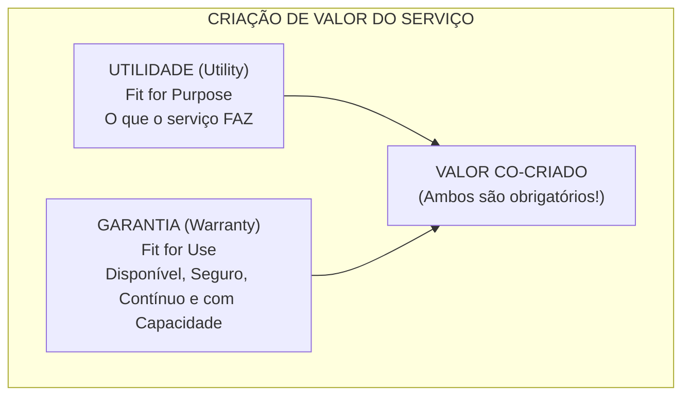
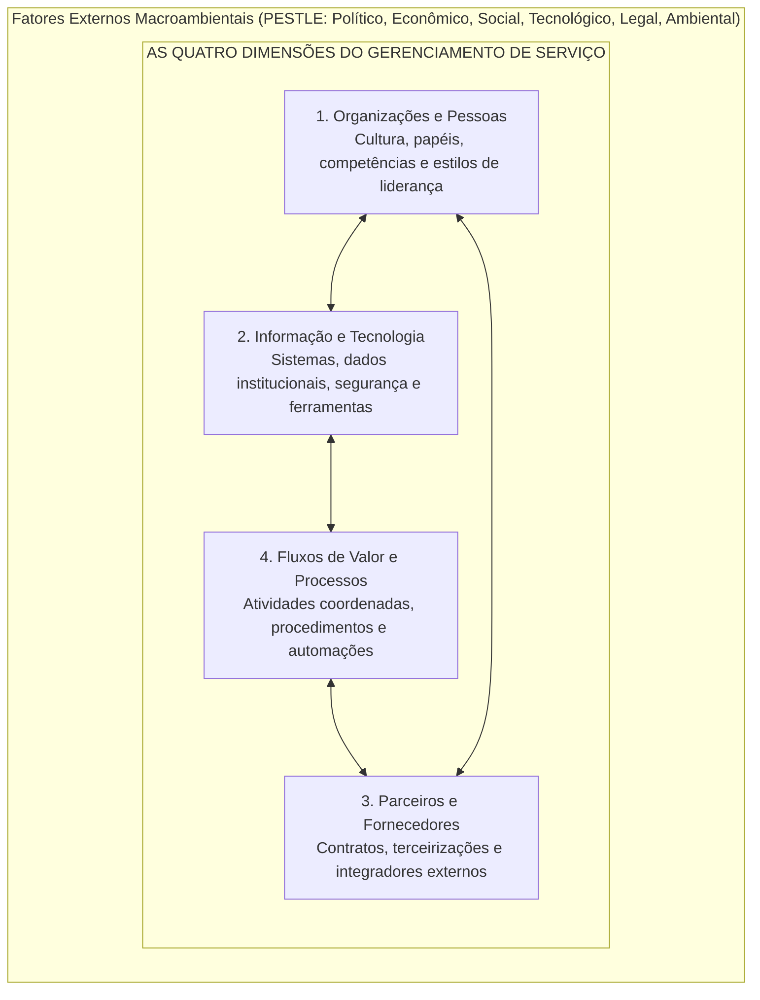
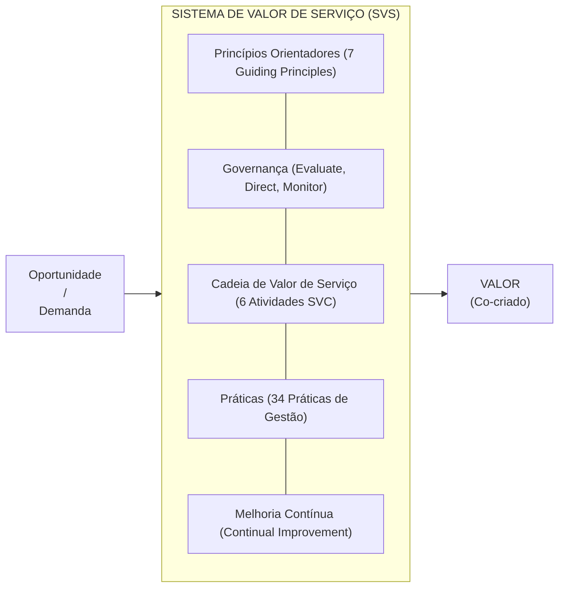
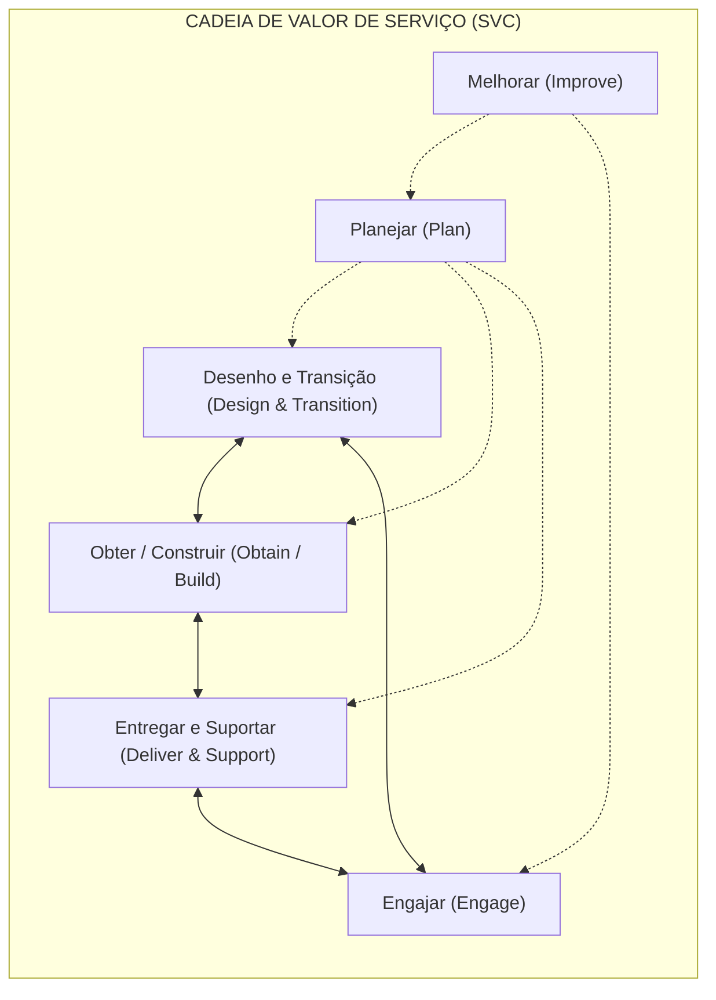
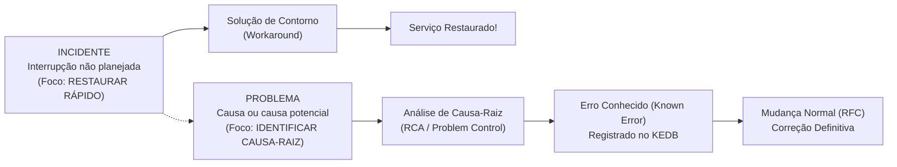
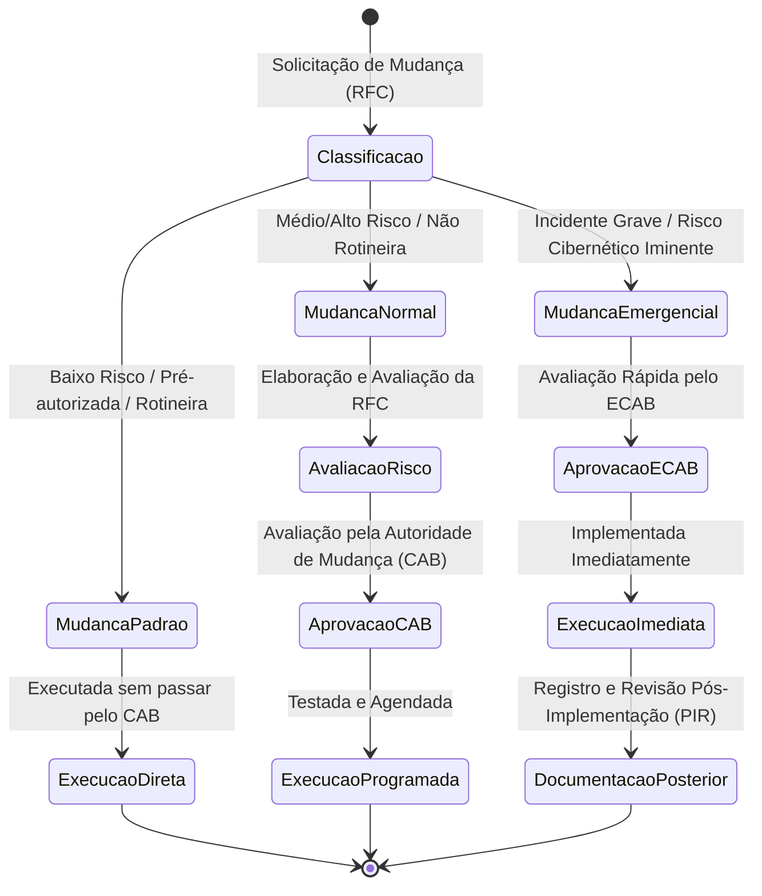

# 02 - Gestão de Serviços de TI e Práticas da ITIL v4

> **Matéria:** Governança de Tecnologia da Informação  
> **Cargo:** B02 – Técnico de Controle Externo – Especialidade: Tecnologia da Informação  
> **Arquivo:** `02_gestao_de_servicos_de_ti_itil_v4.md`  

---

## 📌 Ementa / Itens do Edital
- Framework ITIL v4 (Information Technology Infrastructure Library)
- Conceitos fundamentais de serviço, utilidade e garantia (Utility & Warranty)
- Sistema de Valor de Serviço (SVS - Service Value System)
- As Quatro Dimensões do Gerenciamento de Serviço
- Cadeia de Valor de Serviço (SVC - Service Value Chain)
- Os 7 Princípios Orientadores da ITIL v4
- Práticas de Gerenciamento de Serviços:
    - Central de Serviços (Service Desk)
    - Gerenciamento de Incidentes (Incident Management)
    - Gerenciamento de Problemas (Problem Management) e KEDB
    - Habilitação de Mudanças (Change Enablement)
    - Gerenciamento de Configuração de Serviço (CMDB e CIs)
    - Gerenciamento de Ativos de TI (ITAM)
    - Gerenciamento de Nível de Serviço (SLA, OLA, UC)
    - Gerenciamento de Continuidade de Serviços de TI (ITSCM: RPO e RTO)

---

## 🧭 Sumário

1. [O Modelo Central da ITIL v4](#1-o-modelo-central-da-itil-v4)
1. [Conceitos de Serviço, Co-criação de Valor, Utilidade e Garantia](#1-1-conceitos-de-servico-co-criacao-de-valor-utilidade-e-garantia)
    1. [Teste 475](#Teste-475)
1. [As Quatro Dimensões do Gerenciamento de Serviço](#1-2-as-quatro-dimensoes-do-gerenciamento-de-servico)
    1. [Teste 476](#Teste-476)
1. [O Sistema de Valor de Serviço (SVS)](#1-3-o-sistema-de-valor-de-servico-svs)
1. [Os 7 Princípios Orientadores (Guiding Principles)](#1-4-os-7-principios-orientadores-guiding-principles)
    1. [Teste 477](#Teste-477)
1. [A Cadeia de Valor de Serviço (SVC - 6 Atividades Operacionais)](#1-5-a-cadeia-de-valor-de-servico-svc-6-atividades-operacionais)
    1. [Teste 478](#Teste-478)
2. [Práticas Essenciais de Gerenciamento de Serviços da ITIL v4](#2-praticas-essenciais-de-gerenciamento-de-servicos-da-itil-v4)
2. [Central de Serviços (Service Desk)](#2-1-central-de-servicos-service-desk)
    1. [Teste 479](#Teste-479)
2. [Gerenciamento de Incidentes vs. Gerenciamento de Problemas](#2-2-gerenciamento-de-incidentes-vs-gerenciamento-de-problemas)
    1. [Teste 480](#Teste-480)
2. [Habilitação de Mudanças (Change Enablement)](#2-3-habilitacao-de-mudancas-change-enablement)
    1. [Teste 481](#Teste-481)
2. [Gerenciamento de Configuração de Serviço (CMDB) vs. Ativos de TI (ITAM)](#2-4-gerenciamento-de-configuracao-de-servico-cmdb-vs-ativos-de-ti-itam)
    1. [Teste 482](#Teste-482)
2. [Gerenciamento de Nível de Serviço (SLA, OLA e UC)](#2-5-gerenciamento-de-nivel-de-servico-sla-ola-e-uc)
    1. [Teste 483](#Teste-483)
2. [Gerenciamento de Continuidade de Serviços de TI (ITSCM: RTO e RPO)](#2-6-gerenciamento-de-continuidade-de-servicos-de-ti-itscm-rto-e-rpo)
    1. [Teste 484](#Teste-484)
6. [Fontes Recomendadas na Internet](#6-fontes-recomendadas-na-internet)

---

## 1. O Modelo Central da ITIL v4

A **ITIL v4** (*Information Technology Infrastructure Library*) representa uma evolução substancial da biblioteca de boas práticas de Gerenciamento de Serviços de TI (ITSM). Em substituição ao modelo puramente linear baseado nos 5 estágios do ciclo de vida da ITIL v3 (Estratégia, Desenho, Transição, Operação e Melhoria Contínua), a ITIL v4 consolida uma abordagem ágil, holística, flexível e orientada à **co-criação mútua de valor**.

---

### Teste 001
**(FGV – TCE/GO – 2024 – Analista de Controle Externo - Ciências Contábeis)**
O compliance é uma prática oriunda do marco regulatório corporativo anglo-saxão, particularmente o norte-americano. A legislação brasileira utiliza a terminologia de programas de integridade para se referir aos sistemas de compliance. Assinale a opção que indica um marco legal de programas de integridade pública no Brasil.

* **A)** Decreto da Governança.
* **B)** Lei Anticorrupção.
* **C)** Lei das Estatais.
* **D)** Lei de Responsabilidade Fiscal.
* **E)** Decreto de Acesso à Informação.

---

> **Comentário Detalhado:**
>
> - **A)** **Correta.** Conforme fundamentado na seção *1.3 O Sistema de Valor de Serviço (SVS)* deste guia, gOV["Governança (Evaluate, Direct, Monitor)"]. Dessa forma, está plenamente correta a assertiva da banca (FGV – TCE/GO/2024) ao estabelecer que "Decreto da Governança".
> - **B)** **Incorreta.** A opção apresenta proposição em desacordo com os fundamentos teóricos e técnicos do tópico ao afirmar que "Lei Anticorrupção". De acordo com a teoria estudada em *1.3 O Sistema de Valor de Serviço (SVS)*, governança ( Governance ): O sistema pelo qual a organização é dirigida e controlada (alinhamento ao ciclo EDM da ISO/IEC 38500).
> - **C)** **Incorreta.** A opção apresenta proposição em desacordo com os fundamentos teóricos e técnicos do tópico ao afirmar que "Lei das Estatais". De acordo com a teoria estudada em *6. Fontes Recomendadas na Internet*, tCU Práticas de Governança e Gestão de TI no Setor Público Referencial de boas práticas de gestão de operações e catálogo de serviços de TI governamentais.
> - **D)** **Incorreta.** A opção apresenta proposição em desacordo com os fundamentos teóricos e técnicos do tópico ao afirmar que "Lei de Responsabilidade Fiscal". De acordo com a teoria estudada em *6. Fontes Recomendadas na Internet*, governo Digital Infraestrutura Nacional de Dados (IND) Governança, compartilhamento e segurança de bases de dados do setor público.
> - **E)** **Incorreta.** A opção apresenta proposição em desacordo com os fundamentos teóricos e técnicos do tópico ao afirmar que "Decreto de Acesso à Informação". De acordo com a teoria estudada em *1.2 As Quatro Dimensões do Gerenciamento de Serviço*, informação e Tecnologia: O ecossistema de informações gerado e processado (bancos de dados, integridade, conformidade com a LGPD) e as tecnologias de suporte aos serviços (computação em nuvem, ferramentas de automação, monitoramento e IA).
>
> **Gabarito: A**

---

### Teste 002
**(FCC – TCE/GO – 2009 – Analista de Controle Externo - Gestão de Conhecimento)**
Dentre os elementos dos atos administrativos, citam-se

* **A)** a autoexecutoriedade, a imperatividade e a presun- ção de legalidade.
* **B)** a discricionariedade e a vinculação.
* **C)** a anulação e a revogação. Legislação Específica do Estado de Goiás
* **D)** o objeto, a finalidade e o motivo.
* **E)** I, II e III. _________________________________________________________

---

> **Comentário Detalhado:**
>
> - **A)** **Incorreta.** A opção apresenta proposição em desacordo com os fundamentos teóricos e técnicos do tópico ao afirmar que "a autoexecutoriedade, a imperatividade e a presun ção de legalidade". De acordo com a teoria estudada em *Definições Fundamentais da ITIL v4*, serviço ( Service ): Meio para permitir a co criação de valor, facilitando os resultados que os clientes desejam alcançar, sem que eles precisem assumir a gestão de custos e riscos específicos.
> - **B)** **Incorreta.** A opção apresenta proposição em desacordo com os fundamentos teóricos e técnicos do tópico ao afirmar que "a discricionariedade e a vinculação". De acordo com a teoria estudada em *Definições Fundamentais da ITIL v4*, co criação de Valor: O valor não é gerado e empurrado unilateralmente pelo provedor de TI. Ele é co criado ativamente por meio de parceria e interação constante entre o provedor e o consumidor do serviço.
> - **C)** **Incorreta.** A opção apresenta proposição em desacordo com os fundamentos teóricos e técnicos do tópico ao afirmar que "a anulação e a revogação. Legislação Específica do Estado de Goiás". De acordo com a teoria estudada em *Definições Fundamentais da ITIL v4*, utilidade ( Utility ): A funcionalidade oferecida por um produto ou serviço para atender a uma necessidade real de negócio. Reflete o que o serviço faz ( Fit for Purpose aptidão para o propósito).
> - **D)** **Correta.** Conforme fundamentado na seção *1. O Modelo Central da ITIL v4* deste guia, a ITIL v4 ( Information Technology Infrastructure Library ) representa uma evolução substancial da biblioteca de boas práticas de Gerenciamento de Serviços de TI (ITSM). Em substituição ao modelo puramente linear baseado nos 5 estágios do ciclo de vida da ITIL v3 (Estratégia, Desenho, Transição, Operação e Melhoria Contínua), a ITIL v4 consolida uma abordagem ágil, holística, flexível e orientada à co criação mútua de valor. Dessa forma, está plenamente correta a assertiva da banca (FCC – TCE/GO/2009) ao estabelecer que "o objeto, a finalidade e o motivo".
> - **E)** **Incorreta.** A opção apresenta proposição em desacordo com os fundamentos teóricos e técnicos do tópico ao afirmar que "I, II e III". De acordo com a teoria estudada em *Definições Fundamentais da ITIL v4*, garantia ( Warranty ): A segurança de que o produto ou serviço atenderá aos requisitos acordados quanto à sua disponibilidade, capacidade, continuidade e segurança. Reflete como o serviço é entregue e mantido ( Fit for Use aptidão para o uso).
>
> **Gabarito: D**

---

### Teste 003
**(FGV – TJ/AP – 2023 – Analista Judiciario Apoio Especializado Tecnologia Da Informacao Telecomunicacoes)**
As ferramentas de colaboração online revolucionaram a maneira com que equipes e empresas interagem e trabalham, permitindo uma comunicação mais eficiente, coordenação de tarefas e compartilhamento de informações em tempo real. Em relação ao assunto, são exemplos de ferramentas de colaboração:

* **A)** Jira, WhatsApp e YouTube;
* **B)** Dropbox, LinkedIn e Twitter;
* **C)** Basecamp, Discord e Pinterest;
* **D)** Slack, Trello e Microsoft Teams;
* **E)** Google Docs, Facebook e Instagram.

---

> **Comentário Detalhado:**
>
> - **A)** **Incorreta.** A opção apresenta proposição em desacordo com os fundamentos teóricos e técnicos do tópico ao afirmar que "Jira, WhatsApp e YouTube". De acordo com a teoria estudada em *1.4 Os 7 Princípios Orientadores (Guiding Principles)*, 5: Pense e Trabalhe Holisticamente ( Think and Work Holistically ) — Nenhum serviço ou prática funciona de maneira isolada. É necessário compreender a interdependência sistêmica entre pessoas, processos e ferramentas.
> - **B)** **Incorreta.** A opção apresenta proposição em desacordo com os fundamentos teóricos e técnicos do tópico ao afirmar que "Dropbox, LinkedIn e Twitter". De acordo com a teoria estudada em *1.3 O Sistema de Valor de Serviço (SVS)*, práticas ( Practices ): Conjuntos de recursos organizacionais desenhados para realizar tarefas específicas (a ITIL v4 substitui o conceito de "processos" da v3 pelo termo mais abrangente "práticas").
> - **C)** **Incorreta.** A opção apresenta proposição em desacordo com os fundamentos teóricos e técnicos do tópico ao afirmar que "Basecamp, Discord e Pinterest". De acordo com a teoria estudada em *Tabela Comparativa: Incidente versus Problema versus Erro Conhecido*, problema ( Problem ): Uma causa, ou causa potencial, de um ou mais incidentes. — Identificar a causa raiz real ou provável dos incidentes e prevenir a sua recorrência futura. — Análise de causa raiz (RCA), auditoria de logs, simulação em ambiente de testes.
> - **D)** **Correta.** Conforme fundamentado na seção *1.2 As Quatro Dimensões do Gerenciamento de Serviço* deste guia, informação e Tecnologia: O ecossistema de informações gerado e processado (bancos de dados, integridade, conformidade com a LGPD) e as tecnologias de suporte aos serviços (computação em nuvem, ferramentas de automação, monitoramento e IA). Dessa forma, está plenamente correta a assertiva da banca (FGV – TJ/AP/2023) ao estabelecer que "Slack, Trello e Microsoft Teams".
> - **E)** **Incorreta.** A opção apresenta proposição em desacordo com os fundamentos teóricos e técnicos do tópico ao afirmar que "Google Docs, Facebook e Instagram". De acordo com a teoria estudada em *1.2 As Quatro Dimensões do Gerenciamento de Serviço*, organizações e Pessoas: Estrutura formal do órgão ou empresa, cultura corporativa compartilhada, definição inequívoca de papéis e responsabilidades, comunicação interpessoal, competências técnicas e estilos de liderança.
>
> **Gabarito: D**

---

### Teste 004
**(FCC – TRT 23ª – 2016 – Analista Judiciário - Apoio Especializado - Tecnologia da Informação)**
De acordo com a norma ABNT NBR ISO/IEC 27002:2013 a política de controle de acesso deve considerar

* **A)** a disponibilidade de referências de caráter satisfatórias do usuário, por exemplo, uma profissional e uma pessoal.
* **B)** verificações financeiras e verificações de registros criminais do usuário.
* **C)** ações a serem tomadas no caso de o funcionário desrespeitar os requisitos de segurança da informação da organização.
* **D)** a legislação pertinente e qualquer obrigação contratual relativa à proteção de acesso para dados ou serviços.
* **E)** a confirmação e documentação das qualificações acadêmicas e profissionais do usuário.

---

> **Comentário Detalhado:**
>
> - **A)** **Incorreta.** A opção apresenta proposição em desacordo com os fundamentos teóricos e técnicos do tópico ao afirmar que "a disponibilidade de referências de caráter satisfatórias do usuário, por exemplo, uma profissional e uma pessoal". De acordo com a teoria estudada em *2.6 Gerenciamento de Continuidade de Serviços de TI (ITSCM: RTO e RPO)*, responsável por garantir que a disponibilidade e o desempenho dos serviços de TI sejam mantidos em níveis suficientes em caso de desastre operacional grave, alinhando se ao Plano de Continuidade de Negócios ( Business Continuity Plan BCP ) do Tribunal.
> - **B)** **Incorreta.** A opção apresenta proposição em desacordo com os fundamentos teóricos e técnicos do tópico ao afirmar que "verificações financeiras e verificações de registros criminais do usuário". De acordo com a teoria estudada em *2.1 Central de Serviços (Service Desk)*, virtual: Analistas distribuídos geograficamente que interagem por meio de sistemas na nuvem, dando ao usuário a percepção de uma central única.
> - **C)** **Incorreta.** A opção apresenta proposição em desacordo com os fundamentos teóricos e técnicos do tópico ao afirmar que "ações a serem tomadas no caso de o funcionário desrespeitar os requisitos de segurança da informação da organização". De acordo com a teoria estudada em *1.2 As Quatro Dimensões do Gerenciamento de Serviço*, d2["2. Informação e Tecnologia<br/ Sistemas, dados institucionais, segurança e ferramentas"].
> - **D)** **Correta.** Conforme fundamentado na seção *Os Três Tipos de Mudanças na ITIL v4* deste guia, mudança Padrão ( Standard Change ): Baixo — Pré autorizada (formalmente aprovada de antemão). — Procedimento rotineiro, documentado e testado. Não requer envio de RFC ao CAB a cada ocorrência. — Criação de conta de usuário, concessão de perfil de acesso de rede, troca de mouse defeituoso. Dessa forma, está plenamente correta a assertiva da banca (FCC – TRT 23ª/2016) ao estabelecer que "a legislação pertinente e qualquer obrigação contratual relativa à proteção de acesso para dados ou serviços".
> - **E)** **Incorreta.** A opção apresenta proposição em desacordo com os fundamentos teóricos e técnicos do tópico ao afirmar que "a confirmação e documentação das qualificações acadêmicas e profissionais do usuário". De acordo com a teoria estudada em *6. Fontes Recomendadas na Internet*, governo Digital Estratégia Federal de Governo Digital (EFGD) Diretrizes estratégicas para sustentação e entrega contínua de serviços digitais centrados no usuário.
>
> **Gabarito: D**

---

### Teste 005
**(FCC – TRT 9ª – 2015 – Analista Judiciário - Apoio Especializado - Tecnologia da Informação)**
Considere os seguintes itens: _________________________________________________________ I. Hino nacional. Noções de Direito Administrativo II. Feriados oficiais nacionais. III. Armas nacionais. 25. Sabe-se que em algumas hipóteses a Administração pública está, por lei, autorizada a contratar diretamente, é IV. Selo nacional. dizer, sem a realização de procedimento licitatório. Quanto a essas situações, é correto afirmar que os casos de Nos termos da Constituição Federal, além da Bandeira nacional, é símbolo da República Federativa do Brasil o

* **A)** II e III. clusivo, se a hipótese fática não estiver arrolada no
* **B)** dispensa de licitação estão elencados de forma
* **C)** I, III e IV.
* **D)** I, II e III. exaustiva pela legislação, o que implica a impossibi- lidade de contratação direta, sob esse fundamento,
* **E)** I e IV. se a hipótese fática não constar de algum dos dispo- _________________________________________________________ sitivos legais autorizadores da contratação direta, por dispensa de licitação.

---

> **Comentário Detalhado:**
>
> - **A)** **Incorreta.** A opção apresenta proposição em desacordo com os fundamentos teóricos e técnicos do tópico ao afirmar que "II e III. clusivo, se a hipótese fática não estiver arrolada no". De acordo com a teoria estudada em *Definições Fundamentais da ITIL v4*, garantia ( Warranty ): A segurança de que o produto ou serviço atenderá aos requisitos acordados quanto à sua disponibilidade, capacidade, continuidade e segurança. Reflete como o serviço é entregue e mantido ( Fit for Use aptidão para o uso).
> - **B)** **Incorreta.** A opção afasta requisito ou relação estrutural exigida pela matéria ao afirmar que "dispensa de licitação estão elencados de forma". De acordo com a teoria estudada em *1.4 Os 7 Princípios Orientadores (Guiding Principles)*, 4: Colabore e Promova Visibilidade ( Collaborate and Promote Visibility ) — Trabalhe de forma integrada entre departamentos, eliminando silos isolados. Compartilhe dados operacionais, status de projetos e métricas de forma transparente.
> - **C)** **Correta.** Conforme fundamentado na seção *Os Três Tipos de Mudanças na ITIL v4* deste guia, mudança Padrão ( Standard Change ): Baixo — Pré autorizada (formalmente aprovada de antemão). — Procedimento rotineiro, documentado e testado. Não requer envio de RFC ao CAB a cada ocorrência. — Criação de conta de usuário, concessão de perfil de acesso de rede, troca de mouse defeituoso. Dessa forma, está plenamente correta a assertiva da banca (FCC – TRT 9ª/2015) ao estabelecer que "I, III e IV".
> - **D)** **Incorreta.** A opção apresenta proposição em desacordo com os fundamentos teóricos e técnicos do tópico ao afirmar que "I, II e III. exaustiva pela legislação, o que implica a impossibi lidade de contratação direta, sob esse...". De acordo com a teoria estudada em *Definições Fundamentais da ITIL v4*, a FCC adora afirmar que um serviço de TI pode gerar valor pleno ao negócio apenas possuindo excelente Utilidade, mesmo com falhas de Garantia. ERRADO! O valor requer simultaneamente Utilidade ( Fit for Purpose ) e Garantia ( Fit for Use ). Se um sistema de processo eletrônico tem todas as telas e funções que os auditores precisam (utilidade), mas cai a cada meia hora ou vaza dados (falha de garantia), o serviço gera valor zero ou negativo.
> - **E)** **Incorreta.** A opção afasta requisito ou relação estrutural exigida pela matéria ao afirmar que "I e IV. se a hipótese fática não constar de algum dos dispo sitivos legais autorizadores da contratação direta...". De acordo com a teoria estudada em *1.3 O Sistema de Valor de Serviço (SVS)*, saída: Realização contínua de Valor para as partes interessadas.
>
> **Gabarito: C**

---

### Teste 006
**(FGV – TRT da 24º Região – 2025 – Analista Judiciário - Área Administrativa - Sem Especialidade)**
A elaboração e a execução do Plano Plurianual (PPA) é um instrumento essencial do ciclo orçamentário, pois orienta o planejamento, a alocação de recursos e a prestação de contas das políticas públicas. Assinale a opção que apresenta corretamente as características do PPA.

* **A)** O PPA permite que cada novo governo defina metas e programas independentes, não exigindo continuidade dos planos e projetos iniciados no mandato anterior.
* **B)** O PPA é uma lei exclusivamente de planejamento operacional, que influencia apenas a elaboração da Lei Orçamentária Anual, sem relação com a Lei de Diretrizes Orçamentárias.
* **C)** O PPA tem duração de três anos, iniciando sua vigência imediatamente no início do mandato presidencial, sem a necessidade de continuidade administrativa das metas e programas.
* **D)** O PPA é uma lei de natureza formal e conteúdo material, com duração de quatro anos e seu projeto deve ser encaminhado pelo Executivo ao Legislativo até 31 de agosto do primeiro ano do governo, iniciando sua vigência no segundo ano do mandato presidencial.
* **E)** O PPA é uma lei de planejamento estratégico de quatro anos, que deve ser encaminhada pelo Executivo ao Legislativo até o final do primeiro ano do governo, iniciando sua vigência imediatamente no início do mandato, o que não garante a continuidade administrativa das metas e programas.

---

> **Comentário Detalhado:**
>
> - **A)** **Incorreta.** A opção apresenta proposição em desacordo com os fundamentos teóricos e técnicos do tópico ao afirmar que "O PPA permite que cada novo governo defina metas e programas independentes, não exigindo continuidade dos planos e...". De acordo com a teoria estudada em *1.4 Os 7 Princípios Orientadores (Guiding Principles)*, 7: Otimize e Automatize ( Optimize and Automate ) — Simplifique e padronize o processo antes de implementar automações tecnológicas. A tecnologia deve ser usada para liberar pessoas para tarefas criativas e complexas.
> - **B)** **Incorreta.** A opção incorre em restrição indevida ao limitar o escopo conceitual ao afirmar que "O PPA é uma lei exclusivamente de planejamento operacional, que influencia apenas a elaboração da Lei Orçamentária...". De acordo com a teoria estudada em *6. Fontes Recomendadas na Internet*, governo Digital Estratégia Federal de Governo Digital (EFGD) Diretrizes estratégicas para sustentação e entrega contínua de serviços digitais centrados no usuário.
> - **C)** **Incorreta.** A opção apresenta proposição em desacordo com os fundamentos teóricos e técnicos do tópico ao afirmar que "O PPA tem duração de três anos, iniciando sua vigência imediatamente no início do mandato presidencial, sem a...". De acordo com a teoria estudada em *Os Três Tipos de Mudanças na ITIL v4*, mudança Normal ( Normal Change ): Variável (Médio a Alto) — Requer autorização formal da Autoridade de Mudança ( Change Authority / CAB). — Segue o fluxo formal: RFC $\rightarrow$ Avaliação de impacto/risco $\rightarrow$ Agendamento em janela $\rightarrow$ Testes $\rightarrow$ Implementação. — Atualização de versão do SGBD de produção, migração de datacenter, lançamento de nova versão do portal.
> - **D)** **Correta.** Conforme fundamentado na seção *1.4 Os 7 Princípios Orientadores (Guiding Principles)* deste guia, a FCC adora trocar a ordem de "Otimize e Automatize", afirmando que se deve "automatizar para depois descobrir o que precisa ser otimizado". ERRADO! Automatizar processos ruins apenas produz erros em maior velocidade. Primeiro otimiza se e padroniza se; depois se automatiza!. Dessa forma, está plenamente correta a assertiva da banca (FGV – TRT da 24º Região/2025) ao estabelecer que "O PPA é uma lei de natureza formal e conteúdo material, com duração de quatro anos e seu projeto deve ser...".
> - **E)** **Incorreta.** A opção apresenta proposição em desacordo com os fundamentos teóricos e técnicos do tópico ao afirmar que "O PPA é uma lei de planejamento estratégico de quatro anos, que deve ser encaminhada pelo Executivo ao Legislativo...". De acordo com a teoria estudada em *1.2 As Quatro Dimensões do Gerenciamento de Serviço*, organizações e Pessoas: Estrutura formal do órgão ou empresa, cultura corporativa compartilhada, definição inequívoca de papéis e responsabilidades, comunicação interpessoal, competências técnicas e estilos de liderança.
>
> **Gabarito: D**

---

### Teste 007
**(FGV – TRT 1ª – 2024 – Analista Judiciário - Área Administrativa)**
Um decreto federal assegurou à pessoa com deficiência tratamento prioritário. Dispôs ele que: 1) ficaria assegurada à pessoa com deficiência física, mental ou sensorial a prioridade de vaga em escola pública que estivesse localizada mais próxima de sua residência; 2) seriam consideradas deficiências todas aquelas que necessitassem de assistência especial, decorrentes de problemas visuais, auditivos, mentais, motores, ou má- formação congênita; 3) as deficiências dos estudantes beneficiados seriam comprovadas por meio de laudo médico fornecido por instituições médico-hospitalares públicas e competentes para prestar tal comprovação; e, 4) ficariam excluídos da prioridade do item 1 os estabelecimentos de ensino que não possuíssem as condições necessárias para educação de portadores de deficiência mental e sensorial. Levando em conta a Agenda 2030 da Organização das Nações Unidas (ONU), os direitos humanos e fundamentais da pessoa com deficiência e a Lei nº 13.146/2015, é correto afirmar que:

* **A)** o referido decreto acerta ao dispor de todos os problemas (visuais, auditivos, mentais, motores, ou má formação congênita) para fins de consideração da pessoa com deficiência, adotando-se o conceito amplo proposto pela Lei nº 13.146/2015;
* **B)** a exigência de que as deficiências dos estudantes beneficiados sejam comprovadas por meio de laudo médico fornecido por instituições médico-hospitalares públicas e competentes para prestar tal comprovação atende ao que reclama a Lei nº 13.146/2015;
* **C)** o item 4 se choca com a imposição de assegurar um sistema educacional inclusivo, estabelecido no sistema constitucional e na Lei nº 13.146/2015, e com o amparo no objetivo de desenvolvimento sustentável referente à educação da Agenda 2030 da ONU;
* **D)** a Agenda 2030 da ONU não trata do tema educação em relação a pessoas com deficiência, de modo que o único objetivo de desenvolvimento sustentável apto a conferir um olhar mais específico à questão é o referente a instituições eficazes;
* **E)** a exclusão relacionada aos estabelecimentos de ensino estaria corretamente justificada na liberdade de conformação legislativa e na discricionariedade administrativa quando da concretização da política pública.

---

> **Comentário Detalhado:**
>
> - **A)** **Incorreta.** A opção apresenta proposição em desacordo com os fundamentos teóricos e técnicos do tópico ao afirmar que "o referido decreto acerta ao dispor de todos os problemas (visuais, auditivos, mentais, motores, ou má formação...". De acordo com a teoria estudada em *1.3 O Sistema de Valor de Serviço (SVS)*, práticas ( Practices ): Conjuntos de recursos organizacionais desenhados para realizar tarefas específicas (a ITIL v4 substitui o conceito de "processos" da v3 pelo termo mais abrangente "práticas").
> - **B)** **Incorreta.** A opção apresenta proposição em desacordo com os fundamentos teóricos e técnicos do tópico ao afirmar que "a exigência de que as deficiências dos estudantes beneficiados sejam comprovadas por meio de laudo médico...". De acordo com a teoria estudada em *2.3 Habilitação de Mudanças (Change Enablement)*, a prática de Habilitação de Mudanças (denominada Change Management na v3) visa maximizar o número de mudanças bem sucedidas em serviços e produtos, garantindo a adequada avaliação de riscos, a autorização formal pelas autoridades competentes e a execução coordenada.
> - **C)** **Correta.** Conforme fundamentado na seção *Definições Fundamentais da ITIL v4* deste guia, a FCC adora afirmar que um serviço de TI pode gerar valor pleno ao negócio apenas possuindo excelente Utilidade, mesmo com falhas de Garantia. ERRADO! O valor requer simultaneamente Utilidade ( Fit for Purpose ) e Garantia ( Fit for Use ). Se um sistema de processo eletrônico tem todas as telas e funções que os auditores precisam (utilidade), mas cai a cada meia hora ou vaza dados (falha de garantia), o serviço gera valor zero ou negativo. Dessa forma, está plenamente correta a assertiva da banca (FGV – TRT 1ª/2024) ao estabelecer que "o item 4 se choca com a imposição de assegurar um sistema educacional inclusivo, estabelecido no sistema...".
> - **D)** **Incorreta.** A opção apresenta proposição em desacordo com os fundamentos teóricos e técnicos do tópico ao afirmar que "a Agenda 2030 da ONU não trata do tema educação em relação a pessoas com deficiência, de modo que o único objetivo...". De acordo com a teoria estudada em *2.5 Gerenciamento de Nível de Serviço (SLA, OLA e UC)*, o objetivo do Gerenciamento de Nível de Serviço ( Service Level Management SLM ) é definir metas claras baseadas em negócios para os níveis de serviço e garantir que a entrega de serviços seja avaliada, monitorada e gerenciada em relação a essas metas.
> - **E)** **Incorreta.** A opção apresenta proposição em desacordo com os fundamentos teóricos e técnicos do tópico ao afirmar que "a exclusão relacionada aos estabelecimentos de ensino estaria corretamente justificada na liberdade de conformação...". De acordo com a teoria estudada em *1.2 As Quatro Dimensões do Gerenciamento de Serviço*, parceiros e Fornecedores: Relações contratuais com entidades externas que participam da concepção, desenvolvimento, entrega e suporte dos serviços (fábricas de software, provedores de nuvem, consultorias de TIC).
>
> **Gabarito: C**

---

### Teste 008
**(FGV – TRT 1ª – 2024 – Analista Judiciário - Área Administrativa)**
O estado Alfa, à mingua de normas da União disciplinando a respectiva temática, editou a Lei estadual nº X. Em momento posterior, a União editou a Lei nº Y, em sentido diametralmente oposto ao da Lei estadual nº X. Considerando os balizamentos estabelecidos pela ordem constitucional, é correto afirmar que a Lei nº Y:

* **A)** não deve ser aplicada no território de Alfa, enquanto a Lei estadual nº X permanecer em vigor;
* **B)** revoga a Lei estadual nº X, mas apenas se a temática estiver inserida na competência legislativa privativa da União;
* **C)** deve ser considerada nula, considerando o princípio federativo da especialização legislativa nos entes de menor proporção;
* **D)** suspende a eficácia da Lei estadual nº X, caso veicule normas gerais e a matéria se insira na competência legislativa concorrente;
* **E)** revoga a Lei estadual nº X se a temática estiver inserida na competência legislativa privativa da União ou na competência legislativa concorrente.

---

> **Comentário Detalhado:**
>
> - **A)** **Incorreta.** A opção apresenta proposição em desacordo com os fundamentos teóricos e técnicos do tópico ao afirmar que "não deve ser aplicada no território de Alfa, enquanto a Lei estadual nº X permanecer em vigor". De acordo com a teoria estudada em *1.4 Os 7 Princípios Orientadores (Guiding Principles)*, a FCC adora trocar a ordem de "Otimize e Automatize", afirmando que se deve "automatizar para depois descobrir o que precisa ser otimizado". ERRADO! Automatizar processos ruins apenas produz erros em maior velocidade. Primeiro otimiza se e padroniza se; depois se automatiza!.
> - **B)** **Incorreta.** A opção incorre em restrição indevida ao limitar o escopo conceitual ao afirmar que "revoga a Lei estadual nº X, mas apenas se a temática estiver inserida na competência legislativa privativa da União". De acordo com a teoria estudada em *Definições Fundamentais da ITIL v4*, a FCC adora afirmar que um serviço de TI pode gerar valor pleno ao negócio apenas possuindo excelente Utilidade, mesmo com falhas de Garantia. ERRADO! O valor requer simultaneamente Utilidade ( Fit for Purpose ) e Garantia ( Fit for Use ). Se um sistema de processo eletrônico tem todas as telas e funções que os auditores precisam (utilidade), mas cai a cada meia hora ou vaza dados (falha de garantia), o serviço gera valor zero ou negativo.
> - **C)** **Incorreta.** A opção apresenta proposição em desacordo com os fundamentos teóricos e técnicos do tópico ao afirmar que "deve ser considerada nula, considerando o princípio federativo da especialização legislativa nos entes de menor...". De acordo com a teoria estudada em *Tabela Comparativa: Incidente versus Problema versus Erro Conhecido*, a banca frequentemente afirma que a equipe de incidentes deve paralisar a produção até encontrar a causa raiz no código. ERRADO! O foco do Gerenciamento de Incidentes é exclusivamente a restauração do serviço no menor tempo possível ( Time to Restore ). A busca minuciosa da causa raiz é trabalho privativo do Gerenciamento de Problemas.
> - **D)** **Correta.** Conforme fundamentado na seção *2.6 Gerenciamento de Continuidade de Serviços de TI (ITSCM: RTO e RPO)* deste guia, responsável por garantir que a disponibilidade e o desempenho dos serviços de TI sejam mantidos em níveis suficientes em caso de desastre operacional grave, alinhando se ao Plano de Continuidade de Negócios ( Business Continuity Plan BCP ) do Tribunal. Dessa forma, está plenamente correta a assertiva da banca (FGV – TRT 1ª/2024) ao estabelecer que "suspende a eficácia da Lei estadual nº X, caso veicule normas gerais e a matéria se insira na competência...".
> - **E)** **Incorreta.** A opção apresenta proposição em desacordo com os fundamentos teóricos e técnicos do tópico ao afirmar que "revoga a Lei estadual nº X se a temática estiver inserida na competência legislativa privativa da União ou na...". De acordo com a teoria estudada em *1.2 As Quatro Dimensões do Gerenciamento de Serviço*, para viabilizar uma abordagem holística, equilibrada e evitar o isolamento de equipes em silos técnicos, a ITIL v4 exige que qualquer produto ou serviço seja gerenciado considerando Quatro Dimensões.
>
> **Gabarito: D**

---

### Teste 009
**(FGV – TRT 1ª – 2024 – Analista Judiciário - Área Administrativa)**
Um ente público municipal pleiteou uma transferência voluntária junto ao Ministério das Cidades para desenvolvimento de projetos de geração de emprego e renda a partir da exploração sustentável de recursos regionais. À luz da legislação aplicável, o recebimento da transferência voluntária pretendida pelo ente solicitante:

* **A)** depende de previsão expressa no plano plurianual em vigor no âmbito do governo federal;
* **B)** é vedado no último ano de mandato no âmbito do ente recebedor;
* **C)** exige previsão orçamentária de contrapartida pelo ente transferidor;
* **D)** permite alteração da finalidade e do cronograma de aplicação dos recursos;
* **E)** requer observância dos limites de endividamento e despesa total com pessoal pelo ente recebedor.

---

> **Comentário Detalhado:**
>
> - **A)** **Incorreta.** A opção apresenta proposição em desacordo com os fundamentos teóricos e técnicos do tópico ao afirmar que "depende de previsão expressa no plano plurianual em vigor no âmbito do governo federal". De acordo com a teoria estudada em *2.6 Gerenciamento de Continuidade de Serviços de TI (ITSCM: RTO e RPO)*, responsável por garantir que a disponibilidade e o desempenho dos serviços de TI sejam mantidos em níveis suficientes em caso de desastre operacional grave, alinhando se ao Plano de Continuidade de Negócios ( Business Continuity Plan BCP ) do Tribunal.
> - **B)** **Incorreta.** A opção apresenta proposição em desacordo com os fundamentos teóricos e técnicos do tópico ao afirmar que "é vedado no último ano de mandato no âmbito do ente recebedor". De acordo com a teoria estudada em *2.6 Gerenciamento de Continuidade de Serviços de TI (ITSCM: RTO e RPO)*, rPO ( Recovery Point Objective Ponto Objetivo de Recuperação): Quantidade máxima tolerável de perda de dados expressa em tempo decorrido desde o último backup válido até o momento do incidente. Mede a tolerância à perda de transações.
> - **C)** **Incorreta.** A opção apresenta proposição em desacordo com os fundamentos teóricos e técnicos do tópico ao afirmar que "exige previsão orçamentária de contrapartida pelo ente transferidor". De acordo com a teoria estudada em *1.2 As Quatro Dimensões do Gerenciamento de Serviço*, para viabilizar uma abordagem holística, equilibrada e evitar o isolamento de equipes em silos técnicos, a ITIL v4 exige que qualquer produto ou serviço seja gerenciado considerando Quatro Dimensões.
> - **D)** **Incorreta.** A opção apresenta proposição em desacordo com os fundamentos teóricos e técnicos do tópico ao afirmar que "permite alteração da finalidade e do cronograma de aplicação dos recursos". De acordo com a teoria estudada em *1.3 O Sistema de Valor de Serviço (SVS)*, práticas ( Practices ): Conjuntos de recursos organizacionais desenhados para realizar tarefas específicas (a ITIL v4 substitui o conceito de "processos" da v3 pelo termo mais abrangente "práticas").
> - **E)** **Correta.** Conforme fundamentado na seção *Definições Fundamentais da ITIL v4* deste guia, a FCC adora afirmar que um serviço de TI pode gerar valor pleno ao negócio apenas possuindo excelente Utilidade, mesmo com falhas de Garantia. ERRADO! O valor requer simultaneamente Utilidade ( Fit for Purpose ) e Garantia ( Fit for Use ). Se um sistema de processo eletrônico tem todas as telas e funções que os auditores precisam (utilidade), mas cai a cada meia hora ou vaza dados (falha de garantia), o serviço gera valor zero ou negativo. Dessa forma, está plenamente correta a assertiva da banca (FGV – TRT 1ª/2024) ao estabelecer que "requer observância dos limites de endividamento e despesa total com pessoal pelo ente recebedor".
>
> **Gabarito: E**

---

### Teste 010
**(CEBRASPE – STF – 2008 – Analista Judiciario Suporte Em Tecnologia Da Informacao)**
Um tribunal, ao elaborar seu regimento interno, exerce uma função atípica legislativa.

* **C)** Certo
* **E)** Errado

---

> **Comentário Detalhado:**
>
> - **C)** **Correta.** O item está **Certo**. Conforme fundamentado na seção *2.5 Gerenciamento de Nível de Serviço (SLA, OLA e UC)*, oLA ( Operational Level Agreement Acordo de Nível Operacional): Acordo interno firmado entre diferentes áreas internas do mesmo provedor de TI (ex.: equipe de Redes acordando com a equipe de Aplicações o tempo de liberação de portas de firewall). Dessa forma, está plenamente correta a assertiva da banca (CEBRASPE – STF/2008) ao afirmar que "Um tribunal, ao elaborar seu regimento interno, exerce uma função atípica legislativa".
> - **E)** **Incorreta.** A assertiva não incorre em erro conceitual, guardando conformidade com a teoria estudada.
>
> **Gabarito: C**

---

### Teste 011
**(CEBRASPE – STF – 2013 – Analista Judiciario Suporte Em Tecnologia Da Informacao)**
A ISO 38500 visa promover o uso eficaz, eficiente e aceitável da tecnologia da informação (TI) e possui, como princípios da boa governança corporativa de TI, a responsabilidade, a estratégia e a aquisição.

* **C)** Certo
* **E)** Errado

---

> **Comentário Detalhado:**
>
> - **C)** **Correta.** O item está **Certo**. Conforme fundamentado na seção *1.3 O Sistema de Valor de Serviço (SVS)*, governança ( Governance ): O sistema pelo qual a organização é dirigida e controlada (alinhamento ao ciclo EDM da ISO/IEC 38500). Dessa forma, está plenamente correta a assertiva da banca (CEBRASPE – STF/2013) ao afirmar que "A ISO 38500 visa promover o uso eficaz, eficiente e aceitável da tecnologia da informação (TI) e possui, como...".
> - **E)** **Incorreta.** A assertiva não incorre em erro conceitual, guardando conformidade com a teoria estudada.
>
> **Gabarito: C**

---

### Teste 012
**(CEBRASPE – TRT/10 – 2013 – Analista Judiciario Tecnologia Da Informacao)**
Estratégias organizacionais são identificadas a partir do planejamento estratégico institucional, de modo que a não elaboração desse planejamento pela organização impossibilita o reconhecimento de suas necessidades de informação alinhadas com as necessidades de negócio. EGTI OTNEMAJENALP pla n e j a m e n to p l a n e j a m e n t o plan e ja m ento c o n tr a ta ç ã o d e p lu r i a nu a l e s t r a t é g i c o d e TI s o lu ç ã o d e T I i n s t it u c i o n a l PPA PEI PETI PDTI contrato MPOG. Guia de elaboração de PDTI do SISP, 2012. A figura acima ilustra a relação entre os instrumentos de planejamento de TI no escopo da organização, evidenciando o processo de planejamento organizacional ao qual estão submetidos órgãos públicos federais. Na figura, são mostrados os seguintes elementos: plano plurianual (PPA), planejamento estratégico institucional (PEI), planejamento estratégico de TI (PETI) e plano diretor de tecnologia da informação (PDTI). Tendo a figura acima apresentada como referência e considerando a legislação vigente, julgue os itens que se seguem, a respeito do processo de planejamento de TI e seus instrumentos.

* **C)** Certo
* **E)** Errado

---

> **Comentário Detalhado:**
>
> - **C)** **Incorreta.** A proposição apresenta proposição em desacordo com os fundamentos teóricos e técnicos do tópico ao afirmar que "Estratégias organizacionais são identificadas a partir do planejamento estratégico institucional, de modo que...". De acordo com a teoria em *1.5 A Cadeia de Valor de Serviço (SVC - 6 Atividades Operacionais)*, planejar ( Plan ): Assegurar o entendimento compartilhado da visão institucional, situação atual e direcionamento de melhoria para todos os produtos e serviços.
> - **E)** **Correta.** O item está **Errado** (gabarito oficial: **E**), pois contraria a disciplina teórica aplicável.
>
> **Gabarito: E**

---

### Teste 013
**(FCC – TRT 15ª – 2015 – Analista Judiciário - Tecnologia da Informação)**
No contexto dado, possui a mesma regência do verbo presente no segmento A escravidão que denunciava com dureza, o que se encontra sublinhado em:

* **A)** Quem fala, hoje, dos 30 milhões de escravos... (8o parágrafo)
* **B)** ... número que hoje oscila entre os 13 milhões e os 14 milhões... (5o parágrafo)
* **C)** ... antes de portugueses ou espanhóis comprarem negros na África rumo ao Novo Mundo. (7o parágrafo)
* **D)** ... o Global Slavery Index é um belo retrato da nossa miséria... (4o parágrafo)
* **E)** Não é preciso assistir a 12 Anos de Escravidão... (1o parágrafo)

---

> **Comentário Detalhado:**
>
> - **A)** **Incorreta.** A opção apresenta proposição em desacordo com os fundamentos teóricos e técnicos do tópico ao afirmar que "Quem fala, hoje, dos 30 milhões de escravos... (8o parágrafo)". De acordo com a teoria estudada em *Definições Fundamentais da ITIL v4*, serviço ( Service ): Meio para permitir a co criação de valor, facilitando os resultados que os clientes desejam alcançar, sem que eles precisem assumir a gestão de custos e riscos específicos.
> - **B)** **Incorreta.** A opção apresenta proposição em desacordo com os fundamentos teóricos e técnicos do tópico ao afirmar que "... número que hoje oscila entre os 13 milhões e os 14 milhões... (5o parágrafo)". De acordo com a teoria estudada em *2.3 Habilitação de Mudanças (Change Enablement)*, a prática de Habilitação de Mudanças (denominada Change Management na v3) visa maximizar o número de mudanças bem sucedidas em serviços e produtos, garantindo a adequada avaliação de riscos, a autorização formal pelas autoridades competentes e a execução coordenada.
> - **C)** **Incorreta.** A opção apresenta proposição em desacordo com os fundamentos teóricos e técnicos do tópico ao afirmar que "... antes de portugueses ou espanhóis comprarem negros na África rumo ao Novo Mundo. (7o parágrafo)". De acordo com a teoria estudada em *1.4 Os 7 Princípios Orientadores (Guiding Principles)*, 2: Comece de Onde Você Está ( Start Where You Are ) — Não destrua o que já existe para recomeçar do zero sem antes analisar o estado atual. Avalie e reaproveite serviços, códigos, procedimentos e sistemas em operação.
> - **D)** **Incorreta.** A opção apresenta proposição em desacordo com os fundamentos teóricos e técnicos do tópico ao afirmar que "... o Global Slavery Index é um belo retrato da nossa miséria... (4o parágrafo)". De acordo com a teoria estudada em *Definições Fundamentais da ITIL v4*, co criação de Valor: O valor não é gerado e empurrado unilateralmente pelo provedor de TI. Ele é co criado ativamente por meio de parceria e interação constante entre o provedor e o consumidor do serviço.
> - **E)** **Correta.** Conforme fundamentado na seção *1. O Modelo Central da ITIL v4* deste guia, a ITIL v4 ( Information Technology Infrastructure Library ) representa uma evolução substancial da biblioteca de boas práticas de Gerenciamento de Serviços de TI (ITSM). Em substituição ao modelo puramente linear baseado nos 5 estágios do ciclo de vida da ITIL v3 (Estratégia, Desenho, Transição, Operação e Melhoria Contínua), a ITIL v4 consolida uma abordagem ágil, holística, flexível e orientada à co criação mútua de valor. Dessa forma, está plenamente correta a assertiva da banca (FCC – TRT 15ª/2015) ao estabelecer que "Não é preciso assistir a 12 Anos de Escravidão... (1o parágrafo)".
>
> **Gabarito: E**

---

### Teste 014
**(FCC – TRT 2ª – 2014 – Analista Judiciário - Tecnologia da Informação)**
No próximo ano, uma enfermeira deverá estar de plantão 22. É competência privativa da União legislar sobre as maté- em 210 dos 365 dias do ano. No hospital em que ela tra- rias de direito balha, só se permite que uma enfermeira fique de plantão

* **A)** 78. tográfico.
* **B)** 85.
* **C)** 87.
* **D)** 90. _________________________________________________________
* **E)** agrário, direito penitenciário, metalurgia e sistema cartográfico.

---

> **Comentário Detalhado:**
>
> - **A)** **Incorreta.** A opção apresenta proposição em desacordo com os fundamentos teóricos e técnicos do tópico ao afirmar que "78. tográfico". De acordo com a teoria estudada em *Definições Fundamentais da ITIL v4*, serviço ( Service ): Meio para permitir a co criação de valor, facilitando os resultados que os clientes desejam alcançar, sem que eles precisem assumir a gestão de custos e riscos específicos.
> - **B)** **Incorreta.** A opção apresenta proposição em desacordo com os fundamentos teóricos e técnicos do tópico ao afirmar que "85". De acordo com a teoria estudada em *Definições Fundamentais da ITIL v4*, co criação de Valor: O valor não é gerado e empurrado unilateralmente pelo provedor de TI. Ele é co criado ativamente por meio de parceria e interação constante entre o provedor e o consumidor do serviço.
> - **C)** **Correta.** Conforme fundamentado na seção *1. O Modelo Central da ITIL v4* deste guia, a ITIL v4 ( Information Technology Infrastructure Library ) representa uma evolução substancial da biblioteca de boas práticas de Gerenciamento de Serviços de TI (ITSM). Em substituição ao modelo puramente linear baseado nos 5 estágios do ciclo de vida da ITIL v3 (Estratégia, Desenho, Transição, Operação e Melhoria Contínua), a ITIL v4 consolida uma abordagem ágil, holística, flexível e orientada à co criação mútua de valor. Dessa forma, está plenamente correta a assertiva da banca (FCC – TRT 2ª/2014) ao estabelecer que "87".
> - **D)** **Incorreta.** A opção apresenta proposição em desacordo com os fundamentos teóricos e técnicos do tópico ao afirmar que "90". De acordo com a teoria estudada em *Definições Fundamentais da ITIL v4*, utilidade ( Utility ): A funcionalidade oferecida por um produto ou serviço para atender a uma necessidade real de negócio. Reflete o que o serviço faz ( Fit for Purpose aptidão para o propósito).
> - **E)** **Incorreta.** A opção apresenta proposição em desacordo com os fundamentos teóricos e técnicos do tópico ao afirmar que "agrário, direito penitenciário, metalurgia e sistema cartográfico". De acordo com a teoria estudada em *Definições Fundamentais da ITIL v4*, a FCC adora afirmar que um serviço de TI pode gerar valor pleno ao negócio apenas possuindo excelente Utilidade, mesmo com falhas de Garantia. ERRADO! O valor requer simultaneamente Utilidade ( Fit for Purpose ) e Garantia ( Fit for Use ). Se um sistema de processo eletrônico tem todas as telas e funções que os auditores precisam (utilidade), mas cai a cada meia hora ou vaza dados (falha de garantia), o serviço gera valor zero ou negativo.
>
> **Gabarito: C**

---

### Teste 015
**(FGV – TCE/PA – 2024 – Auditor de Controle Externo - Administrativa - Gestão Governamental)**
No âmbito da autotutela, existem diferentes modalidades de extinção do ato por manifestação de vontade da Administração, entre as quais encontram-se as seguintes situações: I. Extinção do ato administrativo discricionário, apenas pelo fato de que a situação nele contemplada não é mais admitida pela legislação. II. Extinção do ato administrativo em razão de ilegalidade superveniente atribuída ao respectivo beneficiário. III. Extinção do ato administrativo em decorrência do reconhecimento de um vício grave e insanável. As situações I, II e III referem-se, respectivamente, a extinções por

* **A)** caducidade, cassação e anulação.
* **B)** revogação, anulação e caducidade.
* **C)** anulação, cassação e revogação.
* **D)** revogação, cassação e anulação.
* **E)** caducidade, revogação e cassação.

---

> **Comentário Detalhado:**
>
> - **A)** **Correta.** Conforme fundamentado na seção *1.5 A Cadeia de Valor de Serviço (SVC - 6 Atividades Operacionais)* deste guia, planejar ( Plan ): Assegurar o entendimento compartilhado da visão institucional, situação atual e direcionamento de melhoria para todos os produtos e serviços. Dessa forma, está plenamente correta a assertiva da banca (FGV – TCE/PA/2024) ao estabelecer que "caducidade, cassação e anulação".
> - **B)** **Incorreta.** A opção apresenta proposição em desacordo com os fundamentos teóricos e técnicos do tópico ao afirmar que "revogação, anulação e caducidade". De acordo com a teoria estudada em *2.4 Gerenciamento de Configuração de Serviço (CMDB) vs. Ativos de TI (ITAM)*, pergunta Essencial: "Se o switch da sala de servidores queimar, quais bancos de dados, aplicações de fiscalização e servidores web ficarão indisponíveis?" — "Quantas licenças de Windows Server adquirimos, qual é o valor residual dos notebooks do Tribunal e quando expira a garantia do servidor?".
> - **C)** **Incorreta.** A opção apresenta proposição em desacordo com os fundamentos teóricos e técnicos do tópico ao afirmar que "anulação, cassação e revogação". De acordo com a teoria estudada em *2.1 Central de Serviços (Service Desk)*, siga o Sol (Follow the Sun): Equipes em diferentes fusos horários cobrindo suporte ininterrupto 24/7.
> - **D)** **Incorreta.** A opção apresenta proposição em desacordo com os fundamentos teóricos e técnicos do tópico ao afirmar que "revogação, cassação e anulação". De acordo com a teoria estudada em *2.3 Habilitação de Mudanças (Change Enablement)*, classificacao MudancaEmergencial: Incidente Grave / Risco Cibernético Iminente.
> - **E)** **Incorreta.** A opção apresenta proposição em desacordo com os fundamentos teóricos e técnicos do tópico ao afirmar que "caducidade, revogação e cassação". De acordo com a teoria estudada em *2.5 Gerenciamento de Nível de Serviço (SLA, OLA e UC)*, oLA ( Operational Level Agreement Acordo de Nível Operacional): Acordo interno firmado entre diferentes áreas internas do mesmo provedor de TI (ex.: equipe de Redes acordando com a equipe de Aplicações o tempo de liberação de portas de firewall).
>
> **Gabarito: A**

---

### Teste 016
**(FGV – TCE/PA – 2024 – Auditor de Controle Externo - Administrativa - Gestão Governamental)**
De acordo com a NBC TSP Estrutura Conceitual– Estrutura Conceitual para Elaboração e Divulgação de Informação Contábil de Propósito Geral pelas Entidades do Setor Público, no Relatório Contábil de Propósito Geral das Entidades do Setor Público, os objetivos da elaboração e divulgação da informação contábil são determinadas com base

* **A)** nas exigências dos órgãos reguladores.
* **B)** nas prioridades de divulgação do Governo.
* **C)** nas determinações da legislação contábil vigente.
* **D)** nas necessidades de informações dos usuários dos relatórios.
* **E)** nos interesses dos dirigentes das entidades do setor público.

---

> **Comentário Detalhado:**
>
> - **A)** **Incorreta.** A opção apresenta proposição em desacordo com os fundamentos teóricos e técnicos do tópico ao afirmar que "nas exigências dos órgãos reguladores". De acordo com a teoria estudada em *1.4 Os 7 Princípios Orientadores (Guiding Principles)*, 6: Mantenha Simples e Prático ( Keep It Simple and Practical ) — Utilize a quantidade mínima necessária de etapas para atingir o objetivo. Elimine relatórios inúteis, etapas burocráticas e métricas redundantes ( parcimônia ).
> - **B)** **Incorreta.** A opção apresenta proposição em desacordo com os fundamentos teóricos e técnicos do tópico ao afirmar que "nas prioridades de divulgação do Governo". De acordo com a teoria estudada em *6. Fontes Recomendadas na Internet*, governo Digital Infraestrutura Nacional de Dados (IND) Governança, compartilhamento e segurança de bases de dados do setor público.
> - **C)** **Incorreta.** A opção apresenta proposição em desacordo com os fundamentos teóricos e técnicos do tópico ao afirmar que "nas determinações da legislação contábil vigente". De acordo com a teoria estudada em *2.4 Gerenciamento de Configuração de Serviço (CMDB) vs. Ativos de TI (ITAM)*, foco Primário: Operacional / Técnico: Mapeia como os componentes técnicos se interconectam e dependem uns dos outros para sustentar a entrega de um serviço de TI. — Financeiro / Contábil / Legal: Controla o valor financeiro, notas fiscais, depreciação contábil, termos de garantia e conformidade de licenças de software.
> - **D)** **Correta.** Conforme fundamentado na seção *1.2 As Quatro Dimensões do Gerenciamento de Serviço* deste guia, informação e Tecnologia: O ecossistema de informações gerado e processado (bancos de dados, integridade, conformidade com a LGPD) e as tecnologias de suporte aos serviços (computação em nuvem, ferramentas de automação, monitoramento e IA). Dessa forma, está plenamente correta a assertiva da banca (FGV – TCE/PA/2024) ao estabelecer que "nas necessidades de informações dos usuários dos relatórios".
> - **E)** **Incorreta.** A opção apresenta proposição em desacordo com os fundamentos teóricos e técnicos do tópico ao afirmar que "nos interesses dos dirigentes das entidades do setor público". De acordo com a teoria estudada em *1.2 As Quatro Dimensões do Gerenciamento de Serviço*, parceiros e Fornecedores: Relações contratuais com entidades externas que participam da concepção, desenvolvimento, entrega e suporte dos serviços (fábricas de software, provedores de nuvem, consultorias de TIC).
>
> **Gabarito: D**

---

### Teste 017
**(FGV – TCE/PA – 2024 – Auditor de Controle Externo - Administrativa - Gestão Governamental)**
A base constitucional para o sigilo fiscal está na preservação da intimidade e da vida privada e inviolabilidade da correspondência. Assinale a situação em que o legislador ou a jurisprudência dos Tribunais Superiores entende que há violação ao sigilo fiscal.

* **A)** Translado do dever de sigilo da esfera bancária para a fiscal, previsto em lei, sem a necessidade de decisão judicial.
* **B)** Inclusão de dados das pessoas físicas e jurídicas responsáveis pelos créditos inadimplidos no Cadastro Informativo dos Créditos não Quitados de Órgão e Entidades Federais - CADIN.
* **C)** Divulgação, pela fazenda pública, de informações obtidas em razão de ofício sobre a situação financeira do sujeito passivo e sobre a natureza e o estado de seus negócios.
* **D)** Divulgação de informações relativas a representações fiscais para fins penais.
* **E)** Divulgação de informações relativas a inscrições na Dívida Ativa da Fazenda Pública.

---

> **Comentário Detalhado:**
>
> - **A)** **Incorreta.** A opção apresenta proposição em desacordo com os fundamentos teóricos e técnicos do tópico ao afirmar que "Translado do dever de sigilo da esfera bancária para a fiscal, previsto em lei, sem a necessidade de decisão...". De acordo com a teoria estudada em *1.2 As Quatro Dimensões do Gerenciamento de Serviço*, informação e Tecnologia: O ecossistema de informações gerado e processado (bancos de dados, integridade, conformidade com a LGPD) e as tecnologias de suporte aos serviços (computação em nuvem, ferramentas de automação, monitoramento e IA).
> - **B)** **Incorreta.** A opção apresenta proposição em desacordo com os fundamentos teóricos e técnicos do tópico ao afirmar que "Inclusão de dados das pessoas físicas e jurídicas responsáveis pelos créditos inadimplidos no Cadastro Informativo...". De acordo com a teoria estudada em *1.2 As Quatro Dimensões do Gerenciamento de Serviço*, organizações e Pessoas: Estrutura formal do órgão ou empresa, cultura corporativa compartilhada, definição inequívoca de papéis e responsabilidades, comunicação interpessoal, competências técnicas e estilos de liderança.
> - **C)** **Correta.** Conforme fundamentado na seção *1.5 A Cadeia de Valor de Serviço (SVC - 6 Atividades Operacionais)* deste guia, planejar ( Plan ): Assegurar o entendimento compartilhado da visão institucional, situação atual e direcionamento de melhoria para todos os produtos e serviços. Dessa forma, está plenamente correta a assertiva da banca (FGV – TCE/PA/2024) ao estabelecer que "Divulgação, pela fazenda pública, de informações obtidas em razão de ofício sobre a situação financeira do sujeito...".
> - **D)** **Incorreta.** A opção apresenta proposição em desacordo com os fundamentos teóricos e técnicos do tópico ao afirmar que "Divulgação de informações relativas a representações fiscais para fins penais". De acordo com a teoria estudada em *2.4 Gerenciamento de Configuração de Serviço (CMDB) vs. Ativos de TI (ITAM)*, foco Primário: Operacional / Técnico: Mapeia como os componentes técnicos se interconectam e dependem uns dos outros para sustentar a entrega de um serviço de TI. — Financeiro / Contábil / Legal: Controla o valor financeiro, notas fiscais, depreciação contábil, termos de garantia e conformidade de licenças de software.
> - **E)** **Incorreta.** A opção apresenta proposição em desacordo com os fundamentos teóricos e técnicos do tópico ao afirmar que "Divulgação de informações relativas a inscrições na Dívida Ativa da Fazenda Pública". De acordo com a teoria estudada em *1.4 Os 7 Princípios Orientadores (Guiding Principles)*, 3: Progrida Iterativamente com Feedback ( Progress Iteratively with Feedback ) — Divida iniciativas complexas em ciclos menores e gerenciáveis (iterações ágeis). Obtenha feedback real dos usuários antes, durante e após cada entrega.
>
> **Gabarito: C**

---

### Teste 018
**(FGV – TCE/PI – 2025 – Auditor de Controle Externo - Controle Externo - Específica de Área Comum)**
Nos últimos anos, a administração pública brasileira tem dado cada vez mais atenção à gestão da integridade. Programas de integridade, que abrangem ações preventivas e corretivas contra fraudes e corrupção, são fundamentais para promover a confiança pública e criar um ambiente favorável ao desenvolvimento econômico. Assinale a opção que descreve a função suporte da alta administração nos programas de integridade.

* **A)** Desenvolver mecanismos de controle para gerenciar os riscos internos e externos da organização.
* **B)** Promover a adesão dos colaboradores a um código de conduta específico para prevenir fraudes e corrupção.
* **C)** Realizar auditorias independentes para detectar violações e garantir a conformidade com as políticas da organização.
* **D)** Dar aval explícito e apoio incondicional como exemplo a ser seguido, reforçando o compromisso de transformar a cultura da organização.
* **E)** Monitorar continuamente as operações da organização, garantindo a adaptação dos instrumentos e estruturas às novas demandas. Legislação Aplicável ao Tribunal de Contas do Estado do Piauí

---

> **Comentário Detalhado:**
>
> - **A)** **Incorreta.** A opção apresenta proposição em desacordo com os fundamentos teóricos e técnicos do tópico ao afirmar que "Desenvolver mecanismos de controle para gerenciar os riscos internos e externos da organização". De acordo com a teoria estudada em *Definições Fundamentais da ITIL v4*, serviço ( Service ): Meio para permitir a co criação de valor, facilitando os resultados que os clientes desejam alcançar, sem que eles precisem assumir a gestão de custos e riscos específicos.
> - **B)** **Incorreta.** A opção apresenta proposição em desacordo com os fundamentos teóricos e técnicos do tópico ao afirmar que "Promover a adesão dos colaboradores a um código de conduta específico para prevenir fraudes e corrupção". De acordo com a teoria estudada em *Tabela Comparativa: Incidente versus Problema versus Erro Conhecido*, problema ( Problem ): Uma causa, ou causa potencial, de um ou mais incidentes. — Identificar a causa raiz real ou provável dos incidentes e prevenir a sua recorrência futura. — Análise de causa raiz (RCA), auditoria de logs, simulação em ambiente de testes.
> - **C)** **Incorreta.** A opção apresenta proposição em desacordo com os fundamentos teóricos e técnicos do tópico ao afirmar que "Realizar auditorias independentes para detectar violações e garantir a conformidade com as políticas da organização". De acordo com a teoria estudada em *1.2 As Quatro Dimensões do Gerenciamento de Serviço*, informação e Tecnologia: O ecossistema de informações gerado e processado (bancos de dados, integridade, conformidade com a LGPD) e as tecnologias de suporte aos serviços (computação em nuvem, ferramentas de automação, monitoramento e IA).
> - **D)** **Correta.** Conforme fundamentado na seção *1.3 O Sistema de Valor de Serviço (SVS)* deste guia, o SVS ( Service Value System ) descreve como todos os componentes e atividades da organização atuam harmonicamente para transformar oportunidades e demandas em valor real para a sociedade e clientes. Dessa forma, está plenamente correta a assertiva da banca (FGV – TCE/PI/2025) ao estabelecer que "Dar aval explícito e apoio incondicional como exemplo a ser seguido, reforçando o compromisso de transformar a...".
> - **E)** **Incorreta.** A opção apresenta proposição em desacordo com os fundamentos teóricos e técnicos do tópico ao afirmar que "Monitorar continuamente as operações da organização, garantindo a adaptação dos instrumentos e estruturas às novas...". De acordo com a teoria estudada em *6. Fontes Recomendadas na Internet*, tCU Práticas de Governança e Gestão de TI no Setor Público Referencial de boas práticas de gestão de operações e catálogo de serviços de TI governamentais.
>
> **Gabarito: D**

---

### Teste 019
**(FGV – TCE/PA – 2024 – Auditor de Controle Externo - Fiscalização - Ciências Atuariais)**
A NBASP 140 tem como objetivo ajudar os Tribunais de Contas (TCs) a instituir, estabelecer e manter um sistema de controle da qualidade de suas auditorias apropriado às suas competências, de forma a responder aos seus riscos de qualidade. O sistema de controle da qualidade inclui o controle e a asseguração da qualidade do processo de auditoria dos TCs, e é composto por seis elementos, orientados por princípios. O princípio que preceitua o estabelecimento de políticas e procedimentos destinados a fornecer segurança razoável de que têm pessoal suficiente, competente, capaz e comprometido com os princípios éticos para executar trabalhos de acordo com as normas profissionais, a legislação e as exigências regulamentares correspondentes, é integrante do seguinte elemento:

* **A)** Recursos Humanos.
* **B)** Governança.
* **C)** Tecnologia organizacional.
* **D)** Estrutura organizacional.
* **E)** Monitoramento.

---

> **Comentário Detalhado:**
>
> - **A)** **Correta.** Conforme fundamentado na seção *1.3 O Sistema de Valor de Serviço (SVS)* deste guia, práticas ( Practices ): Conjuntos de recursos organizacionais desenhados para realizar tarefas específicas (a ITIL v4 substitui o conceito de "processos" da v3 pelo termo mais abrangente "práticas"). Dessa forma, está plenamente correta a assertiva da banca (FGV – TCE/PA/2024) ao estabelecer que "Recursos Humanos".
> - **B)** **Incorreta.** A opção apresenta proposição em desacordo com os fundamentos teóricos e técnicos do tópico ao afirmar que "Governança". De acordo com a teoria estudada em *6. Fontes Recomendadas na Internet*, governo Digital Infraestrutura Nacional de Dados (IND) Governança, compartilhamento e segurança de bases de dados do setor público.
> - **C)** **Incorreta.** A opção apresenta proposição em desacordo com os fundamentos teóricos e técnicos do tópico ao afirmar que "Tecnologia organizacional". De acordo com a teoria estudada em *1.4 Os 7 Princípios Orientadores (Guiding Principles)*, 7: Otimize e Automatize ( Optimize and Automate ) — Simplifique e padronize o processo antes de implementar automações tecnológicas. A tecnologia deve ser usada para liberar pessoas para tarefas criativas e complexas.
> - **D)** **Incorreta.** A opção apresenta proposição em desacordo com os fundamentos teóricos e técnicos do tópico ao afirmar que "Estrutura organizacional". De acordo com a teoria estudada em *1.2 As Quatro Dimensões do Gerenciamento de Serviço*, organizações e Pessoas: Estrutura formal do órgão ou empresa, cultura corporativa compartilhada, definição inequívoca de papéis e responsabilidades, comunicação interpessoal, competências técnicas e estilos de liderança.
> - **E)** **Incorreta.** A opção apresenta proposição em desacordo com os fundamentos teóricos e técnicos do tópico ao afirmar que "Monitoramento". De acordo com a teoria estudada em *1.2 As Quatro Dimensões do Gerenciamento de Serviço*, informação e Tecnologia: O ecossistema de informações gerado e processado (bancos de dados, integridade, conformidade com a LGPD) e as tecnologias de suporte aos serviços (computação em nuvem, ferramentas de automação, monitoramento e IA).
>
> **Gabarito: A**

---

### Teste 020
**(FGV – TCE/PA – 2024 – Auditor de Controle Externo - Fiscalização - Ciências Atuariais)**
Sobre a Auditoria Atuarial, é incorreto afirmar que

* **A)** contribui para a transparência e a confiança nos resultados atuariais, fornecendo uma revisão independente e objetiva das premissas e métodos utilizados, e recomendando melhorias para assegurar a precisão e a conformidade com os padrões profissionais e regulatórios.
* **B)** envolve a revisão independente das premissas atuariais, métodos e cálculos utilizados, assegurando a conformidade com os padrões profissionais e regulatórios, e a precisão das projeções financeiras e atuariais.
* **C)** é uma auditoria contábil, porque enfoca especificamente as premissas atuariais, métodos e cálculos utilizados, assegurando a precisão das projeções atuariais, fluxos atuariais e a conformidade com os padrões profissionais e regulatórios, além de avaliar a solvência e a sustentabilidade.
* **D)** é essencial para assegurar a integridade e a confiabilidade dos resultados atuariais, identificando discrepâncias ou erros nas premissas ou métodos utilizados, e recomendando ajustes necessários para garantir a solvência.
* **E)** o papel do auditor atuarial inclui avaliar a conformidade do plano com as normas internas e legislação vigentes, revisando as premissas, métodos e cálculos atuariais, e garantindo que as práticas atuariais sejam adequadas.

---

> **Comentário Detalhado:**
>
> - **A)** **Incorreta.** A opção apresenta proposição em desacordo com os fundamentos teóricos e técnicos do tópico ao afirmar que "contribui para a transparência e a confiança nos resultados atuariais, fornecendo uma revisão independente e...". De acordo com a teoria estudada em *1.2 As Quatro Dimensões do Gerenciamento de Serviço*, fluxos de Valor e Processos: Como as diversas áreas da organização coordenam suas atividades por meio de fluxos de valor ( Value Streams ) e procedimentos operacionais padronizados para entregar resultados tangíveis.
> - **B)** **Incorreta.** A opção apresenta proposição em desacordo com os fundamentos teóricos e técnicos do tópico ao afirmar que "envolve a revisão independente das premissas atuariais, métodos e cálculos utilizados, assegurando a conformidade...". De acordo com a teoria estudada em *Tabela Comparativa: Incidente versus Problema versus Erro Conhecido*, problema ( Problem ): Uma causa, ou causa potencial, de um ou mais incidentes. — Identificar a causa raiz real ou provável dos incidentes e prevenir a sua recorrência futura. — Análise de causa raiz (RCA), auditoria de logs, simulação em ambiente de testes.
> - **C)** **Correta.** Conforme fundamentado na seção *2.4 Gerenciamento de Configuração de Serviço (CMDB) vs. Ativos de TI (ITAM)* deste guia, foco Primário: Operacional / Técnico: Mapeia como os componentes técnicos se interconectam e dependem uns dos outros para sustentar a entrega de um serviço de TI. — Financeiro / Contábil / Legal: Controla o valor financeiro, notas fiscais, depreciação contábil, termos de garantia e conformidade de licenças de software. Dessa forma, está plenamente correta a assertiva da banca (FGV – TCE/PA/2024) ao estabelecer que "é uma auditoria contábil, porque enfoca especificamente as premissas atuariais, métodos e cálculos utilizados...".
> - **D)** **Incorreta.** A opção apresenta proposição em desacordo com os fundamentos teóricos e técnicos do tópico ao afirmar que "é essencial para assegurar a integridade e a confiabilidade dos resultados atuariais, identificando discrepâncias...". De acordo com a teoria estudada em *1.2 As Quatro Dimensões do Gerenciamento de Serviço*, informação e Tecnologia: O ecossistema de informações gerado e processado (bancos de dados, integridade, conformidade com a LGPD) e as tecnologias de suporte aos serviços (computação em nuvem, ferramentas de automação, monitoramento e IA).
> - **E)** **Incorreta.** A opção apresenta proposição em desacordo com os fundamentos teóricos e técnicos do tópico ao afirmar que "o papel do auditor atuarial inclui avaliar a conformidade do plano com as normas internas e legislação vigentes...". De acordo com a teoria estudada em *2.3 Habilitação de Mudanças (Change Enablement)*, a prática de Habilitação de Mudanças (denominada Change Management na v3) visa maximizar o número de mudanças bem sucedidas em serviços e produtos, garantindo a adequada avaliação de riscos, a autorização formal pelas autoridades competentes e a execução coordenada.
>
> **Gabarito: C**

---

### Teste 021
**(FGV – TCE/SC – 2026 – Auditor Fiscal de Controle Externo - Administração)**
O Estado Alfa apresentou um quadro de grave desequilíbrio financeiro, fato que o impulsionou a aderir ao plano de recuperação fiscal firmado junto ao Governo Federal, e com base nos parâmetros previstos na legislação vigente. O plano previa uma série de medidas administrativas, orçamentárias e financeiras a serem desenvolvidas pelo Estado Alfa, a fim de reestabelecer seu equilíbrio financeiro. O Tribunal de Contas do Estado Alfa instaurou um instrumento de fiscalização com a finalidade de examinar, no período de execução do plano, a legalidade, a legitimidade e a tempestividade dos atos de gestão dos responsáveis pela execução daquele plano. Nesse sentido, o instrumento de fiscalização mais adequado à finalidade da atividade de controle externo é denominado

* **A)** monitoramento.
* **B)** levantamento.
* **C)** auditoria operacional.
* **D)** auditoria de regularidade.
* **E)** acompanhamento. Controle Externo da Administração Pública

---

> **Comentário Detalhado:**
>
> - **A)** **Incorreta.** A opção apresenta proposição em desacordo com os fundamentos teóricos e técnicos do tópico ao afirmar que "monitoramento". De acordo com a teoria estudada em *1.2 As Quatro Dimensões do Gerenciamento de Serviço*, informação e Tecnologia: O ecossistema de informações gerado e processado (bancos de dados, integridade, conformidade com a LGPD) e as tecnologias de suporte aos serviços (computação em nuvem, ferramentas de automação, monitoramento e IA).
> - **B)** **Incorreta.** A opção apresenta proposição em desacordo com os fundamentos teóricos e técnicos do tópico ao afirmar que "levantamento". De acordo com a teoria estudada em *2.2 Gerenciamento de Incidentes vs. Gerenciamento de Problemas*, esta é a distinção mais testada em concursos de Tribunais de Contas.
> - **C)** **Incorreta.** A opção apresenta proposição em desacordo com os fundamentos teóricos e técnicos do tópico ao afirmar que "auditoria operacional". De acordo com a teoria estudada em *Tabela Comparativa: Incidente versus Problema versus Erro Conhecido*, problema ( Problem ): Uma causa, ou causa potencial, de um ou mais incidentes. — Identificar a causa raiz real ou provável dos incidentes e prevenir a sua recorrência futura. — Análise de causa raiz (RCA), auditoria de logs, simulação em ambiente de testes.
> - **D)** **Incorreta.** A opção apresenta proposição em desacordo com os fundamentos teóricos e técnicos do tópico ao afirmar que "auditoria de regularidade". De acordo com a teoria estudada em *1.3 O Sistema de Valor de Serviço (SVS)*, melhoria Contínua ( Continual Improvement ): Atividade recorrente executada em todos os níveis e componentes da organização.
> - **E)** **Correta.** Conforme fundamentado na seção *2.6 Gerenciamento de Continuidade de Serviços de TI (ITSCM: RTO e RPO)* deste guia, responsável por garantir que a disponibilidade e o desempenho dos serviços de TI sejam mantidos em níveis suficientes em caso de desastre operacional grave, alinhando se ao Plano de Continuidade de Negócios ( Business Continuity Plan BCP ) do Tribunal. Dessa forma, está plenamente correta a assertiva da banca (FGV – TCE/SC/2026) ao estabelecer que "acompanhamento. Controle Externo da Administração Pública".
>
> **Gabarito: E**

---

### Teste 022
**(FGV – TCE/SC – 2026 – Auditor Fiscal de Controle Externo - Administração)**
Os Tribunais de Contas dos Municípios são órgãos responsáveis pela fiscalização das contas de todos os municípios de determinado Estado. Quanto à prestação de contas, nos termos da jurisprudência do Supremo Tribunal Federal, é correto afirmar que os Tribunais de Contas dos Municípios devem prestar contas perante

* **A)** a Câmara Municipal, por serem órgãos municipais sujeitos ao modelo de controle externo previsto na Constituição Federal.
* **B)** a Assembleia Legislativa, por serem órgãos estaduais sujeitos ao modelo de controle externo previsto na Constituição Federal.
* **C)** o Tribunal de Contas do Estado, por serem órgãos municipais sujeitos ao modelo de controle externo previsto na Constituição Federal.
* **D)** o Tribunal de Contas do Estado, por serem órgãos estaduais sujeitos ao modelo de controle externo previsto na Constituição Federal.
* **E)** o Tribunal de Justiça do Estado, por serem órgãos estaduais sujeitos ao modelo de controle externo previsto na Constituição Federal.

---

> **Comentário Detalhado:**
>
> - **A)** **Incorreta.** A opção apresenta proposição em desacordo com os fundamentos teóricos e técnicos do tópico ao afirmar que "a Câmara Municipal, por serem órgãos municipais sujeitos ao modelo de controle externo previsto na Constituição...". De acordo com a teoria estudada em *1. O Modelo Central da ITIL v4*, a ITIL v4 ( Information Technology Infrastructure Library ) representa uma evolução substancial da biblioteca de boas práticas de Gerenciamento de Serviços de TI (ITSM). Em substituição ao modelo puramente linear baseado nos 5 estágios do ciclo de vida da ITIL v3 (Estratégia, Desenho, Transição, Operação e Melhoria Contínua), a ITIL v4 consolida uma abordagem ágil, holística, flexível e orientada à co criação mútua de valor.
> - **B)** **Incorreta.** A opção apresenta proposição em desacordo com os fundamentos teóricos e técnicos do tópico ao afirmar que "a Assembleia Legislativa, por serem órgãos estaduais sujeitos ao modelo de controle externo previsto na...". De acordo com a teoria estudada em *1.3 O Sistema de Valor de Serviço (SVS)*, cadeia de Valor de Serviço ( Service Value Chain ): O modelo operacional composto por 6 atividades interconectadas.
> - **C)** **Incorreta.** A opção apresenta proposição em desacordo com os fundamentos teóricos e técnicos do tópico ao afirmar que "o Tribunal de Contas do Estado, por serem órgãos municipais sujeitos ao modelo de controle externo previsto na...". De acordo com a teoria estudada em *Definições Fundamentais da ITIL v4*, garantia ( Warranty ): A segurança de que o produto ou serviço atenderá aos requisitos acordados quanto à sua disponibilidade, capacidade, continuidade e segurança. Reflete como o serviço é entregue e mantido ( Fit for Use aptidão para o uso).
> - **D)** **Correta.** Conforme fundamentado na seção *2.2 Gerenciamento de Incidentes vs. Gerenciamento de Problemas* deste guia, esta é a distinção mais testada em concursos de Tribunais de Contas. Dessa forma, está plenamente correta a assertiva da banca (FGV – TCE/SC/2026) ao estabelecer que "o Tribunal de Contas do Estado, por serem órgãos estaduais sujeitos ao modelo de controle externo previsto na...".
> - **E)** **Incorreta.** A opção apresenta proposição em desacordo com os fundamentos teóricos e técnicos do tópico ao afirmar que "o Tribunal de Justiça do Estado, por serem órgãos estaduais sujeitos ao modelo de controle externo previsto na...". De acordo com a teoria estudada em *Definições Fundamentais da ITIL v4*, a FCC adora afirmar que um serviço de TI pode gerar valor pleno ao negócio apenas possuindo excelente Utilidade, mesmo com falhas de Garantia. ERRADO! O valor requer simultaneamente Utilidade ( Fit for Purpose ) e Garantia ( Fit for Use ). Se um sistema de processo eletrônico tem todas as telas e funções que os auditores precisam (utilidade), mas cai a cada meia hora ou vaza dados (falha de garantia), o serviço gera valor zero ou negativo.
>
> **Gabarito: D**

---

### Teste 023
**(FGV – TCE/SC – 2026 – Auditor Fiscal de Controle Externo - Administração)**
Os atos de improbidade administrativa são ações ou omissões dolosas que violam os deveres de honestidade, probidade e boa- fé. Considerando as disposições da Lei nº 8.429/1992, com a redação dada pela Lei nº 14.230/2021, a respeito dos referidos atos, é correto afirmar que

* **A)** constitui ato de improbidade administrativa que causa prejuízo ao erário deixar a Assembleia Legislativa de apreciar o parecer prévio de Contas do Governador emitido pelo Tribunal de Contas Estadual, no prazo de 60 dias a contar do seu recebimento.
* **B)** constitui ato de improbidade administrativa que causa prejuízo ao erário deixar a Câmara Municipal de apreciar o parecer prévio de Contas do Prefeito Municipal emitido pelo Tribunal de Contas do Município, no prazo de 30 dias a contar do seu recebimento.
* **C)** constitui ato de improbidade administrativa que atenta contra os princípios da administração pública deixar de prestar contas quando esteja obrigado a fazê-lo, desde que disponha das condições para isso, com vistas a ocultar irregularidades
* **D)** constitui ato de improbidade administrativa que importa enriquecimento ilícito deixar o Tribunal de Contas de proferir provimento final em tomada de contas especial no prazo de 5 anos a contar do fato gerador, desde que o valor não supere o limite de alçada.
* **E)** constitui ato de improbidade administrativa que causa prejuízo ao erário deixar de prestar contas quando esteja obrigado a fazê-lo, desde que disponha das condições para isso, com vistas a ocultar irregularidades ou permitir a mudança em situação de fato ou de direito.

---

> **Comentário Detalhado:**
>
> - **A)** **Incorreta.** A opção apresenta proposição em desacordo com os fundamentos teóricos e técnicos do tópico ao afirmar que "constitui ato de improbidade administrativa que causa prejuízo ao erário deixar a Assembleia Legislativa de...". De acordo com a teoria estudada em *2.2 Gerenciamento de Incidentes vs. Gerenciamento de Problemas*, esta é a distinção mais testada em concursos de Tribunais de Contas.
> - **B)** **Incorreta.** A opção apresenta proposição em desacordo com os fundamentos teóricos e técnicos do tópico ao afirmar que "constitui ato de improbidade administrativa que causa prejuízo ao erário deixar a Câmara Municipal de apreciar o...". De acordo com a teoria estudada em *Os Três Tipos de Mudanças na ITIL v4*, mudança de Emergência ( Emergency Change ): Crítico — Autorizada com urgência pelo ECAB ( Emergency Change Advisory Board ). — Implementação veloz para conter incidente gravíssimo ou brecha crítica de segurança. A documentação formal e a avaliação pós implantação ocorrem a posteriori. — Aplicação de hotfix de segurança contra exploit ativo em firewall; restauração emergencial de servidor de autenticação caído.
> - **C)** **Correta.** Conforme fundamentado na seção *1.4 Os 7 Princípios Orientadores (Guiding Principles)* deste guia, os princípios orientadores da ITIL v4 são recomendações perenes, aplicáveis em qualquer organização pública ou privada, guiando desde a rotina de sustentação de TI até programas estratégicos de transformação digital. Dessa forma, está plenamente correta a assertiva da banca (FGV – TCE/SC/2026) ao estabelecer que "constitui ato de improbidade administrativa que atenta contra os princípios da administração pública deixar de...".
> - **D)** **Incorreta.** A opção apresenta proposição em desacordo com os fundamentos teóricos e técnicos do tópico ao afirmar que "constitui ato de improbidade administrativa que importa enriquecimento ilícito deixar o Tribunal de Contas de...". De acordo com a teoria estudada em *1.3 O Sistema de Valor de Serviço (SVS)*, princípios Orientadores ( Guiding Principles ): Filosofias e recomendações universais que orientam a tomada de decisão em quaisquer circunstâncias.
> - **E)** **Incorreta.** A opção apresenta proposição em desacordo com os fundamentos teóricos e técnicos do tópico ao afirmar que "constitui ato de improbidade administrativa que causa prejuízo ao erário deixar de prestar contas quando esteja...". De acordo com a teoria estudada em *Tabela Comparativa: Incidente versus Problema versus Erro Conhecido*, erro Conhecido ( Known Error ): Um problema cuja análise foi concluída, com causa raiz identificada e para o qual existe uma solução de contorno ( workaround ). — Documentar a falha e a solução de contorno no KEDB ( Known Error Database ) para acelerar futuros atendimentos. — Criação de artigo no KEDB e emissão de solicitação de mudança (RFC) para correção permanente no código.
>
> **Gabarito: C**

---

### Teste 024
**(FGV – TCE/SC – 2026 – Auditor Fiscal de Controle Externo - Administração)**
Um servidor público federal, ao conduzir licitação para aquisição de equipamentos, favoreceu empresa de familiar próximo, mesmo sem obter vantagem pessoal direta. A comissão de ética concluiu que houve violação a um princípio constitucional da Administração Pública, independentemente de dolo ou de prejuízo ao erário. Com base nos artigos 37 a 42 da Constituição Federal de 1988, assinale a afirmativa correta a respeito do caso.

* **A)** A conduta viola o princípio da legalidade, pois o servidor agiu sem expressa previsão legal que autorizasse a preferência à empresa do familiar.
* **B)** A conduta viola o princípio da impessoalidade, pois a Administração deve tratar os administrados sem favoritismos ou discriminações, orientando seus atos pelo interesse público e não por interesses privados.
* **C)** A conduta viola o princípio da publicidade, pois o servidor deixou de divulgar os atos da licitação nos meios oficiais exigidos pela legislação.
* **D)** A conduta viola o princípio da eficiência, uma vez que a escolha de empresa não selecionada pelos critérios técnicos adequados compromete o desempenho da Administração.
* **E)** Não há violação a princípio constitucional, pois a ausência de vantagem pessoal direta e de prejuízo ao erário afasta qualquer irregularidade no procedimento licitatório.

---

> **Comentário Detalhado:**
>
> - **A)** **Incorreta.** A opção apresenta proposição em desacordo com os fundamentos teóricos e técnicos do tópico ao afirmar que "A conduta viola o princípio da legalidade, pois o servidor agiu sem expressa previsão legal que autorizasse a...". De acordo com a teoria estudada em *1.2 As Quatro Dimensões do Gerenciamento de Serviço*, organizações e Pessoas: Estrutura formal do órgão ou empresa, cultura corporativa compartilhada, definição inequívoca de papéis e responsabilidades, comunicação interpessoal, competências técnicas e estilos de liderança.
> - **B)** **Correta.** Conforme fundamentado na seção *1.4 Os 7 Princípios Orientadores (Guiding Principles)* deste guia, nº: Princípio Orientador — Significado e Aplicação Prática no ITSM. Dessa forma, está plenamente correta a assertiva da banca (FGV – TCE/SC/2026) ao estabelecer que "A conduta viola o princípio da impessoalidade, pois a Administração deve tratar os administrados sem favoritismos...".
> - **C)** **Incorreta.** A opção apresenta proposição em desacordo com os fundamentos teóricos e técnicos do tópico ao afirmar que "A conduta viola o princípio da publicidade, pois o servidor deixou de divulgar os atos da licitação nos meios...". De acordo com a teoria estudada em *Os Três Tipos de Mudanças na ITIL v4*, mudança de Emergência ( Emergency Change ): Crítico — Autorizada com urgência pelo ECAB ( Emergency Change Advisory Board ). — Implementação veloz para conter incidente gravíssimo ou brecha crítica de segurança. A documentação formal e a avaliação pós implantação ocorrem a posteriori. — Aplicação de hotfix de segurança contra exploit ativo em firewall; restauração emergencial de servidor de autenticação caído.
> - **D)** **Incorreta.** A opção apresenta proposição em desacordo com os fundamentos teóricos e técnicos do tópico ao afirmar que "A conduta viola o princípio da eficiência, uma vez que a escolha de empresa não selecionada pelos critérios...". De acordo com a teoria estudada em *2.6 Gerenciamento de Continuidade de Serviços de TI (ITSCM: RTO e RPO)*, responsável por garantir que a disponibilidade e o desempenho dos serviços de TI sejam mantidos em níveis suficientes em caso de desastre operacional grave, alinhando se ao Plano de Continuidade de Negócios ( Business Continuity Plan BCP ) do Tribunal.
> - **E)** **Incorreta.** A opção promove generalização excessiva que desconsidera as condições técnicas e normativas ao afirmar que "Não há violação a princípio constitucional, pois a ausência de vantagem pessoal direta e de prejuízo ao erário...". De acordo com a teoria estudada em *Os Três Tipos de Mudanças na ITIL v4*, mudança Padrão ( Standard Change ): Baixo — Pré autorizada (formalmente aprovada de antemão). — Procedimento rotineiro, documentado e testado. Não requer envio de RFC ao CAB a cada ocorrência. — Criação de conta de usuário, concessão de perfil de acesso de rede, troca de mouse defeituoso.
>
> **Gabarito: B**

---

### Teste 025
**(FGV – TCE/SC – 2026 – Auditor Fiscal de Controle Externo - Ciências Atuariais)**
De acordo com a Portaria MTP nº 1.467/2022, assinale a opção que descreve corretamente as obrigações do regime próprio quanto ao encaminhamento de demonstrativos, documentos e informações, considerando os prazos e a periodicidade exigidos pelo Ministério da Previdência.

* **A)** Demonstrativo de Informações Previdenciárias e Repasses, até o último dia do mês seguinte ao encerramento de cada trimestre.
* **B)** Demonstrativo de Viabilidade do Plano de Custeio, até o dia 31 de julho de cada ano.
* **C)** Legislação relacionada ao regime previdenciário, em até um ano após a publicação.
* **D)** Nota Técnica Atuarial, imediatamente após sua elaboração, sem obrigatoriedade de envio das retificações, salvo quando houver requisição expressa.
* **E)** Relatório de Análise das Hipóteses, contendo, inclusive, justificativa quanto à premissa de idade da primeira vinculação a regime previdenciário de origem, com análise de aderência e revisão no mínimo a cada quatro anos.

---

> **Comentário Detalhado:**
>
> - **A)** **Correta.** Conforme fundamentado na seção *1.2 As Quatro Dimensões do Gerenciamento de Serviço* deste guia, informação e Tecnologia: O ecossistema de informações gerado e processado (bancos de dados, integridade, conformidade com a LGPD) e as tecnologias de suporte aos serviços (computação em nuvem, ferramentas de automação, monitoramento e IA). Dessa forma, está plenamente correta a assertiva da banca (FGV – TCE/SC/2026) ao estabelecer que "Demonstrativo de Informações Previdenciárias e Repasses, até o último dia do mês seguinte ao encerramento de cada...".
> - **B)** **Incorreta.** A opção apresenta proposição em desacordo com os fundamentos teóricos e técnicos do tópico ao afirmar que "Demonstrativo de Viabilidade do Plano de Custeio, até o dia 31 de julho de cada ano". De acordo com a teoria estudada em *2.6 Gerenciamento de Continuidade de Serviços de TI (ITSCM: RTO e RPO)*, responsável por garantir que a disponibilidade e o desempenho dos serviços de TI sejam mantidos em níveis suficientes em caso de desastre operacional grave, alinhando se ao Plano de Continuidade de Negócios ( Business Continuity Plan BCP ) do Tribunal.
> - **C)** **Incorreta.** A opção apresenta proposição em desacordo com os fundamentos teóricos e técnicos do tópico ao afirmar que "Legislação relacionada ao regime previdenciário, em até um ano após a publicação". De acordo com a teoria estudada em *1.4 Os 7 Princípios Orientadores (Guiding Principles)*, 3: Progrida Iterativamente com Feedback ( Progress Iteratively with Feedback ) — Divida iniciativas complexas em ciclos menores e gerenciáveis (iterações ágeis). Obtenha feedback real dos usuários antes, durante e após cada entrega.
> - **D)** **Incorreta.** A opção apresenta proposição em desacordo com os fundamentos teóricos e técnicos do tópico ao afirmar que "Nota Técnica Atuarial, imediatamente após sua elaboração, sem obrigatoriedade de envio das retificações, salvo...". De acordo com a teoria estudada em *2.6 Gerenciamento de Continuidade de Serviços de TI (ITSCM: RTO e RPO)*, rPO ( Recovery Point Objective Ponto Objetivo de Recuperação): Quantidade máxima tolerável de perda de dados expressa em tempo decorrido desde o último backup válido até o momento do incidente. Mede a tolerância à perda de transações.
> - **E)** **Incorreta.** A opção apresenta proposição em desacordo com os fundamentos teóricos e técnicos do tópico ao afirmar que "Relatório de Análise das Hipóteses, contendo, inclusive, justificativa quanto à premissa de idade da primeira...". De acordo com a teoria estudada em *Definições Fundamentais da ITIL v4*, garantia ( Warranty ): A segurança de que o produto ou serviço atenderá aos requisitos acordados quanto à sua disponibilidade, capacidade, continuidade e segurança. Reflete como o serviço é entregue e mantido ( Fit for Use aptidão para o uso).
>
> **Gabarito: A**

---

### Teste 026
**(FGV – TCE/SC – 2026 – Auditor Fiscal de Controle Externo - Ciências da Computação, Sistemas de Informação...)**
Em uma auditoria de um contrato de licenciamento de software por prazo determinado, o Auditor fiscaliza a aplicação de sanções devido ao descumprimento reiterado de Indicadores de Nível de Serviço (SLA). De acordo com a Nova Lei de Licitações (Lei nº 14.133/2021), a sanção que impede o contratado de licitar ou contratar no âmbito da Administração Pública direta e indireta de todos os entes federativos por até 5 anos é a(o)

* **A)** advertência escrita.
* **B)** multa moratória.
* **C)** impedimento de licitar e contratar.
* **D)** declaração de inidoneidade para licitar ou contratar.
* **E)** suspensão temporária de participação.

---

> **Comentário Detalhado:**
>
> - **A)** **Incorreta.** A opção apresenta proposição em desacordo com os fundamentos teóricos e técnicos do tópico ao afirmar que "advertência escrita". De acordo com a teoria estudada em *2.5 Gerenciamento de Nível de Serviço (SLA, OLA e UC)*, o objetivo do Gerenciamento de Nível de Serviço ( Service Level Management SLM ) é definir metas claras baseadas em negócios para os níveis de serviço e garantir que a entrega de serviços seja avaliada, monitorada e gerenciada em relação a essas metas.
> - **B)** **Incorreta.** A opção apresenta proposição em desacordo com os fundamentos teóricos e técnicos do tópico ao afirmar que "multa moratória". De acordo com a teoria estudada em *2.5 Gerenciamento de Nível de Serviço (SLA, OLA e UC)*, a prática articula três tipos de instrumentos fundamentais.
> - **C)** **Incorreta.** A opção apresenta proposição em desacordo com os fundamentos teóricos e técnicos do tópico ao afirmar que "impedimento de licitar e contratar". De acordo com a teoria estudada em *2.5 Gerenciamento de Nível de Serviço (SLA, OLA e UC)*, sLA ( Service Level Agreement Acordo de Nível de Serviço): Acordo documentado e firmado formalmente entre o provedor de serviços de TI e o cliente/negócio (ex.: DTI acordando com a Presidência do Tribunal que o Processo Eletrônico estará disponível 99,8% do tempo).
> - **D)** **Correta.** Conforme fundamentado na seção *2.5 Gerenciamento de Nível de Serviço (SLA, OLA e UC)* deste guia, uC ( Underpinning Contract Contrato de Apoio): Contrato jurídico firmado entre o provedor de TI e um fornecedor externo terceirizado (ex.: contrato de link de fibra óptica celebrado com a operadora de telecomunicações, estipulando multas por indisponibilidade). Dessa forma, está plenamente correta a assertiva da banca (FGV – TCE/SC/2026) ao estabelecer que "declaração de inidoneidade para licitar ou contratar".
> - **E)** **Incorreta.** A opção apresenta proposição em desacordo com os fundamentos teóricos e técnicos do tópico ao afirmar que "suspensão temporária de participação". De acordo com a teoria estudada em *Tabela Comparativa: Incidente versus Problema versus Erro Conhecido*, incidente ( Incident ): Uma interrupção não planejada de um serviço ou redução na sua qualidade operacional. — Restaurar a operação normal do serviço o mais rápido possível e minimizar o impacto negativo no negócio. — Reiniciar aplicação, alternar para link redundante, aplicar solução paliativa temporária.
>
> **Gabarito: D**

---

## 1.1 Conceitos de Serviço, Co-criação de Valor, Utilidade e Garantia

#### Definições Fundamentais da ITIL v4

- **Serviço (*Service*):** Meio para permitir a **co-criação de valor**, facilitando os resultados que os clientes desejam alcançar, sem que eles precisem assumir a gestão de custos e riscos específicos.
- **Co-criação de Valor:** O valor não é gerado e empurrado unilateralmente pelo provedor de TI. Ele é co-criado ativamente por meio de parceria e interação constante entre o provedor e o consumidor do serviço.
- **Utilidade (*Utility*):** A funcionalidade oferecida por um produto ou serviço para atender a uma necessidade real de negócio. Reflete **o que o serviço faz** (*Fit for Purpose* - aptidão para o propósito).
- **Garantia (*Warranty*):** A segurança de que o produto ou serviço atenderá aos requisitos acordados quanto à sua disponibilidade, capacidade, continuidade e segurança. Reflete **como o serviço é entregue e mantido** (*Fit for Use* - aptidão para o uso).

> 🚨 **ALERTA DE PROVA / PEGADINHA FCC:**  
> A FCC adora afirmar que um serviço de TI pode gerar valor pleno ao negócio apenas possuindo excelente **Utilidade**, mesmo com falhas de Garantia. **ERRADO!** O valor requer simultaneamente Utilidade (*Fit for Purpose*) e Garantia (*Fit for Use*). Se um sistema de processo eletrônico tem todas as telas e funções que os auditores precisam (utilidade), mas cai a cada meia hora ou vaza dados (falha de garantia), o serviço gera valor zero ou negativo.

---

### Teste 027
**(FGV – TCE/SC – 2026 – Auditor Fiscal De Controle Externo Engenharia Sanitaria)**
Uma empresa é prestadora de um serviço de saneamento básico, por meio de um contrato de concessão. A legislação permite que essa empresa realize licitação e contratação de parceria público- privada, para subdelegar o objeto contratado. Para tal, é necessária autorização expressa do titular dos serviços, e deve-se respeitar um limite máximo, em relação ao valor do contrato, de

* **A)** 10%.
* **B)** 15%.
* **C)** 20%.
* **D)** 25%.
* **E)** 30%.

---

> **Comentário Detalhado:**
>
> - **A)** **Incorreta.** A opção apresenta proposição em desacordo com os fundamentos teóricos e técnicos do tópico ao afirmar que "10%". De acordo com a teoria estudada em *Definições Fundamentais da ITIL v4*, serviço ( Service ): Meio para permitir a co criação de valor, facilitando os resultados que os clientes desejam alcançar, sem que eles precisem assumir a gestão de custos e riscos específicos.
> - **B)** **Incorreta.** A opção apresenta proposição em desacordo com os fundamentos teóricos e técnicos do tópico ao afirmar que "15%". De acordo com a teoria estudada em *2.5 Gerenciamento de Nível de Serviço (SLA, OLA e UC)*, o objetivo do Gerenciamento de Nível de Serviço ( Service Level Management SLM ) é definir metas claras baseadas em negócios para os níveis de serviço e garantir que a entrega de serviços seja avaliada, monitorada e gerenciada em relação a essas metas.
> - **C)** **Incorreta.** A opção apresenta proposição em desacordo com os fundamentos teóricos e técnicos do tópico ao afirmar que "20%". De acordo com a teoria estudada em *2.6 Gerenciamento de Continuidade de Serviços de TI (ITSCM: RTO e RPO)*, rTO ( Recovery Time Objective Tempo Objetivo de Recuperação): Tempo máximo tolerável que a organização suporta manter um serviço fora do ar antes que ocorram prejuízos inaceitáveis. Mede a velocidade de recuperação.
> - **D)** **Correta.** Conforme fundamentado na seção *Definições Fundamentais da ITIL v4* deste guia, co criação de Valor: O valor não é gerado e empurrado unilateralmente pelo provedor de TI. Ele é co criado ativamente por meio de parceria e interação constante entre o provedor e o consumidor do serviço. Dessa forma, está plenamente correta a assertiva da banca (FGV – TCE/SC/2026) ao estabelecer que "25%".
> - **E)** **Incorreta.** A opção apresenta proposição em desacordo com os fundamentos teóricos e técnicos do tópico ao afirmar que "30%". De acordo com a teoria estudada em *2.6 Gerenciamento de Continuidade de Serviços de TI (ITSCM: RTO e RPO)*, rPO ( Recovery Point Objective Ponto Objetivo de Recuperação): Quantidade máxima tolerável de perda de dados expressa em tempo decorrido desde o último backup válido até o momento do incidente. Mede a tolerância à perda de transações.
>
> **Gabarito: D**

---

## 1.2 As Quatro Dimensões do Gerenciamento de Serviço

Para viabilizar uma abordagem holística, equilibrada e evitar o isolamento de equipes em silos técnicos, a ITIL v4 exige que qualquer produto ou serviço seja gerenciado considerando **Quatro Dimensões**:

1. **Organizações e Pessoas:** Estrutura formal do órgão ou empresa, cultura corporativa compartilhada, definição inequívoca de papéis e responsabilidades, comunicação interpessoal, competências técnicas e estilos de liderança.
2. **Informação e Tecnologia:** O ecossistema de informações gerado e processado (bancos de dados, integridade, conformidade com a LGPD) e as tecnologias de suporte aos serviços (computação em nuvem, ferramentas de automação, monitoramento e IA).
3. **Parceiros e Fornecedores:** Relações contratuais com entidades externas que participam da concepção, desenvolvimento, entrega e suporte dos serviços (fábricas de software, provedores de nuvem, consultorias de TIC).
4. **Fluxos de Valor e Processos:** Como as diversas áreas da organização coordenam suas atividades por meio de fluxos de valor (*Value Streams*) e procedimentos operacionais padronizados para entregar resultados tangíveis.

Essas quatro dimensões sofrem pressão contínua de fatores externos incontroláveis descritos pelo acrônimo **PESTLE** (*Political, Economic, Social, Technological, Legal, Environmental*).

---

### Teste 028
**(CEBRASPE – TRF 6ª – 2025 – Analista Judiciário - Apoio Especializado - Governança e Gestão de Tecnologia da Informação)**
Dentre as dimensões do ITIL v4, os fluxos de processos e valor referem-se ao relacionamento da organização com outras entidades envolvidas no ciclo de vida dos serviços.

* **C)** Certo
* **E)** Errado

---

> **Comentário Detalhado:**
>
> - **C)** **Incorreta.** A proposição apresenta proposição em desacordo com os fundamentos teóricos e técnicos do tópico ao afirmar que "Dentre as dimensões do ITIL v4, os fluxos de processos e valor referem se ao relacionamento da organização...". De acordo com a teoria em *1.2 As Quatro Dimensões do Gerenciamento de Serviço*, fluxos de Valor e Processos: Como as diversas áreas da organização coordenam suas atividades por meio de fluxos de valor ( Value Streams ) e procedimentos operacionais padronizados para entregar resultados tangíveis.
> - **E)** **Correta.** O item está **Errado** (gabarito oficial: **E**), pois contraria a disciplina teórica aplicável.
>
> **Gabarito: E**

---

## 1.3 O Sistema de Valor de Serviço (SVS)

O **SVS** (*Service Value System*) descreve como todos os componentes e atividades da organização atuam harmonicamente para transformar oportunidades e demandas em valor real para a sociedade e clientes.

- **Entradas:** Oportunidades (chances de agregar valor) e Demanda (necessidade manifesta de novos serviços ou correções por parte dos usuários).
- **Os 5 Componentes Centrais do SVS:**
    1. **Princípios Orientadores (*Guiding Principles*):** Filosofias e recomendações universais que orientam a tomada de decisão em quaisquer circunstâncias.
    2. **Governança (*Governance*):** O sistema pelo qual a organização é dirigida e controlada (alinhamento ao ciclo EDM da ISO/IEC 38500).
    3. **Cadeia de Valor de Serviço (*Service Value Chain*):** O modelo operacional composto por 6 atividades interconectadas.
    4. **Práticas (*Practices*):** Conjuntos de recursos organizacionais desenhados para realizar tarefas específicas (a ITIL v4 substitui o conceito de "processos" da v3 pelo termo mais abrangente "práticas").
    5. **Melhoria Contínua (*Continual Improvement*):** Atividade recorrente executada em todos os níveis e componentes da organização.

- **Saída:** Realização contínua de **Valor** para as partes interessadas.

---

---

## 1.4 Os 7 Princípios Orientadores (Guiding Principles)

Os princípios orientadores da ITIL v4 são recomendações perenes, aplicáveis em qualquer organização pública ou privada, guiando desde a rotina de sustentação de TI até programas estratégicos de transformação digital:

| Nº | Princípio Orientador | Significado e Aplicação Prática no ITSM |
| :---: | :--- | :--- |
| **1** | **Foco no Valor** (*Focus on Value*) | Toda iniciativa deve gerar valor direto ou indireto para os stakeholders. É indispensável identificar quem consome o serviço e o que esse usuário realmente valoriza. |
| **2** | **Comece de Onde Você Está** (*Start Where You Are*) | Não destrua o que já existe para recomeçar do zero sem antes analisar o estado atual. Avalie e reaproveite serviços, códigos, procedimentos e sistemas em operação. |
| **3** | **Progrida Iterativamente com Feedback** (*Progress Iteratively with Feedback*) | Divida iniciativas complexas em ciclos menores e gerenciáveis (iterações ágeis). Obtenha feedback real dos usuários antes, durante e após cada entrega. |
| **4** | **Colabore e Promova Visibilidade** (*Collaborate and Promote Visibility*) | Trabalhe de forma integrada entre departamentos, eliminando silos isolados. Compartilhe dados operacionais, status de projetos e métricas de forma transparente. |
| **5** | **Pense e Trabalhe Holisticamente** (*Think and Work Holistically*) | Nenhum serviço ou prática funciona de maneira isolada. É necessário compreender a interdependência sistêmica entre pessoas, processos e ferramentas. |
| **6** | **Mantenha Simples e Prático** (*Keep It Simple and Practical*) | Utilize a quantidade mínima necessária de etapas para atingir o objetivo. Elimine relatórios inúteis, etapas burocráticas e métricas redundantes (*parcimônia*). |
| **7** | **Otimize e Automatize** (*Optimize and Automate*) | Simplifique e padronize o processo antes de implementar automações tecnológicas. A tecnologia deve ser usada para liberar pessoas para tarefas criativas e complexas. |

> 🚨 **ALERTA DE PROVA / PEGADINHA FCC:**  
> A FCC adora trocar a ordem de "Otimize e Automatize", afirmando que se deve "automatizar para depois descobrir o que precisa ser otimizado". **ERRADO!** Automatizar processos ruins apenas produz erros em maior velocidade. Primeiro otimiza-se e padroniza-se; depois se automatiza!

---

## 1.5 A Cadeia de Valor de Serviço (SVC - 6 Atividades Operacionais)

A Cadeia de Valor de Serviço (*Service Value Chain*) é a engrenagem operacional central do SVS. Trata-se de uma rede flexível e não linear de **seis atividades** que podem ser combinadas para criar múltiplos fluxos de valor (*Value Streams*):

1. **Planejar (*Plan*):** Assegurar o entendimento compartilhado da visão institucional, situação atual e direcionamento de melhoria para todos os produtos e serviços.
2. **Melhorar (*Improve*):** Garantir o aprimoramento contínuo dos serviços, práticas e componentes em todas as atividades da cadeia de valor.
3. **Engajar (*Engage*):** Proporcionar uma compreensão profunda das expectativas dos stakeholders, garantir transparência e cultivar bom relacionamento contínuo.
4. **Desenho e Transição (*Design & Transition*):** Assegurar que produtos e serviços atendam continuamente às expectativas de custos, prazos, conformidade e especificações.
5. **Obter/Construir (*Obtain/Build*):** Garantir que os componentes de serviço (softwares, hardwares e documentações) estejam disponíveis quando e onde forem necessários.
6. **Entregar e Suportar (*Deliver & Support*):** Assegurar que os serviços sejam executados, operados e suportados de acordo com os níveis de serviço acordados com os usuários.

---

### Teste 029
**(FGV – TCE/SC – 2026 – Auditor Fiscal de Controle Externo - Administração)**
As atividades de controle interno são desenvolvidas em níveis de governança e gestão, denominadas pela legislação brasileira como “linhas de defesa”. Acerca dessa temática, considere as seguintes atividades de controle: I. Aplicação de procedimentos de gestão relativos à pesquisa e à formação de preços em um processo de contratação. II. Análise e assessoramento jurídico na elaboração de um edital de concorrência pública. III. Instauração de procedimento, pela unidade de controle interno da própria unidade organizacional, para verificar a adequação dos controles internos implementados. Assinale a opção que apresenta apenas atividades típicas de segunda linha de defesa.

* **A)** I.
* **B)** II.
* **C)** I e III.
* **D)** II e III.
* **E)** I, II e III.

---

> **Comentário Detalhado:**
>
> - **A)** **Incorreta.** A opção apresenta proposição em desacordo com os fundamentos teóricos e técnicos do tópico ao afirmar que "I". De acordo com a teoria estudada em *6. Fontes Recomendadas na Internet*, tCU Práticas de Governança e Gestão de TI no Setor Público Referencial de boas práticas de gestão de operações e catálogo de serviços de TI governamentais.
> - **B)** **Incorreta.** A opção apresenta proposição em desacordo com os fundamentos teóricos e técnicos do tópico ao afirmar que "II". De acordo com a teoria estudada em *1.2 As Quatro Dimensões do Gerenciamento de Serviço*, d4["4. Fluxos de Valor e Processos<br/ Atividades coordenadas, procedimentos e automações"].
> - **C)** **Incorreta.** A opção apresenta proposição em desacordo com os fundamentos teóricos e técnicos do tópico ao afirmar que "I e III". De acordo com a teoria estudada em *1.2 As Quatro Dimensões do Gerenciamento de Serviço*, fluxos de Valor e Processos: Como as diversas áreas da organização coordenam suas atividades por meio de fluxos de valor ( Value Streams ) e procedimentos operacionais padronizados para entregar resultados tangíveis.
> - **D)** **Correta.** Conforme fundamentado na seção *1.5 A Cadeia de Valor de Serviço (SVC - 6 Atividades Operacionais)* deste guia, entregar e Suportar ( Deliver & Support ): Assegurar que os serviços sejam executados, operados e suportados de acordo com os níveis de serviço acordados com os usuários. Dessa forma, está plenamente correta a assertiva da banca (FGV – TCE/SC/2026) ao estabelecer que "II e III".
> - **E)** **Incorreta.** A opção apresenta proposição em desacordo com os fundamentos teóricos e técnicos do tópico ao afirmar que "I, II e III". De acordo com a teoria estudada em *2.1 Central de Serviços (Service Desk)*, estruturas Organizacionais Típicas.
>
> **Gabarito: D**

---

## 2. Práticas Essenciais de Gerenciamento de Serviços da ITIL v4

A ITIL v4 classifica suas 34 práticas em três domínios:

- **14 Práticas de Gerenciamento Geral** (*General Management Practices*)
- **17 Práticas de Gerenciamento de Serviços** (*Service Management Practices*)
- **3 Práticas de Gerenciamento Técnico** (*Technical Management Practices*)

Abaixo, detalham-se as práticas com maior recorrência nas bancas de controle externo.

---

---

### Teste 030
**(FGV – TCE/GO – 2024 – Analista de Controle Externo - Tecnologia da Informação)**
Durante a execução de um contrato de prestação de serviços de TI, celebrado por uma autarquia federal, observou-se que o fornecedor não está cumprindo com os níveis estabelecidos nas Cláusulas de Nível de Serviço (SLA). Para resolver o problema, a administração deve

* **A)** emitir notificação formal ao fornecedor para que seja realizada uma auditoria técnica imediata e ajustes necessários.
* **B)** cancelar imediatamente o contrato, sem aviso formal, com aplicação de penalidades, visto que o serviço não atende às expectativas.
* **C)** cancelar o contrato com o fornecedor para evitar mais consequências, uma vez que as métricas de SLA são apenas diretrizes, não obrigatórias.
* **D)** reportar e aguardar que as falhas, para maior eficácia e esperar que sejam ajustadas no próximo ciclo de renovação contratual automática.
* **E)** reduzir o pagamento proporcionalmente ao período não conforme, independente do contrato, com comunicação formal ao fornecedor.

---

> **Comentário Detalhado:**
>
> - **A)** **Correta.** Conforme fundamentado na seção *2.5 Gerenciamento de Nível de Serviço (SLA, OLA e UC)* deste guia, uC ( Underpinning Contract Contrato de Apoio): Contrato jurídico firmado entre o provedor de TI e um fornecedor externo terceirizado (ex.: contrato de link de fibra óptica celebrado com a operadora de telecomunicações, estipulando multas por indisponibilidade). Dessa forma, está plenamente correta a assertiva da banca (FGV – TCE/GO/2024) ao estabelecer que "emitir notificação formal ao fornecedor para que seja realizada uma auditoria técnica imediata e ajustes...".
> - **B)** **Incorreta.** A opção apresenta proposição em desacordo com os fundamentos teóricos e técnicos do tópico ao afirmar que "cancelar imediatamente o contrato, sem aviso formal, com aplicação de penalidades, visto que o serviço não atende...". De acordo com a teoria estudada em *Tabela Comparativa: Incidente versus Problema versus Erro Conhecido*, swarming: Técnica colaborativa em que múltiplos especialistas de áreas diversas unem se rapidamente para resolver incidentes graves, substituindo a escalação hierárquica lenta por cooperação ágil.
> - **C)** **Incorreta.** A opção incorre em restrição indevida ao limitar o escopo conceitual ao afirmar que "cancelar o contrato com o fornecedor para evitar mais consequências, uma vez que as métricas de SLA são apenas...". De acordo com a teoria estudada em *Tabela Comparativa: Incidente versus Problema versus Erro Conhecido*, problema ( Problem ): Uma causa, ou causa potencial, de um ou mais incidentes. — Identificar a causa raiz real ou provável dos incidentes e prevenir a sua recorrência futura. — Análise de causa raiz (RCA), auditoria de logs, simulação em ambiente de testes.
> - **D)** **Incorreta.** A opção apresenta proposição em desacordo com os fundamentos teóricos e técnicos do tópico ao afirmar que "reportar e aguardar que as falhas, para maior eficácia e esperar que sejam ajustadas no próximo ciclo de renovação...". De acordo com a teoria estudada em *2.3 Habilitação de Mudanças (Change Enablement)*, a prática de Habilitação de Mudanças (denominada Change Management na v3) visa maximizar o número de mudanças bem sucedidas em serviços e produtos, garantindo a adequada avaliação de riscos, a autorização formal pelas autoridades competentes e a execução coordenada.
> - **E)** **Incorreta.** A opção apresenta proposição em desacordo com os fundamentos teóricos e técnicos do tópico ao afirmar que "reduzir o pagamento proporcionalmente ao período não conforme, independente do contrato, com comunicação formal ao...". De acordo com a teoria estudada em *1.2 As Quatro Dimensões do Gerenciamento de Serviço*, organizações e Pessoas: Estrutura formal do órgão ou empresa, cultura corporativa compartilhada, definição inequívoca de papéis e responsabilidades, comunicação interpessoal, competências técnicas e estilos de liderança.
>
> **Gabarito: A**

---

### Teste 031
**(CEBRASPE – TRF 6ª – 2025 – Analista Judiciário - Apoio Especializado - Governança e Gestão de Tecnologia da Informação)**
A cadeia de valor de serviço do ITIL v4 é formada pelas práticas, pelos princípios orientadores, pela governança e pela melhoria contínua.

* **C)** Certo
* **E)** Errado

---

> **Comentário Detalhado:**
>
> - **C)** **Incorreta.** A proposição apresenta proposição em desacordo com os fundamentos teóricos e técnicos do tópico ao afirmar que "A cadeia de valor de serviço do ITIL v4 é formada pelas práticas, pelos princípios orientadores, pela...". De acordo com a teoria em *1. O Modelo Central da ITIL v4*, a ITIL v4 ( Information Technology Infrastructure Library ) representa uma evolução substancial da biblioteca de boas práticas de Gerenciamento de Serviços de TI (ITSM). Em substituição ao modelo puramente linear baseado nos 5 estágios do ciclo de vida da ITIL v3 (Estratégia, Desenho, Transição, Operação e Melhoria Contínua), a ITIL v4 consolida uma abordagem ágil, holística, flexível e orientada à co criação mútua de valor.
> - **E)** **Correta.** O item está **Errado** (gabarito oficial: **E**), pois contraria a disciplina teórica aplicável.
>
> **Gabarito: E**

---

### Teste 032
**(CEBRASPE – TRF 6ª – 2025 – Analista Judiciário - Apoio Especializado - Governança e Gestão de Tecnologia da Informação)**
Otimizar e automatizar é um dos princípios orientadores do ITIL v4.

* **C)** Certo
* **E)** Errado

---

> **Comentário Detalhado:**
>
> - **C)** **Correta.** O item está **Certo**. Conforme fundamentado na seção *1.4 Os 7 Princípios Orientadores (Guiding Principles)*, a FCC adora trocar a ordem de "Otimize e Automatize", afirmando que se deve "automatizar para depois descobrir o que precisa ser otimizado". ERRADO! Automatizar processos ruins apenas produz erros em maior velocidade. Primeiro otimiza se e padroniza se; depois se automatiza!. Dessa forma, está plenamente correta a assertiva da banca (CEBRASPE – TRF 6ª/2025) ao afirmar que "Otimizar e automatizar é um dos princípios orientadores do ITIL v4".
> - **E)** **Incorreta.** A assertiva não incorre em erro conceitual, guardando conformidade com a teoria estudada.
>
> **Gabarito: C**

---

### Teste 033
**(CEBRASPE – TRF 6ª – 2025 – Analista Judiciário - Apoio Especializado - Governança e Gestão de Tecnologia da Informação)**
No gerenciamento de riscos, que é uma das práticas de gerenciamento de serviços do ITIL, os riscos são devidamente identificados e tratados.

* **C)** Certo
* **E)** Errado

---

> **Comentário Detalhado:**
>
> - **C)** **Incorreta.** A proposição apresenta proposição em desacordo com os fundamentos teóricos e técnicos do tópico ao afirmar que "No gerenciamento de riscos, que é uma das práticas de gerenciamento de serviços do ITIL, os riscos são...". De acordo com a teoria em *2. Práticas Essenciais de Gerenciamento de Serviços da ITIL v4*, a ITIL v4 classifica suas 34 práticas em três domínios.
> - **E)** **Correta.** O item está **Errado** (gabarito oficial: **E**), pois contraria a disciplina teórica aplicável.
>
> **Gabarito: E**

---

### Teste 034
**(CEBRASPE – TRF/6 – 2025 – Analista Judiciario Apoio Especializado Tecnologia Da Informacao)**
O ITIL v4 define uma estrutura de práticas que auxiliam as organizações a fornecerem serviços de TI de qualidade, focando exclusivamente em processos de TI.

* **C)** Certo
* **E)** Errado

---

> **Comentário Detalhado:**
>
> - **C)** **Incorreta.** A proposição incorre em restrição indevida ao limitar o escopo conceitual ao afirmar que "O ITIL v4 define uma estrutura de práticas que auxiliam as organizações a fornecerem serviços de TI de...". De acordo com a teoria em *1.2 As Quatro Dimensões do Gerenciamento de Serviço*, organizações e Pessoas: Estrutura formal do órgão ou empresa, cultura corporativa compartilhada, definição inequívoca de papéis e responsabilidades, comunicação interpessoal, competências técnicas e estilos de liderança.
> - **E)** **Correta.** O item está **Errado** (gabarito oficial: **E**), pois contraria a disciplina teórica aplicável.
>
> **Gabarito: E**

---

### Teste 035
**(FCC – TRT 14ª – 2016 – Analista Judiciário - Apoio Especializado - Tecnologia da Informação)**
De acordo com a ITIL v3, atualizada em 2011, o Catálogo de Serviços é

* **A)** parte do Portfólio de Serviço e contém informações sobre serviços de TI: 1. voltados para o cliente, que são visíveis para o negócio e 2. de suporte, requeridos pelo provedor de serviço para entregar serviços voltados para o cliente.
* **B)** estruturado por um banco de dados com informações sobre todos os serviços de TI já implantados, em produção e obsoletos, sem incluir serviços disponíveis para implantação.
* **C)** o responsável por fornecer e manter o Portfólio de Serviços e por garantir que esteja disponível àqueles autorizados.
* **D)** um documento que contém detalhes de um serviço novo ou modificado recentemente.
* **E)** usado para gerenciar o ciclo de vida completo de todos os serviços de TI, incluindo duas categorias: 1. Funil de Serviço (proposto ou em desenvolvimento) e 2. Portfólio de Serviço (em produção ou disponível para implantação).

---

> **Comentário Detalhado:**
>
> - **A)** **Correta.** Conforme fundamentado na seção *2.5 Gerenciamento de Nível de Serviço (SLA, OLA e UC)* deste guia, sLA ( Service Level Agreement Acordo de Nível de Serviço): Acordo documentado e firmado formalmente entre o provedor de serviços de TI e o cliente/negócio (ex.: DTI acordando com a Presidência do Tribunal que o Processo Eletrônico estará disponível 99,8% do tempo). Dessa forma, está plenamente correta a assertiva da banca (FCC – TRT 14ª/2016) ao estabelecer que "parte do Portfólio de Serviço e contém informações sobre serviços de TI: 1. voltados para o cliente, que são...".
> - **B)** **Incorreta.** A opção apresenta proposição em desacordo com os fundamentos teóricos e técnicos do tópico ao afirmar que "estruturado por um banco de dados com informações sobre todos os serviços de TI já implantados, em produção e...". De acordo com a teoria estudada em *1.2 As Quatro Dimensões do Gerenciamento de Serviço*, informação e Tecnologia: O ecossistema de informações gerado e processado (bancos de dados, integridade, conformidade com a LGPD) e as tecnologias de suporte aos serviços (computação em nuvem, ferramentas de automação, monitoramento e IA).
> - **C)** **Incorreta.** A opção apresenta proposição em desacordo com os fundamentos teóricos e técnicos do tópico ao afirmar que "o responsável por fornecer e manter o Portfólio de Serviços e por garantir que esteja disponível àqueles...". De acordo com a teoria estudada em *2.6 Gerenciamento de Continuidade de Serviços de TI (ITSCM: RTO e RPO)*, responsável por garantir que a disponibilidade e o desempenho dos serviços de TI sejam mantidos em níveis suficientes em caso de desastre operacional grave, alinhando se ao Plano de Continuidade de Negócios ( Business Continuity Plan BCP ) do Tribunal.
> - **D)** **Incorreta.** A opção apresenta proposição em desacordo com os fundamentos teóricos e técnicos do tópico ao afirmar que "um documento que contém detalhes de um serviço novo ou modificado recentemente". De acordo com a teoria estudada em *1.3 O Sistema de Valor de Serviço (SVS)*, entradas: Oportunidades (chances de agregar valor) e Demanda (necessidade manifesta de novos serviços ou correções por parte dos usuários).
> - **E)** **Incorreta.** A opção apresenta proposição em desacordo com os fundamentos teóricos e técnicos do tópico ao afirmar que "usado para gerenciar o ciclo de vida completo de todos os serviços de TI, incluindo duas categorias: 1. Funil de...". De acordo com a teoria estudada em *1. O Modelo Central da ITIL v4*, a ITIL v4 ( Information Technology Infrastructure Library ) representa uma evolução substancial da biblioteca de boas práticas de Gerenciamento de Serviços de TI (ITSM). Em substituição ao modelo puramente linear baseado nos 5 estágios do ciclo de vida da ITIL v3 (Estratégia, Desenho, Transição, Operação e Melhoria Contínua), a ITIL v4 consolida uma abordagem ágil, holística, flexível e orientada à co criação mútua de valor.
>
> **Gabarito: A**

---

### Teste 036
**(FCC – TRT 23ª – 2016 – Analista Judiciário - Apoio Especializado - Tecnologia da Informação)**
No contexto da ITIL v3 − edição 2011, para se obter hardware nos tempos acordados que serão refletidos no Acordo de Nível de Serviço − ANS (Service Level Agreement − SLA) com seus clientes é necessário que a área Provedora de Serviço de TI e o departamento de compras de uma mesma organização estabeleçam entre si

* **A)** um Acordo de Nível Operacional − (Operational Level Agreement − OLA).
* **B)** uma Revisão de Serviço − (Service review).
* **C)** um Plano de Melhoria de Serviço − PMS − (Service Improvement Plan − SIP).
* **D)** uma Monitoração do ANS − (SLA monitoring).
* **E)** um Contrato de Apoio − (Underpinning Contract − UC).

---

> **Comentário Detalhado:**
>
> - **A)** **Correta.** Conforme fundamentado na seção *2.5 Gerenciamento de Nível de Serviço (SLA, OLA e UC)* deste guia, oLA ( Operational Level Agreement Acordo de Nível Operacional): Acordo interno firmado entre diferentes áreas internas do mesmo provedor de TI (ex.: equipe de Redes acordando com a equipe de Aplicações o tempo de liberação de portas de firewall). Dessa forma, está plenamente correta a assertiva da banca (FCC – TRT 23ª/2016) ao estabelecer que "um Acordo de Nível Operacional − (Operational Level Agreement − OLA)".
> - **B)** **Incorreta.** A opção apresenta proposição em desacordo com os fundamentos teóricos e técnicos do tópico ao afirmar que "uma Revisão de Serviço − (Service review)". De acordo com a teoria estudada em *2.5 Gerenciamento de Nível de Serviço (SLA, OLA e UC)*, sLA ( Service Level Agreement Acordo de Nível de Serviço): Acordo documentado e firmado formalmente entre o provedor de serviços de TI e o cliente/negócio (ex.: DTI acordando com a Presidência do Tribunal que o Processo Eletrônico estará disponível 99,8% do tempo).
> - **C)** **Incorreta.** A opção apresenta proposição em desacordo com os fundamentos teóricos e técnicos do tópico ao afirmar que "um Plano de Melhoria de Serviço − PMS − (Service Improvement Plan − SIP)". De acordo com a teoria estudada em *2.5 Gerenciamento de Nível de Serviço (SLA, OLA e UC)*, o objetivo do Gerenciamento de Nível de Serviço ( Service Level Management SLM ) é definir metas claras baseadas em negócios para os níveis de serviço e garantir que a entrega de serviços seja avaliada, monitorada e gerenciada em relação a essas metas.
> - **D)** **Incorreta.** A opção apresenta proposição em desacordo com os fundamentos teóricos e técnicos do tópico ao afirmar que "uma Monitoração do ANS − (SLA monitoring)". De acordo com a teoria estudada em *2.5 Gerenciamento de Nível de Serviço (SLA, OLA e UC)*, a prática articula três tipos de instrumentos fundamentais.
> - **E)** **Incorreta.** A opção apresenta proposição em desacordo com os fundamentos teóricos e técnicos do tópico ao afirmar que "um Contrato de Apoio − (Underpinning Contract − UC)". De acordo com a teoria estudada em *2.5 Gerenciamento de Nível de Serviço (SLA, OLA e UC)*, uC ( Underpinning Contract Contrato de Apoio): Contrato jurídico firmado entre o provedor de TI e um fornecedor externo terceirizado (ex.: contrato de link de fibra óptica celebrado com a operadora de telecomunicações, estipulando multas por indisponibilidade).
>
> **Gabarito: A**

---

### Teste 037
**(FCC – TRT 6ª – 2012 – Analista Judiciário - Apoio Especializado/Tecnologia da Informação)**
Para a transição de serviços, segundo o ITIL, o Gerenciamento de Ativos (Asset Management) é

* **A)** As aplicações são os sistemas automatizados do usuário e procedimentos manuais que processam a informação.
* **B)** Melhor alinhamento, baseado em um foco de negócios.
* **C)** Propriedade clara e responsabilidades, com base na orientação do processo.
* **D)** Aceitação geral com terceiros e órgãos reguladores.
* **E)** Entendimento compartilhado entre todos os interessados (stakeholders), com base em uma linguagem comum.

---

> **Comentário Detalhado:**
>
> - **A)** **Incorreta.** A opção apresenta proposição em desacordo com os fundamentos teóricos e técnicos do tópico ao afirmar que "As aplicações são os sistemas automatizados do usuário e procedimentos manuais que processam a informação". De acordo com a teoria estudada em *1.2 As Quatro Dimensões do Gerenciamento de Serviço*, d2["2. Informação e Tecnologia<br/ Sistemas, dados institucionais, segurança e ferramentas"].
> - **B)** **Correta.** Conforme fundamentado na seção *1. O Modelo Central da ITIL v4* deste guia, a ITIL v4 ( Information Technology Infrastructure Library ) representa uma evolução substancial da biblioteca de boas práticas de Gerenciamento de Serviços de TI (ITSM). Em substituição ao modelo puramente linear baseado nos 5 estágios do ciclo de vida da ITIL v3 (Estratégia, Desenho, Transição, Operação e Melhoria Contínua), a ITIL v4 consolida uma abordagem ágil, holística, flexível e orientada à co criação mútua de valor. Dessa forma, está plenamente correta a assertiva da banca (FCC – TRT 6ª/2012) ao estabelecer que "Melhor alinhamento, baseado em um foco de negócios".
> - **C)** **Incorreta.** A opção apresenta proposição em desacordo com os fundamentos teóricos e técnicos do tópico ao afirmar que "Propriedade clara e responsabilidades, com base na orientação do processo". De acordo com a teoria estudada em *6. Fontes Recomendadas na Internet*, fREITAS, Marcos André dos Santos. Fundamentos do Gerenciamento de Serviços de TI com Base na ITIL 4. Rio de Janeiro: Brasport, 2020. (Cap. 1 a 6).
> - **D)** **Incorreta.** A opção apresenta proposição em desacordo com os fundamentos teóricos e técnicos do tópico ao afirmar que "Aceitação geral com terceiros e órgãos reguladores". De acordo com a teoria estudada em *2. Práticas Essenciais de Gerenciamento de Serviços da ITIL v4*, 14 Práticas de Gerenciamento Geral ( General Management Practices ).
> - **E)** **Incorreta.** A opção apresenta proposição em desacordo com os fundamentos teóricos e técnicos do tópico ao afirmar que "Entendimento compartilhado entre todos os interessados (stakeholders), com base em uma linguagem comum". De acordo com a teoria estudada em *1.5 A Cadeia de Valor de Serviço (SVC - 6 Atividades Operacionais)*, planejar ( Plan ): Assegurar o entendimento compartilhado da visão institucional, situação atual e direcionamento de melhoria para todos os produtos e serviços.
>
> **Gabarito: B**

---

### Teste 038
**(FGV – TJ/RR – 2024 – Analista Judiciario Gestao E Governanca De Tecnologia Da Informacao)**
Considerando aspectos da entrega de serviços segundo a metodologia ITIL v4, avalie as seguintes afirmativas: I. Um serviço é o ato de entregar alguma coisa de valor para o consumidor. II. Os serviços são sempre físicos e possuem valor material. III. O serviço não precisa ser inerentemente tecnológico. Está correto o que se afirma em

* **A)** I, apenas.
* **B)** II, apenas.
* **C)** III, apenas.
* **D)** I e II, apenas.
* **E)** I e III, apenas.

---

> **Comentário Detalhado:**
>
> - **A)** **Incorreta.** A opção incorre em restrição indevida ao limitar o escopo conceitual ao afirmar que "I, apenas". De acordo com a teoria estudada em *Definições Fundamentais da ITIL v4*, co criação de Valor: O valor não é gerado e empurrado unilateralmente pelo provedor de TI. Ele é co criado ativamente por meio de parceria e interação constante entre o provedor e o consumidor do serviço.
> - **B)** **Incorreta.** A opção incorre em restrição indevida ao limitar o escopo conceitual ao afirmar que "II, apenas". De acordo com a teoria estudada em *1.5 A Cadeia de Valor de Serviço (SVC - 6 Atividades Operacionais)*, entregar e Suportar ( Deliver & Support ): Assegurar que os serviços sejam executados, operados e suportados de acordo com os níveis de serviço acordados com os usuários.
> - **C)** **Incorreta.** A opção incorre em restrição indevida ao limitar o escopo conceitual ao afirmar que "III, apenas". De acordo com a teoria estudada em *1.2 As Quatro Dimensões do Gerenciamento de Serviço*, para viabilizar uma abordagem holística, equilibrada e evitar o isolamento de equipes em silos técnicos, a ITIL v4 exige que qualquer produto ou serviço seja gerenciado considerando Quatro Dimensões.
> - **D)** **Incorreta.** A opção incorre em restrição indevida ao limitar o escopo conceitual ao afirmar que "I e II, apenas". De acordo com a teoria estudada em *1.4 Os 7 Princípios Orientadores (Guiding Principles)*, 2: Comece de Onde Você Está ( Start Where You Are ) — Não destrua o que já existe para recomeçar do zero sem antes analisar o estado atual. Avalie e reaproveite serviços, códigos, procedimentos e sistemas em operação.
> - **E)** **Correta.** Conforme fundamentado na seção *1.4 Os 7 Princípios Orientadores (Guiding Principles)* deste guia, a FCC adora trocar a ordem de "Otimize e Automatize", afirmando que se deve "automatizar para depois descobrir o que precisa ser otimizado". ERRADO! Automatizar processos ruins apenas produz erros em maior velocidade. Primeiro otimiza se e padroniza se; depois se automatiza!. Dessa forma, está plenamente correta a assertiva da banca (FGV – TJ/RR/2024) ao estabelecer que "I e III, apenas".
>
> **Gabarito: E**

---

### Teste 039
**(CEBRASPE – STF – 2013 – Analista Judiciario Suporte Em Tecnologia Da Informacao)**
O desenho do serviço é influenciado por alterações nas necessidades de negócio e melhorias de serviços. O ITIL preconiza que deve ser adotada uma abordagem estruturada e holística para o desenho dos serviços, com vistas a garantir a consistência e a integração com o negócio.

* **C)** Certo
* **E)** Errado

---

> **Comentário Detalhado:**
>
> - **C)** **Correta.** O item está **Certo**. Conforme fundamentado na seção *1. O Modelo Central da ITIL v4*, a ITIL v4 ( Information Technology Infrastructure Library ) representa uma evolução substancial da biblioteca de boas práticas de Gerenciamento de Serviços de TI (ITSM). Em substituição ao modelo puramente linear baseado nos 5 estágios do ciclo de vida da ITIL v3 (Estratégia, Desenho, Transição, Operação e Melhoria Contínua), a ITIL v4 consolida uma abordagem ágil, holística, flexível e orientada à co criação mútua de valor. Dessa forma, está plenamente correta a assertiva da banca (CEBRASPE – STF/2013) ao afirmar que "O desenho do serviço é influenciado por alterações nas necessidades de negócio e melhorias de serviços. O...".
> - **E)** **Incorreta.** A assertiva não incorre em erro conceitual, guardando conformidade com a teoria estudada.
>
> **Gabarito: C**

---

### Teste 040
**(CEBRASPE – TJ/DFT – 2015 – Analista Judiciario Suporte Em Tecnologia Da Informacao)**
No ITIL, o gerenciamento de continuidade de negócio é responsável por garantir que os serviços de TI atendam às necessidades atuais e futuras do negócio dentro do orçamento planejado, e por gerenciar a redução de riscos a um nível aceitável. Em relação a gerenciamento de projetos com base no PMBOK 5, julgue os itens a seguir.

* **C)** Certo
* **E)** Errado

---

> **Comentário Detalhado:**
>
> - **C)** **Incorreta.** A proposição apresenta proposição em desacordo com os fundamentos teóricos e técnicos do tópico ao afirmar que "No ITIL, o gerenciamento de continuidade de negócio é responsável por garantir que os serviços de TI atendam...". De acordo com a teoria em *2.6 Gerenciamento de Continuidade de Serviços de TI (ITSCM: RTO e RPO)*, responsável por garantir que a disponibilidade e o desempenho dos serviços de TI sejam mantidos em níveis suficientes em caso de desastre operacional grave, alinhando se ao Plano de Continuidade de Negócios ( Business Continuity Plan BCP ) do Tribunal.
> - **E)** **Correta.** O item está **Errado** (gabarito oficial: **E**), pois contraria a disciplina teórica aplicável.
>
> **Gabarito: E**

---

### Teste 041
**(FCC – TRT 1ª – 2014 – Analista Judiciário - Tecnologia da Informação)**
No ITIL v3, o processo de Gerenciamento de Fornece- dores é descrito na publicação

* **A)** Estratégia de Serviços.
* **B)** Projeto de Serviços. _________________________________________________________
* **C)** Transição de Serviços.
* **D)** TEMP.
* **E)** MAIN.

---

> **Comentário Detalhado:**
>
> - **A)** **Incorreta.** A opção apresenta proposição em desacordo com os fundamentos teóricos e técnicos do tópico ao afirmar que "Estratégia de Serviços". De acordo com a teoria estudada em *1. O Modelo Central da ITIL v4*, a ITIL v4 ( Information Technology Infrastructure Library ) representa uma evolução substancial da biblioteca de boas práticas de Gerenciamento de Serviços de TI (ITSM). Em substituição ao modelo puramente linear baseado nos 5 estágios do ciclo de vida da ITIL v3 (Estratégia, Desenho, Transição, Operação e Melhoria Contínua), a ITIL v4 consolida uma abordagem ágil, holística, flexível e orientada à co criação mútua de valor.
> - **B)** **Correta.** Conforme fundamentado na seção *2.5 Gerenciamento de Nível de Serviço (SLA, OLA e UC)* deste guia, sLA ( Service Level Agreement Acordo de Nível de Serviço): Acordo documentado e firmado formalmente entre o provedor de serviços de TI e o cliente/negócio (ex.: DTI acordando com a Presidência do Tribunal que o Processo Eletrônico estará disponível 99,8% do tempo). Dessa forma, está plenamente correta a assertiva da banca (FCC – TRT 1ª/2014) ao estabelecer que "Projeto de Serviços".
> - **C)** **Incorreta.** A opção apresenta proposição em desacordo com os fundamentos teóricos e técnicos do tópico ao afirmar que "Transição de Serviços". De acordo com a teoria estudada em *1.5 A Cadeia de Valor de Serviço (SVC - 6 Atividades Operacionais)*, desenho e Transição ( Design & Transition ): Assegurar que produtos e serviços atendam continuamente às expectativas de custos, prazos, conformidade e especificações.
> - **D)** **Incorreta.** A opção apresenta proposição em desacordo com os fundamentos teóricos e técnicos do tópico ao afirmar que "TEMP". De acordo com a teoria estudada em *2. Práticas Essenciais de Gerenciamento de Serviços da ITIL v4*, a ITIL v4 classifica suas 34 práticas em três domínios.
> - **E)** **Incorreta.** A opção apresenta proposição em desacordo com os fundamentos teóricos e técnicos do tópico ao afirmar que "MAIN". De acordo com a teoria estudada em *2. Práticas Essenciais de Gerenciamento de Serviços da ITIL v4*, 14 Práticas de Gerenciamento Geral ( General Management Practices ).
>
> **Gabarito: B**

---

### Teste 042
**(CEBRASPE – TRT/10 – 2013 – Analista Judiciario Tecnologia Da Informacao)**
No ITIL v3, o processo de gerenciamento financeiro de serviços de tecnologia da informação (TI) está relacionado à fa s e d e d e s e n h o d e s e rv i ç o , e o p r o c e s s o d e g e re n c ia m e n to d e c o n t i n u i d a d e d e se r v iç o s d e T I e s t á r e l a c i o n a d o c o m a f as e d e estratégia de serviço.

* **C)** Certo
* **E)** Errado

---

> **Comentário Detalhado:**
>
> - **C)** **Incorreta.** A proposição apresenta proposição em desacordo com os fundamentos teóricos e técnicos do tópico ao afirmar que "No ITIL v3, o processo de gerenciamento financeiro de serviços de tecnologia da informação (TI) está...". De acordo com a teoria em *1.2 As Quatro Dimensões do Gerenciamento de Serviço*, informação e Tecnologia: O ecossistema de informações gerado e processado (bancos de dados, integridade, conformidade com a LGPD) e as tecnologias de suporte aos serviços (computação em nuvem, ferramentas de automação, monitoramento e IA).
> - **E)** **Correta.** O item está **Errado** (gabarito oficial: **E**), pois contraria a disciplina teórica aplicável.
>
> **Gabarito: E**

---

### Teste 043
**(FCC – TRT 13ª – 2014 – Analista Judiciário - Tecnologia da Informação)**
De acordo com a ITIL v3, 2011, o ciclo PDCA − Plan-Do-Check-Act está mais fortemente relacionado com

* **A)** operação de serviço.
* **B)** transição de serviço.
* **C)** estratégia de serviço.
* **D)** desenho de serviço.
* **E)** melhoria contínua de serviço.

---

> **Comentário Detalhado:**
>
> - **A)** **Incorreta.** A opção apresenta proposição em desacordo com os fundamentos teóricos e técnicos do tópico ao afirmar que "operação de serviço". De acordo com a teoria estudada em *1.3 O Sistema de Valor de Serviço (SVS)*, cSI["Melhoria Contínua (Continual Improvement)"].
> - **B)** **Incorreta.** A opção apresenta proposição em desacordo com os fundamentos teóricos e técnicos do tópico ao afirmar que "transição de serviço". De acordo com a teoria estudada em *1.3 O Sistema de Valor de Serviço (SVS)*, melhoria Contínua ( Continual Improvement ): Atividade recorrente executada em todos os níveis e componentes da organização.
> - **C)** **Incorreta.** A opção apresenta proposição em desacordo com os fundamentos teóricos e técnicos do tópico ao afirmar que "estratégia de serviço". De acordo com a teoria estudada em *6. Fontes Recomendadas na Internet*, governo Digital Estratégia Federal de Governo Digital (EFGD) Diretrizes estratégicas para sustentação e entrega contínua de serviços digitais centrados no usuário.
> - **D)** **Incorreta.** A opção apresenta proposição em desacordo com os fundamentos teóricos e técnicos do tópico ao afirmar que "desenho de serviço". De acordo com a teoria estudada em *1.5 A Cadeia de Valor de Serviço (SVC - 6 Atividades Operacionais)*, planejar ( Plan ): Assegurar o entendimento compartilhado da visão institucional, situação atual e direcionamento de melhoria para todos os produtos e serviços.
> - **E)** **Correta.** Conforme fundamentado na seção *1. O Modelo Central da ITIL v4* deste guia, a ITIL v4 ( Information Technology Infrastructure Library ) representa uma evolução substancial da biblioteca de boas práticas de Gerenciamento de Serviços de TI (ITSM). Em substituição ao modelo puramente linear baseado nos 5 estágios do ciclo de vida da ITIL v3 (Estratégia, Desenho, Transição, Operação e Melhoria Contínua), a ITIL v4 consolida uma abordagem ágil, holística, flexível e orientada à co criação mútua de valor. Dessa forma, está plenamente correta a assertiva da banca (FCC – TRT 13ª/2014) ao estabelecer que "melhoria contínua de serviço".
>
> **Gabarito: E**

---

### Teste 044
**(FGV – TRT/13 – 2022 – Analista Judiciario Tecnologia Da Informacao)**
De acordo com o ITIL 4, a prática que visa a garantir que a organização tenha a combinação certa de programas, projetos, produtos e serviços para executar a estratégia da organização é o gerenciamento de

* **A)** ativos.
* **B)** catálogo de serviço.
* **C)** configuração.
* **D)** portfólio.
* **E)** release.

---

> **Comentário Detalhado:**
>
> - **A)** **Incorreta.** A opção apresenta proposição em desacordo com os fundamentos teóricos e técnicos do tópico ao afirmar que "ativos". De acordo com a teoria estudada em *2.4 Gerenciamento de Configuração de Serviço (CMDB) vs. Ativos de TI (ITAM)*, dimensão de Comparação: Gerenciamento de Configuração de Serviço — Gerenciamento de Ativos de TI (ITAM).
> - **B)** **Incorreta.** A opção apresenta proposição em desacordo com os fundamentos teóricos e técnicos do tópico ao afirmar que "catálogo de serviço". De acordo com a teoria estudada em *6. Fontes Recomendadas na Internet*, tCU Práticas de Governança e Gestão de TI no Setor Público Referencial de boas práticas de gestão de operações e catálogo de serviços de TI governamentais.
> - **C)** **Incorreta.** A opção apresenta proposição em desacordo com os fundamentos teóricos e técnicos do tópico ao afirmar que "configuração". De acordo com a teoria estudada em *2.4 Gerenciamento de Configuração de Serviço (CMDB) vs. Ativos de TI (ITAM)*, foco Primário: Operacional / Técnico: Mapeia como os componentes técnicos se interconectam e dependem uns dos outros para sustentar a entrega de um serviço de TI. — Financeiro / Contábil / Legal: Controla o valor financeiro, notas fiscais, depreciação contábil, termos de garantia e conformidade de licenças de software.
> - **D)** **Correta.** Conforme fundamentado na seção *2.3 Habilitação de Mudanças (Change Enablement)* deste guia, a prática de Habilitação de Mudanças (denominada Change Management na v3) visa maximizar o número de mudanças bem sucedidas em serviços e produtos, garantindo a adequada avaliação de riscos, a autorização formal pelas autoridades competentes e a execução coordenada. Dessa forma, está plenamente correta a assertiva da banca (FGV – TRT/13/2022) ao estabelecer que "portfólio".
> - **E)** **Incorreta.** A opção apresenta proposição em desacordo com os fundamentos teóricos e técnicos do tópico ao afirmar que "release". De acordo com a teoria estudada em *1.4 Os 7 Princípios Orientadores (Guiding Principles)*, os princípios orientadores da ITIL v4 são recomendações perenes, aplicáveis em qualquer organização pública ou privada, guiando desde a rotina de sustentação de TI até programas estratégicos de transformação digital.
>
> **Gabarito: D**

---

### Teste 045
**(FCC – TRT 16ª – 2014 – Analista Judiciário - Tecnologia da Informação)**
Em um certo dia de trabalho no TRT da 16a Região, ocorreu uma falha em um disco de um conjunto espelhado gerando uma I interrupção não planejada de um serviço de TI que operava neste disco. De acordo com a ITIL v3, ocorreu um , que possui  II um ciclo de vida expandido composto pelas etapas: . No dia seguinte, novamente ocorreu a falha no mesmo disco, mais de  uma vez. A equipe de TI buscou, então, investigar a sua causa raiz. De acordo com a ITIL v3 a investigação desta causa raiz III IV deve ser conduzida pelo processo , que pertence ao estágio .   As lacunas I, II, III e IV são, correta e respectivamente, preenchidas por:

* **A)** continuidade de serviço de TI, Gerenciamento de disponibilidade e Gerenciamento de continuidade de negócio, todos do estágio Desenho de Serviços.
* **B)** configuração e ativos de serviços de TI (do estágio Transição de Serviços), Gerenciamento de liberação e implantação (do estágio Transição de Serviços) e Gerenciamento de continuidade de serviço de TI (do estágio Desenho de Serviços).
* **C)** continuidade de serviço de TI, Gerenciamento de liberação e implantação, Gerenciamento de continuidade de negócio, todos do estágio Transição de Serviços.
* **D)** continuidade de negócio (do estágio Transição de Serviços), Gerenciamento de disponibilidade (do estágio Operação de Serviços) e Gerenciamento de continuidade de serviço de TI (do estágio Transição de Serviços).
* **E)** configuração e ativos de serviços de TI (do estágio Operação de Serviços), Gerenciamento de liberação e implantação (do estágio Operação de Serviços) e Gerenciamento de continuidade (do estágio Desenho de Serviços).

---

> **Comentário Detalhado:**
>
> - **A)** **Incorreta.** A opção apresenta proposição em desacordo com os fundamentos teóricos e técnicos do tópico ao afirmar que "continuidade de serviço de TI, Gerenciamento de disponibilidade e Gerenciamento de continuidade de negócio, todos...". De acordo com a teoria estudada em *Tabela Comparativa: Incidente versus Problema versus Erro Conhecido*, incidente ( Incident ): Uma interrupção não planejada de um serviço ou redução na sua qualidade operacional. — Restaurar a operação normal do serviço o mais rápido possível e minimizar o impacto negativo no negócio. — Reiniciar aplicação, alternar para link redundante, aplicar solução paliativa temporária.
> - **B)** **Incorreta.** A opção apresenta proposição em desacordo com os fundamentos teóricos e técnicos do tópico ao afirmar que "configuração e ativos de serviços de TI (do estágio Transição de Serviços), Gerenciamento de liberação e...". De acordo com a teoria estudada em *1.5 A Cadeia de Valor de Serviço (SVC - 6 Atividades Operacionais)*, desenho e Transição ( Design & Transition ): Assegurar que produtos e serviços atendam continuamente às expectativas de custos, prazos, conformidade e especificações.
> - **C)** **Incorreta.** A opção apresenta proposição em desacordo com os fundamentos teóricos e técnicos do tópico ao afirmar que "continuidade de serviço de TI, Gerenciamento de liberação e implantação, Gerenciamento de continuidade de negócio...". De acordo com a teoria estudada em *2.4 Gerenciamento de Configuração de Serviço (CMDB) vs. Ativos de TI (ITAM)*, dimensão de Comparação: Gerenciamento de Configuração de Serviço — Gerenciamento de Ativos de TI (ITAM).
> - **D)** **Incorreta.** A opção apresenta proposição em desacordo com os fundamentos teóricos e técnicos do tópico ao afirmar que "continuidade de negócio (do estágio Transição de Serviços), Gerenciamento de disponibilidade (do estágio Operação...". De acordo com a teoria estudada em *2.6 Gerenciamento de Continuidade de Serviços de TI (ITSCM: RTO e RPO)*, responsável por garantir que a disponibilidade e o desempenho dos serviços de TI sejam mantidos em níveis suficientes em caso de desastre operacional grave, alinhando se ao Plano de Continuidade de Negócios ( Business Continuity Plan BCP ) do Tribunal.
> - **E)** **Correta.** Conforme fundamentado na seção *1. O Modelo Central da ITIL v4* deste guia, a ITIL v4 ( Information Technology Infrastructure Library ) representa uma evolução substancial da biblioteca de boas práticas de Gerenciamento de Serviços de TI (ITSM). Em substituição ao modelo puramente linear baseado nos 5 estágios do ciclo de vida da ITIL v3 (Estratégia, Desenho, Transição, Operação e Melhoria Contínua), a ITIL v4 consolida uma abordagem ágil, holística, flexível e orientada à co criação mútua de valor. Dessa forma, está plenamente correta a assertiva da banca (FCC – TRT 16ª/2014) ao estabelecer que "configuração e ativos de serviços de TI (do estágio Operação de Serviços), Gerenciamento de liberação e...".
>
> **Gabarito: E**

---

### Teste 046
**(FCC – TRT 2ª – 2014 – Analista Judiciário - Tecnologia da Informação)**
No Gerenciamento de Liberação e Implantação da ITIL v3, é proposto o Modelo V de Serviço para o planejamento da construção e teste dos serviços. Critério de Revisão I de Serviço Validar Serviços, Pacotes, Ofertas e Contratos II Critério de Aceite Teste de Aceite de Serviço III Critério Operacional Teste de Aceite Operacional Critério de Teste de Desenhar Liberação Liberação Teste de Pacote do Serviço de Liberação Desenvolver Liberação Teste de do Serviço Componente Construir e Testar Serviço No Modelo V, acima, as lacunas I, II e III são preenchidas, correta e respectivamente, com:

* **A)** Definir Escopo da Liberação, Planejar Liberação, Definir Requisitos da Liberação.
* **B)** Definir Escopo da Liberação, Definir Requisitos da Liberação, Definir Requisitos do Serviço.
* **C)** Definir Requisitos da Liberação, Definir Requisitos do Negócio, Definir Requisitos do Serviço.
* **D)** Definir Requisitos do Negócio, Definir Requisitos do Serviço, Definir Solução do Serviço.
* **E)** Definir Requisitos do Negócio, Definir Requisitos do Sistema, Definir Requisitos do Serviço.

---

> **Comentário Detalhado:**
>
> - **A)** **Incorreta.** A opção apresenta proposição em desacordo com os fundamentos teóricos e técnicos do tópico ao afirmar que "Definir Escopo da Liberação, Planejar Liberação, Definir Requisitos da Liberação". De acordo com a teoria estudada em *Tabela Comparativa: Incidente versus Problema versus Erro Conhecido*, solução de Contorno ( Workaround ): Uma medida paliativa que reduz ou elimina o impacto de um incidente ou problema para o qual a solução definitiva ainda não existe. — Viabilizar o retorno imediato da operação antes que a correção final seja desenvolvida. — Script de liberação temporária de cache, roteamento estático manual.
> - **B)** **Incorreta.** A opção apresenta proposição em desacordo com os fundamentos teóricos e técnicos do tópico ao afirmar que "Definir Escopo da Liberação, Definir Requisitos da Liberação, Definir Requisitos do Serviço". De acordo com a teoria estudada em *2.5 Gerenciamento de Nível de Serviço (SLA, OLA e UC)*, oLA ( Operational Level Agreement Acordo de Nível Operacional): Acordo interno firmado entre diferentes áreas internas do mesmo provedor de TI (ex.: equipe de Redes acordando com a equipe de Aplicações o tempo de liberação de portas de firewall).
> - **C)** **Incorreta.** A opção apresenta proposição em desacordo com os fundamentos teóricos e técnicos do tópico ao afirmar que "Definir Requisitos da Liberação, Definir Requisitos do Negócio, Definir Requisitos do Serviço". De acordo com a teoria estudada em *2.5 Gerenciamento de Nível de Serviço (SLA, OLA e UC)*, o objetivo do Gerenciamento de Nível de Serviço ( Service Level Management SLM ) é definir metas claras baseadas em negócios para os níveis de serviço e garantir que a entrega de serviços seja avaliada, monitorada e gerenciada em relação a essas metas.
> - **D)** **Correta.** Conforme fundamentado na seção *Tabela Comparativa: Incidente versus Problema versus Erro Conhecido* deste guia, incidente ( Incident ): Uma interrupção não planejada de um serviço ou redução na sua qualidade operacional. — Restaurar a operação normal do serviço o mais rápido possível e minimizar o impacto negativo no negócio. — Reiniciar aplicação, alternar para link redundante, aplicar solução paliativa temporária. Dessa forma, está plenamente correta a assertiva da banca (FCC – TRT 2ª/2014) ao estabelecer que "Definir Requisitos do Negócio, Definir Requisitos do Serviço, Definir Solução do Serviço".
> - **E)** **Incorreta.** A opção apresenta proposição em desacordo com os fundamentos teóricos e técnicos do tópico ao afirmar que "Definir Requisitos do Negócio, Definir Requisitos do Sistema, Definir Requisitos do Serviço". De acordo com a teoria estudada em *Definições Fundamentais da ITIL v4*, a FCC adora afirmar que um serviço de TI pode gerar valor pleno ao negócio apenas possuindo excelente Utilidade, mesmo com falhas de Garantia. ERRADO! O valor requer simultaneamente Utilidade ( Fit for Purpose ) e Garantia ( Fit for Use ). Se um sistema de processo eletrônico tem todas as telas e funções que os auditores precisam (utilidade), mas cai a cada meia hora ou vaza dados (falha de garantia), o serviço gera valor zero ou negativo.
>
> **Gabarito: D**

---

### Teste 047
**(FGV – TCE/PA – 2024 – Auditor de Controle Externo - Administrativa - Ciência de Dados)**
Considerando a legislação aplicável a contratos administrativos de bens e serviços de Tecnologia da Informação e Comunicação (TIC), analise as afirmativas a seguir. I. A fase de Gestão do Contrato se iniciará com a assinatura do contrato e com a nomeação do Gestor e da Equipe de Fiscalização do Contrato, composta por Fiscal Técnico, Fiscal Requisitante, Fiscal Administrativo e Fiscal Setorial, quando necessário. II. Em contratações de serviços de TIC, o encaminhamento formal de demandas, a cargo do Gestor do Contrato, deverá ocorrer por meio de Ordens de Serviço. III. No início do contrato administrativo, para soluções compostas exclusivamente de serviços de TIC, é facultado à contratada participar da reunião inicial convocada pelo Gestor do Contrato, apresentar seu preposto e entregar os Termos de Compromisso e de Ciência. Está correto o que se afirma em

* **A)** I, apenas.
* **B)** II, apenas.
* **C)** I e II, apenas.
* **D)** I e III, apenas.
* **E)** II e III, apenas.

---

> **Comentário Detalhado:**
>
> - **A)** **Incorreta.** A opção incorre em restrição indevida ao limitar o escopo conceitual ao afirmar que "I, apenas". De acordo com a teoria estudada em *1.2 As Quatro Dimensões do Gerenciamento de Serviço*, informação e Tecnologia: O ecossistema de informações gerado e processado (bancos de dados, integridade, conformidade com a LGPD) e as tecnologias de suporte aos serviços (computação em nuvem, ferramentas de automação, monitoramento e IA).
> - **B)** **Incorreta.** A opção incorre em restrição indevida ao limitar o escopo conceitual ao afirmar que "II, apenas". De acordo com a teoria estudada em *1.2 As Quatro Dimensões do Gerenciamento de Serviço*, organizações e Pessoas: Estrutura formal do órgão ou empresa, cultura corporativa compartilhada, definição inequívoca de papéis e responsabilidades, comunicação interpessoal, competências técnicas e estilos de liderança.
> - **C)** **Correta.** Conforme fundamentado na seção *Tabela Comparativa: Incidente versus Problema versus Erro Conhecido* deste guia, a banca frequentemente afirma que a equipe de incidentes deve paralisar a produção até encontrar a causa raiz no código. ERRADO! O foco do Gerenciamento de Incidentes é exclusivamente a restauração do serviço no menor tempo possível ( Time to Restore ). A busca minuciosa da causa raiz é trabalho privativo do Gerenciamento de Problemas. Dessa forma, está plenamente correta a assertiva da banca (FGV – TCE/PA/2024) ao estabelecer que "I e II, apenas".
> - **D)** **Incorreta.** A opção incorre em restrição indevida ao limitar o escopo conceitual ao afirmar que "I e III, apenas". De acordo com a teoria estudada em *1.2 As Quatro Dimensões do Gerenciamento de Serviço*, d2["2. Informação e Tecnologia<br/ Sistemas, dados institucionais, segurança e ferramentas"].
> - **E)** **Incorreta.** A opção incorre em restrição indevida ao limitar o escopo conceitual ao afirmar que "II e III, apenas". De acordo com a teoria estudada em *Definições Fundamentais da ITIL v4*, serviço ( Service ): Meio para permitir a co criação de valor, facilitando os resultados que os clientes desejam alcançar, sem que eles precisem assumir a gestão de custos e riscos específicos.
>
> **Gabarito: C**

---

## 2.1 Central de Serviços (Service Desk)

A **Central de Serviços** atua como o **Ponto Único de Contato (SPOC - *Single Point of Contact*)** entre o provedor de serviços de TI e os usuários corporativos.

- **Propósito:** Capturar a demanda de resolução de incidentes e requisições de serviço, servindo como o ponto focal para todas as comunicações operacionais.
- **Estruturas Organizacionais Típicas:**
    - *Local:* Equipe de suporte alocada fisicamente nas dependências do órgão.
    - *Centralizada:* Equipe única atendendo múltiplos prédios, unidades regionais ou filiais a partir de uma sede.
    - *Virtual:* Analistas distribuídos geograficamente que interagem por meio de sistemas na nuvem, dando ao usuário a percepção de uma central única.
    - *Siga o Sol (Follow the Sun):* Equipes em diferentes fusos horários cobrindo suporte ininterrupto 24/7.
- **Cultura e Habilidades:** Mais do que mero conhecimento técnico profundo, a Central de Serviços exige excelência em atendimento ao cliente, empatia interpessoal e compreensão do impacto das falhas nas atividades institucionais.

---

## 2.2 Gerenciamento de Incidentes vs. Gerenciamento de Problemas

Esta é a distinção mais testada em concursos de Tribunais de Contas:

#### Tabela Comparativa: Incidente versus Problema versus Erro Conhecido

| Conceito | Definição Oficial ITIL v4 | Objetivo Primordial | Tratamento Prático |
| :--- | :--- | :--- | :--- |
| **Incidente** (*Incident*) | Uma interrupção não planejada de um serviço ou redução na sua qualidade operacional. | Restaurar a operação normal do serviço **o mais rápido possível** e minimizar o impacto negativo no negócio. | Reiniciar aplicação, alternar para link redundante, aplicar solução paliativa temporária. |
| **Problema** (*Problem*) | Uma causa, ou causa potencial, de um ou mais incidentes. | Identificar a **causa-raiz** real ou provável dos incidentes e prevenir a sua recorrência futura. | Análise de causa-raiz (RCA), auditoria de logs, simulação em ambiente de testes. |
| **Erro Conhecido** (*Known Error*) | Um problema cuja análise foi concluída, com causa-raiz identificada e para o qual existe uma solução de contorno (*workaround*). | Documentar a falha e a solução de contorno no **KEDB** (*Known Error Database*) para acelerar futuros atendimentos. | Criação de artigo no KEDB e emissão de solicitação de mudança (RFC) para correção permanente no código. |
| **Solução de Contorno** (*Workaround*) | Uma medida paliativa que reduz ou elimina o impacto de um incidente ou problema para o qual a solução definitiva ainda não existe. | Viabilizar o retorno imediato da operação antes que a correção final seja desenvolvida. | Script de liberação temporária de cache, roteamento estático manual. |

> 🚨 **ALERTA DE PROVA / PEGADINHA FCC:**  
> A banca frequentemente afirma que a equipe de incidentes deve paralisar a produção até encontrar a causa-raiz no código. **ERRADO!** O foco do Gerenciamento de Incidentes é exclusivamente a **restauração do serviço no menor tempo possível** (*Time to Restore*). A busca minuciosa da causa-raiz é trabalho privativo do **Gerenciamento de Problemas**.

- **Swarming:** Técnica colaborativa em que múltiplos especialistas de áreas diversas unem-se rapidamente para resolver incidentes graves, substituindo a escalação hierárquica lenta por cooperação ágil.

---

## 2.3 Habilitação de Mudanças (Change Enablement)

A prática de **Habilitação de Mudanças** (denominada *Change Management* na v3) visa maximizar o número de mudanças bem-sucedidas em serviços e produtos, garantindo a adequada avaliação de riscos, a autorização formal pelas autoridades competentes e a execução coordenada.

#### Os Três Tipos de Mudanças na ITIL v4

| Tipo de Mudança | Nível de Risco | Autorização Prévia | Fluxo Operacional | Exemplos Práticos |
| :--- | :---: | :--- | :--- | :--- |
| **Mudança Padrão** (*Standard Change*) | **Baixo** | **Pré-autorizada** (formalmente aprovada de antemão). | Procedimento rotineiro, documentado e testado. Não requer envio de RFC ao CAB a cada ocorrência. | Criação de conta de usuário, concessão de perfil de acesso de rede, troca de mouse defeituoso. |
| **Mudança Normal** (*Normal Change*) | Variável (Médio a Alto) | Requer autorização formal da **Autoridade de Mudança** (*Change Authority* / CAB). | Segue o fluxo formal: RFC $\rightarrow$ Avaliação de impacto/risco $\rightarrow$ Agendamento em janela $\rightarrow$ Testes $\rightarrow$ Implementação. | Atualização de versão do SGBD de produção, migração de datacenter, lançamento de nova versão do portal. |
| **Mudança de Emergência** (*Emergency Change*) | **Crítico** | Autorizada com urgência pelo **ECAB** (*Emergency Change Advisory Board*). | Implementação veloz para conter incidente gravíssimo ou brecha crítica de segurança. A documentação formal e a avaliação pós-implantação ocorrem a posteriori. | Aplicação de hotfix de segurança contra exploit ativo em firewall; restauração emergencial de servidor de autenticação caído. |

---

## 2.4 Gerenciamento de Configuração de Serviço (CMDB) vs. Ativos de TI (ITAM)

| Dimensão de Comparação | Gerenciamento de Configuração de Serviço | Gerenciamento de Ativos de TI (ITAM) |
| :--- | :--- | :--- |
| **Conceito Central** | **Item de Configuração (CI - *Configuration Item*)** | **Ativo de TI (*IT Asset*)** |
| **Foco Primário** | **Operacional / Técnico:** Mapeia como os componentes técnicos se interconectam e dependem uns dos outros para sustentar a entrega de um serviço de TI. | **Financeiro / Contábil / Legal:** Controla o valor financeiro, notas fiscais, depreciação contábil, termos de garantia e conformidade de licenças de software. |
| **Repositório Central** | **CMDB** (*Configuration Management Database*) integrado ao CMS (*Configuration Management System*). | Sistema de Controle Patrimonial e Gerenciamento de Licenças de Software (*SAM - Software Asset Management*). |
| **Pergunta Essencial** | *"Se o switch da sala de servidores queimar, quais bancos de dados, aplicações de fiscalização e servidores web ficarão indisponíveis?"* | *"Quantas licenças de Windows Server adquirimos, qual é o valor residual dos notebooks do Tribunal e quando expira a garantia do servidor?"* |

---

## 2.5 Gerenciamento de Nível de Serviço (SLA, OLA e UC)

O objetivo do Gerenciamento de Nível de Serviço (*Service Level Management - SLM*) é definir metas claras baseadas em negócios para os níveis de serviço e garantir que a entrega de serviços seja avaliada, monitorada e gerenciada em relação a essas metas.

A prática articula três tipos de instrumentos fundamentais:

1. **SLA (*Service Level Agreement* - Acordo de Nível de Serviço):** Acordo documentado e firmado formalmente entre o provedor de serviços de TI e o **cliente/negócio** (ex.: DTI acordando com a Presidência do Tribunal que o Processo Eletrônico estará disponível 99,8% do tempo).
2. **OLA (*Operational Level Agreement* - Acordo de Nível Operacional):** Acordo interno firmado entre **diferentes áreas internas do mesmo provedor de TI** (ex.: equipe de Redes acordando com a equipe de Aplicações o tempo de liberação de portas de firewall).
3. **UC (*Underpinning Contract* - Contrato de Apoio):** Contrato jurídico firmado entre o provedor de TI e um **fornecedor externo terceirizado** (ex.: contrato de link de fibra óptica celebrado com a operadora de telecomunicações, estipulando multas por indisponibilidade).

---

### Teste 048
**(CEBRASPE – TRT/10 – 2013 – Analista Judiciario Tecnologia Da Informacao)**
O PETI é um instrumento de planejamento de nível estratégico, enquanto o PDTI é um instrumento de planejamento de nível tático, o que explica estar o PDTI alinhado ao PETI, que, por sua vez, deriva do PEI. A governança corporativa de TI deve fundamentar-se na legislação vigente e na construção de políticas e procedimentos organizacionais que definem as práticas em vigor na instituição. Com relação à legislação, às políticas e aos procedimentos para a contratação de TI, julgue os itens a seguir.

* **C)** Certo
* **E)** Errado

---

> **Comentário Detalhado:**
>
> - **C)** **Correta.** O item está **Certo**. Conforme fundamentado na seção *2.5 Gerenciamento de Nível de Serviço (SLA, OLA e UC)*, o objetivo do Gerenciamento de Nível de Serviço ( Service Level Management SLM ) é definir metas claras baseadas em negócios para os níveis de serviço e garantir que a entrega de serviços seja avaliada, monitorada e gerenciada em relação a essas metas. Dessa forma, está plenamente correta a assertiva da banca (CEBRASPE – TRT/10/2013) ao afirmar que "O PETI é um instrumento de planejamento de nível estratégico, enquanto o PDTI é um instrumento de...".
> - **E)** **Incorreta.** A assertiva não incorre em erro conceitual, guardando conformidade com a teoria estudada.
>
> **Gabarito: C**

---

## 2.6 Gerenciamento de Continuidade de Serviços de TI (ITSCM: RTO e RPO)

Responsável por garantir que a disponibilidade e o desempenho dos serviços de TI sejam mantidos em níveis suficientes em caso de desastre operacional grave, alinhando-se ao Plano de Continuidade de Negócios (*Business Continuity Plan - BCP*) do Tribunal:

- **RTO (*Recovery Time Objective* - Tempo Objetivo de Recuperação):** Tempo máximo tolerável que a organização suporta manter um serviço fora do ar antes que ocorram prejuízos inaceitáveis. Mede a velocidade de recuperação.
- **RPO (*Recovery Point Objective* - Ponto Objetivo de Recuperação):** Quantidade máxima tolerável de perda de dados expressa em tempo decorrido desde o último backup válido até o momento do incidente. Mede a tolerância à perda de transações.

---

## 6. Fontes Recomendadas na Internet

* [AXELOS - ITIL 4 Foundation Overview](https://www.axelos.com/certifications/itil-service-management) - Visão geral do framework ITIL 4, Sistema de Valor de Serviço (SVS) e Quatro Dimensões do Gerenciamento de Serviços.
* [AXELOS - The Seven Guiding Principles of ITIL 4](https://www.axelos.com/resource-hub/blog/the-seven-guiding-principles-of-itil-4) - Descrição detalhada dos 7 princípios orientadores da ITIL 4 voltados à co-criação de valor.
* [TCU - Práticas de Governança e Gestão de TI no Setor Público](https://portal.tcu.gov.br/governanca/governanca-no-tcu/) - Referencial de boas práticas de gestão de operações e catálogo de serviços de TI governamentais.
* [Governo Digital - Estratégia Federal de Governo Digital (EFGD)](https://www.gov.br/governodigital/pt-br/estrategias-e-governanca-digital/EFGD) - Diretrizes estratégicas para sustentação e entrega contínua de serviços digitais centrados no usuário.
* [Governo Digital - Infraestrutura Nacional de Dados (IND)](https://www.gov.br/governodigital/pt-br/infraestrutura-nacional-de-dados) - Governança, compartilhamento e segurança de bases de dados do setor público.
* AXELOS. **ITIL Foundation: ITIL 4 Edition**. London: TSO (The Stationery Office), 2019. (Cap. 2 - Key Concepts of Service Management; Cap. 4 - The ITIL Service Value System; Cap. 5 - ITIL Management Practices).
* FERNANDES, Aguinaldo Aragon; ABREU, Vladimir Ferraz de. **Implantando a Governança de TI: da Estratégia aos Processos**. 4. ed. Rio de Janeiro: Brasport, 2014. (Cap. 5 - Gerenciamento de Serviços com ITIL).
* FREITAS, Marcos André dos Santos. **Fundamentos do Gerenciamento de Serviços de TI com Base na ITIL 4**. Rio de Janeiro: Brasport, 2020. (Cap. 1 a 6).
