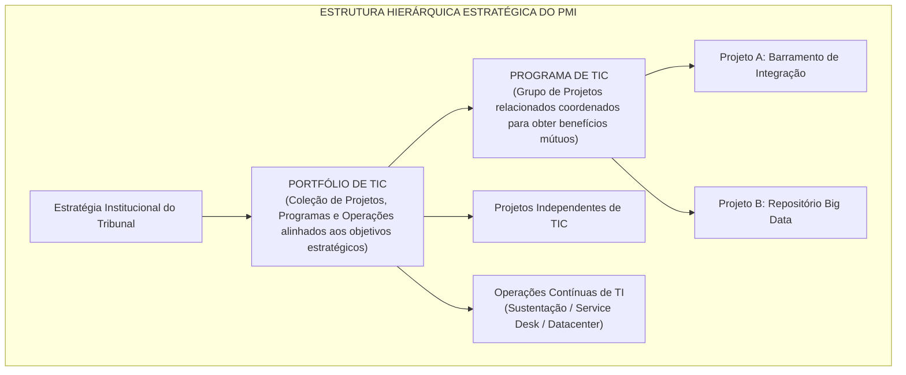
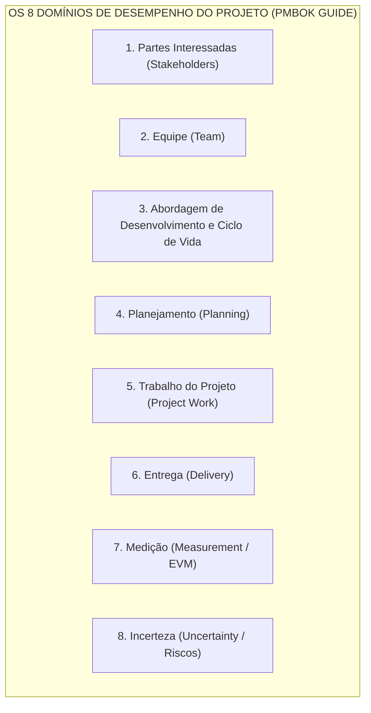
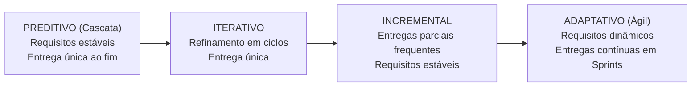
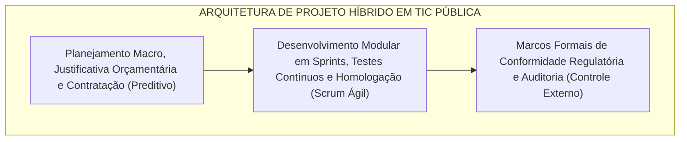

# 03 - Gestão de Projetos: PMBOK 8ª Edição e Métodos Ágeis

> **Matéria:** Governança de Tecnologia da Informação  
> **Cargo:** B02 – Técnico de Controle Externo – Especialidade: Tecnologia da Informação  
> **Arquivo:** `03_gestao_de_projetos_pmbok_8_edicao_e_metodos_ageis.md`  

---

## 📌 Ementa / Itens do Edital
- Fundamentos de Gestão de Projetos (PMI - Project Management Institute)
- O padrão do Guia PMBOK (evolução de processos para Princípios e Domínios de Desempenho)
- Sistema de Entrega de Valor (System for Value Delivery)
- Os 12 Princípios de Entrega de Projetos
- Os 8 Domínios de Desempenho do Projeto (Project Performance Domains)
- Métodos ágeis aplicados a projetos de TI, abordagens híbridas e adaptação (Tailoring)
- Análise de Valor Agregado (EVA / EVM: VP, CR, VA, IDP, IDC)
- Gestão de Portfólio de TI (alinhamento estratégico, governança de programas e priorização)

---

## 🧭 Sumário

1. [Fundamentos de Gestão de Projetos e Mudança de Paradigma do PMI](#1-fundamentos-de-gestao-de-projetos-e-mudanca-de-paradigma-do-pmi)
1. [Conceito de Projeto vs. Operação](#1-1-conceito-de-projeto-vs-operacao)
    1. [Teste 485](#Teste-485)
1. [Hierarquia PMI: Projetos, Programas e Portfólios de TIC](#1-2-hierarquia-pmi-projetos-programas-e-portfolios-de-tic)
    1. [Teste 486](#Teste-486)
1. [O Sistema de Entrega de Valor (System for Value Delivery)](#1-3-o-sistema-de-entrega-de-valor-system-for-value-delivery)
    1. [Teste 487](#Teste-487)
2. [Os 12 Princípios de Entrega de Projetos](#2-os-12-principios-de-entrega-de-projetos)
    1. [Teste 488](#Teste-488)
3. [Os 8 Domínios de Desempenho do Projeto](#3-os-8-dominios-de-desempenho-do-projeto)
    1. [Teste 489](#Teste-489)
4. [Ciclos de Vida: Métodos Ágeis, Abordagens Híbridas e Adaptação (Tailoring)](#4-ciclos-de-vida-metodos-ageis-abordagens-hibridas-e-adaptacao-tailoring)
4. [Comparativo dos Ciclos de Vida (Preditivo a Adaptativo)](#4-1-comparativo-dos-ciclos-de-vida-preditivo-a-adaptativo)
4. [Abordagens Híbridas na Administração Pública](#4-2-abordagens-hibridas-na-administracao-publica)
    1. [Teste 490](#Teste-490)
4. [Adaptação Contextual (Tailoring)](#4-3-adaptacao-contextual-tailoring)
    1. [Teste 491](#Teste-491)
5. [Análise de Valor Agregado (EVM / EVA)](#5-analise-de-valor-agregado-evm-eva)
5. [Variáveis Fundamentais (VP, CR e VA)](#5-1-variaveis-fundamentais-vp-cr-e-va)
    1. [Teste 492](#Teste-492)
5. [Variações e Índices de Desempenho (IDP e IDC)](#5-2-variacoes-e-indices-de-desempenho-idp-e-idc)
    1. [Teste 493](#Teste-493)
6. [Gestão de Portfólio de TI e Governança de Programas](#6-gestao-de-portfolio-de-ti-e-governanca-de-programas)
    1. [Teste 494](#Teste-494)
6. [Fontes Recomendadas na Internet](#6-fontes-recomendadas-na-internet)

---

## 1. Fundamentos de Gestão de Projetos e Mudança de Paradigma do PMI

Segundo a padronização do Project Management Institute (PMI), um **Projeto** é definido como um esforço temporário empreendido para criar um produto, serviço ou resultado exclusivo.

---

## 1.1 Conceito de Projeto vs. Operação

- **Temporário:** Possui marco temporal de início e término definidos. O fim é alcançado quando os objetivos foram integralmente atingidos, ou quando o projeto é cancelado por inviabilidade técnica, orçamentária ou perda de alinhamento estratégico.
- **Exclusivo (Único):** O resultado final (sistema desenvolvido, data center modernizado) difere substancialmente de qualquer outro trabalho previamente executado.
- **Projeto versus Operação Contínua:**
    - *Projetos:* Geram mudanças, criam ativos novos, possuem equipes multidisciplinares temporárias e encerram-se ao concluir a entrega.
    - *Operações:* Sustentam o negócio existente, repetem processos padronizados contínuos (atendimento de chamados, manutenção de infraestrutura, rotinas de backup) e não têm data prevista para término.

---

## 1.2 Hierarquia PMI: Projetos, Programas e Portfólios de TIC

#### Tabela Comparativa: Portfólio versus Programa versus Projeto versus Operação

| Dimensão | Portfólio | Programa | Projeto | Operação |
| :--- | :--- | :--- | :--- | :--- |
| **Escopo** | Visão estratégica corporativa; engloba múltiplos projetos e programas correlatos ou independentes. | Escopo abrangente integrando benefícios conjuntos de múltiplos projetos relacionados. | Escopo delimitado, específico e controlado; entrega exclusiva pré-definida. | Escopo contínuo, padronizado, repetitivo e voltado à rotina. |
| **Mudança** | Monitora mudanças no ambiente macro e ajusta a alocação de recursos financeiros e prioridades. | Gerencia mudanças no ambiente programático visando maximizar os benefícios do conjunto. | Gerencia desvios de escopo por meio do processo formal de controle de mudanças. | Reage a incidentes e busca manter a estabilidade contínua dos serviços. |
| **Métrica de Sucesso** | **Retorno do investimento agregado**, mitigação de riscos globais e alcance das metas estratégicas. | **Realização de benefícios consolidados** e integração eficaz dos projetos componentes. | **Qualidade técnica da entrega**, valor agregado e respeito às restrições de custo e prazo. | **Eficiência operacional**, cumprimento estrito de SLAs e estabilidade dos sistemas. |
| **Duração** | Permanente e plurianual (revisado ciclicamente). | Médio a longo prazo (dura o ciclo de entrega dos benefícios programáticos). | **Temporário** (início, meio e fim claramente fixados). | **Permanente / Contínuo** (sem data estipulada de término). |

> 🚨 **ALERTA DE PROVA / PEGADINHA FCC:**  
> A banca frequentemente testa a diferença conceitual entre Programa e Portfólio. Lembre-se: em um **Programa**, os projetos são **necessariamente interdependentes e relacionados** (produzem benefícios em comum). Em um **Portfólio**, os projetos e programas agrupados **não precisam ter dependência técnica entre si**; o único fator comum é o alinhamento ao mesmo conjunto de objetivos estratégicos da organização.

---

## 1.3 O Sistema de Entrega de Valor (System for Value Delivery)

A partir da transição iniciada na 7ª edição do Guia PMBOK e consolidada nas diretrizes contemporâneas (8ª edição), o PMI abandonou o foco exclusivo no cumprimento mecânico de processos da 6ª edição (que continha 10 Áreas de Conhecimento e 49 Processos rígidos).

A gestão de projetos passou a ser compreendida dentro de um **Sistema de Entrega de Valor**, no qual o foco se desloca dos meros "entregáveis" (*deliverables* físicos) para os **resultados e valor de negócio gerados** (*outcomes and business value*). Esse sistema é composto por:

- Governança organizacional e estratégica;
- Funções de gestão de projetos (liderança servidora, facilitação e remoção de barreiras);
- Ambiente interno (cultura, maturidade, recursos) e externo (legislação, avanços tecnológicos);
- Fluxo de valor contínuo que transforma estratégias em benefícios tangíveis para os cidadãos e gestores públicos.

---

## 2. Os 12 Princípios de Entrega de Projetos

Os 12 Princípios do PMBOK orientam a conduta profissional dos gestores e equipes, aplicando-se indistintamente a abordagens preditivas, híbridas ou ágeis:

| Nº | Princípio | Significado Prático |
| :---: | :--- | :--- |
| **1** | **Administração Diligente** (*Stewardship*) | Atuar com honestidade, integridade, cuidado ético, zelo pelo patrimônio público e conformidade legal estrita. |
| **2** | **Ambiente de Equipe Colaborativo** (*Team*) | Fomentar a cooperação, empatia, respeito mútuo, comunicação aberta e responsabilidade compartilhada pela equipe. |
| **3** | **Envolvimento Eficaz dos Stakeholders** (*Stakeholders*) | Identificar, compreender e engajar continuamente as partes interessadas para alinhar expectativas e mitigar resistências. |
| **4** | **Foco no Valor** (*Value*) | Monitorar e maximizar o valor público e institucional gerado por cada entrega, adaptando o escopo se o valor pretendido mudar. |
| **5** | **Pensamento Sistêmico** (*Systems Thinking*) | Reconhecer que o projeto é parte de um ecossistema complexo e que decisões locais repercutem em toda a TI corporativa. |
| **6** | **Liderança** (*Leadership*) | Praticar liderança servidora, influenciando positivamente a equipe, promovendo o desenvolvimento humano e removendo bloqueios. |
| **7** | **Adaptação Contextual** (*Tailoring*) | Personalizar métodos, ritos, ferramentas e governança ao porte, complexidade e criticidade reais de cada projeto. |
| **8** | **Qualidade nas Entregas** (*Quality*) | Garantir que os processos de desenvolvimento e os produtos finais atendam aos critérios de aceitação e aos requisitos de uso. |
| **9** | **Navegar na Complexidade** (*Complexity*) | Abordar a volatilidade, as conexões tecnológicas densas e a incerteza comportamental com flexibilidade e monitoramento contínuo. |
| **10** | **Otimizar Respostas aos Riscos** (*Risk*) | Gerenciar ativamente tanto ameaças (riscos negativos) quanto oportunidades (riscos positivos), aplicando respostas proporcionais. |
| **11** | **Adaptabilidade e Resiliência** (*Adaptability & Resilience*) | Capacidade de resistir a choques, aprender rapidamente com erros, replanejar rotas e manter o compromisso com o objetivo final. |
| **12** | **Permitir a Mudança** (*Change*) | Facilitar a transição estrutural e humana entre o estado atual e o estado futuro almejado pelas partes interessadas. |

---

## 3. Os 8 Domínios de Desempenho do Projeto

Os **Domínios de Desempenho** (*Project Performance Domains*) são grupos de atividades correlatas essenciais para a entrega bem-sucedida de projetos:

1. **Partes Interessadas (*Stakeholders*):** Relacionamento produtivo, alinhamento de expectativas e engajamento das pessoas afetadas pelo projeto.
2. **Equipe (*Team*):** Criação de ambiente de alta performance, liderança colaborativa, segurança psicológica e autonomia técnica do time.
3. **Abordagem de Desenvolvimento e Ciclo de Vida (*Development Approach & Life Cycle*):** Seleção fundamentada da cadência de entrega (preditiva, híbrida ou adaptativa) e das fases do ciclo de vida.
4. **Planejamento (*Planning*):** Coordenação progressiva de escopo, prazos, orçamentos e alocação de recursos (*elaboração progressiva*).
5. **Trabalho do Projeto (*Project Work*):** Gestão do fluxo diário de atividades, administração de contratos com fornecedores e remoção de impedimentos ao avanço da equipe.
6. **Entrega (*Delivery*):** Garantia de que os incrementos e produtos satisfazem os requisitos de qualidade e entregam valor real aos usuários.
7. **Medição (*Measurement*):** Avaliação quantitativa e qualitativa do progresso por meio de métricas de desempenho e Análise de Valor Agregado (EVA/EVM).
8. **Incerteza (*Uncertainty*):** Identificação, avaliação e tratamento de incertezas, ambiguidades, riscos operacionais e contingências imprevistas.

---

## 4. Ciclos de Vida: Métodos Ágeis, Abordagens Híbridas e Adaptação (Tailoring)

---

## 4.1 Comparativo dos Ciclos de Vida (Preditivo a Adaptativo)

- **Preditivo (Cascata / *Waterfall*):** Escopo, tempo e custo são estabelecidos de forma detalhada no início. Mudanças são rigidamente controladas. Ideal para obras físicas e implantações onde os requisitos são absolutamente fixos e conhecidos.
- **Iterativo:** O escopo é refinado e aprofundado por meio de ciclos sucessivos de feedback e prototipagem, entregando o produto concluído em um único lote ao final.
- **Incremental:** O produto é dividido em fatias funcionais e entregue aos poucos, gerando valor utilizável antes do encerramento total.
- **Adaptativo (Ágil - Scrum / Kanban):** Projetado para alta incerteza e requisitos que evoluem. O trabalho ocorre em iterações curtas (*sprints* de 1 a 4 semanas), priorizando continuamente o backlog com base no feedback real.

---

---

## 4.2 Abordagens Híbridas na Administração Pública

A **Abordagem Híbrida** combina características do modelo preditivo e do modelo adaptativo. É o padrão predominante em projetos de TIC no setor público brasileiro:

- O órgão define escopo macro, limites orçamentários, conformidade legal e prazos gerais de forma formal e preditiva (respeitando a Lei nº 14.133/2021).
- O desenvolvimento, testes de software e validações com usuários ocorrem por meio de sprints quinzenais ágeis, garantindo adaptação rápida a mudanças.

---

## 4.3 Adaptação Contextual (Tailoring)

O princípio do **Tailoring** dita que não existe uma metodologia universal. Cada projeto exige adaptações deliberadas nos processos de gestão:

- *Porte do projeto:* Projetos de pequeno porte dispensam comitês pesados e documentação excessiva.
- *Criticidade e Risco:* Sistemas centrais de controle fiscal exigem maior rigor formal e testes automatizados mais densos do que protótipos internos.
- *Cultura Organizacional:* Adequação dos ritos à maturidade do órgão e dos servidores envolvidos.

---

## 5. Análise de Valor Agregado (EVM / EVA)

A **Análise de Valor Agregado** (*Earned Value Management*) integra escopo, cronograma e custo para medir objetivamente o progresso de um projeto. É o cálculo mais cobrado pela FCC em provas de gestão de projetos.

---

## 5.1 Variáveis Fundamentais (VP, CR e VA)

1. **Valor Planejado (VP ou PV - *Planned Value*):** Orçamento aprovado alocado ao trabalho que deveria estar concluído até a data de medição.
2. **Custo Real (CR ou AC - *Actual Cost*):** Custo efetivamente incorrido e desembolsado para realizar o trabalho entregue até a data de medição.
3. **Valor Agregado (VA ou EV - *Earned Value*):** A mensuração do trabalho **efetivamente executado**, avaliado em termos do orçamento originalmente aprovado para esse trabalho.

---

## 5.2 Variações e Índices de Desempenho (IDP e IDC)

#### Variações Absolutas
- **Variação de Prazos ($VPr$ ou $SV$):**
  $$VPr = VA - VP$$
    - $VPr > 0$: Projeto adiantado.
    - $VPr = 0$: Projeto rigorosamente no cronograma.
    - $VPr < 0$: Projeto atrasado.

- **Variação de Custos ($VC$ ou $CV$):**
  $$VC = VA - CR$$
    - $VC > 0$: Abaixo do orçamento (economia de recursos).
    - $VC = 0$: Exatamente no orçamento planejado.
    - $VC < 0$: Acima do orçamento (estouro financeiro).

#### Índices de Desempenho Relativo
- **Índice de Desempenho de Prazos ($IDP$ ou $SPI$):**
  $$IDP = \frac{VA}{VP}$$
    - $IDP > 1$: Eficiência de cronograma superior ao previsto (adiantado).
    - $IDP = 1$: No ritmo do cronograma previsto.
    - $IDP < 1$: Eficiência de cronograma inferior ao previsto (atrasado).

- **Índice de Desempenho de Custos ($IDC$ ou $CPI$):**
  $$IDC = \frac{VA}{CR}$$
    - $IDC > 1$: Eficiência de custos favorável (gastando menos para cada unidade de entrega).
    - $IDC = 1$: Gastando rigorosamente o orçado.
    - $IDC < 1$: Eficiência desfavorável (gastando mais para entregar o trabalho).

> 🚨 **ALERTA DE PROVA / PEGADINHA FCC:**  
> A banca FCC adora inverter os numeradores e denominadores para induzir ao erro. Grave a regra mnemônica: **O Valor Agregado ($VA$) SEMPRE fica no numerador nas fórmulas dos índices de desempenho** ($IDP = VA / VP$ e $IDC = VA / CR$).

---

## 6. Gestão de Portfólio de TI e Governança de Programas

A **Gestão de Portfólio de TI** conecta a estratégia institucional do Tribunal à seleção e execução das iniciativas tecnológicas:

- **Comitê de Governança Digital / Comitê de TI:** Órgão colegiado que avalia propostas de novos projetos e programas, priorizando-os de acordo com o impacto fiscal e institucional.
- **Modelos de Pontuação (*Scoring Models*):** Critérios ponderados de priorização (ex.: retorno social, urgência regulatória, complexidade técnica, custo estimado e matriz de riscos).
- **Balanceamento do Portfólio:** Equilíbrio equilibrado entre projetos de alta inovação (IA para auditoria), modernização de infraestrutura (migração para nuvem) e sustentação de sistemas legados essenciais.

---

## 6. Fontes Recomendadas na Internet

* [Scrum Guide 2020 Oficial (Português-BR)](https://scrumguides.org/docs/scrumguide/v2020/2020-Scrum-Guide-PortugueseBR-3.0.pdf) - Guia definitivo e oficial das regras, papéis, eventos e artefatos do framework Scrum.
* [Kanban Guide Oficial (English)](https://kanbanguides.org/english/) - Guia oficial de definição do Kanban para equipes de desenvolvimento e gestão de fluxo de trabalho.
* [Manifesto Ágil - Princípios do Desenvolvimento Ágil de Software](https://agilemanifesto.org/iso/ptbr/principles.html) - Valores e 12 princípios fundamentais do manifesto ágil.
* [TCU - Governança e Boas Práticas em Gestão de Projetos](https://portal.tcu.gov.br/governanca/governanca-no-tcu/) - Orientações do Tribunal de Contas da União para fiscalização e governança de projetos e contratos de tecnologia.
* [Governo Digital - Estratégia Federal de Governo Digital (EFGD)](https://www.gov.br/governodigital/pt-br/estrategias-e-governanca-digital/EFGD) - Diretrizes e iniciativas para entregas iterativas e governança de projetos no setor público.
* PROJECT MANAGEMENT INSTITUTE. **Um Guia do Conhecimento em Gerenciamento de Projetos (Guia PMBOK)**. 7. ed. Newtown Square: PMI, 2021. (Seção 1 - O Padrão de Gerenciamento de Projetos; Seção 2 - Domínios de Desempenho do Projeto).
* KERZNER, Harold. **Gestão de Projetos: As Melhores Práticas**. 3. ed. Porto Alegre: Bookman, 2011. (Cap. 1 - Visão Geral do Gerenciamento de Projetos; Cap. 14 - Gestão do Valor Agregado - EVM).
* SUTHERLAND, Jeff. **Scrum: A Arte de Fazer o Dobro do Trabalho na Metade do Tempo**. São Paulo: Leya, 2014. (Cap. 1 a 5 - Métodos Ágeis e Ciclos de Feedback).
