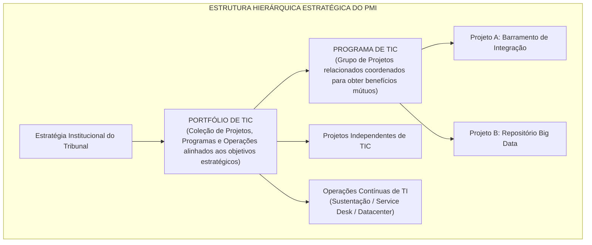
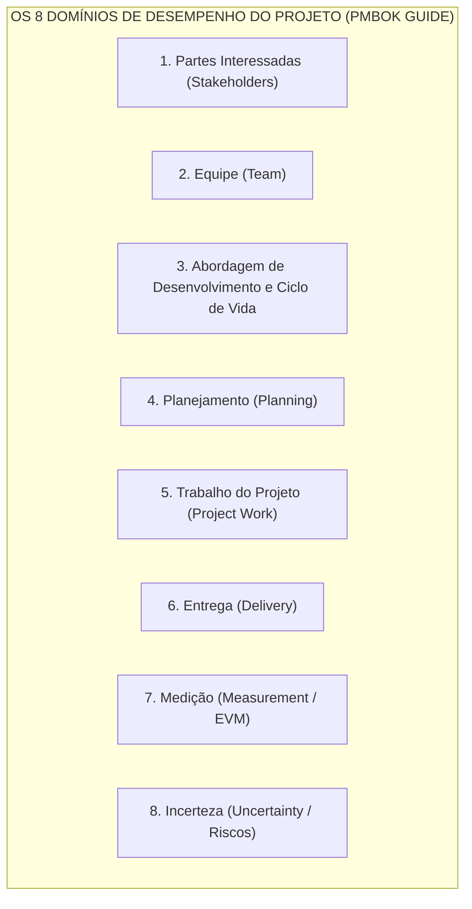
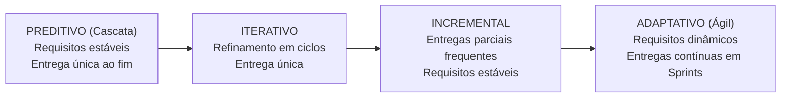
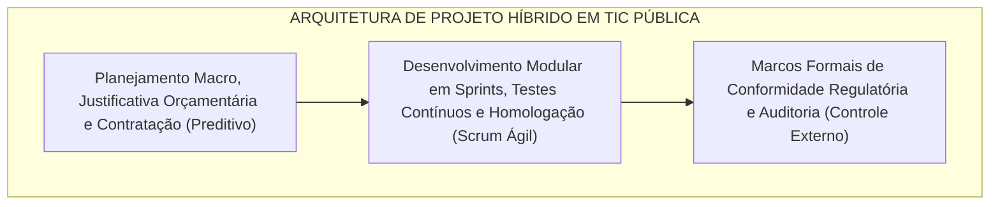

# 03 - Gestão de Projetos: PMBOK 8ª Edição e Métodos Ágeis

> **Matéria:** Governança de Tecnologia da Informação  
> **Cargo:** B02 – Técnico de Controle Externo – Especialidade: Tecnologia da Informação  
> **Arquivo:** `03_gestao_de_projetos_pmbok_8_edicao_e_metodos_ageis.md`  

---

## 📌 Ementa / Itens do Edital
- Fundamentos de Gestão de Projetos (PMI - Project Management Institute)
- O padrão do Guia PMBOK (evolução de processos para Princípios e Domínios de Desempenho)
- Sistema de Entrega de Valor (System for Value Delivery)
- Os 12 Princípios de Entrega de Projetos
- Os 8 Domínios de Desempenho do Projeto (Project Performance Domains)
- Métodos ágeis aplicados a projetos de TI, abordagens híbridas e adaptação (Tailoring)
- Análise de Valor Agregado (EVA / EVM: VP, CR, VA, IDP, IDC)
- Gestão de Portfólio de TI (alinhamento estratégico, governança de programas e priorização)

---

## 🧭 Sumário

1. [Fundamentos de Gestão de Projetos e Mudança de Paradigma do PMI](#1-fundamentos-de-gestao-de-projetos-e-mudanca-de-paradigma-do-pmi)
1. [Conceito de Projeto vs. Operação](#1-1-conceito-de-projeto-vs-operacao)
    1. [Teste 485](#Teste-485)
1. [Hierarquia PMI: Projetos, Programas e Portfólios de TIC](#1-2-hierarquia-pmi-projetos-programas-e-portfolios-de-tic)
    1. [Teste 486](#Teste-486)
1. [O Sistema de Entrega de Valor (System for Value Delivery)](#1-3-o-sistema-de-entrega-de-valor-system-for-value-delivery)
    1. [Teste 487](#Teste-487)
2. [Os 12 Princípios de Entrega de Projetos](#2-os-12-principios-de-entrega-de-projetos)
    1. [Teste 488](#Teste-488)
3. [Os 8 Domínios de Desempenho do Projeto](#3-os-8-dominios-de-desempenho-do-projeto)
    1. [Teste 489](#Teste-489)
4. [Ciclos de Vida: Métodos Ágeis, Abordagens Híbridas e Adaptação (Tailoring)](#4-ciclos-de-vida-metodos-ageis-abordagens-hibridas-e-adaptacao-tailoring)
4. [Comparativo dos Ciclos de Vida (Preditivo a Adaptativo)](#4-1-comparativo-dos-ciclos-de-vida-preditivo-a-adaptativo)
4. [Abordagens Híbridas na Administração Pública](#4-2-abordagens-hibridas-na-administracao-publica)
    1. [Teste 490](#Teste-490)
4. [Adaptação Contextual (Tailoring)](#4-3-adaptacao-contextual-tailoring)
    1. [Teste 491](#Teste-491)
5. [Análise de Valor Agregado (EVM / EVA)](#5-analise-de-valor-agregado-evm-eva)
5. [Variáveis Fundamentais (VP, CR e VA)](#5-1-variaveis-fundamentais-vp-cr-e-va)
    1. [Teste 492](#Teste-492)
5. [Variações e Índices de Desempenho (IDP e IDC)](#5-2-variacoes-e-indices-de-desempenho-idp-e-idc)
    1. [Teste 493](#Teste-493)
6. [Gestão de Portfólio de TI e Governança de Programas](#6-gestao-de-portfolio-de-ti-e-governanca-de-programas)
    1. [Teste 494](#Teste-494)
6. [Fontes Recomendadas na Internet](#6-fontes-recomendadas-na-internet)

---

## 1. Fundamentos de Gestão de Projetos e Mudança de Paradigma do PMI

Segundo a padronização do Project Management Institute (PMI), um **Projeto** é definido como um esforço temporário empreendido para criar um produto, serviço ou resultado exclusivo.

---

### Teste 001
**(CEBRASPE – STJ – 2024 – Analista Judiciário - Apoio Especializado - Suporte em Tecnologia da Informação)**
Caso um projeto possua um escopo sujeito a mudanças durante a sua execução, é recomendável, segundo o PMBOK, que se utilize uma abordagem de desenvolvimento do tipo preditiva.

* **C)** Certo
* **E)** Errado

---

> **Comentário Detalhado:**
>
> - **C)** **Incorreta.** A proposição apresenta proposição em desacordo com os fundamentos teóricos e técnicos do tópico ao afirmar que "Caso um projeto possua um escopo sujeito a mudanças durante a sua execução, é recomendável, segundo o PMBOK...". De acordo com a teoria em *3. Os 8 Domínios de Desempenho do Projeto*, abordagem de Desenvolvimento e Ciclo de Vida ( Development Approach & Life Cycle ): Seleção fundamentada da cadência de entrega (preditiva, híbrida ou adaptativa) e das fases do ciclo de vida.
> - **E)** **Correta.** O item está **Errado** (gabarito oficial: **E**), pois contraria a disciplina teórica aplicável.
>
> **Gabarito: E**

---

### Teste 002
**(CEBRASPE – STJ – 2024 – Analista Judiciário - Apoio Especializado - Suporte em Tecnologia da Informação)**
Segundo o PMBOK, a comunicação passiva, elemento fundamental para o engajamento das partes interessadas, é o tipo de comunicação que pode ocorrer por meio da busca por políticas ou modelos de comunicação e pesquisas em repositórios online, a fim de se detectarem indiretamente as preocupações dessas partes interessadas quanto ao projeto.

* **C)** Certo
* **E)** Errado

---

> **Comentário Detalhado:**
>
> - **C)** **Correta.** O item está **Certo**. Conforme fundamentado na seção *3. Os 8 Domínios de Desempenho do Projeto*, partes Interessadas ( Stakeholders ): Relacionamento produtivo, alinhamento de expectativas e engajamento das pessoas afetadas pelo projeto. Dessa forma, está plenamente correta a assertiva da banca (CEBRASPE – STJ/2024) ao afirmar que "Segundo o PMBOK, a comunicação passiva, elemento fundamental para o engajamento das partes interessadas, é o...".
> - **E)** **Incorreta.** A assertiva não incorre em erro conceitual, guardando conformidade com a teoria estudada.
>
> **Gabarito: C**

---

### Teste 003
**(CEBRASPE – TRF/6 – 2025 – Analista Judiciario Apoio Especializado Tecnologia Da Informacao)**
O ciclo de vida do projeto, no PMBOK 7.ª edição, é constituído de cinco fases sequenciais e padronizadas que devem ser seguidas rigidamente em todos os projetos.

* **C)** Certo
* **E)** Errado

---

> **Comentário Detalhado:**
>
> - **C)** **Correta.** O item está **Certo**. Conforme fundamentado na seção *3. Os 8 Domínios de Desempenho do Projeto*, abordagem de Desenvolvimento e Ciclo de Vida ( Development Approach & Life Cycle ): Seleção fundamentada da cadência de entrega (preditiva, híbrida ou adaptativa) e das fases do ciclo de vida. Dessa forma, está plenamente correta a assertiva da banca (CEBRASPE – TRF/6/2025) ao afirmar que "O ciclo de vida do projeto, no PMBOK 7.ª edição, é constituído de cinco fases sequenciais e padronizadas que...".
> - **E)** **Incorreta.** A assertiva não incorre em erro conceitual, guardando conformidade com a teoria estudada.
>
> **Gabarito: C**

---

### Teste 004
**(CEBRASPE – TRF/6 – 2025 – Analista Judiciario Apoio Especializado Tecnologia Da Informacao)**
No PMBOK 7.ª edição, os processos de gerenciamento de projetos estão organizados em grupos de processos e áreas de conhecimento; cada área de conhecimento possui uma série de processos específicos que contribuem para a sua gestão eficaz.

* **C)** Certo
* **E)** Errado

---

> **Comentário Detalhado:**
>
> - **C)** **Correta.** O item está **Certo**. Conforme fundamentado na seção *1.3 O Sistema de Entrega de Valor (System for Value Delivery)*, a partir da transição iniciada na 7ª edição do Guia PMBOK e consolidada nas diretrizes contemporâneas (8ª edição), o PMI abandonou o foco exclusivo no cumprimento mecânico de processos da 6ª edição (que continha 10 Áreas de Conhecimento e 49 Processos rígidos). Dessa forma, está plenamente correta a assertiva da banca (CEBRASPE – TRF/6/2025) ao afirmar que "No PMBOK 7.ª edição, os processos de gerenciamento de projetos estão organizados em grupos de processos e...".
> - **E)** **Incorreta.** A assertiva não incorre em erro conceitual, guardando conformidade com a teoria estudada.
>
> **Gabarito: C**

---

### Teste 005
**(FCC – TRT 6ª – 2012 – Analista Judiciário - Apoio Especializado/Tecnologia da Informação)**
Segundo o PMBOK, a governança de projetos oferece um método abrangente e consistente de controle e garantia de sucesso do projeto, considerando duas restrições que devem ser observadas. Uma das restrições é que a abordagem da governança do projeto deve ser descrita no plano de gerenciamento do projeto. A outra é que

* **A)** em projetos com várias fases, pode ocorrer mais de uma relação entre elas durante o ciclo de vida do projeto. A governança do projeto deve se restringir às fases isoladas, deixando o tratamento das relações com a equipe de gerenciamento do projeto.
* **B)** da mesma maneira que o gerenciamento do projeto, a governança do projeto deve dividir um projeto em duas fases onde uma equipe diferente pode escolher gerenciar todo o trabalho como uma única fase.
* **C)** a organização da governança do projeto deve estabelecer políticas que padronizam todos os projetos, enquanto a equipe de gerenciamento é encarregada de escolher as políticas mais apropriadas para seu projeto específico.
* **D)** a governança do projeto deve se adequar ao contexto mais amplo do programa ou da organização patrocinadora.
* **E)** a equipe de governança do projeto precisa identificar as partes interessadas, tanto internas quanto externas, a fim de determinar os requisitos e as expectativas em relação ao projeto de todas as partes envolvidas.

---

> **Comentário Detalhado:**
>
> - **A)** **Incorreta.** A opção apresenta proposição em desacordo com os fundamentos teóricos e técnicos do tópico ao afirmar que "em projetos com várias fases, pode ocorrer mais de uma relação entre elas durante o ciclo de vida do projeto. A...". De acordo com a teoria estudada em *3. Os 8 Domínios de Desempenho do Projeto*, abordagem de Desenvolvimento e Ciclo de Vida ( Development Approach & Life Cycle ): Seleção fundamentada da cadência de entrega (preditiva, híbrida ou adaptativa) e das fases do ciclo de vida.
> - **B)** **Incorreta.** A opção apresenta proposição em desacordo com os fundamentos teóricos e técnicos do tópico ao afirmar que "da mesma maneira que o gerenciamento do projeto, a governança do projeto deve dividir um projeto em duas fases...". De acordo com a teoria estudada em *6. Fontes Recomendadas na Internet*, pROJECT MANAGEMENT INSTITUTE. Um Guia do Conhecimento em Gerenciamento de Projetos (Guia PMBOK). 7. ed. Newtown Square: PMI, 2021. (Seção 1 O Padrão de Gerenciamento de Projetos; Seção 2 Domínios de Desempenho do Projeto).
> - **C)** **Incorreta.** A opção apresenta proposição em desacordo com os fundamentos teóricos e técnicos do tópico ao afirmar que "a organização da governança do projeto deve estabelecer políticas que padronizam todos os projetos, enquanto a...". De acordo com a teoria estudada em *Tabela Comparativa: Portfólio versus Programa versus Projeto versus Operação*, escopo: Visão estratégica corporativa; engloba múltiplos projetos e programas correlatos ou independentes. — Escopo abrangente integrando benefícios conjuntos de múltiplos projetos relacionados. — Escopo delimitado, específico e controlado; entrega exclusiva pré definida. — Escopo contínuo, padronizado, repetitivo e voltado à rotina.
> - **D)** **Correta.** Conforme fundamentado na seção *Tabela Comparativa: Portfólio versus Programa versus Projeto versus Operação* deste guia, a banca frequentemente testa a diferença conceitual entre Programa e Portfólio. Lembre se: em um Programa, os projetos são necessariamente interdependentes e relacionados (produzem benefícios em comum). Em um Portfólio, os projetos e programas agrupados não precisam ter dependência técnica entre si; o único fator comum é o alinhamento ao mesmo conjunto de objetivos estratégicos da organização. Dessa forma, está plenamente correta a assertiva da banca (FCC – TRT 6ª/2012) ao estabelecer que "a governança do projeto deve se adequar ao contexto mais amplo do programa ou da organização patrocinadora".
> - **E)** **Incorreta.** A opção apresenta proposição em desacordo com os fundamentos teóricos e técnicos do tópico ao afirmar que "a equipe de governança do projeto precisa identificar as partes interessadas, tanto internas quanto externas, a...". De acordo com a teoria estudada em *2. Os 12 Princípios de Entrega de Projetos*, 3: Envolvimento Eficaz dos Stakeholders ( Stakeholders ) — Identificar, compreender e engajar continuamente as partes interessadas para alinhar expectativas e mitigar resistências.
>
> **Gabarito: D**

---

### Teste 006
**(FCC – TRT 6ª – 2012 – Analista Judiciário - Apoio Especializado/Tecnologia da Informação)**
Com relação ao ciclo de vida do produto, segundo o PMBOK, considere: I. Geralmente o ciclo de vida de um projeto está contido em um ou mais ciclos de vida do produto. O ciclo de vida do produto consiste em fases do produto, geralmente sequenciais e não sobrepostas, determinadas pela necessidade de produção e controle da organização, sendo que a última fase do ciclo de vida de um produto é a entrega para o cliente final. II. Vários aspectos do ciclo de vida do produto prestam-se à execução como projetos, por exemplo, a realização de um es- tudo de viabilidade, a condução de pesquisas de mercado, a execução de campanhas publicitárias, a instalação de um produto, realização de dinâmicas de grupo e de avaliações de produtos em mercados de teste. Em cada um destes exem- plos, o ciclo de vida do projeto difere do ciclo de vida do produto. III. Quando a saída do projeto está relacionada a um produto, existem muitas relações possíveis. Por exemplo, o desenvolvimento de um novo produto pode ser um projeto em si. Ao mesmo tempo, um produto existente pode se beneficiar de um projeto para o acréscimo de novas funções ou características. Está correto o que se afirma em

* **A)** II e III, apenas.
* **B)** I, II e III.
* **C)** I e III, apenas.
* **D)** I, apenas.
* **E)** III, apenas.

---

> **Comentário Detalhado:**
>
> - **A)** **Correta.** Conforme fundamentado na seção *3. Os 8 Domínios de Desempenho do Projeto* deste guia, abordagem de Desenvolvimento e Ciclo de Vida ( Development Approach & Life Cycle ): Seleção fundamentada da cadência de entrega (preditiva, híbrida ou adaptativa) e das fases do ciclo de vida. Dessa forma, está plenamente correta a assertiva da banca (FCC – TRT 6ª/2012) ao estabelecer que "II e III, apenas".
> - **B)** **Incorreta.** A opção apresenta proposição em desacordo com os fundamentos teóricos e técnicos do tópico ao afirmar que "I, II e III". De acordo com a teoria estudada em *4.1 Comparativo dos Ciclos de Vida (Preditivo a Adaptativo)*, iterativo: O escopo é refinado e aprofundado por meio de ciclos sucessivos de feedback e prototipagem, entregando o produto concluído em um único lote ao final.
> - **C)** **Incorreta.** A opção incorre em restrição indevida ao limitar o escopo conceitual ao afirmar que "I e III, apenas". De acordo com a teoria estudada em *3. Os 8 Domínios de Desempenho do Projeto*, d3["3. Abordagem de Desenvolvimento e Ciclo de Vida"].
> - **D)** **Incorreta.** A opção incorre em restrição indevida ao limitar o escopo conceitual ao afirmar que "I, apenas". De acordo com a teoria estudada em *4.1 Comparativo dos Ciclos de Vida (Preditivo a Adaptativo)*, preditivo (Cascata / Waterfall ): Escopo, tempo e custo são estabelecidos de forma detalhada no início. Mudanças são rigidamente controladas. Ideal para obras físicas e implantações onde os requisitos são absolutamente fixos e conhecidos.
> - **E)** **Incorreta.** A opção incorre em restrição indevida ao limitar o escopo conceitual ao afirmar que "III, apenas". De acordo com a teoria estudada em *1.1 Conceito de Projeto vs. Operação*, exclusivo (Único): O resultado final (sistema desenvolvido, data center modernizado) difere substancialmente de qualquer outro trabalho previamente executado.
>
> **Gabarito: A**

---

### Teste 007
**(FCC – TRT 9ª – 2015 – Analista Judiciário - Apoio Especializado - Tecnologia da Informação)**
O Balanced Scorecard utiliza o mapa estratégico, que evidencia os desafios que a organização deve suplantar para concretizar a visão de futuro e cumprir sua missão, sendo um importante instrumento de alinhamento, gestão e comunicação da estratégia. Entretanto, algumas especificidades precisam ser observadas no delineamento da estratégia de uma organização pública em relação à privada. Ao se implantar o BSC no Tribunal Regional do Trabalho da 9a Região, as correlações entre o setor público e o privado devem ser estabelecidas, como indica a tabela a seguir: Foco Setor Privado Setor Público Alvo estratégico Competitividade I Rentabilidade Resultados econômico-financeiros Crescimento II Participação no mercado Acionistas Partes interessadas Clientes III Colaboradores Resultado desejado Satisfação do cliente IV Um Analista da área de TI indicou, corretamente, as correlações

* **A)** devem existir links de transmissão entre as unidades e o Tribunal suficientes para suportar o tráfego de dados e informações e garantir a disponibilidade exigida pelos aplicativos, sendo o mínimo de 500 Kbps para download.
* **B)** não poderá ser objeto de contratação o suporte técnico aos processos de planejamento e avaliação da qualidade da Solução de Tecnologia da Informação e Comunicação.
* **C)** o planejamento das contratações de Solução de Tecnologia da Informação e Comunicação, não pode incluir a terceirização de nenhum tipo de atividade.
* **D)** o PETIC, no âmbito judiciário, tem entre seus objetivos estratégicos promover a capilaridade dos sistemas e serviços, bem como desenvolver sistemas de TIC interoperáveis e portáveis.
* **E)** deverão ser definidos processos para gestão dos ativos de infraestrutura de TIC do Tribunal, de acordo com as melhores práticas preconizadas pelo PMBOK 4a e 5a edições.

---

> **Comentário Detalhado:**
>
> - **A)** **Incorreta.** A opção apresenta proposição em desacordo com os fundamentos teóricos e técnicos do tópico ao afirmar que "devem existir links de transmissão entre as unidades e o Tribunal suficientes para suportar o tráfego de dados e...". De acordo com a teoria estudada em *2. Os 12 Princípios de Entrega de Projetos*, 8: Qualidade nas Entregas ( Quality ) — Garantir que os processos de desenvolvimento e os produtos finais atendam aos critérios de aceitação e aos requisitos de uso.
> - **B)** **Correta.** Conforme fundamentado na seção *1.3 O Sistema de Entrega de Valor (System for Value Delivery)* deste guia, a gestão de projetos passou a ser compreendida dentro de um Sistema de Entrega de Valor, no qual o foco se desloca dos meros "entregáveis" ( deliverables físicos) para os resultados e valor de negócio gerados ( outcomes and business value ). Esse sistema é composto por. Dessa forma, está plenamente correta a assertiva da banca (FCC – TRT 9ª/2015) ao estabelecer que "não poderá ser objeto de contratação o suporte técnico aos processos de planejamento e avaliação da qualidade da...".
> - **C)** **Incorreta.** A opção apresenta proposição em desacordo com os fundamentos teóricos e técnicos do tópico ao afirmar que "o planejamento das contratações de Solução de Tecnologia da Informação e Comunicação, não pode incluir a...". De acordo com a teoria estudada em *4.2 Abordagens Híbridas na Administração Pública*, h1["Planejamento Macro, Justificativa Orçamentária e Contratação (Preditivo)"].
> - **D)** **Incorreta.** A opção apresenta proposição em desacordo com os fundamentos teóricos e técnicos do tópico ao afirmar que "o PETIC, no âmbito judiciário, tem entre seus objetivos estratégicos promover a capilaridade dos sistemas e...". De acordo com a teoria estudada em *Tabela Comparativa: Portfólio versus Programa versus Projeto versus Operação*, a banca frequentemente testa a diferença conceitual entre Programa e Portfólio. Lembre se: em um Programa, os projetos são necessariamente interdependentes e relacionados (produzem benefícios em comum). Em um Portfólio, os projetos e programas agrupados não precisam ter dependência técnica entre si; o único fator comum é o alinhamento ao mesmo conjunto de objetivos estratégicos da organização.
> - **E)** **Incorreta.** A opção apresenta proposição em desacordo com os fundamentos teóricos e técnicos do tópico ao afirmar que "deverão ser definidos processos para gestão dos ativos de infraestrutura de TIC do Tribunal, de acordo com as...". De acordo com a teoria estudada em *6. Fontes Recomendadas na Internet*, kERZNER, Harold. Gestão de Projetos: As Melhores Práticas. 3. ed. Porto Alegre: Bookman, 2011. (Cap. 1 Visão Geral do Gerenciamento de Projetos; Cap. 14 Gestão do Valor Agregado EVM).
>
> **Gabarito: B**

---

### Teste 008
**(FCC – TRT 9ª – 2015 – Analista Judiciário - Apoio Especializado - Tecnologia da Informação)**
Um Analista da área de TI, ao seguir as melhores práticas do Guia PMBOK 5a edição, sugeriu cuidados a serem tomados em relação à governança do projeto, que seria essencial ao projeto de software complexo que se iniciava. Ele afirmou, corretamente, que a governança do projeto

* **A)** é uma função de supervisão que está alinhada com o modelo de governança da organização e que engloba o ciclo de vida global do projeto, não podendo determinar ciclo de vida específico de projetos individuais.
* **B)** fornece à equipe a estrutura, processos e ferramentas para gerenciar o projeto, deixando para a alta direção o controle do projeto e os modelos de tomada de decisões, a fim de todos chegarem a uma entrega bem sucedida.
* **C)** fornece um método específico de desenvolver o projeto, garantindo o seu sucesso através da definição e documentação de práticas confiáveis, deixando a equipe livre da obrigação de prestar contas orçamentárias.
* **D)** é definida e se adequa ao contexto específico do portfólio, programa ou organização que patrocina o projeto, sendo parte essencial da governança organizacional.
* **E)** fornece a estrutura em que a equipe do projeto atua, mantendo-a responsável pelo planejamento, execução, controle e encerramento do projeto. A abordagem da governança do projeto deve ser descrita no plano de gerenciamento do projeto.

---

> **Comentário Detalhado:**
>
> - **A)** **Incorreta.** A opção apresenta proposição em desacordo com os fundamentos teóricos e técnicos do tópico ao afirmar que "é uma função de supervisão que está alinhada com o modelo de governança da organização e que engloba o ciclo de...". De acordo com a teoria estudada em *Tabela Comparativa: Portfólio versus Programa versus Projeto versus Operação*, escopo: Visão estratégica corporativa; engloba múltiplos projetos e programas correlatos ou independentes. — Escopo abrangente integrando benefícios conjuntos de múltiplos projetos relacionados. — Escopo delimitado, específico e controlado; entrega exclusiva pré definida. — Escopo contínuo, padronizado, repetitivo e voltado à rotina.
> - **B)** **Incorreta.** A opção apresenta proposição em desacordo com os fundamentos teóricos e técnicos do tópico ao afirmar que "fornece à equipe a estrutura, processos e ferramentas para gerenciar o projeto, deixando para a alta direção o...". De acordo com a teoria estudada em *3. Os 8 Domínios de Desempenho do Projeto*, os Domínios de Desempenho ( Project Performance Domains ) são grupos de atividades correlatas essenciais para a entrega bem sucedida de projetos.
> - **C)** **Incorreta.** A opção apresenta proposição em desacordo com os fundamentos teóricos e técnicos do tópico ao afirmar que "fornece um método específico de desenvolver o projeto, garantindo o seu sucesso através da definição e...". De acordo com a teoria estudada em *6. Fontes Recomendadas na Internet*, tCU Governança e Boas Práticas em Gestão de Projetos Orientações do Tribunal de Contas da União para fiscalização e governança de projetos e contratos de tecnologia.
> - **D)** **Incorreta.** A opção apresenta proposição em desacordo com os fundamentos teóricos e técnicos do tópico ao afirmar que "é definida e se adequa ao contexto específico do portfólio, programa ou organização que patrocina o projeto, sendo...". De acordo com a teoria estudada em *Tabela Comparativa: Portfólio versus Programa versus Projeto versus Operação*, a banca frequentemente testa a diferença conceitual entre Programa e Portfólio. Lembre se: em um Programa, os projetos são necessariamente interdependentes e relacionados (produzem benefícios em comum). Em um Portfólio, os projetos e programas agrupados não precisam ter dependência técnica entre si; o único fator comum é o alinhamento ao mesmo conjunto de objetivos estratégicos da organização.
> - **E)** **Correta.** Conforme fundamentado na seção *6. Gestão de Portfólio de TI e Governança de Programas* deste guia, a Gestão de Portfólio de TI conecta a estratégia institucional do Tribunal à seleção e execução das iniciativas tecnológicas. Dessa forma, está plenamente correta a assertiva da banca (FCC – TRT 9ª/2015) ao estabelecer que "fornece a estrutura em que a equipe do projeto atua, mantendo a responsável pelo planejamento, execução, controle...".
>
> **Gabarito: E**

---

### Teste 009
**(FGV – TJ/RR – 2024 – Analista Judiciario Gestao E Governanca De Tecnologia Da Informacao)**
Considerando conceitos de gestão de projetos (PMBOK 7ª Edição), analise as afirmativas a seguir. I. Um risco é um evento ou condição incerta que, caso ocorra, causará um efeito positivo ou negativo a um ou mais objetivos do projeto. II. Cinco estratégias podem ser consideradas para lidar com ameaças: evitar, escalar, transferir, mitigar e aceitar. III. Uma análise SWOT avalia as forças, fraquezas, oportunidades e ameaças de uma organização, projeto ou opção. Está correto o que se afirma em

* **A)** I, apenas.
* **B)** II, apenas.
* **C)** III, apenas.
* **D)** I e II, apenas.
* **E)** I, II e III.

---

> **Comentário Detalhado:**
>
> - **A)** **Incorreta.** A opção incorre em restrição indevida ao limitar o escopo conceitual ao afirmar que "I, apenas". De acordo com a teoria estudada em *Tabela Comparativa: Portfólio versus Programa versus Projeto versus Operação*, a banca frequentemente testa a diferença conceitual entre Programa e Portfólio. Lembre se: em um Programa, os projetos são necessariamente interdependentes e relacionados (produzem benefícios em comum). Em um Portfólio, os projetos e programas agrupados não precisam ter dependência técnica entre si; o único fator comum é o alinhamento ao mesmo conjunto de objetivos estratégicos da organização.
> - **B)** **Incorreta.** A opção incorre em restrição indevida ao limitar o escopo conceitual ao afirmar que "II, apenas". De acordo com a teoria estudada em *2. Os 12 Princípios de Entrega de Projetos*, 10: Otimizar Respostas aos Riscos ( Risk ) — Gerenciar ativamente tanto ameaças (riscos negativos) quanto oportunidades (riscos positivos), aplicando respostas proporcionais.
> - **C)** **Incorreta.** A opção incorre em restrição indevida ao limitar o escopo conceitual ao afirmar que "III, apenas". De acordo com a teoria estudada em *4.3 Adaptação Contextual (Tailoring)*, criticidade e Risco: Sistemas centrais de controle fiscal exigem maior rigor formal e testes automatizados mais densos do que protótipos internos.
> - **D)** **Incorreta.** A opção incorre em restrição indevida ao limitar o escopo conceitual ao afirmar que "I e II, apenas". De acordo com a teoria estudada em *1.3 O Sistema de Entrega de Valor (System for Value Delivery)*, a partir da transição iniciada na 7ª edição do Guia PMBOK e consolidada nas diretrizes contemporâneas (8ª edição), o PMI abandonou o foco exclusivo no cumprimento mecânico de processos da 6ª edição (que continha 10 Áreas de Conhecimento e 49 Processos rígidos).
> - **E)** **Correta.** Conforme fundamentado na seção *5. Análise de Valor Agregado (EVM / EVA)* deste guia, a Análise de Valor Agregado ( Earned Value Management ) integra escopo, cronograma e custo para medir objetivamente o progresso de um projeto. É o cálculo mais cobrado pela FCC em provas de gestão de projetos. Dessa forma, está plenamente correta a assertiva da banca (FGV – TJ/RR/2024) ao estabelecer que "I, II e III".
>
> **Gabarito: E**

---

### Teste 010
**(FGV – TJ/BA – 2015 – Analista Judiciario Tecnologia Da Informacao)**
O Guia PMBOK® descreve a natureza dos processos de gerenciamento de projetos em termos da integração entre os processos, suas interações e seus objetivos. Os processos de gerenciamento de projetos são agrupados em cinco categorias conhecidas como grupos de processos de gerenciamento de projetos (ou grupos de processos). Relacione cada um dos grupos de processos de gerenciamento de projetos com as características apresentadas a seguir: 1. Grupo de processos de iniciação. 2. Grupo de processos de planejamento. 3. Grupo de processos de execução. 4. Grupo de processos de monitoramento e controle. 5. Grupo de processos de encerramento. ( ) processos necessários para definir o escopo do projeto, refinar os objetivos e definir a linha de ação necessária para alcançar os objetivos para os quais o projeto foi criado; ( ) processos realizados para executar o trabalho definido no plano de gerenciamento do projeto para satisfazer as especificações do projeto; ( ) processos exigidos para acompanhar, analisar e controlar o progresso e desempenho do projeto, identificar quaisquer áreas nas quais serão necessárias mudanças no plano, e iniciar as mudanças correspondentes; ( ) processos executados para finalizar todas as atividades de todos os grupos de processos, visando encerrar formalmente o projeto ou fase; ( ) processos executados para definir um novo projeto ou uma nova fase de um projeto existente através da obtenção de autorização para iniciar o projeto ou fase. A relação correta, de cima para baixo, é:

* **A)** 3, 2, 5, 1 e 4;
* **B)** 2, 3, 4, 5 e 1;
* **C)** 3, 2, 4, 1 e 5;
* **D)** 2, 3, 5, 4 e 1;
* **E)** 3, 2, 1, 5 e 4.

---

> **Comentário Detalhado:**
>
> - **A)** **Incorreta.** A opção apresenta proposição em desacordo com os fundamentos teóricos e técnicos do tópico ao afirmar que "3, 2, 5, 1 e 4". De acordo com a teoria estudada em *6. Fontes Recomendadas na Internet*, pROJECT MANAGEMENT INSTITUTE. Um Guia do Conhecimento em Gerenciamento de Projetos (Guia PMBOK). 7. ed. Newtown Square: PMI, 2021. (Seção 1 O Padrão de Gerenciamento de Projetos; Seção 2 Domínios de Desempenho do Projeto).
> - **B)** **Correta.** Conforme fundamentado na seção *1.3 O Sistema de Entrega de Valor (System for Value Delivery)* deste guia, a partir da transição iniciada na 7ª edição do Guia PMBOK e consolidada nas diretrizes contemporâneas (8ª edição), o PMI abandonou o foco exclusivo no cumprimento mecânico de processos da 6ª edição (que continha 10 Áreas de Conhecimento e 49 Processos rígidos). Dessa forma, está plenamente correta a assertiva da banca (FGV – TJ/BA/2015) ao estabelecer que "2, 3, 4, 5 e 1".
> - **C)** **Incorreta.** A opção apresenta proposição em desacordo com os fundamentos teóricos e técnicos do tópico ao afirmar que "3, 2, 4, 1 e 5". De acordo com a teoria estudada em *3. Os 8 Domínios de Desempenho do Projeto*, os Domínios de Desempenho ( Project Performance Domains ) são grupos de atividades correlatas essenciais para a entrega bem sucedida de projetos.
> - **D)** **Incorreta.** A opção apresenta proposição em desacordo com os fundamentos teóricos e técnicos do tópico ao afirmar que "2, 3, 5, 4 e 1". De acordo com a teoria estudada em *Tabela Comparativa: Portfólio versus Programa versus Projeto versus Operação*, mudança: Monitora mudanças no ambiente macro e ajusta a alocação de recursos financeiros e prioridades. — Gerencia mudanças no ambiente programático visando maximizar os benefícios do conjunto. — Gerencia desvios de escopo por meio do processo formal de controle de mudanças. — Reage a incidentes e busca manter a estabilidade contínua dos serviços.
> - **E)** **Incorreta.** A opção apresenta proposição em desacordo com os fundamentos teóricos e técnicos do tópico ao afirmar que "3, 2, 1, 5 e 4". De acordo com a teoria estudada em *Tabela Comparativa: Portfólio versus Programa versus Projeto versus Operação*, a banca frequentemente testa a diferença conceitual entre Programa e Portfólio. Lembre se: em um Programa, os projetos são necessariamente interdependentes e relacionados (produzem benefícios em comum). Em um Portfólio, os projetos e programas agrupados não precisam ter dependência técnica entre si; o único fator comum é o alinhamento ao mesmo conjunto de objetivos estratégicos da organização.
>
> **Gabarito: B**

---

### Teste 011
**(FGV – TJ/MT – 2024 – Analista Judiciario Tecnologia Da Informacao)**
No contexto do PMBOK, um guia de práticas para o gerenciamento de projetos, um dos cinco grupos de processos se destaca por incluir atividades destinadas a acompanhar e medir o progresso do projeto, garantindo que as metas sejam cumpridas de acordo com o planejado. O texto se refere ao grupo de processos de

* **A)** iniciação.
* **B)** planejamento.
* **C)** execução.
* **D)** monitoramento e controle.
* **E)** encerramento.

---

> **Comentário Detalhado:**
>
> - **A)** **Incorreta.** A opção apresenta proposição em desacordo com os fundamentos teóricos e técnicos do tópico ao afirmar que "iniciação". De acordo com a teoria estudada em *6. Fontes Recomendadas na Internet*, pROJECT MANAGEMENT INSTITUTE. Um Guia do Conhecimento em Gerenciamento de Projetos (Guia PMBOK). 7. ed. Newtown Square: PMI, 2021. (Seção 1 O Padrão de Gerenciamento de Projetos; Seção 2 Domínios de Desempenho do Projeto).
> - **B)** **Incorreta.** A opção apresenta proposição em desacordo com os fundamentos teóricos e técnicos do tópico ao afirmar que "planejamento". De acordo com a teoria estudada em *3. Os 8 Domínios de Desempenho do Projeto*, d4["4. Planejamento (Planning)"].
> - **C)** **Incorreta.** A opção apresenta proposição em desacordo com os fundamentos teóricos e técnicos do tópico ao afirmar que "execução". De acordo com a teoria estudada em *6. Gestão de Portfólio de TI e Governança de Programas*, a Gestão de Portfólio de TI conecta a estratégia institucional do Tribunal à seleção e execução das iniciativas tecnológicas.
> - **D)** **Correta.** Conforme fundamentado na seção *2. Os 12 Princípios de Entrega de Projetos* deste guia, 9: Navegar na Complexidade ( Complexity ) — Abordar a volatilidade, as conexões tecnológicas densas e a incerteza comportamental com flexibilidade e monitoramento contínuo. Dessa forma, está plenamente correta a assertiva da banca (FGV – TJ/MT/2024) ao estabelecer que "monitoramento e controle".
> - **E)** **Incorreta.** A opção apresenta proposição em desacordo com os fundamentos teóricos e técnicos do tópico ao afirmar que "encerramento". De acordo com a teoria estudada em *4.1 Comparativo dos Ciclos de Vida (Preditivo a Adaptativo)*, incremental: O produto é dividido em fatias funcionais e entregue aos poucos, gerando valor utilizável antes do encerramento total.
>
> **Gabarito: D**

---

### Teste 012
**(CEBRASPE – TRT/10 – 2013 – Analista Judiciario Tecnologia Da Informacao)**
A adoção do PMBOK contribui para que os projetos de uma empresa não sofram influências dos fatores ambientais que venham a alterar suas estruturas-padrão, podendo o PMBOK ser empregado por qualquer tipo de organização.

* **C)** Certo
* **E)** Errado

---

> **Comentário Detalhado:**
>
> - **C)** **Incorreta.** A proposição promove generalização excessiva que desconsidera as condições técnicas e normativas ao afirmar que "A adoção do PMBOK contribui para que os projetos de uma empresa não sofram influências dos fatores ambientais...". De acordo com a teoria em *6. Fontes Recomendadas na Internet*, pROJECT MANAGEMENT INSTITUTE. Um Guia do Conhecimento em Gerenciamento de Projetos (Guia PMBOK). 7. ed. Newtown Square: PMI, 2021. (Seção 1 O Padrão de Gerenciamento de Projetos; Seção 2 Domínios de Desempenho do Projeto).
> - **E)** **Correta.** O item está **Errado** (gabarito oficial: **E**), pois contraria a disciplina teórica aplicável.
>
> **Gabarito: E**

---

### Teste 013
**(CEBRASPE – TRT/10 – 2013 – Analista Judiciario Tecnologia Da Informacao)**
Independentemente do ciclo de vida do projeto, as ferramentas, técnicas e atividades para o gerenciamento de escopo de projetos são sempre as mesmas, em consonância com o padrão estabelecido no PMBOK.

* **C)** Certo
* **E)** Errado

---

> **Comentário Detalhado:**
>
> - **C)** **Incorreta.** A proposição promove generalização excessiva que desconsidera as condições técnicas e normativas ao afirmar que "Independentemente do ciclo de vida do projeto, as ferramentas, técnicas e atividades para o gerenciamento de...". De acordo com a teoria em *6. Fontes Recomendadas na Internet*, pROJECT MANAGEMENT INSTITUTE. Um Guia do Conhecimento em Gerenciamento de Projetos (Guia PMBOK). 7. ed. Newtown Square: PMI, 2021. (Seção 1 O Padrão de Gerenciamento de Projetos; Seção 2 Domínios de Desempenho do Projeto).
> - **E)** **Correta.** O item está **Errado** (gabarito oficial: **E**), pois contraria a disciplina teórica aplicável.
>
> **Gabarito: E**

---

### Teste 014
**(FCC – TRT 11ª – 2017 – Analista Judiciário - Tecnologia da Informação)**
Considere que Analistas do TRT estejam utilizando as melhores práticas do guia PMBOK 5a edição. Para realizarem o Gerenciamento da Integração do Projeto, os Analistas estão trabalhando em um processo responsável pelo acompanhamento, análise e registro do progresso para atender aos objetivos de desempenho definidos no plano de gerenciamento do projeto. Este processo lida com dois aspectos: I. É executado do início ao término do projeto e inclui a coleta, medição e distribuição das informações de desempenho e a avaliação das medições e tendências para efetuar melhorias no processo. Realizado de forma contínua, fornece à equipe de gerenciamento uma compreensão clara da saúde do projeto, identificando quaisquer áreas que possam requerer atenção especial. II. Inclui a determinação de ações corretivas ou preventivas, ou o replanejamento e acompanhamento dos planos de ação para determinar se as ações tomadas resolveram o problema de desempenho. O processo e os aspectos I e II, no qual os Analistas estão trabalhando, são correta e respectivamente,

* **A)** Planejar o gerenciamento do escopo − planejamento − avaliação.
* **B)** Estimar os recursos das atividades − medição − controle.
* **C)** Monitorar e controlar o trabalho do projeto − monitoramento − controle.
* **D)** Orientar e gerenciar o trabalho do projeto − medição − correção.
* **E)** Desenvolver o plano de gerenciamento do projeto − planejamento − correção.

---

> **Comentário Detalhado:**
>
> - **A)** **Incorreta.** A opção apresenta proposição em desacordo com os fundamentos teóricos e técnicos do tópico ao afirmar que "Planejar o gerenciamento do escopo − planejamento − avaliação". De acordo com a teoria estudada em *6. Fontes Recomendadas na Internet*, pROJECT MANAGEMENT INSTITUTE. Um Guia do Conhecimento em Gerenciamento de Projetos (Guia PMBOK). 7. ed. Newtown Square: PMI, 2021. (Seção 1 O Padrão de Gerenciamento de Projetos; Seção 2 Domínios de Desempenho do Projeto).
> - **B)** **Incorreta.** A opção apresenta proposição em desacordo com os fundamentos teóricos e técnicos do tópico ao afirmar que "Estimar os recursos das atividades − medição − controle". De acordo com a teoria estudada em *3. Os 8 Domínios de Desempenho do Projeto*, trabalho do Projeto ( Project Work ): Gestão do fluxo diário de atividades, administração de contratos com fornecedores e remoção de impedimentos ao avanço da equipe.
> - **C)** **Correta.** Conforme fundamentado na seção *3. Os 8 Domínios de Desempenho do Projeto* deste guia, medição ( Measurement ): Avaliação quantitativa e qualitativa do progresso por meio de métricas de desempenho e Análise de Valor Agregado (EVA/EVM). Dessa forma, está plenamente correta a assertiva da banca (FCC – TRT 11ª/2017) ao estabelecer que "Monitorar e controlar o trabalho do projeto − monitoramento − controle".
> - **D)** **Incorreta.** A opção apresenta proposição em desacordo com os fundamentos teóricos e técnicos do tópico ao afirmar que "Orientar e gerenciar o trabalho do projeto − medição − correção". De acordo com a teoria estudada em *5.1 Variáveis Fundamentais (VP, CR e VA)*, valor Planejado (VP ou PV Planned Value ): Orçamento aprovado alocado ao trabalho que deveria estar concluído até a data de medição.
> - **E)** **Incorreta.** A opção apresenta proposição em desacordo com os fundamentos teóricos e técnicos do tópico ao afirmar que "Desenvolver o plano de gerenciamento do projeto − planejamento − correção". De acordo com a teoria estudada em *6. Fontes Recomendadas na Internet*, kERZNER, Harold. Gestão de Projetos: As Melhores Práticas. 3. ed. Porto Alegre: Bookman, 2011. (Cap. 1 Visão Geral do Gerenciamento de Projetos; Cap. 14 Gestão do Valor Agregado EVM).
>
> **Gabarito: C**

---

### Teste 015
**(FCC – TRT 13ª – 2014 – Analista Judiciário - Tecnologia da Informação)**
O Project Management Institute − PMI tornou-se referên- cia como uma das principais associações profissionais em gerenciamento de projetos. O PMBOK é uma das prin- cipais publicações do instituto e envolve nove áreas do co- nhecimento, dentre as quais,

* **A)** a pesquisa de satisfação do cliente.
* **B)** a certificação de qualidade.
* **C)** as ferramentas de auditoria.
* **D)** o gerenciamento de escopo.
* **E)** o mapeamento estratégico. _________________________________________________________

---

> **Comentário Detalhado:**
>
> - **A)** **Incorreta.** A opção apresenta proposição em desacordo com os fundamentos teóricos e técnicos do tópico ao afirmar que "a pesquisa de satisfação do cliente". De acordo com a teoria estudada em *6. Fontes Recomendadas na Internet*, kERZNER, Harold. Gestão de Projetos: As Melhores Práticas. 3. ed. Porto Alegre: Bookman, 2011. (Cap. 1 Visão Geral do Gerenciamento de Projetos; Cap. 14 Gestão do Valor Agregado EVM).
> - **B)** **Incorreta.** A opção apresenta proposição em desacordo com os fundamentos teóricos e técnicos do tópico ao afirmar que "a certificação de qualidade". De acordo com a teoria estudada em *1. Fundamentos de Gestão de Projetos e Mudança de Paradigma do PMI*, segundo a padronização do Project Management Institute (PMI), um Projeto é definido como um esforço temporário empreendido para criar um produto, serviço ou resultado exclusivo.
> - **C)** **Incorreta.** A opção apresenta proposição em desacordo com os fundamentos teóricos e técnicos do tópico ao afirmar que "as ferramentas de auditoria". De acordo com a teoria estudada em *2. Os 12 Princípios de Entrega de Projetos*, 7: Adaptação Contextual ( Tailoring ) — Personalizar métodos, ritos, ferramentas e governança ao porte, complexidade e criticidade reais de cada projeto.
> - **D)** **Correta.** Conforme fundamentado na seção *6. Fontes Recomendadas na Internet* deste guia, pROJECT MANAGEMENT INSTITUTE. Um Guia do Conhecimento em Gerenciamento de Projetos (Guia PMBOK). 7. ed. Newtown Square: PMI, 2021. (Seção 1 O Padrão de Gerenciamento de Projetos; Seção 2 Domínios de Desempenho do Projeto). Dessa forma, está plenamente correta a assertiva da banca (FCC – TRT 13ª/2014) ao estabelecer que "o gerenciamento de escopo".
> - **E)** **Incorreta.** A opção apresenta proposição em desacordo com os fundamentos teóricos e técnicos do tópico ao afirmar que "o mapeamento estratégico". De acordo com a teoria estudada em *1.1 Conceito de Projeto vs. Operação*, temporário: Possui marco temporal de início e término definidos. O fim é alcançado quando os objetivos foram integralmente atingidos, ou quando o projeto é cancelado por inviabilidade técnica, orçamentária ou perda de alinhamento estratégico.
>
> **Gabarito: D**

---

### Teste 016
**(FCC – TRT 15ª – 2015 – Analista Judiciário - Tecnologia da Informação)**
No PMBoK 4a edição, a área de conhecimento em gerenciamento de projetos conhecida como Gerenciamento dos Custos do Projeto contém os processos: Estimar os Custos, Determinar Orçamento e Controlar os Custos. Dentre estes, faz (ou fazem) parte do grupo de processos de planejamento:

* **A)** Estimar os Custos e Controlar os Custos.
* **B)** Estimar os Custos, apenas.
* **C)** Determinar Orçamento e Controlar os Custos.
* **D)** Estimar os Custos e Determinar Orçamento.
* **E)** Determinar Orçamento, apenas.

---

> **Comentário Detalhado:**
>
> - **A)** **Correta.** Conforme fundamentado na seção *1.3 O Sistema de Entrega de Valor (System for Value Delivery)* deste guia, a partir da transição iniciada na 7ª edição do Guia PMBOK e consolidada nas diretrizes contemporâneas (8ª edição), o PMI abandonou o foco exclusivo no cumprimento mecânico de processos da 6ª edição (que continha 10 Áreas de Conhecimento e 49 Processos rígidos). Dessa forma, está plenamente correta a assertiva da banca (FCC – TRT 15ª/2015) ao estabelecer que "Estimar os Custos e Controlar os Custos".
> - **B)** **Incorreta.** A opção incorre em restrição indevida ao limitar o escopo conceitual ao afirmar que "Estimar os Custos, apenas". De acordo com a teoria estudada em *Variações Absolutas*, variação de Custos ($VC$ ou $CV$).
> - **C)** **Incorreta.** A opção apresenta proposição em desacordo com os fundamentos teóricos e técnicos do tópico ao afirmar que "Determinar Orçamento e Controlar os Custos". De acordo com a teoria estudada em *Índices de Desempenho Relativo*, índice de Desempenho de Custos ($IDC$ ou $CPI$).
> - **D)** **Incorreta.** A opção apresenta proposição em desacordo com os fundamentos teóricos e técnicos do tópico ao afirmar que "Estimar os Custos e Determinar Orçamento". De acordo com a teoria estudada em *Índices de Desempenho Relativo*, $IDC 1$: Eficiência de custos favorável (gastando menos para cada unidade de entrega).
> - **E)** **Incorreta.** A opção incorre em restrição indevida ao limitar o escopo conceitual ao afirmar que "Determinar Orçamento, apenas". De acordo com a teoria estudada em *6. Fontes Recomendadas na Internet*, pROJECT MANAGEMENT INSTITUTE. Um Guia do Conhecimento em Gerenciamento de Projetos (Guia PMBOK). 7. ed. Newtown Square: PMI, 2021. (Seção 1 O Padrão de Gerenciamento de Projetos; Seção 2 Domínios de Desempenho do Projeto).
>
> **Gabarito: A**

---

### Teste 017
**(FCC – TRT 2ª – 2014 – Analista Judiciário - Tecnologia da Informação)**
São entradas do processo Criar a Estrutura Analítica do Projeto (EAP), do Grupo de Processos de Planejamento, descritas na quarta edição do guia PMBoK:

* **A)** Termo de Abertura do Projeto, Documentação de Requisitos, Registro das Partes Interessadas.
* **B)** Declaração do Escopo do Projeto, Documentação dos Requisitos e Ativos de Processos Organizacionais.
* **C)** Lista de Atividades, Atributos das Atividades, Lista dos Marcos, Declaração do Escopo do Projeto e Ativos de Processos Organizacionais.
* **D)** Termo de Abertura do Projeto, Saídas dos Processos de Planejamento, Fatores Ambientais da Empresa e Ativos de Processos Organizacionais.
* **E)** Documentação dos Requisitos, Dicionário da EAP e Ativos de Processos Organizacionais.

---

> **Comentário Detalhado:**
>
> - **A)** **Incorreta.** A opção apresenta proposição em desacordo com os fundamentos teóricos e técnicos do tópico ao afirmar que "Termo de Abertura do Projeto, Documentação de Requisitos, Registro das Partes Interessadas". De acordo com a teoria estudada em *3. Os 8 Domínios de Desempenho do Projeto*, d1["1. Partes Interessadas (Stakeholders)"].
> - **B)** **Correta.** Conforme fundamentado na seção *1.3 O Sistema de Entrega de Valor (System for Value Delivery)* deste guia, a partir da transição iniciada na 7ª edição do Guia PMBOK e consolidada nas diretrizes contemporâneas (8ª edição), o PMI abandonou o foco exclusivo no cumprimento mecânico de processos da 6ª edição (que continha 10 Áreas de Conhecimento e 49 Processos rígidos). Dessa forma, está plenamente correta a assertiva da banca (FCC – TRT 2ª/2014) ao estabelecer que "Declaração do Escopo do Projeto, Documentação dos Requisitos e Ativos de Processos Organizacionais".
> - **C)** **Incorreta.** A opção apresenta proposição em desacordo com os fundamentos teóricos e técnicos do tópico ao afirmar que "Lista de Atividades, Atributos das Atividades, Lista dos Marcos, Declaração do Escopo do Projeto e Ativos de...". De acordo com a teoria estudada em *2. Os 12 Princípios de Entrega de Projetos*, 8: Qualidade nas Entregas ( Quality ) — Garantir que os processos de desenvolvimento e os produtos finais atendam aos critérios de aceitação e aos requisitos de uso.
> - **D)** **Incorreta.** A opção apresenta proposição em desacordo com os fundamentos teóricos e técnicos do tópico ao afirmar que "Termo de Abertura do Projeto, Saídas dos Processos de Planejamento, Fatores Ambientais da Empresa e Ativos de...". De acordo com a teoria estudada em *3. Os 8 Domínios de Desempenho do Projeto*, planejamento ( Planning ): Coordenação progressiva de escopo, prazos, orçamentos e alocação de recursos ( elaboração progressiva ).
> - **E)** **Incorreta.** A opção apresenta proposição em desacordo com os fundamentos teóricos e técnicos do tópico ao afirmar que "Documentação dos Requisitos, Dicionário da EAP e Ativos de Processos Organizacionais". De acordo com a teoria estudada em *1.1 Conceito de Projeto vs. Operação*, projetos: Geram mudanças, criam ativos novos, possuem equipes multidisciplinares temporárias e encerram se ao concluir a entrega.
>
> **Gabarito: B**

---

### Teste 018
**(FCC – TRT 2ª – 2014 – Analista Judiciário - Tecnologia da Informação)**
No PMBoK, os processos de gerenciamento de projetos são agrupados em diversos grupos de processos. Um destes grupos contém os processos necessários para acompanhar, revisar e regular o progresso e o desempenho do projeto, identificar todas as áreas nas quais serão necessárias mudanças no plano e iniciar as mudanças correspondentes. Este grupo de processo é identificado no Guia PMBoK como Grupo de processos de

* **A)** Matriz RACI.
* **B)** Structured Process Control.
* **C)** Work Breakdown Structure.
* **D)** Análise SWOT.
* **E)** Matriz GUT.

---

> **Comentário Detalhado:**
>
> - **A)** **Incorreta.** A opção apresenta proposição em desacordo com os fundamentos teóricos e técnicos do tópico ao afirmar que "Matriz RACI". De acordo com a teoria estudada em *6. Fontes Recomendadas na Internet*, pROJECT MANAGEMENT INSTITUTE. Um Guia do Conhecimento em Gerenciamento de Projetos (Guia PMBOK). 7. ed. Newtown Square: PMI, 2021. (Seção 1 O Padrão de Gerenciamento de Projetos; Seção 2 Domínios de Desempenho do Projeto).
> - **B)** **Correta.** Conforme fundamentado na seção *1.3 O Sistema de Entrega de Valor (System for Value Delivery)* deste guia, a partir da transição iniciada na 7ª edição do Guia PMBOK e consolidada nas diretrizes contemporâneas (8ª edição), o PMI abandonou o foco exclusivo no cumprimento mecânico de processos da 6ª edição (que continha 10 Áreas de Conhecimento e 49 Processos rígidos). Dessa forma, está plenamente correta a assertiva da banca (FCC – TRT 2ª/2014) ao estabelecer que "Structured Process Control".
> - **C)** **Incorreta.** A opção apresenta proposição em desacordo com os fundamentos teóricos e técnicos do tópico ao afirmar que "Work Breakdown Structure". De acordo com a teoria estudada em *3. Os 8 Domínios de Desempenho do Projeto*, d5["5. Trabalho do Projeto (Project Work)"].
> - **D)** **Incorreta.** A opção apresenta proposição em desacordo com os fundamentos teóricos e técnicos do tópico ao afirmar que "Análise SWOT". De acordo com a teoria estudada em *3. Os 8 Domínios de Desempenho do Projeto*, medição ( Measurement ): Avaliação quantitativa e qualitativa do progresso por meio de métricas de desempenho e Análise de Valor Agregado (EVA/EVM).
> - **E)** **Incorreta.** A opção apresenta proposição em desacordo com os fundamentos teóricos e técnicos do tópico ao afirmar que "Matriz GUT". De acordo com a teoria estudada em *6. Gestão de Portfólio de TI e Governança de Programas*, modelos de Pontuação ( Scoring Models ): Critérios ponderados de priorização (ex.: retorno social, urgência regulatória, complexidade técnica, custo estimado e matriz de riscos).
>
> **Gabarito: B**

---

### Teste 019
**(FCC – TRT 24ª – 2017 – Analista Judiciário - Tecnologia da Informação)**
Uma das técnicas que podem ser usadas para estimar os custos de uma atividade no Gerenciamento dos Custos de um Projeto, segundo o guia PMBOK 5a Edição é a Técnica de Revisão e Avaliação de Programa − PERT. Esta técnica usa três estimativas para definir o custo estimado (C ) de uma atividade: custo mais provável (C ), custo otimista (C ) e custo pessimista (C ). Para E M O P um Analista calcular o custo estimado de uma atividade usando PERT, deverá utilizar a fórmula:

* **A)** C = (C + 2C + C ) E O M P
* **B)** C = (2C + 4C + 3C ) / 9 E O M P
* **C)** C = (C + 4C + C ) / 6 E O M P
* **D)** C = (C + 2C + 3C ) / 5 E O M P
* **E)** C = 4(C + C ) + C E O M P

---

> **Comentário Detalhado:**
>
> - **A)** **Correta.** Conforme fundamentado na seção *6. Fontes Recomendadas na Internet* deste guia, pROJECT MANAGEMENT INSTITUTE. Um Guia do Conhecimento em Gerenciamento de Projetos (Guia PMBOK). 7. ed. Newtown Square: PMI, 2021. (Seção 1 O Padrão de Gerenciamento de Projetos; Seção 2 Domínios de Desempenho do Projeto). Dessa forma, está plenamente correta a assertiva da banca (FCC – TRT 24ª/2017) ao estabelecer que "C = (C + 2C + C ) E O M P".
> - **B)** **Incorreta.** A opção apresenta proposição em desacordo com os fundamentos teóricos e técnicos do tópico ao afirmar que "C = (2C + 4C + 3C ) / 9 E O M P". De acordo com a teoria estudada em *1.3 O Sistema de Entrega de Valor (System for Value Delivery)*, a partir da transição iniciada na 7ª edição do Guia PMBOK e consolidada nas diretrizes contemporâneas (8ª edição), o PMI abandonou o foco exclusivo no cumprimento mecânico de processos da 6ª edição (que continha 10 Áreas de Conhecimento e 49 Processos rígidos).
> - **C)** **Incorreta.** A opção apresenta proposição em desacordo com os fundamentos teóricos e técnicos do tópico ao afirmar que "C = (C + 4C + C ) / 6 E O M P". De acordo com a teoria estudada em *6. Gestão de Portfólio de TI e Governança de Programas*, modelos de Pontuação ( Scoring Models ): Critérios ponderados de priorização (ex.: retorno social, urgência regulatória, complexidade técnica, custo estimado e matriz de riscos).
> - **D)** **Incorreta.** A opção apresenta proposição em desacordo com os fundamentos teóricos e técnicos do tópico ao afirmar que "C = (C + 2C + 3C ) / 5 E O M P". De acordo com a teoria estudada em *Tabela Comparativa: Portfólio versus Programa versus Projeto versus Operação*, métrica de Sucesso: Retorno do investimento agregado, mitigação de riscos globais e alcance das metas estratégicas. — Realização de benefícios consolidados e integração eficaz dos projetos componentes. — Qualidade técnica da entrega, valor agregado e respeito às restrições de custo e prazo. — Eficiência operacional, cumprimento estrito de SLAs e estabilidade dos sistemas.
> - **E)** **Incorreta.** A opção apresenta proposição em desacordo com os fundamentos teóricos e técnicos do tópico ao afirmar que "C = 4(C + C ) + C E O M P". De acordo com a teoria estudada em *5. Análise de Valor Agregado (EVM / EVA)*, a Análise de Valor Agregado ( Earned Value Management ) integra escopo, cronograma e custo para medir objetivamente o progresso de um projeto. É o cálculo mais cobrado pela FCC em provas de gestão de projetos.
>
> **Gabarito: A**

---

### Teste 020
**(FCC – TRT 4ª – 2015 – Analista Judiciário - Tecnologia Da Informação)**
O PMBoK 4a edição elenca dentre as ferramentas e técnicas de um processo: “É possível realizar inspeções e auditorias solicitadas pelo comprador e apoiadas pelo fornecedor conforme especificado no contrato de aquisição durante a execução do projeto para verificar a conformidade nos processos de trabalho ou nas entregas do fornecedor. Se for autorizado por contrato, algumas equipes de inspeção e auditoria podem incluir pessoal de aquisições do comprador”. Um Analista Judiciário identificou, corretamente, que se refere ao processo

* **A)** Monitorar e Controlar o Trabalho do Projeto da área de conhecimento Gerenciamento da Integração do Projeto.
* **B)** Administrar as Aquisições da área de conhecimento Gerenciamento das Aquisições do Projeto.
* **C)** Controlar os Custos da área de conhecimento Gerenciamento das Aquisições do Projeto.
* **D)** Administrar as Aquisições da área de conhecimento Gerenciamento dos Custos do Projeto.
* **E)** Gerenciar a Equipe do Projeto da área de conhecimento Gerenciamento das Partes Interessadas.

---

> **Comentário Detalhado:**
>
> - **A)** **Incorreta.** A opção apresenta proposição em desacordo com os fundamentos teóricos e técnicos do tópico ao afirmar que "Monitorar e Controlar o Trabalho do Projeto da área de conhecimento Gerenciamento da Integração do Projeto". De acordo com a teoria estudada em *1.3 O Sistema de Entrega de Valor (System for Value Delivery)*, a partir da transição iniciada na 7ª edição do Guia PMBOK e consolidada nas diretrizes contemporâneas (8ª edição), o PMI abandonou o foco exclusivo no cumprimento mecânico de processos da 6ª edição (que continha 10 Áreas de Conhecimento e 49 Processos rígidos).
> - **B)** **Correta.** Conforme fundamentado na seção *6. Fontes Recomendadas na Internet* deste guia, pROJECT MANAGEMENT INSTITUTE. Um Guia do Conhecimento em Gerenciamento de Projetos (Guia PMBOK). 7. ed. Newtown Square: PMI, 2021. (Seção 1 O Padrão de Gerenciamento de Projetos; Seção 2 Domínios de Desempenho do Projeto). Dessa forma, está plenamente correta a assertiva da banca (FCC – TRT 4ª/2015) ao estabelecer que "Administrar as Aquisições da área de conhecimento Gerenciamento das Aquisições do Projeto".
> - **C)** **Incorreta.** A opção apresenta proposição em desacordo com os fundamentos teóricos e técnicos do tópico ao afirmar que "Controlar os Custos da área de conhecimento Gerenciamento das Aquisições do Projeto". De acordo com a teoria estudada em *6. Fontes Recomendadas na Internet*, kERZNER, Harold. Gestão de Projetos: As Melhores Práticas. 3. ed. Porto Alegre: Bookman, 2011. (Cap. 1 Visão Geral do Gerenciamento de Projetos; Cap. 14 Gestão do Valor Agregado EVM).
> - **D)** **Incorreta.** A opção apresenta proposição em desacordo com os fundamentos teóricos e técnicos do tópico ao afirmar que "Administrar as Aquisições da área de conhecimento Gerenciamento dos Custos do Projeto". De acordo com a teoria estudada em *Variações Absolutas*, variação de Custos ($VC$ ou $CV$).
> - **E)** **Incorreta.** A opção apresenta proposição em desacordo com os fundamentos teóricos e técnicos do tópico ao afirmar que "Gerenciar a Equipe do Projeto da área de conhecimento Gerenciamento das Partes Interessadas". De acordo com a teoria estudada em *3. Os 8 Domínios de Desempenho do Projeto*, d1["1. Partes Interessadas (Stakeholders)"].
>
> **Gabarito: B**

---

### Teste 021
**(FGV – TCE/PA – 2024 – Auditor de Controle Externo - Administrativa - Ciência de Dados)**
Segundo o Guia PMBOK 7ª edição, um domínio de desempenho do projeto é um grupo de atividades relacionadas, que são críticas para a entrega eficaz dos resultados do projeto. São áreas de foco interativas, inter-relacionadas e interdependentes, que trabalham em coesão para alcançar os resultados do projeto. Nesse contexto, os oito domínios de desempenho abordados no Guia PMBOK, 7ª ed. são

* **A)** das Partes Interessadas; do Escopo; do Cronograma; do Planejamento; da Abordagem de Desenvolvimento e Ciclo de Vida; dos Riscos; da Qualidade; dos Custos.
* **B)** do Escopo; do Cronograma; dos Custos; da Qualidade; dos Recursos; das Comunicações; dos Riscos; das Aquisições.
* **C)** das Partes Interessadas; da Equipe; da Abordagem de Desenvolvimento e Ciclo de Vida; do Planejamento; do Trabalho do Projeto; da Entrega; da Medição; da Incerteza.
* **D)** do Escopo; do Cronograma; dos Custos; da Qualidade; dos Recursos; das Comunicações; dos Riscos; das Partes Interessadas.
* **E)** da Colaboração; da Empatia; do Foco no Valor; do Pensamento Sistêmico; da Liderança; da Qualidade; dos Riscos; da Adaptabilidade e Resiliência.

---

> **Comentário Detalhado:**
>
> - **A)** **Incorreta.** A opção apresenta proposição em desacordo com os fundamentos teóricos e técnicos do tópico ao afirmar que "das Partes Interessadas; do Escopo; do Cronograma; do Planejamento; da Abordagem de Desenvolvimento e Ciclo de...". De acordo com a teoria estudada em *3. Os 8 Domínios de Desempenho do Projeto*, d3["3. Abordagem de Desenvolvimento e Ciclo de Vida"].
> - **B)** **Incorreta.** A opção apresenta proposição em desacordo com os fundamentos teóricos e técnicos do tópico ao afirmar que "do Escopo; do Cronograma; dos Custos; da Qualidade; dos Recursos; das Comunicações; dos Riscos; das Aquisições". De acordo com a teoria estudada em *3. Os 8 Domínios de Desempenho do Projeto*, planejamento ( Planning ): Coordenação progressiva de escopo, prazos, orçamentos e alocação de recursos ( elaboração progressiva ).
> - **C)** **Correta.** Conforme fundamentado na seção *3. Os 8 Domínios de Desempenho do Projeto* deste guia, abordagem de Desenvolvimento e Ciclo de Vida ( Development Approach & Life Cycle ): Seleção fundamentada da cadência de entrega (preditiva, híbrida ou adaptativa) e das fases do ciclo de vida. Dessa forma, está plenamente correta a assertiva da banca (FGV – TCE/PA/2024) ao estabelecer que "das Partes Interessadas; da Equipe; da Abordagem de Desenvolvimento e Ciclo de Vida; do Planejamento; do Trabalho...".
> - **D)** **Incorreta.** A opção apresenta proposição em desacordo com os fundamentos teóricos e técnicos do tópico ao afirmar que "do Escopo; do Cronograma; dos Custos; da Qualidade; dos Recursos; das Comunicações; dos Riscos; das Partes...". De acordo com a teoria estudada em *Tabela Comparativa: Portfólio versus Programa versus Projeto versus Operação*, métrica de Sucesso: Retorno do investimento agregado, mitigação de riscos globais e alcance das metas estratégicas. — Realização de benefícios consolidados e integração eficaz dos projetos componentes. — Qualidade técnica da entrega, valor agregado e respeito às restrições de custo e prazo. — Eficiência operacional, cumprimento estrito de SLAs e estabilidade dos sistemas.
> - **E)** **Incorreta.** A opção apresenta proposição em desacordo com os fundamentos teóricos e técnicos do tópico ao afirmar que "da Colaboração; da Empatia; do Foco no Valor; do Pensamento Sistêmico; da Liderança; da Qualidade; dos Riscos; da...". De acordo com a teoria estudada em *1.3 O Sistema de Entrega de Valor (System for Value Delivery)*, a partir da transição iniciada na 7ª edição do Guia PMBOK e consolidada nas diretrizes contemporâneas (8ª edição), o PMI abandonou o foco exclusivo no cumprimento mecânico de processos da 6ª edição (que continha 10 Áreas de Conhecimento e 49 Processos rígidos).
>
> **Gabarito: C**

---

## 1.1 Conceito de Projeto vs. Operação

- **Temporário:** Possui marco temporal de início e término definidos. O fim é alcançado quando os objetivos foram integralmente atingidos, ou quando o projeto é cancelado por inviabilidade técnica, orçamentária ou perda de alinhamento estratégico.
- **Exclusivo (Único):** O resultado final (sistema desenvolvido, data center modernizado) difere substancialmente de qualquer outro trabalho previamente executado.
- **Projeto versus Operação Contínua:**
    - *Projetos:* Geram mudanças, criam ativos novos, possuem equipes multidisciplinares temporárias e encerram-se ao concluir a entrega.
    - *Operações:* Sustentam o negócio existente, repetem processos padronizados contínuos (atendimento de chamados, manutenção de infraestrutura, rotinas de backup) e não têm data prevista para término.

---

## 1.2 Hierarquia PMI: Projetos, Programas e Portfólios de TIC

#### Tabela Comparativa: Portfólio versus Programa versus Projeto versus Operação

| Dimensão | Portfólio | Programa | Projeto | Operação |
| :--- | :--- | :--- | :--- | :--- |
| **Escopo** | Visão estratégica corporativa; engloba múltiplos projetos e programas correlatos ou independentes. | Escopo abrangente integrando benefícios conjuntos de múltiplos projetos relacionados. | Escopo delimitado, específico e controlado; entrega exclusiva pré-definida. | Escopo contínuo, padronizado, repetitivo e voltado à rotina. |
| **Mudança** | Monitora mudanças no ambiente macro e ajusta a alocação de recursos financeiros e prioridades. | Gerencia mudanças no ambiente programático visando maximizar os benefícios do conjunto. | Gerencia desvios de escopo por meio do processo formal de controle de mudanças. | Reage a incidentes e busca manter a estabilidade contínua dos serviços. |
| **Métrica de Sucesso** | **Retorno do investimento agregado**, mitigação de riscos globais e alcance das metas estratégicas. | **Realização de benefícios consolidados** e integração eficaz dos projetos componentes. | **Qualidade técnica da entrega**, valor agregado e respeito às restrições de custo e prazo. | **Eficiência operacional**, cumprimento estrito de SLAs e estabilidade dos sistemas. |
| **Duração** | Permanente e plurianual (revisado ciclicamente). | Médio a longo prazo (dura o ciclo de entrega dos benefícios programáticos). | **Temporário** (início, meio e fim claramente fixados). | **Permanente / Contínuo** (sem data estipulada de término). |

> 🚨 **ALERTA DE PROVA / PEGADINHA FCC:**  
> A banca frequentemente testa a diferença conceitual entre Programa e Portfólio. Lembre-se: em um **Programa**, os projetos são **necessariamente interdependentes e relacionados** (produzem benefícios em comum). Em um **Portfólio**, os projetos e programas agrupados **não precisam ter dependência técnica entre si**; o único fator comum é o alinhamento ao mesmo conjunto de objetivos estratégicos da organização.

---

## 1.3 O Sistema de Entrega de Valor (System for Value Delivery)

A partir da transição iniciada na 7ª edição do Guia PMBOK e consolidada nas diretrizes contemporâneas (8ª edição), o PMI abandonou o foco exclusivo no cumprimento mecânico de processos da 6ª edição (que continha 10 Áreas de Conhecimento e 49 Processos rígidos).

A gestão de projetos passou a ser compreendida dentro de um **Sistema de Entrega de Valor**, no qual o foco se desloca dos meros "entregáveis" (*deliverables* físicos) para os **resultados e valor de negócio gerados** (*outcomes and business value*). Esse sistema é composto por:

- Governança organizacional e estratégica;
- Funções de gestão de projetos (liderança servidora, facilitação e remoção de barreiras);
- Ambiente interno (cultura, maturidade, recursos) e externo (legislação, avanços tecnológicos);
- Fluxo de valor contínuo que transforma estratégias em benefícios tangíveis para os cidadãos e gestores públicos.

---

## 2. Os 12 Princípios de Entrega de Projetos

Os 12 Princípios do PMBOK orientam a conduta profissional dos gestores e equipes, aplicando-se indistintamente a abordagens preditivas, híbridas ou ágeis:

| Nº | Princípio | Significado Prático |
| :---: | :--- | :--- |
| **1** | **Administração Diligente** (*Stewardship*) | Atuar com honestidade, integridade, cuidado ético, zelo pelo patrimônio público e conformidade legal estrita. |
| **2** | **Ambiente de Equipe Colaborativo** (*Team*) | Fomentar a cooperação, empatia, respeito mútuo, comunicação aberta e responsabilidade compartilhada pela equipe. |
| **3** | **Envolvimento Eficaz dos Stakeholders** (*Stakeholders*) | Identificar, compreender e engajar continuamente as partes interessadas para alinhar expectativas e mitigar resistências. |
| **4** | **Foco no Valor** (*Value*) | Monitorar e maximizar o valor público e institucional gerado por cada entrega, adaptando o escopo se o valor pretendido mudar. |
| **5** | **Pensamento Sistêmico** (*Systems Thinking*) | Reconhecer que o projeto é parte de um ecossistema complexo e que decisões locais repercutem em toda a TI corporativa. |
| **6** | **Liderança** (*Leadership*) | Praticar liderança servidora, influenciando positivamente a equipe, promovendo o desenvolvimento humano e removendo bloqueios. |
| **7** | **Adaptação Contextual** (*Tailoring*) | Personalizar métodos, ritos, ferramentas e governança ao porte, complexidade e criticidade reais de cada projeto. |
| **8** | **Qualidade nas Entregas** (*Quality*) | Garantir que os processos de desenvolvimento e os produtos finais atendam aos critérios de aceitação e aos requisitos de uso. |
| **9** | **Navegar na Complexidade** (*Complexity*) | Abordar a volatilidade, as conexões tecnológicas densas e a incerteza comportamental com flexibilidade e monitoramento contínuo. |
| **10** | **Otimizar Respostas aos Riscos** (*Risk*) | Gerenciar ativamente tanto ameaças (riscos negativos) quanto oportunidades (riscos positivos), aplicando respostas proporcionais. |
| **11** | **Adaptabilidade e Resiliência** (*Adaptability & Resilience*) | Capacidade de resistir a choques, aprender rapidamente com erros, replanejar rotas e manter o compromisso com o objetivo final. |
| **12** | **Permitir a Mudança** (*Change*) | Facilitar a transição estrutural e humana entre o estado atual e o estado futuro almejado pelas partes interessadas. |

---

## 3. Os 8 Domínios de Desempenho do Projeto

Os **Domínios de Desempenho** (*Project Performance Domains*) são grupos de atividades correlatas essenciais para a entrega bem-sucedida de projetos:

1. **Partes Interessadas (*Stakeholders*):** Relacionamento produtivo, alinhamento de expectativas e engajamento das pessoas afetadas pelo projeto.
2. **Equipe (*Team*):** Criação de ambiente de alta performance, liderança colaborativa, segurança psicológica e autonomia técnica do time.
3. **Abordagem de Desenvolvimento e Ciclo de Vida (*Development Approach & Life Cycle*):** Seleção fundamentada da cadência de entrega (preditiva, híbrida ou adaptativa) e das fases do ciclo de vida.
4. **Planejamento (*Planning*):** Coordenação progressiva de escopo, prazos, orçamentos e alocação de recursos (*elaboração progressiva*).
5. **Trabalho do Projeto (*Project Work*):** Gestão do fluxo diário de atividades, administração de contratos com fornecedores e remoção de impedimentos ao avanço da equipe.
6. **Entrega (*Delivery*):** Garantia de que os incrementos e produtos satisfazem os requisitos de qualidade e entregam valor real aos usuários.
7. **Medição (*Measurement*):** Avaliação quantitativa e qualitativa do progresso por meio de métricas de desempenho e Análise de Valor Agregado (EVA/EVM).
8. **Incerteza (*Uncertainty*):** Identificação, avaliação e tratamento de incertezas, ambiguidades, riscos operacionais e contingências imprevistas.

---

## 4. Ciclos de Vida: Métodos Ágeis, Abordagens Híbridas e Adaptação (Tailoring)

---

## 4.1 Comparativo dos Ciclos de Vida (Preditivo a Adaptativo)

- **Preditivo (Cascata / *Waterfall*):** Escopo, tempo e custo são estabelecidos de forma detalhada no início. Mudanças são rigidamente controladas. Ideal para obras físicas e implantações onde os requisitos são absolutamente fixos e conhecidos.
- **Iterativo:** O escopo é refinado e aprofundado por meio de ciclos sucessivos de feedback e prototipagem, entregando o produto concluído em um único lote ao final.
- **Incremental:** O produto é dividido em fatias funcionais e entregue aos poucos, gerando valor utilizável antes do encerramento total.
- **Adaptativo (Ágil - Scrum / Kanban):** Projetado para alta incerteza e requisitos que evoluem. O trabalho ocorre em iterações curtas (*sprints* de 1 a 4 semanas), priorizando continuamente o backlog com base no feedback real.

---

---

## 4.2 Abordagens Híbridas na Administração Pública

A **Abordagem Híbrida** combina características do modelo preditivo e do modelo adaptativo. É o padrão predominante em projetos de TIC no setor público brasileiro:

- O órgão define escopo macro, limites orçamentários, conformidade legal e prazos gerais de forma formal e preditiva (respeitando a Lei nº 14.133/2021).
- O desenvolvimento, testes de software e validações com usuários ocorrem por meio de sprints quinzenais ágeis, garantindo adaptação rápida a mudanças.

---

## 4.3 Adaptação Contextual (Tailoring)

O princípio do **Tailoring** dita que não existe uma metodologia universal. Cada projeto exige adaptações deliberadas nos processos de gestão:

- *Porte do projeto:* Projetos de pequeno porte dispensam comitês pesados e documentação excessiva.
- *Criticidade e Risco:* Sistemas centrais de controle fiscal exigem maior rigor formal e testes automatizados mais densos do que protótipos internos.
- *Cultura Organizacional:* Adequação dos ritos à maturidade do órgão e dos servidores envolvidos.

---

## 5. Análise de Valor Agregado (EVM / EVA)

A **Análise de Valor Agregado** (*Earned Value Management*) integra escopo, cronograma e custo para medir objetivamente o progresso de um projeto. É o cálculo mais cobrado pela FCC em provas de gestão de projetos.

---

## 5.1 Variáveis Fundamentais (VP, CR e VA)

1. **Valor Planejado (VP ou PV - *Planned Value*):** Orçamento aprovado alocado ao trabalho que deveria estar concluído até a data de medição.
2. **Custo Real (CR ou AC - *Actual Cost*):** Custo efetivamente incorrido e desembolsado para realizar o trabalho entregue até a data de medição.
3. **Valor Agregado (VA ou EV - *Earned Value*):** A mensuração do trabalho **efetivamente executado**, avaliado em termos do orçamento originalmente aprovado para esse trabalho.

---

## 5.2 Variações e Índices de Desempenho (IDP e IDC)

#### Variações Absolutas
- **Variação de Prazos ($VPr$ ou $SV$):**
  $$VPr = VA - VP$$
    - $VPr > 0$: Projeto adiantado.
    - $VPr = 0$: Projeto rigorosamente no cronograma.
    - $VPr < 0$: Projeto atrasado.

- **Variação de Custos ($VC$ ou $CV$):**
  $$VC = VA - CR$$
    - $VC > 0$: Abaixo do orçamento (economia de recursos).
    - $VC = 0$: Exatamente no orçamento planejado.
    - $VC < 0$: Acima do orçamento (estouro financeiro).

#### Índices de Desempenho Relativo
- **Índice de Desempenho de Prazos ($IDP$ ou $SPI$):**
  $$IDP = \frac{VA}{VP}$$
    - $IDP > 1$: Eficiência de cronograma superior ao previsto (adiantado).
    - $IDP = 1$: No ritmo do cronograma previsto.
    - $IDP < 1$: Eficiência de cronograma inferior ao previsto (atrasado).

- **Índice de Desempenho de Custos ($IDC$ ou $CPI$):**
  $$IDC = \frac{VA}{CR}$$
    - $IDC > 1$: Eficiência de custos favorável (gastando menos para cada unidade de entrega).
    - $IDC = 1$: Gastando rigorosamente o orçado.
    - $IDC < 1$: Eficiência desfavorável (gastando mais para entregar o trabalho).

> 🚨 **ALERTA DE PROVA / PEGADINHA FCC:**  
> A banca FCC adora inverter os numeradores e denominadores para induzir ao erro. Grave a regra mnemônica: **O Valor Agregado ($VA$) SEMPRE fica no numerador nas fórmulas dos índices de desempenho** ($IDP = VA / VP$ e $IDC = VA / CR$).

---

## 6. Gestão de Portfólio de TI e Governança de Programas

A **Gestão de Portfólio de TI** conecta a estratégia institucional do Tribunal à seleção e execução das iniciativas tecnológicas:

- **Comitê de Governança Digital / Comitê de TI:** Órgão colegiado que avalia propostas de novos projetos e programas, priorizando-os de acordo com o impacto fiscal e institucional.
- **Modelos de Pontuação (*Scoring Models*):** Critérios ponderados de priorização (ex.: retorno social, urgência regulatória, complexidade técnica, custo estimado e matriz de riscos).
- **Balanceamento do Portfólio:** Equilíbrio equilibrado entre projetos de alta inovação (IA para auditoria), modernização de infraestrutura (migração para nuvem) e sustentação de sistemas legados essenciais.

---

## 6. Fontes Recomendadas na Internet

* [Scrum Guide 2020 Oficial (Português-BR)](https://scrumguides.org/docs/scrumguide/v2020/2020-Scrum-Guide-PortugueseBR-3.0.pdf) - Guia definitivo e oficial das regras, papéis, eventos e artefatos do framework Scrum.
* [Kanban Guide Oficial (English)](https://kanbanguides.org/english/) - Guia oficial de definição do Kanban para equipes de desenvolvimento e gestão de fluxo de trabalho.
* [Manifesto Ágil - Princípios do Desenvolvimento Ágil de Software](https://agilemanifesto.org/iso/ptbr/principles.html) - Valores e 12 princípios fundamentais do manifesto ágil.
* [TCU - Governança e Boas Práticas em Gestão de Projetos](https://portal.tcu.gov.br/governanca/governanca-no-tcu/) - Orientações do Tribunal de Contas da União para fiscalização e governança de projetos e contratos de tecnologia.
* [Governo Digital - Estratégia Federal de Governo Digital (EFGD)](https://www.gov.br/governodigital/pt-br/estrategias-e-governanca-digital/EFGD) - Diretrizes e iniciativas para entregas iterativas e governança de projetos no setor público.
* PROJECT MANAGEMENT INSTITUTE. **Um Guia do Conhecimento em Gerenciamento de Projetos (Guia PMBOK)**. 7. ed. Newtown Square: PMI, 2021. (Seção 1 - O Padrão de Gerenciamento de Projetos; Seção 2 - Domínios de Desempenho do Projeto).
* KERZNER, Harold. **Gestão de Projetos: As Melhores Práticas**. 3. ed. Porto Alegre: Bookman, 2011. (Cap. 1 - Visão Geral do Gerenciamento de Projetos; Cap. 14 - Gestão do Valor Agregado - EVM).
* SUTHERLAND, Jeff. **Scrum: A Arte de Fazer o Dobro do Trabalho na Metade do Tempo**. São Paulo: Leya, 2014. (Cap. 1 a 5 - Métodos Ágeis e Ciclos de Feedback).
