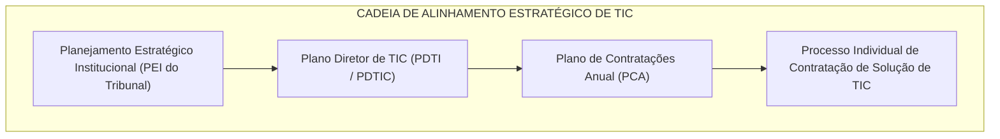
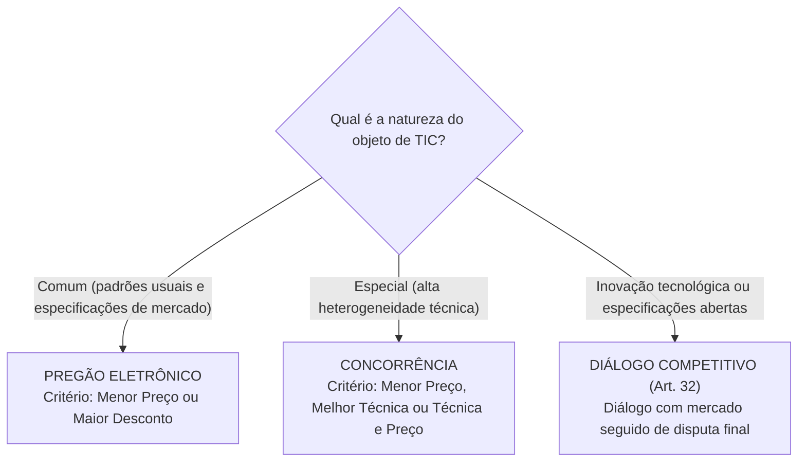
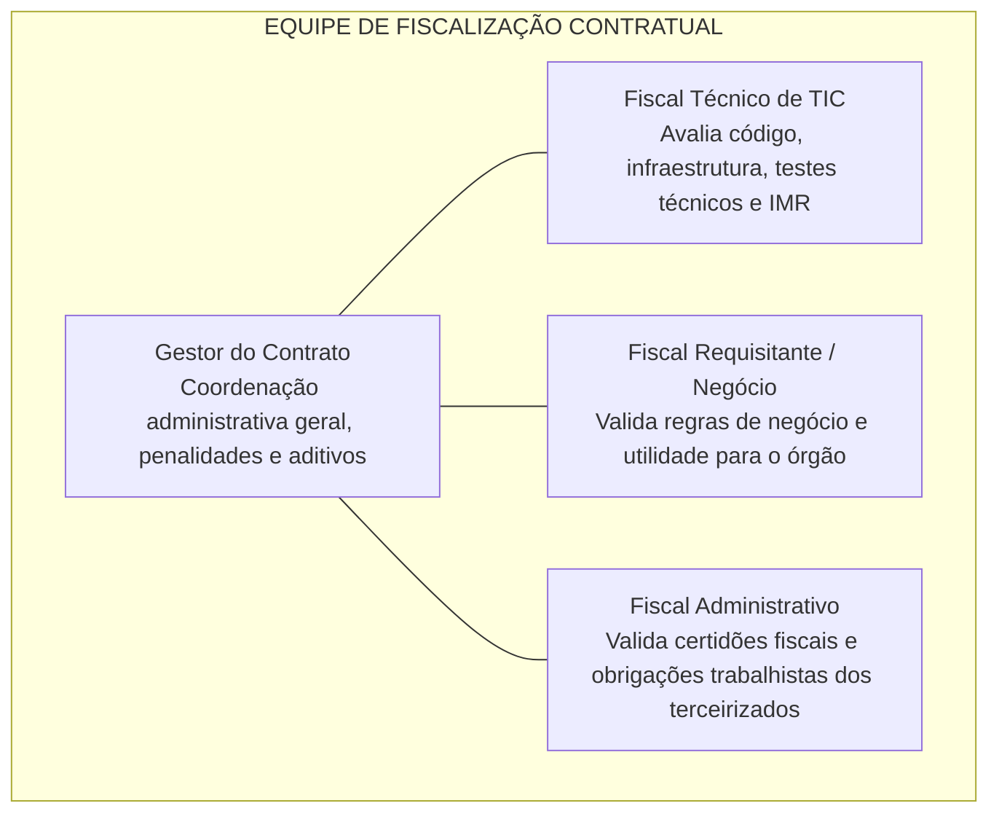

# 04 - Contratações de Soluções de TIC na Lei nº 14.133/2021

> **Matéria:** Governança de Tecnologia da Informação  
> **Cargo:** B02 – Técnico de Controle Externo – Especialidade: Tecnologia da Informação  
> **Arquivo:** `04_contratacoes_de_tic_lei_14133_2021.md`  
> **Ato Normativo Central:** Lei Federal nº 14.133, de 1º de abril de 2021 (Lei de Licitações e Contratos Administrativos)

---

## 📌 Ementa / Itens do Edital
- Aplicação da Lei nº 14.133/2021 às contratações de Soluções de Tecnologia da Informação e Comunicação (TIC)
- Alinhamento Estratégico: Plano Diretor de TIC (PDTI) e Plano de Contratações Anual (PCA)
- Fases do Processo de Contratação: Planejamento, Seleção do Fornecedor e Gestão do Contrato
- Artefatos da Fase Preparatória: DOD, Estudo Técnico Preliminar (ETP), Custo Total de Propriedade (TCO), Mapa de Riscos e Termo de Referência (TR)
- Modalidades e Critérios de Julgamento em TIC: Pregão, Concorrência e Diálogo Competitivo
- Contratação Direta de Soluções de TIC: Inexigibilidade vs. Dispensa de Licitação
- Gestão e Fiscalização de Contratos de TIC: Segregação de papéis (Gestor, Fiscal Técnico, Fiscal Requisitante, Fiscal Administrativo)
- Instrumento de Medição de Resultado (IMR), Acordo de Nível de Serviço (SLA), Glosas e Recebimento do Objeto (Provisório e Definitivo)

---

## 🧭 Sumário

1. [Princípios e Diretrizes das Contratações de TIC na Lei nº 14.133/2021](#1-principios-e-diretrizes-das-contratacoes-de-tic-na-lei-no-141332021)
1. [Alinhamento Estratégico e Planejamento Prévio (PDTI e PCA)](#1-1-alinhamento-estrategico-e-planejamento-previo-pdti-e-pca)
    1. [Teste 495](#Teste-495)
1. [Vedações Expressas e Jurisprudência dos Tribunais de Contas](#1-2-vedacoes-expressas-e-jurisprudencia-dos-tribunais-de-contas)
    1. [Teste 496](#Teste-496)
2. [O Ciclo de Vida da Contratação e a Fase Preparatória](#2-o-ciclo-de-vida-da-contratacao-e-a-fase-preparatoria)
2. [Artefatos da Fase de Planejamento (DOD, ETP, Mapa de Riscos e TR)](#2-1-artefatos-da-fase-de-planejamento-dod-etp-mapa-de-riscos-e-tr)
    1. [Teste 497](#Teste-497)
2. [Custo Total de Propriedade (TCO - Total Cost of Ownership)](#2-2-custo-total-de-propriedade-tco-total-cost-of-ownership)
    1. [Teste 498](#Teste-498)
3. [Fase de Seleção do Fornecedor em TIC](#3-fase-de-selecao-do-fornecedor-em-tic)
3. [Modalidades de Licitação (Pregão, Concorrência e Diálogo Competitivo)](#3-1-modalidades-de-licitacao-pregao-concorrencia-e-dialogo-competitivo)
    1. [Teste 499](#Teste-499)
3. [Hipóteses de Contratação Direta em TIC (Inexigibilidade vs. Dispensa)](#3-2-hipoteses-de-contratacao-direta-em-tic-inexigibilidade-vs-dispensa)
    1. [Teste 500](#Teste-500)
4. [Gestão e Fiscalização de Contratos de TIC](#4-gestao-e-fiscalizacao-de-contratos-de-tic)
4. [Segregação de Papéis na Equipe de Fiscalização](#4-1-segregacao-de-papeis-na-equipe-de-fiscalizacao)
    1. [Teste 501](#Teste-501)
4. [Instrumento de Medição de Resultado (IMR), SLA e Glosas](#4-2-instrumento-de-medicao-de-resultado-imr-sla-e-glosas)
    1. [Teste 502](#Teste-502)
4. [Recebimento Provisório e Recebimento Definitivo](#4-3-recebimento-provisorio-e-recebimento-definitivo)
    1. [Teste 503](#Teste-503)
    2. [Teste 504](#Teste-504)
6. [Fontes Recomendadas na Internet](#6-fontes-recomendadas-na-internet)

---

## 1. Princípios e Diretrizes das Contratações de TIC na Lei nº 14.133/2021

A **Lei nº 14.133/2021** (Nova Lei de Licitações e Contratos Administrativos) consolidou e positivou princípios e boas práticas de contratação pública de Soluções de Tecnologia da Informação e Comunicação (TIC), harmonizando a legislação geral com a jurisprudência histórica do Tribunal de Contas da União (TCU) e com as normas infralegais federais (como a Instrução Normativa SGD/MGI nº 94/2022).

---

## 1.1 Alinhamento Estratégico e Planejamento Prévio (PDTI e PCA)

No setor público, nenhuma aquisição de tecnologia pode ocorrer de forma isolada, episódica ou desconectada das metas institucionais:

- **Plano Diretor de TIC (PDTI / PDTIC):** Instrumento de diagnóstico, planejamento e gestão dos recursos e processos de TIC do órgão para um horizonte plurianual (normalmente de 2 a 4 anos), alinhado ao Planejamento Estratégico Institucional (PEI).
- **Plano de Contratações Anual (PCA):** Documento formalizado pela alta administração que consolida todas as compras e contratações que o órgão pretende realizar no exercício financeiro seguinte, assegurando previsão orçamentária e evitando fracionamento indevido de despesas.
- **Regra:** Toda contratação de solução de TIC deve estar expressamente prevista ou fundamentadamente compatível com o PDTI e com o PCA do exercício.

---

### Teste 495
**(FGV – TJ/RR – 2024 – Analista Judiciario Gestao E Governanca De Tecnologia Da Informacao)**
Considerando conceitos básicos de contratações de TI, analise as afirmativas a seguir. I. O preço máximo de compra de item de TIC (PMC-TIC) é o valor máximo que os órgãos e as entidades integrantes do SISP adotarão nas contratações dos itens constantes nos Catálogos de Soluções de TIC com Condições Padronizadas, aplicável para contratações realizadas em todo o território nacional. II. Para fins da Instrução Normativa nº 94/2022 SGD/ME, a área requisitante da solução é a unidade do órgão ou entidade que demande a contratação de uma solução de TIC. III. Quando a pesquisa de preços for realizada com fornecedores, é facultado o registro, nos autos do processo da contratação correspondente, da relação de fornecedores que foram consultados e não enviaram propostas como resposta à solicitação de cotação. Está correto o que se afirma em

* **A)** I, apenas.
* **B)** II, apenas.
* **C)** III, apenas.
* **D)** I e II, apenas.
* **E)** I e III, apenas.

---

> **Comentário Detalhado:**
>
> - **A)** **Incorreta.** A opção incorre em restrição indevida ao limitar o escopo conceitual ao afirmar que "I, apenas". De acordo com a teoria estudada em *2.2 Custo Total de Propriedade (TCO - Total Cost of Ownership)*, a análise de TCO frequentemente demonstra que uma solução com preço inicial de compra mais baixo (ou até software gratuito) acarreta gastos elevadíssimos com suporte especializado, horas de customização e energia, tornando uma solução com custo inicial maior, porém com suporte integrado, muito mais econômica globalmente para o órgão.
> - **B)** **Incorreta.** A opção incorre em restrição indevida ao limitar o escopo conceitual ao afirmar que "II, apenas". De acordo com a teoria estudada em *2.1 Artefatos da Fase de Planejamento (DOD, ETP, Mapa de Riscos e TR)*, dOD (*Documento de Oficialização da Demanda*): Área Requisitante (Negócio) — Inicia formalmente o processo administrativo, explicitando o problema institucional a ser resolvido, os resultados esperados e o alinhamento com o PDTI.
> - **C)** **Incorreta.** A opção incorre em restrição indevida ao limitar o escopo conceitual ao afirmar que "III, apenas". De acordo com a teoria estudada em *3.2 Hipóteses de Contratação Direta em TIC (Inexigibilidade vs. Dispensa)*, hipótese 2 em TIC: Serviços Técnicos Especializados de Natureza Predominantemente Intelectual (Art. 74, III): Profissionais ou empresas de notória especialização para auditoria de segurança crítica, perícias forenses complexas ou consultoria arquitetural avançada. — Emergência ou Calamidade Pública (Art. 75, VIII): Restabelecimento imediato de sistemas vitais após sinistros graves ou ataques cibernéticos massivos, restrito ao prazo necessário.
> - **D)** **Correta.** Conforme fundamentado na seção *1. Princípios e Diretrizes das Contratações de TIC na Lei nº 14.133/2021* deste guia, a Lei nº 14.133/2021 (Nova Lei de Licitações e Contratos Administrativos) consolidou e positivou princípios e boas práticas de contratação pública de Soluções de Tecnologia da Informação e Comunicação (TIC), harmonizando a legislação geral com a jurisprudência histórica do Tribunal de Contas da União (TCU) e com as normas infralegais federais (como a Instrução Normativa SGD/MGI nº 94/2022). Dessa forma, está plenamente correta a assertiva da banca (FGV – TJ/RR/2024) ao estabelecer que "I e II, apenas".
> - **E)** **Incorreta.** A opção incorre em restrição indevida ao limitar o escopo conceitual ao afirmar que "I e III, apenas". De acordo com a teoria estudada em *3.2 Hipóteses de Contratação Direta em TIC (Inexigibilidade vs. Dispensa)*, a contratação de empresa por Notória Especialização com base em Inexigibilidade (Art. 74, III) não pode ser usada para suporte rotineiro de informática ou help-desk! Ela exige cumulativamente: 1) Natureza predominantemente intelectual; 2) Notória especialização do prestador; e 3) Singularidade do serviço.
>
> **Gabarito: D**

---

## 1.2 Vedações Expressas e Jurisprudência dos Tribunais de Contas

1. **Vedação à Remuneração por Homem-Hora Puro (Súmula nº 269 do TCU):**  
   É terminantemente proibida a remuneração de serviços de desenvolvimento, sustentação ou suporte de software com base unicamente na quantidade de horas trabalhadas ou pela mera presença física de funcionários terceirizados nas dependências do órgão. Os pagamentos devem estar obrigatoriamente vinculados a **resultados mensuráveis**, como Pontos de Função (Análise de Pontos de Função - APF), Unidades de Serviço Técnico (UST) previamente catalogadas em tabela de complexidade ou cumprimento de níveis mínimos de serviço (SLA/IMR).
2. **Vedação à Indicação de Marcas ou Modelos:**  
   Em regra, o edital não pode exigir marca, modelo ou fabricante exclusivo. Exceções são admitidas **apenas** quando houver comprovação técnica de padronização corporativa prévia formalizada em Estudo Técnico Preliminar (ETP), ou quando uma marca for a única tecnicamente viável para manter a interoperabilidade de sistemas preexistentes.
3. **Vedação à Terceirização da Governança e Decisão:**  
   Atividades privativas de tomada de decisão, gestão estratégica de TIC, aprovação de orçamentos, elaboração de pareceres conclusivos e fiscalização formal de contratos **jamais** podem ser terceirizadas para empresas privadas.

---

### Teste 496
**(FCC – TCE/GO – 2009 – Analista de Controle Externo - Gestão de Conhecimento)**
Um usuário solicita à biblioteca informação de como fazer 75. Visando melhorar o atendimento do usuário e, ao mesmo a citação de um trabalho em fase de elaboração. Nesse tempo, promover o uso extensivo dos recursos da biblio- caso, ele deve ser informado que, segundo a norma da teca, o serviço de informação e referência deve concentrar ABNT, esforços

* **A)** no serviço de empréstimo domiciliar. nota de rodapé.
* **B)** a expressão “em fase de elaboração” deve vir logo
* **C)** não é necessário fazer qualquer referência a esse tipo de trabalho, uma vez que ele ainda não foi
* **D)** no treinamento do bibliotecário. em nota de rodapé, dos dados disponíveis.
* **E)** na comunicação visual do espaço. _________________________________________________________

---

> **Comentário Detalhado:**
>
> - **A)** **Incorreta.** A opção apresenta proposição em desacordo com os fundamentos teóricos e técnicos do tópico ao afirmar que "no serviço de empréstimo domiciliar. nota de rodapé". De acordo com a teoria estudada em *3.2 Hipóteses de Contratação Direta em TIC (Inexigibilidade vs. Dispensa)*, a contratação de empresa por Notória Especialização com base em Inexigibilidade (Art. 74, III) não pode ser usada para suporte rotineiro de informática ou help-desk! Ela exige cumulativamente: 1) Natureza predominantemente intelectual; 2) Notória especialização do prestador; e 3) Singularidade do serviço.
> - **B)** **Correta.** Conforme fundamentado na seção *1.2 Vedações Expressas e Jurisprudência dos Tribunais de Contas* deste guia, atividades privativas de tomada de decisão, gestão estratégica de TIC, aprovação de orçamentos, elaboração de pareceres conclusivos e fiscalização formal de contratos jamais podem ser terceirizadas para empresas privadas. Dessa forma, está plenamente correta a assertiva da banca (FCC – TCE/GO/2009) ao estabelecer que "a expressão “em fase de elaboração” deve vir logo".
> - **C)** **Incorreta.** A opção promove generalização excessiva que desconsidera as condições técnicas e normativas ao afirmar que "não é necessário fazer qualquer referência a esse tipo de trabalho, uma vez que ele ainda não foi". De acordo com a teoria estudada em *2.1 Artefatos da Fase de Planejamento (DOD, ETP, Mapa de Riscos e TR)*, a fase preparatória é o núcleo de conformidade da contratação. Falhas graves apontadas em auditorias de controle externo derivam, em sua grande maioria, de fragilidades no ETP ou no Termo de Referência.
> - **D)** **Incorreta.** A opção apresenta proposição em desacordo com os fundamentos teóricos e técnicos do tópico ao afirmar que "no treinamento do bibliotecário. em nota de rodapé, dos dados disponíveis". De acordo com a teoria estudada em *1.1 Alinhamento Estratégico e Planejamento Prévio (PDTI e PCA)*, regra: Toda contratação de solução de TIC deve estar expressamente prevista ou fundamentadamente compatível com o PDTI e com o PCA do exercício.
> - **E)** **Incorreta.** A opção apresenta proposição em desacordo com os fundamentos teóricos e técnicos do tópico ao afirmar que "na comunicação visual do espaço. _________________________________________________________". De acordo com a teoria estudada em *1. Princípios e Diretrizes das Contratações de TIC na Lei nº 14.133/2021*, a Lei nº 14.133/2021 (Nova Lei de Licitações e Contratos Administrativos) consolidou e positivou princípios e boas práticas de contratação pública de Soluções de Tecnologia da Informação e Comunicação (TIC), harmonizando a legislação geral com a jurisprudência histórica do Tribunal de Contas da União (TCU) e com as normas infralegais federais (como a Instrução Normativa SGD/MGI nº 94/2022).
>
> **Gabarito: B**

---

## 2. O Ciclo de Vida da Contratação e a Fase Preparatória

O processo de contratação pública de TIC divide-se em três macrofases interdependentes:

```mermaid
flowchart LR
    subgraph FASE1["1. Planejamento da Contratação"]
        DOD["DOD<br/>Demanda"] --> EQ["Equipe de Planejamento<br/>(Requisitante, Técnico, ADM)"]
        EQ --> ETP["Estudo Técnico Preliminar<br/>(ETP + TCO)"]
        ETP --> MR["Mapa de Riscos"]
        MR --> TR["Termo de Referência<br/>(TR + IMR)"]
    end

    subgraph FASE2["2. Seleção do Fornecedor"]
        PUB["Edital de Licitação /<br/>Ato de Contratação Direta"] --> JULG["Julgamento de Propostas<br/>(Pregão / Concorrência / Diálogo)"]
        JULG --> HOM["Habilitação e Homologação"]
    end

    subgraph FASE3["3. Gestão Contratual"]
        OS["Emissão de OS / OFB"] --> EXEC["Execução e Aferição de SLA"]
        EXEC --> REC_PROV["Recebimento Provisório<br/>(Fiscais)"]
        REC_PROV --> REC_DEF["Recebimento Definitivo<br/>(Gestor do Contrato)"]
        REC_DEF --> PAG["Pagamento com Glosas"]
    end

    TR --> PUB
    HOM --> OS
```

---

## 2.1 Artefatos da Fase de Planejamento (DOD, ETP, Mapa de Riscos e TR)

A fase preparatória é o núcleo de conformidade da contratação. Falhas graves apontadas em auditorias de controle externo derivam, em sua grande maioria, de fragilidades no ETP ou no Termo de Referência.

| Artefato | Responsável Principal | Finalidade e Conteúdo Essencial |
| :--- | :--- | :--- |
| **DOD** (*Documento de Oficialização da Demanda*) | Área Requisitante (Negócio) | Inicia formalmente o processo administrativo, explicitando o problema institucional a ser resolvido, os resultados esperados e o alinhamento com o PDTI. |
| **Equipe de Planejamento** | Designada pela Autoridade Competente | Comissão composta por no mínimo: Integrante Requisitante, Integrante Técnico (TI) e Integrante Administrativo, assegurando a segregação de funções. |
| **ETP** (*Estudo Técnico Preliminar*) | Equipe de Planejamento da Contratação | Demonstra a viabilidade técnica, operacional e econômica. Compara soluções de mercado (nuvem vs on-premises, software livre vs proprietário), calcula o **TCO** e define o quantitativo. |
| **Mapa de Riscos** | Equipe de Planejamento | Matriz que identifica riscos internos e externos em todo o ciclo de vida, avaliando probabilidade e impacto, além de prever ações preventivas e contingenciais. |
| **TR** (*Termo de Referência*) | Equipe de Planejamento | Documento definitivo que estabelece o objeto, requisitos funcionais e não funcionais, modelo de execução, critérios de habilitação e o **Instrumento de Medição de Resultado (IMR)**. |

---

### Teste 497
**(FGV – TJ/AP – 2023 – Analista Judiciario Apoio Especializado Tecnologia Da Informacao Telecomunicacoes)**
Com base na Instrução Normativa nº 4, de 11 de setembro de 2014 (MPOG/SLTI), que dispõe sobre o processo de contratação de Soluções de Tecnologia da Informação pelos órgãos integrantes do Sistema de Administração dos Recursos de Tecnologia da Informação (SISP) do Poder Executivo Federal. A primeira fase da contratação de Soluções de Tecnologia da Informação se inicia com a elaboração do Documento de Oficialização de Demanda (DOD). Esse documento:

* **A)** apresenta os riscos e ameaças à contratação;
* **B)** demonstra a viabilidade técnica e econômica da contratação;
* **C)** detalha a necessidade que deverá ser atendida pela contratação;
* **D)** descreve as atividades de alocação de recursos necessários para a contratação;
* **E)** reúne as especificações necessárias para definir a Solução de Tecnologia da Informação a ser contratada.

---

> **Comentário Detalhado:**
>
> - **A)** **Incorreta.** A opção apresenta proposição em desacordo com os fundamentos teóricos e técnicos do tópico ao afirmar que "apresenta os riscos e ameaças à contratação". De acordo com a teoria estudada em *1. Princípios e Diretrizes das Contratações de TIC na Lei nº 14.133/2021*, a Lei nº 14.133/2021 (Nova Lei de Licitações e Contratos Administrativos) consolidou e positivou princípios e boas práticas de contratação pública de Soluções de Tecnologia da Informação e Comunicação (TIC), harmonizando a legislação geral com a jurisprudência histórica do Tribunal de Contas da União (TCU) e com as normas infralegais federais (como a Instrução Normativa SGD/MGI nº 94/2022).
> - **B)** **Incorreta.** A opção apresenta proposição em desacordo com os fundamentos teóricos e técnicos do tópico ao afirmar que "demonstra a viabilidade técnica e econômica da contratação". De acordo com a teoria estudada em *2.1 Artefatos da Fase de Planejamento (DOD, ETP, Mapa de Riscos e TR)*, eTP (*Estudo Técnico Preliminar*): Equipe de Planejamento da Contratação — Demonstra a viabilidade técnica, operacional e econômica. Compara soluções de mercado (nuvem vs on-premises, software livre vs proprietário), calcula o TCO e define o quantitativo.
> - **C)** **Correta.** Conforme fundamentado na seção *2.1 Artefatos da Fase de Planejamento (DOD, ETP, Mapa de Riscos e TR)* deste guia, dOD (*Documento de Oficialização da Demanda*): Área Requisitante (Negócio) — Inicia formalmente o processo administrativo, explicitando o problema institucional a ser resolvido, os resultados esperados e o alinhamento com o PDTI. Dessa forma, está plenamente correta a assertiva da banca (FGV – TJ/AP/2023) ao estabelecer que "detalha a necessidade que deverá ser atendida pela contratação".
> - **D)** **Incorreta.** A opção apresenta proposição em desacordo com os fundamentos teóricos e técnicos do tópico ao afirmar que "descreve as atividades de alocação de recursos necessários para a contratação". De acordo com a teoria estudada em *1.2 Vedações Expressas e Jurisprudência dos Tribunais de Contas*, atividades privativas de tomada de decisão, gestão estratégica de TIC, aprovação de orçamentos, elaboração de pareceres conclusivos e fiscalização formal de contratos jamais podem ser terceirizadas para empresas privadas.
> - **E)** **Incorreta.** A opção apresenta proposição em desacordo com os fundamentos teóricos e técnicos do tópico ao afirmar que "reúne as especificações necessárias para definir a Solução de Tecnologia da Informação a ser contratada". De acordo com a teoria estudada em *3.2 Hipóteses de Contratação Direta em TIC (Inexigibilidade vs. Dispensa)*, a contratação de empresa por Notória Especialização com base em Inexigibilidade (Art. 74, III) não pode ser usada para suporte rotineiro de informática ou help-desk! Ela exige cumulativamente: 1) Natureza predominantemente intelectual; 2) Notória especialização do prestador; e 3) Singularidade do serviço.
>
> **Gabarito: C**

---

## 2.2 Custo Total de Propriedade (TCO - Total Cost of Ownership)

Ao realizar o Estudo Técnico Preliminar de soluções de TIC, a Administração não pode avaliar exclusivamente o custo nominal de aquisição inicial de hardware ou licenças. Deve-se calcular o **Custo Total de Propriedade (TCO)** ao longo de todo o ciclo de vida:

$$\text{TCO} = \text{Aquisição} + \text{Implantação/Customização} + \text{Capacitação/Treinamento} + \text{Manutenção/Suporte Recorrente} + \text{Infraestrutura/Energia} + \text{Descarte/Migração}$$

> 🚨 **ALERTA DE PROVA / PEGADINHA FCC:**  
> A análise de TCO frequentemente demonstra que uma solução com preço inicial de compra mais baixo (ou até software gratuito) acarreta gastos elevadíssimos com suporte especializado, horas de customização e energia, tornando uma solução com custo inicial maior, porém com suporte integrado, muito mais econômica globalmente para o órgão.

---

### Teste 498
**(CEBRASPE – TJ/DFT – 2015 – Analista Judiciario Suporte Em Tecnologia Da Informacao)**
De acordo com a Resolução CNJ n.º 182, o planejamento das contratações de solução de TI e comunicação incluirá as seguintes fases: análise de viabilidade da contratação, análise dos aspectos técnicos da solução e análise dos aspectos administrativos da contratação.

* **C)** Certo
* **E)** Errado

---

> **Comentário Detalhado:**
>
> - **C)** **Incorreta.** A marcação como **Certo** não procede, pois o enunciado apresenta proposição em desacordo com os fundamentos teóricos e técnicos do tópico ao afirmar que "De acordo com a Resolução CNJ n.º 182, o planejamento das contratações de solução de TI e comunicação...". De acordo com a teoria estudada em *2.1 Artefatos da Fase de Planejamento (DOD, ETP, Mapa de Riscos e TR)*, eTP (*Estudo Técnico Preliminar*): Equipe de Planejamento da Contratação — Demonstra a viabilidade técnica, operacional e econômica. Compara soluções de mercado (nuvem vs on-premises, software livre vs proprietário), calcula o TCO e define o quantitativo.
> - **E)** **Correta.** O item está **Errado** (gabarito oficial: **E**). Conforme fundamentado na seção *1. Princípios e Diretrizes das Contratações de TIC na Lei nº 14.133/2021* deste guia, a Lei nº 14.133/2021 (Nova Lei de Licitações e Contratos Administrativos) consolidou e positivou princípios e boas práticas de contratação pública de Soluções de Tecnologia da Informação e Comunicação (TIC), harmonizando a legislação geral com a jurisprudência histórica do Tribunal de Contas da União (TCU) e com as normas infralegais federais (como a Instrução Normativa SGD/MGI nº 94/2022). Portanto, a assertiva examinada pela banca (CEBRASPE – TJ/DFT/2015) viola os preceitos técnicos do tópico.
>
> **Gabarito: E**

---

## 3. Fase de Seleção do Fornecedor em TIC

---

## 3.1 Modalidades de Licitação (Pregão, Concorrência e Diálogo Competitivo)

#### 1. Pregão Eletrônico (Art. 28, I e Art. 29)
- **Aplicação Obrigatória/Preferencial:** Aquisição de **bens e serviços comuns de TIC**, definidos como aqueles cujos padrões de desempenho e qualidade podem ser objetivamente definidos pelo edital por meio de especificações usuais de mercado.
- **Exemplos em TIC:** Compra de notebooks, switches de borda, monitores, locação de impressoras corporativas, serviços de service desk de nível 1 e renovação de licenças de software comercial de prateleira.
- **Critérios de Julgamento Admitidos:** **Menor Preço** ou **Maior Desconto**. (É expressamente proibido usar "Técnica e Preço" no pregão!).

#### 2. Concorrência (Art. 28, II)
- **Aplicação:** Bens e serviços **especiais** de TIC (soluções cuja complexidade e peculiaridades técnicas impeçam sua padronização objetiva de mercado).
- **Critérios de Julgamento:** Menor Preço, Maior Desconto, Melhor Técnica ou Conteúdo Artístico, **Técnica e Preço**, ou Maior Retorno Econômico.

#### 3. Diálogo Competitivo (Art. 32)
- **Aplicação:** Modalidade inovadora da Lei nº 14.133/2021, cabível especificamente quando a Administração:
    1. Visa contratar objeto que envolva **inovação tecnológica ou técnica**;
    2. Não possui conhecimento suficiente para redigir as especificações técnicas da solução disponível no mercado; ou
    3. Precisa avaliar e definir a melhor modelagem técnica, jurídica ou financeira com o mercado antes de formular o edital final.

- **Dinâmica:**
    - *Fase de Diálogo:* O órgão publica edital convocatório, seleciona concorrentes qualificados e realiza rodadas de diálogo transparentes para construir a melhor solução técnica.
    - *Fase Competitiva:* Concluído o diálogo, publica-se o edital final com a solução construída, concedendo prazo de no mínimo 60 dias para a apresentação das propostas formais de preço e técnica.

---

### Teste 499
**(FCC – TRT 13ª – 2014 – Analista Judiciário - Tecnologia da Informação)**
Considere as definições seguintes, cada qual em seu contexto específico, aplicáveis à gestão de negócios e de tecnologia da informação e comunicação. I. É embasado em quatro perspectivas (financeira, clientes, processos internos e aprendizado/crescimento), formando um conjunto coeso e interdependente, com seus objetivos e indicadores se inter-relacionando e formando um fluxo ou diagrama de causa e efeito que se inicia na perspectiva do aprendizado e crescimento e termina na perspectiva financeira. II. Seu objetivo é fornecer uma visão completa do ambiente atual de Tecnologia da Informação e Comunicação e ao mesmo tempo compará-lo a cenários alternativos que possam otimizar o retorno dos investimentos já feitos e dos ainda a serem realizados. Visa orientar a identificação das informações estratégicas, táticas e operacionais necessárias à instituição e também permitir a definição de projetos e prioridades, bem como o acompanhamento das ações e o controle dos investimentos. III. Gerenciar serviços terceirizados significa assegurar que os serviços prestados por fornecedores satisfaçam aos requisitos do negócio. Isso requer um processo efetivo de gestão da terceirização. Esse processo é realizado definindo-se claramente os papéis, responsabilidades e expectativas nos acordos de terceirização bem como revisando e monitorando tais acordos quanto à efetividade e à conformidade. A gestão eficaz dos serviços terceirizados minimiza os riscos de negócio associados aos fornecedores que não cumprem seu papel. As definições I, II e III correspondem, respectivamente, a

* **A)** ITIL - COBIT - BPMN
* **B)** COBIT - BSC - PDTIC
* **C)** BSC - ITIL - BPMN
* **D)** BPMN - PDTIC - BSC
* **E)** BSC - PDTIC - COBIT

---

> **Comentário Detalhado:**
>
> - **A)** **Incorreta.** A opção apresenta proposição em desacordo com os fundamentos teóricos e técnicos do tópico ao afirmar que "ITIL - COBIT - BPMN". De acordo com a teoria estudada em *2.1 Artefatos da Fase de Planejamento (DOD, ETP, Mapa de Riscos e TR)*, dOD (*Documento de Oficialização da Demanda*): Área Requisitante (Negócio) — Inicia formalmente o processo administrativo, explicitando o problema institucional a ser resolvido, os resultados esperados e o alinhamento com o PDTI.
> - **B)** **Incorreta.** A opção apresenta proposição em desacordo com os fundamentos teóricos e técnicos do tópico ao afirmar que "COBIT - BSC - PDTIC". De acordo com a teoria estudada em *4.3 Recebimento Provisório e Recebimento Definitivo*, realizado pelo Gestor do Contrato ou por comissão designada, após a homologação técnica completa, validação de conformidade com o Termo de Referência e apuração dos indicadores do IMR.
> - **C)** **Incorreta.** A opção apresenta proposição em desacordo com os fundamentos teóricos e técnicos do tópico ao afirmar que "BSC - ITIL - BPMN". De acordo com a teoria estudada em *1. Princípios e Diretrizes das Contratações de TIC na Lei nº 14.133/2021*, a Lei nº 14.133/2021 (Nova Lei de Licitações e Contratos Administrativos) consolidou e positivou princípios e boas práticas de contratação pública de Soluções de Tecnologia da Informação e Comunicação (TIC), harmonizando a legislação geral com a jurisprudência histórica do Tribunal de Contas da União (TCU) e com as normas infralegais federais (como a Instrução Normativa SGD/MGI nº 94/2022).
> - **D)** **Incorreta.** A opção apresenta proposição em desacordo com os fundamentos teóricos e técnicos do tópico ao afirmar que "BPMN - PDTIC - BSC". De acordo com a teoria estudada em *2.1 Artefatos da Fase de Planejamento (DOD, ETP, Mapa de Riscos e TR)*, mapa de Riscos: Equipe de Planejamento — Matriz que identifica riscos internos e externos em todo o ciclo de vida, avaliando probabilidade e impacto, além de prever ações preventivas e contingenciais.
> - **E)** **Correta.** Conforme fundamentado na seção *1.1 Alinhamento Estratégico e Planejamento Prévio (PDTI e PCA)* deste guia, plano Diretor de TIC (PDTI / PDTIC): Instrumento de diagnóstico, planejamento e gestão dos recursos e processos de TIC do órgão para um horizonte plurianual (normalmente de 2 a 4 anos), alinhado ao Planejamento Estratégico Institucional (PEI). Dessa forma, está plenamente correta a assertiva da banca (FCC – TRT 13ª/2014) ao estabelecer que "BSC - PDTIC - COBIT".
>
> **Gabarito: E**

---

## 3.2 Hipóteses de Contratação Direta em TIC (Inexigibilidade vs. Dispensa)

| Dimensão | Inexigibilidade de Licitação (Art. 74) | Dispensa de Licitação (Art. 75) |
| :--- | :--- | :--- |
| **Fundamento Jurídico** | **Inviabilidade jurídica de competição** (não há como estabelecer julgamento objetivo entre competidores). | A competição é juridicamente possível, mas a lei autoriza a não licitar por razões de economia processual, celeridade ou emergência. |
| **Hipótese 1 em TIC** | **Fornecedor Exclusivo (Art. 74, I):** Aquisição de software ou hardware exclusivo, comprovada por atestado idôneo do fabricante ou sindicato de classe. | **Baixo Valor (Art. 75, I e II):** Compras e serviços comuns de TIC de pequeno vulto (valores monetários atualizados anualmente por decreto). |
| **Hipótese 2 em TIC** | **Serviços Técnicos Especializados de Natureza Predominantemente Intelectual (Art. 74, III):** Profissionais ou empresas de notória especialização para auditoria de segurança crítica, perícias forenses complexas ou consultoria arquitetural avançada. | **Emergência ou Calamidade Pública (Art. 75, VIII):** Restabelecimento imediato de sistemas vitais após sinistros graves ou ataques cibernéticos massivos, restrito ao prazo necessário. |
| **Hipótese 3 em TIC** | — | **Contratação de Órgão Público de TIC (Art. 75, IX):** Contratação de empresas públicas de processamento de dados (SERPRO, DATAPREV, ATI estadual) para serviços criados para esse fim, com preço compatível de mercado. |

> 🚨 **ALERTA DE PROVA / PEGADINHA FCC:**  
> A contratação de empresa por Notória Especialização com base em Inexigibilidade (Art. 74, III) **não pode** ser usada para suporte rotineiro de informática ou help-desk! Ela exige cumulativamente: 1) Natureza predominantemente intelectual; 2) Notória especialização do prestador; e 3) Singularidade do serviço.

---

### Teste 500
**(FGV – TRF/1 – 2024 – Analista Judiciario Area Apoio Especializado Especialidade Suporte Em Tecnologia Da Informacao)**
As contratações de solução de tecnologia da informação e comunicação (STIC) deverão ser precedidas de encaminhamento pela área demandante do projeto básico ou termo de referência. Esse documento deverá conter a fundamentação da contratação dispondo, entre outros elementos, sobre os(as):

* **A)** obrigações contratuais que o órgão e a empresa deverão observar;
* **B)** informações sobre o impacto social decorrente da contratação;
* **C)** alinhamentos entre a contratação e o planejamento de transformação digital do órgão;
* **D)** objetivos a serem alcançados por meio da plataforma digital do Poder Judiciário brasileiro - PDPJ-Br;
* **E)** benefícios diretos e indiretos resultantes da implementação da plataforma digital do Poder Judiciário brasileiro - PDPJ-Br.

---

> **Comentário Detalhado:**
>
> - **A)** **Correta.** Conforme fundamentado na seção *1. Princípios e Diretrizes das Contratações de TIC na Lei nº 14.133/2021* deste guia, a Lei nº 14.133/2021 (Nova Lei de Licitações e Contratos Administrativos) consolidou e positivou princípios e boas práticas de contratação pública de Soluções de Tecnologia da Informação e Comunicação (TIC), harmonizando a legislação geral com a jurisprudência histórica do Tribunal de Contas da União (TCU) e com as normas infralegais federais (como a Instrução Normativa SGD/MGI nº 94/2022). Dessa forma, está plenamente correta a assertiva da banca (FGV – TRF/1/2024) ao estabelecer que "obrigações contratuais que o órgão e a empresa deverão observar".
> - **B)** **Incorreta.** A opção apresenta proposição em desacordo com os fundamentos teóricos e técnicos do tópico ao afirmar que "informações sobre o impacto social decorrente da contratação". De acordo com a teoria estudada em *3.2 Hipóteses de Contratação Direta em TIC (Inexigibilidade vs. Dispensa)*, a contratação de empresa por Notória Especialização com base em Inexigibilidade (Art. 74, III) não pode ser usada para suporte rotineiro de informática ou help-desk! Ela exige cumulativamente: 1) Natureza predominantemente intelectual; 2) Notória especialização do prestador; e 3) Singularidade do serviço.
> - **C)** **Incorreta.** A opção apresenta proposição em desacordo com os fundamentos teóricos e técnicos do tópico ao afirmar que "alinhamentos entre a contratação e o planejamento de transformação digital do órgão". De acordo com a teoria estudada em *1.1 Alinhamento Estratégico e Planejamento Prévio (PDTI e PCA)*, plano de Contratações Anual (PCA): Documento formalizado pela alta administração que consolida todas as compras e contratações que o órgão pretende realizar no exercício financeiro seguinte, assegurando previsão orçamentária e evitando fracionamento indevido de despesas.
> - **D)** **Incorreta.** A opção apresenta proposição em desacordo com os fundamentos teóricos e técnicos do tópico ao afirmar que "objetivos a serem alcançados por meio da plataforma digital do Poder Judiciário brasileiro - PDPJ-Br". De acordo com a teoria estudada em *1. Pregão Eletrônico (Art. 28, I e Art. 29)*, aplicação Obrigatória/Preferencial: Aquisição de bens e serviços comuns de TIC, definidos como aqueles cujos padrões de desempenho e qualidade podem ser objetivamente definidos pelo edital por meio de especificações usuais de mercado.
> - **E)** **Incorreta.** A opção apresenta proposição em desacordo com os fundamentos teóricos e técnicos do tópico ao afirmar que "benefícios diretos e indiretos resultantes da implementação da plataforma digital do Poder Judiciário brasileiro -...". De acordo com a teoria estudada em *3.2 Hipóteses de Contratação Direta em TIC (Inexigibilidade vs. Dispensa)*, hipótese 3 em TIC: — — Contratação de Órgão Público de TIC (Art. 75, IX): Contratação de empresas públicas de processamento de dados (SERPRO, DATAPREV, ATI estadual) para serviços criados para esse fim, com preço compatível de mercado.
>
> **Gabarito: A**

---

## 4. Gestão e Fiscalização de Contratos de TIC

---

## 4.1 Segregação de Papéis na Equipe de Fiscalização

A Lei nº 14.133/2021 exige a separação clara de atribuições entre os agentes públicos responsáveis pelo contrato para prevenir conluios e falhas de controle:

- **Gestor do Contrato:** Servidor que coordena o contrato, formaliza termos aditivos, solicita a aplicação de penalidades (advertências e multas) e assina o termo de recebimento definitivo.
- **Fiscal Técnico:** Servidor de TIC encarregado de validar a qualidade técnica, arquitetura de software, conformidade de hardware e aferir os indicadores do IMR.
- **Fiscal Requisitante:** Servidor da área finalística/usuária que homologa se as funcionalidades do sistema atendem perfeitamente aos processos de trabalho institucionais.
- **Fiscal Administrativo:** Servidor que confere o pagamento de salários, FGTS, INSS e tributos dos empregados terceirizados, protegendo a Administração contra condenações subsidiárias na Justiça do Trabalho.

---

### Teste 501
**(FGV – TCE/PA – 2024 – Auditor de Controle Externo - Administrativa - Ciência de Dados)**
Considerando a legislação aplicável a contratos administrativos de bens e serviços de Tecnologia da Informação e Comunicação (TIC), analise as afirmativas a seguir. I. A fase de Gestão do Contrato se iniciará com a assinatura do contrato e com a nomeação do Gestor e da Equipe de Fiscalização do Contrato, composta por Fiscal Técnico, Fiscal Requisitante, Fiscal Administrativo e Fiscal Setorial, quando necessário. II. Em contratações de serviços de TIC, o encaminhamento formal de demandas, a cargo do Gestor do Contrato, deverá ocorrer por meio de Ordens de Serviço. III. No início do contrato administrativo, para soluções compostas exclusivamente de serviços de TIC, é facultado à contratada participar da reunião inicial convocada pelo Gestor do Contrato, apresentar seu preposto e entregar os Termos de Compromisso e de Ciência. Está correto o que se afirma em

* **A)** I, apenas.
* **B)** II, apenas.
* **C)** I e II, apenas.
* **D)** I e III, apenas.
* **E)** II e III, apenas.

---

> **Comentário Detalhado:**
>
> - **A)** **Incorreta.** A opção incorre em restrição indevida ao limitar o escopo conceitual ao afirmar que "I, apenas". De acordo com a teoria estudada em *4.1 Segregação de Papéis na Equipe de Fiscalização*, gestor do Contrato: Servidor que coordena o contrato, formaliza termos aditivos, solicita a aplicação de penalidades (advertências e multas) e assina o termo de recebimento definitivo.
> - **B)** **Incorreta.** A opção incorre em restrição indevida ao limitar o escopo conceitual ao afirmar que "II, apenas". De acordo com a teoria estudada em *1.2 Vedações Expressas e Jurisprudência dos Tribunais de Contas*, atividades privativas de tomada de decisão, gestão estratégica de TIC, aprovação de orçamentos, elaboração de pareceres conclusivos e fiscalização formal de contratos jamais podem ser terceirizadas para empresas privadas.
> - **C)** **Correta.** Conforme fundamentado na seção *1. Princípios e Diretrizes das Contratações de TIC na Lei nº 14.133/2021* deste guia, a Lei nº 14.133/2021 (Nova Lei de Licitações e Contratos Administrativos) consolidou e positivou princípios e boas práticas de contratação pública de Soluções de Tecnologia da Informação e Comunicação (TIC), harmonizando a legislação geral com a jurisprudência histórica do Tribunal de Contas da União (TCU) e com as normas infralegais federais (como a Instrução Normativa SGD/MGI nº 94/2022). Dessa forma, está plenamente correta a assertiva da banca (FGV – TCE/PA/2024) ao estabelecer que "I e II, apenas".
> - **D)** **Incorreta.** A opção incorre em restrição indevida ao limitar o escopo conceitual ao afirmar que "I e III, apenas". De acordo com a teoria estudada em *3.2 Hipóteses de Contratação Direta em TIC (Inexigibilidade vs. Dispensa)*, hipótese 2 em TIC: Serviços Técnicos Especializados de Natureza Predominantemente Intelectual (Art. 74, III): Profissionais ou empresas de notória especialização para auditoria de segurança crítica, perícias forenses complexas ou consultoria arquitetural avançada. — Emergência ou Calamidade Pública (Art. 75, VIII): Restabelecimento imediato de sistemas vitais após sinistros graves ou ataques cibernéticos massivos, restrito ao prazo necessário.
> - **E)** **Incorreta.** A opção incorre em restrição indevida ao limitar o escopo conceitual ao afirmar que "II e III, apenas". De acordo com a teoria estudada em *3.2 Hipóteses de Contratação Direta em TIC (Inexigibilidade vs. Dispensa)*, a contratação de empresa por Notória Especialização com base em Inexigibilidade (Art. 74, III) não pode ser usada para suporte rotineiro de informática ou help-desk! Ela exige cumulativamente: 1) Natureza predominantemente intelectual; 2) Notória especialização do prestador; e 3) Singularidade do serviço.
>
> **Gabarito: C**

---

## 4.2 Instrumento de Medição de Resultado (IMR), SLA e Glosas

O **IMR** (*Instrumento de Medição de Resultado*) é o mecanismo formal que vincula o pagamento mensal da fatura ao desempenho e qualidade efetivamente entregues:

- **Métricas Comuns no IMR:**
    - Disponibilidade mensal dos sistemas (ex.: meta de 99,8%);
    - Tempo de Resolução de Falhas Críticas (ex.: máximo de 2 horas);
    - Taxa de defeitos em homologação (ex.: máximo de 0,05 bugs por Ponto de Função);
    - Cumprimento de prazos das Ordens de Serviço (OS).
- **Glosas Financeiras:**  
  Quando a empresa não atinge o SLA estipulado no IMR, a Administração aplica uma **glosa** (retenção/desconto direto na fatura do mês correspondente), pagando apenas pelo valor proporcional à qualidade entregue, sem prejuízo de advertência ou multa.

---

### Teste 502
**(FGV – TRF/1 – 2024 – Analista Judiciario Area Apoio Especializado Especialidade Suporte Em Tecnologia Da Informacao)**
A análise SWOT é uma ferramenta de gestão. No contexto do planejamento de tecnologia da informação e comunicação (TIC), tal ferramenta avalia as características:

* **A)** negativas, que podem restringir o desempenho da TIC (ameaça), em relação ao ambiente interno;
* **B)** positivas, que a TIC pode explorar para atingir suas metas (oportunidades), em relação ao ambiente interno;
* **C)** não controláveis pela TIC, que a podem impedir de atingir as metas planejadas e comprometer o crescimento organizacional (ameaças), em relação ao ambiente externo;
* **D)** não controláveis pela TIC, com potencial para ajudar a organização a crescer e atingir ou exceder as metas planejadas (oportunidades), em relação ao ambiente interno;
* **E)** não controláveis pela TIC, que a podem impedir de atingir as metas planejadas e comprometer o crescimento organizacional (vulnerabilidades), em relação ao ambiente externo.

---

> **Comentário Detalhado:**
>
> - **A)** **Incorreta.** A opção apresenta proposição em desacordo com os fundamentos teóricos e técnicos do tópico ao afirmar que "negativas, que podem restringir o desempenho da TIC (ameaça), em relação ao ambiente interno". De acordo com a teoria estudada em *1. Pregão Eletrônico (Art. 28, I e Art. 29)*, aplicação Obrigatória/Preferencial: Aquisição de bens e serviços comuns de TIC, definidos como aqueles cujos padrões de desempenho e qualidade podem ser objetivamente definidos pelo edital por meio de especificações usuais de mercado.
> - **B)** **Incorreta.** A opção apresenta proposição em desacordo com os fundamentos teóricos e técnicos do tópico ao afirmar que "positivas, que a TIC pode explorar para atingir suas metas (oportunidades), em relação ao ambiente interno". De acordo com a teoria estudada em *1.1 Alinhamento Estratégico e Planejamento Prévio (PDTI e PCA)*, no setor público, nenhuma aquisição de tecnologia pode ocorrer de forma isolada, episódica ou desconectada das metas institucionais.
> - **C)** **Correta.** Conforme fundamentado na seção *1.2 Vedações Expressas e Jurisprudência dos Tribunais de Contas* deste guia, atividades privativas de tomada de decisão, gestão estratégica de TIC, aprovação de orçamentos, elaboração de pareceres conclusivos e fiscalização formal de contratos jamais podem ser terceirizadas para empresas privadas. Dessa forma, está plenamente correta a assertiva da banca (FGV – TRF/1/2024) ao estabelecer que "não controláveis pela TIC, que a podem impedir de atingir as metas planejadas e comprometer o crescimento...".
> - **D)** **Incorreta.** A opção apresenta proposição em desacordo com os fundamentos teóricos e técnicos do tópico ao afirmar que "não controláveis pela TIC, com potencial para ajudar a organização a crescer e atingir ou exceder as metas...". De acordo com a teoria estudada em *1. Princípios e Diretrizes das Contratações de TIC na Lei nº 14.133/2021*, a Lei nº 14.133/2021 (Nova Lei de Licitações e Contratos Administrativos) consolidou e positivou princípios e boas práticas de contratação pública de Soluções de Tecnologia da Informação e Comunicação (TIC), harmonizando a legislação geral com a jurisprudência histórica do Tribunal de Contas da União (TCU) e com as normas infralegais federais (como a Instrução Normativa SGD/MGI nº 94/2022).
> - **E)** **Incorreta.** A opção apresenta proposição em desacordo com os fundamentos teóricos e técnicos do tópico ao afirmar que "não controláveis pela TIC, que a podem impedir de atingir as metas planejadas e comprometer o crescimento...". De acordo com a teoria estudada em *1.1 Alinhamento Estratégico e Planejamento Prévio (PDTI e PCA)*, plano Diretor de TIC (PDTI / PDTIC): Instrumento de diagnóstico, planejamento e gestão dos recursos e processos de TIC do órgão para um horizonte plurianual (normalmente de 2 a 4 anos), alinhado ao Planejamento Estratégico Institucional (PEI).
>
> **Gabarito: C**

---

## 4.3 Recebimento Provisório e Recebimento Definitivo

A Lei nº 14.133/2021 estabelece dois momentos formais e inconfundíveis para o aceite do objeto em TIC:

1. **Recebimento Provisório:**  
    - Realizado pelos **Fiscais Técnico, Requisitante e Administrativo** imediatamente após a entrega do produto ou encerramento da etapa de serviços.  
    - Objetivo: Registrar a entrega formal para fins de início dos testes de homologação e inspeção detalhada de conformidade.

2. **Recebimento Definitivo:**  
    - Realizado pelo **Gestor do Contrato** ou por comissão designada, após a homologação técnica completa, validação de conformidade com o Termo de Referência e apuração dos indicadores do IMR.  
    - Objetivo: Atestar a conformidade integral do objeto, autorizando a liquidação e o pagamento final da fatura.

---

### Teste 503
**(FCC – TRT 23ª – 2016 – Analista Judiciário - Apoio Especializado - Tecnologia da Informação)**
Um Analista do Tribunal pretende contratar algumas soluções de Tecnologia da Informação e Comunicação para serem utilizadas em seu projeto prioritário. Para tanto, ele deve reportar-se à Resolução no 182 de 17 de outubro de 2013 que dispõe sobre as diretrizes para as contratações de Solução de Tecnologia da Informação e Comunicação pelos órgãos submetidos ao controle administrativo e financeiro do Conselho Nacional de Justiça − CNJ. Ao estudar a referida resolução ele viu que a execução da fase de Elaboração dos Estudos Preliminares da STIC é

* **A)** gargalo, regras de negócio e capacidade.
* **B)** gargalo, capacidade e regras de negócio.
* **C)** capacidade, regras de negócio e gargalo.
* **D)** regras de negócio, capacidade e gargalo.
* **E)** regras de negócio, gargalo e capacidade.

---

> **Comentário Detalhado:**
>
> - **A)** **Incorreta.** A opção apresenta proposição em desacordo com os fundamentos teóricos e técnicos do tópico ao afirmar que "gargalo, regras de negócio e capacidade". De acordo com a teoria estudada em *2.1 Artefatos da Fase de Planejamento (DOD, ETP, Mapa de Riscos e TR)*, dOD (*Documento de Oficialização da Demanda*): Área Requisitante (Negócio) — Inicia formalmente o processo administrativo, explicitando o problema institucional a ser resolvido, os resultados esperados e o alinhamento com o PDTI.
> - **B)** **Incorreta.** A opção apresenta proposição em desacordo com os fundamentos teóricos e técnicos do tópico ao afirmar que "gargalo, capacidade e regras de negócio". De acordo com a teoria estudada em *1.1 Alinhamento Estratégico e Planejamento Prévio (PDTI e PCA)*, plano de Contratações Anual (PCA): Documento formalizado pela alta administração que consolida todas as compras e contratações que o órgão pretende realizar no exercício financeiro seguinte, assegurando previsão orçamentária e evitando fracionamento indevido de despesas.
> - **C)** **Incorreta.** A opção apresenta proposição em desacordo com os fundamentos teóricos e técnicos do tópico ao afirmar que "capacidade, regras de negócio e gargalo". De acordo com a teoria estudada em *4.1 Segregação de Papéis na Equipe de Fiscalização*, fiscal Administrativo: Servidor que confere o pagamento de salários, FGTS, INSS e tributos dos empregados terceirizados, protegendo a Administração contra condenações subsidiárias na Justiça do Trabalho.
> - **D)** **Incorreta.** A opção apresenta proposição em desacordo com os fundamentos teóricos e técnicos do tópico ao afirmar que "regras de negócio, capacidade e gargalo". De acordo com a teoria estudada em *2.2 Custo Total de Propriedade (TCO - Total Cost of Ownership)*, ao realizar o Estudo Técnico Preliminar de soluções de TIC, a Administração não pode avaliar exclusivamente o custo nominal de aquisição inicial de hardware ou licenças. Deve-se calcular o Custo Total de Propriedade (TCO) ao longo de todo o ciclo de vida.
> - **E)** **Correta.** Conforme fundamentado na seção *1. Princípios e Diretrizes das Contratações de TIC na Lei nº 14.133/2021* deste guia, a Lei nº 14.133/2021 (Nova Lei de Licitações e Contratos Administrativos) consolidou e positivou princípios e boas práticas de contratação pública de Soluções de Tecnologia da Informação e Comunicação (TIC), harmonizando a legislação geral com a jurisprudência histórica do Tribunal de Contas da União (TCU) e com as normas infralegais federais (como a Instrução Normativa SGD/MGI nº 94/2022). Dessa forma, está plenamente correta a assertiva da banca (FCC – TRT 23ª/2016) ao estabelecer que "regras de negócio, gargalo e capacidade".
>
> **Gabarito: E**

---

---

### Teste 504
**(FGV – TCE/PA – 2024 – Auditor de Controle Externo - Administrativa - Ciência de Dados)**
Considerando a legislação aplicável a licitações de bens e serviços de Tecnologia da Informação e Comunicação (TIC), analise as afirmativas a seguir. I. Um acordo de nível de serviço (ANS), segundo a ITIL v4, é um acordo documentado entre um provedor de serviços de TIC e um cliente que define os serviços a serem prestados e o nível de qualidade que o provedor deve se comprometer a cumprir na prestação destes serviços. Em documentos da fase interna de processos licitatórios para a contratação de Centrais de Serviços (Service Desk), como Estudos Técnicos Preliminares ou Termos de Referência, é esperado encontrar requisitos da solução de TIC no formato de ANS. II. Na fase interna de licitações de bens e serviços de TIC no poder público, a adoção da Lei 14.133/2021 e da IN SGD/ME nº 94/2022 são mandatórias. Além destes documentos, a equipe técnica responsável deve adotar princípios orientadores e boas práticas de gerenciamento de serviços de TIC. Para isto, a lei brasileira exige que os órgãos públicos mantenham servidores capacitados, exclusivamente, nesta metodologia ITIL v4 de gerenciamento de serviços de TIC. III. Segundo a IN SGD/ME nº 94/2022, é vedada a contratação de soluções de autenticação em aplicações destinadas a serviços públicos digitais, salvo nos casos em que o órgão ou entidade tenha obtido autorização prévia pelo Órgão Central do SISP. Está correto o que se afirma em

* **A)** I, apenas.
* **B)** II, apenas.
* **C)** I e II, apenas.
* **D)** I e III, apenas.
* **E)** II e III, apenas.

---

> **Comentário Detalhado:**
>
> - **A)** **Incorreta.** A opção incorre em restrição indevida ao limitar o escopo conceitual ao afirmar que "I, apenas". De acordo com a teoria estudada em *3.2 Hipóteses de Contratação Direta em TIC (Inexigibilidade vs. Dispensa)*, a contratação de empresa por Notória Especialização com base em Inexigibilidade (Art. 74, III) não pode ser usada para suporte rotineiro de informática ou help-desk! Ela exige cumulativamente: 1) Natureza predominantemente intelectual; 2) Notória especialização do prestador; e 3) Singularidade do serviço.
> - **B)** **Incorreta.** A opção incorre em restrição indevida ao limitar o escopo conceitual ao afirmar que "II, apenas". De acordo com a teoria estudada em *3.2 Hipóteses de Contratação Direta em TIC (Inexigibilidade vs. Dispensa)*, hipótese 2 em TIC: Serviços Técnicos Especializados de Natureza Predominantemente Intelectual (Art. 74, III): Profissionais ou empresas de notória especialização para auditoria de segurança crítica, perícias forenses complexas ou consultoria arquitetural avançada. — Emergência ou Calamidade Pública (Art. 75, VIII): Restabelecimento imediato de sistemas vitais após sinistros graves ou ataques cibernéticos massivos, restrito ao prazo necessário.
> - **C)** **Incorreta.** A opção incorre em restrição indevida ao limitar o escopo conceitual ao afirmar que "I e II, apenas". De acordo com a teoria estudada em *4.1 Segregação de Papéis na Equipe de Fiscalização*, a Lei nº 14.133/2021 exige a separação clara de atribuições entre os agentes públicos responsáveis pelo contrato para prevenir conluios e falhas de controle.
> - **D)** **Correta.** Conforme fundamentado na seção *1. Princípios e Diretrizes das Contratações de TIC na Lei nº 14.133/2021* deste guia, a Lei nº 14.133/2021 (Nova Lei de Licitações e Contratos Administrativos) consolidou e positivou princípios e boas práticas de contratação pública de Soluções de Tecnologia da Informação e Comunicação (TIC), harmonizando a legislação geral com a jurisprudência histórica do Tribunal de Contas da União (TCU) e com as normas infralegais federais (como a Instrução Normativa SGD/MGI nº 94/2022). Dessa forma, está plenamente correta a assertiva da banca (FGV – TCE/PA/2024) ao estabelecer que "I e III, apenas".
> - **E)** **Incorreta.** A opção incorre em restrição indevida ao limitar o escopo conceitual ao afirmar que "II e III, apenas". De acordo com a teoria estudada em *1. Pregão Eletrônico (Art. 28, I e Art. 29)*, exemplos em TIC: Compra de notebooks, switches de borda, monitores, locação de impressoras corporativas, serviços de service desk de nível 1 e renovação de licenças de software comercial de prateleira.
>
> **Gabarito: D**

---

## 6. Fontes Recomendadas na Internet

* [Lei nº 14.133/2021 (Nova Lei de Licitações e Contratos)](https://www.planalto.gov.br/ccivil_03/_ato2019-2022/2021/lei/l14133.htm) - Texto oficial que disciplina as licitações e contratos administrativos em âmbito nacional.
* [Governo Digital - Processo de Contratação de TIC na Lei nº 14.133/2021](https://www.gov.br/governodigital/pt-br/contratacoes-de-tic/legislacao/processo-de-contratacao-de-solucoes-de-tic-regido-pela-lei-ndeg-14-133-de-2021) - Rito oficial, fases de planejamento (DFD, ETP, TR) e gestão contratual.
* [Governo Digital - Modelos e Diretrizes de Contratação de Soluções de TIC](https://www.gov.br/governodigital/pt-br/contratacoes-de-tic/legislacao/todos-os-modelos-diretrizes-e-orientacoes-para-contratacao-de-solucoes-de-tic) - Modelos oficiais padronizados de Estudos Técnicos Preliminares e Termos de Referência.
* [Governo Digital - Orientações sobre Contratos Baseados em UST](https://www.gov.br/governodigital/pt-br/contratacoes-de-tic/legislacao/orientacoes-contratos-baseados-em-ust) - Regras e limites para dimensionamento e medição por Unidade de Serviço Técnico.
* [TCU - Governança e Controle de Aquisições de TI](https://portal.tcu.gov.br/governanca/governanca-no-tcu/) - Orientações institucionais do TCU sobre terceirização, fiscalização e critérios de pagamento por resultados em TI.
* JUSTEN FILHO, Marçal. **Comentários à Lei de Licitações e Contratações Administrativas: Lei 14.133/2021**. 2. ed. São Paulo: Thomson Reuters Brasil, 2023. (Cap. II - Do Planejamento das Contratações; Cap. VII - Dos Serviços de Engenharia e TIC).
* CARVALHO FILHO, José dos Santos. **Manual de Direito Administrativo**. 38. ed. Rio de Janeiro: Atlas, 2024. (Cap. 5 - Contratos Administrativos e Licitação).
* FERNANDES, Aguinaldo Aragon; ABREU, Vladimir Ferraz de. **Implantando a Governança de TI: da Estratégia aos Processos**. 4. ed. Rio de Janeiro: Brasport, 2014. (Cap. 11 - Aquisições e Contratos de TIC no Setor Público).
