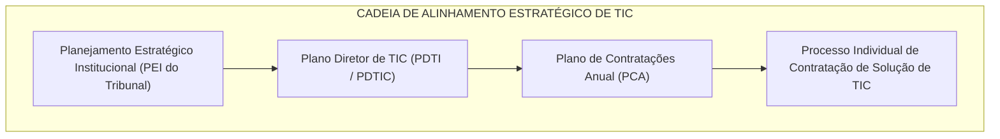
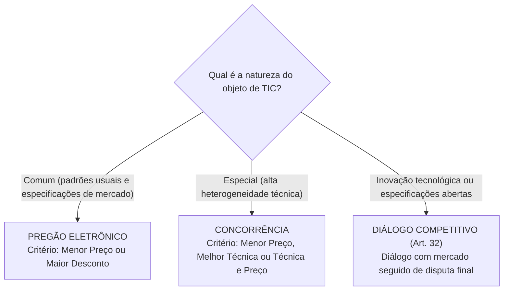
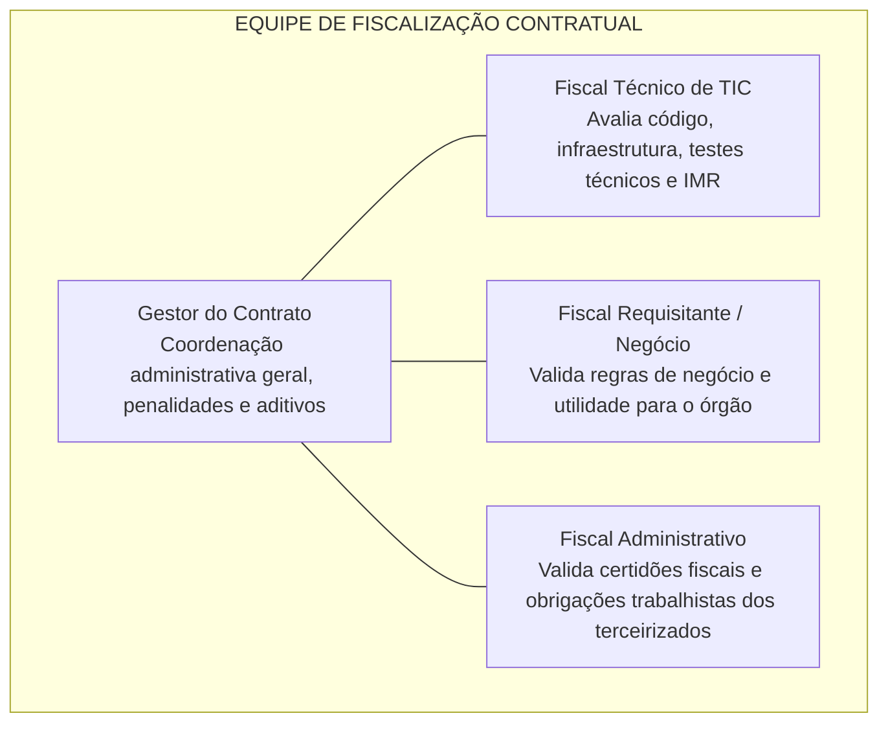

# 04 - Contratações de Soluções de TIC na Lei nº 14.133/2021

> **Matéria:** Governança de Tecnologia da Informação  
> **Cargo:** B02 – Técnico de Controle Externo – Especialidade: Tecnologia da Informação  
> **Arquivo:** `04_contratacoes_de_tic_lei_14133_2021.md`  
> **Ato Normativo Central:** Lei Federal nº 14.133, de 1º de abril de 2021 (Lei de Licitações e Contratos Administrativos)

---

## 📌 Ementa / Itens do Edital
- Aplicação da Lei nº 14.133/2021 às contratações de Soluções de Tecnologia da Informação e Comunicação (TIC)
- Alinhamento Estratégico: Plano Diretor de TIC (PDTI) e Plano de Contratações Anual (PCA)
- Fases do Processo de Contratação: Planejamento, Seleção do Fornecedor e Gestão do Contrato
- Artefatos da Fase Preparatória: DOD, Estudo Técnico Preliminar (ETP), Custo Total de Propriedade (TCO), Mapa de Riscos e Termo de Referência (TR)
- Modalidades e Critérios de Julgamento em TIC: Pregão, Concorrência e Diálogo Competitivo
- Contratação Direta de Soluções de TIC: Inexigibilidade vs. Dispensa de Licitação
- Gestão e Fiscalização de Contratos de TIC: Segregação de papéis (Gestor, Fiscal Técnico, Fiscal Requisitante, Fiscal Administrativo)
- Instrumento de Medição de Resultado (IMR), Acordo de Nível de Serviço (SLA), Glosas e Recebimento do Objeto (Provisório e Definitivo)

---

## 🧭 Sumário

1. [Princípios e Diretrizes das Contratações de TIC na Lei nº 14.133/2021](#1-principios-e-diretrizes-das-contratacoes-de-tic-na-lei-no-141332021)
1. [Alinhamento Estratégico e Planejamento Prévio (PDTI e PCA)](#1-1-alinhamento-estrategico-e-planejamento-previo-pdti-e-pca)
    1. [Teste 495](#Teste-495)
1. [Vedações Expressas e Jurisprudência dos Tribunais de Contas](#1-2-vedacoes-expressas-e-jurisprudencia-dos-tribunais-de-contas)
    1. [Teste 496](#Teste-496)
2. [O Ciclo de Vida da Contratação e a Fase Preparatória](#2-o-ciclo-de-vida-da-contratacao-e-a-fase-preparatoria)
2. [Artefatos da Fase de Planejamento (DOD, ETP, Mapa de Riscos e TR)](#2-1-artefatos-da-fase-de-planejamento-dod-etp-mapa-de-riscos-e-tr)
    1. [Teste 497](#Teste-497)
2. [Custo Total de Propriedade (TCO - Total Cost of Ownership)](#2-2-custo-total-de-propriedade-tco-total-cost-of-ownership)
    1. [Teste 498](#Teste-498)
3. [Fase de Seleção do Fornecedor em TIC](#3-fase-de-selecao-do-fornecedor-em-tic)
3. [Modalidades de Licitação (Pregão, Concorrência e Diálogo Competitivo)](#3-1-modalidades-de-licitacao-pregao-concorrencia-e-dialogo-competitivo)
    1. [Teste 499](#Teste-499)
3. [Hipóteses de Contratação Direta em TIC (Inexigibilidade vs. Dispensa)](#3-2-hipoteses-de-contratacao-direta-em-tic-inexigibilidade-vs-dispensa)
    1. [Teste 500](#Teste-500)
4. [Gestão e Fiscalização de Contratos de TIC](#4-gestao-e-fiscalizacao-de-contratos-de-tic)
4. [Segregação de Papéis na Equipe de Fiscalização](#4-1-segregacao-de-papeis-na-equipe-de-fiscalizacao)
    1. [Teste 501](#Teste-501)
4. [Instrumento de Medição de Resultado (IMR), SLA e Glosas](#4-2-instrumento-de-medicao-de-resultado-imr-sla-e-glosas)
    1. [Teste 502](#Teste-502)
4. [Recebimento Provisório e Recebimento Definitivo](#4-3-recebimento-provisorio-e-recebimento-definitivo)
    1. [Teste 503](#Teste-503)
    2. [Teste 504](#Teste-504)
6. [Fontes Recomendadas na Internet](#6-fontes-recomendadas-na-internet)

---

## 1. Princípios e Diretrizes das Contratações de TIC na Lei nº 14.133/2021

A **Lei nº 14.133/2021** (Nova Lei de Licitações e Contratos Administrativos) consolidou e positivou princípios e boas práticas de contratação pública de Soluções de Tecnologia da Informação e Comunicação (TIC), harmonizando a legislação geral com a jurisprudência histórica do Tribunal de Contas da União (TCU) e com as normas infralegais federais (como a Instrução Normativa SGD/MGI nº 94/2022).

---

## 1.1 Alinhamento Estratégico e Planejamento Prévio (PDTI e PCA)

No setor público, nenhuma aquisição de tecnologia pode ocorrer de forma isolada, episódica ou desconectada das metas institucionais:

- **Plano Diretor de TIC (PDTI / PDTIC):** Instrumento de diagnóstico, planejamento e gestão dos recursos e processos de TIC do órgão para um horizonte plurianual (normalmente de 2 a 4 anos), alinhado ao Planejamento Estratégico Institucional (PEI).
- **Plano de Contratações Anual (PCA):** Documento formalizado pela alta administração que consolida todas as compras e contratações que o órgão pretende realizar no exercício financeiro seguinte, assegurando previsão orçamentária e evitando fracionamento indevido de despesas.
- **Regra:** Toda contratação de solução de TIC deve estar expressamente prevista ou fundamentadamente compatível com o PDTI e com o PCA do exercício.

---

### Teste 495
**(FGV – TJ-RR – Analista Judiciario Gestao e Governanca de Tecnologia da Informacao – 2024)**
Considerando conceitos básicos de contratações de TI, analise as afirmativas a seguir. I. O preço máximo de compra de item de TIC (PMC-TIC) é o valor máximo que os órgãos e as entidades integrantes do SISP adotarão nas contratações dos itens constantes nos Catálogos de Soluções de TIC com Condições Padronizadas, aplicável para contratações realizadas em todo o território nacional. II. Para fins da Instrução Normativa nº 94/2022 SGD/ME, a área requisitante da solução é a unidade do órgão ou entidade que demande a contratação de uma solução de TIC. III. Quando a pesquisa de preços for realizada com fornecedores, é facultado o registro, nos autos do processo da contratação correspondente, da relação de fornecedores que foram consultados e não enviaram propostas como resposta à solicitação de cotação. Está correto o que se afirma em

* **A)** I, apenas.
* **B)** II, apenas.
* **C)** III, apenas.
* **D)** I e II, apenas.
* **E)** I e III, apenas.

---

> **Comentário Detalhado:**
>
> - **A)** **Incorreta.** A opção incorre em restrição indevida ao limitar o escopo conceitual ao afirmar que "I, apenas". De acordo com a teoria estudada em *2.2 Custo Total de Propriedade (TCO - Total Cost of Ownership)*, a análise de TCO frequentemente demonstra que uma solução com preço inicial de compra mais baixo (ou até software gratuito) acarreta gastos elevadíssimos com suporte especializado, horas de customização e energia, tornando uma solução com custo inicial maior, porém com suporte integrado, muito mais econômica globalmente para o órgão.
> - **B)** **Incorreta.** A opção incorre em restrição indevida ao limitar o escopo conceitual ao afirmar que "II, apenas". De acordo com a teoria estudada em *2.1 Artefatos da Fase de Planejamento (DOD, ETP, Mapa de Riscos e TR)*, dOD (*Documento de Oficialização da Demanda*): Área Requisitante (Negócio) — Inicia formalmente o processo administrativo, explicitando o problema institucional a ser resolvido, os resultados esperados e o alinhamento com o PDTI.
> - **C)** **Incorreta.** A opção incorre em restrição indevida ao limitar o escopo conceitual ao afirmar que "III, apenas". De acordo com a teoria estudada em *3.2 Hipóteses de Contratação Direta em TIC (Inexigibilidade vs. Dispensa)*, hipótese 2 em TIC: Serviços Técnicos Especializados de Natureza Predominantemente Intelectual (Art. 74, III): Profissionais ou empresas de notória especialização para auditoria de segurança crítica, perícias forenses complexas ou consultoria arquitetural avançada. — Emergência ou Calamidade Pública (Art. 75, VIII): Restabelecimento imediato de sistemas vitais após sinistros graves ou ataques cibernéticos massivos, restrito ao prazo necessário.
> - **D)** **Correta.** Conforme fundamentado na seção *1. Princípios e Diretrizes das Contratações de TIC na Lei nº 14.133/2021* deste guia, a Lei nº 14.133/2021 (Nova Lei de Licitações e Contratos Administrativos) consolidou e positivou princípios e boas práticas de contratação pública de Soluções de Tecnologia da Informação e Comunicação (TIC), harmonizando a legislação geral com a jurisprudência histórica do Tribunal de Contas da União (TCU) e com as normas infralegais federais (como a Instrução Normativa SGD/MGI nº 94/2022). Dessa forma, está plenamente correta a assertiva da banca (FGV – TJ-RR/2024) ao estabelecer que "I e II, apenas".
> - **E)** **Incorreta.** A opção incorre em restrição indevida ao limitar o escopo conceitual ao afirmar que "I e III, apenas". De acordo com a teoria estudada em *3.2 Hipóteses de Contratação Direta em TIC (Inexigibilidade vs. Dispensa)*, a contratação de empresa por Notória Especialização com base em Inexigibilidade (Art. 74, III) não pode ser usada para suporte rotineiro de informática ou help-desk! Ela exige cumulativamente: 1) Natureza predominantemente intelectual; 2) Notória especialização do prestador; e 3) Singularidade do serviço.
>
> **Gabarito: D**

---

## 1.2 Vedações Expressas e Jurisprudência dos Tribunais de Contas

1. **Vedação à Remuneração por Homem-Hora Puro (Súmula nº 269 do TCU):**  
   É terminantemente proibida a remuneração de serviços de desenvolvimento, sustentação ou suporte de software com base unicamente na quantidade de horas trabalhadas ou pela mera presença física de funcionários terceirizados nas dependências do órgão. Os pagamentos devem estar obrigatoriamente vinculados a **resultados mensuráveis**, como Pontos de Função (Análise de Pontos de Função - APF), Unidades de Serviço Técnico (UST) previamente catalogadas em tabela de complexidade ou cumprimento de níveis mínimos de serviço (SLA/IMR).
2. **Vedação à Indicação de Marcas ou Modelos:**  
   Em regra, o edital não pode exigir marca, modelo ou fabricante exclusivo. Exceções são admitidas **apenas** quando houver comprovação técnica de padronização corporativa prévia formalizada em Estudo Técnico Preliminar (ETP), ou quando uma marca for a única tecnicamente viável para manter a interoperabilidade de sistemas preexistentes.
3. **Vedação à Terceirização da Governança e Decisão:**  
   Atividades privativas de tomada de decisão, gestão estratégica de TIC, aprovação de orçamentos, elaboração de pareceres conclusivos e fiscalização formal de contratos **jamais** podem ser terceirizadas para empresas privadas.

---

### Teste 496
**(FGV – TCE-GO – Analista de Controle Externo Tecnologia da Informacao – 2024)**
Durante a execução de um contrato de prestação de serviços de TI, celebrado por uma autarquia federal, observou-se que o fornecedor não está cumprindo com os níveis estabelecidos nas Cláusulas de Nível de Serviço (SLA). Para resolver o problema, a administração deve

* **A)** emitir notificação formal ao fornecedor para que seja realizada uma auditoria técnica imediata e ajustes necessários.
* **B)** cancelar imediatamente o contrato, sem aviso formal, com aplicação de penalidades, visto que o serviço não atende às expectativas.
* **C)** cancelar o contrato com o fornecedor para evitar mais consequências, uma vez que as métricas de SLA são apenas diretrizes, não obrigatórias.
* **D)** reportar e aguardar que as falhas, para maior eficácia e esperar que sejam ajustadas no próximo ciclo de renovação contratual automática.
* **E)** reduzir o pagamento proporcionalmente ao período não conforme, independente do contrato, com comunicação formal ao fornecedor.

---

> **Comentário Detalhado:**
>
> - **A)** **Correta.** Conforme fundamentado na seção *3.2 Hipóteses de Contratação Direta em TIC (Inexigibilidade vs. Dispensa)* deste guia, hipótese 1 em TIC: Fornecedor Exclusivo (Art. 74, I): Aquisição de software ou hardware exclusivo, comprovada por atestado idôneo do fabricante ou sindicato de classe. — Baixo Valor (Art. 75, I e II): Compras e serviços comuns de TIC de pequeno vulto (valores monetários atualizados anualmente por decreto). Dessa forma, está plenamente correta a assertiva da banca (FGV – TCE-GO/2024) ao estabelecer que "emitir notificação formal ao fornecedor para que seja realizada uma auditoria técnica imediata e ajustes...".
> - **B)** **Incorreta.** A opção apresenta proposição em desacordo com os fundamentos teóricos e técnicos do tópico ao afirmar que "cancelar imediatamente o contrato, sem aviso formal, com aplicação de penalidades, visto que o serviço não atende...". De acordo com a teoria estudada em *4.1 Segregação de Papéis na Equipe de Fiscalização*, gestor do Contrato: Servidor que coordena o contrato, formaliza termos aditivos, solicita a aplicação de penalidades (advertências e multas) e assina o termo de recebimento definitivo.
> - **C)** **Incorreta.** A opção incorre em restrição indevida ao limitar o escopo conceitual ao afirmar que "cancelar o contrato com o fornecedor para evitar mais consequências, uma vez que as métricas de SLA são apenas...". De acordo com a teoria estudada em *4.2 Instrumento de Medição de Resultado (IMR), SLA e Glosas*, o IMR (*Instrumento de Medição de Resultado*) é o mecanismo formal que vincula o pagamento mensal da fatura ao desempenho e qualidade efetivamente entregues.
> - **D)** **Incorreta.** A opção apresenta proposição em desacordo com os fundamentos teóricos e técnicos do tópico ao afirmar que "reportar e aguardar que as falhas, para maior eficácia e esperar que sejam ajustadas no próximo ciclo de renovação...". De acordo com a teoria estudada em *1. Pregão Eletrônico (Art. 28, I e Art. 29)*, exemplos em TIC: Compra de notebooks, switches de borda, monitores, locação de impressoras corporativas, serviços de service desk de nível 1 e renovação de licenças de software comercial de prateleira.
> - **E)** **Incorreta.** A opção apresenta proposição em desacordo com os fundamentos teóricos e técnicos do tópico ao afirmar que "reduzir o pagamento proporcionalmente ao período não conforme, independente do contrato, com comunicação formal ao...". De acordo com a teoria estudada em *4.3 Recebimento Provisório e Recebimento Definitivo*, realizado pelo Gestor do Contrato ou por comissão designada, após a homologação técnica completa, validação de conformidade com o Termo de Referência e apuração dos indicadores do IMR.
>
> **Gabarito: A**

---

## 2. O Ciclo de Vida da Contratação e a Fase Preparatória

O processo de contratação pública de TIC divide-se em três macrofases interdependentes:

```mermaid
flowchart LR
    subgraph FASE1["1. Planejamento da Contratação"]
        DOD["DOD<br/>Demanda"] --> EQ["Equipe de Planejamento<br/>(Requisitante, Técnico, ADM)"]
        EQ --> ETP["Estudo Técnico Preliminar<br/>(ETP + TCO)"]
        ETP --> MR["Mapa de Riscos"]
        MR --> TR["Termo de Referência<br/>(TR + IMR)"]
    end

    subgraph FASE2["2. Seleção do Fornecedor"]
        PUB["Edital de Licitação /<br/>Ato de Contratação Direta"] --> JULG["Julgamento de Propostas<br/>(Pregão / Concorrência / Diálogo)"]
        JULG --> HOM["Habilitação e Homologação"]
    end

    subgraph FASE3["3. Gestão Contratual"]
        OS["Emissão de OS / OFB"] --> EXEC["Execução e Aferição de SLA"]
        EXEC --> REC_PROV["Recebimento Provisório<br/>(Fiscais)"]
        REC_PROV --> REC_DEF["Recebimento Definitivo<br/>(Gestor do Contrato)"]
        REC_DEF --> PAG["Pagamento com Glosas"]
    end

    TR --> PUB
    HOM --> OS
```

---

## 2.1 Artefatos da Fase de Planejamento (DOD, ETP, Mapa de Riscos e TR)

A fase preparatória é o núcleo de conformidade da contratação. Falhas graves apontadas em auditorias de controle externo derivam, em sua grande maioria, de fragilidades no ETP ou no Termo de Referência.

| Artefato | Responsável Principal | Finalidade e Conteúdo Essencial |
| :--- | :--- | :--- |
| **DOD** (*Documento de Oficialização da Demanda*) | Área Requisitante (Negócio) | Inicia formalmente o processo administrativo, explicitando o problema institucional a ser resolvido, os resultados esperados e o alinhamento com o PDTI. |
| **Equipe de Planejamento** | Designada pela Autoridade Competente | Comissão composta por no mínimo: Integrante Requisitante, Integrante Técnico (TI) e Integrante Administrativo, assegurando a segregação de funções. |
| **ETP** (*Estudo Técnico Preliminar*) | Equipe de Planejamento da Contratação | Demonstra a viabilidade técnica, operacional e econômica. Compara soluções de mercado (nuvem vs on-premises, software livre vs proprietário), calcula o **TCO** e define o quantitativo. |
| **Mapa de Riscos** | Equipe de Planejamento | Matriz que identifica riscos internos e externos em todo o ciclo de vida, avaliando probabilidade e impacto, além de prever ações preventivas e contingenciais. |
| **TR** (*Termo de Referência*) | Equipe de Planejamento | Documento definitivo que estabelece o objeto, requisitos funcionais e não funcionais, modelo de execução, critérios de habilitação e o **Instrumento de Medição de Resultado (IMR)**. |

---

### Teste 497
**(CEBRASPE – TJ-RJ – Analista Judiciario Grupo Tecnologia da Informacao Analista de Gestao de Tic – 2021)**
De acordo com a Instrução Normativa n.º 01/2019 do Ministério da Economia, o estudo técnico preliminar da contratação é o documento que descreve as análises realizadas em relação às condições da contratação, em termos de necessidades, alternativas e escolhas que demonstrem a viabilidade técnica e econômica da contratação. Esse documento

* **A)** será aprovado e assinado pelos integrantes técnico e requisitante da equipe de planejamento da contratação e pela autoridade máxima da área de TIC ou, caso esta componha a equipe, pela autoridade superior à ela.
* **B)** será especificado com base em requisitos necessários e suficientes e conterá o quantitativo de bens e serviços, ressalvado à forma de cálculo para a sua composição que deve ser inserida no termo de referência ou projeto básico.
* **C)** considera estritamente os aspectos econômicos da solução, com descrição detalhada, motivada e justificada.
* **D)** exclui aspectos qualitativos em termos de benefícios, sob pena de tornar inválida a imparcialidade exigida no estudo da contratação, ainda que haja necessidades de adequação do ambiente do órgão para viabilizar a execução contratual.
* **E)** compreende a análise comparativa de soluções e de custos para as soluções técnicas, ainda que não sejam funcionalmente viáveis, desde que haja a possibilidade de contratação como serviço e o Total Cost Ownership seja vantajoso para o órgão.

---

> **Comentário Detalhado:**
>
> - **A)** **Correta.** Conforme fundamentado na seção *2.1 Artefatos da Fase de Planejamento (DOD, ETP, Mapa de Riscos e TR)* deste guia, eTP (*Estudo Técnico Preliminar*): Equipe de Planejamento da Contratação — Demonstra a viabilidade técnica, operacional e econômica. Compara soluções de mercado (nuvem vs on-premises, software livre vs proprietário), calcula o TCO e define o quantitativo. Dessa forma, está plenamente correta a assertiva da banca (CEBRASPE – TJ-RJ/2021) ao estabelecer que "será aprovado e assinado pelos integrantes técnico e requisitante da equipe de planejamento da contratação e pela...".
> - **B)** **Incorreta.** A opção apresenta proposição em desacordo com os fundamentos teóricos e técnicos do tópico ao afirmar que "será especificado com base em requisitos necessários e suficientes e conterá o quantitativo de bens e serviços...". De acordo com a teoria estudada em *2.1 Artefatos da Fase de Planejamento (DOD, ETP, Mapa de Riscos e TR)*, tR (*Termo de Referência*): Equipe de Planejamento — Documento definitivo que estabelece o objeto, requisitos funcionais e não funcionais, modelo de execução, critérios de habilitação e o Instrumento de Medição de Resultado (IMR).
> - **C)** **Incorreta.** A opção apresenta proposição em desacordo com os fundamentos teóricos e técnicos do tópico ao afirmar que "considera estritamente os aspectos econômicos da solução, com descrição detalhada, motivada e justificada". De acordo com a teoria estudada em *2.1 Artefatos da Fase de Planejamento (DOD, ETP, Mapa de Riscos e TR)*, equipe de Planejamento: Designada pela Autoridade Competente — Comissão composta por no mínimo: Integrante Requisitante, Integrante Técnico (TI) e Integrante Administrativo, assegurando a segregação de funções.
> - **D)** **Incorreta.** A opção apresenta proposição em desacordo com os fundamentos teóricos e técnicos do tópico ao afirmar que "exclui aspectos qualitativos em termos de benefícios, sob pena de tornar inválida a imparcialidade exigida no...". De acordo com a teoria estudada em *2.1 Artefatos da Fase de Planejamento (DOD, ETP, Mapa de Riscos e TR)*, dOD (*Documento de Oficialização da Demanda*): Área Requisitante (Negócio) — Inicia formalmente o processo administrativo, explicitando o problema institucional a ser resolvido, os resultados esperados e o alinhamento com o PDTI.
> - **E)** **Incorreta.** A opção apresenta proposição em desacordo com os fundamentos teóricos e técnicos do tópico ao afirmar que "compreende a análise comparativa de soluções e de custos para as soluções técnicas, ainda que não sejam...". De acordo com a teoria estudada em *2.2 Custo Total de Propriedade (TCO - Total Cost of Ownership)*, a análise de TCO frequentemente demonstra que uma solução com preço inicial de compra mais baixo (ou até software gratuito) acarreta gastos elevadíssimos com suporte especializado, horas de customização e energia, tornando uma solução com custo inicial maior, porém com suporte integrado, muito mais econômica globalmente para o órgão.
>
> **Gabarito: A**

---

## 2.2 Custo Total de Propriedade (TCO - Total Cost of Ownership)

Ao realizar o Estudo Técnico Preliminar de soluções de TIC, a Administração não pode avaliar exclusivamente o custo nominal de aquisição inicial de hardware ou licenças. Deve-se calcular o **Custo Total de Propriedade (TCO)** ao longo de todo o ciclo de vida:

$$\text{TCO} = \text{Aquisição} + \text{Implantação/Customização} + \text{Capacitação/Treinamento} + \text{Manutenção/Suporte Recorrente} + \text{Infraestrutura/Energia} + \text{Descarte/Migração}$$

> 🚨 **ALERTA DE PROVA / PEGADINHA FCC:**  
> A análise de TCO frequentemente demonstra que uma solução com preço inicial de compra mais baixo (ou até software gratuito) acarreta gastos elevadíssimos com suporte especializado, horas de customização e energia, tornando uma solução com custo inicial maior, porém com suporte integrado, muito mais econômica globalmente para o órgão.

---

### Teste 498
**(FGV – TRF-1 – Analista Judiciario Area Apoio Especializado Especialidade Tecnologia da Informacao – 2024)**
O TRF1 iniciou o planejamento da contratação para o desenvolvimento de uma nova solução tecnológica. A equipe de planejamento da contratação registrou, no estudo técnico preliminar, que a solução está aderente aos requisitos técnicos da plataforma digital do Poder Judiciário brasileiro (PDPJ-Br). Considerando a política pública para a governança e gestão do processo judicial eletrônico, a contratação da solução tecnológicas será proibida se:

* **A)** atender a peculiaridades regionais do Tribunal;
* **B)** causar redução dos custos com ações isoladas;
* **C)** causar dependência tecnológica do fornecedor;
* **D)** permitir o compartilhamento da solução na PDPJ-Br;
* **E)** permitir a coexistência com outras soluções da PDPJ-Br.

---

> **Comentário Detalhado:**
>
> - **A)** **Incorreta.** A opção apresenta proposição em desacordo com os fundamentos teóricos e técnicos do tópico ao afirmar que "atender a peculiaridades regionais do Tribunal". De acordo com a teoria estudada em *6. Fontes Recomendadas na Internet*, governo Digital - Processo de Contratação de TIC na Lei nº 14.133/2021 - Rito oficial, fases de planejamento (DFD, ETP, TR) e gestão contratual.
> - **B)** **Incorreta.** A opção apresenta proposição em desacordo com os fundamentos teóricos e técnicos do tópico ao afirmar que "causar redução dos custos com ações isoladas". De acordo com a teoria estudada em *2.1 Artefatos da Fase de Planejamento (DOD, ETP, Mapa de Riscos e TR)*, mapa de Riscos: Equipe de Planejamento — Matriz que identifica riscos internos e externos em todo o ciclo de vida, avaliando probabilidade e impacto, além de prever ações preventivas e contingenciais.
> - **C)** **Incorreta.** A opção apresenta proposição em desacordo com os fundamentos teóricos e técnicos do tópico ao afirmar que "causar dependência tecnológica do fornecedor". De acordo com a teoria estudada em *3. Diálogo Competitivo (Art. 32)*, visa contratar objeto que envolva inovação tecnológica ou técnica.
> - **D)** **Correta.** Conforme fundamentado na seção *1.1 Alinhamento Estratégico e Planejamento Prévio (PDTI e PCA)* deste guia, regra: Toda contratação de solução de TIC deve estar expressamente prevista ou fundamentadamente compatível com o PDTI e com o PCA do exercício. Dessa forma, está plenamente correta a assertiva da banca (FGV – TRF-1/2024) ao estabelecer que "permitir o compartilhamento da solução na PDPJ-Br".
> - **E)** **Incorreta.** A opção apresenta proposição em desacordo com os fundamentos teóricos e técnicos do tópico ao afirmar que "permitir a coexistência com outras soluções da PDPJ-Br". De acordo com a teoria estudada em *2.1 Artefatos da Fase de Planejamento (DOD, ETP, Mapa de Riscos e TR)*, eTP (*Estudo Técnico Preliminar*): Equipe de Planejamento da Contratação — Demonstra a viabilidade técnica, operacional e econômica. Compara soluções de mercado (nuvem vs on-premises, software livre vs proprietário), calcula o TCO e define o quantitativo.
>
> **Gabarito: D**

---

## 3. Fase de Seleção do Fornecedor em TIC

---

## 3.1 Modalidades de Licitação (Pregão, Concorrência e Diálogo Competitivo)

#### 1. Pregão Eletrônico (Art. 28, I e Art. 29)
- **Aplicação Obrigatória/Preferencial:** Aquisição de **bens e serviços comuns de TIC**, definidos como aqueles cujos padrões de desempenho e qualidade podem ser objetivamente definidos pelo edital por meio de especificações usuais de mercado.
- **Exemplos em TIC:** Compra de notebooks, switches de borda, monitores, locação de impressoras corporativas, serviços de service desk de nível 1 e renovação de licenças de software comercial de prateleira.
- **Critérios de Julgamento Admitidos:** **Menor Preço** ou **Maior Desconto**. (É expressamente proibido usar "Técnica e Preço" no pregão!).

#### 2. Concorrência (Art. 28, II)
- **Aplicação:** Bens e serviços **especiais** de TIC (soluções cuja complexidade e peculiaridades técnicas impeçam sua padronização objetiva de mercado).
- **Critérios de Julgamento:** Menor Preço, Maior Desconto, Melhor Técnica ou Conteúdo Artístico, **Técnica e Preço**, ou Maior Retorno Econômico.

#### 3. Diálogo Competitivo (Art. 32)
- **Aplicação:** Modalidade inovadora da Lei nº 14.133/2021, cabível especificamente quando a Administração:
    1. Visa contratar objeto que envolva **inovação tecnológica ou técnica**;
    2. Não possui conhecimento suficiente para redigir as especificações técnicas da solução disponível no mercado; ou
    3. Precisa avaliar e definir a melhor modelagem técnica, jurídica ou financeira com o mercado antes de formular o edital final.

- **Dinâmica:**
    - *Fase de Diálogo:* O órgão publica edital convocatório, seleciona concorrentes qualificados e realiza rodadas de diálogo transparentes para construir a melhor solução técnica.
    - *Fase Competitiva:* Concluído o diálogo, publica-se o edital final com a solução construída, concedendo prazo de no mínimo 60 dias para a apresentação das propostas formais de preço e técnica.

---

### Teste 499
**(FGV – TCE-GO – Analista de Controle Externo Tecnologia da Informacao – 2024)**
Uma empresa pública contratou serviços de desenvolvimento de software, estabelecendo no contrato cláusulas de nível de serviço (SLA) com penalidade e especificações claras sobre o produto final, assim como condições para o seu aceite. Ao final do prazo, a empresa percebeu que o produto final não atendia integralmente às especificações técnicas acordadas. Visando proteger os interesses da empresa e o funcionamento do software, indique a medida correta que protege os interesses da empresa e o funcionamento do software.

* **A)** Dispensar o pagamento de penalidades, considerando que houve bastante trabalho feito pela contratada, e esperar uma nova versão.
* **B)** Exigir a revisão do produto sem custos adicionais, baseando-se nas cláusulas de nível de serviço estipuladas.
* **C)** Celebrar novos termos aditivos para nova versão do software, independente do aceite da contratada, para estender o prazo, visto que houve esforço por parte da contratada.
* **D)** Aceitar o produto como está, evitando conflitos judiciais e futuras complicações administrativas.
* **E)** Rescindir o contrato imediatamente, aplicando as máximas penalidades possíveis devido ao não cumprimento das especificações.

---

> **Comentário Detalhado:**
>
> - **A)** **Incorreta.** A opção apresenta proposição em desacordo com os fundamentos teóricos e técnicos do tópico ao afirmar que "Dispensar o pagamento de penalidades, considerando que houve bastante trabalho feito pela contratada, e esperar...". De acordo com a teoria estudada em *4.1 Segregação de Papéis na Equipe de Fiscalização*, fiscal Administrativo: Servidor que confere o pagamento de salários, FGTS, INSS e tributos dos empregados terceirizados, protegendo a Administração contra condenações subsidiárias na Justiça do Trabalho.
> - **B)** **Correta.** Conforme fundamentado na seção *1. Pregão Eletrônico (Art. 28, I e Art. 29)* deste guia, exemplos em TIC: Compra de notebooks, switches de borda, monitores, locação de impressoras corporativas, serviços de service desk de nível 1 e renovação de licenças de software comercial de prateleira. Dessa forma, está plenamente correta a assertiva da banca (FGV – TCE-GO/2024) ao estabelecer que "Exigir a revisão do produto sem custos adicionais, baseando-se nas cláusulas de nível de serviço estipuladas".
> - **C)** **Incorreta.** A opção apresenta proposição em desacordo com os fundamentos teóricos e técnicos do tópico ao afirmar que "Celebrar novos termos aditivos para nova versão do software, independente do aceite da contratada, para estender o...". De acordo com a teoria estudada em *4.1 Segregação de Papéis na Equipe de Fiscalização*, gestor do Contrato: Servidor que coordena o contrato, formaliza termos aditivos, solicita a aplicação de penalidades (advertências e multas) e assina o termo de recebimento definitivo.
> - **D)** **Incorreta.** A opção apresenta proposição em desacordo com os fundamentos teóricos e técnicos do tópico ao afirmar que "Aceitar o produto como está, evitando conflitos judiciais e futuras complicações administrativas". De acordo com a teoria estudada em *4.3 Recebimento Provisório e Recebimento Definitivo*, realizado pelos Fiscais Técnico, Requisitante e Administrativo imediatamente após a entrega do produto ou encerramento da etapa de serviços.
> - **E)** **Incorreta.** A opção apresenta proposição em desacordo com os fundamentos teóricos e técnicos do tópico ao afirmar que "Rescindir o contrato imediatamente, aplicando as máximas penalidades possíveis devido ao não cumprimento das...". De acordo com a teoria estudada em *1.2 Vedações Expressas e Jurisprudência dos Tribunais de Contas*, os pagamentos devem estar obrigatoriamente vinculados a resultados mensuráveis, como Pontos de Função (Análise de Pontos de Função - APF), Unidades de Serviço Técnico (UST) previamente catalogadas em tabela de complexidade ou cumprimento de níveis mínimos de serviço (SLA/IMR).
>
> **Gabarito: B**

---

## 3.2 Hipóteses de Contratação Direta em TIC (Inexigibilidade vs. Dispensa)

| Dimensão | Inexigibilidade de Licitação (Art. 74) | Dispensa de Licitação (Art. 75) |
| :--- | :--- | :--- |
| **Fundamento Jurídico** | **Inviabilidade jurídica de competição** (não há como estabelecer julgamento objetivo entre competidores). | A competição é juridicamente possível, mas a lei autoriza a não licitar por razões de economia processual, celeridade ou emergência. |
| **Hipótese 1 em TIC** | **Fornecedor Exclusivo (Art. 74, I):** Aquisição de software ou hardware exclusivo, comprovada por atestado idôneo do fabricante ou sindicato de classe. | **Baixo Valor (Art. 75, I e II):** Compras e serviços comuns de TIC de pequeno vulto (valores monetários atualizados anualmente por decreto). |
| **Hipótese 2 em TIC** | **Serviços Técnicos Especializados de Natureza Predominantemente Intelectual (Art. 74, III):** Profissionais ou empresas de notória especialização para auditoria de segurança crítica, perícias forenses complexas ou consultoria arquitetural avançada. | **Emergência ou Calamidade Pública (Art. 75, VIII):** Restabelecimento imediato de sistemas vitais após sinistros graves ou ataques cibernéticos massivos, restrito ao prazo necessário. |
| **Hipótese 3 em TIC** | — | **Contratação de Órgão Público de TIC (Art. 75, IX):** Contratação de empresas públicas de processamento de dados (SERPRO, DATAPREV, ATI estadual) para serviços criados para esse fim, com preço compatível de mercado. |

> 🚨 **ALERTA DE PROVA / PEGADINHA FCC:**  
> A contratação de empresa por Notória Especialização com base em Inexigibilidade (Art. 74, III) **não pode** ser usada para suporte rotineiro de informática ou help-desk! Ela exige cumulativamente: 1) Natureza predominantemente intelectual; 2) Notória especialização do prestador; e 3) Singularidade do serviço.

---

### Teste 500
**(FGV – TRT-16 – Analista Judiciario Area Administrativa Tecnologia da Informacao – 2022)**
João, Diretor de Licitações no âmbito da Administração Pública direta do Município Alfa, foi consultado por Maria sobre o documento necessário, previsto na Lei nº 14.133/2021, para a contratação de bens e serviços, isto com o objetivo de estabelecer os contornos básicos do objeto a ser contratado. João respondeu corretamente que

* **A)** o projeto básico é o documento necessário à contratação de bens.
* **B)** o anteprojeto é o documento necessário à contratação de bens e serviços.
* **C)** o termo de referência é o documento necessário à referida contratação.
* **D)** o projeto executivo é o documento necessário à contratação de bens e serviços.
* **E)** a matriz de objeto e riscos é o documento necessário à contratação de serviços.

---

> **Comentário Detalhado:**
>
> - **A)** **Incorreta.** A opção apresenta proposição em desacordo com os fundamentos teóricos e técnicos do tópico ao afirmar que "o projeto básico é o documento necessário à contratação de bens". De acordo com a teoria estudada em *3.2 Hipóteses de Contratação Direta em TIC (Inexigibilidade vs. Dispensa)*, hipótese 2 em TIC: Serviços Técnicos Especializados de Natureza Predominantemente Intelectual (Art. 74, III): Profissionais ou empresas de notória especialização para auditoria de segurança crítica, perícias forenses complexas ou consultoria arquitetural avançada. — Emergência ou Calamidade Pública (Art. 75, VIII): Restabelecimento imediato de sistemas vitais após sinistros graves ou ataques cibernéticos massivos, restrito ao prazo necessário.
> - **B)** **Incorreta.** A opção apresenta proposição em desacordo com os fundamentos teóricos e técnicos do tópico ao afirmar que "o anteprojeto é o documento necessário à contratação de bens e serviços". De acordo com a teoria estudada em *1. Pregão Eletrônico (Art. 28, I e Art. 29)*, aplicação Obrigatória/Preferencial: Aquisição de bens e serviços comuns de TIC, definidos como aqueles cujos padrões de desempenho e qualidade podem ser objetivamente definidos pelo edital por meio de especificações usuais de mercado.
> - **C)** **Correta.** Conforme fundamentado na seção *2.1 Artefatos da Fase de Planejamento (DOD, ETP, Mapa de Riscos e TR)* deste guia, tR (*Termo de Referência*): Equipe de Planejamento — Documento definitivo que estabelece o objeto, requisitos funcionais e não funcionais, modelo de execução, critérios de habilitação e o Instrumento de Medição de Resultado (IMR). Dessa forma, está plenamente correta a assertiva da banca (FGV – TRT-16/2022) ao estabelecer que "o termo de referência é o documento necessário à referida contratação".
> - **D)** **Incorreta.** A opção apresenta proposição em desacordo com os fundamentos teóricos e técnicos do tópico ao afirmar que "o projeto executivo é o documento necessário à contratação de bens e serviços". De acordo com a teoria estudada em *2.1 Artefatos da Fase de Planejamento (DOD, ETP, Mapa de Riscos e TR)*, a fase preparatória é o núcleo de conformidade da contratação. Falhas graves apontadas em auditorias de controle externo derivam, em sua grande maioria, de fragilidades no ETP ou no Termo de Referência.
> - **E)** **Incorreta.** A opção apresenta proposição em desacordo com os fundamentos teóricos e técnicos do tópico ao afirmar que "a matriz de objeto e riscos é o documento necessário à contratação de serviços". De acordo com a teoria estudada em *2.1 Artefatos da Fase de Planejamento (DOD, ETP, Mapa de Riscos e TR)*, dOD (*Documento de Oficialização da Demanda*): Área Requisitante (Negócio) — Inicia formalmente o processo administrativo, explicitando o problema institucional a ser resolvido, os resultados esperados e o alinhamento com o PDTI.
>
> **Gabarito: C**

---

## 4. Gestão e Fiscalização de Contratos de TIC

---

## 4.1 Segregação de Papéis na Equipe de Fiscalização

A Lei nº 14.133/2021 exige a separação clara de atribuições entre os agentes públicos responsáveis pelo contrato para prevenir conluios e falhas de controle:

- **Gestor do Contrato:** Servidor que coordena o contrato, formaliza termos aditivos, solicita a aplicação de penalidades (advertências e multas) e assina o termo de recebimento definitivo.
- **Fiscal Técnico:** Servidor de TIC encarregado de validar a qualidade técnica, arquitetura de software, conformidade de hardware e aferir os indicadores do IMR.
- **Fiscal Requisitante:** Servidor da área finalística/usuária que homologa se as funcionalidades do sistema atendem perfeitamente aos processos de trabalho institucionais.
- **Fiscal Administrativo:** Servidor que confere o pagamento de salários, FGTS, INSS e tributos dos empregados terceirizados, protegendo a Administração contra condenações subsidiárias na Justiça do Trabalho.

---

### Teste 501
**(FGV – TCE-PA – Auditor de Controle Externo Administrativa Ciencia de Dados – 2024)**
Considerando a legislação aplicável a contratos administrativos de bens e serviços de Tecnologia da Informação e Comunicação (TIC), analise as afirmativas a seguir. I. A fase de Gestão do Contrato se iniciará com a assinatura do contrato e com a nomeação do Gestor e da Equipe de Fiscalização do Contrato, composta por Fiscal Técnico, Fiscal Requisitante, Fiscal Administrativo e Fiscal Setorial, quando necessário. II. Em contratações de serviços de TIC, o encaminhamento formal de demandas, a cargo do Gestor do Contrato, deverá ocorrer por meio de Ordens de Serviço. III. No início do contrato administrativo, para soluções compostas exclusivamente de serviços de TIC, é facultado à contratada participar da reunião inicial convocada pelo Gestor do Contrato, apresentar seu preposto e entregar os Termos de Compromisso e de Ciência. Está correto o que se afirma em

* **A)** I, apenas.
* **B)** II, apenas.
* **C)** I e II, apenas.
* **D)** I e III, apenas.
* **E)** II e III, apenas.

---

> **Comentário Detalhado:**
>
> - **A)** **Incorreta.** A opção incorre em restrição indevida ao limitar o escopo conceitual ao afirmar que "I, apenas". De acordo com a teoria estudada em *4.1 Segregação de Papéis na Equipe de Fiscalização*, gestor do Contrato: Servidor que coordena o contrato, formaliza termos aditivos, solicita a aplicação de penalidades (advertências e multas) e assina o termo de recebimento definitivo.
> - **B)** **Incorreta.** A opção incorre em restrição indevida ao limitar o escopo conceitual ao afirmar que "II, apenas". De acordo com a teoria estudada em *2.1 Artefatos da Fase de Planejamento (DOD, ETP, Mapa de Riscos e TR)*, equipe de Planejamento: Designada pela Autoridade Competente — Comissão composta por no mínimo: Integrante Requisitante, Integrante Técnico (TI) e Integrante Administrativo, assegurando a segregação de funções.
> - **C)** **Correta.** Conforme fundamentado na seção *1. Princípios e Diretrizes das Contratações de TIC na Lei nº 14.133/2021* deste guia, a Lei nº 14.133/2021 (Nova Lei de Licitações e Contratos Administrativos) consolidou e positivou princípios e boas práticas de contratação pública de Soluções de Tecnologia da Informação e Comunicação (TIC), harmonizando a legislação geral com a jurisprudência histórica do Tribunal de Contas da União (TCU) e com as normas infralegais federais (como a Instrução Normativa SGD/MGI nº 94/2022). Dessa forma, está plenamente correta a assertiva da banca (FGV – TCE-PA/2024) ao estabelecer que "I e II, apenas".
> - **D)** **Incorreta.** A opção incorre em restrição indevida ao limitar o escopo conceitual ao afirmar que "I e III, apenas". De acordo com a teoria estudada em *3.2 Hipóteses de Contratação Direta em TIC (Inexigibilidade vs. Dispensa)*, hipótese 2 em TIC: Serviços Técnicos Especializados de Natureza Predominantemente Intelectual (Art. 74, III): Profissionais ou empresas de notória especialização para auditoria de segurança crítica, perícias forenses complexas ou consultoria arquitetural avançada. — Emergência ou Calamidade Pública (Art. 75, VIII): Restabelecimento imediato de sistemas vitais após sinistros graves ou ataques cibernéticos massivos, restrito ao prazo necessário.
> - **E)** **Incorreta.** A opção incorre em restrição indevida ao limitar o escopo conceitual ao afirmar que "II e III, apenas". De acordo com a teoria estudada em *3.2 Hipóteses de Contratação Direta em TIC (Inexigibilidade vs. Dispensa)*, a contratação de empresa por Notória Especialização com base em Inexigibilidade (Art. 74, III) não pode ser usada para suporte rotineiro de informática ou help-desk! Ela exige cumulativamente: 1) Natureza predominantemente intelectual; 2) Notória especialização do prestador; e 3) Singularidade do serviço.
>
> **Gabarito: C**

---

## 4.2 Instrumento de Medição de Resultado (IMR), SLA e Glosas

O **IMR** (*Instrumento de Medição de Resultado*) é o mecanismo formal que vincula o pagamento mensal da fatura ao desempenho e qualidade efetivamente entregues:

- **Métricas Comuns no IMR:**
    - Disponibilidade mensal dos sistemas (ex.: meta de 99,8%);
    - Tempo de Resolução de Falhas Críticas (ex.: máximo de 2 horas);
    - Taxa de defeitos em homologação (ex.: máximo de 0,05 bugs por Ponto de Função);
    - Cumprimento de prazos das Ordens de Serviço (OS).
- **Glosas Financeiras:**  
  Quando a empresa não atinge o SLA estipulado no IMR, a Administração aplica uma **glosa** (retenção/desconto direto na fatura do mês correspondente), pagando apenas pelo valor proporcional à qualidade entregue, sem prejuízo de advertência ou multa.

---

### Teste 502
**(FGV – TCE-GO – Analista de Controle Externo Ciencias Contabeis – 2024)**
A Lei nº 13.303/2016 estabelece que os órgãos de controle externo e interno das três esferas de governo fiscalizarão as empresas públicas e as sociedades de economia mista a eles relacionados, inclusive aquelas domiciliadas no exterior, quanto à legitimidade, à economicidade e à eficácia da aplicação de seus recursos, sob o ponto de vista contábil, financeiro, operacional e patrimonial. Acerca do mencionado tema, à luz da referida norma, é correto afirmar que

* **A)** as ações e deliberações do órgão ou ente de controle não podem implicar interferência na gestão das empresas públicas e das sociedades de economia mista a eles submetidas nem ingerência no exercício de suas competências ou na definição de políticas públicas.
* **B)** é vedado que os Tribunais de Contas realizem o controle externo em relação às licitações e contratos formalizados pelas empresas públicas e sociedades de economia mista, considerando a natureza jurídica de tais entidades administrativas.
* **C)** as gravações e filmagens existentes de reuniões, ordinárias ou extraordinárias, dos conselhos de administração ou fiscal das empresas públicas e das sociedades de economia mista, não poderão ser disponibilizados para os órgãos de controle, no âmbito dos trabalhos de auditoria.
* **D)** o exercício da supervisão por vinculação da empresa pública ou da sociedade de economia mista, pelo órgão a que se vincula, enseja necessariamente a redução da autonomia conferida pela lei específica que autorizou a criação da entidade supervisionada ou inerente a sua natureza, autorizando, assim, a ingerência do supervisor em sua administração e funcionamento.
* **E)** para a realização da aludida atividade fiscalizatória, os órgãos de controle deverão ter acesso às informações e aos documentos necessários à realização dos trabalhos, ressalvados aqueles classificados como sigilosos pela empresa pública ou pela sociedade de economia mista, nos termos da legislação de regência.

---

> **Comentário Detalhado:**
>
> - **A)** **Incorreta.** A opção apresenta proposição em desacordo com os fundamentos teóricos e técnicos do tópico ao afirmar que "as ações e deliberações do órgão ou ente de controle não podem implicar interferência na gestão das empresas...". De acordo com a teoria estudada em *3.2 Hipóteses de Contratação Direta em TIC (Inexigibilidade vs. Dispensa)*, hipótese 3 em TIC: — — Contratação de Órgão Público de TIC (Art. 75, IX): Contratação de empresas públicas de processamento de dados (SERPRO, DATAPREV, ATI estadual) para serviços criados para esse fim, com preço compatível de mercado.
> - **B)** **Incorreta.** A opção apresenta proposição em desacordo com os fundamentos teóricos e técnicos do tópico ao afirmar que "é vedado que os Tribunais de Contas realizem o controle externo em relação às licitações e contratos formalizados...". De acordo com a teoria estudada em *3.2 Hipóteses de Contratação Direta em TIC (Inexigibilidade vs. Dispensa)*, fundamento Jurídico: Inviabilidade jurídica de competição (não há como estabelecer julgamento objetivo entre competidores). — A competição é juridicamente possível, mas a lei autoriza a não licitar por razões de economia processual, celeridade ou emergência.
> - **C)** **Incorreta.** A opção apresenta proposição em desacordo com os fundamentos teóricos e técnicos do tópico ao afirmar que "as gravações e filmagens existentes de reuniões, ordinárias ou extraordinárias, dos conselhos de administração ou...". De acordo com a teoria estudada em *3.2 Hipóteses de Contratação Direta em TIC (Inexigibilidade vs. Dispensa)*, hipótese 2 em TIC: Serviços Técnicos Especializados de Natureza Predominantemente Intelectual (Art. 74, III): Profissionais ou empresas de notória especialização para auditoria de segurança crítica, perícias forenses complexas ou consultoria arquitetural avançada. — Emergência ou Calamidade Pública (Art. 75, VIII): Restabelecimento imediato de sistemas vitais após sinistros graves ou ataques cibernéticos massivos, restrito ao prazo necessário.
> - **D)** **Correta.** Conforme fundamentado na seção *1.1 Alinhamento Estratégico e Planejamento Prévio (PDTI e PCA)* deste guia, plano de Contratações Anual (PCA): Documento formalizado pela alta administração que consolida todas as compras e contratações que o órgão pretende realizar no exercício financeiro seguinte, assegurando previsão orçamentária e evitando fracionamento indevido de despesas. Dessa forma, está plenamente correta a assertiva da banca (FGV – TCE-GO/2024) ao estabelecer que "o exercício da supervisão por vinculação da empresa pública ou da sociedade de economia mista, pelo órgão a que se...".
> - **E)** **Incorreta.** A opção apresenta proposição em desacordo com os fundamentos teóricos e técnicos do tópico ao afirmar que "para a realização da aludida atividade fiscalizatória, os órgãos de controle deverão ter acesso às informações e...". De acordo com a teoria estudada em *3.2 Hipóteses de Contratação Direta em TIC (Inexigibilidade vs. Dispensa)*, a contratação de empresa por Notória Especialização com base em Inexigibilidade (Art. 74, III) não pode ser usada para suporte rotineiro de informática ou help-desk! Ela exige cumulativamente: 1) Natureza predominantemente intelectual; 2) Notória especialização do prestador; e 3) Singularidade do serviço.
>
> **Gabarito: D**

---

## 4.3 Recebimento Provisório e Recebimento Definitivo

A Lei nº 14.133/2021 estabelece dois momentos formais e inconfundíveis para o aceite do objeto em TIC:

1. **Recebimento Provisório:**  
    - Realizado pelos **Fiscais Técnico, Requisitante e Administrativo** imediatamente após a entrega do produto ou encerramento da etapa de serviços.  
    - Objetivo: Registrar a entrega formal para fins de início dos testes de homologação e inspeção detalhada de conformidade.

2. **Recebimento Definitivo:**  
    - Realizado pelo **Gestor do Contrato** ou por comissão designada, após a homologação técnica completa, validação de conformidade com o Termo de Referência e apuração dos indicadores do IMR.  
    - Objetivo: Atestar a conformidade integral do objeto, autorizando a liquidação e o pagamento final da fatura.

---

### Teste 503
**(FGV – TCE-GO – Analista de Controle Externo Tecnologia da Informacao – 2024)**
Uma instituição federal está em processo de modernização de seu sistema de informações e necessita adquirir novos servidores de alta capacidade. O setor de TI realizou estudos preliminares e definiu especificações técnicas detalhadas que apenas uma marca específica de servidores atende. Considerando a Lei nº 14.133/2021, o setor de compras, para a aquisição destes servidores, deve

* **A)** realizar licitação na modalidade concorrência, permitindo a participação de várias marcas para assegurar a obtenção de propostas competitivas.
* **B)** efetuar uma dispensa de licitação, uma vez que a especificação detalhada restringe a aquisição à marca única, caracterizando fornecedor exclusivo.
* **C)** proceder com a inexigibilidade de licitação devido à especificação técnica que justifica a escolha de uma única marca, evitando a competição.
* **D)** solicitar autorização judicial para adquirir diretamente do fornecedor sem necessidade de licitação, dado o caráter exclusivo da especificação.
* **E)** realizar um pregão eletrônico com indicação de marca no edital para garantir a compatibilidade com o sistema atual da instituição.

---

> **Comentário Detalhado:**
>
> - **A)** **Incorreta.** A opção apresenta proposição em desacordo com os fundamentos teóricos e técnicos do tópico ao afirmar que "realizar licitação na modalidade concorrência, permitindo a participação de várias marcas para assegurar a...". De acordo com a teoria estudada em *1.1 Alinhamento Estratégico e Planejamento Prévio (PDTI e PCA)*, plano de Contratações Anual (PCA): Documento formalizado pela alta administração que consolida todas as compras e contratações que o órgão pretende realizar no exercício financeiro seguinte, assegurando previsão orçamentária e evitando fracionamento indevido de despesas.
> - **B)** **Incorreta.** A opção afasta requisito ou relação estrutural exigida pela matéria ao afirmar que "efetuar uma dispensa de licitação, uma vez que a especificação detalhada restringe a aquisição à marca única...". De acordo com a teoria estudada em *3.2 Hipóteses de Contratação Direta em TIC (Inexigibilidade vs. Dispensa)*, hipótese 1 em TIC: Fornecedor Exclusivo (Art. 74, I): Aquisição de software ou hardware exclusivo, comprovada por atestado idôneo do fabricante ou sindicato de classe. — Baixo Valor (Art. 75, I e II): Compras e serviços comuns de TIC de pequeno vulto (valores monetários atualizados anualmente por decreto).
> - **C)** **Correta.** Conforme fundamentado na seção *1.2 Vedações Expressas e Jurisprudência dos Tribunais de Contas* deste guia, exceções são admitidas apenas quando houver comprovação técnica de padronização corporativa prévia formalizada em Estudo Técnico Preliminar (ETP), ou quando uma marca for a única tecnicamente viável para manter a interoperabilidade de sistemas preexistentes. Dessa forma, está plenamente correta a assertiva da banca (FGV – TCE-GO/2024) ao estabelecer que "proceder com a inexigibilidade de licitação devido à especificação técnica que justifica a escolha de uma única...".
> - **D)** **Incorreta.** A opção apresenta proposição em desacordo com os fundamentos teóricos e técnicos do tópico ao afirmar que "solicitar autorização judicial para adquirir diretamente do fornecedor sem necessidade de licitação, dado o...". De acordo com a teoria estudada em *1.2 Vedações Expressas e Jurisprudência dos Tribunais de Contas*, em regra, o edital não pode exigir marca, modelo ou fabricante exclusivo.
> - **E)** **Incorreta.** A opção apresenta proposição em desacordo com os fundamentos teóricos e técnicos do tópico ao afirmar que "realizar um pregão eletrônico com indicação de marca no edital para garantir a compatibilidade com o sistema atual...". De acordo com a teoria estudada em *1. Pregão Eletrônico (Art. 28, I e Art. 29)*, aplicação Obrigatória/Preferencial: Aquisição de bens e serviços comuns de TIC, definidos como aqueles cujos padrões de desempenho e qualidade podem ser objetivamente definidos pelo edital por meio de especificações usuais de mercado.
>
> **Gabarito: C**

---

---

### Teste 504
**(FGV – TCE-PA – Auditor de Controle Externo Administrativa Ciencia de Dados – 2024)**
Considerando a legislação aplicável a licitações de bens e serviços de Tecnologia da Informação e Comunicação (TIC), analise as afirmativas a seguir. I. Um acordo de nível de serviço (ANS), segundo a ITIL v4, é um acordo documentado entre um provedor de serviços de TIC e um cliente que define os serviços a serem prestados e o nível de qualidade que o provedor deve se comprometer a cumprir na prestação destes serviços. Em documentos da fase interna de processos licitatórios para a contratação de Centrais de Serviços (Service Desk), como Estudos Técnicos Preliminares ou Termos de Referência, é esperado encontrar requisitos da solução de TIC no formato de ANS. II. Na fase interna de licitações de bens e serviços de TIC no poder público, a adoção da Lei 14.133/2021 e da IN SGD/ME nº 94/2022 são mandatórias. Além destes documentos, a equipe técnica responsável deve adotar princípios orientadores e boas práticas de gerenciamento de serviços de TIC. Para isto, a lei brasileira exige que os órgãos públicos mantenham servidores capacitados, exclusivamente, nesta metodologia ITIL v4 de gerenciamento de serviços de TIC. III. Segundo a IN SGD/ME nº 94/2022, é vedada a contratação de soluções de autenticação em aplicações destinadas a serviços públicos digitais, salvo nos casos em que o órgão ou entidade tenha obtido autorização prévia pelo Órgão Central do SISP. Está correto o que se afirma em

* **A)** I, apenas.
* **B)** II, apenas.
* **C)** I e II, apenas.
* **D)** I e III, apenas.
* **E)** II e III, apenas.

---

> **Comentário Detalhado:**
>
> - **A)** **Incorreta.** A opção incorre em restrição indevida ao limitar o escopo conceitual ao afirmar que "I, apenas". De acordo com a teoria estudada em *3.2 Hipóteses de Contratação Direta em TIC (Inexigibilidade vs. Dispensa)*, a contratação de empresa por Notória Especialização com base em Inexigibilidade (Art. 74, III) não pode ser usada para suporte rotineiro de informática ou help-desk! Ela exige cumulativamente: 1) Natureza predominantemente intelectual; 2) Notória especialização do prestador; e 3) Singularidade do serviço.
> - **B)** **Incorreta.** A opção incorre em restrição indevida ao limitar o escopo conceitual ao afirmar que "II, apenas". De acordo com a teoria estudada em *6. Fontes Recomendadas na Internet*, governo Digital - Modelos e Diretrizes de Contratação de Soluções de TIC - Modelos oficiais padronizados de Estudos Técnicos Preliminares e Termos de Referência.
> - **C)** **Incorreta.** A opção incorre em restrição indevida ao limitar o escopo conceitual ao afirmar que "I e II, apenas". De acordo com a teoria estudada em *3.2 Hipóteses de Contratação Direta em TIC (Inexigibilidade vs. Dispensa)*, hipótese 2 em TIC: Serviços Técnicos Especializados de Natureza Predominantemente Intelectual (Art. 74, III): Profissionais ou empresas de notória especialização para auditoria de segurança crítica, perícias forenses complexas ou consultoria arquitetural avançada. — Emergência ou Calamidade Pública (Art. 75, VIII): Restabelecimento imediato de sistemas vitais após sinistros graves ou ataques cibernéticos massivos, restrito ao prazo necessário.
> - **D)** **Correta.** Conforme fundamentado na seção *1. Princípios e Diretrizes das Contratações de TIC na Lei nº 14.133/2021* deste guia, a Lei nº 14.133/2021 (Nova Lei de Licitações e Contratos Administrativos) consolidou e positivou princípios e boas práticas de contratação pública de Soluções de Tecnologia da Informação e Comunicação (TIC), harmonizando a legislação geral com a jurisprudência histórica do Tribunal de Contas da União (TCU) e com as normas infralegais federais (como a Instrução Normativa SGD/MGI nº 94/2022). Dessa forma, está plenamente correta a assertiva da banca (FGV – TCE-PA/2024) ao estabelecer que "I e III, apenas".
> - **E)** **Incorreta.** A opção incorre em restrição indevida ao limitar o escopo conceitual ao afirmar que "II e III, apenas". De acordo com a teoria estudada em *4.1 Segregação de Papéis na Equipe de Fiscalização*, a Lei nº 14.133/2021 exige a separação clara de atribuições entre os agentes públicos responsáveis pelo contrato para prevenir conluios e falhas de controle.
>
> **Gabarito: D**

---

## 6. Fontes Recomendadas na Internet

* [Lei nº 14.133/2021 (Nova Lei de Licitações e Contratos)](https://www.planalto.gov.br/ccivil_03/_ato2019-2022/2021/lei/l14133.htm) - Texto oficial que disciplina as licitações e contratos administrativos em âmbito nacional.
* [Governo Digital - Processo de Contratação de TIC na Lei nº 14.133/2021](https://www.gov.br/governodigital/pt-br/contratacoes-de-tic/legislacao/processo-de-contratacao-de-solucoes-de-tic-regido-pela-lei-ndeg-14-133-de-2021) - Rito oficial, fases de planejamento (DFD, ETP, TR) e gestão contratual.
* [Governo Digital - Modelos e Diretrizes de Contratação de Soluções de TIC](https://www.gov.br/governodigital/pt-br/contratacoes-de-tic/legislacao/todos-os-modelos-diretrizes-e-orientacoes-para-contratacao-de-solucoes-de-tic) - Modelos oficiais padronizados de Estudos Técnicos Preliminares e Termos de Referência.
* [Governo Digital - Orientações sobre Contratos Baseados em UST](https://www.gov.br/governodigital/pt-br/contratacoes-de-tic/legislacao/orientacoes-contratos-baseados-em-ust) - Regras e limites para dimensionamento e medição por Unidade de Serviço Técnico.
* [TCU - Governança e Controle de Aquisições de TI](https://portal.tcu.gov.br/governanca/governanca-no-tcu/) - Orientações institucionais do TCU sobre terceirização, fiscalização e critérios de pagamento por resultados em TI.
* JUSTEN FILHO, Marçal. **Comentários à Lei de Licitações e Contratações Administrativas: Lei 14.133/2021**. 2. ed. São Paulo: Thomson Reuters Brasil, 2023. (Cap. II - Do Planejamento das Contratações; Cap. VII - Dos Serviços de Engenharia e TIC).
* CARVALHO FILHO, José dos Santos. **Manual de Direito Administrativo**. 38. ed. Rio de Janeiro: Atlas, 2024. (Cap. 5 - Contratos Administrativos e Licitação).
* FERNANDES, Aguinaldo Aragon; ABREU, Vladimir Ferraz de. **Implantando a Governança de TI: da Estratégia aos Processos**. 4. ed. Rio de Janeiro: Brasport, 2014. (Cap. 11 - Aquisições e Contratos de TIC no Setor Público).
