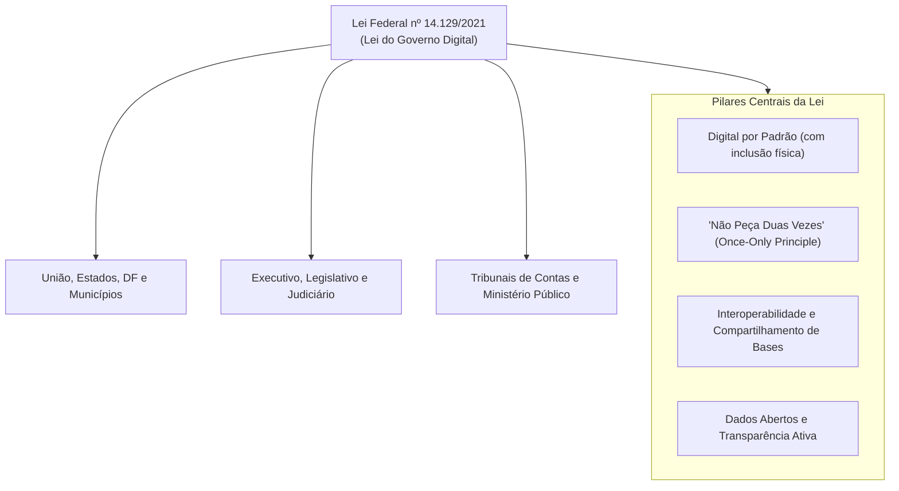
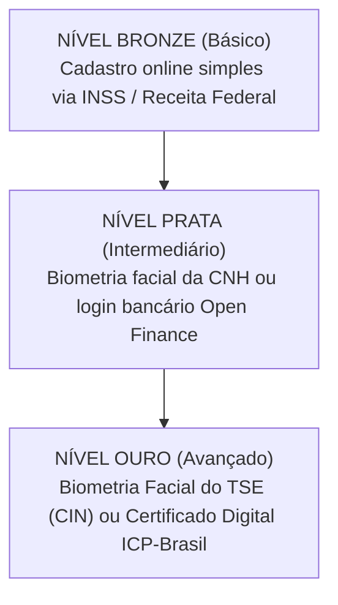
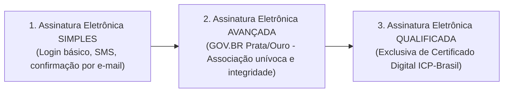
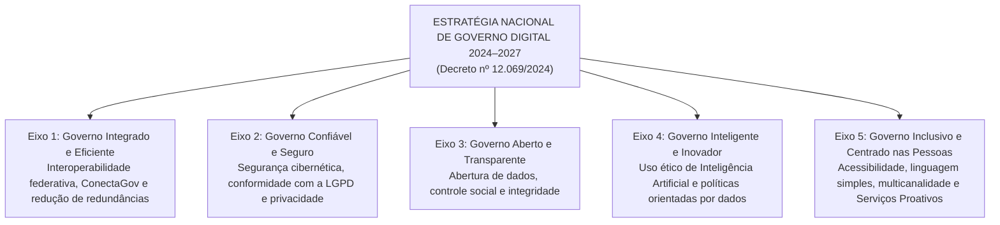

# 05 - Governo Digital e a ENGD 2024–2027 (Decreto 12.069/2024)

> **Matéria:** Governança de Tecnologia da Informação  
> **Cargo:** B02 – Técnico de Controle Externo – Especialidade: Tecnologia da Informação  
> **Arquivo:** `05_governo_digital_lei_14129_e_engd_2024_2027.md`  
> **Atos Normativos Centrais:** Lei Federal nº 14.129, de 29 de março de 2021 (Lei do Governo Digital) e Decreto Federal nº 12.069, de 21 de junho de 2024 (Estratégia Nacional de Governo Digital – ENGD 2024–2027)

---

## 📌 Ementa / Itens do Edital
- Transformação digital, inovação e modernização administrativa no setor público
- Lei Federal nº 14.129/2021 (Lei do Governo Digital):
    - Princípios, diretrizes e instrumentos fundamentais
    - Princípio do "Digital por Padrão" (*Digital by Default*) e a vedação à exigência de documentos já existentes no Estado (*Once-Only Principle*)
    - Níveis de identificação e autenticação digital (Plataforma GOV.BR: Bronze, Prata e Ouro)
    - Tipos de assinatura eletrônica no setor público: Simples, Avançada e Qualificada (Lei 14.063/2020)
    - Governo Como Plataforma (*Government as a Platform* - GaaP) e Interoperabilidade de Dados
- Estratégia Nacional de Governo Digital – ENGD 2024–2027 (Decreto Federal nº 12.069/2024):
    - Visão estratégica, objetivos e princípios orientadores
    - Os 5 Eixos Estratégicos e diretrizes para a transformação federativa (União, Estados e Municípios)
    - Serviços Públicos Proativos e Infraestrutura Pública Digital (DPI)

---

## 🧭 Sumário

1. [A Lei do Governo Digital (Lei Federal nº 14.129/2021)](#1-a-lei-do-governo-digital-lei-federal-no-141292021)
1. [Âmbito de Aplicação Universal](#1-1-ambito-de-aplicacao-universal)
    1. [Teste 505](#Teste-505)
1. [Princípios e Diretrizes Marcantes](#1-2-principios-e-diretrizes-marcantes)
    1. [Teste 506](#Teste-506)
    2. [Teste 507](#Teste-507)
1. [Níveis de Autenticação na Plataforma GOV.BR (Bronze, Prata e Ouro)](#1-3-niveis-de-autenticacao-na-plataforma-govbr-bronze-prata-e-ouro)
    1. [Teste 508](#Teste-508)
1. [Classificação das Assinaturas Eletrônicas no Setor Público (Lei nº 14.063/2020)](#1-4-classificacao-das-assinaturas-eletronicas-no-setor-publico-lei-no-140632020)
    1. [Teste 509](#Teste-509)
1. [Governo Como Plataforma (GaaP) e Interoperabilidade](#1-5-governo-como-plataforma-gaap-e-interoperabilidade)
    1. [Teste 510](#Teste-510)
2. [A Estratégia Nacional de Governo Digital – ENGD 2024–2027 (Decreto nº 12.069/2024)](#2-a-estrategia-nacional-de-governo-digital-engd-20242027-decreto-no-120692024)
2. [Propósito e Abrangência Federativa](#2-1-proposito-e-abrangencia-federativa)
    1. [Teste 511](#Teste-511)
2. [Os 5 Eixos Estratégicos da ENGD 2024–2027](#2-2-os-5-eixos-estrategicos-da-engd-20242027)
    1. [Teste 512](#Teste-512)
    2. [Teste 513](#Teste-513)
2. [Serviços Públicos Proativos e Infraestrutura Pública Digital (DPI)](#2-3-servicos-publicos-proativos-e-infraestrutura-publica-digital-dpi)
    1. [Teste 514](#Teste-514)
6. [Fontes Recomendadas na Internet](#6-fontes-recomendadas-na-internet)

---

## 1. A Lei do Governo Digital (Lei Federal nº 14.129/2021)

A **Lei nº 14.129/2021** instituiu o marco regulatório para a prestação digital dos serviços públicos no Brasil, fixando princípios, regras e instrumentos para o aumento da eficiência pública e a desburocratização das relações entre o Estado e a sociedade.

---

## 1.1 Âmbito de Aplicação Universal

A Lei do Governo Digital aplica-se obrigatoriamente a todos os entes e Poderes da Federação:

1. À administração direta e indireta da **União, dos Estados, do Distrito Federal e dos Municípios**.
2. Aos Poderes **Executivo, Judiciário e Legislativo** (abrangendo expressamente os **Tribunais de Contas** e o Ministério Público).
3. Às empresas públicas e sociedades de economia mista que prestem serviços públicos.

---

### Teste 505
**(FGV – TRF-1 – Analista Judiciario Area Apoio Especializado Especialidade Suporte Em Tecnologia da Informacao – 2024)**
A política de segurança da cibernética do Poder Judiciário (PSEC-PJ) tem por finalidade prover princípios, objetivos e instrumentos capazes de assegurar a segurança cibernética no Poder Judiciário. Dentre os instrumentos da PSEC-PJ, foi instituído o protocolo de gerenciamento de crises cibernéticas no âmbito do Poder Judiciário (PGCC-PJ). Considerando o previsto na PSEC-PJ e no PGCC-PJ, ações responsivas devem ser colocadas em prática quando:

* **A)** um incidente de segurança impactar o processo judicial eletrônico;
* **B)** o computador de um analista judiciário do TRF1 for contaminado por vírus;
* **C)** a mídia noticiar o comprometimento de credenciais de acesso de um sistema descontinuado;
* **D)** o servidor de arquivos de backup do TRF1 ficar em manutenção por dois dias consecutivos;
* **E)** a contratação do serviço da nuvem nacional da plataforma digital do Poder Judiciário brasileiro atrair grande atenção da mídia e da população em geral.

---

> **Comentário Detalhado:**
>
> - **A)** **Correta.** Conforme fundamentado na seção *Tabela Comparativa: Assinaturas Eletrônicas na Administração Pública* deste guia, a FCC adora afirmar que qualquer manifestação ou processo eletrônico em órgão público "exige compulsoriamente a assinatura qualificada com certificado ICP-Brasil". Dessa forma, está plenamente correta a assertiva da banca (FGV – TRF-1/2024) ao estabelecer que "um incidente de segurança impactar o processo judicial eletrônico".
> - **B)** **Incorreta.** A opção apresenta proposição em desacordo com os fundamentos teóricos e técnicos do tópico ao afirmar que "o computador de um analista judiciário do TRF1 for contaminado por vírus". De acordo com a teoria estudada em *2.2 Os 5 Eixos Estratégicos da ENGD 2024–2027*, eixo 2 - Governo Confiável e Seguro: Resiliência cibernética de infraestruturas críticas, proteção de dados pessoais (LGPD) e segurança da informação governamental.
> - **C)** **Incorreta.** A opção apresenta proposição em desacordo com os fundamentos teóricos e técnicos do tópico ao afirmar que "a mídia noticiar o comprometimento de credenciais de acesso de um sistema descontinuado". De acordo com a teoria estudada em *1.3 Níveis de Autenticação na Plataforma GOV.BR (Bronze, Prata e Ouro)*, prata: Validação biométrica facial contra a base da CNH (Senatran); login por meio de credenciais bancárias (Open Finance / Bancos Credenciados); ou validação via SIGEPE (servidores públicos). — Acesso à grande maioria dos serviços públicos digitais federais e estaduais, emissão de certidões e uso de assinatura eletrônica avançada.
> - **D)** **Incorreta.** A opção apresenta proposição em desacordo com os fundamentos teóricos e técnicos do tópico ao afirmar que "o servidor de arquivos de backup do TRF1 ficar em manutenção por dois dias consecutivos". De acordo com a teoria estudada em *3. Presunção de Boa-Fé e Desburocratização*, fica dispensado o reconhecimento de firma em cartório e a autenticação de cópias em papel, bastando que o servidor público confira a cópia com o documento original apresentado ou valide os dados por meio de assinatura e identificação digital oficial.
> - **E)** **Incorreta.** A opção apresenta proposição em desacordo com os fundamentos teóricos e técnicos do tópico ao afirmar que "a contratação do serviço da nuvem nacional da plataforma digital do Poder Judiciário brasileiro atrair grande...". De acordo com a teoria estudada em *1.3 Níveis de Autenticação na Plataforma GOV.BR (Bronze, Prata e Ouro)*, ouro: Validação biométrica facial na base da Justiça Eleitoral (TSE / Carteira de Identidade Nacional - CIN); ou validação por Certificado Digital padrão ICP-Brasil (A1 ou A3). — Nível máximo de segurança: acesso irrestrito a todos os serviços críticos, sigilosos, declaração pré-preenchida do Imposto de Renda e assinaturas eletrônicas.
>
> **Gabarito: A**

---

---

## 1.2 Princípios e Diretrizes Marcantes

#### 1. Vedação Expressa à Exigência de Documento em Posse do Estado (*Once-Only Principle*)
O Art. 5º, inciso VI e o Art. 12 da Lei nº 14.129/2021 consagram expressamente a **vedação de exigir do cidadão informações, documentos ou certidões que já constem na posse da própria Administração Pública**:

- O órgão público não pode transferir para o usuário o ônus de buscar uma certidão emitida por outro órgão do mesmo ente ou da administração governamental.
- Os órgãos públicos são obrigados a estruturar mecanismos de **interoperabilidade de dados** para consultar diretamente as bases cadastrais governamentais.

> 🚨 **ALERTA DE PROVA / PEGADINHA FCC:**  
> A FCC adora cobrar a regra: Se o cidadão solicita um serviço em uma Secretaria Estadual, o órgão **não pode** exigir certidão de regularidade fiscal emitida pela própria Fazenda Estadual ou certidão de nascimento civil emitida pelo Estado; o órgão deve consumir esses dados eletronicamente via barramento de interoperabilidade.

---

### Teste 506
**(FGV – TJ-AP – Analista Judiciario Apoio Especializado Tecnologia da Informacao Seguranca da Informacao – 2023)**
A equipe de gestão de riscos de um órgão público está atualizando seu Plano de Gestão de Riscos (PGR). Na atual fase de trabalho, a equipe está executando o processo de avaliação de riscos das atividades constantes do escopo do PGR, descrevendo, analisando e avaliando os riscos identificados. Durante a identificação dos riscos, a equipe deve considerar o fator:

* **A)** mudanças nos contextos externo e interno do órgão;
* **B)** natureza e magnitude das consequências;
* **C)** probabilidade de eventos e consequências;
* **D)** opções existentes para tratamento de riscos;
* **E)** recursos requeridos, incluindo contingências.

---

> **Comentário Detalhado:**
>
> - **A)** **Correta.** Conforme fundamentado na seção *1. Vedação Expressa à Exigência de Documento em Posse do Estado (Once-Only Principle)* deste guia, a FCC adora cobrar a regra: Se o cidadão solicita um serviço em uma Secretaria Estadual, o órgão não pode exigir certidão de regularidade fiscal emitida pela própria Fazenda Estadual ou certidão de nascimento civil emitida pelo Estado; o órgão deve consumir esses dados eletronicamente via barramento de interoperabilidade. Dessa forma, está plenamente correta a assertiva da banca (FGV – TJ-AP/2023) ao estabelecer que "mudanças nos contextos externo e interno do órgão".
> - **B)** **Incorreta.** A opção apresenta proposição em desacordo com os fundamentos teóricos e técnicos do tópico ao afirmar que "natureza e magnitude das consequências". De acordo com a teoria estudada em *Tabela Comparativa: Assinaturas Eletrônicas na Administração Pública*, a FCC adora afirmar que qualquer manifestação ou processo eletrônico em órgão público "exige compulsoriamente a assinatura qualificada com certificado ICP-Brasil".
> - **C)** **Incorreta.** A opção apresenta proposição em desacordo com os fundamentos teóricos e técnicos do tópico ao afirmar que "probabilidade de eventos e consequências". De acordo com a teoria estudada em *1. Vedação Expressa à Exigência de Documento em Posse do Estado (Once-Only Principle)*, o órgão público não pode transferir para o usuário o ônus de buscar uma certidão emitida por outro órgão do mesmo ente ou da administração governamental.
> - **D)** **Incorreta.** A opção apresenta proposição em desacordo com os fundamentos teóricos e técnicos do tópico ao afirmar que "opções existentes para tratamento de riscos". De acordo com a teoria estudada em *1.5 Governo Como Plataforma (GaaP) e Interoperabilidade*, em vez de construir aplicações verticais monolíticas isoladas para cada órgão, o governo desenvolve blocos compartilhados de infraestrutura tecnológica aberta.
> - **E)** **Incorreta.** A opção apresenta proposição em desacordo com os fundamentos teóricos e técnicos do tópico ao afirmar que "recursos requeridos, incluindo contingências". De acordo com a teoria estudada em *1. Serviços Públicos Proativos*, *Modelo Reativo Tradicional:* O cidadão descobre a existência do direito, preenche formulários, reúne certidões e protocola requerimento no órgão.
>
> **Gabarito: A**

---

#### 2. Digital por Padrão (*Digital by Default*) com Garantia de Inclusão
Os serviços públicos devem ser prioritariamente concebidos e ofertados em formato digital. Todavia, para resguardar os cidadãos em situação de vulnerabilidade ou sem letramento digital, a Administração deve manter canais de atendimento presencial humanizados e acessíveis.

#### 3. Presunção de Boa-Fé e Desburocratização
Fica dispensado o reconhecimento de firma em cartório e a autenticação de cópias em papel, bastando que o servidor público confira a cópia com o documento original apresentado ou valide os dados por meio de assinatura e identificação digital oficial.

#### 4. Transparência Ativa e Dados Abertos
Os dados governamentais não sigilosos devem ser abertos ativamente em sítios oficiais:

- Devem estar em formatos **abertos, não proprietários e estruturados** (como CSV, JSON, XML), legíveis por máquina.
- É vedado publicar dados abertos exclusivamente em arquivos fechados ou formatos de imagem (como PDF rasterizado ou JPG), que impossibilitam a análise algorítmica.

---

### Teste 507
**(FGV – TCE-GO – Analista de Controle Externo Tecnologia da Informacao – 2024)**
Dados abertos são informações digitais disponibilizadas ao público sem restrições de uso, geralmente sob formatos acessíveis e licenças que permitem sua livre utilização, redistribuição e modificação. O chamado Sistema de 5 Estrelas classifica por meio de estrelas o grau de abertura dos dados. O nível três estrelas é caracterizado por sua disponibilidade na internet

* **A)** em qualquer formato.
* **B)** em formato RDF.
* **C)** de maneira estruturada e formato não proprietário.
* **D)** em formato SPARQL.
* **E)** em formato RDF Conectado.

---

> **Comentário Detalhado:**
>
> - **A)** **Incorreta.** A opção promove generalização excessiva que desconsidera as condições técnicas e normativas ao afirmar que "em qualquer formato". De acordo com a teoria estudada em *Tabela Comparativa: Assinaturas Eletrônicas na Administração Pública*, avançada: Está associada unicamente ao signatário; dados para criação sob seu controle exclusivo; detecta qualquer alteração posterior no documento.
> - **B)** **Incorreta.** A opção apresenta proposição em desacordo com os fundamentos teóricos e técnicos do tópico ao afirmar que "em formato RDF". De acordo com a teoria estudada em *1.3 Níveis de Autenticação na Plataforma GOV.BR (Bronze, Prata e Ouro)*, prata: Validação biométrica facial contra a base da CNH (Senatran); login por meio de credenciais bancárias (Open Finance / Bancos Credenciados); ou validação via SIGEPE (servidores públicos). — Acesso à grande maioria dos serviços públicos digitais federais e estaduais, emissão de certidões e uso de assinatura eletrônica avançada.
> - **C)** **Correta.** Conforme fundamentado na seção *2. Digital por Padrão (Digital by Default) com Garantia de Inclusão* deste guia, os serviços públicos devem ser prioritariamente concebidos e ofertados em formato digital. Dessa forma, está plenamente correta a assertiva da banca (FGV – TCE-GO/2024) ao estabelecer que "de maneira estruturada e formato não proprietário".
> - **D)** **Incorreta.** A opção apresenta proposição em desacordo com os fundamentos teóricos e técnicos do tópico ao afirmar que "em formato SPARQL". De acordo com a teoria estudada em *4. Transparência Ativa e Dados Abertos*, devem estar em formatos abertos, não proprietários e estruturados (como CSV, JSON, XML), legíveis por máquina.
> - **E)** **Incorreta.** A opção apresenta proposição em desacordo com os fundamentos teóricos e técnicos do tópico ao afirmar que "em formato RDF Conectado". De acordo com a teoria estudada em *4. Transparência Ativa e Dados Abertos*, é vedado publicar dados abertos exclusivamente em arquivos fechados ou formatos de imagem (como PDF rasterizado ou JPG), que impossibilitam a análise algorítmica.
>
> **Gabarito: C**

---

## 1.3 Níveis de Autenticação na Plataforma GOV.BR (Bronze, Prata e Ouro)

O ecossistema GOV.BR classifica as contas de identificação dos cidadãos em **três níveis progressivos de confiabilidade cadastral**:

| Nível da Conta | Métodos de Validação / Obtenção | Serviços Públicos Acessíveis |
| :---: | :--- | :--- |
| **Bronze** | Cadastro presencial simplificado ou validação de dados cadastrais básicos junto à base do INSS ou da Receita Federal (perguntas cadastrais simples). | Acesso a serviços digitais básicos de baixo risco e consultas cadastrais simples. |
| **Prata** | Validação biométrica facial contra a base da CNH (Senatran); login por meio de credenciais bancárias (Open Finance / Bancos Credenciados); ou validação via SIGEPE (servidores públicos). | Acesso à grande maioria dos serviços públicos digitais federais e estaduais, emissão de certidões e uso de assinatura eletrônica avançada. |
| **Ouro** | Validação biométrica facial na base da Justiça Eleitoral (TSE / Carteira de Identidade Nacional - CIN); ou validação por Certificado Digital padrão ICP-Brasil (A1 ou A3). | Nível máximo de segurança: acesso irrestrito a todos os serviços críticos, sigilosos, declaração pré-preenchida do Imposto de Renda e assinaturas eletrônicas. |

---

### Teste 508
**(FCC – TCE-GO – Analista de Controle Externo Gestao de Conhecimento – 2009)**
Ao planejar o desenvolvimento de serviços e produtos de informação no âmbito da biblioteca digital, o bibliotecário deve repensar a questão do uso da informação de maneira que a biblioteca

* **A)** promova a utilização simultânea dos recursos por duas ou mais pessoas.
* **B)** venha a prover a totalidade da informação demandada em formato eletrônico.
* **C)** amplie o número de computadores e o acesso à internet oferecidos aos usuários.
* **D)** não necessite ser proprietária do documento solicitado pelo usuário.
* **E)** transforme o seu acervo físico em documentos virtuais de acesso remoto.

---

> **Comentário Detalhado:**
>
> - **A)** **Incorreta.** A opção apresenta proposição em desacordo com os fundamentos teóricos e técnicos do tópico ao afirmar que "promova a utilização simultânea dos recursos por duas ou mais pessoas". De acordo com a teoria estudada em *2.2 Os 5 Eixos Estratégicos da ENGD 2024–2027*, eixo 5 - Governo Inclusivo e Centrado nas Pessoas: Inclusão digital ampla, design universal, linguagem simples, multicanalidade e adoção do modelo de Serviços Públicos Proativos.
> - **B)** **Incorreta.** A opção apresenta proposição em desacordo com os fundamentos teóricos e técnicos do tópico ao afirmar que "venha a prover a totalidade da informação demandada em formato eletrônico". De acordo com a teoria estudada em *2. Digital por Padrão (Digital by Default) com Garantia de Inclusão*, os serviços públicos devem ser prioritariamente concebidos e ofertados em formato digital.
> - **C)** **Incorreta.** A opção apresenta proposição em desacordo com os fundamentos teóricos e técnicos do tópico ao afirmar que "amplie o número de computadores e o acesso à internet oferecidos aos usuários". De acordo com a teoria estudada em *1.3 Níveis de Autenticação na Plataforma GOV.BR (Bronze, Prata e Ouro)*, prata: Validação biométrica facial contra a base da CNH (Senatran); login por meio de credenciais bancárias (Open Finance / Bancos Credenciados); ou validação via SIGEPE (servidores públicos). — Acesso à grande maioria dos serviços públicos digitais federais e estaduais, emissão de certidões e uso de assinatura eletrônica avançada.
> - **D)** **Correta.** Conforme fundamentado na seção *1. Vedação Expressa à Exigência de Documento em Posse do Estado (Once-Only Principle)* deste guia, o órgão público não pode transferir para o usuário o ônus de buscar uma certidão emitida por outro órgão do mesmo ente ou da administração governamental. Dessa forma, está plenamente correta a assertiva da banca (FCC – TCE-GO/2009) ao estabelecer que "não necessite ser proprietária do documento solicitado pelo usuário".
> - **E)** **Incorreta.** A opção apresenta proposição em desacordo com os fundamentos teóricos e técnicos do tópico ao afirmar que "transforme o seu acervo físico em documentos virtuais de acesso remoto". De acordo com a teoria estudada em *1. Vedação Expressa à Exigência de Documento em Posse do Estado (Once-Only Principle)*, o Art. 5º, inciso VI e o Art. 12 da Lei nº 14.129/2021 consagram expressamente a vedação de exigir do cidadão informações, documentos ou certidões que já constem na posse da própria Administração Pública.
>
> **Gabarito: D**

---

## 1.4 Classificação das Assinaturas Eletrônicas no Setor Público (Lei nº 14.063/2020)

A Lei nº 14.063/2020 padronizou os tipos de assinatura eletrônica no relacionamento com órgãos públicos em três modalidades:

#### Tabela Comparativa: Assinaturas Eletrônicas na Administração Pública

| Categoria | Requisitos Técnicos de Segurança | Hipóteses de Aplicação Típicas |
| :--- | :--- | :--- |
| **Simples** | Permite identificar o signatário e anexa dados eletrônicos a outros dados (ex.: código SMS, confirmação de link por e-mail, login com senha comum). | Interações de baixo impacto financeiro ou operacional: agendamento de atendimentos, requerimentos de informações gerais, ouvidoria. |
| **Avançada** | Está associada unicamente ao signatário; dados para criação sob seu controle exclusivo; detecta qualquer alteração posterior no documento. Produzida tipicamente pelas contas **GOV.BR Prata e Ouro**. | Processos administrativos regulares, termos de posse, contratos administrativos ordinários, manifestações processuais em Tribunais de Contas e órgãos fiscais. |
| **Qualificada** | Utiliza **certificado digital emitido por Autoridade Certificadora credenciada na Infraestrutura de Chaves Públicas Brasileira (ICP-Brasil)**. É o nível mais alto. | Atos normativos de chefes de Poder (Presidente, Governadores, Prefeitos); transferência e registro de imóveis públicos; atos que impliquem sigilo fiscal/bancário gravíssimo onde a lei exigir expressamente. |

> 🚨 **ALERTA DE PROVA / PEGADINHA FCC:**  
> A FCC adora afirmar que qualquer manifestação ou processo eletrônico em órgão público "exige compulsoriamente a assinatura qualificada com certificado ICP-Brasil". **FALSO!** A legislação autorizou amplamente o uso da **Assinatura Eletrônica Avançada** (como a provida pelo GOV.BR Prata e Ouro) para a esmagadora maioria dos atos e processos administrativos cotidianos.

---

### Teste 509
**(FCC – TRT-11 – Analista Judiciario Tecnologia da Informacao – 2017)**
Dos funcionários do almoxarifado de uma empresa, todos aqueles que sabem mexer com planilha eletrônica também sabem mexer com processador de texto, e há funcionários que não mexem com planilha eletrônica nem com processador de texto. A respeito desses funcionários, é correto afirmar que quem

* **A)** mexe com processador de texto também mexe com planilha eletrônica.
* **B)** mexe com processador de texto, não mexe com planilha eletrônica.
* **C)** não mexe com planilha eletrônica também não mexe com processador de texto.
* **D)** não mexe com processador de texto também não mexe com planilha eletrônica.
* **E)** não mexe com planilha eletrônica, mexe com processador de texto.

---

> **Comentário Detalhado:**
>
> - **A)** **Incorreta.** A opção apresenta proposição em desacordo com os fundamentos teóricos e técnicos do tópico ao afirmar que "mexe com processador de texto também mexe com planilha eletrônica". De acordo com a teoria estudada em *1.4 Classificação das Assinaturas Eletrônicas no Setor Público (Lei nº 14.063/2020)*, a Lei nº 14.063/2020 padronizou os tipos de assinatura eletrônica no relacionamento com órgãos públicos em três modalidades.
> - **B)** **Incorreta.** A opção apresenta proposição em desacordo com os fundamentos teóricos e técnicos do tópico ao afirmar que "mexe com processador de texto, não mexe com planilha eletrônica". De acordo com a teoria estudada em *Tabela Comparativa: Assinaturas Eletrônicas na Administração Pública*, fALSO! A legislação autorizou amplamente o uso da Assinatura Eletrônica Avançada (como a provida pelo GOV.BR Prata e Ouro) para a esmagadora maioria dos atos e processos administrativos cotidianos.
> - **C)** **Incorreta.** A opção apresenta proposição em desacordo com os fundamentos teóricos e técnicos do tópico ao afirmar que "não mexe com planilha eletrônica também não mexe com processador de texto". De acordo com a teoria estudada em *1.3 Níveis de Autenticação na Plataforma GOV.BR (Bronze, Prata e Ouro)*, prata: Validação biométrica facial contra a base da CNH (Senatran); login por meio de credenciais bancárias (Open Finance / Bancos Credenciados); ou validação via SIGEPE (servidores públicos). — Acesso à grande maioria dos serviços públicos digitais federais e estaduais, emissão de certidões e uso de assinatura eletrônica avançada.
> - **D)** **Correta.** Conforme fundamentado na seção *6. Fontes Recomendadas na Internet* deste guia, lei nº 14.129/2021 (Lei do Governo Digital) - Texto oficial que estabelece princípios, regras e instrumentos para o aumento da eficiência pública e desburocratização. Dessa forma, está plenamente correta a assertiva da banca (FCC – TRT-11/2017) ao estabelecer que "não mexe com processador de texto também não mexe com planilha eletrônica".
> - **E)** **Incorreta.** A opção apresenta proposição em desacordo com os fundamentos teóricos e técnicos do tópico ao afirmar que "não mexe com planilha eletrônica, mexe com processador de texto". De acordo com a teoria estudada em *Tabela Comparativa: Assinaturas Eletrônicas na Administração Pública*, a FCC adora afirmar que qualquer manifestação ou processo eletrônico em órgão público "exige compulsoriamente a assinatura qualificada com certificado ICP-Brasil".
>
> **Gabarito: D**

---

## 1.5 Governo Como Plataforma (GaaP) e Interoperabilidade

O paradigma de **Governo Como Plataforma** (*Government as a Platform - GaaP*) redefine o papel da tecnologia pública. Em vez de construir aplicações verticais monolíticas isoladas para cada órgão, o governo desenvolve blocos compartilhados de infraestrutura tecnológica aberta:

- Criação de APIs padronizadas e barramentos centrais (como a plataforma **ConectaGov** no Brasil);
- Disponibilização de serviços públicos digitais interoperáveis que conversam em tempo real;
- Racionalização de custos de TIC e eliminação de duplicação de dados entre a União, Estados e Municípios.

---

### Teste 510
**(FGV – TCE-PA – Auditor de Controle Externo Administrativa Administracao – 2024)**
As opções a seguir apresentam objetivos do governo eletrônico, à exceção de uma. Assinale-a.

* **A)** Inclusão digital.
* **B)** Modernizar a máquina pública.
* **C)** Reduzir custos e melhorar a eficiência da administração pública no que se refere aos seus processos internos.
* **D)** Aumentar a transparência, o controle social e a accountability.
* **E)** Fomento econômico do setor de tecnologia da informação.

---

> **Comentário Detalhado:**
>
> - **A)** **Incorreta.** A opção apresenta proposição em desacordo com os fundamentos teóricos e técnicos do tópico ao afirmar que "Inclusão digital". De acordo com a teoria estudada em *6. Fontes Recomendadas na Internet*, governo Digital - Infraestrutura Nacional de Dados (IND) - Governança, compartilhamento e segurança de bases de dados do setor público.
> - **B)** **Incorreta.** A opção apresenta proposição em desacordo com os fundamentos teóricos e técnicos do tópico ao afirmar que "Modernizar a máquina pública". De acordo com a teoria estudada em *2.2 Os 5 Eixos Estratégicos da ENGD 2024–2027*, eixo 2 - Governo Confiável e Seguro: Resiliência cibernética de infraestruturas críticas, proteção de dados pessoais (LGPD) e segurança da informação governamental.
> - **C)** **Incorreta.** A opção apresenta proposição em desacordo com os fundamentos teóricos e técnicos do tópico ao afirmar que "Reduzir custos e melhorar a eficiência da administração pública no que se refere aos seus processos internos". De acordo com a teoria estudada em *Tabela Comparativa: Assinaturas Eletrônicas na Administração Pública*, produzida tipicamente pelas contas GOV.BR Prata e Ouro. — Processos administrativos regulares, termos de posse, contratos administrativos ordinários, manifestações processuais em Tribunais de Contas e órgãos fiscais.
> - **D)** **Incorreta.** A opção apresenta proposição em desacordo com os fundamentos teóricos e técnicos do tópico ao afirmar que "Aumentar a transparência, o controle social e a accountability". De acordo com a teoria estudada em *2.2 Os 5 Eixos Estratégicos da ENGD 2024–2027*, eixo 3 - Governo Aberto e Transparente: Fomento à transparência ativa, ampliação do catálogo de dados abertos para pesquisa e controle social, e integridade pública.
> - **E)** **Correta.** Conforme fundamentado na seção *1.5 Governo Como Plataforma (GaaP) e Interoperabilidade* deste guia, o paradigma de Governo Como Plataforma (*Government as a Platform - GaaP*) redefine o papel da tecnologia pública. Dessa forma, está plenamente correta a assertiva da banca (FGV – TCE-PA/2024) ao estabelecer que "Fomento econômico do setor de tecnologia da informação".
>
> **Gabarito: E**

---

## 2. A Estratégia Nacional de Governo Digital – ENGD 2024–2027 (Decreto nº 12.069/2024)

O **Decreto Federal nº 12.069, de 21 de junho de 2024**, promulgou a nova **Estratégia Nacional de Governo Digital (ENGD)** para o quadriênio **2024 a 2027**.

---

## 2.1 Propósito e Abrangência Federativa

A ENGD 2024–2027 é uma política pública de **amplitude nacional federativa**, coordenada para articular a transformação digital integrada de todos os entes federativos (União, 26 Estados, DF e Municípios), promovendo a interoperabilidade e reduzindo disparidades regionais de infraestrutura e capacidade de atendimento digital.

---

### Teste 511
**(FCC – TRT-14 – Analista Judiciario Apoio Especializado Tecnologia da Informacao – 2016)**
Afirma-se na abertura do texto: As crianças de hoje parecem nascer já familiarizadas com todas as engenhocas eletrônicas que estarão no centro de suas vidas. Com a leitura integral do texto, tal afirmação é

* **A)** contraditada pelo fato de que o verdadeiro interesse das crianças, longe de estar nas atrações eletrônicas, é aquele que o teatro proporciona em suas grandes produções.
* **B)** ratificada quando nos certificamos de que a imaginação das crianças de hoje é estimulada sobretudo pelo manejo de jogos eletrônicos, sob o comando criativo de cada uma delas.
* **C)** contraposta ao prazer inexcedível que cada criança experimenta quando abandona a manipulação de engenhocas eletrônicas pelo encanto de criar histórias imaginosas.
* **D)** ressalvada pelo fato de que o encantamento pelas narrativas orais, com o narrador presente, pode substituir o prazer que elas experimentam por meio de recursos eletrônicos.
* **E)** minimizada ao nos darmos conta de que a suposta atração que as crianças sentem pelos jogos eletrônicos decorre da baixa atenção que a família moderna lhes dedica.

---

> **Comentário Detalhado:**
>
> - **A)** **Incorreta.** A opção apresenta proposição em desacordo com os fundamentos teóricos e técnicos do tópico ao afirmar que "contraditada pelo fato de que o verdadeiro interesse das crianças, longe de estar nas atrações eletrônicas, é...". De acordo com a teoria estudada em *4. Transparência Ativa e Dados Abertos*, devem estar em formatos abertos, não proprietários e estruturados (como CSV, JSON, XML), legíveis por máquina.
> - **B)** **Incorreta.** A opção apresenta proposição em desacordo com os fundamentos teóricos e técnicos do tópico ao afirmar que "ratificada quando nos certificamos de que a imaginação das crianças de hoje é estimulada sobretudo pelo manejo de...". De acordo com a teoria estudada em *Tabela Comparativa: Assinaturas Eletrônicas na Administração Pública*, avançada: Está associada unicamente ao signatário; dados para criação sob seu controle exclusivo; detecta qualquer alteração posterior no documento.
> - **C)** **Incorreta.** A opção apresenta proposição em desacordo com os fundamentos teóricos e técnicos do tópico ao afirmar que "contraposta ao prazer inexcedível que cada criança experimenta quando abandona a manipulação de engenhocas...". De acordo com a teoria estudada em *1. Vedação Expressa à Exigência de Documento em Posse do Estado (Once-Only Principle)*, o órgão público não pode transferir para o usuário o ônus de buscar uma certidão emitida por outro órgão do mesmo ente ou da administração governamental.
> - **D)** **Correta.** Conforme fundamentado na seção *Tabela Comparativa: Assinaturas Eletrônicas na Administração Pública* deste guia, simples: Permite identificar o signatário e anexa dados eletrônicos a outros dados (ex.: código SMS, confirmação de link por e-mail, login com senha comum). — Interações de baixo impacto financeiro ou operacional: agendamento de atendimentos, requerimentos de informações gerais, ouvidoria. Dessa forma, está plenamente correta a assertiva da banca (FCC – TRT-14/2016) ao estabelecer que "ressalvada pelo fato de que o encantamento pelas narrativas orais, com o narrador presente, pode substituir o...".
> - **E)** **Incorreta.** A opção apresenta proposição em desacordo com os fundamentos teóricos e técnicos do tópico ao afirmar que "minimizada ao nos darmos conta de que a suposta atração que as crianças sentem pelos jogos eletrônicos decorre da...". De acordo com a teoria estudada em *1.3 Níveis de Autenticação na Plataforma GOV.BR (Bronze, Prata e Ouro)*, nível da Conta: Métodos de Validação / Obtenção — Serviços Públicos Acessíveis.
>
> **Gabarito: D**

---

## 2.2 Os 5 Eixos Estratégicos da ENGD 2024–2027

1. **Eixo 1 - Governo Integrado e Eficiente:** Fortalecimento da interoperabilidade federativa via ConectaGov, racionalização de custos de TIC e eliminação de cadastros redundantes.
2. **Eixo 2 - Governo Confiável e Seguro:** Resiliência cibernética de infraestruturas críticas, proteção de dados pessoais (LGPD) e segurança da informação governamental.
3. **Eixo 3 - Governo Aberto e Transparente:** Fomento à transparência ativa, ampliação do catálogo de dados abertos para pesquisa e controle social, e integridade pública.
4. **Eixo 4 - Governo Inteligente e Inovador:** Adoção ética e responsável de Inteligência Artificial (IA) e formulação de políticas públicas orientadas por evidências empíricas (*data-driven policy*).
5. **Eixo 5 - Governo Inclusivo e Centrado nas Pessoas:** Inclusão digital ampla, design universal, linguagem simples, multicanalidade e adoção do modelo de **Serviços Públicos Proativos**.

---

### Teste 512
**(CEBRASPE – TJ-RJ – Analista Judiciario Grupo Tecnologia da Informacao Analista de Gestao de Tic – 2021)**
No que diz respeito à atuação da União, dos estados, do Distrito Federal e dos municípios no desenvolvimento da Internet no país, de acordo com o Marco Civil da Internet, o CGIbr participa da diretriz de

* **A)** promoção da racionalização da gestão, expansão e uso da Internet.
* **B)** adoção preferencial de tecnologias, padrões e formatos abertos e livres.
* **C)** otimização da infraestrutura das redes e estímulo à implantação de centros de armazenamento, gerenciamento e disseminação de dados no país.
* **D)** desenvolvimento de ações e programas de capacitação para uso da Internet.
* **E)** promoção da racionalização e da interoperabilidade tecnológica dos serviços de governo eletrônico.

---

> **Comentário Detalhado:**
>
> - **A)** **Correta.** Conforme fundamentado na seção *1.5 Governo Como Plataforma (GaaP) e Interoperabilidade* deste guia, racionalização de custos de TIC e eliminação de duplicação de dados entre a União, Estados e Municípios. Dessa forma, está plenamente correta a assertiva da banca (CEBRASPE – TJ-RJ/2021) ao estabelecer que "promoção da racionalização da gestão, expansão e uso da Internet".
> - **B)** **Incorreta.** A opção apresenta proposição em desacordo com os fundamentos teóricos e técnicos do tópico ao afirmar que "adoção preferencial de tecnologias, padrões e formatos abertos e livres". De acordo com a teoria estudada em *4. Transparência Ativa e Dados Abertos*, devem estar em formatos abertos, não proprietários e estruturados (como CSV, JSON, XML), legíveis por máquina.
> - **C)** **Incorreta.** A opção apresenta proposição em desacordo com os fundamentos teóricos e técnicos do tópico ao afirmar que "otimização da infraestrutura das redes e estímulo à implantação de centros de armazenamento, gerenciamento e...". De acordo com a teoria estudada em *2. Infraestrutura Pública Digital (DPI - Digital Public Infrastructure)*, a ENGD 2024–2027 estrutura a evolução digital do país em três pilares fundamentais.
> - **D)** **Incorreta.** A opção apresenta proposição em desacordo com os fundamentos teóricos e técnicos do tópico ao afirmar que "desenvolvimento de ações e programas de capacitação para uso da Internet". De acordo com a teoria estudada em *1.1 Âmbito de Aplicação Universal*, à administração direta e indireta da União, dos Estados, do Distrito Federal e dos Municípios.
> - **E)** **Incorreta.** A opção apresenta proposição em desacordo com os fundamentos teóricos e técnicos do tópico ao afirmar que "promoção da racionalização e da interoperabilidade tecnológica dos serviços de governo eletrônico". De acordo com a teoria estudada em *6. Fontes Recomendadas na Internet*, governo Digital - Estratégia Federal de Governo Digital (EFGD) - Diretrizes estratégicas para interoperabilidade, dados abertos e serviços centrados no cidadão.
>
> **Gabarito: A**

---

### Teste 513
**(FGV – TCE-PI – Auditor de Controle Externo Controle Externo Especifica de Area Comum – 2025)**
O governo eletrônico (e-gov) consiste no uso de tecnologia da informação e comunicação (TICs) combinado com mudanças organizacionais para aperfeiçoar as estruturas e operações do governo. Com relação ao e-gov, analise as afirmativas a seguir. I. O e-gov é uma alternativa mais rápida e prática para os cidadãos no acesso a serviços governamentais. II. A percepção de risco pelos cidadãos, como em questões de privacidade e segurança, pode desencorajá-los a utilizar os sistemas de e-gov. III. O uso de serviços presenciais tradicionais tende a aumentar quando os cidadãos percebem o uso de e-gov como arriscado. Está correto o que se afirma em

* **A)** I, apenas.
* **B)** I e II, apenas.
* **C)** I e III, apenas.
* **D)** II e III, apenas.
* **E)** I, II e III.

---

> **Comentário Detalhado:**
>
> - **A)** **Incorreta.** A opção incorre em restrição indevida ao limitar o escopo conceitual ao afirmar que "I, apenas". De acordo com a teoria estudada em *2.2 Os 5 Eixos Estratégicos da ENGD 2024–2027*, eixo 2 - Governo Confiável e Seguro: Resiliência cibernética de infraestruturas críticas, proteção de dados pessoais (LGPD) e segurança da informação governamental.
> - **B)** **Incorreta.** A opção incorre em restrição indevida ao limitar o escopo conceitual ao afirmar que "I e II, apenas". De acordo com a teoria estudada em *1.3 Níveis de Autenticação na Plataforma GOV.BR (Bronze, Prata e Ouro)*, prata: Validação biométrica facial contra a base da CNH (Senatran); login por meio de credenciais bancárias (Open Finance / Bancos Credenciados); ou validação via SIGEPE (servidores públicos). — Acesso à grande maioria dos serviços públicos digitais federais e estaduais, emissão de certidões e uso de assinatura eletrônica avançada.
> - **C)** **Incorreta.** A opção incorre em restrição indevida ao limitar o escopo conceitual ao afirmar que "I e III, apenas". De acordo com a teoria estudada em *1.3 Níveis de Autenticação na Plataforma GOV.BR (Bronze, Prata e Ouro)*, ouro: Validação biométrica facial na base da Justiça Eleitoral (TSE / Carteira de Identidade Nacional - CIN); ou validação por Certificado Digital padrão ICP-Brasil (A1 ou A3). — Nível máximo de segurança: acesso irrestrito a todos os serviços críticos, sigilosos, declaração pré-preenchida do Imposto de Renda e assinaturas eletrônicas.
> - **D)** **Correta.** Conforme fundamentado na seção *1.3 Níveis de Autenticação na Plataforma GOV.BR (Bronze, Prata e Ouro)* deste guia, bronze: Cadastro presencial simplificado ou validação de dados cadastrais básicos junto à base do INSS ou da Receita Federal (perguntas cadastrais simples). — Acesso a serviços digitais básicos de baixo risco e consultas cadastrais simples. Dessa forma, está plenamente correta a assertiva da banca (FGV – TCE-PI/2025) ao estabelecer que "II e III, apenas".
> - **E)** **Incorreta.** A opção apresenta proposição em desacordo com os fundamentos teóricos e técnicos do tópico ao afirmar que "I, II e III". De acordo com a teoria estudada em *1.3 Níveis de Autenticação na Plataforma GOV.BR (Bronze, Prata e Ouro)*, o ecossistema GOV.BR classifica as contas de identificação dos cidadãos em três níveis progressivos de confiabilidade cadastral.
>
> **Gabarito: D**

---

## 2.3 Serviços Públicos Proativos e Infraestrutura Pública Digital (DPI)

#### 1. Serviços Públicos Proativos
Consiste na mudança de paradigma do atendimento público:

- *Modelo Reativo Tradicional:* O cidadão descobre a existência do direito, preenche formulários, reúne certidões e protocola requerimento no órgão.
- *Modelo Proativo da ENGD:* O Estado cruza dados de suas bases interoperáveis, reconhece automaticamente que o cidadão preencheu os requisitos previstos em lei e **disponibiliza ou concede ativamente o serviço/benefício**, notificando o indivíduo de forma transparente, sem necessidade de provocação prévia.

#### 2. Infraestrutura Pública Digital (DPI - *Digital Public Infrastructure*)
A ENGD 2024–2027 estrutura a evolução digital do país em três pilares fundamentais:

1. **Identificação Digital Unificada:** Acesso único por meio do CPF e da plataforma GOV.BR.
2. **Sistema de Pagamentos Instantâneos:** Utilização do Pix e da plataforma PagTesouro para recebimento ágil de taxas e repasses sociais diretos.
3. **Barramento Seguro de Dados:** Troca segura de informações via APIs e ConectaGov, com rastreabilidade e controle estrito de acessos.

---

### Teste 514
**(FGV – TRF-1 – Analista Judiciario Area Apoio Especializado Especialidade Suporte Em Tecnologia da Informacao – 2024)**
A política de gestão e governança da plataforma digital do Poder Judiciário brasileiro (PDPJ-Br) estabelece requisitos para os dados e documentos no âmbito da plataforma. Dentre esses requisitos, são estabelecidos padrões de:

* **A)** tabelas distribuídas;
* **B)** controle físico e financeiro;
* **C)** documentos e assinaturas digitais;
* **D)** bases distribuídas e independentes;
* **E)** dados públicos a serem armazenados.

---

> **Comentário Detalhado:**
>
> - **A)** **Correta.** Conforme fundamentado na seção *1. Serviços Públicos Proativos* deste guia, *Modelo Proativo da ENGD:* O Estado cruza dados de suas bases interoperáveis, reconhece automaticamente que o cidadão preencheu os requisitos previstos em lei e disponibiliza ou concede ativamente o serviço/benefício, notificando o indivíduo de forma transparente, sem necessidade de provocação prévia. Dessa forma, está plenamente correta a assertiva da banca (FGV – TRF-1/2024) ao estabelecer que "tabelas distribuídas".
> - **B)** **Incorreta.** A opção apresenta proposição em desacordo com os fundamentos teóricos e técnicos do tópico ao afirmar que "controle físico e financeiro". De acordo com a teoria estudada em *Tabela Comparativa: Assinaturas Eletrônicas na Administração Pública*, simples: Permite identificar o signatário e anexa dados eletrônicos a outros dados (ex.: código SMS, confirmação de link por e-mail, login com senha comum). — Interações de baixo impacto financeiro ou operacional: agendamento de atendimentos, requerimentos de informações gerais, ouvidoria.
> - **C)** **Incorreta.** A opção apresenta proposição em desacordo com os fundamentos teóricos e técnicos do tópico ao afirmar que "documentos e assinaturas digitais". De acordo com a teoria estudada em *1. Vedação Expressa à Exigência de Documento em Posse do Estado (Once-Only Principle)*, o Art. 5º, inciso VI e o Art. 12 da Lei nº 14.129/2021 consagram expressamente a vedação de exigir do cidadão informações, documentos ou certidões que já constem na posse da própria Administração Pública.
> - **D)** **Incorreta.** A opção apresenta proposição em desacordo com os fundamentos teóricos e técnicos do tópico ao afirmar que "bases distribuídas e independentes". De acordo com a teoria estudada em *6. Fontes Recomendadas na Internet*, governo Digital - Infraestrutura Nacional de Dados (IND) - Governança, compartilhamento e segurança de bases de dados do setor público.
> - **E)** **Incorreta.** A opção apresenta proposição em desacordo com os fundamentos teóricos e técnicos do tópico ao afirmar que "dados públicos a serem armazenados". De acordo com a teoria estudada em *1. Vedação Expressa à Exigência de Documento em Posse do Estado (Once-Only Principle)*, os órgãos públicos são obrigados a estruturar mecanismos de interoperabilidade de dados para consultar diretamente as bases cadastrais governamentais.
>
> **Gabarito: A**

---

## 6. Fontes Recomendadas na Internet

* [Lei nº 14.129/2021 (Lei do Governo Digital)](https://www.planalto.gov.br/ccivil_03/_ato2019-2022/2021/lei/l14129.htm) - Texto oficial que estabelece princípios, regras e instrumentos para o aumento da eficiência pública e desburocratização.
* [Decreto nº 12.198/2024 (Estratégia Nacional de Governo Digital)](https://www.planalto.gov.br/ccivil_03/_ato2023-2026/2024/decreto/d12198.htm) - Institui a Estratégia Nacional de Governo Digital para o ciclo 2024-2027.
* [Governo Digital - Estratégia Nacional de Governo Digital (ENGD)](https://www.gov.br/governodigital/pt-br/estrategias-e-governanca-digital/estrategianacional) - Pilares, metas e indicadores da transformação digital dos serviços públicos brasileiros.
* [Governo Digital - Estratégia Federal de Governo Digital (EFGD)](https://www.gov.br/governodigital/pt-br/estrategias-e-governanca-digital/EFGD) - Diretrizes estratégicas para interoperabilidade, dados abertos e serviços centrados no cidadão.
* [Governo Digital - Infraestrutura Nacional de Dados (IND)](https://www.gov.br/governodigital/pt-br/infraestrutura-nacional-de-dados) - Governança, compartilhamento e segurança de bases de dados do setor público.
* DI PIETRO, Maria Sylvia Zanella. **Direito Administrativo**. 37. ed. Rio de Janeiro: Forense, 2024. (Cap. 3 - Princípios da Administração Pública e Eficiência Digital).
* NOHARA, Irene Patrícia. **Direito Administrativo**. 13. ed. São Paulo: Atlas, 2023. (Cap. 2 - A Transformação Digital da Administração Pública e a Lei 14.129/2021).
* BRESSER-PEREIRA, Luiz Carlos. **Reforma do Estado para a Cidadania: a Reforma Gerencial Brasileira na Perspectiva Internacional**. São Paulo: Editora 34, 1998. (Cap. 4 - Transparência, Governança e Serviços Públicos).
