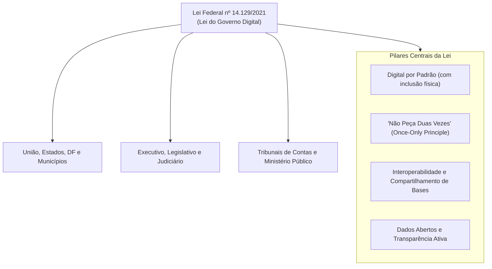
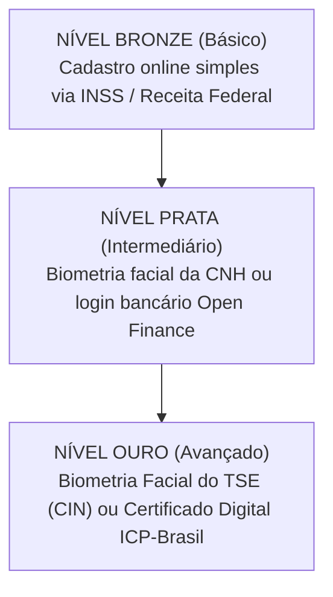
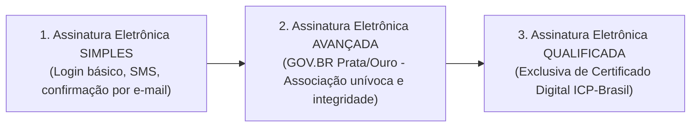
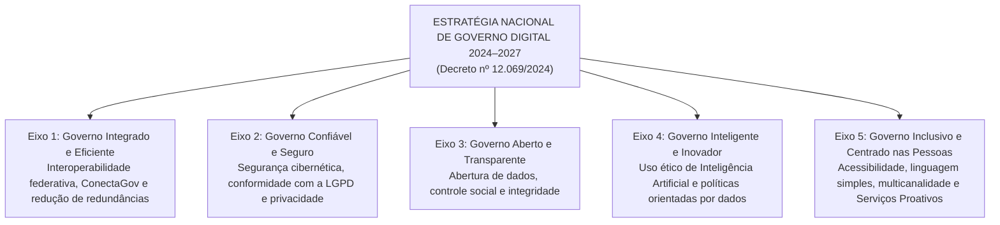

# 05 - Governo Digital e a ENGD 2024–2027 (Decreto 12.069/2024)

> **Matéria:** Governança de Tecnologia da Informação  
> **Cargo:** B02 – Técnico de Controle Externo – Especialidade: Tecnologia da Informação  
> **Arquivo:** `05_governo_digital_lei_14129_e_engd_2024_2027.md`  
> **Atos Normativos Centrais:** Lei Federal nº 14.129, de 29 de março de 2021 (Lei do Governo Digital) e Decreto Federal nº 12.069, de 21 de junho de 2024 (Estratégia Nacional de Governo Digital – ENGD 2024–2027)

---

## 📌 Ementa / Itens do Edital
- Transformação digital, inovação e modernização administrativa no setor público
- Lei Federal nº 14.129/2021 (Lei do Governo Digital):
    - Princípios, diretrizes e instrumentos fundamentais
    - Princípio do "Digital por Padrão" (*Digital by Default*) e a vedação à exigência de documentos já existentes no Estado (*Once-Only Principle*)
    - Níveis de identificação e autenticação digital (Plataforma GOV.BR: Bronze, Prata e Ouro)
    - Tipos de assinatura eletrônica no setor público: Simples, Avançada e Qualificada (Lei 14.063/2020)
    - Governo Como Plataforma (*Government as a Platform* - GaaP) e Interoperabilidade de Dados
- Estratégia Nacional de Governo Digital – ENGD 2024–2027 (Decreto Federal nº 12.069/2024):
    - Visão estratégica, objetivos e princípios orientadores
    - Os 5 Eixos Estratégicos e diretrizes para a transformação federativa (União, Estados e Municípios)
    - Serviços Públicos Proativos e Infraestrutura Pública Digital (DPI)

---

## 🧭 Sumário

1. [A Lei do Governo Digital (Lei Federal nº 14.129/2021)](#1-a-lei-do-governo-digital-lei-federal-no-141292021)
1. [Âmbito de Aplicação Universal](#1-1-ambito-de-aplicacao-universal)
    1. [Teste 505](#Teste-505)
1. [Princípios e Diretrizes Marcantes](#1-2-principios-e-diretrizes-marcantes)
    1. [Teste 506](#Teste-506)
    2. [Teste 507](#Teste-507)
1. [Níveis de Autenticação na Plataforma GOV.BR (Bronze, Prata e Ouro)](#1-3-niveis-de-autenticacao-na-plataforma-govbr-bronze-prata-e-ouro)
    1. [Teste 508](#Teste-508)
1. [Classificação das Assinaturas Eletrônicas no Setor Público (Lei nº 14.063/2020)](#1-4-classificacao-das-assinaturas-eletronicas-no-setor-publico-lei-no-140632020)
    1. [Teste 509](#Teste-509)
1. [Governo Como Plataforma (GaaP) e Interoperabilidade](#1-5-governo-como-plataforma-gaap-e-interoperabilidade)
    1. [Teste 510](#Teste-510)
2. [A Estratégia Nacional de Governo Digital – ENGD 2024–2027 (Decreto nº 12.069/2024)](#2-a-estrategia-nacional-de-governo-digital-engd-20242027-decreto-no-120692024)
2. [Propósito e Abrangência Federativa](#2-1-proposito-e-abrangencia-federativa)
    1. [Teste 511](#Teste-511)
2. [Os 5 Eixos Estratégicos da ENGD 2024–2027](#2-2-os-5-eixos-estrategicos-da-engd-20242027)
    1. [Teste 512](#Teste-512)
    2. [Teste 513](#Teste-513)
2. [Serviços Públicos Proativos e Infraestrutura Pública Digital (DPI)](#2-3-servicos-publicos-proativos-e-infraestrutura-publica-digital-dpi)
    1. [Teste 514](#Teste-514)
6. [Fontes Recomendadas na Internet](#6-fontes-recomendadas-na-internet)

---

## 1. A Lei do Governo Digital (Lei Federal nº 14.129/2021)

A **Lei nº 14.129/2021** instituiu o marco regulatório para a prestação digital dos serviços públicos no Brasil, fixando princípios, regras e instrumentos para o aumento da eficiência pública e a desburocratização das relações entre o Estado e a sociedade.

---

## 1.1 Âmbito de Aplicação Universal

A Lei do Governo Digital aplica-se obrigatoriamente a todos os entes e Poderes da Federação:

1. À administração direta e indireta da **União, dos Estados, do Distrito Federal e dos Municípios**.
2. Aos Poderes **Executivo, Judiciário e Legislativo** (abrangendo expressamente os **Tribunais de Contas** e o Ministério Público).
3. Às empresas públicas e sociedades de economia mista que prestem serviços públicos.

---

### Teste 505
**(FGV – TCE/PI – 2025 – Auditor de Controle Externo - Controle Externo - Específica de Área Comum)**
Uma escola do setor público, por política administrativa, costuma manter estoque de folha de papel para seis meses em seu almoxarifado. Em dezembro de 2024, uma tubulação estourou e molhou todo o estoque de folhas, que estava avaliado por R$10.000. O valor era considerado material pela escola. De acordo com os termos apresentados no Manual de Informações de Custos do Governo Federal, a baixa no valor, em dezembro, representa um(a)

* **A)** custo.
* **B)** gasto.
* **C)** perda.
* **D)** despesa.
* **E)** desembolso.

---

> **Comentário Detalhado:**
>
> - **A)** **Incorreta.** A opção apresenta proposição em desacordo com os fundamentos teóricos e técnicos do tópico ao afirmar que "custo". De acordo com a teoria estudada em *2.1 Propósito e Abrangência Federativa*, a ENGD 2024–2027 é uma política pública de amplitude nacional federativa, coordenada para articular a transformação digital integrada de todos os entes federativos (União, 26 Estados, DF e Municípios), promovendo a interoperabilidade e reduzindo disparidades regionais de infraestrutura e capacidade de atendimento digital.
> - **B)** **Incorreta.** A opção apresenta proposição em desacordo com os fundamentos teóricos e técnicos do tópico ao afirmar que "gasto". De acordo com a teoria estudada em *1.5 Governo Como Plataforma (GaaP) e Interoperabilidade*, o paradigma de Governo Como Plataforma (*Government as a Platform - GaaP*) redefine o papel da tecnologia pública.
> - **C)** **Correta.** Conforme fundamentado na seção *2.2 Os 5 Eixos Estratégicos da ENGD 2024–2027* deste guia, eixo 1 - Governo Integrado e Eficiente: Fortalecimento da interoperabilidade federativa via ConectaGov, racionalização de custos de TIC e eliminação de cadastros redundantes. Dessa forma, está plenamente correta a assertiva da banca (FGV – TCE/PI/2025) ao estabelecer que "perda".
> - **D)** **Incorreta.** A opção apresenta proposição em desacordo com os fundamentos teóricos e técnicos do tópico ao afirmar que "despesa". De acordo com a teoria estudada em *1.5 Governo Como Plataforma (GaaP) e Interoperabilidade*, racionalização de custos de TIC e eliminação de duplicação de dados entre a União, Estados e Municípios.
> - **E)** **Incorreta.** A opção apresenta proposição em desacordo com os fundamentos teóricos e técnicos do tópico ao afirmar que "desembolso". De acordo com a teoria estudada em *2. Digital por Padrão (Digital by Default) com Garantia de Inclusão*, todavia, para resguardar os cidadãos em situação de vulnerabilidade ou sem letramento digital, a Administração deve manter canais de atendimento presencial humanizados e acessíveis.
>
> **Gabarito: C**

---

---

## 1.2 Princípios e Diretrizes Marcantes

#### 1. Vedação Expressa à Exigência de Documento em Posse do Estado (*Once-Only Principle*)
O Art. 5º, inciso VI e o Art. 12 da Lei nº 14.129/2021 consagram expressamente a **vedação de exigir do cidadão informações, documentos ou certidões que já constem na posse da própria Administração Pública**:

- O órgão público não pode transferir para o usuário o ônus de buscar uma certidão emitida por outro órgão do mesmo ente ou da administração governamental.
- Os órgãos públicos são obrigados a estruturar mecanismos de **interoperabilidade de dados** para consultar diretamente as bases cadastrais governamentais.

> 🚨 **ALERTA DE PROVA / PEGADINHA FCC:**  
> A FCC adora cobrar a regra: Se o cidadão solicita um serviço em uma Secretaria Estadual, o órgão **não pode** exigir certidão de regularidade fiscal emitida pela própria Fazenda Estadual ou certidão de nascimento civil emitida pelo Estado; o órgão deve consumir esses dados eletronicamente via barramento de interoperabilidade.

---

### Teste 506
**(FGV – TCE/GO – 2024 – Analista de Controle Externo - Controle Externo)**
Os princípios de governança pública são fundamentos orientadores que promovem a transparência, a responsabilidade, a eficácia e a equidade nas ações e decisões do setor público, visando ao interesse público e ao desenvolvimento sustentável. Assinale, dentre as opções a seguir, a que compreende princípios de governança pública.

* **A)** Integridade, melhoria regulatória e transparência.
* **B)** Competência, responsabilidade e transparência.
* **C)** Integridade, liderança e motivação.
* **D)** Competência, integridade e liderança.
* **E)** Integridade, melhoria regulatória e liderança.

---

> **Comentário Detalhado:**
>
> - **A)** **Incorreta.** A opção apresenta proposição em desacordo com os fundamentos teóricos e técnicos do tópico ao afirmar que "Integridade, melhoria regulatória e transparência". De acordo com a teoria estudada em *4. Transparência Ativa e Dados Abertos*, os dados governamentais não sigilosos devem ser abertos ativamente em sítios oficiais.
> - **B)** **Incorreta.** A opção apresenta proposição em desacordo com os fundamentos teóricos e técnicos do tópico ao afirmar que "Competência, responsabilidade e transparência". De acordo com a teoria estudada em *4. Transparência Ativa e Dados Abertos*, devem estar em formatos abertos, não proprietários e estruturados (como CSV, JSON, XML), legíveis por máquina.
> - **C)** **Correta.** Conforme fundamentado na seção *2.2 Os 5 Eixos Estratégicos da ENGD 2024–2027* deste guia, eixo 3 - Governo Aberto e Transparente: Fomento à transparência ativa, ampliação do catálogo de dados abertos para pesquisa e controle social, e integridade pública. Dessa forma, está plenamente correta a assertiva da banca (FGV – TCE/GO/2024) ao estabelecer que "Integridade, liderança e motivação".
> - **D)** **Incorreta.** A opção apresenta proposição em desacordo com os fundamentos teóricos e técnicos do tópico ao afirmar que "Competência, integridade e liderança". De acordo com a teoria estudada em *4. Transparência Ativa e Dados Abertos*, é vedado publicar dados abertos exclusivamente em arquivos fechados ou formatos de imagem (como PDF rasterizado ou JPG), que impossibilitam a análise algorítmica.
> - **E)** **Incorreta.** A opção apresenta proposição em desacordo com os fundamentos teóricos e técnicos do tópico ao afirmar que "Integridade, melhoria regulatória e liderança". De acordo com a teoria estudada em *1. A Lei do Governo Digital (Lei Federal nº 14.129/2021)*, a Lei nº 14.129/2021 instituiu o marco regulatório para a prestação digital dos serviços públicos no Brasil, fixando princípios, regras e instrumentos para o aumento da eficiência pública e a desburocratização das relações entre o Estado e a sociedade.
>
> **Gabarito: C**

---

#### 2. Digital por Padrão (*Digital by Default*) com Garantia de Inclusão
Os serviços públicos devem ser prioritariamente concebidos e ofertados em formato digital. Todavia, para resguardar os cidadãos em situação de vulnerabilidade ou sem letramento digital, a Administração deve manter canais de atendimento presencial humanizados e acessíveis.

#### 3. Presunção de Boa-Fé e Desburocratização
Fica dispensado o reconhecimento de firma em cartório e a autenticação de cópias em papel, bastando que o servidor público confira a cópia com o documento original apresentado ou valide os dados por meio de assinatura e identificação digital oficial.

#### 4. Transparência Ativa e Dados Abertos
Os dados governamentais não sigilosos devem ser abertos ativamente em sítios oficiais:

- Devem estar em formatos **abertos, não proprietários e estruturados** (como CSV, JSON, XML), legíveis por máquina.
- É vedado publicar dados abertos exclusivamente em arquivos fechados ou formatos de imagem (como PDF rasterizado ou JPG), que impossibilitam a análise algorítmica.

---

### Teste 507
**(FGV – TCE/PA – 2024 – Auditor de Controle Externo - Administrativa - Administração)**
As opções a seguir apresentam objetivos do governo eletrônico, à exceção de uma. Assinale-a.

* **A)** Inclusão digital.
* **B)** Modernizar a máquina pública.
* **C)** Reduzir custos e melhorar a eficiência da administração pública no que se refere aos seus processos internos.
* **D)** Aumentar a transparência, o controle social e a accountability.
* **E)** Fomento econômico do setor de tecnologia da informação.

---

> **Comentário Detalhado:**
>
> - **A)** **Incorreta.** A opção apresenta proposição em desacordo com os fundamentos teóricos e técnicos do tópico ao afirmar que "Inclusão digital". De acordo com a teoria estudada em *2. Digital por Padrão (Digital by Default) com Garantia de Inclusão*, os serviços públicos devem ser prioritariamente concebidos e ofertados em formato digital.
> - **B)** **Incorreta.** A opção apresenta proposição em desacordo com os fundamentos teóricos e técnicos do tópico ao afirmar que "Modernizar a máquina pública". De acordo com a teoria estudada em *4. Transparência Ativa e Dados Abertos*, devem estar em formatos abertos, não proprietários e estruturados (como CSV, JSON, XML), legíveis por máquina.
> - **C)** **Incorreta.** A opção apresenta proposição em desacordo com os fundamentos teóricos e técnicos do tópico ao afirmar que "Reduzir custos e melhorar a eficiência da administração pública no que se refere aos seus processos internos". De acordo com a teoria estudada em *Tabela Comparativa: Assinaturas Eletrônicas na Administração Pública*, produzida tipicamente pelas contas GOV.BR Prata e Ouro. — Processos administrativos regulares, termos de posse, contratos administrativos ordinários, manifestações processuais em Tribunais de Contas e órgãos fiscais.
> - **D)** **Incorreta.** A opção apresenta proposição em desacordo com os fundamentos teóricos e técnicos do tópico ao afirmar que "Aumentar a transparência, o controle social e a accountability". De acordo com a teoria estudada em *2.2 Os 5 Eixos Estratégicos da ENGD 2024–2027*, eixo 3 - Governo Aberto e Transparente: Fomento à transparência ativa, ampliação do catálogo de dados abertos para pesquisa e controle social, e integridade pública.
> - **E)** **Correta.** Conforme fundamentado na seção *1.5 Governo Como Plataforma (GaaP) e Interoperabilidade* deste guia, o paradigma de Governo Como Plataforma (*Government as a Platform - GaaP*) redefine o papel da tecnologia pública. Dessa forma, está plenamente correta a assertiva da banca (FGV – TCE/PA/2024) ao estabelecer que "Fomento econômico do setor de tecnologia da informação".
>
> **Gabarito: E**

---

## 1.3 Níveis de Autenticação na Plataforma GOV.BR (Bronze, Prata e Ouro)

O ecossistema GOV.BR classifica as contas de identificação dos cidadãos em **três níveis progressivos de confiabilidade cadastral**:

| Nível da Conta | Métodos de Validação / Obtenção | Serviços Públicos Acessíveis |
| :---: | :--- | :--- |
| **Bronze** | Cadastro presencial simplificado ou validação de dados cadastrais básicos junto à base do INSS ou da Receita Federal (perguntas cadastrais simples). | Acesso a serviços digitais básicos de baixo risco e consultas cadastrais simples. |
| **Prata** | Validação biométrica facial contra a base da CNH (Senatran); login por meio de credenciais bancárias (Open Finance / Bancos Credenciados); ou validação via SIGEPE (servidores públicos). | Acesso à grande maioria dos serviços públicos digitais federais e estaduais, emissão de certidões e uso de assinatura eletrônica avançada. |
| **Ouro** | Validação biométrica facial na base da Justiça Eleitoral (TSE / Carteira de Identidade Nacional - CIN); ou validação por Certificado Digital padrão ICP-Brasil (A1 ou A3). | Nível máximo de segurança: acesso irrestrito a todos os serviços críticos, sigilosos, declaração pré-preenchida do Imposto de Renda e assinaturas eletrônicas. |

---

### Teste 508
**(FGV – TCE/PI – 2025 – Auditor de Controle Externo - Controle Externo - Específica de Área Comum)**
O governo eletrônico (e-gov) consiste no uso de tecnologia da informação e comunicação (TICs) combinado com mudanças organizacionais para aperfeiçoar as estruturas e operações do governo. Com relação ao e-gov, analise as afirmativas a seguir. I. O e-gov é uma alternativa mais rápida e prática para os cidadãos no acesso a serviços governamentais. II. A percepção de risco pelos cidadãos, como em questões de privacidade e segurança, pode desencorajá-los a utilizar os sistemas de e-gov. III. O uso de serviços presenciais tradicionais tende a aumentar quando os cidadãos percebem o uso de e-gov como arriscado. Está correto o que se afirma em

* **A)** I, apenas.
* **B)** I e II, apenas.
* **C)** I e III, apenas.
* **D)** II e III, apenas.
* **E)** I, II e III.

---

> **Comentário Detalhado:**
>
> - **A)** **Incorreta.** A opção incorre em restrição indevida ao limitar o escopo conceitual ao afirmar que "I, apenas". De acordo com a teoria estudada em *1.3 Níveis de Autenticação na Plataforma GOV.BR (Bronze, Prata e Ouro)*, prata: Validação biométrica facial contra a base da CNH (Senatran); login por meio de credenciais bancárias (Open Finance / Bancos Credenciados); ou validação via SIGEPE (servidores públicos). — Acesso à grande maioria dos serviços públicos digitais federais e estaduais, emissão de certidões e uso de assinatura eletrônica avançada.
> - **B)** **Incorreta.** A opção incorre em restrição indevida ao limitar o escopo conceitual ao afirmar que "I e II, apenas". De acordo com a teoria estudada em *1.3 Níveis de Autenticação na Plataforma GOV.BR (Bronze, Prata e Ouro)*, ouro: Validação biométrica facial na base da Justiça Eleitoral (TSE / Carteira de Identidade Nacional - CIN); ou validação por Certificado Digital padrão ICP-Brasil (A1 ou A3). — Nível máximo de segurança: acesso irrestrito a todos os serviços críticos, sigilosos, declaração pré-preenchida do Imposto de Renda e assinaturas eletrônicas.
> - **C)** **Incorreta.** A opção incorre em restrição indevida ao limitar o escopo conceitual ao afirmar que "I e III, apenas". De acordo com a teoria estudada em *2.2 Os 5 Eixos Estratégicos da ENGD 2024–2027*, eixo 2 - Governo Confiável e Seguro: Resiliência cibernética de infraestruturas críticas, proteção de dados pessoais (LGPD) e segurança da informação governamental.
> - **D)** **Incorreta.** A opção incorre em restrição indevida ao limitar o escopo conceitual ao afirmar que "II e III, apenas". De acordo com a teoria estudada em *1.3 Níveis de Autenticação na Plataforma GOV.BR (Bronze, Prata e Ouro)*, o ecossistema GOV.BR classifica as contas de identificação dos cidadãos em três níveis progressivos de confiabilidade cadastral.
> - **E)** **Correta.** Conforme fundamentado na seção *1.3 Níveis de Autenticação na Plataforma GOV.BR (Bronze, Prata e Ouro)* deste guia, bronze: Cadastro presencial simplificado ou validação de dados cadastrais básicos junto à base do INSS ou da Receita Federal (perguntas cadastrais simples). — Acesso a serviços digitais básicos de baixo risco e consultas cadastrais simples. Dessa forma, está plenamente correta a assertiva da banca (FGV – TCE/PI/2025) ao estabelecer que "I, II e III".
>
> **Gabarito: E**

---

## 1.4 Classificação das Assinaturas Eletrônicas no Setor Público (Lei nº 14.063/2020)

A Lei nº 14.063/2020 padronizou os tipos de assinatura eletrônica no relacionamento com órgãos públicos em três modalidades:

#### Tabela Comparativa: Assinaturas Eletrônicas na Administração Pública

| Categoria | Requisitos Técnicos de Segurança | Hipóteses de Aplicação Típicas |
| :--- | :--- | :--- |
| **Simples** | Permite identificar o signatário e anexa dados eletrônicos a outros dados (ex.: código SMS, confirmação de link por e-mail, login com senha comum). | Interações de baixo impacto financeiro ou operacional: agendamento de atendimentos, requerimentos de informações gerais, ouvidoria. |
| **Avançada** | Está associada unicamente ao signatário; dados para criação sob seu controle exclusivo; detecta qualquer alteração posterior no documento. Produzida tipicamente pelas contas **GOV.BR Prata e Ouro**. | Processos administrativos regulares, termos de posse, contratos administrativos ordinários, manifestações processuais em Tribunais de Contas e órgãos fiscais. |
| **Qualificada** | Utiliza **certificado digital emitido por Autoridade Certificadora credenciada na Infraestrutura de Chaves Públicas Brasileira (ICP-Brasil)**. É o nível mais alto. | Atos normativos de chefes de Poder (Presidente, Governadores, Prefeitos); transferência e registro de imóveis públicos; atos que impliquem sigilo fiscal/bancário gravíssimo onde a lei exigir expressamente. |

> 🚨 **ALERTA DE PROVA / PEGADINHA FCC:**  
> A FCC adora afirmar que qualquer manifestação ou processo eletrônico em órgão público "exige compulsoriamente a assinatura qualificada com certificado ICP-Brasil". **FALSO!** A legislação autorizou amplamente o uso da **Assinatura Eletrônica Avançada** (como a provida pelo GOV.BR Prata e Ouro) para a esmagadora maioria dos atos e processos administrativos cotidianos.

---

### Teste 509
**(FGV – TCE/PA – 2024 – Auditor de Controle Externo - Administrativa - Administração)**
“Para além de promover o interesse público, essa diretriz demonstra a importância da antecipação das necessidades da sociedade e da superação das limitações orçamentárias – especialmente a partir de práticas inovadoras. A ideia de que a atuação pública deve se pautar pela busca de soluções integradas, inovadoras e personalizadas já se tornou uma premissa em diversos países do mundo, que reconhecem e tentam lidar com demandas cada vez mais complexas por parte de quem financia o Estado”. (BRASIL, GPGP, 2018) O trecho acima foi retirado do Guia da Política de Governança Pública, elaborado pelo Governo Federal. Assinale o princípio de governança que corresponde ao preceito contido no excerto.

* **A)** Accountability.
* **B)** Efetividade.
* **C)** Capacidade de resposta.
* **D)** Integridade.
* **E)** Participação social.

---

> **Comentário Detalhado:**
>
> - **A)** **Incorreta.** A opção apresenta proposição em desacordo com os fundamentos teóricos e técnicos do tópico ao afirmar que "Accountability". De acordo com a teoria estudada em *1. A Lei do Governo Digital (Lei Federal nº 14.129/2021)*, a Lei nº 14.129/2021 instituiu o marco regulatório para a prestação digital dos serviços públicos no Brasil, fixando princípios, regras e instrumentos para o aumento da eficiência pública e a desburocratização das relações entre o Estado e a sociedade.
> - **B)** **Incorreta.** A opção apresenta proposição em desacordo com os fundamentos teóricos e técnicos do tópico ao afirmar que "Efetividade". De acordo com a teoria estudada em *Tabela Comparativa: Assinaturas Eletrônicas na Administração Pública*, é o nível mais alto. — Atos normativos de chefes de Poder (Presidente, Governadores, Prefeitos); transferência e registro de imóveis públicos; atos que impliquem sigilo fiscal/bancário gravíssimo onde a lei exigir expressamente.
> - **C)** **Correta.** Conforme fundamentado na seção *2.1 Propósito e Abrangência Federativa* deste guia, a ENGD 2024–2027 é uma política pública de amplitude nacional federativa, coordenada para articular a transformação digital integrada de todos os entes federativos (União, 26 Estados, DF e Municípios), promovendo a interoperabilidade e reduzindo disparidades regionais de infraestrutura e capacidade de atendimento digital. Dessa forma, está plenamente correta a assertiva da banca (FGV – TCE/PA/2024) ao estabelecer que "Capacidade de resposta".
> - **D)** **Incorreta.** A opção apresenta proposição em desacordo com os fundamentos teóricos e técnicos do tópico ao afirmar que "Integridade". De acordo com a teoria estudada em *2.2 Os 5 Eixos Estratégicos da ENGD 2024–2027*, eixo 3 - Governo Aberto e Transparente: Fomento à transparência ativa, ampliação do catálogo de dados abertos para pesquisa e controle social, e integridade pública.
> - **E)** **Incorreta.** A opção apresenta proposição em desacordo com os fundamentos teóricos e técnicos do tópico ao afirmar que "Participação social". De acordo com a teoria estudada em *Tabela Comparativa: Assinaturas Eletrônicas na Administração Pública*, qualificada: Utiliza certificado digital emitido por Autoridade Certificadora credenciada na Infraestrutura de Chaves Públicas Brasileira (ICP-Brasil).
>
> **Gabarito: C**

---

## 1.5 Governo Como Plataforma (GaaP) e Interoperabilidade

O paradigma de **Governo Como Plataforma** (*Government as a Platform - GaaP*) redefine o papel da tecnologia pública. Em vez de construir aplicações verticais monolíticas isoladas para cada órgão, o governo desenvolve blocos compartilhados de infraestrutura tecnológica aberta:

- Criação de APIs padronizadas e barramentos centrais (como a plataforma **ConectaGov** no Brasil);
- Disponibilização de serviços públicos digitais interoperáveis que conversam em tempo real;
- Racionalização de custos de TIC e eliminação de duplicação de dados entre a União, Estados e Municípios.

---

### Teste 510
**(FGV – TRF/1 – 2024 – Analista Judiciario Area Apoio Especializado Especialidade Suporte Em Tecnologia Da Informacao)**
As contratações de solução de tecnologia da informação e comunicação (STIC) deverão ser precedidas de encaminhamento pela área demandante do projeto básico ou termo de referência. Esse documento deverá conter a fundamentação da contratação dispondo, entre outros elementos, sobre os(as):

* **A)** obrigações contratuais que o órgão e a empresa deverão observar;
* **B)** informações sobre o impacto social decorrente da contratação;
* **C)** alinhamentos entre a contratação e o planejamento de transformação digital do órgão;
* **D)** objetivos a serem alcançados por meio da plataforma digital do Poder Judiciário brasileiro - PDPJ-Br;
* **E)** benefícios diretos e indiretos resultantes da implementação da plataforma digital do Poder Judiciário brasileiro - PDPJ-Br.

---

> **Comentário Detalhado:**
>
> - **A)** **Correta.** Conforme fundamentado na seção *1. Vedação Expressa à Exigência de Documento em Posse do Estado (Once-Only Principle)* deste guia, o órgão público não pode transferir para o usuário o ônus de buscar uma certidão emitida por outro órgão do mesmo ente ou da administração governamental. Dessa forma, está plenamente correta a assertiva da banca (FGV – TRF/1/2024) ao estabelecer que "obrigações contratuais que o órgão e a empresa deverão observar".
> - **B)** **Incorreta.** A opção apresenta proposição em desacordo com os fundamentos teóricos e técnicos do tópico ao afirmar que "informações sobre o impacto social decorrente da contratação". De acordo com a teoria estudada em *Tabela Comparativa: Assinaturas Eletrônicas na Administração Pública*, simples: Permite identificar o signatário e anexa dados eletrônicos a outros dados (ex.: código SMS, confirmação de link por e-mail, login com senha comum). — Interações de baixo impacto financeiro ou operacional: agendamento de atendimentos, requerimentos de informações gerais, ouvidoria.
> - **C)** **Incorreta.** A opção apresenta proposição em desacordo com os fundamentos teóricos e técnicos do tópico ao afirmar que "alinhamentos entre a contratação e o planejamento de transformação digital do órgão". De acordo com a teoria estudada em *2.1 Propósito e Abrangência Federativa*, a ENGD 2024–2027 é uma política pública de amplitude nacional federativa, coordenada para articular a transformação digital integrada de todos os entes federativos (União, 26 Estados, DF e Municípios), promovendo a interoperabilidade e reduzindo disparidades regionais de infraestrutura e capacidade de atendimento digital.
> - **D)** **Incorreta.** A opção apresenta proposição em desacordo com os fundamentos teóricos e técnicos do tópico ao afirmar que "objetivos a serem alcançados por meio da plataforma digital do Poder Judiciário brasileiro - PDPJ-Br". De acordo com a teoria estudada em *2. Infraestrutura Pública Digital (DPI - Digital Public Infrastructure)*, identificação Digital Unificada: Acesso único por meio do CPF e da plataforma GOV.BR.
> - **E)** **Incorreta.** A opção apresenta proposição em desacordo com os fundamentos teóricos e técnicos do tópico ao afirmar que "benefícios diretos e indiretos resultantes da implementação da plataforma digital do Poder Judiciário brasileiro -...". De acordo com a teoria estudada em *2. Infraestrutura Pública Digital (DPI - Digital Public Infrastructure)*, sistema de Pagamentos Instantâneos: Utilização do Pix e da plataforma PagTesouro para recebimento ágil de taxas e repasses sociais diretos.
>
> **Gabarito: A**

---

## 2. A Estratégia Nacional de Governo Digital – ENGD 2024–2027 (Decreto nº 12.069/2024)

O **Decreto Federal nº 12.069, de 21 de junho de 2024**, promulgou a nova **Estratégia Nacional de Governo Digital (ENGD)** para o quadriênio **2024 a 2027**.

---

## 2.1 Propósito e Abrangência Federativa

A ENGD 2024–2027 é uma política pública de **amplitude nacional federativa**, coordenada para articular a transformação digital integrada de todos os entes federativos (União, 26 Estados, DF e Municípios), promovendo a interoperabilidade e reduzindo disparidades regionais de infraestrutura e capacidade de atendimento digital.

---

### Teste 511
**(FGV – TRF/1 – 2024 – Analista Judiciario Area Apoio Especializado Especialidade Tecnologia Da Informacao)**
A plataforma digital do Poder Judiciário brasileiro (PDPJ-Br) é composta por um conjunto de aplicações e microsserviços que devem funcionar de forma harmônica. O TRF1 coordena um sistema processual público que pretende manter e aprimorar para se adequar à PDPJ-Br. Juntamente com os coordenadores dos projetos vigentes do sistema de tramitação processual eletrônica, o TRF1 deverá:

* **A)** promover ações que possibilitem a troca de informações com os demais sistemas e redução dos custos de tecnologia da informação;
* **B)** estabelecer planos de trabalho para descontinuar seus sistemas de tramitação processual eletrônica e adotar o sistema padronizado para uso na PDPJ-Br;
* **C)** adequar as regras de negócio que atendem às peculiaridades regionais contempladas pelo sistema do tribunal para substituí-lo pelo sistema padronizado da PDPJ-Br;
* **D)** hospedar o sistema do tribunal na PDPJ-Br na forma de um módulo ou microsserviço para uso exclusivo do tribunal e uso compartilhado dos recursos de nuvem da PDPJ-Br;
* **E)** evoluir o sistema de tramitação processual do tribunal para os requisitos e conceitos da PDPJ-Br, com custos rateados entre os integrantes da rede do Poder Judiciário nacional.

---

> **Comentário Detalhado:**
>
> - **A)** **Incorreta.** A opção apresenta proposição em desacordo com os fundamentos teóricos e técnicos do tópico ao afirmar que "promover ações que possibilitem a troca de informações com os demais sistemas e redução dos custos de tecnologia...". De acordo com a teoria estudada em *2. Infraestrutura Pública Digital (DPI - Digital Public Infrastructure)*, barramento Seguro de Dados: Troca segura de informações via APIs e ConectaGov, com rastreabilidade e controle estrito de acessos.
> - **B)** **Correta.** Conforme fundamentado na seção *1.3 Níveis de Autenticação na Plataforma GOV.BR (Bronze, Prata e Ouro)* deste guia, prata: Validação biométrica facial contra a base da CNH (Senatran); login por meio de credenciais bancárias (Open Finance / Bancos Credenciados); ou validação via SIGEPE (servidores públicos). — Acesso à grande maioria dos serviços públicos digitais federais e estaduais, emissão de certidões e uso de assinatura eletrônica avançada. Dessa forma, está plenamente correta a assertiva da banca (FGV – TRF/1/2024) ao estabelecer que "estabelecer planos de trabalho para descontinuar seus sistemas de tramitação processual eletrônica e adotar o...".
> - **C)** **Incorreta.** A opção apresenta proposição em desacordo com os fundamentos teóricos e técnicos do tópico ao afirmar que "adequar as regras de negócio que atendem às peculiaridades regionais contempladas pelo sistema do tribunal para...". De acordo com a teoria estudada em *Tabela Comparativa: Assinaturas Eletrônicas na Administração Pública*, fALSO! A legislação autorizou amplamente o uso da Assinatura Eletrônica Avançada (como a provida pelo GOV.BR Prata e Ouro) para a esmagadora maioria dos atos e processos administrativos cotidianos.
> - **D)** **Incorreta.** A opção apresenta proposição em desacordo com os fundamentos teóricos e técnicos do tópico ao afirmar que "hospedar o sistema do tribunal na PDPJ-Br na forma de um módulo ou microsserviço para uso exclusivo do tribunal e...". De acordo com a teoria estudada em *2. Infraestrutura Pública Digital (DPI - Digital Public Infrastructure)*, sistema de Pagamentos Instantâneos: Utilização do Pix e da plataforma PagTesouro para recebimento ágil de taxas e repasses sociais diretos.
> - **E)** **Incorreta.** A opção apresenta proposição em desacordo com os fundamentos teóricos e técnicos do tópico ao afirmar que "evoluir o sistema de tramitação processual do tribunal para os requisitos e conceitos da PDPJ-Br, com custos...". De acordo com a teoria estudada em *Tabela Comparativa: Assinaturas Eletrônicas na Administração Pública*, é o nível mais alto. — Atos normativos de chefes de Poder (Presidente, Governadores, Prefeitos); transferência e registro de imóveis públicos; atos que impliquem sigilo fiscal/bancário gravíssimo onde a lei exigir expressamente.
>
> **Gabarito: B**

---

## 2.2 Os 5 Eixos Estratégicos da ENGD 2024–2027

1. **Eixo 1 - Governo Integrado e Eficiente:** Fortalecimento da interoperabilidade federativa via ConectaGov, racionalização de custos de TIC e eliminação de cadastros redundantes.
2. **Eixo 2 - Governo Confiável e Seguro:** Resiliência cibernética de infraestruturas críticas, proteção de dados pessoais (LGPD) e segurança da informação governamental.
3. **Eixo 3 - Governo Aberto e Transparente:** Fomento à transparência ativa, ampliação do catálogo de dados abertos para pesquisa e controle social, e integridade pública.
4. **Eixo 4 - Governo Inteligente e Inovador:** Adoção ética e responsável de Inteligência Artificial (IA) e formulação de políticas públicas orientadas por evidências empíricas (*data-driven policy*).
5. **Eixo 5 - Governo Inclusivo e Centrado nas Pessoas:** Inclusão digital ampla, design universal, linguagem simples, multicanalidade e adoção do modelo de **Serviços Públicos Proativos**.

---

### Teste 512
**(FGV – TRT/13 – 2022 – Analista Judiciario Tecnologia Da Informacao)**
A Estratégia Nacional de Segurança Cibernética do Poder Judiciário (ENSEC-PJ) tem sua regulamentação instituída pela Resolução CNJ nº 396/2021 e pela Portaria CNJ nº 162/2021. Quanto às definições de eventos Cibernéticos do Poder Judiciário, assinale V para a afirmativa verdadeira e F para a falsa. I. Na Prevenção de Incidentes Cibernéticos do Poder Judiciário são princípios críticos que asseguram a construção de sistema de segurança cibernética eficaz: base de conhecimento de vírus, diagnóstico contínuo e automação. II. Na Investigação para Ilícitos Cibernéticos do Poder Judiciário o protocolo tem por finalidade estabelecer os procedimentos básicos para coleta e preservação de evidências e para comunicação obrigatória dos fatos penalmente relevantes ao Ministério Público e ao órgão de polícia judiciária com atribuição para o início da persecução penal. III. Considerando a Prevenção e Mitigação de Ameaças Cibernéticas e Confiança Digital, na etapa de recuperação espera-se que a organização conte com plano que preveja ações a serem executadas durante ou após um incidente e que incorpore as lições aprendidas, bem como que exista gerenciamento de comunicação com o público e um plano de recuperação de reputação após incidentes. As afirmativas são, respectivamente,

* **A)** F, V e V.
* **B)** F, F e V.
* **C)** V, F e F.
* **D)** V, V e F.
* **E)** V, F e V.

---

> **Comentário Detalhado:**
>
> - **A)** **Correta.** Conforme fundamentado na seção *1.3 Níveis de Autenticação na Plataforma GOV.BR (Bronze, Prata e Ouro)* deste guia, ouro: Validação biométrica facial na base da Justiça Eleitoral (TSE / Carteira de Identidade Nacional - CIN); ou validação por Certificado Digital padrão ICP-Brasil (A1 ou A3). — Nível máximo de segurança: acesso irrestrito a todos os serviços críticos, sigilosos, declaração pré-preenchida do Imposto de Renda e assinaturas eletrônicas. Dessa forma, está plenamente correta a assertiva da banca (FGV – TRT/13/2022) ao estabelecer que "F, V e V".
> - **B)** **Incorreta.** A opção apresenta proposição em desacordo com os fundamentos teóricos e técnicos do tópico ao afirmar que "F, F e V". De acordo com a teoria estudada em *2.2 Os 5 Eixos Estratégicos da ENGD 2024–2027*, eixo 2 - Governo Confiável e Seguro: Resiliência cibernética de infraestruturas críticas, proteção de dados pessoais (LGPD) e segurança da informação governamental.
> - **C)** **Incorreta.** A opção apresenta proposição em desacordo com os fundamentos teóricos e técnicos do tópico ao afirmar que "V, F e F". De acordo com a teoria estudada em *1. A Lei do Governo Digital (Lei Federal nº 14.129/2021)*, a Lei nº 14.129/2021 instituiu o marco regulatório para a prestação digital dos serviços públicos no Brasil, fixando princípios, regras e instrumentos para o aumento da eficiência pública e a desburocratização das relações entre o Estado e a sociedade.
> - **D)** **Incorreta.** A opção apresenta proposição em desacordo com os fundamentos teóricos e técnicos do tópico ao afirmar que "V, V e F". De acordo com a teoria estudada em *2. A Estratégia Nacional de Governo Digital – ENGD 2024–2027 (Decreto nº 12.069/2024)*, o Decreto Federal nº 12.069, de 21 de junho de 2024, promulgou a nova Estratégia Nacional de Governo Digital (ENGD) para o quadriênio 2024 a 2027.
> - **E)** **Incorreta.** A opção apresenta proposição em desacordo com os fundamentos teóricos e técnicos do tópico ao afirmar que "V, F e V". De acordo com a teoria estudada em *1.3 Níveis de Autenticação na Plataforma GOV.BR (Bronze, Prata e Ouro)*, bronze: Cadastro presencial simplificado ou validação de dados cadastrais básicos junto à base do INSS ou da Receita Federal (perguntas cadastrais simples). — Acesso a serviços digitais básicos de baixo risco e consultas cadastrais simples.
>
> **Gabarito: A**

---

### Teste 513
**(FCC – TRT 11ª – 2017 – Analista Judiciário - Tecnologia da Informação)**
Alunos de um curso de Direito participaram de um evento organizado pelo Governo do Estado do Amazonas sobre os direitos das pessoas com deficiência. A primeira discussão tratou dos seguintes temas relacionados à Política Nacional para a Integração da Pessoa Portadora de Deficiência: I. O desenvolvimento de ação conjunta do Estado e da sociedade civil, de modo a assegurar a plena integração da pessoa portadora de deficiência no contexto socioeconômico e cultural. II. A adoção de estratégias de articulação com órgãos e entidades públicos e privados, bem assim com organismos inter- nacionais e estrangeiros para a implantação da Política Nacional para a Integração da Pessoa Portadora de Deficiência. III. O desenvolvimento de programas setoriais destinados ao atendimento das necessidades especiais da pessoa portadora de deficiência. IV. O fomento da tecnologia de bioengenharia voltada para a pessoa portadora de deficiência, bem como a facilitação da importação de equipamentos. V. A fiscalização do cumprimento da legislação pertinente à pessoa portadora de deficiência. Para a Política Nacional para a Integração da Pessoa Portadora de Deficiência e nos termos do Decreto no 3.298/1999, esses temas são conceituados, respectivamente, como:

* **A)** diretriz, princípio, instrumento, princípio e objetivo.
* **B)** objetivo, princípio, princípio, diretriz e diretriz.
* **C)** instrumento, princípio, diretriz, objetivo e instrumento.
* **D)** princípio, diretriz, objetivo, instrumento e instrumento.
* **E)** princípio, princípio, diretriz, instrumento e objetivo.

---

> **Comentário Detalhado:**
>
> - **A)** **Incorreta.** A opção apresenta proposição em desacordo com os fundamentos teóricos e técnicos do tópico ao afirmar que "diretriz, princípio, instrumento, princípio e objetivo". De acordo com a teoria estudada em *2.1 Propósito e Abrangência Federativa*, a ENGD 2024–2027 é uma política pública de amplitude nacional federativa, coordenada para articular a transformação digital integrada de todos os entes federativos (União, 26 Estados, DF e Municípios), promovendo a interoperabilidade e reduzindo disparidades regionais de infraestrutura e capacidade de atendimento digital.
> - **B)** **Incorreta.** A opção apresenta proposição em desacordo com os fundamentos teóricos e técnicos do tópico ao afirmar que "objetivo, princípio, princípio, diretriz e diretriz". De acordo com a teoria estudada em *2. A Estratégia Nacional de Governo Digital – ENGD 2024–2027 (Decreto nº 12.069/2024)*, o Decreto Federal nº 12.069, de 21 de junho de 2024, promulgou a nova Estratégia Nacional de Governo Digital (ENGD) para o quadriênio 2024 a 2027.
> - **C)** **Incorreta.** A opção apresenta proposição em desacordo com os fundamentos teóricos e técnicos do tópico ao afirmar que "instrumento, princípio, diretriz, objetivo e instrumento". De acordo com a teoria estudada em *2.2 Os 5 Eixos Estratégicos da ENGD 2024–2027*, eixo 3 - Governo Aberto e Transparente: Fomento à transparência ativa, ampliação do catálogo de dados abertos para pesquisa e controle social, e integridade pública.
> - **D)** **Correta.** Conforme fundamentado na seção *2.2 Os 5 Eixos Estratégicos da ENGD 2024–2027* deste guia, eixo 5 - Governo Inclusivo e Centrado nas Pessoas: Inclusão digital ampla, design universal, linguagem simples, multicanalidade e adoção do modelo de Serviços Públicos Proativos. Dessa forma, está plenamente correta a assertiva da banca (FCC – TRT 11ª/2017) ao estabelecer que "princípio, diretriz, objetivo, instrumento e instrumento".
> - **E)** **Incorreta.** A opção apresenta proposição em desacordo com os fundamentos teóricos e técnicos do tópico ao afirmar que "princípio, princípio, diretriz, instrumento e objetivo". De acordo com a teoria estudada em *Tabela Comparativa: Assinaturas Eletrônicas na Administração Pública*, produzida tipicamente pelas contas GOV.BR Prata e Ouro. — Processos administrativos regulares, termos de posse, contratos administrativos ordinários, manifestações processuais em Tribunais de Contas e órgãos fiscais.
>
> **Gabarito: D**

---

## 2.3 Serviços Públicos Proativos e Infraestrutura Pública Digital (DPI)

#### 1. Serviços Públicos Proativos
Consiste na mudança de paradigma do atendimento público:

- *Modelo Reativo Tradicional:* O cidadão descobre a existência do direito, preenche formulários, reúne certidões e protocola requerimento no órgão.
- *Modelo Proativo da ENGD:* O Estado cruza dados de suas bases interoperáveis, reconhece automaticamente que o cidadão preencheu os requisitos previstos em lei e **disponibiliza ou concede ativamente o serviço/benefício**, notificando o indivíduo de forma transparente, sem necessidade de provocação prévia.

#### 2. Infraestrutura Pública Digital (DPI - *Digital Public Infrastructure*)
A ENGD 2024–2027 estrutura a evolução digital do país em três pilares fundamentais:

1. **Identificação Digital Unificada:** Acesso único por meio do CPF e da plataforma GOV.BR.
2. **Sistema de Pagamentos Instantâneos:** Utilização do Pix e da plataforma PagTesouro para recebimento ágil de taxas e repasses sociais diretos.
3. **Barramento Seguro de Dados:** Troca segura de informações via APIs e ConectaGov, com rastreabilidade e controle estrito de acessos.

---

### Teste 514
**(FGV – TCE/SC – 2026 – Auditor Fiscal de Controle Externo - Economia)**
Em uma economia aberta e com governo, avalie as afirmativas a seguir sobre identidades macroeconômicas e mensuração do produto e da renda nacional. I. Pela ótica da despesa, o produto interno bruto (PIB) pode ser expresso por 𝑃𝐼𝐵=𝐶+𝐼+𝐺+(𝑋−𝑀). II. Se os impostos indiretos líquidos de subsídios forem positivos, então o PIB a preços de mercado (PIB ) será maior pm que o PIB a custo de fatores (PIB ). cf III. Se a renda líquida enviada ao exterior (RLEE) for positiva, então o produto nacional bruto (PNB) será maior que o produto interno bruto. IV. Um bem produzido no ano corrente e vendido apenas no ano seguinte deve ser contabilizado no PIB do ano da venda. Estão corretas as afirmativas

* **A)** I e II, apenas.
* **B)** I e III, apenas.
* **C)** II e IV, apenas.
* **D)** I, II e III, apenas.
* **E)** II, III e IV, apenas.

---

> **Comentário Detalhado:**
>
> - **A)** **Incorreta.** A opção incorre em restrição indevida ao limitar o escopo conceitual ao afirmar que "I e II, apenas". De acordo com a teoria estudada em *1. Vedação Expressa à Exigência de Documento em Posse do Estado (Once-Only Principle)*, a FCC adora cobrar a regra: Se o cidadão solicita um serviço em uma Secretaria Estadual, o órgão não pode exigir certidão de regularidade fiscal emitida pela própria Fazenda Estadual ou certidão de nascimento civil emitida pelo Estado; o órgão deve consumir esses dados eletronicamente via barramento de interoperabilidade.
> - **B)** **Correta.** Conforme fundamentado na seção *1.3 Níveis de Autenticação na Plataforma GOV.BR (Bronze, Prata e Ouro)* deste guia, ouro: Validação biométrica facial na base da Justiça Eleitoral (TSE / Carteira de Identidade Nacional - CIN); ou validação por Certificado Digital padrão ICP-Brasil (A1 ou A3). — Nível máximo de segurança: acesso irrestrito a todos os serviços críticos, sigilosos, declaração pré-preenchida do Imposto de Renda e assinaturas eletrônicas. Dessa forma, está plenamente correta a assertiva da banca (FGV – TCE/SC/2026) ao estabelecer que "I e III, apenas".
> - **C)** **Incorreta.** A opção incorre em restrição indevida ao limitar o escopo conceitual ao afirmar que "II e IV, apenas". De acordo com a teoria estudada em *1.5 Governo Como Plataforma (GaaP) e Interoperabilidade*, em vez de construir aplicações verticais monolíticas isoladas para cada órgão, o governo desenvolve blocos compartilhados de infraestrutura tecnológica aberta.
> - **D)** **Incorreta.** A opção incorre em restrição indevida ao limitar o escopo conceitual ao afirmar que "I, II e III, apenas". De acordo com a teoria estudada em *2. A Estratégia Nacional de Governo Digital – ENGD 2024–2027 (Decreto nº 12.069/2024)*, o Decreto Federal nº 12.069, de 21 de junho de 2024, promulgou a nova Estratégia Nacional de Governo Digital (ENGD) para o quadriênio 2024 a 2027.
> - **E)** **Incorreta.** A opção incorre em restrição indevida ao limitar o escopo conceitual ao afirmar que "II, III e IV, apenas". De acordo com a teoria estudada em *1.1 Âmbito de Aplicação Universal*, às empresas públicas e sociedades de economia mista que prestem serviços públicos.
>
> **Gabarito: B**

---

## 6. Fontes Recomendadas na Internet

* [Lei nº 14.129/2021 (Lei do Governo Digital)](https://www.planalto.gov.br/ccivil_03/_ato2019-2022/2021/lei/l14129.htm) - Texto oficial que estabelece princípios, regras e instrumentos para o aumento da eficiência pública e desburocratização.
* [Decreto nº 12.198/2024 (Estratégia Nacional de Governo Digital)](https://www.planalto.gov.br/ccivil_03/_ato2023-2026/2024/decreto/d12198.htm) - Institui a Estratégia Nacional de Governo Digital para o ciclo 2024-2027.
* [Governo Digital - Estratégia Nacional de Governo Digital (ENGD)](https://www.gov.br/governodigital/pt-br/estrategias-e-governanca-digital/estrategianacional) - Pilares, metas e indicadores da transformação digital dos serviços públicos brasileiros.
* [Governo Digital - Estratégia Federal de Governo Digital (EFGD)](https://www.gov.br/governodigital/pt-br/estrategias-e-governanca-digital/EFGD) - Diretrizes estratégicas para interoperabilidade, dados abertos e serviços centrados no cidadão.
* [Governo Digital - Infraestrutura Nacional de Dados (IND)](https://www.gov.br/governodigital/pt-br/infraestrutura-nacional-de-dados) - Governança, compartilhamento e segurança de bases de dados do setor público.
* DI PIETRO, Maria Sylvia Zanella. **Direito Administrativo**. 37. ed. Rio de Janeiro: Forense, 2024. (Cap. 3 - Princípios da Administração Pública e Eficiência Digital).
* NOHARA, Irene Patrícia. **Direito Administrativo**. 13. ed. São Paulo: Atlas, 2023. (Cap. 2 - A Transformação Digital da Administração Pública e a Lei 14.129/2021).
* BRESSER-PEREIRA, Luiz Carlos. **Reforma do Estado para a Cidadania: a Reforma Gerencial Brasileira na Perspectiva Internacional**. São Paulo: Editora 34, 1998. (Cap. 4 - Transparência, Governança e Serviços Públicos).
