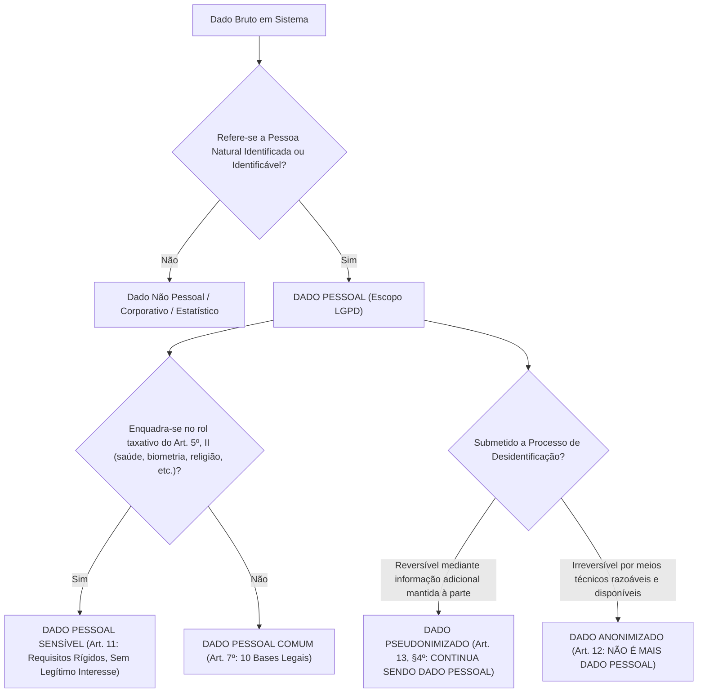
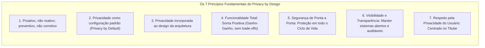
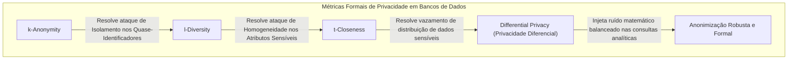
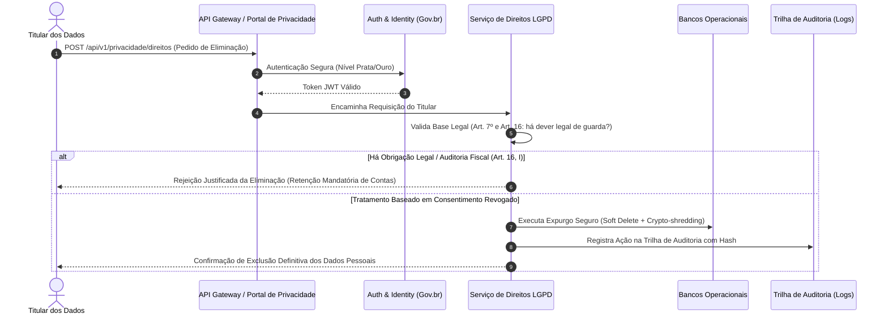

# 01 - LGPD Aplicada ao Desenvolvimento e Operação de Sistemas

> **Matéria:** Legislação Aplicada à Tecnologia da Informação  
> **Cargo:** B02 – Técnico de Controle Externo – Especialidade: Tecnologia da Informação  
> **Arquivo:** `01_lgpd_aplicada_ao_desenvolvimento_e_sistemas.md`  
> **Ato Normativo:** Lei Federal nº 13.709, de 14 de agosto de 2018 (Lei Geral de Proteção de Dados Pessoais - LGPD)

---

## 📌 Ementa / Itens do Edital
- Aplicação técnica da LGPD (Lei nº 13.709/2018) no ciclo de desenvolvimento de software e operação de sistemas
- Conceitos essenciais: Dado pessoal, Dado sensível, Dado anonimizado, Titular, Controlador, Operador e Encarregado (DPO)
- Princípios da LGPD aplicados à engenharia de software (com foco em Minimização e Finalidade)
- Metodologias: Privacy by Design e Privacy by Default (Ann Cavoukian)
- Técnicas de desidentificação: Anonimização vs. Pseudonimização
- Implementação de direitos dos titulares em sistemas de informação e segurança de dados

---

## 🧭 Sumário

1. [Taxonomia de Dados e Papéis sob a LGPD](#1-taxonomia-de-dados-e-papeis-sob-a-lgpd)
1. [Classificação Legal e Técnica dos Dados](#1-1-classificacao-legal-e-tecnica-dos-dados)
    1. [Teste 515](#Teste-515)
1. [Agentes de Tratamento e o Encarregado (DPO)](#1-2-agentes-de-tratamento-e-o-encarregado-dpo)
    1. [Teste 516](#Teste-516)
2. [Princípios do Art. 6º sob a Ótica da Arquitetura e Engenharia de Software](#2-principios-do-art-6o-sob-a-otica-da-arquitetura-e-engenharia-de-software)
    1. [Teste 517](#Teste-517)
3. [Privacy by Design e Privacy by Default (Ann Cavoukian)](#3-privacy-by-design-e-privacy-by-default-ann-cavoukian)
3. [Os 7 Princípios Fundamentais do Privacy by Design](#3-1-os-7-principios-fundamentais-do-privacy-by-design)
    1. [Teste 518](#Teste-518)
3. [Comparativo: Privacy by Design vs. Privacy by Default](#3-2-comparativo-privacy-by-design-vs-privacy-by-default)
    1. [Teste 519](#Teste-519)
4. [Engenharia de Desidentificação: Anonimização vs. Pseudonimização](#4-engenharia-de-desidentificacao-anonimizacao-vs-pseudonimizacao)
4. [Técnicas Criptográficas de Pseudonimização](#4-1-tecnicas-criptograficas-de-pseudonimizacao)
    1. [Teste 520](#Teste-520)
4. [Métricas Formais de Anonimização (k-Anonymity, l-Diversity, t-Closeness e DP)](#4-2-metricas-formais-de-anonimizacao-k-anonymity-l-diversity-t-closeness-e-dp)
    1. [Teste 521](#Teste-521)
5. [Implementação Técnica dos Direitos dos Titulares (Art. 18 da LGPD)](#5-implementacao-tecnica-dos-direitos-dos-titulares-art-18-da-lgpd)
5. [Mapeamento dos Direitos e Requisitos Técnicos](#5-1-mapeamento-dos-direitos-e-requisitos-tecnicos)
    1. [Teste 522](#Teste-522)
5. [Comunicação de Incidentes de Segurança à ANPD e Titulares (Art. 48)](#5-2-comunicacao-de-incidentes-de-seguranca-a-anpd-e-titulares-art-48)
    1. [Teste 523](#Teste-523)
    2. [Teste 524](#Teste-524)
6. [Fontes Recomendadas na Internet](#6-fontes-recomendadas-na-internet)

---

## 1. Taxonomia de Dados e Papéis sob a LGPD

A aplicação da **Lei Geral de Proteção de Dados Pessoais (Lei nº 13.709/2018 - LGPD)** na Engenharia de Software, Arquitetura de Sistemas e Operações de TI (DevSecOps) impõe uma reformulação estrutural nos modelos conceituais de dados, esquemas relacionais e NoSQL, esteiras de mensageria, contratos de APIs e controles de acesso.

---

## 1.1 Classificação Legal e Técnica dos Dados

| Categoria | Definição Legal (LGPD) | Exemplos Técnicos em Banco de Dados / APIs | Regime Jurídico de Proteção |
|---|---|---|---|
| **Dado Pessoal Comum** (Art. 5º, I) | Informação relacionada a pessoa natural identificada ou identificável. | Nome, CPF, e-mail pessoal, endereço IP de log, User-Agent, cookie identifier, geolocalização GPS. | Sujeito integralmente à LGPD. Pode ser tratado via 10 bases legais (Art. 7º), incluindo execução de contrato, cumprimento de obrigação legal e legítimo interesse. |
| **Dado Pessoal Sensível** (Art. 5º, II) | Origem racial/étnica, convicção religiosa, opinião política, filiação a sindicato/organização religiosa/política, dado referente à saúde ou à vida sexual, dado genético ou biométrico. | Template biométrico facial/digital, prontuário médico eletrônico, CID em atestados, exames toxicológicos. | Regime altamente restritivo (Art. 11). **NÃO admite a base legal do Legítimo Interesse**. Exige consentimento específico e destacado ou hipóteses legais estritas. |
| **Dado Pseudonimizado** (Art. 13, § 4º) | Dado que perde a possibilidade de associação direta a um indivíduo, senão pelo uso de informação adicional mantida separadamente pelo controlador. | IDs com Hashing salgado (`SHA-256(CPF + Salt)`), tokens UUID opacos cujas tabelas de de-para residem em base isolada com KMS. | **CONTINUA SENDO DADO PESSOAL**. É uma salvaguarda técnica e de segurança, não uma isenção da lei. |
| **Dado Anonimizado** (Art. 12) | Dado relativo a titular que não possa ser identificado, considerando meios técnicos razoáveis e disponíveis na ocasião do tratamento. | Conjuntos agregados com k-anonymity alto, microdados com injeção de ruído laplaciano (Differential Privacy). | **NÃO é considerado dado pessoal**, saindo do escopo da LGPD, **salvo se o processo for revertido** ou reversível por esforço razoável. |

> 🚨 **ALERTA DE PROVA / PEGADINHA FCC:**  
> A FCC tenta induzir o candidato ao erro afirmando que a **pseudonimização** retira o dado da incidência da LGPD. Isso é **FALSO**! O dado pseudonimizado permanece sob a tutela da LGPD porque o próprio controlador ou terceiro autorizado detém a chave reversora (informação adicional). Somente a **anonimização real e irreversível** afasta a aplicação da lei (Art. 12).

---

## 1.2 Agentes de Tratamento e o Encarregado (DPO)

1. **Titular:** A pessoa natural (física) viva a quem se referem os dados pessoais que são objeto de tratamento. Pessoas jurídicas **não** são titulares de dados sob a LGPD.
2. **Controlador (Art. 5º, VI):** Pessoa natural ou jurídica, de direito público ou privado, a quem competem as **decisões** essenciais referentes ao tratamento de dados pessoais (ex.: Tribunal de Contas, Secretaria de Fazenda, empresa pública).
3. **Operador (Art. 5º, VII):** Pessoa natural ou jurídica, de direito público ou privado, que realiza o tratamento de dados pessoais **em nome do controlador** (ex.: empresa contratada de hospedagem em nuvem, fábrica de software terceirizada, consultoria de sustentação de banco de dados). O operador deve agir estritamente conforme as instruções lícitas do controlador.
4. **Encarregado / Data Protection Officer - DPO (Art. 5º, VIII):** Pessoa indicada pelo controlador e operador para atuar como canal de comunicação entre o controlador, os titulares dos dados e a Autoridade Nacional de Proteção de Dados (ANPD).
    - Suas atividades incluem: receber reclamações e comunicações dos titulares, prestar esclarecimentos, receber notificações da ANPD e orientar os colaboradores da entidade sobre as práticas de proteção de dados.
    - A identidade e as informações de contato do encarregado devem ser divulgadas publicamente, de forma clara e objetiva, preferencialmente no sítio eletrônico do controlador (Art. 41, § 1º).

> 🚨 **ALERTA DE PROVA / PEGADINHA FCC:**  
> O Operador não toma decisões sobre as finalidades do tratamento. Se um provedor de nuvem contratado como Operador resolver utilizar os dados do órgão público para treinar seus próprios modelos comerciais de IA sem autorização, ele comete desvio de finalidade e passa a responder como **Controlador** em relação a esse tratamento ilícito.

---

## 2. Princípios do Art. 6º sob a Ótica da Arquitetura e Engenharia de Software

O Art. 6º da LGPD elenca dez princípios fundamentais que regem as atividades de tratamento. Para desenvolvedores, arquitetos e DBAs, esses princípios se traduzem em requisitos não funcionais diretos:

1. **Finalidade:** Realização do tratamento para propósitos legítimos, específicos, explícitos e informados ao titular, sem possibilidade de tratamento posterior de forma incompatível.
    - *Impacto em TI:* Cada campo persistido na tabela do banco de dados deve ter uma justificativa funcional rastreável. Não é permitido criar rotinas de coleta de dados genéricos sob a premissa de "podemos precisar disso no futuro".

2. **Adequação:** Compatibilidade do tratamento com as finalidades informadas ao titular.
    - *Impacto em TI:* Se o cadastro foi feito para emissão de certidão negativa de débitos fiscais, o sistema não pode enviar newsletters promocionais ou compartilhar dados com empresas privadas sem base legal.

3. **Necessidade (Minimização de Dados):** Limitação do tratamento ao mínimo necessário para a realização de suas finalidades, com abrangência dos dados pertinentes, proporcionais e não excessivos.
    - *Impacto em TI:* Se uma API precisa apenas validar a maioridade do usuário, ela deve receber um booleano `maior_de_idade: true/false` ou a idade calculada, e não o RG completo, filiação e certidão de nascimento digitalizada.

4. **Livre Acesso:** Garantia aos titulares de consulta facilitada e gratuita sobre a forma e a duração do tratamento, bem como sobre a integralidade de seus dados pessoais.
    - *Impacto em TI:* Criação de painéis de autoatendimento (*self-service privacy portals*) e endpoints de leitura de perfil.

5. **Qualidade dos Dados:** Garantia de exatidão, clareza, relevância e atualização dos dados.
    - *Impacto em TI:* Implementação de rotinas de validação de esquemas (JSON Schema, constraints de integridade), deduplicação de registros e mecanismos para retificação de dados incorretos pelo próprio titular.

6. **Transparência:** Garantia de informações claras, precisas e facilmente acessíveis sobre a realização do tratamento e os respectivos agentes de tratamento.
    - *Impacto em TI:* Políticas de privacidade com redação clara em microcopy nos formulários, registros de consentimento (*consent logs*) e termos versionados.

7. **Segurança:** Utilização de medidas técnicas e administrativas aptas a proteger os dados pessoais de acessos não autorizados e de situações acidentais ou ilícitas.
    - *Impacto em TI:* Criptografia de dados em trânsito (TLS 1.3) e em repouso (AES-256 com chaves gerenciadas por HSM/KMS), RBAC/ABAC, mTLS em microserviços e proteção contra injeções (OWASP Top 10).

8. **Prevenção:** Adoção de medidas prévias para evitar a ocorrência de danos em virtude do tratamento de dados pessoais.
    - *Impacto em TI:* Auditorias contínuas de código (SAST/DAST), modelagem de ameaças e esteiras DevSecOps com bloqueio de deploy em caso de vazamento de segredos em repositórios.

9. **Não Discriminação:** Impossibilidade de realização do tratamento para fins discriminatórios ilícitos ou abusivos.
    - *Impacto em TI:* Validação ética e técnica de modelos de Machine Learning para evitar viés algorítmico (*bias*) em sistemas de concessão de créditos tributários ou triagens fiscais.

10. **Responsabilização e Prestação de Contas (Accountability):** Demonstração da eficácia das medidas adotadas pelo agente.
    - *Impacto em TI:* Trilhas de auditoria imutáveis (*audit trails* / logs assinados digitalmente), relatórios de impacto à proteção de dados (RIPD/DPIA) e documentação de arquitetura de dados.

> 🚨 **ALERTA DE PROVA / PEGADINHA FCC:**  
> No setor público (Art. 23), para desempenhar competências legais e executar políticas públicas, **não se exige consentimento** do titular. A FCC adora afirmar que órgãos de fiscalização precisam de autorização do cidadão auditado para processar seus dados cadastrais. **ERRADO!** O tratamento funda-se no cumprimento de obrigação legal (Art. 7º, II) e exercício regular de direitos (Art. 7º, VI).

---

## 3. Privacy by Design e Privacy by Default (Ann Cavoukian)

Concebida no final da década de 1990 pela Comissária de Informação e Privacidade de Ontário (Canadá), Dra. Ann Cavoukian, a metodologia de **Privacy by Design (PbD)** prescreve que a privacidade não pode ser um adendo tardio adicionado ao final do desenvolvimento; ela deve ser o alicerce desde a primeira linha de arquitetura.

---

## 3.1 Os 7 Princípios Fundamentais do Privacy by Design

1. **Proativo e não reativo; Preventivo e não corretivo:** O sistema antecipa os riscos de violação de privacidade antes que aconteçam, aplicando modelagem de ameaças à privacidade (LINDDUN) antes da codificação.
2. **Privacidade como Padrão (Privacy by Default):** Se o titular do dado não fizer nenhuma alteração nas configurações, o nível de privacidade permanece o mais restritivo possível.
    - Checkboxes de consentimento desmarcadas por padrão;
    - Coleta de dados estritamente necessária ativada; dados opcionais desativados;
    - Cookies de rastreamento de terceiros bloqueados por padrão.

3. **Privacidade Incorporada ao Design:** A proteção da privacidade é uma funcionalidade essencial do núcleo do software e da infraestrutura, não um remendo (*patch*) colocado sobre uma arquitetura insegura.
4. **Funcionalidade Total (Soma Positiva - *Positive-Sum, not Zero-Sum*):** Rejeita a falsa dicotomia de que "ou temos privacidade, ou temos segurança/desempenho". A arquitetura de software de excelência entrega alta performance, segurança robusta **e** respeito irrestrito à privacidade.
5. **Segurança de Ponta a Ponta (Proteção em Todo o Ciclo de Vida):** A segurança cobre a informação desde a coleta inicial, trânsito, processamento, armazenamento, backup até o expurgo definitivo e seguro (*crypto-shredding* ou destruição física da mídia).
6. **Visibilidade e Transparência:** Todas as partes operacionais e políticas devem permanecer transparentes e verificáveis, assegurando que o que foi prometido nos termos seja exatamente o que os algoritmos executam em produção.
7. **Respeito pela Privacidade do Usuário:** O sistema é centrado no usuário (*user-centric*). Oferece padrões de usabilidade claros, sem padrões obscuros (*dark patterns*) voltados a ludibriar o titular a compartilhar dados indesejados.

---

## 3.2 Comparativo: Privacy by Design vs. Privacy by Default

| Dimensão | Privacy by Design (PbD) | Privacy by Default (PbDf) |
|---|---|---|
| **Escopo** | Holístico, arquitetural e metodológico. Abrange toda a esteira de engenharia de software e processos organizacionais. | Focado na experiência de usuário, parametrização padrão de interfaces, bancos e sistemas operacionais. |
| **Momento de Aplicação** | Desde a concepção dos requisitos de negócio e arquitetura de software (Fase 0). | No momento em que o sistema ou serviço é disponibilizado para uso pelo usuário final. |
| **Ação Exigida do Usuário** | Nenhuma (é interno à engenharia de software). | Zero esforço: a proteção máxima já está ativa sem que o usuário precise alterar nenhuma chave ou configuração. |
| **Exemplo Típico** | Armazenamento de dados pessoais em tabelas segregadas com criptografia em repouso e trilhas de log imutáveis. | Perfil público de novo usuário criado como "Privado" por padrão; geolocalização desativada inicialmente. |

---

### Teste 001
**(FGV – TJ/SC – 2026 – Analista Administrativo)**
O Tribunal de Justiça de Santa Catarina implementou um sistema eletrônico para gestão processual e atendimento ao cidadão, com o objetivo de aprimorar a prestação jurisdicional e assegurar a conformidade com a Lei nº 13.709/2018 (Lei Geral de Proteção de Dados Pessoais – LGPD). Na solução adotada: i) dados de partes, advogados e demais usuários são coletados e utilizados para identificação, comunicação processual e tramitação dos feitos; ii) informações relativas à saúde, biometria e outros dados protegidos pela LGPD recebem tratamento diferenciado e maior nível de proteção; iii) os cidadãos podem solicitar informações sobre o tratamento de seus dados pessoais, nos termos da legislação aplicável; iv) o Tribunal define as finalidades e os meios de tratamento dos dados pessoais utilizados em suas atividades; e v) empresa contratada é responsável pelo armazenamento e processamento de dados em ambiente computacional disponibilizado ao Tribunal. Com base nesse cenário, associe corretamente os conceitos da LGPD (Coluna I) às descrições (Coluna II): Coluna I Coluna II ( ) Informações como nome, CPF, endereço eletrônico e telefone, 1. Dado pessoal utilizadas para identificar usuários dos serviços judiciais. 2. Dado pessoal ( ) Empresa contratada que realiza o sensível armazenamento e o processamento de dados em nome do Tribunal. 3. Titular dos ( ) Pessoa física a quem os dados pessoais dados se referem, podendo exercer os direitos previstos na LGPD. 4. Controlador ( ) Informações sobre saúde, dados biométricos ou outros dados 5. Operador submetidos à proteção especial pela legislação. ( ) Órgão responsável por definir as finalidades e os meios de tratamento dos dados pessoais utilizados no sistema. Assinale a opção que indica a relação correta, na ordem apresentada.

* **A)** 1 – 5 – 3 – 2 – 4.
* **B)** 1 – 4 – 3 – 2 – 5.
* **C)** 2 – 5 – 3 – 1 – 4.
* **D)** 1 – 5 – 4 – 2 – 3.
* **E)** 1 – 3 – 5 – 2 – 4.

---

> **Comentário Detalhado:**
>
> - **A)** **Correta.** Conforme fundamentado na seção *1.2 Agentes de Tratamento e o Encarregado (DPO)* deste guia, operador (Art. 5º, VII): Pessoa natural ou jurídica, de direito público ou privado, que realiza o tratamento de dados pessoais em nome do controlador (ex.: empresa contratada de hospedagem em nuvem, fábrica de software terceirizada, consultoria de sustentação de banco de dados). O operador deve agir estritamente conforme as instruções lícitas do controlador. Dessa forma, está plenamente correta a assertiva da banca (FGV – TJ/SC/2026) ao estabelecer que "1 – 5 – 3 – 2 – 4".
> - **B)** **Incorreta.** A opção apresenta proposição em desacordo com os fundamentos teóricos e técnicos do tópico ao afirmar que "1 – 4 – 3 – 2 – 5". De acordo com a teoria estudada em *6. Fontes Recomendadas na Internet*, lei nº 13.709/2018 (Lei Geral de Proteção de Dados Pessoais LGPD) Texto compilado da LGPD no Planalto com todas as bases legais, direitos dos titulares e deveres dos agentes de tratamento.
> - **C)** **Incorreta.** A opção apresenta proposição em desacordo com os fundamentos teóricos e técnicos do tópico ao afirmar que "2 – 5 – 3 – 1 – 4". De acordo com a teoria estudada em *1.1 Classificação Legal e Técnica dos Dados*, dado Pessoal Comum (Art. 5º, I): Informação relacionada a pessoa natural identificada ou identificável. — Nome, CPF, e mail pessoal, endereço IP de log, User Agent, cookie identifier, geolocalização GPS. — Sujeito integralmente à LGPD. Pode ser tratado via 10 bases legais (Art. 7º), incluindo execução de contrato, cumprimento de obrigação legal e legítimo interesse.
> - **D)** **Incorreta.** A opção apresenta proposição em desacordo com os fundamentos teóricos e técnicos do tópico ao afirmar que "1 – 5 – 4 – 2 – 3". De acordo com a teoria estudada em *1.2 Agentes de Tratamento e o Encarregado (DPO)*, o Operador não toma decisões sobre as finalidades do tratamento. Se um provedor de nuvem contratado como Operador resolver utilizar os dados do órgão público para treinar seus próprios modelos comerciais de IA sem autorização, ele comete desvio de finalidade e passa a responder como Controlador em relação a esse tratamento ilícito.
> - **E)** **Incorreta.** A opção apresenta proposição em desacordo com os fundamentos teóricos e técnicos do tópico ao afirmar que "1 – 3 – 5 – 2 – 4". De acordo com a teoria estudada em *Fundamentos Teóricos*, ato Normativo: Lei Federal nº 13.709, de 14 de agosto de 2018 (Lei Geral de Proteção de Dados Pessoais LGPD).
>
> **Gabarito: A**

---

### Teste 002
**(FGV – TJ/SC – 2026 – Analista Administrativo)**
No âmbito da Resolução TJ nº 3/2021 do Tribunal de Justiça de Santa Catarina, o tratamento de dados pessoais deve ser pautado pela observância estrita das bases legais e dos princípios de proteção ao titular. Imagine que uma unidade administrativa do TJSC deseja implementar um novo sistema para o processamento de dados de magistrados e servidores, visando especificamente ao cumprimento de determinações contidas em leis federais e normas do Conselho Nacional de Justiça (CNJ). Considerando as diretrizes sobre o ciclo de vida dos dados e as hipóteses de tratamento previstas na referida Resolução e na LGPD, assinale a afirmativa que descreve corretamente a base legal e a conduta correta para esse cenário.

* **A)** O tratamento deve ser baseado exclusivamente no consentimento do titular, devendo o sistema ser interrompido caso algum servidor se recuse a autorizar a coleta dos dados.
* **B)** O tratamento poderá ser realizado com base no cumprimento de obrigação legal ou regulatória, o que dispensa a coleta de consentimento específico, desde que respeitados os princípios da finalidade e da necessidade.
* **C)** Os dados coletados para essa finalidade legal podem ser utilizados posteriormente para qualquer outro fim administrativo, uma vez que o dado já reside nos servidores do Controlador (PJSC).
* **D)** O dado pessoal sensível, por sua natureza, não pode ser tratado pelo Tribunal sob a justificativa de obrigação legal, exigindo sempre a anonimização irreversível imediata após a coleta.
* **E)** A fase de descarte do ciclo de vida do dado é facultativa para o Judiciário, sendo permitida a manutenção perpétua de dados pessoais em texto claro para fins de registro histórico, sem necessidade de avaliação de descarte. Direitos Humanos e acesso à justiça

---

> **Comentário Detalhado:**
>
> - **A)** **Incorreta.** A opção incorre em restrição indevida ao limitar o escopo conceitual ao afirmar que "O tratamento deve ser baseado exclusivamente no consentimento do titular, devendo o sistema ser interrompido caso...". De acordo com a teoria estudada em *1.1 Classificação Legal e Técnica dos Dados*, dado Pessoal Comum (Art. 5º, I): Informação relacionada a pessoa natural identificada ou identificável. — Nome, CPF, e mail pessoal, endereço IP de log, User Agent, cookie identifier, geolocalização GPS. — Sujeito integralmente à LGPD. Pode ser tratado via 10 bases legais (Art. 7º), incluindo execução de contrato, cumprimento de obrigação legal e legítimo interesse.
> - **B)** **Correta.** Conforme fundamentado na seção *2. Princípios do Art. 6º sob a Ótica da Arquitetura e Engenharia de Software* deste guia, no setor público (Art. 23), para desempenhar competências legais e executar políticas públicas, não se exige consentimento do titular. A FCC adora afirmar que órgãos de fiscalização precisam de autorização do cidadão auditado para processar seus dados cadastrais. ERRADO! O tratamento funda se no cumprimento de obrigação legal (Art. 7º, II) e exercício regular de direitos (Art. 7º, VI). Dessa forma, está plenamente correta a assertiva da banca (FGV – TJ/SC/2026) ao estabelecer que "O tratamento poderá ser realizado com base no cumprimento de obrigação legal ou regulatória, o que dispensa a...".
> - **C)** **Incorreta.** A opção promove generalização excessiva que desconsidera as condições técnicas e normativas ao afirmar que "Os dados coletados para essa finalidade legal podem ser utilizados posteriormente para qualquer outro fim...". De acordo com a teoria estudada em *1.1 Classificação Legal e Técnica dos Dados*, dado Pessoal Sensível (Art. 5º, II): Origem racial/étnica, convicção religiosa, opinião política, filiação a sindicato/organização religiosa/política, dado referente à saúde ou à vida sexual, dado genético ou biométrico. — Template biométrico facial/digital, prontuário médico eletrônico, CID em atestados, exames toxicológicos. — Regime altamente restritivo (Art. 11). NÃO admite a base legal do Legítimo Interesse. Exige consentimento específico e destacado ou hipóteses legais estritas.
> - **D)** **Incorreta.** A opção promove generalização excessiva que desconsidera as condições técnicas e normativas ao afirmar que "O dado pessoal sensível, por sua natureza, não pode ser tratado pelo Tribunal sob a justificativa de obrigação...". De acordo com a teoria estudada em *1.1 Classificação Legal e Técnica dos Dados*, dado Anonimizado (Art. 12): Dado relativo a titular que não possa ser identificado, considerando meios técnicos razoáveis e disponíveis na ocasião do tratamento. — Conjuntos agregados com k anonymity alto, microdados com injeção de ruído laplaciano (Differential Privacy). — NÃO é considerado dado pessoal, saindo do escopo da LGPD, salvo se o processo for revertido ou reversível por esforço razoável.
> - **E)** **Incorreta.** A opção afasta requisito ou relação estrutural exigida pela matéria ao afirmar que "A fase de descarte do ciclo de vida do dado é facultativa para o Judiciário, sendo permitida a manutenção perpétua...". De acordo com a teoria estudada em *3.1 Os 7 Princípios Fundamentais do Privacy by Design*, segurança de Ponta a Ponta (Proteção em Todo o Ciclo de Vida): A segurança cobre a informação desde a coleta inicial, trânsito, processamento, armazenamento, backup até o expurgo definitivo e seguro ( crypto shredding ou destruição física da mídia).
>
> **Gabarito: B**

---

### Teste 003
**(FGV – TJ/AP – 2023 – Analista Judiciario Apoio Especializado Tecnologia Da Informacao Desenvolvimento De Sistemas)**
De acordo com a LGPD, a manifestação livre, informada e inequívoca pela qual o titular concorda com o tratamento de seus dados pessoais para uma finalidade determinada é realizada por meio do(a):

* **A)** livre acesso;
* **B)** transparência;
* **C)** consentimento;
* **D)** não discriminação;
* **E)** responsabilização e prestação de contas.

---

> **Comentário Detalhado:**
>
> - **A)** **Incorreta.** A opção apresenta proposição em desacordo com os fundamentos teóricos e técnicos do tópico ao afirmar que "livre acesso". De acordo com a teoria estudada em *2. Princípios do Art. 6º sob a Ótica da Arquitetura e Engenharia de Software*, livre Acesso: Garantia aos titulares de consulta facilitada e gratuita sobre a forma e a duração do tratamento, bem como sobre a integralidade de seus dados pessoais.
> - **B)** **Incorreta.** A opção apresenta proposição em desacordo com os fundamentos teóricos e técnicos do tópico ao afirmar que "transparência". De acordo com a teoria estudada em *2. Princípios do Art. 6º sob a Ótica da Arquitetura e Engenharia de Software*, transparência: Garantia de informações claras, precisas e facilmente acessíveis sobre a realização do tratamento e os respectivos agentes de tratamento.
> - **C)** **Correta.** Conforme fundamentado na seção *2. Princípios do Art. 6º sob a Ótica da Arquitetura e Engenharia de Software* deste guia, no setor público (Art. 23), para desempenhar competências legais e executar políticas públicas, não se exige consentimento do titular. A FCC adora afirmar que órgãos de fiscalização precisam de autorização do cidadão auditado para processar seus dados cadastrais. ERRADO! O tratamento funda se no cumprimento de obrigação legal (Art. 7º, II) e exercício regular de direitos (Art. 7º, VI). Dessa forma, está plenamente correta a assertiva da banca (FGV – TJ/AP/2023) ao estabelecer que "consentimento".
> - **D)** **Incorreta.** A opção apresenta proposição em desacordo com os fundamentos teóricos e técnicos do tópico ao afirmar que "não discriminação". De acordo com a teoria estudada em *2. Princípios do Art. 6º sob a Ótica da Arquitetura e Engenharia de Software*, não Discriminação: Impossibilidade de realização do tratamento para fins discriminatórios ilícitos ou abusivos.
> - **E)** **Incorreta.** A opção apresenta proposição em desacordo com os fundamentos teóricos e técnicos do tópico ao afirmar que "responsabilização e prestação de contas". De acordo com a teoria estudada em *2. Princípios do Art. 6º sob a Ótica da Arquitetura e Engenharia de Software*, responsabilização e Prestação de Contas (Accountability): Demonstração da eficácia das medidas adotadas pelo agente.
>
> **Gabarito: C**

---

### Teste 004
**(FGV – TRT da 24º Região – 2025 – Analista Judiciário - Área Administrativa - Contabilidade)**
De acordo com a Lei Geral de Proteção de Dados Pessoais (Lei nº 13.709/2018), o titular tem direito ao acesso facilitado às informações sobre o tratamento de seus dados, que deverão ser disponibilizadas de forma clara, adequada e ostensiva acerca de determinadas características. Quando o consentimento é requerido, se houver mudanças da finalidade para o tratamento de dados pessoais não compatíveis com o consentimento original, o controlador deverá informar o titular sobre as mudanças de finalidade

* **A)** previamente, sendo que o titular não poderá revogar o consentimento.
* **B)** previamente, podendo o titular revogar o consentimento, caso discorde das alterações.
* **C)** posteriormente, sendo que o titular não poderá revogar o consentimento.
* **D)** posteriormente, podendo o titular revogar o consentimento, caso discorde das alterações.
* **E)** anualmente, sendo que o titular deverá renovar o seu consentimento.

---

> **Comentário Detalhado:**
>
> - **A)** **Incorreta.** A opção apresenta proposição em desacordo com os fundamentos teóricos e técnicos do tópico ao afirmar que "previamente, sendo que o titular não poderá revogar o consentimento". De acordo com a teoria estudada em *5.2 Comunicação de Incidentes de Segurança à ANPD e Titulares (Art. 48)*, a ANPD poderá determinar ao controlador a ampla divulgação do fato nos meios de comunicação caso considere relevante.
> - **B)** **Correta.** Conforme fundamentado na seção *2. Princípios do Art. 6º sob a Ótica da Arquitetura e Engenharia de Software* deste guia, no setor público (Art. 23), para desempenhar competências legais e executar políticas públicas, não se exige consentimento do titular. A FCC adora afirmar que órgãos de fiscalização precisam de autorização do cidadão auditado para processar seus dados cadastrais. ERRADO! O tratamento funda se no cumprimento de obrigação legal (Art. 7º, II) e exercício regular de direitos (Art. 7º, VI). Dessa forma, está plenamente correta a assertiva da banca (FGV – TRT da 24º Região/2025) ao estabelecer que "previamente, podendo o titular revogar o consentimento, caso discorde das alterações".
> - **C)** **Incorreta.** A opção apresenta proposição em desacordo com os fundamentos teóricos e técnicos do tópico ao afirmar que "posteriormente, sendo que o titular não poderá revogar o consentimento". De acordo com a teoria estudada em *1. Taxonomia de Dados e Papéis sob a LGPD*, a aplicação da Lei Geral de Proteção de Dados Pessoais (Lei nº 13.709/2018 LGPD) na Engenharia de Software, Arquitetura de Sistemas e Operações de TI (DevSecOps) impõe uma reformulação estrutural nos modelos conceituais de dados, esquemas relacionais e NoSQL, esteiras de mensageria, contratos de APIs e controles de acesso.
> - **D)** **Incorreta.** A opção apresenta proposição em desacordo com os fundamentos teóricos e técnicos do tópico ao afirmar que "posteriormente, podendo o titular revogar o consentimento, caso discorde das alterações". De acordo com a teoria estudada em *6. Fontes Recomendadas na Internet*, lei nº 13.709/2018 (Lei Geral de Proteção de Dados Pessoais LGPD) Texto compilado da LGPD no Planalto com todas as bases legais, direitos dos titulares e deveres dos agentes de tratamento.
> - **E)** **Incorreta.** A opção apresenta proposição em desacordo com os fundamentos teóricos e técnicos do tópico ao afirmar que "anualmente, sendo que o titular deverá renovar o seu consentimento". De acordo com a teoria estudada em *1.2 Agentes de Tratamento e o Encarregado (DPO)*, a identidade e as informações de contato do encarregado devem ser divulgadas publicamente, de forma clara e objetiva, preferencialmente no sítio eletrônico do controlador (Art. 41, § 1º).
>
> **Gabarito: B**

---

### Teste 005
**(FGV – TRT 16ª – 2022 – Analista Judiciário (Área Administrativa - Tecnologia da Informação))**
A sociedade empresária Alfa recebeu dados cadastrais de um consumidor. Ato contínuo, decidiu que esses atos seriam avaliados, para determinados fins da atividade empresarial, por João, pessoa natural. Considerando a sistemática estabelecida pela Lei nº 13.709/2018, é correto afirmar que Alfa deve ser considerada

* **A)** controladora, enquanto João é o operador, que realiza uma atividade de tratamento.
* **B)** operadora, enquanto João é o controlador, que realiza uma atividade de tratamento.
* **C)** repassadora, enquanto João é o controlador da avaliação, que realiza uma atividade de tratamento.
* **D)** operadora, enquanto João é o controlador, sendo que ambos realizaram uma atividade de tratamento.
* **E)** receptora, enquanto João é o destinatário, sendo que não há atividade de tratamento por nenhum dos dois.

---

> **Comentário Detalhado:**
>
> - **A)** **Correta.** Conforme fundamentado na seção *1.2 Agentes de Tratamento e o Encarregado (DPO)* deste guia, operador (Art. 5º, VII): Pessoa natural ou jurídica, de direito público ou privado, que realiza o tratamento de dados pessoais em nome do controlador (ex.: empresa contratada de hospedagem em nuvem, fábrica de software terceirizada, consultoria de sustentação de banco de dados). O operador deve agir estritamente conforme as instruções lícitas do controlador. Dessa forma, está plenamente correta a assertiva da banca (FGV – TRT 16ª/2022) ao estabelecer que "controladora, enquanto João é o operador, que realiza uma atividade de tratamento".
> - **B)** **Incorreta.** A opção apresenta proposição em desacordo com os fundamentos teóricos e técnicos do tópico ao afirmar que "operadora, enquanto João é o controlador, que realiza uma atividade de tratamento". De acordo com a teoria estudada em *1.2 Agentes de Tratamento e o Encarregado (DPO)*, encarregado / Data Protection Officer DPO (Art. 5º, VIII): Pessoa indicada pelo controlador e operador para atuar como canal de comunicação entre o controlador, os titulares dos dados e a Autoridade Nacional de Proteção de Dados (ANPD).
> - **C)** **Incorreta.** A opção apresenta proposição em desacordo com os fundamentos teóricos e técnicos do tópico ao afirmar que "repassadora, enquanto João é o controlador da avaliação, que realiza uma atividade de tratamento". De acordo com a teoria estudada em *1.2 Agentes de Tratamento e o Encarregado (DPO)*, o Operador não toma decisões sobre as finalidades do tratamento. Se um provedor de nuvem contratado como Operador resolver utilizar os dados do órgão público para treinar seus próprios modelos comerciais de IA sem autorização, ele comete desvio de finalidade e passa a responder como Controlador em relação a esse tratamento ilícito.
> - **D)** **Incorreta.** A opção apresenta proposição em desacordo com os fundamentos teóricos e técnicos do tópico ao afirmar que "operadora, enquanto João é o controlador, sendo que ambos realizaram uma atividade de tratamento". De acordo com a teoria estudada em *1.1 Classificação Legal e Técnica dos Dados*, dado Pseudonimizado (Art. 13, § 4º): Dado que perde a possibilidade de associação direta a um indivíduo, senão pelo uso de informação adicional mantida separadamente pelo controlador. — IDs com Hashing salgado ( SHA 256(CPF + Salt) ), tokens UUID opacos cujas tabelas de de para residem em base isolada com KMS. — CONTINUA SENDO DADO PESSOAL. É uma salvaguarda técnica e de segurança, não uma isenção da lei.
> - **E)** **Incorreta.** A opção apresenta proposição em desacordo com os fundamentos teóricos e técnicos do tópico ao afirmar que "receptora, enquanto João é o destinatário, sendo que não há atividade de tratamento por nenhum dos dois". De acordo com a teoria estudada em *4.2 Métricas Formais de Anonimização (k-Anonymity, l-Diversity, t-Closeness e DP)*, linkability (Vinculação): Possibilidade de cruzar dois conjuntos de dados distintos e correlacionar registros referentes à mesma pessoa.
>
> **Gabarito: A**

---

### Teste 006
**(FGV – TRT/DA – 2025 – Analista Judiciario Area Apoio Especializado Tecnologia Da Informacao)**
A Lei nº 13.709/2018 (Lei Geral de Proteção de Dados Pessoais – LGPD) dispõe sobre o tratamento de dados pessoais, inclusive nos meios digitais, por pessoa natural ou por pessoa jurídica de direito público ou privado, com o objetivo de proteger os direitos fundamentais de liberdade e de privacidade e o livre desenvolvimento da personalidade da pessoa natural. A esse respeito, analise as afirmativas a seguir sobre os fundamentos da disciplina da proteção de dados pessoais. I. Entre os fundamentos constam a liberdade de expressão, de informação, de comunicação e de opinião e a inviolabilidade da intimidade, da honra e da imagem II. Entre os fundamentos estão presentes o respeito à propriedade privada nos meios digitais e a autodeterminação informativa de interesse público. III. Entre os fundamentos incluem-se a livre iniciativa, a livre concorrência e a defesa do consumidor e os direitos humanos, o livre desenvolvimento da personalidade, a dignidade e o exercício da cidadania pelas pessoas naturais. Está correto o que se afirma em

* **A)** I, apenas.
* **B)** II, apenas.
* **C)** III, apenas.
* **D)** I e II, apenas.
* **E)** I e III, apenas.

---

> **Comentário Detalhado:**
>
> - **A)** **Incorreta.** A opção incorre em restrição indevida ao limitar o escopo conceitual ao afirmar que "I, apenas". De acordo com a teoria estudada em *6. Fontes Recomendadas na Internet*, lei nº 13.709/2018 (Lei Geral de Proteção de Dados Pessoais LGPD) Texto compilado da LGPD no Planalto com todas as bases legais, direitos dos titulares e deveres dos agentes de tratamento.
> - **B)** **Incorreta.** A opção incorre em restrição indevida ao limitar o escopo conceitual ao afirmar que "II, apenas". De acordo com a teoria estudada em *1.2 Agentes de Tratamento e o Encarregado (DPO)*, controlador (Art. 5º, VI): Pessoa natural ou jurídica, de direito público ou privado, a quem competem as decisões essenciais referentes ao tratamento de dados pessoais (ex.: Tribunal de Contas, Secretaria de Fazenda, empresa pública).
> - **C)** **Incorreta.** A opção incorre em restrição indevida ao limitar o escopo conceitual ao afirmar que "III, apenas". De acordo com a teoria estudada em *1.2 Agentes de Tratamento e o Encarregado (DPO)*, operador (Art. 5º, VII): Pessoa natural ou jurídica, de direito público ou privado, que realiza o tratamento de dados pessoais em nome do controlador (ex.: empresa contratada de hospedagem em nuvem, fábrica de software terceirizada, consultoria de sustentação de banco de dados). O operador deve agir estritamente conforme as instruções lícitas do controlador.
> - **D)** **Incorreta.** A opção incorre em restrição indevida ao limitar o escopo conceitual ao afirmar que "I e II, apenas". De acordo com a teoria estudada em *1. Taxonomia de Dados e Papéis sob a LGPD*, a aplicação da Lei Geral de Proteção de Dados Pessoais (Lei nº 13.709/2018 LGPD) na Engenharia de Software, Arquitetura de Sistemas e Operações de TI (DevSecOps) impõe uma reformulação estrutural nos modelos conceituais de dados, esquemas relacionais e NoSQL, esteiras de mensageria, contratos de APIs e controles de acesso.
> - **E)** **Correta.** Conforme fundamentado na seção *Fundamentos Teóricos* deste guia, ato Normativo: Lei Federal nº 13.709, de 14 de agosto de 2018 (Lei Geral de Proteção de Dados Pessoais LGPD). Dessa forma, está plenamente correta a assertiva da banca (FGV – TRT/DA/2025) ao estabelecer que "I e III, apenas".
>
> **Gabarito: E**

---

### Teste 007
**(FGV – TJ/RR – 2024 – Analista Judiciario Gestao E Governanca De Tecnologia Da Informacao)**
No contexto da Lei Geral de Proteção de Dados (LGPD), os papéis do Controlador, do Operador e do Encarregado de Dados (DPO – Data Protection Officer) são fundamentais para o correto tratamento dos dados pessoais. Considerando a interação com a Autoridade Nacional de Proteção de Dados (ANPD), e as responsabilidades e funções de cada um, é correto afirmar que

* **A)** o Controlador é responsável por executar o tratamento de dados pessoais seguindo as instruções do Operador, enquanto o DPO orienta e atua como canal de comunicação.
* **B)** o Operador decide sobre as finalidades e os meios de tratamento dos dados pessoais, sendo auxiliado pelo Controlador na implementação das medidas de segurança, enquanto o DPO interage tanto com os titulares dos dados quanto com a ANPD.
* **C)** o DPO é responsável por determinar como os dados pessoais serão coletados e utilizados, além de implementar políticas de proteção de dados de forma independente do Controlador ou Operador.
* **D)** o Controlador determina as finalidades e os meios de tratamento dos dados pessoais; o Operador realiza o tratamento, seguindo as instruções do Controlador; e o DPO atua como canal de comunicação entre o Controlador, os titulares dos dados e a ANPD.
* **E)** o Controlador e o Operador compartilham a responsabilidade de decidir sobre as bases legais para o tratamento de dados pessoais, enquanto o DPO é o único responsável por comunicar violações de dados à ANPD e aos titulares.

---

> **Comentário Detalhado:**
>
> - **A)** **Incorreta.** A opção apresenta proposição em desacordo com os fundamentos teóricos e técnicos do tópico ao afirmar que "o Controlador é responsável por executar o tratamento de dados pessoais seguindo as instruções do Operador...". De acordo com a teoria estudada em *1.2 Agentes de Tratamento e o Encarregado (DPO)*, operador (Art. 5º, VII): Pessoa natural ou jurídica, de direito público ou privado, que realiza o tratamento de dados pessoais em nome do controlador (ex.: empresa contratada de hospedagem em nuvem, fábrica de software terceirizada, consultoria de sustentação de banco de dados). O operador deve agir estritamente conforme as instruções lícitas do controlador.
> - **B)** **Incorreta.** A opção apresenta proposição em desacordo com os fundamentos teóricos e técnicos do tópico ao afirmar que "o Operador decide sobre as finalidades e os meios de tratamento dos dados pessoais, sendo auxiliado pelo...". De acordo com a teoria estudada em *5.2 Comunicação de Incidentes de Segurança à ANPD e Titulares (Art. 48)*, o Art. 48 da LGPD determina que o Controlador deve comunicar à Autoridade Nacional de Proteção de Dados (ANPD) e aos titulares a ocorrência de incidente de segurança que possa acarretar risco ou dano relevante aos titulares.
> - **C)** **Incorreta.** A opção apresenta proposição em desacordo com os fundamentos teóricos e técnicos do tópico ao afirmar que "o DPO é responsável por determinar como os dados pessoais serão coletados e utilizados, além de implementar...". De acordo com a teoria estudada em *1.2 Agentes de Tratamento e o Encarregado (DPO)*, o Operador não toma decisões sobre as finalidades do tratamento. Se um provedor de nuvem contratado como Operador resolver utilizar os dados do órgão público para treinar seus próprios modelos comerciais de IA sem autorização, ele comete desvio de finalidade e passa a responder como Controlador em relação a esse tratamento ilícito.
> - **D)** **Correta.** Conforme fundamentado na seção *1.2 Agentes de Tratamento e o Encarregado (DPO)* deste guia, encarregado / Data Protection Officer DPO (Art. 5º, VIII): Pessoa indicada pelo controlador e operador para atuar como canal de comunicação entre o controlador, os titulares dos dados e a Autoridade Nacional de Proteção de Dados (ANPD). Dessa forma, está plenamente correta a assertiva da banca (FGV – TJ/RR/2024) ao estabelecer que "o Controlador determina as finalidades e os meios de tratamento dos dados pessoais; o Operador realiza o...".
> - **E)** **Incorreta.** A opção apresenta proposição em desacordo com os fundamentos teóricos e técnicos do tópico ao afirmar que "o Controlador e o Operador compartilham a responsabilidade de decidir sobre as bases legais para o tratamento de...". De acordo com a teoria estudada em *6. Fontes Recomendadas na Internet*, lei nº 13.709/2018 (Lei Geral de Proteção de Dados Pessoais LGPD) Texto compilado da LGPD no Planalto com todas as bases legais, direitos dos titulares e deveres dos agentes de tratamento.
>
> **Gabarito: D**

---

### Teste 008
**(FGV – TJ/RR – 2024 – Analista Judiciario Gestao E Governanca De Tecnologia Da Informacao)**
Um sistema de gerenciamento de dados dos beneficiários de um programa governamental coleta diversas informações pessoais, incluindo nome, endereço e dados bancários para depósito dos benefícios. Durante uma auditoria, o auditor descobriu que: 1. O sistema não informa aos usuários como seus dados serão utilizados. 2. Não há procedimentos estabelecidos para que os beneficiários solicitem a remoção de seus dados. 3. Não existe a opção de correção de certos dados fornecidos pelo usuário. Considerando os direitos do titular de dados pessoais previstos na LGPD, podemos dizer que, entre os direitos violados, encontra-se o direito de

* **A)** acesso aos dados pessoais.
* **B)** revogação do consentimento.
* **C)** eliminação dos dados pessoais após o término do tratamento.
* **D)** portabilidade dos dados pessoais.
* **E)** oposição ao tratamento de dados pessoais.

---

> **Comentário Detalhado:**
>
> - **A)** **Incorreta.** A opção apresenta proposição em desacordo com os fundamentos teóricos e técnicos do tópico ao afirmar que "acesso aos dados pessoais". De acordo com a teoria estudada em *2. Princípios do Art. 6º sob a Ótica da Arquitetura e Engenharia de Software*, livre Acesso: Garantia aos titulares de consulta facilitada e gratuita sobre a forma e a duração do tratamento, bem como sobre a integralidade de seus dados pessoais.
> - **B)** **Incorreta.** A opção apresenta proposição em desacordo com os fundamentos teóricos e técnicos do tópico ao afirmar que "revogação do consentimento". De acordo com a teoria estudada em *5.1 Mapeamento dos Direitos e Requisitos Técnicos*, crypto shredding: Criptografar os dados pessoais de cada titular com uma chave individual e exclusiva ($K {\text{titular}}$). Para executar a eliminação definitiva em todas as réplicas e backups frios ( WORM ), basta destruir a chave no KMS.
> - **C)** **Correta.** Conforme fundamentado na seção *1.2 Agentes de Tratamento e o Encarregado (DPO)* deste guia, operador (Art. 5º, VII): Pessoa natural ou jurídica, de direito público ou privado, que realiza o tratamento de dados pessoais em nome do controlador (ex.: empresa contratada de hospedagem em nuvem, fábrica de software terceirizada, consultoria de sustentação de banco de dados). O operador deve agir estritamente conforme as instruções lícitas do controlador. Dessa forma, está plenamente correta a assertiva da banca (FGV – TJ/RR/2024) ao estabelecer que "eliminação dos dados pessoais após o término do tratamento".
> - **D)** **Incorreta.** A opção apresenta proposição em desacordo com os fundamentos teóricos e técnicos do tópico ao afirmar que "portabilidade dos dados pessoais". De acordo com a teoria estudada em *1.2 Agentes de Tratamento e o Encarregado (DPO)*, titular: A pessoa natural (física) viva a quem se referem os dados pessoais que são objeto de tratamento. Pessoas jurídicas não são titulares de dados sob a LGPD.
> - **E)** **Incorreta.** A opção apresenta proposição em desacordo com os fundamentos teóricos e técnicos do tópico ao afirmar que "oposição ao tratamento de dados pessoais". De acordo com a teoria estudada em *6. Fontes Recomendadas na Internet*, lei nº 13.709/2018 (Lei Geral de Proteção de Dados Pessoais LGPD) Texto compilado da LGPD no Planalto com todas as bases legais, direitos dos titulares e deveres dos agentes de tratamento.
>
> **Gabarito: C**

---

### Teste 009
**(FGV – TJ/RR – 2024 – Analista Judiciario Gestao E Governanca De Tecnologia Da Informacao)**
De acordo com a Lei Geral de Proteção de Dados (LGPD), especificamente o Artigo 38, o Relatório de Impacto à Proteção de Dados Pessoais (RIPD) tem como conteúdo mínimo obrigatório

* **A)** a descrição dos tipos de dados coletados; metodologia utilizada para a coleta e para a garantia da segurança das informações; e análise do controlador sobre medidas, salvaguardas e mecanismos de mitigação de risco adotados.
* **B)** a descrição das finalidades específicas do tratamento de dados; metodologia utilizada para a coleta e para a garantia da segurança das informações; e informações sobre o compartilhamento de dados com terceiros.
* **C)** a descrição dos tipos de dados coletados; políticas internas de recursos humanos; e informações sobre o compartilhamento de dados com terceiros.
* **D)** a lista dos consentimentos obtidos dos titulares; métodos para revogação do consentimento; e detalhes sobre a oposição ao tratamento de dados pessoais.
* **E)** o resumo das solicitações de eliminação de dados pessoais; mecanismos para anonimização de dados; e análise do controlador sobre medidas, salvaguardas e mecanismos de mitigação de risco adotados.

---

> **Comentário Detalhado:**
>
> - **A)** **Correta.** Conforme fundamentado na seção *5.2 Comunicação de Incidentes de Segurança à ANPD e Titulares (Art. 48)* deste guia, o Art. 48 da LGPD determina que o Controlador deve comunicar à Autoridade Nacional de Proteção de Dados (ANPD) e aos titulares a ocorrência de incidente de segurança que possa acarretar risco ou dano relevante aos titulares. Dessa forma, está plenamente correta a assertiva da banca (FGV – TJ/RR/2024) ao estabelecer que "a descrição dos tipos de dados coletados; metodologia utilizada para a coleta e para a garantia da segurança das...".
> - **B)** **Incorreta.** A opção apresenta proposição em desacordo com os fundamentos teóricos e técnicos do tópico ao afirmar que "a descrição das finalidades específicas do tratamento de dados; metodologia utilizada para a coleta e para a...". De acordo com a teoria estudada em *1.2 Agentes de Tratamento e o Encarregado (DPO)*, o Operador não toma decisões sobre as finalidades do tratamento. Se um provedor de nuvem contratado como Operador resolver utilizar os dados do órgão público para treinar seus próprios modelos comerciais de IA sem autorização, ele comete desvio de finalidade e passa a responder como Controlador em relação a esse tratamento ilícito.
> - **C)** **Incorreta.** A opção apresenta proposição em desacordo com os fundamentos teóricos e técnicos do tópico ao afirmar que "a descrição dos tipos de dados coletados; políticas internas de recursos humanos; e informações sobre o...". De acordo com a teoria estudada em *2. Princípios do Art. 6º sob a Ótica da Arquitetura e Engenharia de Software*, transparência: Garantia de informações claras, precisas e facilmente acessíveis sobre a realização do tratamento e os respectivos agentes de tratamento.
> - **D)** **Incorreta.** A opção apresenta proposição em desacordo com os fundamentos teóricos e técnicos do tópico ao afirmar que "a lista dos consentimentos obtidos dos titulares; métodos para revogação do consentimento; e detalhes sobre a...". De acordo com a teoria estudada em *6. Fontes Recomendadas na Internet*, lei nº 13.709/2018 (Lei Geral de Proteção de Dados Pessoais LGPD) Texto compilado da LGPD no Planalto com todas as bases legais, direitos dos titulares e deveres dos agentes de tratamento.
> - **E)** **Incorreta.** A opção apresenta proposição em desacordo com os fundamentos teóricos e técnicos do tópico ao afirmar que "o resumo das solicitações de eliminação de dados pessoais; mecanismos para anonimização de dados; e análise do...". De acordo com a teoria estudada em *2. Princípios do Art. 6º sob a Ótica da Arquitetura e Engenharia de Software*, segurança: Utilização de medidas técnicas e administrativas aptas a proteger os dados pessoais de acessos não autorizados e de situações acidentais ou ilícitas.
>
> **Gabarito: A**

---

### Teste 010
**(FGV – TJ/RR – 2024 – Analista Judiciario Gestao E Governanca De Tecnologia Da Informacao)**
A Norma ABNT NBR ISO/IEC 27002:2022 categorizou 93 controles em 4 temas: Pessoais, Físicos, Tecnológicos e Organizacionais. Diante desse contexto, assinale a opção que apresenta apenas controles organizacionais.

* **A)** Políticas para Segurança da Informação e Termos e Condições de Contratação.
* **B)** Responsabilidades após Término ou Mudança de Contratação e Proteção de Escritórios, Salas e Instalações.
* **C)** Trabalho em Áreas Seguras e Gerenciamento de Vulnerabilidades Técnicas.
* **D)** Segurança da Informação no Gerenciamento de Projetos e Segurança da Informação em Relacionamentos com Fornecedores.
* **E)** Resposta aos Incidentes de Segurança da Informação e Redundância de Recursos de Processamento de Informações. PROVA DISCURSIVA Em um condomínio de apartamentos, o morador X recebeu convidados e tocou música alta durante quatro noites seguidas, perturbando o vizinho Y, que registrou uma queixa no livro de ocorrências do condomínio logo após a primeira noite. No terceiro dia, X e Y se enfrentaram nas áreas comuns, trocando ofensas e ameaças na presença de testemunhas, quase evoluindo para um confronto corpo a corpo. Cabe ressaltar que Y é idoso e possui dificuldades de locomoção, diferentemente de X, que é um homem jovem e de temperamento agressivo. Diante da falta de ação da administração do condomínio para resolver o problema do barulho, o morador Y registrou em livro a solicitação dos dados pessoais do morador X para processá-lo civil e criminalmente. No entanto, o administrador do condomínio negou o pedido, alegando que divulgar essas informações, sem o consentimento do titular, violaria o direito à privacidade de X e que ele poderia acabar sendo responsabilizado, na forma do art. 42 da Lei nº 13.709/18 (Lei Geral de Proteção de Dados Pessoais – LGPD): “o controlador ou o operador que, em razão do exercício de atividade de tratamento de dados pessoais, causar a outrem dano patrimonial, moral, individual ou coletivo, em violação à legislação de proteção de dados pessoais, é obrigado a repará-lo.” A LGPD é uma Lei brasileira que “dispõe sobre o tratamento de dados pessoais, inclusive nos meios digitais, por pessoa natural ou por pessoa jurídica de direito público ou privado, com o objetivo de proteger os direitos fundamentais de liberdade e de privacidade e o livre desenvolvimento da personalidade da pessoa natural”. (BRASIL. Lei nº 13.709, de 14 de agosto de 2018) Considerando que a administração do condomínio atua como controladora dos dados pessoais de todos os condôminos, responda, em no máximo 30 linhas, ao que se pede a seguir. a) Cite um motivo pelo qual o pedido do morador Y ao administrador do condomínio se enquadra no âmbito de aplicação da LGPD. Justifique sua escolha. b) Apresente dois motivos pelos quais o administrador do condomínio deveria ter concedido acesso aos dados cadastrais, mesmo sem consentimento do morador X. Justifique sua resposta.

---

> **Comentário Detalhado:**
>
> - **A)** **Incorreta.** A opção apresenta proposição em desacordo com os fundamentos teóricos e técnicos do tópico ao afirmar que "Políticas para Segurança da Informação e Termos e Condições de Contratação". De acordo com a teoria estudada em *2. Princípios do Art. 6º sob a Ótica da Arquitetura e Engenharia de Software*, impacto em TI: Políticas de privacidade com redação clara em microcopy nos formulários, registros de consentimento ( consent logs ) e termos versionados.
> - **B)** **Incorreta.** A opção apresenta proposição em desacordo com os fundamentos teóricos e técnicos do tópico ao afirmar que "Responsabilidades após Término ou Mudança de Contratação e Proteção de Escritórios, Salas e Instalações". De acordo com a teoria estudada em *3.1 Os 7 Princípios Fundamentais do Privacy by Design*, segurança de Ponta a Ponta (Proteção em Todo o Ciclo de Vida): A segurança cobre a informação desde a coleta inicial, trânsito, processamento, armazenamento, backup até o expurgo definitivo e seguro ( crypto shredding ou destruição física da mídia).
> - **C)** **Incorreta.** A opção apresenta proposição em desacordo com os fundamentos teóricos e técnicos do tópico ao afirmar que "Trabalho em Áreas Seguras e Gerenciamento de Vulnerabilidades Técnicas". De acordo com a teoria estudada em *6. Fontes Recomendadas na Internet*, oWASP Top 10 Privacy Risks Project Documentação oficial sobre vulnerabilidades de privacidade e controles recomendados em sistemas web.
> - **D)** **Correta.** Conforme fundamentado na seção *6. Fontes Recomendadas na Internet* deste guia, decreto nº 9.637/2018 (Política Nacional de Segurança da Informação) Dispõe sobre governança de dados pessoais e segurança da informação na administração pública. Dessa forma, está plenamente correta a assertiva da banca (FGV – TJ/RR/2024) ao estabelecer que "Segurança da Informação no Gerenciamento de Projetos e Segurança da Informação em Relacionamentos com Fornecedores".
> - **E)** **Incorreta.** A opção apresenta proposição em desacordo com os fundamentos teóricos e técnicos do tópico ao afirmar que "Resposta aos Incidentes de Segurança da Informação e Redundância de Recursos de Processamento de Informações...". De acordo com a teoria estudada em *1. Taxonomia de Dados e Papéis sob a LGPD*, a aplicação da Lei Geral de Proteção de Dados Pessoais (Lei nº 13.709/2018 LGPD) na Engenharia de Software, Arquitetura de Sistemas e Operações de TI (DevSecOps) impõe uma reformulação estrutural nos modelos conceituais de dados, esquemas relacionais e NoSQL, esteiras de mensageria, contratos de APIs e controles de acesso.
>
> **Gabarito: D**

---

### Teste 011
**(FGV – TJ/MT – 2024 – Analista Judiciario Tecnologia Da Informacao)**
A Lei Geral de Proteção de Dados Pessoais (LGPD) estabelece uma série de regras para o tratamento de dados pessoais no Brasil. Assinale a afirmativa correta acerca das bases legais para o tratamento de dados pessoais previstas pela LGPD.

* **A)** A empresa pode tratar os dados pessoais de um cliente sem a necessidade de qualquer justificativa legal, desde que o cliente tenha fornecido o consentimento.
* **B)** O tratamento de dados pessoais pode ser realizado exclusivamente quando houver um contrato de trabalho formal entre o controlador e o titular dos dados.
* **C)** O tratamento de dados pessoais pode ser realizado com base em legítimo interesse do controlador, desde que não sobreponha os direitos e liberdades fundamentais do titular.
* **D)** O tratamento de dados pessoais é proibido, exceto quando a autoridade nacional autorizar explicitamente sua coleta e uso.
* **E)** Dados sensíveis podem ser coletados e utilizados sem a necessidade de qualquer base legal, desde que o titular forneça o consentimento explícito.

---

> **Comentário Detalhado:**
>
> - **A)** **Incorreta.** A opção promove generalização excessiva que desconsidera as condições técnicas e normativas ao afirmar que "A empresa pode tratar os dados pessoais de um cliente sem a necessidade de qualquer justificativa legal, desde que...". De acordo com a teoria estudada em *1.1 Classificação Legal e Técnica dos Dados*, dado Pessoal Sensível (Art. 5º, II): Origem racial/étnica, convicção religiosa, opinião política, filiação a sindicato/organização religiosa/política, dado referente à saúde ou à vida sexual, dado genético ou biométrico. — Template biométrico facial/digital, prontuário médico eletrônico, CID em atestados, exames toxicológicos. — Regime altamente restritivo (Art. 11). NÃO admite a base legal do Legítimo Interesse. Exige consentimento específico e destacado ou hipóteses legais estritas.
> - **B)** **Incorreta.** A opção incorre em restrição indevida ao limitar o escopo conceitual ao afirmar que "O tratamento de dados pessoais pode ser realizado exclusivamente quando houver um contrato de trabalho formal...". De acordo com a teoria estudada em *6. Fontes Recomendadas na Internet*, lei nº 13.709/2018 (Lei Geral de Proteção de Dados Pessoais LGPD) Texto compilado da LGPD no Planalto com todas as bases legais, direitos dos titulares e deveres dos agentes de tratamento.
> - **C)** **Correta.** Conforme fundamentado na seção *1.1 Classificação Legal e Técnica dos Dados* deste guia, dado Pessoal Comum (Art. 5º, I): Informação relacionada a pessoa natural identificada ou identificável. — Nome, CPF, e mail pessoal, endereço IP de log, User Agent, cookie identifier, geolocalização GPS. — Sujeito integralmente à LGPD. Pode ser tratado via 10 bases legais (Art. 7º), incluindo execução de contrato, cumprimento de obrigação legal e legítimo interesse. Dessa forma, está plenamente correta a assertiva da banca (FGV – TJ/MT/2024) ao estabelecer que "O tratamento de dados pessoais pode ser realizado com base em legítimo interesse do controlador, desde que não...".
> - **D)** **Incorreta.** A opção apresenta proposição em desacordo com os fundamentos teóricos e técnicos do tópico ao afirmar que "O tratamento de dados pessoais é proibido, exceto quando a autoridade nacional autorizar explicitamente sua coleta...". De acordo com a teoria estudada em *1.2 Agentes de Tratamento e o Encarregado (DPO)*, encarregado / Data Protection Officer DPO (Art. 5º, VIII): Pessoa indicada pelo controlador e operador para atuar como canal de comunicação entre o controlador, os titulares dos dados e a Autoridade Nacional de Proteção de Dados (ANPD).
> - **E)** **Incorreta.** A opção promove generalização excessiva que desconsidera as condições técnicas e normativas ao afirmar que "Dados sensíveis podem ser coletados e utilizados sem a necessidade de qualquer base legal, desde que o titular...". De acordo com a teoria estudada em *6. Fontes Recomendadas na Internet*, bIONI, Bruno Ricardo. Proteção de Dados Pessoais: A Função e os Limites do Consentimento. 3. ed. Rio de Janeiro: Forense, 2021. (Cap. 2 Bases Legais e Legitimo Interesse).
>
> **Gabarito: C**

---

### Teste 012
**(FGV – TRT/13 – 2022 – Analista Judiciario Tecnologia Da Informacao)**
Determinado órgão de segurança pública almejava realizar o tratamento dos dados pessoais de diversos indivíduos, sendo que todos eram pessoas naturais, para um objetivo estritamente relacionado às suas atividades finalísticas. Ao tomar conhecimento dessa iniciativa, a organização não governamental “amigos da privacidade” consultou o seu advogado a respeito de sua compatibilidade com a Lei Geral de Proteção de Dados (LGPD), sendo corretamente esclarecido que

* **A)** a LGPD não é aplicada à referida espécie de tratamento, que deve ser regida por legislação específica.
* **B)** a LGPD autoriza expressamente essa espécie de tratamento, que pode ser livremente realizado por órgão público ou por pessoa jurídica de direito privado.
* **C)** a LGPD veda expressamente essa espécie de tratamento, salvo se houver prévia e expressa autorização do titular dos dados pessoais.
* **D)** a LGPD veda expressamente essa espécie de tratamento, ressalvada, apenas, a possibilidade de ponderação, no caso concreto, à luz dos interesses envolvidos;
* **E)** a LGPD somente permite o arquivamento dos dados pessoais, não o tratamento almejado pelo órgão de segurança pública, sem o consentimento do titular dos dados.

---

> **Comentário Detalhado:**
>
> - **A)** **Correta.** Conforme fundamentado na seção *6. Fontes Recomendadas na Internet* deste guia, lei nº 13.709/2018 (Lei Geral de Proteção de Dados Pessoais LGPD) Texto compilado da LGPD no Planalto com todas as bases legais, direitos dos titulares e deveres dos agentes de tratamento. Dessa forma, está plenamente correta a assertiva da banca (FGV – TRT/13/2022) ao estabelecer que "a LGPD não é aplicada à referida espécie de tratamento, que deve ser regida por legislação específica".
> - **B)** **Incorreta.** A opção apresenta proposição em desacordo com os fundamentos teóricos e técnicos do tópico ao afirmar que "a LGPD autoriza expressamente essa espécie de tratamento, que pode ser livremente realizado por órgão público ou...". De acordo com a teoria estudada em *1.2 Agentes de Tratamento e o Encarregado (DPO)*, operador (Art. 5º, VII): Pessoa natural ou jurídica, de direito público ou privado, que realiza o tratamento de dados pessoais em nome do controlador (ex.: empresa contratada de hospedagem em nuvem, fábrica de software terceirizada, consultoria de sustentação de banco de dados). O operador deve agir estritamente conforme as instruções lícitas do controlador.
> - **C)** **Incorreta.** A opção apresenta vedação ou negativa absoluta incompatível com a regra aplicável ao afirmar que "a LGPD veda expressamente essa espécie de tratamento, salvo se houver prévia e expressa autorização do titular dos...". De acordo com a teoria estudada em *1.1 Classificação Legal e Técnica dos Dados*, dado Anonimizado (Art. 12): Dado relativo a titular que não possa ser identificado, considerando meios técnicos razoáveis e disponíveis na ocasião do tratamento. — Conjuntos agregados com k anonymity alto, microdados com injeção de ruído laplaciano (Differential Privacy). — NÃO é considerado dado pessoal, saindo do escopo da LGPD, salvo se o processo for revertido ou reversível por esforço razoável.
> - **D)** **Incorreta.** A opção incorre em restrição indevida ao limitar o escopo conceitual ao afirmar que "a LGPD veda expressamente essa espécie de tratamento, ressalvada, apenas, a possibilidade de ponderação, no caso...". De acordo com a teoria estudada em *1.2 Agentes de Tratamento e o Encarregado (DPO)*, titular: A pessoa natural (física) viva a quem se referem os dados pessoais que são objeto de tratamento. Pessoas jurídicas não são titulares de dados sob a LGPD.
> - **E)** **Incorreta.** A opção incorre em restrição indevida ao limitar o escopo conceitual ao afirmar que "a LGPD somente permite o arquivamento dos dados pessoais, não o tratamento almejado pelo órgão de segurança...". De acordo com a teoria estudada em *5.2 Comunicação de Incidentes de Segurança à ANPD e Titulares (Art. 48)*, o Art. 48 da LGPD determina que o Controlador deve comunicar à Autoridade Nacional de Proteção de Dados (ANPD) e aos titulares a ocorrência de incidente de segurança que possa acarretar risco ou dano relevante aos titulares.
>
> **Gabarito: A**

---

### Teste 013
**(FGV – TRT/13 – 2022 – Analista Judiciario Tecnologia Da Informacao)**
Maria forneceu os seus dados pessoais para usufruir determinado benefício assistencial ofertado pelo Estado Alfa. Considerando que Maria figurava como parte interessada em um processo administrativo no qual certo órgão da Administração Pública lhe aplicara a sanção de multa, um servidor constatou que as referidas informações poderiam ser utilizadas, neste último processo, para demonstrar que Maria não tinha razão em suas alegações. À luz da sistemática estabelecida pela Lei Geral de Proteção de Dados (LGPD), é correto afirmar que

* **A)** é vedado que órgão da Administração Pública, enquanto controlador dos dados pessoais, os utilize para qualquer outro fim que não aquele indicado pelo titular.
* **B)** o princípio da universalidade das provas, contemplado na LGPD, autoriza a utilização dos dados pessoais de Maria para os fins pretendidos pelo servidor.
* **C)** como os dados pessoais foram apresentados por Maria, para o exercício regular de um direito, não poderiam ser utilizados em seu prejuízo.
* **D)** a Administração Pública, sempre que figure como operadora dos dados pessoais, pode utilizá-los da forma que melhor lhe aprouver.
* **E)** a LGPD autoriza a utilização dos dados fornecidos por Maria caso o bem jurídico a ser tutelado seja de interesse público.

---

> **Comentário Detalhado:**
>
> - **A)** **Incorreta.** A opção promove generalização excessiva que desconsidera as condições técnicas e normativas ao afirmar que "é vedado que órgão da Administração Pública, enquanto controlador dos dados pessoais, os utilize para qualquer...". De acordo com a teoria estudada em *1.1 Classificação Legal e Técnica dos Dados*, dado Anonimizado (Art. 12): Dado relativo a titular que não possa ser identificado, considerando meios técnicos razoáveis e disponíveis na ocasião do tratamento. — Conjuntos agregados com k anonymity alto, microdados com injeção de ruído laplaciano (Differential Privacy). — NÃO é considerado dado pessoal, saindo do escopo da LGPD, salvo se o processo for revertido ou reversível por esforço razoável.
> - **B)** **Incorreta.** A opção apresenta proposição em desacordo com os fundamentos teóricos e técnicos do tópico ao afirmar que "o princípio da universalidade das provas, contemplado na LGPD, autoriza a utilização dos dados pessoais de Maria...". De acordo com a teoria estudada em *Fundamentos Teóricos*, ato Normativo: Lei Federal nº 13.709, de 14 de agosto de 2018 (Lei Geral de Proteção de Dados Pessoais LGPD).
> - **C)** **Correta.** Conforme fundamentado na seção *2. Princípios do Art. 6º sob a Ótica da Arquitetura e Engenharia de Software* deste guia, no setor público (Art. 23), para desempenhar competências legais e executar políticas públicas, não se exige consentimento do titular. A FCC adora afirmar que órgãos de fiscalização precisam de autorização do cidadão auditado para processar seus dados cadastrais. ERRADO! O tratamento funda se no cumprimento de obrigação legal (Art. 7º, II) e exercício regular de direitos (Art. 7º, VI). Dessa forma, está plenamente correta a assertiva da banca (FGV – TRT/13/2022) ao estabelecer que "como os dados pessoais foram apresentados por Maria, para o exercício regular de um direito, não poderiam ser...".
> - **D)** **Incorreta.** A opção promove generalização excessiva que desconsidera as condições técnicas e normativas ao afirmar que "a Administração Pública, sempre que figure como operadora dos dados pessoais, pode utilizá los da forma que melhor...". De acordo com a teoria estudada em *6. Fontes Recomendadas na Internet*, decreto nº 9.637/2018 (Política Nacional de Segurança da Informação) Dispõe sobre governança de dados pessoais e segurança da informação na administração pública.
> - **E)** **Incorreta.** A opção apresenta proposição em desacordo com os fundamentos teóricos e técnicos do tópico ao afirmar que "a LGPD autoriza a utilização dos dados fornecidos por Maria caso o bem jurídico a ser tutelado seja de interesse...". De acordo com a teoria estudada em *1.1 Classificação Legal e Técnica dos Dados*, dado Pessoal Comum (Art. 5º, I): Informação relacionada a pessoa natural identificada ou identificável. — Nome, CPF, e mail pessoal, endereço IP de log, User Agent, cookie identifier, geolocalização GPS. — Sujeito integralmente à LGPD. Pode ser tratado via 10 bases legais (Art. 7º), incluindo execução de contrato, cumprimento de obrigação legal e legítimo interesse.
>
> **Gabarito: C**

---

### Teste 014
**(FGV – TRT/13 – 2022 – Analista Judiciario Tecnologia Da Informacao)**
De acordo com a Lei Geral de Proteção de Dados Pessoais (LGPD), o controlador é a pessoa natural ou jurídica, de direito público ou privado

* **A)** que realiza o tratamento de dados pessoais em nome dos órgãos setoriais do Poder Público.
* **B)** responsável por zelar, implementar e fiscalizar o cumprimento desta Lei em todo o território nacional.
* **C)** a quem competem as decisões referentes ao tratamento de dados pessoais.
* **D)** responsável por realizar pesquisa aplicada de caráter estatístico para validar a segurança da informação.
* **E)** a quem se referem os dados pessoais que são objeto de tratamento.

---

> **Comentário Detalhado:**
>
> - **A)** **Incorreta.** A opção apresenta proposição em desacordo com os fundamentos teóricos e técnicos do tópico ao afirmar que "que realiza o tratamento de dados pessoais em nome dos órgãos setoriais do Poder Público". De acordo com a teoria estudada em *1.2 Agentes de Tratamento e o Encarregado (DPO)*, operador (Art. 5º, VII): Pessoa natural ou jurídica, de direito público ou privado, que realiza o tratamento de dados pessoais em nome do controlador (ex.: empresa contratada de hospedagem em nuvem, fábrica de software terceirizada, consultoria de sustentação de banco de dados). O operador deve agir estritamente conforme as instruções lícitas do controlador.
> - **B)** **Incorreta.** A opção apresenta proposição em desacordo com os fundamentos teóricos e técnicos do tópico ao afirmar que "responsável por zelar, implementar e fiscalizar o cumprimento desta Lei em todo o território nacional". De acordo com a teoria estudada em *6. Fontes Recomendadas na Internet*, lei nº 13.709/2018 (Lei Geral de Proteção de Dados Pessoais LGPD) Texto compilado da LGPD no Planalto com todas as bases legais, direitos dos titulares e deveres dos agentes de tratamento.
> - **C)** **Correta.** Conforme fundamentado na seção *1.2 Agentes de Tratamento e o Encarregado (DPO)* deste guia, controlador (Art. 5º, VI): Pessoa natural ou jurídica, de direito público ou privado, a quem competem as decisões essenciais referentes ao tratamento de dados pessoais (ex.: Tribunal de Contas, Secretaria de Fazenda, empresa pública). Dessa forma, está plenamente correta a assertiva da banca (FGV – TRT/13/2022) ao estabelecer que "a quem competem as decisões referentes ao tratamento de dados pessoais".
> - **D)** **Incorreta.** A opção apresenta proposição em desacordo com os fundamentos teóricos e técnicos do tópico ao afirmar que "responsável por realizar pesquisa aplicada de caráter estatístico para validar a segurança da informação". De acordo com a teoria estudada em *1.2 Agentes de Tratamento e o Encarregado (DPO)*, titular: A pessoa natural (física) viva a quem se referem os dados pessoais que são objeto de tratamento. Pessoas jurídicas não são titulares de dados sob a LGPD.
> - **E)** **Incorreta.** A opção apresenta proposição em desacordo com os fundamentos teóricos e técnicos do tópico ao afirmar que "a quem se referem os dados pessoais que são objeto de tratamento". De acordo com a teoria estudada em *1.2 Agentes de Tratamento e o Encarregado (DPO)*, o Operador não toma decisões sobre as finalidades do tratamento. Se um provedor de nuvem contratado como Operador resolver utilizar os dados do órgão público para treinar seus próprios modelos comerciais de IA sem autorização, ele comete desvio de finalidade e passa a responder como Controlador em relação a esse tratamento ilícito.
>
> **Gabarito: C**

---

### Teste 015
**(FGV – TCE/PA – 2024 – Auditor de Controle Externo - Administrativa - Gestão Governamental)**
Entre os conceitos delimitados pela Lei Geral de Proteção de Dados Pessoais – LGPD (Lei nº 13.709/2018), temos aquele que enuncia o seguinte: “utilização de meios técnicos razoáveis e disponíveis no momento do tratamento, por meio dos quais um dado perde a possibilidade de associação, direta ou indireta, a um indivíduo”. Tal conceito é o de

* **A)** consentimento.
* **B)** bloqueio.
* **C)** anonimização.
* **D)** eliminação.
* **E)** uso compartilhado de dados.

---

> **Comentário Detalhado:**
>
> - **A)** **Incorreta.** A opção apresenta proposição em desacordo com os fundamentos teóricos e técnicos do tópico ao afirmar que "consentimento". De acordo com a teoria estudada em *6. Fontes Recomendadas na Internet*, lei nº 13.709/2018 (Lei Geral de Proteção de Dados Pessoais LGPD) Texto compilado da LGPD no Planalto com todas as bases legais, direitos dos titulares e deveres dos agentes de tratamento.
> - **B)** **Incorreta.** A opção apresenta proposição em desacordo com os fundamentos teóricos e técnicos do tópico ao afirmar que "bloqueio". De acordo com a teoria estudada em *Fundamentos Teóricos*, ato Normativo: Lei Federal nº 13.709, de 14 de agosto de 2018 (Lei Geral de Proteção de Dados Pessoais LGPD).
> - **C)** **Correta.** Conforme fundamentado na seção *1.1 Classificação Legal e Técnica dos Dados* deste guia, dado Pseudonimizado (Art. 13, § 4º): Dado que perde a possibilidade de associação direta a um indivíduo, senão pelo uso de informação adicional mantida separadamente pelo controlador. — IDs com Hashing salgado ( SHA 256(CPF + Salt) ), tokens UUID opacos cujas tabelas de de para residem em base isolada com KMS. — CONTINUA SENDO DADO PESSOAL. É uma salvaguarda técnica e de segurança, não uma isenção da lei. Dessa forma, está plenamente correta a assertiva da banca (FGV – TCE/PA/2024) ao estabelecer que "anonimização".
> - **D)** **Incorreta.** A opção apresenta proposição em desacordo com os fundamentos teóricos e técnicos do tópico ao afirmar que "eliminação". De acordo com a teoria estudada em *1. Taxonomia de Dados e Papéis sob a LGPD*, a aplicação da Lei Geral de Proteção de Dados Pessoais (Lei nº 13.709/2018 LGPD) na Engenharia de Software, Arquitetura de Sistemas e Operações de TI (DevSecOps) impõe uma reformulação estrutural nos modelos conceituais de dados, esquemas relacionais e NoSQL, esteiras de mensageria, contratos de APIs e controles de acesso.
> - **E)** **Incorreta.** A opção apresenta proposição em desacordo com os fundamentos teóricos e técnicos do tópico ao afirmar que "uso compartilhado de dados". De acordo com a teoria estudada em *1.1 Classificação Legal e Técnica dos Dados*, dado Anonimizado (Art. 12): Dado relativo a titular que não possa ser identificado, considerando meios técnicos razoáveis e disponíveis na ocasião do tratamento. — Conjuntos agregados com k anonymity alto, microdados com injeção de ruído laplaciano (Differential Privacy). — NÃO é considerado dado pessoal, saindo do escopo da LGPD, salvo se o processo for revertido ou reversível por esforço razoável.
>
> **Gabarito: C**

---

### Teste 016
**(FGV – TCE/SC – 2026 – Auditor Fiscal de Controle Externo - Administração)**
Em uma auditoria de folha de pagamento, o Auditor fiscaliza dados sensíveis de servidores públicos, como filiação sindical ou dados de saúde. Segundo a LGPD, o tratamento de dados pessoais pelo Poder Público deve ser realizado para o atendimento de sua finalidade pública, com o objetivo de executar competências legais. Nesse contexto, assinale a opção que apresenta a base legal que dispensa o consentimento do titular para o exercício de auditoria por Tribunais de Contas.

* **A)** Interesses legítimos do controlador.
* **B)** Proteção do crédito.
* **C)** Execução de políticas públicas e cumprimento de obrigações legais.
* **D)** Proteção da vida ou da incolumidade física do titular.
* **E)** Consentimento tácito do servidor.

---

> **Comentário Detalhado:**
>
> - **A)** **Incorreta.** A opção apresenta proposição em desacordo com os fundamentos teóricos e técnicos do tópico ao afirmar que "Interesses legítimos do controlador". De acordo com a teoria estudada em *1.1 Classificação Legal e Técnica dos Dados*, dado Pessoal Comum (Art. 5º, I): Informação relacionada a pessoa natural identificada ou identificável. — Nome, CPF, e mail pessoal, endereço IP de log, User Agent, cookie identifier, geolocalização GPS. — Sujeito integralmente à LGPD. Pode ser tratado via 10 bases legais (Art. 7º), incluindo execução de contrato, cumprimento de obrigação legal e legítimo interesse.
> - **B)** **Incorreta.** A opção apresenta proposição em desacordo com os fundamentos teóricos e técnicos do tópico ao afirmar que "Proteção do crédito". De acordo com a teoria estudada em *1.1 Classificação Legal e Técnica dos Dados*, dado Pessoal Sensível (Art. 5º, II): Origem racial/étnica, convicção religiosa, opinião política, filiação a sindicato/organização religiosa/política, dado referente à saúde ou à vida sexual, dado genético ou biométrico. — Template biométrico facial/digital, prontuário médico eletrônico, CID em atestados, exames toxicológicos. — Regime altamente restritivo (Art. 11). NÃO admite a base legal do Legítimo Interesse. Exige consentimento específico e destacado ou hipóteses legais estritas.
> - **C)** **Correta.** Conforme fundamentado na seção *2. Princípios do Art. 6º sob a Ótica da Arquitetura e Engenharia de Software* deste guia, no setor público (Art. 23), para desempenhar competências legais e executar políticas públicas, não se exige consentimento do titular. A FCC adora afirmar que órgãos de fiscalização precisam de autorização do cidadão auditado para processar seus dados cadastrais. ERRADO! O tratamento funda se no cumprimento de obrigação legal (Art. 7º, II) e exercício regular de direitos (Art. 7º, VI). Dessa forma, está plenamente correta a assertiva da banca (FGV – TCE/SC/2026) ao estabelecer que "Execução de políticas públicas e cumprimento de obrigações legais".
> - **D)** **Incorreta.** A opção apresenta proposição em desacordo com os fundamentos teóricos e técnicos do tópico ao afirmar que "Proteção da vida ou da incolumidade física do titular". De acordo com a teoria estudada em *3.1 Os 7 Princípios Fundamentais do Privacy by Design*, segurança de Ponta a Ponta (Proteção em Todo o Ciclo de Vida): A segurança cobre a informação desde a coleta inicial, trânsito, processamento, armazenamento, backup até o expurgo definitivo e seguro ( crypto shredding ou destruição física da mídia).
> - **E)** **Incorreta.** A opção apresenta proposição em desacordo com os fundamentos teóricos e técnicos do tópico ao afirmar que "Consentimento tácito do servidor". De acordo com a teoria estudada em *6. Fontes Recomendadas na Internet*, bIONI, Bruno Ricardo. Proteção de Dados Pessoais: A Função e os Limites do Consentimento. 3. ed. Rio de Janeiro: Forense, 2021. (Cap. 2 Bases Legais e Legitimo Interesse).
>
> **Gabarito: C**

---

### Teste 017
**(FGV – TCE/SC – 2026 – Auditor Fiscal de Controle Externo - Direito)**
Uma plataforma digital de intermediação de serviços domésticos passou a tratar dados pessoais de seus usuários (prestadores e contratantes), incluindo histórico de contratações, avaliações, localização aproximada e registros de comunicação interna. Com base nesses dados, a empresa implementou um sistema automatizado de perfilização comportamental, com a finalidade de (i) sugerir profissionais mais adequados aos contratantes e de (ii) identificar usuários com alto risco de fraude, podendo restringir preventivamente o acesso à plataforma. A empresa fundamentou o tratamento exclusivamente no legítimo interesse, sem coletar consentimento. Não realizou relatório de impacto à proteção de dados, tampouco forneceu informações claras sobre a lógica envolvida no tratamento automatizado, limitando-se a uma cláusula genérica em sua política de privacidade. Um usuário teve sua conta suspensa automaticamente, sem explicação específica, e ajuizou ação alegando violação à Lei Geral de Proteção de Dados (LGPD). Considerando a situação hipotética, e com base na LGPD, assinale a afirmativa correta.

* **A)** O tratamento é lícito, pois o legítimo interesse dispensa transparência específica e autoriza decisões automatizadas, desde que voltadas à segurança da plataforma.
* **B)** O tratamento é lícito apenas quanto à recomendação de serviços, sendo ilícito quanto à restrição automatizada de acesso, pois viola as legítimas expectativas do titular e exige maior grau de transparência e salvaguardas.
* **C)** O tratamento é ilícito em ambas as finalidades, pois o legítimo interesse não pode fundamentar perfilização comportamental.
* **D)** O tratamento é lícito, mas apenas se a empresa comprovar que os dados tratados são úteis, ainda que não estritamente necessários à finalidade pretendida.
* **E)** O tratamento é ilícito exclusivamente porque não houve consentimento do titular, sendo este sempre exigido para decisões automatizadas.

---

> **Comentário Detalhado:**
>
> - **A)** **Incorreta.** A opção afasta requisito ou relação estrutural exigida pela matéria ao afirmar que "O tratamento é lícito, pois o legítimo interesse dispensa transparência específica e autoriza decisões...". De acordo com a teoria estudada em *1.2 Agentes de Tratamento e o Encarregado (DPO)*, o Operador não toma decisões sobre as finalidades do tratamento. Se um provedor de nuvem contratado como Operador resolver utilizar os dados do órgão público para treinar seus próprios modelos comerciais de IA sem autorização, ele comete desvio de finalidade e passa a responder como Controlador em relação a esse tratamento ilícito.
> - **B)** **Incorreta.** A opção incorre em restrição indevida ao limitar o escopo conceitual ao afirmar que "O tratamento é lícito apenas quanto à recomendação de serviços, sendo ilícito quanto à restrição automatizada de...". De acordo com a teoria estudada em *1.1 Classificação Legal e Técnica dos Dados*, dado Pessoal Sensível (Art. 5º, II): Origem racial/étnica, convicção religiosa, opinião política, filiação a sindicato/organização religiosa/política, dado referente à saúde ou à vida sexual, dado genético ou biométrico. — Template biométrico facial/digital, prontuário médico eletrônico, CID em atestados, exames toxicológicos. — Regime altamente restritivo (Art. 11). NÃO admite a base legal do Legítimo Interesse. Exige consentimento específico e destacado ou hipóteses legais estritas.
> - **C)** **Correta.** Conforme fundamentado na seção *1.1 Classificação Legal e Técnica dos Dados* deste guia, dado Pessoal Comum (Art. 5º, I): Informação relacionada a pessoa natural identificada ou identificável. — Nome, CPF, e mail pessoal, endereço IP de log, User Agent, cookie identifier, geolocalização GPS. — Sujeito integralmente à LGPD. Pode ser tratado via 10 bases legais (Art. 7º), incluindo execução de contrato, cumprimento de obrigação legal e legítimo interesse. Dessa forma, está plenamente correta a assertiva da banca (FGV – TCE/SC/2026) ao estabelecer que "O tratamento é ilícito em ambas as finalidades, pois o legítimo interesse não pode fundamentar perfilização...".
> - **D)** **Incorreta.** A opção incorre em restrição indevida ao limitar o escopo conceitual ao afirmar que "O tratamento é lícito, mas apenas se a empresa comprovar que os dados tratados são úteis, ainda que não...". De acordo com a teoria estudada em *1.2 Agentes de Tratamento e o Encarregado (DPO)*, operador (Art. 5º, VII): Pessoa natural ou jurídica, de direito público ou privado, que realiza o tratamento de dados pessoais em nome do controlador (ex.: empresa contratada de hospedagem em nuvem, fábrica de software terceirizada, consultoria de sustentação de banco de dados). O operador deve agir estritamente conforme as instruções lícitas do controlador.
> - **E)** **Incorreta.** A opção incorre em restrição indevida ao limitar o escopo conceitual ao afirmar que "O tratamento é ilícito exclusivamente porque não houve consentimento do titular, sendo este sempre exigido para...". De acordo com a teoria estudada em *6. Fontes Recomendadas na Internet*, bIONI, Bruno Ricardo. Proteção de Dados Pessoais: A Função e os Limites do Consentimento. 3. ed. Rio de Janeiro: Forense, 2021. (Cap. 2 Bases Legais e Legitimo Interesse).
>
> **Gabarito: C**

---

## 4. Engenharia de Desidentificação: Anonimização vs. Pseudonimização

---

## 4.1 Técnicas Criptográficas de Pseudonimização

Na pseudonimização (Art. 13, § 4º da LGPD), o dado pessoal tem seu identificador direto substituído por um pseudônimo. O processo é reversível por quem possui a informação adicional mantida em ambiente segregado e seguro.

1. **Hashing Criptográfico com Salt Único:**
    - Hashing puro (`SHA-256(CPF)`) é vulnerável a ataques de dicionário e tabelas arco-íris (*rainbow tables*), pois o espaço amostral do CPF possui apenas $10^{11}$ possibilidades.
    - Deve-se utilizar Salt aleatório de alta entropia por registro e chaves secretas (HMAC):
     $$\text{Pseudônimo} = \text{HMAC-SHA256}(\text{ChaveSecreta}, \text{CPF} \parallel \text{Salt})$$
2. **Tokenização:** Substituição de dados sensíveis (ex.: número de cartão de crédito, CPF) por um identificador não algorítmico gerado aleatoriamente (Token UUID). O mapeamento (*token vault*) é protegido em banco de dados isolado com controle rigoroso de acesso e mTLS.
3. **Criptografia Reversível Preservadora de Formato (FPE - Format-Preserving Encryption):** Criptografa o dado mantendo o mesmo tamanho e tipo (ex.: CPF de 11 dígitos continua gerando uma string de 11 dígitos numéricos), viabilizando testes em sistemas legados sem quebrar restrições de esquema.

---

## 4.2 Métricas Formais de Anonimização (k-Anonymity, l-Diversity, t-Closeness e DP)

Para que um conjunto de microdados seja considerado verdadeiramente **anonimizado**, a desidentificação deve resistir a três ataques clássicos:

- **Singling out (Isolamento):** Possibilidade de isolar um registro que pertença a um único indivíduo no conjunto.
- **Linkability (Vinculação):** Possibilidade de cruzar dois conjuntos de dados distintos e correlacionar registros referentes à mesma pessoa.
- **Inference (Inferência):** Possibilidade de deduzir, com alta probabilidade, o valor de um atributo sensível de um titular a partir de outros valores.

1. **k-Anonymity (Sweeney, 2002):**
    - Um conjunto de dados possui $k$-anonimato se cada tupla de **quase-identificadores** (ex.: Idade, Gênero, CEP) for indistinguível de pelo menos outras $k-1$ tuplas no mesmo conjunto. Ou seja, cada grupo de equivalência contém no mínimo $k$ registros.
    - *Limitação:* Não protege contra o ataque de **homogeneidade**. Se em um grupo com $k=5$, todos os 5 indivíduos tiverem o atributo sensível "Tuberculose Pulmonar", qualquer pessoa que saiba que a vítima está naquele grupo descobrirá sua doença com 100% de certeza.

2. **l-Diversity (Machanavajjhala et al., 2007):**
    - Extensão do $k$-anonimato que exige que, dentro de cada grupo de equivalência de quase-identificadores, existam pelo menos $l$ valores "bem representados" para cada atributo sensível, superando o ataque de homogeneidade.

3. **t-Closeness (Li et al., 2007):**
    - Exige que a distribuição de probabilidade de um atributo sensível dentro de qualquer grupo de equivalência tenha uma distância estatística de no máximo $t$ em relação à distribuição desse mesmo atributo em todo o banco de dados global.

4. **Privacidade Diferencial ($\epsilon$-Differential Privacy - Dwork, 2006):**
    - Padrão-ouro na computação moderna. Garante matematicamente que a inclusão ou remoção de um único indivíduo no banco de dados não altera significativamente a probabilidade do resultado de uma consulta analítica agregada.
    - Injeta ruído aleatório calibrado (distribuição de Laplace ou Gaussiana) controlado pelo parâmetro de privacidade $\epsilon$ (*privacy budget*).

---

## 5. Implementação Técnica dos Direitos dos Titulares (Art. 18 da LGPD)

---

## 5.1 Mapeamento dos Direitos e Requisitos Técnicos

1. **Confirmação e Acesso aos Dados (Art. 18, I e II):** Endpoint `GET /api/v1/titular/meus-dados` que consolida em uma única visão todos os dados cadastrais e transacionais associados ao titular.
2. **Correção de Dados Incompletos, Inexatos ou Desatualizados (Art. 18, III):** Endpoint `PUT /api/v1/titular/perfil` com replicação assíncrona para bases de réplica e filas de mensageria (Kafka/RabbitMQ).
3. **Anonimização, Bloqueio ou Eliminação de Dados Desnecessários (Art. 18, IV):** Rotinas de *Data Lifecycle Management* (DLM) em cron jobs de expurgo.
4. **Portabilidade dos Dados (Art. 18, V):** Geração assíncrona de arquivos em formato aberto e legível por máquina (JSON, CSV ou XML) disponibilizados via link pré-assinado temporário.
5. **Eliminação dos Dados Tratados com Consentimento (Art. 18, VI):**
    - *Soft Delete:* Marcação da flag `is_deleted = true`, acompanhada do mascaramento irreversível dos dados pessoais de identificação direta na linha do registro.
    - *Crypto-shredding:* Criptografar os dados pessoais de cada titular com uma chave individual e exclusiva ($K_{\text{titular}}$). Para executar a eliminação definitiva em todas as réplicas e backups frios (*WORM*), basta destruir a chave no KMS.
    - *Limites no Setor Público (Art. 16, I e Art. 23):* O direito de eliminação não é absoluto. O titular não pode exigir que o Tribunal de Contas apague dados fiscais e auditorias em que foi processado, pois a guarda decorre de dever legal.

---

## 5.2 Comunicação de Incidentes de Segurança à ANPD e Titulares (Art. 48)

O Art. 48 da LGPD determina que o **Controlador** deve comunicar à Autoridade Nacional de Proteção de Dados (ANPD) e aos titulares a ocorrência de incidente de segurança que **possa acarretar risco ou dano relevante aos titulares**:

- A comunicação deve ocorrer em **prazo razoável** (definido pela Resolução CD/ANPD nº 15/2024 em **3 dias úteis** contados do conhecimento do fato).
- A notificação deve detalhar:
    1. A natureza e a categoria dos dados pessoais afetados;
    2. As informações sobre os titulares envolvidos;
    3. As medidas técnicas e de segurança utilizadas para proteção dos dados;
    4. Os riscos relacionados ao incidente;
    5. As medidas tomadas ou que serão adotadas para reverter ou mitigar os efeitos do prejuízo.

- A ANPD poderá determinar ao controlador a ampla divulgação do fato nos meios de comunicação caso considere relevante.

---

## 6. Fontes Recomendadas na Internet

* [Lei nº 13.709/2018 (Lei Geral de Proteção de Dados Pessoais - LGPD)](https://www.planalto.gov.br/ccivil_03/_ato2015-2018/2018/lei/l13709.htm) - Texto compilado da LGPD no Planalto com todas as bases legais, direitos dos titulares e deveres dos agentes de tratamento.
* [Decreto nº 9.637/2018 (Política Nacional de Segurança da Informação)](https://www.planalto.gov.br/ccivil_03/_ato2015-2018/2018/decreto/d9637.htm) - Dispõe sobre governança de dados pessoais e segurança da informação na administração pública.
* [Governo Digital - Privacidade e Segurança da Informação](https://www.gov.br/governodigital/pt-br/privacidade-e-seguranca) - Diretrizes, guias operacionais e boas práticas de proteção de dados no setor público.
* [IETF RFC 7519 - JSON Web Token (JWT)](https://datatracker.ietf.org/doc/html/rfc7519) - Especificação técnica de tokens seguros para tráfego e proteção de dados entre sistemas.
* [OWASP Top 10 Privacy Risks Project](https://owasp.org/www-project-top-10-privacy-risks/) - Documentação oficial sobre vulnerabilidades de privacidade e controles recomendados em sistemas web.
* DONEDA, Danilo. **Da Privacidade à Proteção de Dados Pessoais: Elementos da Formação do seu Conceito**. 2. ed. São Paulo: Thomson Reuters Brasil, 2020. (Cap. 1 a 4 - Princípios Fundamentais da Proteção de Dados).
* BIONI, Bruno Ricardo. **Proteção de Dados Pessoais: A Função e os Limites do Consentimento**. 3. ed. Rio de Janeiro: Forense, 2021. (Cap. 2 - Bases Legais e Legitimo Interesse).
* PINHEIRO, Patricia Peck. **Direito Digital**. 7. ed. São Paulo: SaraivaJur, 2021. (Cap. 7 - Segurança da Informação e Compliance com a LGPD).
