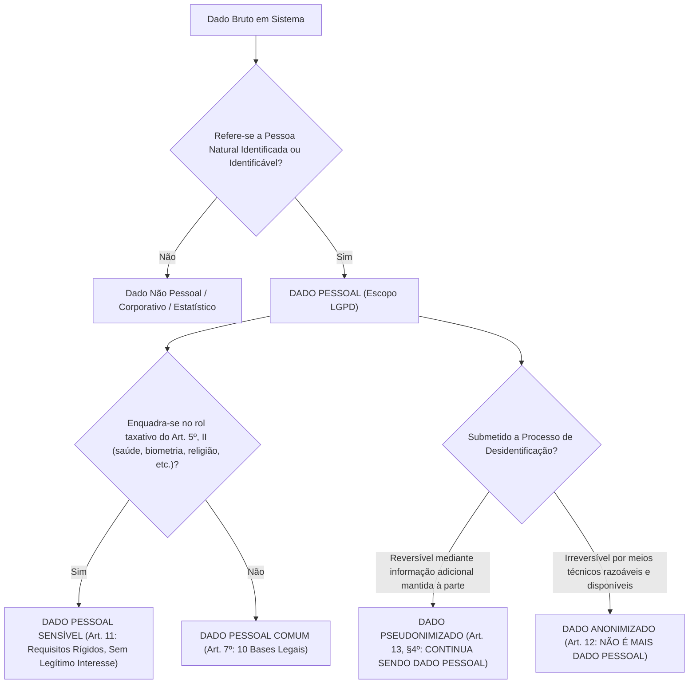
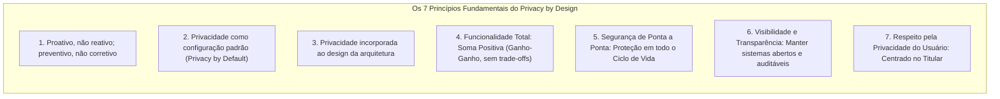
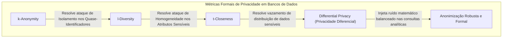
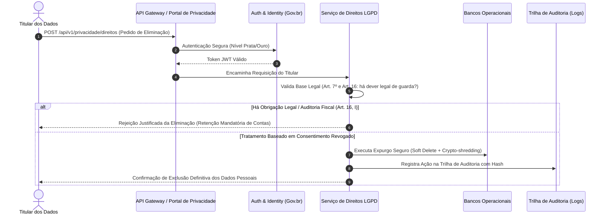

# 01 - LGPD Aplicada ao Desenvolvimento e Operação de Sistemas

> **Matéria:** Legislação Aplicada à Tecnologia da Informação  
> **Cargo:** B02 – Técnico de Controle Externo – Especialidade: Tecnologia da Informação  
> **Arquivo:** `01_lgpd_aplicada_ao_desenvolvimento_e_sistemas.md`  
> **Ato Normativo:** Lei Federal nº 13.709, de 14 de agosto de 2018 (Lei Geral de Proteção de Dados Pessoais - LGPD)

---

## 📌 Ementa / Itens do Edital
- Aplicação técnica da LGPD (Lei nº 13.709/2018) no ciclo de desenvolvimento de software e operação de sistemas
- Conceitos essenciais: Dado pessoal, Dado sensível, Dado anonimizado, Titular, Controlador, Operador e Encarregado (DPO)
- Princípios da LGPD aplicados à engenharia de software (com foco em Minimização e Finalidade)
- Metodologias: Privacy by Design e Privacy by Default (Ann Cavoukian)
- Técnicas de desidentificação: Anonimização vs. Pseudonimização
- Implementação de direitos dos titulares em sistemas de informação e segurança de dados

---

## 🧭 Sumário

1. [Taxonomia de Dados e Papéis sob a LGPD](#1-taxonomia-de-dados-e-papeis-sob-a-lgpd)
1. [Classificação Legal e Técnica dos Dados](#1-1-classificacao-legal-e-tecnica-dos-dados)
    1. [Teste 515](#Teste-515)
1. [Agentes de Tratamento e o Encarregado (DPO)](#1-2-agentes-de-tratamento-e-o-encarregado-dpo)
    1. [Teste 516](#Teste-516)
2. [Princípios do Art. 6º sob a Ótica da Arquitetura e Engenharia de Software](#2-principios-do-art-6o-sob-a-otica-da-arquitetura-e-engenharia-de-software)
    1. [Teste 517](#Teste-517)
3. [Privacy by Design e Privacy by Default (Ann Cavoukian)](#3-privacy-by-design-e-privacy-by-default-ann-cavoukian)
3. [Os 7 Princípios Fundamentais do Privacy by Design](#3-1-os-7-principios-fundamentais-do-privacy-by-design)
    1. [Teste 518](#Teste-518)
3. [Comparativo: Privacy by Design vs. Privacy by Default](#3-2-comparativo-privacy-by-design-vs-privacy-by-default)
    1. [Teste 519](#Teste-519)
4. [Engenharia de Desidentificação: Anonimização vs. Pseudonimização](#4-engenharia-de-desidentificacao-anonimizacao-vs-pseudonimizacao)
4. [Técnicas Criptográficas de Pseudonimização](#4-1-tecnicas-criptograficas-de-pseudonimizacao)
    1. [Teste 520](#Teste-520)
4. [Métricas Formais de Anonimização (k-Anonymity, l-Diversity, t-Closeness e DP)](#4-2-metricas-formais-de-anonimizacao-k-anonymity-l-diversity-t-closeness-e-dp)
    1. [Teste 521](#Teste-521)
5. [Implementação Técnica dos Direitos dos Titulares (Art. 18 da LGPD)](#5-implementacao-tecnica-dos-direitos-dos-titulares-art-18-da-lgpd)
5. [Mapeamento dos Direitos e Requisitos Técnicos](#5-1-mapeamento-dos-direitos-e-requisitos-tecnicos)
    1. [Teste 522](#Teste-522)
5. [Comunicação de Incidentes de Segurança à ANPD e Titulares (Art. 48)](#5-2-comunicacao-de-incidentes-de-seguranca-a-anpd-e-titulares-art-48)
    1. [Teste 523](#Teste-523)
    2. [Teste 524](#Teste-524)
6. [Fontes Recomendadas na Internet](#6-fontes-recomendadas-na-internet)

---

## 1. Taxonomia de Dados e Papéis sob a LGPD

A aplicação da **Lei Geral de Proteção de Dados Pessoais (Lei nº 13.709/2018 - LGPD)** na Engenharia de Software, Arquitetura de Sistemas e Operações de TI (DevSecOps) impõe uma reformulação estrutural nos modelos conceituais de dados, esquemas relacionais e NoSQL, esteiras de mensageria, contratos de APIs e controles de acesso.

---

## 1.1 Classificação Legal e Técnica dos Dados

| Categoria | Definição Legal (LGPD) | Exemplos Técnicos em Banco de Dados / APIs | Regime Jurídico de Proteção |
|---|---|---|---|
| **Dado Pessoal Comum** (Art. 5º, I) | Informação relacionada a pessoa natural identificada ou identificável. | Nome, CPF, e-mail pessoal, endereço IP de log, User-Agent, cookie identifier, geolocalização GPS. | Sujeito integralmente à LGPD. Pode ser tratado via 10 bases legais (Art. 7º), incluindo execução de contrato, cumprimento de obrigação legal e legítimo interesse. |
| **Dado Pessoal Sensível** (Art. 5º, II) | Origem racial/étnica, convicção religiosa, opinião política, filiação a sindicato/organização religiosa/política, dado referente à saúde ou à vida sexual, dado genético ou biométrico. | Template biométrico facial/digital, prontuário médico eletrônico, CID em atestados, exames toxicológicos. | Regime altamente restritivo (Art. 11). **NÃO admite a base legal do Legítimo Interesse**. Exige consentimento específico e destacado ou hipóteses legais estritas. |
| **Dado Pseudonimizado** (Art. 13, § 4º) | Dado que perde a possibilidade de associação direta a um indivíduo, senão pelo uso de informação adicional mantida separadamente pelo controlador. | IDs com Hashing salgado (`SHA-256(CPF + Salt)`), tokens UUID opacos cujas tabelas de de-para residem em base isolada com KMS. | **CONTINUA SENDO DADO PESSOAL**. É uma salvaguarda técnica e de segurança, não uma isenção da lei. |
| **Dado Anonimizado** (Art. 12) | Dado relativo a titular que não possa ser identificado, considerando meios técnicos razoáveis e disponíveis na ocasião do tratamento. | Conjuntos agregados com k-anonymity alto, microdados com injeção de ruído laplaciano (Differential Privacy). | **NÃO é considerado dado pessoal**, saindo do escopo da LGPD, **salvo se o processo for revertido** ou reversível por esforço razoável. |

> 🚨 **ALERTA DE PROVA / PEGADINHA FCC:**  
> A FCC tenta induzir o candidato ao erro afirmando que a **pseudonimização** retira o dado da incidência da LGPD. Isso é **FALSO**! O dado pseudonimizado permanece sob a tutela da LGPD porque o próprio controlador ou terceiro autorizado detém a chave reversora (informação adicional). Somente a **anonimização real e irreversível** afasta a aplicação da lei (Art. 12).

---

### Teste 515
**(FGV – TJ/SC – 2026 – Analista Administrativo)**
Um Analista de Tecnologia da Informação do Tribunal de Justiça de Santa Catarina foi encarregado de adequar os sistemas corporativos às exigências da Lei Geral de Proteção de Dados Pessoais (LGPD). Para reduzir os riscos decorrentes de eventual incidente de segurança envolvendo dados processuais e administrativos, ele adotou duas ações distintas: 1. aplicou um algoritmo para transformar o campo "Informação Sigilosa" em um código cifrado, de modo que o conteúdo original somente possa ser acessado mediante o uso da chave apropriada; e 2. no campo "Nome da Parte", substituiu as identidades reais por códigos alfanuméricos aleatórios, mantendo a tabela de correspondência entre os códigos e as identidades em ambiente segregado e seguro, permitindo que equipes de estatística e inteligência de dados realizem análises sem identificar diretamente os indivíduos, embora a associação possa ser restabelecida pelo Tribunal quando necessário. As técnicas aplicadas pelo analista nas ações 1 e 2 são, respectivamente,

* **A)** Hash Robusto e Pseudonimização.
* **B)** Criptografia Assimétrica e Pseudonimização.
* **C)** Criptografia Simétrica e Anonimização Irreversível.
* **D)** Esteganografia e Tokenização de Sessão.
* **E)** Codificação de Base64 e Criptografia de Chave Única.

---

> **Comentário Detalhado:**
>
> - **A)** **Incorreta.** A opção apresenta proposição em desacordo com os fundamentos teóricos e técnicos do tópico ao afirmar que "Hash Robusto e Pseudonimização". De acordo com a teoria estudada em *4.1 Técnicas Criptográficas de Pseudonimização*, na pseudonimização (Art. 13, § 4º da LGPD), o dado pessoal tem seu identificador direto substituído por um pseudônimo. O processo é reversível por quem possui a informação adicional mantida em ambiente segregado e seguro.
> - **B)** **Correta.** Conforme fundamentado na seção *4.1 Técnicas Criptográficas de Pseudonimização* deste guia, criptografia Reversível Preservadora de Formato (FPE - Format-Preserving Encryption): Criptografa o dado mantendo o mesmo tamanho e tipo (ex.: CPF de 11 dígitos continua gerando uma string de 11 dígitos numéricos), viabilizando testes em sistemas legados sem quebrar restrições de esquema. Dessa forma, está plenamente correta a assertiva da banca (FGV – TJ/SC/2026) ao estabelecer que "Criptografia Assimétrica e Pseudonimização".
> - **C)** **Incorreta.** A opção apresenta proposição em desacordo com os fundamentos teóricos e técnicos do tópico ao afirmar que "Criptografia Simétrica e Anonimização Irreversível". De acordo com a teoria estudada em *1.1 Classificação Legal e Técnica dos Dados*, isso é FALSO! O dado pseudonimizado permanece sob a tutela da LGPD porque o próprio controlador ou terceiro autorizado detém a chave reversora (informação adicional). Somente a anonimização real e irreversível afasta a aplicação da lei (Art. 12).
> - **D)** **Incorreta.** A opção apresenta proposição em desacordo com os fundamentos teóricos e técnicos do tópico ao afirmar que "Esteganografia e Tokenização de Sessão". De acordo com a teoria estudada em *4.1 Técnicas Criptográficas de Pseudonimização*, tokenização: Substituição de dados sensíveis (ex.: número de cartão de crédito, CPF) por um identificador não algorítmico gerado aleatoriamente (Token UUID).
> - **E)** **Incorreta.** A opção apresenta proposição em desacordo com os fundamentos teóricos e técnicos do tópico ao afirmar que "Codificação de Base64 e Criptografia de Chave Única". De acordo com a teoria estudada em *1. Taxonomia de Dados e Papéis sob a LGPD*, a aplicação da Lei Geral de Proteção de Dados Pessoais (Lei nº 13.709/2018 - LGPD) na Engenharia de Software, Arquitetura de Sistemas e Operações de TI (DevSecOps) impõe uma reformulação estrutural nos modelos conceituais de dados, esquemas relacionais e NoSQL, esteiras de mensageria, contratos de APIs e controles de acesso.
>
> **Gabarito: B**

---

## 1.2 Agentes de Tratamento e o Encarregado (DPO)

1. **Titular:** A pessoa natural (física) viva a quem se referem os dados pessoais que são objeto de tratamento. Pessoas jurídicas **não** são titulares de dados sob a LGPD.
2. **Controlador (Art. 5º, VI):** Pessoa natural ou jurídica, de direito público ou privado, a quem competem as **decisões** essenciais referentes ao tratamento de dados pessoais (ex.: Tribunal de Contas, Secretaria de Fazenda, empresa pública).
3. **Operador (Art. 5º, VII):** Pessoa natural ou jurídica, de direito público ou privado, que realiza o tratamento de dados pessoais **em nome do controlador** (ex.: empresa contratada de hospedagem em nuvem, fábrica de software terceirizada, consultoria de sustentação de banco de dados). O operador deve agir estritamente conforme as instruções lícitas do controlador.
4. **Encarregado / Data Protection Officer - DPO (Art. 5º, VIII):** Pessoa indicada pelo controlador e operador para atuar como canal de comunicação entre o controlador, os titulares dos dados e a Autoridade Nacional de Proteção de Dados (ANPD).
    - Suas atividades incluem: receber reclamações e comunicações dos titulares, prestar esclarecimentos, receber notificações da ANPD e orientar os colaboradores da entidade sobre as práticas de proteção de dados.
    - A identidade e as informações de contato do encarregado devem ser divulgadas publicamente, de forma clara e objetiva, preferencialmente no sítio eletrônico do controlador (Art. 41, § 1º).

> 🚨 **ALERTA DE PROVA / PEGADINHA FCC:**  
> O Operador não toma decisões sobre as finalidades do tratamento. Se um provedor de nuvem contratado como Operador resolver utilizar os dados do órgão público para treinar seus próprios modelos comerciais de IA sem autorização, ele comete desvio de finalidade e passa a responder como **Controlador** em relação a esse tratamento ilícito.

---

### Teste 516
**(FGV – TRT/DA – 2025 – Analista Judiciario Area Apoio Especializado Tecnologia Da Informacao)**
A Lei nº 13.709/2018 (Lei Geral de Proteção de Dados Pessoais – LGPD) dispõe sobre o tratamento de dados pessoais, inclusive nos meios digitais, por pessoa natural ou por pessoa jurídica de direito público ou privado, com o objetivo de proteger os direitos fundamentais de liberdade e de privacidade e o livre desenvolvimento da personalidade da pessoa natural. A esse respeito, analise as afirmativas a seguir sobre os fundamentos da disciplina da proteção de dados pessoais. I. Entre os fundamentos constam a liberdade de expressão, de informação, de comunicação e de opinião e a inviolabilidade da intimidade, da honra e da imagem II. Entre os fundamentos estão presentes o respeito à propriedade privada nos meios digitais e a autodeterminação informativa de interesse público. III. Entre os fundamentos incluem-se a livre iniciativa, a livre concorrência e a defesa do consumidor e os direitos humanos, o livre desenvolvimento da personalidade, a dignidade e o exercício da cidadania pelas pessoas naturais. Está correto o que se afirma em

* **A)** I, apenas.
* **B)** II, apenas.
* **C)** III, apenas.
* **D)** I e II, apenas.
* **E)** I e III, apenas.

---

> **Comentário Detalhado:**
>
> - **A)** **Incorreta.** A opção incorre em restrição indevida ao limitar o escopo conceitual ao afirmar que "I, apenas". De acordo com a teoria estudada em *1.2 Agentes de Tratamento e o Encarregado (DPO)*, controlador (Art. 5º, VI): Pessoa natural ou jurídica, de direito público ou privado, a quem competem as decisões essenciais referentes ao tratamento de dados pessoais (ex.: Tribunal de Contas, Secretaria de Fazenda, empresa pública).
> - **B)** **Incorreta.** A opção incorre em restrição indevida ao limitar o escopo conceitual ao afirmar que "II, apenas". De acordo com a teoria estudada em *1.2 Agentes de Tratamento e o Encarregado (DPO)*, operador (Art. 5º, VII): Pessoa natural ou jurídica, de direito público ou privado, que realiza o tratamento de dados pessoais em nome do controlador (ex.: empresa contratada de hospedagem em nuvem, fábrica de software terceirizada, consultoria de sustentação de banco de dados).
> - **C)** **Incorreta.** A opção incorre em restrição indevida ao limitar o escopo conceitual ao afirmar que "III, apenas". De acordo com a teoria estudada em *5.1 Mapeamento dos Direitos e Requisitos Técnicos*, correção de Dados Incompletos, Inexatos ou Desatualizados (Art. 18, III): Endpoint `PUT /api/v1/titular/perfil` com replicação assíncrona para bases de réplica e filas de mensageria (Kafka/RabbitMQ).
> - **D)** **Incorreta.** A opção incorre em restrição indevida ao limitar o escopo conceitual ao afirmar que "I e II, apenas". De acordo com a teoria estudada em *1.2 Agentes de Tratamento e o Encarregado (DPO)*, titular: A pessoa natural (física) viva a quem se referem os dados pessoais que são objeto de tratamento. Pessoas jurídicas não são titulares de dados sob a LGPD.
> - **E)** **Correta.** Conforme fundamentado na seção *1. Taxonomia de Dados e Papéis sob a LGPD* deste guia, a aplicação da Lei Geral de Proteção de Dados Pessoais (Lei nº 13.709/2018 - LGPD) na Engenharia de Software, Arquitetura de Sistemas e Operações de TI (DevSecOps) impõe uma reformulação estrutural nos modelos conceituais de dados, esquemas relacionais e NoSQL, esteiras de mensageria, contratos de APIs e controles de acesso. Dessa forma, está plenamente correta a assertiva da banca (FGV – TRT/DA/2025) ao estabelecer que "I e III, apenas".
>
> **Gabarito: E**

---

## 2. Princípios do Art. 6º sob a Ótica da Arquitetura e Engenharia de Software

O Art. 6º da LGPD elenca dez princípios fundamentais que regem as atividades de tratamento. Para desenvolvedores, arquitetos e DBAs, esses princípios se traduzem em requisitos não funcionais diretos:

1. **Finalidade:** Realização do tratamento para propósitos legítimos, específicos, explícitos e informados ao titular, sem possibilidade de tratamento posterior de forma incompatível.
    - *Impacto em TI:* Cada campo persistido na tabela do banco de dados deve ter uma justificativa funcional rastreável. Não é permitido criar rotinas de coleta de dados genéricos sob a premissa de "podemos precisar disso no futuro".

2. **Adequação:** Compatibilidade do tratamento com as finalidades informadas ao titular.
    - *Impacto em TI:* Se o cadastro foi feito para emissão de certidão negativa de débitos fiscais, o sistema não pode enviar newsletters promocionais ou compartilhar dados com empresas privadas sem base legal.

3. **Necessidade (Minimização de Dados):** Limitação do tratamento ao mínimo necessário para a realização de suas finalidades, com abrangência dos dados pertinentes, proporcionais e não excessivos.
    - *Impacto em TI:* Se uma API precisa apenas validar a maioridade do usuário, ela deve receber um booleano `maior_de_idade: true/false` ou a idade calculada, e não o RG completo, filiação e certidão de nascimento digitalizada.

4. **Livre Acesso:** Garantia aos titulares de consulta facilitada e gratuita sobre a forma e a duração do tratamento, bem como sobre a integralidade de seus dados pessoais.
    - *Impacto em TI:* Criação de painéis de autoatendimento (*self-service privacy portals*) e endpoints de leitura de perfil.

5. **Qualidade dos Dados:** Garantia de exatidão, clareza, relevância e atualização dos dados.
    - *Impacto em TI:* Implementação de rotinas de validação de esquemas (JSON Schema, constraints de integridade), deduplicação de registros e mecanismos para retificação de dados incorretos pelo próprio titular.

6. **Transparência:** Garantia de informações claras, precisas e facilmente acessíveis sobre a realização do tratamento e os respectivos agentes de tratamento.
    - *Impacto em TI:* Políticas de privacidade com redação clara em microcopy nos formulários, registros de consentimento (*consent logs*) e termos versionados.

7. **Segurança:** Utilização de medidas técnicas e administrativas aptas a proteger os dados pessoais de acessos não autorizados e de situações acidentais ou ilícitas.
    - *Impacto em TI:* Criptografia de dados em trânsito (TLS 1.3) e em repouso (AES-256 com chaves gerenciadas por HSM/KMS), RBAC/ABAC, mTLS em microserviços e proteção contra injeções (OWASP Top 10).

8. **Prevenção:** Adoção de medidas prévias para evitar a ocorrência de danos em virtude do tratamento de dados pessoais.
    - *Impacto em TI:* Auditorias contínuas de código (SAST/DAST), modelagem de ameaças e esteiras DevSecOps com bloqueio de deploy em caso de vazamento de segredos em repositórios.

9. **Não Discriminação:** Impossibilidade de realização do tratamento para fins discriminatórios ilícitos ou abusivos.
    - *Impacto em TI:* Validação ética e técnica de modelos de Machine Learning para evitar viés algorítmico (*bias*) em sistemas de concessão de créditos tributários ou triagens fiscais.

10. **Responsabilização e Prestação de Contas (Accountability):** Demonstração da eficácia das medidas adotadas pelo agente.
    - *Impacto em TI:* Trilhas de auditoria imutáveis (*audit trails* / logs assinados digitalmente), relatórios de impacto à proteção de dados (RIPD/DPIA) e documentação de arquitetura de dados.

> 🚨 **ALERTA DE PROVA / PEGADINHA FCC:**  
> No setor público (Art. 23), para desempenhar competências legais e executar políticas públicas, **não se exige consentimento** do titular. A FCC adora afirmar que órgãos de fiscalização precisam de autorização do cidadão auditado para processar seus dados cadastrais. **ERRADO!** O tratamento funda-se no cumprimento de obrigação legal (Art. 7º, II) e exercício regular de direitos (Art. 7º, VI).

---

### Teste 517
**(FGV – TRT/13 – 2022 – Analista Judiciario Tecnologia Da Informacao)**
A Portaria Nº 253 de 18/11/2020 institui técnicas para o processo de desenvolvimento de módulos e serviços na Plataforma Digital do Poder Judiciário Brasileiro – PDPJ-Br. Quanto aos critérios e diretrizes estabelecidos pela norma, assinale a afirmativa correta.

* **A)** Os desenvolvedores podem criar, manter e evoluir as aplicações que compõem a Plataforma PDPJ-Br por meio de modelos de dados e domínio, de eventos e mensagens empregando padrões de mercado proprietários de Application Programming Interface (API).
* **B)** Os microsserviços terão que prover documentação técnica referente à API disponibilizada, utilizando o padrão OpenAPI 2.0.
* **C)** Os módulos estruturantes já disporão de diversas APIs comuns ao relacionamento com o processo judicial, com vistas a não ser necessária a incorporação de diversas APIs nos sistemas monolíticos legados.
* **D)** No caso de necessidade de decomposição da aplicação monolítica existente que se assemelhe a módulo ou microsserviço existente nos sistemas processuais, deverá ser realizada a identificação do domínio a ser extraído e sua modelagem por meio de histórias, seguida da utilização de mecanismos nativos, por exemplo, JSF, Richfaces, componentes Seam.
* **E)** As soluções da Plataforma PDPJ-Br devem ser realizadas exclusivamente em ambiente contratado em serviço de nuvem computacional, atendendo aos princípios e diretrizes relacionados à Segurança da Informação para o tratamento da informação em ambiente de Computação em Nuvem dispostos na Portaria SGI nº 9/2018.

---

> **Comentário Detalhado:**
>
> - **A)** **Incorreta.** A opção apresenta proposição em desacordo com os fundamentos teóricos e técnicos do tópico ao afirmar que "Os desenvolvedores podem criar, manter e evoluir as aplicações que compõem a Plataforma PDPJ-Br por meio de...". De acordo com a teoria estudada em *1. Taxonomia de Dados e Papéis sob a LGPD*, a aplicação da Lei Geral de Proteção de Dados Pessoais (Lei nº 13.709/2018 - LGPD) na Engenharia de Software, Arquitetura de Sistemas e Operações de TI (DevSecOps) impõe uma reformulação estrutural nos modelos conceituais de dados, esquemas relacionais e NoSQL, esteiras de mensageria, contratos de APIs e controles de acesso.
> - **B)** **Incorreta.** A opção apresenta proposição em desacordo com os fundamentos teóricos e técnicos do tópico ao afirmar que "Os microsserviços terão que prover documentação técnica referente à API disponibilizada, utilizando o padrão...". De acordo com a teoria estudada em *1.1 Classificação Legal e Técnica dos Dados*, dado Anonimizado (Art. 12): Dado relativo a titular que não possa ser identificado, considerando meios técnicos razoáveis e disponíveis na ocasião do tratamento. — Conjuntos agregados com k-anonymity alto, microdados com injeção de ruído laplaciano (Differential Privacy). — NÃO é considerado dado pessoal, saindo do escopo da LGPD, salvo se o processo for revertido ou reversível por esforço razoável.
> - **C)** **Correta.** Conforme fundamentado na seção *4.1 Técnicas Criptográficas de Pseudonimização* deste guia, criptografia Reversível Preservadora de Formato (FPE - Format-Preserving Encryption): Criptografa o dado mantendo o mesmo tamanho e tipo (ex.: CPF de 11 dígitos continua gerando uma string de 11 dígitos numéricos), viabilizando testes em sistemas legados sem quebrar restrições de esquema. Dessa forma, está plenamente correta a assertiva da banca (FGV – TRT/13/2022) ao estabelecer que "Os módulos estruturantes já disporão de diversas APIs comuns ao relacionamento com o processo judicial, com vistas...".
> - **D)** **Incorreta.** A opção apresenta proposição em desacordo com os fundamentos teóricos e técnicos do tópico ao afirmar que "No caso de necessidade de decomposição da aplicação monolítica existente que se assemelhe a módulo ou...". De acordo com a teoria estudada em *2. Princípios do Art. 6º sob a Ótica da Arquitetura e Engenharia de Software*, *Impacto em TI:* Auditorias contínuas de código (SAST/DAST), modelagem de ameaças e esteiras DevSecOps com bloqueio de deploy em caso de vazamento de segredos em repositórios.
> - **E)** **Incorreta.** A opção incorre em restrição indevida ao limitar o escopo conceitual ao afirmar que "As soluções da Plataforma PDPJ-Br devem ser realizadas exclusivamente em ambiente contratado em serviço de nuvem...". De acordo com a teoria estudada em *4.1 Técnicas Criptográficas de Pseudonimização*, na pseudonimização (Art. 13, § 4º da LGPD), o dado pessoal tem seu identificador direto substituído por um pseudônimo. O processo é reversível por quem possui a informação adicional mantida em ambiente segregado e seguro.
>
> **Gabarito: C**

---

## 3. Privacy by Design e Privacy by Default (Ann Cavoukian)

Concebida no final da década de 1990 pela Comissária de Informação e Privacidade de Ontário (Canadá), Dra. Ann Cavoukian, a metodologia de **Privacy by Design (PbD)** prescreve que a privacidade não pode ser um adendo tardio adicionado ao final do desenvolvimento; ela deve ser o alicerce desde a primeira linha de arquitetura.

---

## 3.1 Os 7 Princípios Fundamentais do Privacy by Design

1. **Proativo e não reativo; Preventivo e não corretivo:** O sistema antecipa os riscos de violação de privacidade antes que aconteçam, aplicando modelagem de ameaças à privacidade (LINDDUN) antes da codificação.
2. **Privacidade como Padrão (Privacy by Default):** Se o titular do dado não fizer nenhuma alteração nas configurações, o nível de privacidade permanece o mais restritivo possível.
    - Checkboxes de consentimento desmarcadas por padrão;
    - Coleta de dados estritamente necessária ativada; dados opcionais desativados;
    - Cookies de rastreamento de terceiros bloqueados por padrão.

3. **Privacidade Incorporada ao Design:** A proteção da privacidade é uma funcionalidade essencial do núcleo do software e da infraestrutura, não um remendo (*patch*) colocado sobre uma arquitetura insegura.
4. **Funcionalidade Total (Soma Positiva - *Positive-Sum, not Zero-Sum*):** Rejeita a falsa dicotomia de que "ou temos privacidade, ou temos segurança/desempenho". A arquitetura de software de excelência entrega alta performance, segurança robusta **e** respeito irrestrito à privacidade.
5. **Segurança de Ponta a Ponta (Proteção em Todo o Ciclo de Vida):** A segurança cobre a informação desde a coleta inicial, trânsito, processamento, armazenamento, backup até o expurgo definitivo e seguro (*crypto-shredding* ou destruição física da mídia).
6. **Visibilidade e Transparência:** Todas as partes operacionais e políticas devem permanecer transparentes e verificáveis, assegurando que o que foi prometido nos termos seja exatamente o que os algoritmos executam em produção.
7. **Respeito pela Privacidade do Usuário:** O sistema é centrado no usuário (*user-centric*). Oferece padrões de usabilidade claros, sem padrões obscuros (*dark patterns*) voltados a ludibriar o titular a compartilhar dados indesejados.

---

### Teste 518
**(FCC – TRT 16ª – 2014 – Analista Judiciário - Tecnologia da Informação)**
Quando um Sistema Operacional (SO) concilia múltiplos usuários, os aspectos de compartilhamento, a nomeação e a proteção de arquivos tornam-se relevantes. Dada uma estrutura de diretórios que permita o compartilhamento de arquivos entre os usuários, o sistema operacional: I. Tem de mediar este compartilhamento. II. Tanto pode permitir a um usuário o acesso aos arquivos de outros usuários por default como exigir que um usuário conceda especificamente acesso aos arquivos. III. Precisa apenas dos mesmos atributos de arquivo e diretório para implementar o compartilhamento e a proteção necessários em um SO monousuário. IV. Pode possuir múltiplos sistemas de arquivos locais, inclusive volumes em um único disco ou múltiplos volumes em múltiplos discos vinculados. V. É responsável por definir as permissões sobre um arquivo ou diretório a cada operação solicitada e a executa ou não. Está correto o que se afirma APENAS em

* **A)** 3 (Processo Definido) e o próximo nível de maturidade a ser alcançado é o nível 4 (Gerenciado e Mensurável). No nível 4, a gerência passa a monitorar e medir a aderência aos procedimentos e adotar ações em que os processos parecem não funcionar muito bem no TRT da 16a Região. Os processos estarão em constante aprimoramento e fornecerão boas práticas. Automação e ferramentas serão utilizadas de uma maneira limitada ou fragmentada.
* **B)** 4 (Gerenciado e Mensurável) e o próximo nível de maturidade a ser alcançado é o nível 5 (Processo Definido). No nível 5, a gerência passa a monitorar e medir a aderência aos procedimentos e adotar ações em que os processos parecem não funcionar muito bem no TRT da 16a Região. Os processos estarão em constante aprimoramento e fornecerão boas práticas. Automação e ferramentas serão utilizadas de uma maneira limitada ou fragmentada.
* **C)** 2 (Repetível, porém Intuitivo) e o próximo nível de maturidade a ser alcançado é o nível 3 (Processo Definido). No nível 3, os procedimentos terão sido padronizados, documentados e comunicados através de treinamento. Todos do TRT da 16a Região devem seguir estes processos, mas possivelmente desvios não serão detectados. Os procedimentos não serão sofisticados, mas existirá a formalização das práticas existentes.
* **D)** 1 (Inicial / Ad hoc) e o próximo nível de maturidade a ser alcançado é o nível 2 (Repetível, porém Intuitivo). No nível 2, os procedimentos terão sido padronizados, documentados e comunicados através de treinamento. Todos do TRT da 16a Região devem seguir estes processos, mas possivelmente desvios não serão detectados. Os procedimentos não serão sofisticados, mas existirá a formalização das práticas existentes.
* **E)** 3 (Repetível, porém Intuitivo) e o próximo nível de maturidade a ser alcançado é o nível 4 (Gerenciado e Mensurável). No nível 4, os processos terão sido refinados a um nível de boas práticas, baseado no resultado de um contínuo aprimoramento e modelagem da maturidade como em outros Tribunais. A TI passará a ser utilizada no TRT da 16a Região como um caminho integrado para automatizar o fluxo de trabalho, provendo ferramentas para aprimorar a qualidade e efetividade, tornando a organização rápida em adaptar-se.

---

> **Comentário Detalhado:**
>
> - **A)** **Incorreta.** A opção apresenta proposição em desacordo com os fundamentos teóricos e técnicos do tópico ao afirmar que "3 (Processo Definido) e o próximo nível de maturidade a ser alcançado é o nível 4 (Gerenciado e Mensurável). No...". De acordo com a teoria estudada em *1.1 Classificação Legal e Técnica dos Dados*, dado Anonimizado (Art. 12): Dado relativo a titular que não possa ser identificado, considerando meios técnicos razoáveis e disponíveis na ocasião do tratamento. — Conjuntos agregados com k-anonymity alto, microdados com injeção de ruído laplaciano (Differential Privacy). — NÃO é considerado dado pessoal, saindo do escopo da LGPD, salvo se o processo for revertido ou reversível por esforço razoável.
> - **B)** **Correta.** Conforme fundamentado na seção *3.2 Comparativo: Privacy by Design vs. Privacy by Default* deste guia, escopo: Holístico, arquitetural e metodológico. Abrange toda a esteira de engenharia de software e processos organizacionais. — Focado na experiência de usuário, parametrização padrão de interfaces, bancos e sistemas operacionais. Dessa forma, está plenamente correta a assertiva da banca (FCC – TRT 16ª/2014) ao estabelecer que "4 (Gerenciado e Mensurável) e o próximo nível de maturidade a ser alcançado é o nível 5 (Processo Definido). No...".
> - **C)** **Incorreta.** A opção apresenta proposição em desacordo com os fundamentos teóricos e técnicos do tópico ao afirmar que "2 (Repetível, porém Intuitivo) e o próximo nível de maturidade a ser alcançado é o nível 3 (Processo Definido). No...". De acordo com a teoria estudada em *1.2 Agentes de Tratamento e o Encarregado (DPO)*, a identidade e as informações de contato do encarregado devem ser divulgadas publicamente, de forma clara e objetiva, preferencialmente no sítio eletrônico do controlador (Art. 41, § 1º).
> - **D)** **Incorreta.** A opção apresenta proposição em desacordo com os fundamentos teóricos e técnicos do tópico ao afirmar que "1 (Inicial / Ad hoc) e o próximo nível de maturidade a ser alcançado é o nível 2 (Repetível, porém Intuitivo). No...". De acordo com a teoria estudada em *3.1 Os 7 Princípios Fundamentais do Privacy by Design*, privacidade como Padrão (Privacy by Default): Se o titular do dado não fizer nenhuma alteração nas configurações, o nível de privacidade permanece o mais restritivo possível.
> - **E)** **Incorreta.** A opção apresenta proposição em desacordo com os fundamentos teóricos e técnicos do tópico ao afirmar que "3 (Repetível, porém Intuitivo) e o próximo nível de maturidade a ser alcançado é o nível 4 (Gerenciado e...". De acordo com a teoria estudada em *4.2 Métricas Formais de Anonimização (k-Anonymity, l-Diversity, t-Closeness e DP)*, inference (Inferência): Possibilidade de deduzir, com alta probabilidade, o valor de um atributo sensível de um titular a partir de outros valores.
>
> **Gabarito: B**

---

## 3.2 Comparativo: Privacy by Design vs. Privacy by Default

| Dimensão | Privacy by Design (PbD) | Privacy by Default (PbDf) |
|---|---|---|
| **Escopo** | Holístico, arquitetural e metodológico. Abrange toda a esteira de engenharia de software e processos organizacionais. | Focado na experiência de usuário, parametrização padrão de interfaces, bancos e sistemas operacionais. |
| **Momento de Aplicação** | Desde a concepção dos requisitos de negócio e arquitetura de software (Fase 0). | No momento em que o sistema ou serviço é disponibilizado para uso pelo usuário final. |
| **Ação Exigida do Usuário** | Nenhuma (é interno à engenharia de software). | Zero esforço: a proteção máxima já está ativa sem que o usuário precise alterar nenhuma chave ou configuração. |
| **Exemplo Típico** | Armazenamento de dados pessoais em tabelas segregadas com criptografia em repouso e trilhas de log imutáveis. | Perfil público de novo usuário criado como "Privado" por padrão; geolocalização desativada inicialmente. |

---

### Teste 519
**(CEBRASPE – STF – 2013 – Analista Judiciario Suporte Em Tecnologia Da Informacao)**
No modelo de plataforma como serviços (PaaS), os provedores de serviço oferecem banco de dados e servidores de aplicação. No caso de ferramentas de desenvolvimento, o único modelo funcional é o de software como serviço (SaaS). (cid:129) Nesta prova, faça o que se pede, usando, caso deseje, o espaço para rascunho indicado no presente caderno. Em seguida, transcreva o texto para a FOLHA DE TEXTO DEFINITIVO DA PROVA DISCURSIVA, no local apropriado, pois não será avaliado fragmento de texto escrito em local indevido. (cid:129) Qualquer fragmento de texto além da extensão máxima de linhas disponibilizadas será desconsiderado. (cid:129) Na folha de texto definitivo, identifique-se apenas no cabeçalho da primeira página, pois não será avaliado texto que tenha qualquer assinatura ou marca identificadora fora do local apropriado. (cid:129) Ao domínio do conteúdo serão atribuídos até 30,00 pontos, dos quais até 1,50 ponto será atribuído ao quesito apresentação (legibilidade, respeito às margens e indicação de parágrafos) e estrutura textual (organização das ideias em texto estruturado). Uma empresa que vende materiais de limpeza deseja automatizar seu catálogo de produtos ofertados. Inicialmente, em reunião com a equipe de desenvolvimento, foi informado que cada produto seria caracterizado por um código único, nome, categoria (por exemplo, detergente, sabão em pó, sabonete etc.), data de fabricação, data de vencimento, peso e preço. A empresa possui informações de todos os seus clientes e fornecedores. Cada cliente é identificado por um código único (também interno à empresa), nome completo, endereço, telefone, filiação e limite de crédito. Armazena-se igualmente a informação dos pedidos de produtos feitos pelos clientes. Cada pedido possui um número único, data de elaboração, quantidade de produtos pedidos e o valor total, podendo envolver de um a vários produtos. Para cada produto vendido pela empresa há um fornecedor específico, com CNPJ, nome fantasia, telefone, endereço etc. Esse fornecedor pode oferecer vários produtos.

* **C)** Certo
* **E)** Errado

---

> **Comentário Detalhado:**
>
> - **C)** **Incorreta.** A marcação como **Certo** não procede, pois o enunciado incorre em restrição indevida ao limitar o escopo conceitual ao afirmar que "No modelo de plataforma como serviços (PaaS), os provedores de serviço oferecem banco de dados e servidores...". De acordo com a teoria estudada em *1.2 Agentes de Tratamento e o Encarregado (DPO)*, operador (Art. 5º, VII): Pessoa natural ou jurídica, de direito público ou privado, que realiza o tratamento de dados pessoais em nome do controlador (ex.: empresa contratada de hospedagem em nuvem, fábrica de software terceirizada, consultoria de sustentação de banco de dados).
> - **E)** **Correta.** O item está **Errado** (gabarito oficial: **E**). Conforme fundamentado na seção *1.1 Classificação Legal e Técnica dos Dados* deste guia, dado Pessoal Sensível (Art. 5º, II): Origem racial/étnica, convicção religiosa, opinião política, filiação a sindicato/organização religiosa/política, dado referente à saúde ou à vida sexual, dado genético ou biométrico. — Template biométrico facial/digital, prontuário médico eletrônico, CID em atestados, exames toxicológicos. — Regime altamente restritivo (Art. 11). Portanto, a assertiva examinada pela banca (CEBRASPE – STF/2013) viola os preceitos técnicos do tópico.
>
> **Gabarito: E**

---

## 4. Engenharia de Desidentificação: Anonimização vs. Pseudonimização

---

## 4.1 Técnicas Criptográficas de Pseudonimização

Na pseudonimização (Art. 13, § 4º da LGPD), o dado pessoal tem seu identificador direto substituído por um pseudônimo. O processo é reversível por quem possui a informação adicional mantida em ambiente segregado e seguro.

1. **Hashing Criptográfico com Salt Único:**
    - Hashing puro (`SHA-256(CPF)`) é vulnerável a ataques de dicionário e tabelas arco-íris (*rainbow tables*), pois o espaço amostral do CPF possui apenas $10^{11}$ possibilidades.
    - Deve-se utilizar Salt aleatório de alta entropia por registro e chaves secretas (HMAC):
     $$\text{Pseudônimo} = \text{HMAC-SHA256}(\text{ChaveSecreta}, \text{CPF} \parallel \text{Salt})$$
2. **Tokenização:** Substituição de dados sensíveis (ex.: número de cartão de crédito, CPF) por um identificador não algorítmico gerado aleatoriamente (Token UUID). O mapeamento (*token vault*) é protegido em banco de dados isolado com controle rigoroso de acesso e mTLS.
3. **Criptografia Reversível Preservadora de Formato (FPE - Format-Preserving Encryption):** Criptografa o dado mantendo o mesmo tamanho e tipo (ex.: CPF de 11 dígitos continua gerando uma string de 11 dígitos numéricos), viabilizando testes em sistemas legados sem quebrar restrições de esquema.

---

### Teste 520
**(FCC – TRT 4ª – 2015 – Analista Judiciário - Tecnologia Da Informação)**
Uma aplicação que trabalha com Hibernate e EJB possui uma classe POJO − Plain Old Java Object utilizada no mapeamento objeto-relacional com uma tabela do banco de dados. Nessa classe, há um atributo calculado chamado valorTotalPedido que, para ser utilizado apenas em tempo de execução e descartado após finalizar o seu serviço temporário, deverá ser anotado com

* **A)** @Embedded
* **B)** @TemporaryAttribute
* **C)** @GeneratedValue
* **D)** @Transient
* **E)** @Basic Atenção: Para responder às questões de números 33 e 34, utilize a página HTML abaixo. <html> <head> <title>Prova</title>  </head> <body> <form name="frm"> 

---

> **Comentário Detalhado:**
>
> - **A)** **Incorreta.** A opção apresenta proposição em desacordo com os fundamentos teóricos e técnicos do tópico ao afirmar que "@Embedded". De acordo com a teoria estudada em *2. Princípios do Art. 6º sob a Ótica da Arquitetura e Engenharia de Software*, *Impacto em TI:* Cada campo persistido na tabela do banco de dados deve ter uma justificativa funcional rastreável. Não é permitido criar rotinas de coleta de dados genéricos sob a premissa de "podemos precisar disso no futuro".
> - **B)** **Incorreta.** A opção apresenta proposição em desacordo com os fundamentos teóricos e técnicos do tópico ao afirmar que "@TemporaryAttribute". De acordo com a teoria estudada em *3.2 Comparativo: Privacy by Design vs. Privacy by Default*, momento de Aplicação: Desde a concepção dos requisitos de negócio e arquitetura de software (Fase 0). — No momento em que o sistema ou serviço é disponibilizado para uso pelo usuário final.
> - **C)** **Incorreta.** A opção apresenta proposição em desacordo com os fundamentos teóricos e técnicos do tópico ao afirmar que "@GeneratedValue". De acordo com a teoria estudada em *4.1 Técnicas Criptográficas de Pseudonimização*, o mapeamento (*token vault*) é protegido em banco de dados isolado com controle rigoroso de acesso e mTLS.
> - **D)** **Correta.** Conforme fundamentado na seção *1.1 Classificação Legal e Técnica dos Dados* deste guia, pode ser tratado via 10 bases legais (Art. 7º), incluindo execução de contrato, cumprimento de obrigação legal e legítimo interesse. Dessa forma, está plenamente correta a assertiva da banca (FCC – TRT 4ª/2015) ao estabelecer que "@Transient".
> - **E)** **Incorreta.** A opção apresenta proposição em desacordo com os fundamentos teóricos e técnicos do tópico ao afirmar que "@Basic Atenção: Para responder às questões de números 33 e 34, utilize a página HTML abaixo. `<html>` `<head>`...". De acordo com a teoria estudada em *5.1 Mapeamento dos Direitos e Requisitos Técnicos*, *Crypto-shredding:* Criptografar os dados pessoais de cada titular com uma chave individual e exclusiva ($K_{\text{titular}}$). Para executar a eliminação definitiva em todas as réplicas e backups frios (*WORM*), basta destruir a chave no KMS.
>
> **Gabarito: D**

---

## 4.2 Métricas Formais de Anonimização (k-Anonymity, l-Diversity, t-Closeness e DP)

Para que um conjunto de microdados seja considerado verdadeiramente **anonimizado**, a desidentificação deve resistir a três ataques clássicos:

- **Singling out (Isolamento):** Possibilidade de isolar um registro que pertença a um único indivíduo no conjunto.
- **Linkability (Vinculação):** Possibilidade de cruzar dois conjuntos de dados distintos e correlacionar registros referentes à mesma pessoa.
- **Inference (Inferência):** Possibilidade de deduzir, com alta probabilidade, o valor de um atributo sensível de um titular a partir de outros valores.

1. **k-Anonymity (Sweeney, 2002):**
    - Um conjunto de dados possui $k$-anonimato se cada tupla de **quase-identificadores** (ex.: Idade, Gênero, CEP) for indistinguível de pelo menos outras $k-1$ tuplas no mesmo conjunto. Ou seja, cada grupo de equivalência contém no mínimo $k$ registros.
    - *Limitação:* Não protege contra o ataque de **homogeneidade**. Se em um grupo com $k=5$, todos os 5 indivíduos tiverem o atributo sensível "Tuberculose Pulmonar", qualquer pessoa que saiba que a vítima está naquele grupo descobrirá sua doença com 100% de certeza.

2. **l-Diversity (Machanavajjhala et al., 2007):**
    - Extensão do $k$-anonimato que exige que, dentro de cada grupo de equivalência de quase-identificadores, existam pelo menos $l$ valores "bem representados" para cada atributo sensível, superando o ataque de homogeneidade.

3. **t-Closeness (Li et al., 2007):**
    - Exige que a distribuição de probabilidade de um atributo sensível dentro de qualquer grupo de equivalência tenha uma distância estatística de no máximo $t$ em relação à distribuição desse mesmo atributo em todo o banco de dados global.

4. **Privacidade Diferencial ($\epsilon$-Differential Privacy - Dwork, 2006):**
    - Padrão-ouro na computação moderna. Garante matematicamente que a inclusão ou remoção de um único indivíduo no banco de dados não altera significativamente a probabilidade do resultado de uma consulta analítica agregada.
    - Injeta ruído aleatório calibrado (distribuição de Laplace ou Gaussiana) controlado pelo parâmetro de privacidade $\epsilon$ (*privacy budget*).

---

### Teste 521
**(FCC – TRT 9ª – 2015 – Analista Judiciário - Apoio Especializado - Tecnologia da Informação)**
Em uma servlet de uma aplicação web construída com Java EE, os dados de um objeto do tipo ArrayList chamado listaFun, contendo um conjunto de objetos de uma classe bean chamada Funcionario, foram incluídos em um atributo de requisição chamado funcionarios, enviado para um arquivo chamado exibefun.jsp. Estas operações foram realizadas pelo fragmento de código a seguir: request.setAttribute("funcionarios", listaFun); RequestDispatcher disp = request.getRequestDispatcher("exibefun.jsp");; disp.forward(request, response); No arquivo exibefun.jsp, para receber o atributo de requisição funcionarios, no interior de uma tag de scriptlet pode-se utilizar a instrução

* **A)** ArrayList<Funcionario> funcionarios = request.getAttribute("funcionarios");
* **B)** ArrayList funcionarios = (ArrayList) response.getAttribute("funcionarios");
* **C)** ArrayList funcionarios = (Funcionario) request.getAttribute("funcionarios");
* **D)** ArrayList<Funcionario> funcionarios = (ArrayList<Funcionario>) request.getAttribute ("funcionarios");
* **E)** ArrayList funcionarios = response.getAttribute("funcionarios").toArrayList();

---

> **Comentário Detalhado:**
>
> - **A)** **Incorreta.** A opção apresenta proposição em desacordo com os fundamentos teóricos e técnicos do tópico ao afirmar que "ArrayList`<Funcionario>` funcionarios = request.getAttribute("funcionarios")". De acordo com a teoria estudada em *4.2 Métricas Formais de Anonimização (k-Anonymity, l-Diversity, t-Closeness e DP)*, um conjunto de dados possui $k$-anonimato se cada tupla de quase-identificadores (ex.: Idade, Gênero, CEP) for indistinguível de pelo menos outras $k-1$ tuplas no mesmo conjunto. Ou seja, cada grupo de equivalência contém no mínimo $k$ registros.
> - **B)** **Incorreta.** A opção apresenta proposição em desacordo com os fundamentos teóricos e técnicos do tópico ao afirmar que "ArrayList funcionarios = (ArrayList) response.getAttribute("funcionarios")". De acordo com a teoria estudada em *4.2 Métricas Formais de Anonimização (k-Anonymity, l-Diversity, t-Closeness e DP)*, exige que a distribuição de probabilidade de um atributo sensível dentro de qualquer grupo de equivalência tenha uma distância estatística de no máximo $t$ em relação à distribuição desse mesmo atributo em todo o banco de dados global.
> - **C)** **Incorreta.** A opção apresenta proposição em desacordo com os fundamentos teóricos e técnicos do tópico ao afirmar que "ArrayList funcionarios = (Funcionario) request.getAttribute("funcionarios")". De acordo com a teoria estudada em *4.2 Métricas Formais de Anonimização (k-Anonymity, l-Diversity, t-Closeness e DP)*, para que um conjunto de microdados seja considerado verdadeiramente anonimizado, a desidentificação deve resistir a três ataques clássicos.
> - **D)** **Correta.** Conforme fundamentado na seção *1. Taxonomia de Dados e Papéis sob a LGPD* deste guia, a aplicação da Lei Geral de Proteção de Dados Pessoais (Lei nº 13.709/2018 - LGPD) na Engenharia de Software, Arquitetura de Sistemas e Operações de TI (DevSecOps) impõe uma reformulação estrutural nos modelos conceituais de dados, esquemas relacionais e NoSQL, esteiras de mensageria, contratos de APIs e controles de acesso. Dessa forma, está plenamente correta a assertiva da banca (FCC – TRT 9ª/2015) ao estabelecer que "ArrayList`<Funcionario>` funcionarios = (ArrayList`<Funcionario>`) request.getAttribute ("funcionarios")".
> - **E)** **Incorreta.** A opção apresenta proposição em desacordo com os fundamentos teóricos e técnicos do tópico ao afirmar que "ArrayList funcionarios = response.getAttribute("funcionarios").toArrayList()". De acordo com a teoria estudada em *4.2 Métricas Formais de Anonimização (k-Anonymity, l-Diversity, t-Closeness e DP)*, singling out (Isolamento): Possibilidade de isolar um registro que pertença a um único indivíduo no conjunto.
>
> **Gabarito: D**

---

## 5. Implementação Técnica dos Direitos dos Titulares (Art. 18 da LGPD)

---

## 5.1 Mapeamento dos Direitos e Requisitos Técnicos

1. **Confirmação e Acesso aos Dados (Art. 18, I e II):** Endpoint `GET /api/v1/titular/meus-dados` que consolida em uma única visão todos os dados cadastrais e transacionais associados ao titular.
2. **Correção de Dados Incompletos, Inexatos ou Desatualizados (Art. 18, III):** Endpoint `PUT /api/v1/titular/perfil` com replicação assíncrona para bases de réplica e filas de mensageria (Kafka/RabbitMQ).
3. **Anonimização, Bloqueio ou Eliminação de Dados Desnecessários (Art. 18, IV):** Rotinas de *Data Lifecycle Management* (DLM) em cron jobs de expurgo.
4. **Portabilidade dos Dados (Art. 18, V):** Geração assíncrona de arquivos em formato aberto e legível por máquina (JSON, CSV ou XML) disponibilizados via link pré-assinado temporário.
5. **Eliminação dos Dados Tratados com Consentimento (Art. 18, VI):**
    - *Soft Delete:* Marcação da flag `is_deleted = true`, acompanhada do mascaramento irreversível dos dados pessoais de identificação direta na linha do registro.
    - *Crypto-shredding:* Criptografar os dados pessoais de cada titular com uma chave individual e exclusiva ($K_{\text{titular}}$). Para executar a eliminação definitiva em todas as réplicas e backups frios (*WORM*), basta destruir a chave no KMS.
    - *Limites no Setor Público (Art. 16, I e Art. 23):* O direito de eliminação não é absoluto. O titular não pode exigir que o Tribunal de Contas apague dados fiscais e auditorias em que foi processado, pois a guarda decorre de dever legal.

---

### Teste 522
**(FGV – TCE/SC – 2026 – Auditor Fiscal de Controle Externo - Ciências da Computação, Sistemas de Informação...)**
Um pipeline de dados do TCE-SC processa bilhões de registros de notas fiscais usando Spark SQL. O Auditor nota um problema de desbalanceamento de dados no qual um único executor demora muito mais que os outros para completar uma operação de Join, pois uma chave específica possui muito mais registros que as demais. A seguinte técnica avançada de otimização no Spark 3.x permite ao motor de execução identificar esse desequilíbrio em tempo de execução e dividir a partição sobrecarregada em subtarefas menores:

* **A)** Broadcast Hash Join.
* **B)** Adaptive Query Execution com Skew Join Optimization.
* **C)** Predicate Pushdown.
* **D)** Bucketing com 1024 partições fixas.
* **E)** Cache In-Memory em nível de cluster.

---

> **Comentário Detalhado:**
>
> - **A)** **Incorreta.** A opção apresenta proposição em desacordo com os fundamentos teóricos e técnicos do tópico ao afirmar que "Broadcast Hash Join". De acordo com a teoria estudada em *4.2 Métricas Formais de Anonimização (k-Anonymity, l-Diversity, t-Closeness e DP)*, um conjunto de dados possui $k$-anonimato se cada tupla de quase-identificadores (ex.: Idade, Gênero, CEP) for indistinguível de pelo menos outras $k-1$ tuplas no mesmo conjunto. Ou seja, cada grupo de equivalência contém no mínimo $k$ registros.
> - **B)** **Correta.** Conforme fundamentado na seção *5.1 Mapeamento dos Direitos e Requisitos Técnicos* deste guia, *Limites no Setor Público (Art. 16, I e Art. 23):* O direito de eliminação não é absoluto. O titular não pode exigir que o Tribunal de Contas apague dados fiscais e auditorias em que foi processado, pois a guarda decorre de dever legal. Dessa forma, está plenamente correta a assertiva da banca (FGV – TCE/SC/2026) ao estabelecer que "Adaptive Query Execution com Skew Join Optimization".
> - **C)** **Incorreta.** A opção apresenta proposição em desacordo com os fundamentos teóricos e técnicos do tópico ao afirmar que "Predicate Pushdown". De acordo com a teoria estudada em *1.1 Classificação Legal e Técnica dos Dados*, pode ser tratado via 10 bases legais (Art. 7º), incluindo execução de contrato, cumprimento de obrigação legal e legítimo interesse.
> - **D)** **Incorreta.** A opção apresenta proposição em desacordo com os fundamentos teóricos e técnicos do tópico ao afirmar que "Bucketing com 1024 partições fixas". De acordo com a teoria estudada em *4.1 Técnicas Criptográficas de Pseudonimização*, hashing puro (`SHA-256(CPF)`) é vulnerável a ataques de dicionário e tabelas arco-íris (*rainbow tables*), pois o espaço amostral do CPF possui apenas $10^{11}$ possibilidades.
> - **E)** **Incorreta.** A opção apresenta proposição em desacordo com os fundamentos teóricos e técnicos do tópico ao afirmar que "Cache In-Memory em nível de cluster". De acordo com a teoria estudada em *3.1 Os 7 Princípios Fundamentais do Privacy by Design*, privacidade como Padrão (Privacy by Default): Se o titular do dado não fizer nenhuma alteração nas configurações, o nível de privacidade permanece o mais restritivo possível.
>
> **Gabarito: B**

---

## 5.2 Comunicação de Incidentes de Segurança à ANPD e Titulares (Art. 48)

O Art. 48 da LGPD determina que o **Controlador** deve comunicar à Autoridade Nacional de Proteção de Dados (ANPD) e aos titulares a ocorrência de incidente de segurança que **possa acarretar risco ou dano relevante aos titulares**:

- A comunicação deve ocorrer em **prazo razoável** (definido pela Resolução CD/ANPD nº 15/2024 em **3 dias úteis** contados do conhecimento do fato).
- A notificação deve detalhar:
    1. A natureza e a categoria dos dados pessoais afetados;
    2. As informações sobre os titulares envolvidos;
    3. As medidas técnicas e de segurança utilizadas para proteção dos dados;
    4. Os riscos relacionados ao incidente;
    5. As medidas tomadas ou que serão adotadas para reverter ou mitigar os efeitos do prejuízo.

- A ANPD poderá determinar ao controlador a ampla divulgação do fato nos meios de comunicação caso considere relevante.

---

### Teste 523
**(FGV – TRF/1 – 2024 – Analista Judiciario Area Apoio Especializado Especialidade Suporte Em Tecnologia Da Informacao)**
A estratégia nacional de tecnologia da informação e comunicação do Poder Judiciário (ENTIC-JUD) é o principal instrumento de promoção da governança ágil e da transformação digital do Poder Judiciário. De acordo com a ENTIC-JUD, cada órgão do Poder Judiciário deverá:

* **A)** classificar seus sistemas de informação, identificando quais são operacionais;
* **B)** elaborar e aplicar práticas de segurança da informação e proteção de dados a serem informadas para todos os órgãos do Poder Judiciário;
* **C)** executar ou contatar serviços de desenvolvimento e de sustentação de sistemas de informação obedecendo aos requisitos estabelecidos na ENTIC-JUD;
* **D)** elaborar o plano de gestão de continuidade de negócios e serviços, objetivando mitigar as ameaças mapeadas para atuar de forma preditiva e preventiva em relação às possíveis incertezas;
* **E)** elaborar o plano de gestão de riscos de tecnologia da informação e comunicação, no qual estejam estabelecidas as estratégias e os planos de ação que garantam o funcionamento dos serviços essenciais quando da ocorrência de falhas.

---

> **Comentário Detalhado:**
>
> - **A)** **Incorreta.** A opção apresenta proposição em desacordo com os fundamentos teóricos e técnicos do tópico ao afirmar que "classificar seus sistemas de informação, identificando quais são operacionais". De acordo com a teoria estudada em *3.2 Comparativo: Privacy by Design vs. Privacy by Default*, escopo: Holístico, arquitetural e metodológico. Abrange toda a esteira de engenharia de software e processos organizacionais. — Focado na experiência de usuário, parametrização padrão de interfaces, bancos e sistemas operacionais.
> - **B)** **Incorreta.** A opção apresenta proposição em desacordo com os fundamentos teóricos e técnicos do tópico ao afirmar que "elaborar e aplicar práticas de segurança da informação e proteção de dados a serem informadas para todos os órgãos...". De acordo com a teoria estudada em *3.1 Os 7 Princípios Fundamentais do Privacy by Design*, segurança de Ponta a Ponta (Proteção em Todo o Ciclo de Vida): A segurança cobre a informação desde a coleta inicial, trânsito, processamento, armazenamento, backup até o expurgo definitivo e seguro (*crypto-shredding* ou destruição física da mídia).
> - **C)** **Correta.** Conforme fundamentado na seção *5.1 Mapeamento dos Direitos e Requisitos Técnicos* deste guia, *Crypto-shredding:* Criptografar os dados pessoais de cada titular com uma chave individual e exclusiva ($K_{\text{titular}}$). Para executar a eliminação definitiva em todas as réplicas e backups frios (*WORM*), basta destruir a chave no KMS. Dessa forma, está plenamente correta a assertiva da banca (FGV – TRF/1/2024) ao estabelecer que "executar ou contatar serviços de desenvolvimento e de sustentação de sistemas de informação obedecendo aos...".
> - **D)** **Incorreta.** A opção apresenta proposição em desacordo com os fundamentos teóricos e técnicos do tópico ao afirmar que "elaborar o plano de gestão de continuidade de negócios e serviços, objetivando mitigar as ameaças mapeadas para...". De acordo com a teoria estudada em *1.2 Agentes de Tratamento e o Encarregado (DPO)*, encarregado / Data Protection Officer - DPO (Art. 5º, VIII): Pessoa indicada pelo controlador e operador para atuar como canal de comunicação entre o controlador, os titulares dos dados e a Autoridade Nacional de Proteção de Dados (ANPD).
> - **E)** **Incorreta.** A opção apresenta proposição em desacordo com os fundamentos teóricos e técnicos do tópico ao afirmar que "elaborar o plano de gestão de riscos de tecnologia da informação e comunicação, no qual estejam estabelecidas as...". De acordo com a teoria estudada em *5.2 Comunicação de Incidentes de Segurança à ANPD e Titulares (Art. 48)*, o Art. 48 da LGPD determina que o Controlador deve comunicar à Autoridade Nacional de Proteção de Dados (ANPD) e aos titulares a ocorrência de incidente de segurança que possa acarretar risco ou dano relevante aos titulares.
>
> **Gabarito: C**

---

---

### Teste 524
**(FGV – TJ/AP – 2023 – Analista Judiciario Apoio Especializado Tecnologia Da Informacao Seguranca Da Informacao)**
Um órgão público realiza tratamento dos dados pessoais dos seus servidores para implementar o módulo de autenticação de usuários de seus sistemas de informação e para prevenir ataques de softwares maliciosos na sua rede interna. Nesse cenário, é correto afirmar que:

* **A)** o órgão público deve recorrer à base legal do legítimo interesse adotando medidas para garantir a transparência do tratamento dos dados dos seus funcionários;
* **B)** o órgão público deve anonimizar os dados dos funcionários para poder usar no módulo de autenticação;
* **C)** a Autoridade Nacional de Proteção de Dados deverá autorizar o tratamento dos dados sensíveis dos funcionários do órgão público;
* **D)** o registro de um incidente de segurança é requisito para justificar o tratamento dos dados do servidor para o módulo de segurança;
* **E)** cada funcionário deve manifestar seu consentimento concordando com o tratamento de seus dados pessoais para serem usados pelo módulo de autenticação.

---

> **Comentário Detalhado:**
>
> - **A)** **Correta.** Conforme fundamentado na seção *1.1 Classificação Legal e Técnica dos Dados* deste guia, nÃO admite a base legal do Legítimo Interesse. Exige consentimento específico e destacado ou hipóteses legais estritas. Dessa forma, está plenamente correta a assertiva da banca (FGV – TJ/AP/2023) ao estabelecer que "o órgão público deve recorrer à base legal do legítimo interesse adotando medidas para garantir a transparência do...".
> - **B)** **Incorreta.** A opção apresenta proposição em desacordo com os fundamentos teóricos e técnicos do tópico ao afirmar que "o órgão público deve anonimizar os dados dos funcionários para poder usar no módulo de autenticação". De acordo com a teoria estudada em *1.1 Classificação Legal e Técnica dos Dados*, pode ser tratado via 10 bases legais (Art. 7º), incluindo execução de contrato, cumprimento de obrigação legal e legítimo interesse.
> - **C)** **Incorreta.** A opção apresenta proposição em desacordo com os fundamentos teóricos e técnicos do tópico ao afirmar que "a Autoridade Nacional de Proteção de Dados deverá autorizar o tratamento dos dados sensíveis dos funcionários do...". De acordo com a teoria estudada em *5.2 Comunicação de Incidentes de Segurança à ANPD e Titulares (Art. 48)*, o Art. 48 da LGPD determina que o Controlador deve comunicar à Autoridade Nacional de Proteção de Dados (ANPD) e aos titulares a ocorrência de incidente de segurança que possa acarretar risco ou dano relevante aos titulares.
> - **D)** **Incorreta.** A opção apresenta proposição em desacordo com os fundamentos teóricos e técnicos do tópico ao afirmar que "o registro de um incidente de segurança é requisito para justificar o tratamento dos dados do servidor para o...". De acordo com a teoria estudada em *1.2 Agentes de Tratamento e o Encarregado (DPO)*, se um provedor de nuvem contratado como Operador resolver utilizar os dados do órgão público para treinar seus próprios modelos comerciais de IA sem autorização, ele comete desvio de finalidade e passa a responder como Controlador em relação a esse tratamento ilícito.
> - **E)** **Incorreta.** A opção apresenta proposição em desacordo com os fundamentos teóricos e técnicos do tópico ao afirmar que "cada funcionário deve manifestar seu consentimento concordando com o tratamento de seus dados pessoais para serem...". De acordo com a teoria estudada em *2. Princípios do Art. 6º sob a Ótica da Arquitetura e Engenharia de Software*, prevenção: Adoção de medidas prévias para evitar a ocorrência de danos em virtude do tratamento de dados pessoais.
>
> **Gabarito: A**

---

## 6. Fontes Recomendadas na Internet

* [Lei nº 13.709/2018 (Lei Geral de Proteção de Dados Pessoais - LGPD)](https://www.planalto.gov.br/ccivil_03/_ato2015-2018/2018/lei/l13709.htm) - Texto compilado da LGPD no Planalto com todas as bases legais, direitos dos titulares e deveres dos agentes de tratamento.
* [Decreto nº 9.637/2018 (Política Nacional de Segurança da Informação)](https://www.planalto.gov.br/ccivil_03/_ato2015-2018/2018/decreto/d9637.htm) - Dispõe sobre governança de dados pessoais e segurança da informação na administração pública.
* [Governo Digital - Privacidade e Segurança da Informação](https://www.gov.br/governodigital/pt-br/privacidade-e-seguranca) - Diretrizes, guias operacionais e boas práticas de proteção de dados no setor público.
* [IETF RFC 7519 - JSON Web Token (JWT)](https://datatracker.ietf.org/doc/html/rfc7519) - Especificação técnica de tokens seguros para tráfego e proteção de dados entre sistemas.
* [OWASP Top 10 Privacy Risks Project](https://owasp.org/www-project-top-10-privacy-risks/) - Documentação oficial sobre vulnerabilidades de privacidade e controles recomendados em sistemas web.
* DONEDA, Danilo. **Da Privacidade à Proteção de Dados Pessoais: Elementos da Formação do seu Conceito**. 2. ed. São Paulo: Thomson Reuters Brasil, 2020. (Cap. 1 a 4 - Princípios Fundamentais da Proteção de Dados).
* BIONI, Bruno Ricardo. **Proteção de Dados Pessoais: A Função e os Limites do Consentimento**. 3. ed. Rio de Janeiro: Forense, 2021. (Cap. 2 - Bases Legais e Legitimo Interesse).
* PINHEIRO, Patricia Peck. **Direito Digital**. 7. ed. São Paulo: SaraivaJur, 2021. (Cap. 7 - Segurança da Informação e Compliance com a LGPD).
