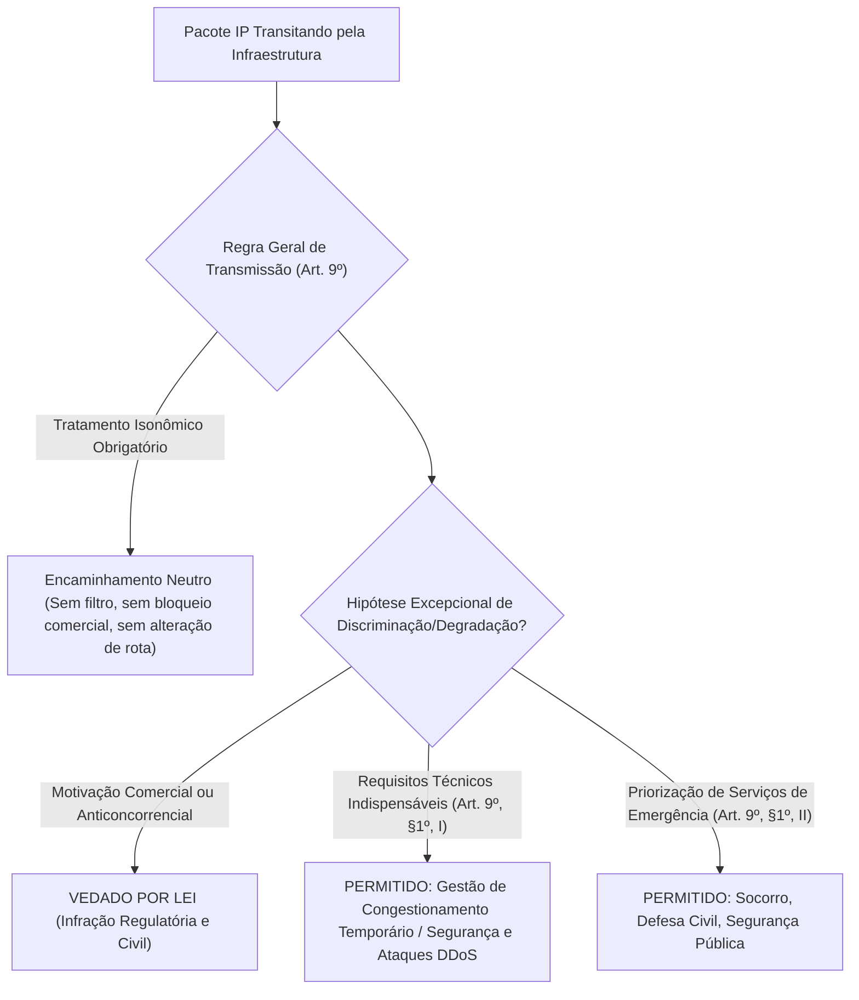
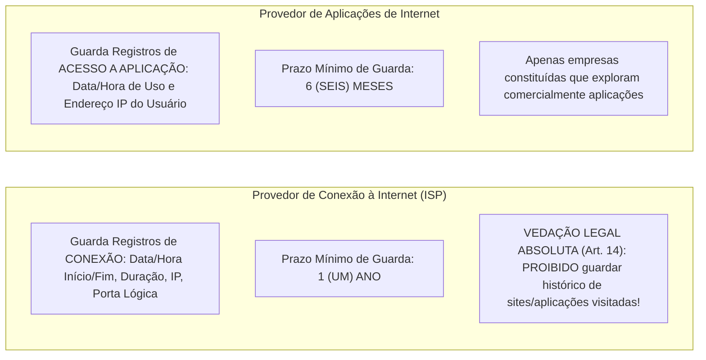
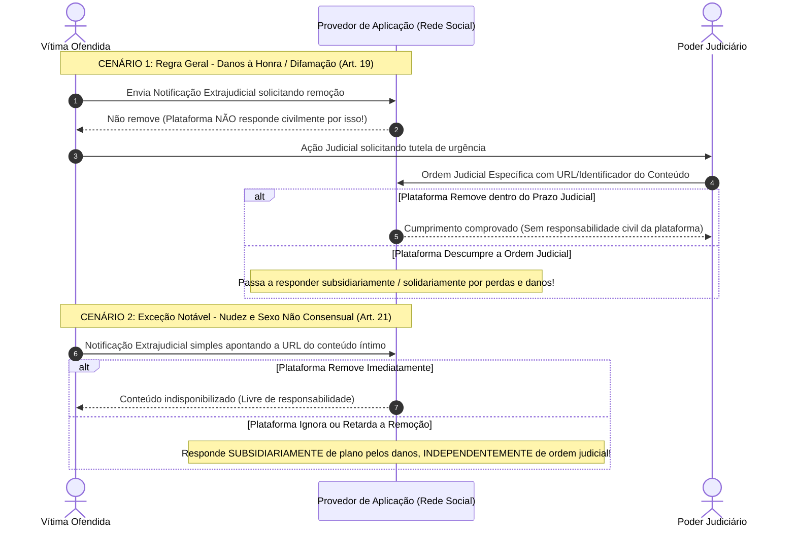

# 02 - Marco Civil da Internet (Lei nº 12.965/2014)

> **Matéria:** Legislação Aplicada à Tecnologia da Informação  
> **Cargo:** B02 – Técnico de Controle Externo – Especialidade: Tecnologia da Informação  
> **Arquivo:** `02_marco_civil_da_internet_lei_12965_2014.md`  
> **Ato Normativo:** Lei Federal nº 12.965, de 23 de abril de 2014 (Marco Civil da Internet) e Decreto nº 8.771, de 11 de maio de 2016

---

## 📌 Ementa / Itens do Edital
- Marco Civil da Internet (Lei nº 12.965/2014)
- Princípios, garantias e direitos dos usuários de Internet no Brasil
- Princípio da Neutralidade de Rede (Art. 9º da Lei e Decreto regulamentador)
- Regras e prazos para Guarda de Registros de Conexão e de Acesso a Aplicações
- Requisição judicial de registros e proteção da privacidade
- Responsabilidade civil por danos decorrentes de conteúdo gerado por terceiros (Arts. 18, 19 e 21)

---

## 🧭 Sumário

1. [Princípios, Garantias e Conceituação Técnica (Arts. 2º a 8º)](#1-principios-garantias-e-conceituacao-tecnica-arts-2o-a-8o)
1. [Vocabulário Técnico-Jurídico Essencial (Art. 5º)](#1-1-vocabulario-tecnico-juridico-essencial-art-5o)
    1. [Teste 525](#Teste-525)
1. [Princípios e Direitos Fundamentais dos Usuários](#1-2-principios-e-direitos-fundamentais-dos-usuarios)
    1. [Teste 526](#Teste-526)
2. [O Princípio da Neutralidade de Rede (Art. 9º e Decreto nº 8.771/2016)](#2-o-principio-da-neutralidade-de-rede-art-9o-e-decreto-no-87712016)
2. [Regra Geral de Tratamento Isonômico](#2-1-regra-geral-de-tratamento-isonomico)
2. [As Duas Únicas Exceções Legais à Neutralidade](#2-2-as-duas-unicas-excecoes-legais-a-neutralidade)
    1. [Teste 527](#Teste-527)
3. [Regime de Guarda de Registros: Conexão vs. Aplicações de Internet](#3-regime-de-guarda-de-registros-conexao-vs-aplicacoes-de-internet)
3. [Distinção Conceitual e Prazos Obrigatórios de Guarda](#3-1-distincao-conceitual-e-prazos-obrigatorios-de-guarda)
    1. [Teste 528](#Teste-528)
    2. [Teste 529](#Teste-529)
3. [A Vedação Absoluta aos Provedores de Conexão (Art. 14)](#3-2-a-vedacao-absoluta-aos-provedores-de-conexao-art-14)
    1. [Teste 530](#Teste-530)
3. [Padrões de Segurança do Decreto nº 8.771/2016](#3-3-padroes-de-seguranca-do-decreto-no-87712016)
4. [Reserva de Jurisdição para Quebra de Sigilo (Arts. 10 e 22)](#4-reserva-de-jurisdicao-para-quebra-de-sigilo-arts-10-e-22)
    1. [Teste 531](#Teste-531)
5. [Responsabilidade Civil por Conteúdo Gerado por Terceiros (Arts. 18 a 21)](#5-responsabilidade-civil-por-conteudo-gerado-por-terceiros-arts-18-a-21)
5. [Imunidade Civil dos Provedores de Conexão (Art. 18)](#5-1-imunidade-civil-dos-provedores-de-conexao-art-18)
5. [Regra Geral dos Provedores de Aplicação (Art. 19 - Ordem Judicial Prévia)](#5-2-regra-geral-dos-provedores-de-aplicacao-art-19-ordem-judicial-previa)
    1. [Teste 532](#Teste-532)
5. [Exceção Crítica do Artigo 21 (Nudez e Sexo Não Consensual)](#5-3-excecao-critica-do-artigo-21-nudez-e-sexo-nao-consensual)
    1. [Teste 533](#Teste-533)
    2. [Teste 534](#Teste-534)
6. [Fontes Recomendadas na Internet](#6-fontes-recomendadas-na-internet)

---

## 1. Princípios, Garantias e Conceituação Técnica (Arts. 2º a 8º)

A **Lei nº 12.965/2014 (Marco Civil da Internet)** estabelece princípios, garantias, direitos e deveres para o uso da Internet no Brasil, determinando as diretrizes para a atuação da União, dos Estados, do Distrito Federal e dos Municípios.

---

## 1.1 Vocabulário Técnico-Jurídico Essencial (Art. 5º)

O Marco Civil consolidou definições obrigatórias para os profissionais de TI, especialmente nas áreas de redes de computadores, telecomunicações e desenvolvimento de software:

1. **Internet (Art. 5º, I):** O sistema constituído do conjunto de redes, protocolos e estruturas de comunicação baseado no protocolo IP (*Internet Protocol*), para comunicação entre pacotes de dados e dispositivos computacionais.
2. **Terminal (Art. 5º, II):** O computador ou qualquer dispositivo que se conecte à Internet (smartphones, roteadores, servidores, dispositivos IoT).
3. **Endereço IP - *Internet Protocol* (Art. 5º, III):** O código atribuído a um terminal de uma rede para permitir sua identificação, definido segundo parâmetros internacionais (IPv4 de 32 bits ou IPv6 de 128 bits).
4. **Porta Lógica de Origem (Decreto nº 8.771/2016, Art. 10):** Número que identifica o canal lógico de comunicação em conexões TCP/UDP (camada de transporte). É essencial para a identificação inequívoca de terminais sob arquiteturas de **CGNAT (*Carrier-Grade NAT* / RFC 6598)**, nas quais centenas de usuários compartilham simultaneamente o mesmo endereço IPv4 público.
5. **Administrador de Sistema Autônomo - AS (Art. 5º, IV):** Pessoa física ou jurídica que administra blocos de endereçamento IP e respectivo sistema autônomo de roteamento (ex.: operadoras e provedores com ASNs registrados no Registro.br / LACNIC).
6. **Conexão à Internet (Art. 5º, V):** A habilitação de um terminal para envio e recebimento de pacotes de dados na Internet, mediante a atribuição de um endereço IP.
7. **Provedor de Conexão à Internet (ISP):** Entidade que viabiliza a habilitação de terminais para tráfego de dados na rede (ex.: operadoras de telecomunicações, provedores regionais de banda larga).
8. **Aplicações de Internet (Art. 5º, VII):** O conjunto de funcionalidades que podem ser acessadas por meio de um terminal conectado à Internet (websites, redes sociais, sistemas de e-mail, plataformas de streaming, APIs governamentais).
9. **Provedor de Aplicações de Internet:** Pessoa natural ou jurídica que disponibiliza serviços, plataformas e aplicações na Internet, explorados ou não comercialmente.

---

### Teste 525
**(FGV – TJ/AP – 2023 – Analista Judiciario Apoio Especializado Tecnologia Da Informacao Telecomunicacoes)**
O gerenciamento e a configuração de equipamentos de rede dependem de uma série de protocolos e aplicações. Dentre eles, podem-se destacar aqueles associados ao acesso remoto e ao monitoramento de equipamentos, e aqueles destinados à transferência de arquivos. Nesse sentido, analise os itens a seguir. I. O protocolo SSH (Secure Shell) permite a realização de autenticação em dispositivos de rede por meio do uso de criptografia. Por padrão, seus servidores utilizam a porta TCP 23 para conexão. II. O protocolo FTP (File Transfer Protocol) realiza a transferência de arquivos de forma segura por meio do uso de criptografia. Por padrão, seus servidores utilizam a porta 21 para controle da conexão e a porta 20 é usada na transferência de dados. III. O protocolo SNMP (Simple Network Management Protocol) permite o monitoramento de uma série de informações de dispositivos de rede. Por padrão, dentre as portas utilizadas por seus servidores estão as portas UDP 161 e UDP 162. Está correto somente o que se afirma em:

* **A)** I;
* **B)** II;
* **C)** III;
* **D)** I e II;
* **E)** II e III.

---

> **Comentário Detalhado:**
>
> - **A)** **Incorreta.** A opção apresenta proposição em desacordo com os fundamentos teóricos e técnicos do tópico ao afirmar que "I". De acordo com a teoria estudada em *1.1 Vocabulário Técnico-Jurídico Essencial (Art. 5º)*, internet (Art. 5º, I): O sistema constituído do conjunto de redes, protocolos e estruturas de comunicação baseado no protocolo IP (*Internet Protocol*), para comunicação entre pacotes de dados e dispositivos computacionais.
> - **B)** **Incorreta.** A opção apresenta proposição em desacordo com os fundamentos teóricos e técnicos do tópico ao afirmar que "II". De acordo com a teoria estudada em *4. Reserva de Jurisdição para Quebra de Sigilo (Arts. 10 e 22)*, inviolabilidade das Comunicações Privadas: São invioláveis a intimidade, o sigilo do fluxo de comunicações pela Internet e o sigilo de dados armazenados, salvo expressa ordem judicial (Art. 7º, II e III).
> - **C)** **Correta.** Conforme fundamentado na seção *1.1 Vocabulário Técnico-Jurídico Essencial (Art. 5º)* deste guia, endereço IP - *Internet Protocol* (Art. 5º, III): O código atribuído a um terminal de uma rede para permitir sua identificação, definido segundo parâmetros internacionais (IPv4 de 32 bits ou IPv6 de 128 bits). Dessa forma, está plenamente correta a assertiva da banca (FGV – TJ/AP/2023) ao estabelecer que "III".
> - **D)** **Incorreta.** A opção apresenta proposição em desacordo com os fundamentos teóricos e técnicos do tópico ao afirmar que "I e II". De acordo com a teoria estudada em *1.1 Vocabulário Técnico-Jurídico Essencial (Art. 5º)*, porta Lógica de Origem (Decreto nº 8.771/2016, Art. 10): Número que identifica o canal lógico de comunicação em conexões TCP/UDP (camada de transporte).
> - **E)** **Incorreta.** A opção apresenta proposição em desacordo com os fundamentos teóricos e técnicos do tópico ao afirmar que "II e III". De acordo com a teoria estudada em *3.1 Distinção Conceitual e Prazos Obrigatórios de Guarda*, o que é guardado?: Registros de Conexão: Data e hora de início e término, duração da sessão, endereço IP atribuído e porta lógica de origem. — Registros de Acesso a Aplicações: Data e hora de início e término do uso da aplicação e respectivo endereço IP de origem.
>
> **Gabarito: C**

---

## 1.2 Princípios e Direitos Fundamentais dos Usuários

Os princípios da disciplina do uso da Internet no Brasil incluem a garantia da liberdade de expressão, comunicação e manifestação de pensamento; a proteção da privacidade e dos dados pessoais; a preservação da estabilidade, segurança e funcionalidade da rede por meio de padrões técnicos universais; e a neutralidade da rede.

São direitos fundamentais do usuário da internet (Art. 7º):

- Inviolabilidade da intimidade e da vida privada, sua proteção e indenização por dano material ou moral;
- Inviolabilidade e sigilo do fluxo de suas comunicações pela Internet, salvo por expressa **ordem judicial**;
- Não suspensão da conexão à Internet, salvo por débito diretamente decorrente de sua utilização;
- Informações claras e completas sobre coleta, uso, armazenamento e tratamento de dados pessoais.

---

### Teste 526
**(FGV – TJ/AP – 2023 – Analista Judiciario Apoio Especializado Tecnologia Da Informacao Telecomunicacoes)**
A tabela abaixo apresenta o extrato da captura de um pacote egresso da interface de rede de um computador pessoal (PC - Personal Computer) pertencente a uma rede de dados privada. Esse PC está realizando uma consulta a um servidor de nomes (Domain Name System - DNS) disponível na internet. Camada OSI Informação de Informação de (Protocolo) Origem Destino Ethernet II dc:53:60:11:e2:7f 74:3a:ef:dc:52:58 Internet 2008:14d:5c40:45ca 2001:4860:4860:: Protocol :c8b3:efb5:6e67:a6 8888 Versão 6 b8 User Datagram 63157 53 Protocol Domain Name Pergunta sobre resolução de Nomes System Sobre essa captura, analise os itens a seguir. I. Essa máquina (PC) possui endereço IPv6 2001:4860:4860::8888 II. O endereço físico da placa de rede do servidor de nomes é o 74:3a:ef:dc:52:58 III. O PC está enviando consultas para a porta 53 do servidor de nomes, por meio do protocolo UDP. Está correto somente o que se afirma em:

* **A)** I;
* **B)** II;
* **C)** III;
* **D)** I e II;
* **E)** II e III.

---

> **Comentário Detalhado:**
>
> - **A)** **Incorreta.** A opção apresenta proposição em desacordo com os fundamentos teóricos e técnicos do tópico ao afirmar que "I". De acordo com a teoria estudada em *4. Reserva de Jurisdição para Quebra de Sigilo (Arts. 10 e 22)*, inviolabilidade das Comunicações Privadas: São invioláveis a intimidade, o sigilo do fluxo de comunicações pela Internet e o sigilo de dados armazenados, salvo expressa ordem judicial (Art. 7º, II e III).
> - **B)** **Incorreta.** A opção apresenta proposição em desacordo com os fundamentos teóricos e técnicos do tópico ao afirmar que "II". De acordo com a teoria estudada em *1.1 Vocabulário Técnico-Jurídico Essencial (Art. 5º)*, porta Lógica de Origem (Decreto nº 8.771/2016, Art. 10): Número que identifica o canal lógico de comunicação em conexões TCP/UDP (camada de transporte).
> - **C)** **Correta.** Conforme fundamentado na seção *1.1 Vocabulário Técnico-Jurídico Essencial (Art. 5º)* deste guia, endereço IP - *Internet Protocol* (Art. 5º, III): O código atribuído a um terminal de uma rede para permitir sua identificação, definido segundo parâmetros internacionais (IPv4 de 32 bits ou IPv6 de 128 bits). Dessa forma, está plenamente correta a assertiva da banca (FGV – TJ/AP/2023) ao estabelecer que "III".
> - **D)** **Incorreta.** A opção apresenta proposição em desacordo com os fundamentos teóricos e técnicos do tópico ao afirmar que "I e II". De acordo com a teoria estudada em *1.2 Princípios e Direitos Fundamentais dos Usuários*, os princípios da disciplina do uso da Internet no Brasil incluem a garantia da liberdade de expressão, comunicação e manifestação de pensamento; a proteção da privacidade e dos dados pessoais; a preservação da estabilidade, segurança e funcionalidade da rede por meio de padrões técnicos universais; e a neutralidade da rede.
> - **E)** **Incorreta.** A opção apresenta proposição em desacordo com os fundamentos teóricos e técnicos do tópico ao afirmar que "II e III". De acordo com a teoria estudada em *1.1 Vocabulário Técnico-Jurídico Essencial (Art. 5º)*, internet (Art. 5º, I): O sistema constituído do conjunto de redes, protocolos e estruturas de comunicação baseado no protocolo IP (*Internet Protocol*), para comunicação entre pacotes de dados e dispositivos computacionais.
>
> **Gabarito: C**

---

## 2. O Princípio da Neutralidade de Rede (Art. 9º e Decreto nº 8.771/2016)

A **Neutralidade de Rede** é a garantia legal de que os dados transmitidos pela infraestrutura de telecomunicações devem ser tratados de forma estritamente isonômica, independentemente do tipo de conteúdo, origem, destino, terminal utilizado ou aplicativo gerador.

---

## 2.1 Regra Geral de Tratamento Isonômico

- O responsável pela transmissão, comutação ou roteamento tem o dever de tratar quaisquer pacotes de dados de forma **isonômica**, sem distinção por conteúdo, origem, destino, terminal ou aplicação.
- **Proibições Rígidas:**
    - Bloquear ou degradar pacotes de protocolos peer-to-peer (P2P/BitTorrent) ou de voz sobre IP (VoIP/WhatsApp) para forçar o consumidor a contratar pacotes de telefonia da própria operadora;
    - Cobrar tarifas adicionais de empresas de streaming para conceder tráfego acelerado prioritário (*fast lanes* comerciais pagas);
    - Monitorar e inspecionar o conteúdo dos pacotes (*Deep Packet Inspection - DPI*) para fins de direcionamento comercial ou degradação seletiva.

---

---

## 2.2 As Duas Únicas Exceções Legais à Neutralidade

A discriminação ou degradação de tráfego somente poderá decorrer de duas hipóteses taxativas (Art. 9º, § 1º):

1. **Requisitos técnicos indispensáveis à prestação adequada dos serviços e aplicações:**
    - Gestão de congestionamento temporário de redes (garantindo que o tráfego crítico não colapse a rede como um todo);
    - Preservação da segurança e estabilidade da rede (mitigação em tempo real de ataques DDoS, contenção de tráfego de botnets e bloqueio de portas vulneráveis disseminadoras de malware).

2. **Priorização de serviços de emergência:**
    - Roteamento e garantia de banda prioritária para comunicações críticas de socorro, SAMU, Corpo de Bombeiros, Defesa Civil e forças de segurança pública durante catástrofes e desastres.

> 🚨 **ALERTA DE PROVA / PEGADINHA FCC:**  
> A banca FCC frequentemente afirma que o provedor de internet pode degradar tráfego de vídeo ou jogos livremente caso isso conste expressamente em contrato assinado com o consumidor. **ASSERTIVA TOTALMENTE ERRADA!** A neutralidade de rede é norma de ordem pública indisponível. Cláusulas contratuais que prevejam degradação por motivos comerciais ou anticoncorrenciais são absolutamente nulas. As únicas exceções são requisitos técnicos de segurança/estabilidade e serviços de emergência.

---

### Teste 527
**(FGV – TCE/PA – 2024 – Auditor de Controle Externo - Administrativa - Engenharia Telecomunicação)**
Os firewalls desempenham um papel fundamental na proteção dos dados sigilosos que trafegam na rede corporativa de um órgão público. Há diversos tipos, como firewall filtro de pacotes, firewall em estado de conexão e firewall em nível de aplicação. O firewall filtro de pacotes

* **A)** permite detectar diversas ameaças à rede, como por exemplo: spam, phishing e spyware.
* **B)** permite distinguir entre os diferentes tipos de tráfego HTTP.
* **C)** mapeia todos os pacotes que entram e saem da rede interna, relacionando-os às conexões TCP/IP ativas.
* **D)** inspeciona apenas os endereços IP e as portas TCP/UDP dos pacotes que entram e saem de uma rede interna, descartando aqueles que não atendem aos critérios estabelecidos pelo administrador de rede.
* **E)** torna possível o envio de tráfego encriptado, garantindo assim a confidencialidade das informações e a privacidade dos dados.

---

> **Comentário Detalhado:**
>
> - **A)** **Incorreta.** A opção apresenta proposição em desacordo com os fundamentos teóricos e técnicos do tópico ao afirmar que "permite detectar diversas ameaças à rede, como por exemplo: spam, phishing e spyware". De acordo com a teoria estudada em *2.2 As Duas Únicas Exceções Legais à Neutralidade*, preservação da segurança e estabilidade da rede (mitigação em tempo real de ataques DDoS, contenção de tráfego de botnets e bloqueio de portas vulneráveis disseminadoras de malware).
> - **B)** **Incorreta.** A opção apresenta proposição em desacordo com os fundamentos teóricos e técnicos do tópico ao afirmar que "permite distinguir entre os diferentes tipos de tráfego HTTP". De acordo com a teoria estudada em *1.1 Vocabulário Técnico-Jurídico Essencial (Art. 5º)*, provedor de Conexão à Internet (ISP): Entidade que viabiliza a habilitação de terminais para tráfego de dados na rede (ex.: operadoras de telecomunicações, provedores regionais de banda larga).
> - **C)** **Incorreta.** A opção apresenta proposição em desacordo com os fundamentos teóricos e técnicos do tópico ao afirmar que "mapeia todos os pacotes que entram e saem da rede interna, relacionando-os às conexões TCP/IP ativas". De acordo com a teoria estudada em *1.2 Princípios e Direitos Fundamentais dos Usuários*, os princípios da disciplina do uso da Internet no Brasil incluem a garantia da liberdade de expressão, comunicação e manifestação de pensamento; a proteção da privacidade e dos dados pessoais; a preservação da estabilidade, segurança e funcionalidade da rede por meio de padrões técnicos universais; e a neutralidade da rede.
> - **D)** **Correta.** Conforme fundamentado na seção *1.1 Vocabulário Técnico-Jurídico Essencial (Art. 5º)* deste guia, porta Lógica de Origem (Decreto nº 8.771/2016, Art. 10): Número que identifica o canal lógico de comunicação em conexões TCP/UDP (camada de transporte). Dessa forma, está plenamente correta a assertiva da banca (FGV – TCE/PA/2024) ao estabelecer que "inspeciona apenas os endereços IP e as portas TCP/UDP dos pacotes que entram e saem de uma rede interna...".
> - **E)** **Incorreta.** A opção apresenta proposição em desacordo com os fundamentos teóricos e técnicos do tópico ao afirmar que "torna possível o envio de tráfego encriptado, garantindo assim a confidencialidade das informações e a...". De acordo com a teoria estudada em *2.2 As Duas Únicas Exceções Legais à Neutralidade*, gestão de congestionamento temporário de redes (garantindo que o tráfego crítico não colapse a rede como um todo).
>
> **Gabarito: D**

---

## 3. Regime de Guarda de Registros: Conexão vs. Aplicações de Internet

O Marco Civil da Internet estabeleceu um regime binário de guarda de registros (*logs*), impondo deveres, prazos e proibições distintos para provedores de conexão e provedores de aplicação:

---

## 3.1 Distinção Conceitual e Prazos Obrigatórios de Guarda

| Aspecto | Provedor de Conexão à Internet (ISP) | Provedor de Aplicação de Internet |
|---|---|---|
| **Dispositivo Legal** | Art. 13 da Lei nº 12.965/2014 | Art. 15 da Lei nº 12.965/2014 |
| **Quem é obrigado?** | Administrador de Sistema Autônomo (AS) devidamente constituído. | Pessoa jurídica constituída que exerça atividade de forma organizada, profissionalmente e com fins econômicos. |
| **O que é guardado?** | **Registros de Conexão:** Data e hora de início e término, duração da sessão, endereço IP atribuído e porta lógica de origem. | **Registros de Acesso a Aplicações:** Data e hora de início e término do uso da aplicação e respectivo endereço IP de origem. |
| **Prazo Legal de Guarda** | **1 (UM) ANO** | **6 (SEIS) MESES** |
| **Ambiente de Guarda** | Sob sigilo, em ambiente controlado e de segurança (Decreto 8.771/2016). | Sob sigilo, em ambiente controlado e de segurança (Decreto 8.771/2016). |
| **Pode guardar histórico de sites?** | ❌ **TERMINANTEMENTE PROIBIDO (Art. 14)!** Não pode guardar registros de acesso a aplicações. | Apenas registra os acessos à sua própria aplicação (não aos sites concorrentes). |
| **Prorrogação Cautelar** | Autoridade policial ou MP pode requerer cautelarmente que os registros sejam guardados por prazo superior enquanto tramita a ordem judicial (Art. 13, § 2º). | Idem: autoridade policial ou MP pode solicitar cautelarmente a preservação de dados (Art. 15, § 2º). |

> 🚨 **ALERTA DE PROVA / PEGADINHA FCC:**  
> Grave os prazos sem chance de confusão:  
>
> - **C**onexão = **1** ano (palavra "Conexão" lembra início de tudo: 1 ano).  
> - **A**plicação = **6** meses (a metade do tempo da conexão).  
> A FCC adora inverter esses dois prazos em enunciados assertivos!

---

### Teste 528
**(FGV – TJ/RR – 2024 – Analista Judiciario Infraestrutura De Tecnologia Da Informacao)**
Correlacione as afirmativas sobre segurança de ativos em uma rede corporativa a seguir com os tipos de malware contra os quais se pretende proteger. ( ) Trojan. ( ) Worm. ( ) Spyware. ( ) Ransomware. 1. O Firewall pode proteger desse malware bloqueando a replicação dele entre segmentos de rede. 2. A mitigação mais efetiva contra esse malware é a execução regular de backup dos dados. 3. O uso de proxy pode ajudar contra este tipo de malware, realizando varredura contra malware em todos os arquivos baixados por computadores na rede corporativa. 4. O bloqueio de tráfego de saída no firewall pode impedir que os dados obtidos por esse malware sejam exfiltrados através da internet. A relação correta, na ordem apresentada, é

* **A)** 2 – 4 – 3 – 1.
* **B)** 2 – 1 – 4 – 3.
* **C)** 3 – 2 – 1 – 4.
* **D)** 3 – 1 – 4 – 2.
* **E)** 1 – 4 – 3 – 2.

---

> **Comentário Detalhado:**
>
> - **A)** **Incorreta.** A opção apresenta proposição em desacordo com os fundamentos teóricos e técnicos do tópico ao afirmar que "2 – 4 – 3 – 1". De acordo com a teoria estudada em *1.2 Princípios e Direitos Fundamentais dos Usuários*, os princípios da disciplina do uso da Internet no Brasil incluem a garantia da liberdade de expressão, comunicação e manifestação de pensamento; a proteção da privacidade e dos dados pessoais; a preservação da estabilidade, segurança e funcionalidade da rede por meio de padrões técnicos universais; e a neutralidade da rede.
> - **B)** **Incorreta.** A opção apresenta proposição em desacordo com os fundamentos teóricos e técnicos do tópico ao afirmar que "2 – 1 – 4 – 3". De acordo com a teoria estudada em *3.1 Distinção Conceitual e Prazos Obrigatórios de Guarda*, prorrogação Cautelar: Autoridade policial ou MP pode requerer cautelarmente que os registros sejam guardados por prazo superior enquanto tramita a ordem judicial (Art. 13, § 2º). — Idem: autoridade policial ou MP pode solicitar cautelarmente a preservação de dados (Art. 15, § 2º).
> - **C)** **Incorreta.** A opção apresenta proposição em desacordo com os fundamentos teóricos e técnicos do tópico ao afirmar que "3 – 2 – 1 – 4". De acordo com a teoria estudada em *2. O Princípio da Neutralidade de Rede (Art. 9º e Decreto nº 8.771/2016)*, a Neutralidade de Rede é a garantia legal de que os dados transmitidos pela infraestrutura de telecomunicações devem ser tratados de forma estritamente isonômica, independentemente do tipo de conteúdo, origem, destino, terminal utilizado ou aplicativo gerador.
> - **D)** **Correta.** Conforme fundamentado na seção *2.2 As Duas Únicas Exceções Legais à Neutralidade* deste guia, preservação da segurança e estabilidade da rede (mitigação em tempo real de ataques DDoS, contenção de tráfego de botnets e bloqueio de portas vulneráveis disseminadoras de malware). Dessa forma, está plenamente correta a assertiva da banca (FGV – TJ/RR/2024) ao estabelecer que "3 – 1 – 4 – 2".
> - **E)** **Incorreta.** A opção apresenta proposição em desacordo com os fundamentos teóricos e técnicos do tópico ao afirmar que "1 – 4 – 3 – 2". De acordo com a teoria estudada em *1.1 Vocabulário Técnico-Jurídico Essencial (Art. 5º)*, provedor de Conexão à Internet (ISP): Entidade que viabiliza a habilitação de terminais para tráfego de dados na rede (ex.: operadoras de telecomunicações, provedores regionais de banda larga).
>
> **Gabarito: D**

---

### Teste 529
**(FCC – TRT 14ª – 2016 – Analista Judiciário - Apoio Especializado - Tecnologia da Informação)**
Um Analista sugeriu corretamente instalar, como mecanismo de segurança da informação, um

* **A)** Servidor firewall à frente do VPN. O servidor firewall seria conectado à intranet e o VPN seria posicionado entre o servidor firewall e a internet para bloquear totalmente os acessos indevidos.
* **B)** Filtro de conteúdo, para analisar todo o tráfego que circula entre a rede local e a internet, impedindo o acesso a sites utilizando bloqueio por palavra-chave, por URL ou por horário.
* **C)** Sistema de Prevenção de Intrusão − IDS, um sistema passivo que examina o tráfego e informa sobre ameaças, após o firewall.
* **D)** Sistema de Detecção de Intrusão − IPS antes do firewall, para analisar ativamente o fluxo de tráfego que entra na rede e realizar ações de bloqueio automaticamente.
* **E)** Roteador IP com recurso de NAT no ponto de conexão entre a VPN e a internet, para converter endereços IPv6 de com- putadores da VPN em endereços IPv4 da internet.

---

> **Comentário Detalhado:**
>
> - **A)** **Incorreta.** A opção apresenta proposição em desacordo com os fundamentos teóricos e técnicos do tópico ao afirmar que "Servidor firewall à frente do VPN. O servidor firewall seria conectado à intranet e o VPN seria posicionado entre...". De acordo com a teoria estudada em *1.1 Vocabulário Técnico-Jurídico Essencial (Art. 5º)*, aplicações de Internet (Art. 5º, VII): O conjunto de funcionalidades que podem ser acessadas por meio de um terminal conectado à Internet (websites, redes sociais, sistemas de e-mail, plataformas de streaming, APIs governamentais).
> - **B)** **Incorreta.** A opção apresenta proposição em desacordo com os fundamentos teóricos e técnicos do tópico ao afirmar que "Filtro de conteúdo, para analisar todo o tráfego que circula entre a rede local e a internet, impedindo o acesso a...". De acordo com a teoria estudada em *2.2 As Duas Únicas Exceções Legais à Neutralidade*, preservação da segurança e estabilidade da rede (mitigação em tempo real de ataques DDoS, contenção de tráfego de botnets e bloqueio de portas vulneráveis disseminadoras de malware).
> - **C)** **Correta.** Conforme fundamentado na seção *5.2 Regra Geral dos Provedores de Aplicação (Art. 19 - Ordem Judicial Prévia)* deste guia, com o intuito de assegurar a liberdade de expressão e impedir a censura privada pelas empresas de tecnologia, o provedor de aplicações de internet somente poderá ser responsabilizado civilmente por danos decorrentes de conteúdo gerado por terceiros se, após ordem judicial específica, não tomar as providências para, no âmbito e nos limites técnicos do seu serviço e dentro do prazo assinalado, tornar indisponível o conteúdo apontado como infringente. Dessa forma, está plenamente correta a assertiva da banca (FCC – TRT 14ª/2016) ao estabelecer que "Sistema de Prevenção de Intrusão − IDS, um sistema passivo que examina o tráfego e informa sobre ameaças, após o...".
> - **D)** **Incorreta.** A opção apresenta proposição em desacordo com os fundamentos teóricos e técnicos do tópico ao afirmar que "Sistema de Detecção de Intrusão − IPS antes do firewall, para analisar ativamente o fluxo de tráfego que entra na...". De acordo com a teoria estudada em *1.1 Vocabulário Técnico-Jurídico Essencial (Art. 5º)*, provedor de Conexão à Internet (ISP): Entidade que viabiliza a habilitação de terminais para tráfego de dados na rede (ex.: operadoras de telecomunicações, provedores regionais de banda larga).
> - **E)** **Incorreta.** A opção apresenta proposição em desacordo com os fundamentos teóricos e técnicos do tópico ao afirmar que "Roteador IP com recurso de NAT no ponto de conexão entre a VPN e a internet, para converter endereços IPv6 de com-...". De acordo com a teoria estudada em *1.1 Vocabulário Técnico-Jurídico Essencial (Art. 5º)*, endereço IP - *Internet Protocol* (Art. 5º, III): O código atribuído a um terminal de uma rede para permitir sua identificação, definido segundo parâmetros internacionais (IPv4 de 32 bits ou IPv6 de 128 bits).
>
> **Gabarito: C**

---

## 3.2 A Vedação Absoluta aos Provedores de Conexão (Art. 14)

O Art. 14 da Lei nº 12.965/2014 prevê expressamente:
> *"Na provisão de conexão à internet, cabe ao administrador de sistema autônomo respectivo a guarda dos registros de conexão, pelo prazo de 1 (um) ano (..). É VEDADA A GUARDA DOS REGISTROS DE ACESSO A APLICAÇÕES DE INTERNET NA PROVISÃO DE CONEXÃO."*

Isso significa que o provedor de banda larga (como Claro, Vivo, Oi ou provedores locais) **não pode bisbilhotar nem gravar quais sites, vídeos ou serviços o usuário navegou**. O provedor sabe apenas que o usuário estava conectado à internet e qual IP ele utilizou, mas não o que ele consumiu na web.

---

### Teste 530
**(FGV – TJ/AP – 2023 – Analista Judiciario Apoio Especializado Tecnologia Da Informacao Seguranca Da Informacao)**
A equipe de resposta e tratamento de incidentes (ETIR) de um órgão público detectou, por meio de suas ferramentas de monitoramento da rede, um aumento no número de acessos a um determinado domínio de internet. Como resultado do processo de investigação de um possível incidente de segurança, a ETIR identificou que os usuários que acessaram o determinado domínio haviam recebido e-mails com orientação para trocarem suas senhas no sistema de Single Sign-On (SSO) do órgão. O domínio acessado continha uma página de internet, com características similares à página do SSO do órgão, porém, com domínio diferente, cujo objetivo era capturar as credenciais de acesso dos usuários. A ETIR identificou que o órgão sofreu um ataque do tipo:

* **A)** advanced fee fraud;
* **B)** phishing;
* **C)** email spoofing;
* **D)** scanning;
* **E)** snifing.

---

> **Comentário Detalhado:**
>
> - **A)** **Incorreta.** A opção apresenta proposição em desacordo com os fundamentos teóricos e técnicos do tópico ao afirmar que "advanced fee fraud". De acordo com a teoria estudada em *3.3 Padrões de Segurança do Decreto nº 8.771/2016*, registro de Auditoria de Acessos: Criação de inventário detalhado com data, hora, identidade do operador e arquivo acessado.
> - **B)** **Correta.** Conforme fundamentado na seção *1.2 Princípios e Direitos Fundamentais dos Usuários* deste guia, os princípios da disciplina do uso da Internet no Brasil incluem a garantia da liberdade de expressão, comunicação e manifestação de pensamento; a proteção da privacidade e dos dados pessoais; a preservação da estabilidade, segurança e funcionalidade da rede por meio de padrões técnicos universais; e a neutralidade da rede. Dessa forma, está plenamente correta a assertiva da banca (FGV – TJ/AP/2023) ao estabelecer que "phishing".
> - **C)** **Incorreta.** A opção apresenta proposição em desacordo com os fundamentos teóricos e técnicos do tópico ao afirmar que "email spoofing". De acordo com a teoria estudada em *3.2 A Vedação Absoluta aos Provedores de Conexão (Art. 14)*, *"Na provisão de conexão à internet, cabe ao administrador de sistema autônomo respectivo a guarda dos registros de conexão, pelo prazo de 1 (um) ano (..). É VEDADA A GUARDA DOS REGISTROS DE ACESSO A APLICAÇÕES DE INTERNET NA PROVISÃO DE CONEXÃO."*.
> - **D)** **Incorreta.** A opção apresenta proposição em desacordo com os fundamentos teóricos e técnicos do tópico ao afirmar que "scanning". De acordo com a teoria estudada em *2. O Princípio da Neutralidade de Rede (Art. 9º e Decreto nº 8.771/2016)*, a Neutralidade de Rede é a garantia legal de que os dados transmitidos pela infraestrutura de telecomunicações devem ser tratados de forma estritamente isonômica, independentemente do tipo de conteúdo, origem, destino, terminal utilizado ou aplicativo gerador.
> - **E)** **Incorreta.** A opção apresenta proposição em desacordo com os fundamentos teóricos e técnicos do tópico ao afirmar que "snifing". De acordo com a teoria estudada em *3.1 Distinção Conceitual e Prazos Obrigatórios de Guarda*, pode guardar histórico de sites?: ❌ TERMINANTEMENTE PROIBIDO (Art. 14)! Não pode guardar registros de acesso a aplicações. — Apenas registra os acessos à sua própria aplicação (não aos sites concorrentes).
>
> **Gabarito: B**

---

## 3.3 Padrões de Segurança do Decreto nº 8.771/2016

Os responsáveis pela guarda de registros devem obrigatoriamente seguir padrões mínimos de segurança da informação (Art. 13 do Decreto nº 8.771/2016):

1. **Controle Estrito de Acesso:** Definição formal das funções dos colaboradores autorizados a acessar os logs;
2. **Autenticação Segura:** Mecanismos de autenticação de duplo fator para os administradores dos dados;
3. **Registro de Auditoria de Acessos:** Criação de inventário detalhado com data, hora, identidade do operador e arquivo acessado;
4. **Criptografia:** Soluções de cifração robusta para os dados armazenados em repouso e em trânsito.

---

---

## 4. Reserva de Jurisdição para Quebra de Sigilo (Arts. 10 e 22)

O fornecimento de registros de conexão e de acesso a aplicações de internet submete-se à **estrita cláusula de reserva de jurisdição**:

1. **Inviolabilidade das Comunicações Privadas:** São invioláveis a intimidade, o sigilo do fluxo de comunicações pela Internet e o sigilo de dados armazenados, salvo expressa **ordem judicial** (Art. 7º, II e III).
2. **Dados Cadastrais vs. Logs de Conexão/Aplicação:**
    - *Dados Cadastrais Básicos (Filiação, Endereço residencial, Nome, CPF):* Podem ser requisitados diretamente por autoridades administrativas e policiais nos termos de leis específicas (Lei de Lavagem de Dinheiro nº 9.613/1998 e Lei de Organizações Criminosas nº 12.850/2013).
    - *Logs de Conexão e de Aplicação (IP, porta lógica, data, hora, duração):* Exigem **SEMPRE ordem judicial prévia**. Nenhuma autoridade administrativa (nem Delegado de Polícia, nem Promotor de Justiça, nem Auditor de Controle Externo) pode requisitá-los diretamente sem mandado do juiz competente.

3. **Requisitos da Petição de Quebra de Registros (Art. 22, parágrafo único):**
    - Fundados indícios da ocorrência do ilícito;
    - Justificativa motivada da utilidade dos registros para fins de investigação ou instrução probatória;
    - Período determinado ao qual se referem os registros (são vedadas ordens genéricas de devassa indeterminada).

---

### Teste 531
**(FCC – TRT 11ª – 2017 – Analista Judiciário - Tecnologia da Informação)**
Uma aplicação Java EE utiliza JPA em conjunto com o provedor de persistência Hibernate. Esta aplicação estabelece conexão com um banco de dados chamado empresa que possui uma tabela departamento. O banco de dados é acessado por meio do usuário root, cuja senha é pC43Ab. Nestas condições, uma instrução correta que pode estar no arquivo persistence.xml é

* **A)** <provider name="org.hibernate.ejb.HibernatePersistence" value="Hibernate"/>
* **B)** <persistence-database name="hibernate.connection.databasename" value="empresa"/>
* **C)** <property name="hibernate.connection.username" value="root"/>
* **D)** <table name="hibernate.connection.tablename" value="departamento"/>
* **E)** <persistence name="persistence.createEntityManagerFactory" value="PersistenceUnit"/>

---

> **Comentário Detalhado:**
>
> - **A)** **Incorreta.** A opção apresenta proposição em desacordo com os fundamentos teóricos e técnicos do tópico ao afirmar que "`<provider name="org.hibernate.ejb.HibernatePersistence" value="Hibernate"/>`". De acordo com a teoria estudada em *3.3 Padrões de Segurança do Decreto nº 8.771/2016*, registro de Auditoria de Acessos: Criação de inventário detalhado com data, hora, identidade do operador e arquivo acessado.
> - **B)** **Incorreta.** A opção apresenta proposição em desacordo com os fundamentos teóricos e técnicos do tópico ao afirmar que "`<persistence-database name="hibernate.connection.databasename" value="empresa"/>`". De acordo com a teoria estudada em *4. Reserva de Jurisdição para Quebra de Sigilo (Arts. 10 e 22)*, dados Cadastrais vs. Logs de Conexão/Aplicação.
> - **C)** **Correta.** Conforme fundamentado na seção *3.2 A Vedação Absoluta aos Provedores de Conexão (Art. 14)* deste guia, isso significa que o provedor de banda larga (como Claro, Vivo, Oi ou provedores locais) não pode bisbilhotar nem gravar quais sites, vídeos ou serviços o usuário navegou. Dessa forma, está plenamente correta a assertiva da banca (FCC – TRT 11ª/2017) ao estabelecer que "`<property name="hibernate.connection.username" value="root"/>`".
> - **D)** **Incorreta.** A opção apresenta proposição em desacordo com os fundamentos teóricos e técnicos do tópico ao afirmar que "`<table name="hibernate.connection.tablename" value="departamento"/>`". De acordo com a teoria estudada em *1.1 Vocabulário Técnico-Jurídico Essencial (Art. 5º)*, aplicações de Internet (Art. 5º, VII): O conjunto de funcionalidades que podem ser acessadas por meio de um terminal conectado à Internet (websites, redes sociais, sistemas de e-mail, plataformas de streaming, APIs governamentais).
> - **E)** **Incorreta.** A opção apresenta proposição em desacordo com os fundamentos teóricos e técnicos do tópico ao afirmar que "`<persistence name="persistence.createEntityManagerFactory" value="PersistenceUnit"/>`". De acordo com a teoria estudada em *3.2 A Vedação Absoluta aos Provedores de Conexão (Art. 14)*, o provedor sabe apenas que o usuário estava conectado à internet e qual IP ele utilizou, mas não o que ele consumiu na web.
>
> **Gabarito: C**

---

## 5. Responsabilidade Civil por Conteúdo Gerado por Terceiros (Arts. 18 a 21)

A responsabilização das plataformas por publicações, comentários, postagens e vídeos feitos pelos usuários estrutura-se em um regime jurídico tripartite:

---

## 5.1 Imunidade Civil dos Provedores de Conexão (Art. 18)

O provedor de conexão à internet **não responderá civilmente** por danos decorrentes de conteúdo gerado por terceiros em nenhuma hipótese. Ele atua como mero conduto de transmissão de pacotes (*mere conduit*), sem poder de gerência sobre o conteúdo transmitido.

---

---

## 5.2 Regra Geral dos Provedores de Aplicação (Art. 19 - Ordem Judicial Prévia)

- Com o intuito de assegurar a liberdade de expressão e impedir a censura privada pelas empresas de tecnologia, o provedor de aplicações de internet somente poderá ser responsabilizado civilmente por danos decorrentes de conteúdo gerado por terceiros **se, após ordem judicial específica, não tomar as providências para, no âmbito e nos limites técnicos do seu serviço e dentro do prazo assinalado, tornar indisponível o conteúdo apontado como infringente**.
- Notificações extrajudiciais privadas (cartas de advogados, e-mails de reclamação) **não** geram responsabilidade civil para a plataforma na regra geral!

---

### Teste 532
**(FGV – TJ/DFT – 2022 – Analista Judiciario Suporte Em Tecnologia Da Informacao)**
Um órgão público possui algumas unidades distantes geograficamente umas das outras e está pesquisando soluções que sejam confiáveis e que suportem criptografia para conectar as unidades entre si. Sobre as tecnologias MPLS (Multi-Protocol Label Switching) e SD- WAN (Software-Defined Wide Area Network), é correto afirmar que:

* **A)** as duas tecnologias podem coexistir numa mesma rede;
* **B)** o desempenho da aplicação é sempre previsível na tecnologia SD-WAN;
* **C)** a tecnologia MPLS opera na camada de transporte da arquitetura TCP/IP;
* **D)** a tecnologia SD-WAN consegue usar criptografia ponta a ponta, mas o MPLS não suporta;
* **E)** em relação ao tráfego de dados, o MPLS distribui os dados por diversos caminhos, e a SD-WAN utiliza sempre o mesmo caminho.

---

> **Comentário Detalhado:**
>
> - **A)** **Correta.** Conforme fundamentado na seção *2.2 As Duas Únicas Exceções Legais à Neutralidade* deste guia, gestão de congestionamento temporário de redes (garantindo que o tráfego crítico não colapse a rede como um todo). Dessa forma, está plenamente correta a assertiva da banca (FGV – TJ/DFT/2022) ao estabelecer que "as duas tecnologias podem coexistir numa mesma rede".
> - **B)** **Incorreta.** A opção promove generalização excessiva que desconsidera as condições técnicas e normativas ao afirmar que "o desempenho da aplicação é sempre previsível na tecnologia SD-WAN". De acordo com a teoria estudada em *5.2 Regra Geral dos Provedores de Aplicação (Art. 19 - Ordem Judicial Prévia)*, com o intuito de assegurar a liberdade de expressão e impedir a censura privada pelas empresas de tecnologia, o provedor de aplicações de internet somente poderá ser responsabilizado civilmente por danos decorrentes de conteúdo gerado por terceiros se, após ordem judicial específica, não tomar as providências para, no âmbito e nos limites técnicos do seu serviço e dentro do prazo assinalado, tornar indisponível o conteúdo apontado como infringente.
> - **C)** **Incorreta.** A opção apresenta proposição em desacordo com os fundamentos teóricos e técnicos do tópico ao afirmar que "a tecnologia MPLS opera na camada de transporte da arquitetura TCP/IP". De acordo com a teoria estudada em *1.1 Vocabulário Técnico-Jurídico Essencial (Art. 5º)*, porta Lógica de Origem (Decreto nº 8.771/2016, Art. 10): Número que identifica o canal lógico de comunicação em conexões TCP/UDP (camada de transporte).
> - **D)** **Incorreta.** A opção apresenta proposição em desacordo com os fundamentos teóricos e técnicos do tópico ao afirmar que "a tecnologia SD-WAN consegue usar criptografia ponta a ponta, mas o MPLS não suporta". De acordo com a teoria estudada em *3.3 Padrões de Segurança do Decreto nº 8.771/2016*, criptografia: Soluções de cifração robusta para os dados armazenados em repouso e em trânsito.
> - **E)** **Incorreta.** A opção promove generalização excessiva que desconsidera as condições técnicas e normativas ao afirmar que "em relação ao tráfego de dados, o MPLS distribui os dados por diversos caminhos, e a SD-WAN utiliza sempre o mesmo...". De acordo com a teoria estudada em *2.2 As Duas Únicas Exceções Legais à Neutralidade*, preservação da segurança e estabilidade da rede (mitigação em tempo real de ataques DDoS, contenção de tráfego de botnets e bloqueio de portas vulneráveis disseminadoras de malware).
>
> **Gabarito: A**

---

## 5.3 Exceção Crítica do Artigo 21 (Nudez e Sexo Não Consensual)

O Artigo 21 constitui a exceção mais importante e cobrada em provas de concurso:

- Aplica-se à divulgação não autorizada de imagens, vídeos ou materiais contendo **cenas de nudez ou de atos sexuais de caráter privado** ("pornografia de vingança").
- **Condição de Responsabilização:** O provedor responderá subsidiariamente se, **após o recebimento de simples notificação pelo participante ou seu representante legal**, deixar de promover de forma diligente a indisponibilização do conteúdo.
- **NÃO exige ordem judicial!** A notificação extrajudicial da vítima contendo elementos que permitam identificar o material (URL) é suficiente para impor a obrigação de derrubada imediata.

---

### Teste 533
**(FGV – TCE/SC – 2026 – Auditor Fiscal de Controle Externo - Administração)**
A Lei de Acesso à Informação (LAI – Lei nº 12.527/2011) estabelece os procedimentos a serem observados pelos órgãos e entidades públicas, com a finalidade de garantir o acesso dos cidadãos às informações produzidas ou custodiadas pelo Estado. Um cidadão formulou pedido de acesso a documentos relacionados a contrato firmado por autarquia federal, sem apresentar qualquer justificativa para a solicitação. O órgão, por sua vez, indeferiu o pedido sob o argumento de que a ausência de motivação pelo requerente impediria a análise da pertinência do acesso. Com base na LAI, assinale a afirmativa correta.

* **A)** O indeferimento foi correto, pois a LAI exige que o requerente indique as razões do pedido de acesso à informação, permitindo ao órgão avaliar a pertinência e a finalidade da solicitação antes de conceder o acesso.
* **B)** O indeferimento foi correto apenas em relação a contratos que envolvam informações de caráter pessoal de terceiros, hipótese em que a LAI exige motivação expressa do requerente para fins de ponderação entre o direito de acesso e a proteção de dados.
* **C)** O indeferimento foi incorreto, pois a LAI veda expressamente a exigência de motivação como condição para o pedido de acesso à informação, sendo suficiente a identificação do requerente, e as informações contratuais de entidades públicas enquadram-se como informações de transparência ativa obrigatória.
* **D)** O indeferimento foi incorreto quanto à ausência de motivação, mas seria válido caso o contrato envolvesse valores acima do limite legal, hipótese em que a LAI autoriza a classificação das informações contratuais como sigilosas.
* **E)** O indeferimento foi incorreto, pois a LAI dispensa até mesmo a identificação do requerente para fins de pedido de acesso à informação, bastando a formalização da solicitação pelo canal oficial do órgão.

---

> **Comentário Detalhado:**
>
> - **A)** **Incorreta.** A opção apresenta proposição em desacordo com os fundamentos teóricos e técnicos do tópico ao afirmar que "O indeferimento foi correto, pois a LAI exige que o requerente indique as razões do pedido de acesso à informação...". De acordo com a teoria estudada em *5.3 Exceção Crítica do Artigo 21 (Nudez e Sexo Não Consensual)*, nÃO exige ordem judicial! A notificação extrajudicial da vítima contendo elementos que permitam identificar o material (URL) é suficiente para impor a obrigação de derrubada imediata.
> - **B)** **Incorreta.** A opção incorre em restrição indevida ao limitar o escopo conceitual ao afirmar que "O indeferimento foi correto apenas em relação a contratos que envolvam informações de caráter pessoal de...". De acordo com a teoria estudada em *5.1 Imunidade Civil dos Provedores de Conexão (Art. 18)*, o provedor de conexão à internet não responderá civilmente por danos decorrentes de conteúdo gerado por terceiros em nenhuma hipótese. Ele atua como mero conduto de transmissão de pacotes (*mere conduit*), sem poder de gerência sobre o conteúdo transmitido.
> - **C)** **Correta.** Conforme fundamentado na seção *1.2 Princípios e Direitos Fundamentais dos Usuários* deste guia, informações claras e completas sobre coleta, uso, armazenamento e tratamento de dados pessoais. Dessa forma, está plenamente correta a assertiva da banca (FGV – TCE/SC/2026) ao estabelecer que "O indeferimento foi incorreto, pois a LAI veda expressamente a exigência de motivação como condição para o pedido...".
> - **D)** **Incorreta.** A opção apresenta proposição em desacordo com os fundamentos teóricos e técnicos do tópico ao afirmar que "O indeferimento foi incorreto quanto à ausência de motivação, mas seria válido caso o contrato envolvesse valores...". De acordo com a teoria estudada em *2.2 As Duas Únicas Exceções Legais à Neutralidade*, a banca FCC frequentemente afirma que o provedor de internet pode degradar tráfego de vídeo ou jogos livremente caso isso conste expressamente em contrato assinado com o consumidor.
> - **E)** **Incorreta.** A opção afasta requisito ou relação estrutural exigida pela matéria ao afirmar que "O indeferimento foi incorreto, pois a LAI dispensa até mesmo a identificação do requerente para fins de pedido de...". De acordo com a teoria estudada em *3.3 Padrões de Segurança do Decreto nº 8.771/2016*, os responsáveis pela guarda de registros devem obrigatoriamente seguir padrões mínimos de segurança da informação (Art. 13 do Decreto nº 8.771/2016).
>
> **Gabarito: C**

---

### Teste 534
**(FGV – TRF/1 – 2024 – Analista Judiciario Area Apoio Especializado Especialidade Tecnologia Da Informacao)**
Luis precisa estabelecer um acesso remoto a um servidor e pede orientação a Carlos, um analista de TI. Carlos afirmou que o acesso pode ser feito pelo protocolo da camada de:

* **A)** aplicação chamado telnet, que roda sobre UDP e, por isso, não é tão confiável quanto o SSH;
* **B)** aplicação chamado telnet, que roda sobre TCP (assim como o SSH) e é uma aplicação interativa;
* **C)** rede chamado SSH, que roda sobre TCP e, apesar de não ser criptografado, é mais confiável do que o telnet;
* **D)** rede chamado SSH, que roda sobre UDP e, apesar de não ser criptografado, é mais confiável do que o telnet;
* **E)** aplicação chamado SSH, que roda sobre TCP e, apesar de não ser criptografado, é mais confiável do que o telnet.

---

> **Comentário Detalhado:**
>
> - **A)** **Incorreta.** A opção apresenta proposição em desacordo com os fundamentos teóricos e técnicos do tópico ao afirmar que "aplicação chamado telnet, que roda sobre UDP e, por isso, não é tão confiável quanto o SSH". De acordo com a teoria estudada em *1.1 Vocabulário Técnico-Jurídico Essencial (Art. 5º)*, porta Lógica de Origem (Decreto nº 8.771/2016, Art. 10): Número que identifica o canal lógico de comunicação em conexões TCP/UDP (camada de transporte).
> - **B)** **Incorreta.** A opção apresenta proposição em desacordo com os fundamentos teóricos e técnicos do tópico ao afirmar que "aplicação chamado telnet, que roda sobre TCP (assim como o SSH) e é uma aplicação interativa". De acordo com a teoria estudada em *5.3 Exceção Crítica do Artigo 21 (Nudez e Sexo Não Consensual)*, o Artigo 21 constitui a exceção mais importante e cobrada em provas de concurso.
> - **C)** **Incorreta.** A opção apresenta proposição em desacordo com os fundamentos teóricos e técnicos do tópico ao afirmar que "rede chamado SSH, que roda sobre TCP e, apesar de não ser criptografado, é mais confiável do que o telnet". De acordo com a teoria estudada em *2. O Princípio da Neutralidade de Rede (Art. 9º e Decreto nº 8.771/2016)*, a Neutralidade de Rede é a garantia legal de que os dados transmitidos pela infraestrutura de telecomunicações devem ser tratados de forma estritamente isonômica, independentemente do tipo de conteúdo, origem, destino, terminal utilizado ou aplicativo gerador.
> - **D)** **Incorreta.** A opção apresenta proposição em desacordo com os fundamentos teóricos e técnicos do tópico ao afirmar que "rede chamado SSH, que roda sobre UDP e, apesar de não ser criptografado, é mais confiável do que o telnet". De acordo com a teoria estudada em *3.1 Distinção Conceitual e Prazos Obrigatórios de Guarda*, pode guardar histórico de sites?: ❌ TERMINANTEMENTE PROIBIDO (Art. 14)! Não pode guardar registros de acesso a aplicações. — Apenas registra os acessos à sua própria aplicação (não aos sites concorrentes).
> - **E)** **Correta.** Conforme fundamentado na seção *5.2 Regra Geral dos Provedores de Aplicação (Art. 19 - Ordem Judicial Prévia)* deste guia, com o intuito de assegurar a liberdade de expressão e impedir a censura privada pelas empresas de tecnologia, o provedor de aplicações de internet somente poderá ser responsabilizado civilmente por danos decorrentes de conteúdo gerado por terceiros se, após ordem judicial específica, não tomar as providências para, no âmbito e nos limites técnicos do seu serviço e dentro do prazo assinalado, tornar indisponível o conteúdo apontado como infringente. Dessa forma, está plenamente correta a assertiva da banca (FGV – TRF/1/2024) ao estabelecer que "aplicação chamado SSH, que roda sobre TCP e, apesar de não ser criptografado, é mais confiável do que o telnet".
>
> **Gabarito: E**

---

## 6. Fontes Recomendadas na Internet

* [Lei nº 12.965/2014 (Marco Civil da Internet)](https://www.planalto.gov.br/ccivil_03/_ato2011-2014/2014/lei/l12965.htm) - Estabelece princípios, garantias, direitos e deveres para o uso da Internet no Brasil.
* [Decreto nº 8.771/2016 (Regulamento do Marco Civil da Internet)](https://www.planalto.gov.br/ccivil_03/_ato2015-2018/2016/decreto/d8771.htm) - Regulamenta a neutralidade de rede, a guarda de registros e os padrões de segurança de dados.
* [Comitê Gestor da Internet no Brasil (CGI.br) - Estrutura e Governança](https://cgi.br/sobre/) - Histórico, competências institucionais e princípios fundamentais de governança da Internet no Brasil.
* [IETF RFC 8446 - The Transport Layer Security (TLS) Protocol Version 1.3](https://datatracker.ietf.org/doc/html/rfc8446) - Norma técnica que viabiliza a inviolabilidade e o sigilo das comunicações previsto no art. 7º do Marco Civil.
* [Governo Digital - Infraestrutura Nacional de Dados (IND)](https://www.gov.br/governodigital/pt-br/infraestrutura-nacional-de-dados) - Governança e compartilhamento de dados governamentais conforme as garantias do Marco Civil.
* PINHEIRO, Patricia Peck. **Direito Digital**. 7. ed. São Paulo: SaraivaJur, 2021. (Cap. 3 - Marco Civil da Internet: Responsabilidade e Registros).
* SOUZA, Carlos Affonso; LEMOS, Ronaldo. **Marco Civil da Internet: Construção e Aplicação**. São Paulo: Revista dos Tribunais, 2014. (Cap. 1 - Neutralidade de Rede; Cap. 2 - Guarda de Registros e Privacidade).
* BLUM, Renato Opice. **Marco Civil da Internet Comentado**. São Paulo: Quartier Latin, 2015. (Arts. 9º a 17 - Responsabilidade Civil dos Provedores).
