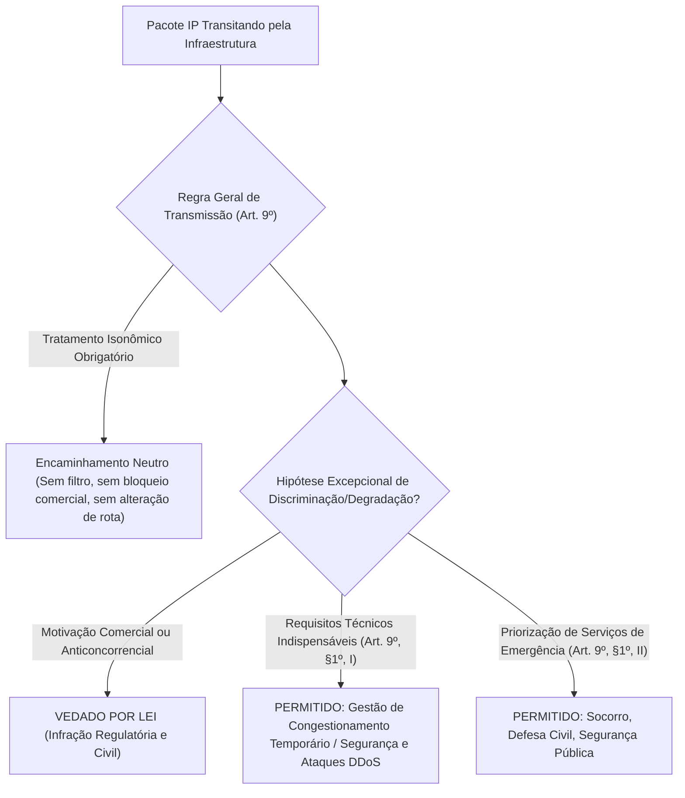
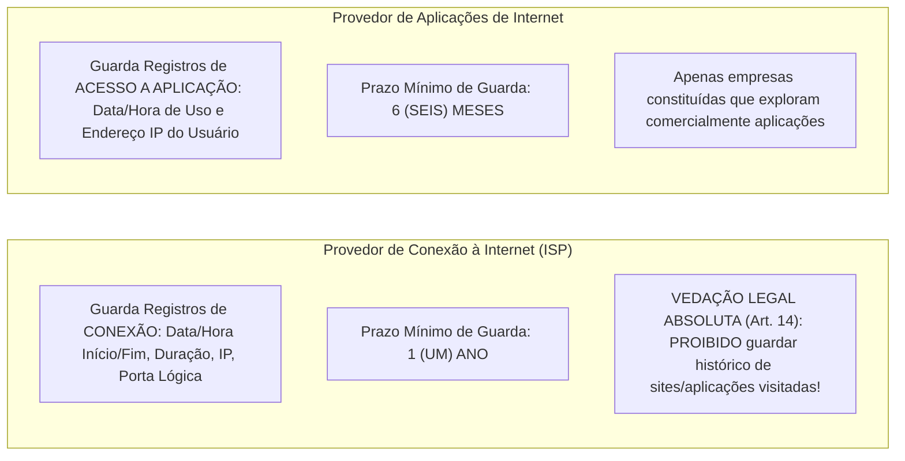
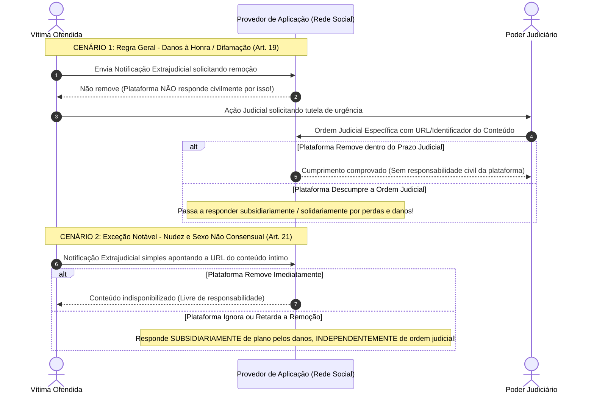

# 02 - Marco Civil da Internet (Lei nº 12.965/2014)

> **Matéria:** Legislação Aplicada à Tecnologia da Informação  
> **Cargo:** B02 – Técnico de Controle Externo – Especialidade: Tecnologia da Informação  
> **Arquivo:** `02_marco_civil_da_internet_lei_12965_2014.md`  
> **Ato Normativo:** Lei Federal nº 12.965, de 23 de abril de 2014 (Marco Civil da Internet) e Decreto nº 8.771, de 11 de maio de 2016

---

## 📌 Ementa / Itens do Edital
- Marco Civil da Internet (Lei nº 12.965/2014)
- Princípios, garantias e direitos dos usuários de Internet no Brasil
- Princípio da Neutralidade de Rede (Art. 9º da Lei e Decreto regulamentador)
- Regras e prazos para Guarda de Registros de Conexão e de Acesso a Aplicações
- Requisição judicial de registros e proteção da privacidade
- Responsabilidade civil por danos decorrentes de conteúdo gerado por terceiros (Arts. 18, 19 e 21)

---

## 🧭 Sumário

1. [Princípios, Garantias e Conceituação Técnica (Arts. 2º a 8º)](#1-principios-garantias-e-conceituacao-tecnica-arts-2o-a-8o)
1. [Vocabulário Técnico-Jurídico Essencial (Art. 5º)](#1-1-vocabulario-tecnico-juridico-essencial-art-5o)
    1. [Teste 525](#Teste-525)
1. [Princípios e Direitos Fundamentais dos Usuários](#1-2-principios-e-direitos-fundamentais-dos-usuarios)
    1. [Teste 526](#Teste-526)
2. [O Princípio da Neutralidade de Rede (Art. 9º e Decreto nº 8.771/2016)](#2-o-principio-da-neutralidade-de-rede-art-9o-e-decreto-no-87712016)
2. [Regra Geral de Tratamento Isonômico](#2-1-regra-geral-de-tratamento-isonomico)
2. [As Duas Únicas Exceções Legais à Neutralidade](#2-2-as-duas-unicas-excecoes-legais-a-neutralidade)
    1. [Teste 527](#Teste-527)
3. [Regime de Guarda de Registros: Conexão vs. Aplicações de Internet](#3-regime-de-guarda-de-registros-conexao-vs-aplicacoes-de-internet)
3. [Distinção Conceitual e Prazos Obrigatórios de Guarda](#3-1-distincao-conceitual-e-prazos-obrigatorios-de-guarda)
    1. [Teste 528](#Teste-528)
    2. [Teste 529](#Teste-529)
3. [A Vedação Absoluta aos Provedores de Conexão (Art. 14)](#3-2-a-vedacao-absoluta-aos-provedores-de-conexao-art-14)
    1. [Teste 530](#Teste-530)
3. [Padrões de Segurança do Decreto nº 8.771/2016](#3-3-padroes-de-seguranca-do-decreto-no-87712016)
4. [Reserva de Jurisdição para Quebra de Sigilo (Arts. 10 e 22)](#4-reserva-de-jurisdicao-para-quebra-de-sigilo-arts-10-e-22)
    1. [Teste 531](#Teste-531)
5. [Responsabilidade Civil por Conteúdo Gerado por Terceiros (Arts. 18 a 21)](#5-responsabilidade-civil-por-conteudo-gerado-por-terceiros-arts-18-a-21)
5. [Imunidade Civil dos Provedores de Conexão (Art. 18)](#5-1-imunidade-civil-dos-provedores-de-conexao-art-18)
5. [Regra Geral dos Provedores de Aplicação (Art. 19 - Ordem Judicial Prévia)](#5-2-regra-geral-dos-provedores-de-aplicacao-art-19-ordem-judicial-previa)
    1. [Teste 532](#Teste-532)
5. [Exceção Crítica do Artigo 21 (Nudez e Sexo Não Consensual)](#5-3-excecao-critica-do-artigo-21-nudez-e-sexo-nao-consensual)
    1. [Teste 533](#Teste-533)
    2. [Teste 534](#Teste-534)
6. [Fontes Recomendadas na Internet](#6-fontes-recomendadas-na-internet)

---

## 1. Princípios, Garantias e Conceituação Técnica (Arts. 2º a 8º)

A **Lei nº 12.965/2014 (Marco Civil da Internet)** estabelece princípios, garantias, direitos e deveres para o uso da Internet no Brasil, determinando as diretrizes para a atuação da União, dos Estados, do Distrito Federal e dos Municípios.

---

## 1.1 Vocabulário Técnico-Jurídico Essencial (Art. 5º)

O Marco Civil consolidou definições obrigatórias para os profissionais de TI, especialmente nas áreas de redes de computadores, telecomunicações e desenvolvimento de software:

1. **Internet (Art. 5º, I):** O sistema constituído do conjunto de redes, protocolos e estruturas de comunicação baseado no protocolo IP (*Internet Protocol*), para comunicação entre pacotes de dados e dispositivos computacionais.
2. **Terminal (Art. 5º, II):** O computador ou qualquer dispositivo que se conecte à Internet (smartphones, roteadores, servidores, dispositivos IoT).
3. **Endereço IP - *Internet Protocol* (Art. 5º, III):** O código atribuído a um terminal de uma rede para permitir sua identificação, definido segundo parâmetros internacionais (IPv4 de 32 bits ou IPv6 de 128 bits).
4. **Porta Lógica de Origem (Decreto nº 8.771/2016, Art. 10):** Número que identifica o canal lógico de comunicação em conexões TCP/UDP (camada de transporte). É essencial para a identificação inequívoca de terminais sob arquiteturas de **CGNAT (*Carrier-Grade NAT* / RFC 6598)**, nas quais centenas de usuários compartilham simultaneamente o mesmo endereço IPv4 público.
5. **Administrador de Sistema Autônomo - AS (Art. 5º, IV):** Pessoa física ou jurídica que administra blocos de endereçamento IP e respectivo sistema autônomo de roteamento (ex.: operadoras e provedores com ASNs registrados no Registro.br / LACNIC).
6. **Conexão à Internet (Art. 5º, V):** A habilitação de um terminal para envio e recebimento de pacotes de dados na Internet, mediante a atribuição de um endereço IP.
7. **Provedor de Conexão à Internet (ISP):** Entidade que viabiliza a habilitação de terminais para tráfego de dados na rede (ex.: operadoras de telecomunicações, provedores regionais de banda larga).
8. **Aplicações de Internet (Art. 5º, VII):** O conjunto de funcionalidades que podem ser acessadas por meio de um terminal conectado à Internet (websites, redes sociais, sistemas de e-mail, plataformas de streaming, APIs governamentais).
9. **Provedor de Aplicações de Internet:** Pessoa natural ou jurídica que disponibiliza serviços, plataformas e aplicações na Internet, explorados ou não comercialmente.

---

### Teste 525
**(FGV – TCE-GO – Analista de Controle Externo Tecnologia da Informacao – 2024)**
A respeito de VoIP e os protocolos SIP e H.323, analise os itens a seguir: I. VoIP é uma aplicação de áudio e vídeo interativo em tempo real; II. O protocolo SIP é um protocolo de camada de transporte que estabelece, gerencia e encerra sessões multimídia; III. O H.323 é um protocolo padrão ITU que permite a um telefone convencional da rede de telefonia pública se comunicar com um computador conectado à Internet. Está correto o que se afirma em

* **A)** I, II e III.
* **B)** I e II, apenas.
* **C)** I e III, apenas.
* **D)** II e III, apenas.
* **E)** II, apenas.

---

> **Comentário Detalhado:**
>
> - **A)** **Incorreta.** A opção apresenta proposição em desacordo com os fundamentos teóricos e técnicos do tópico ao afirmar que "I, II e III". De acordo com a teoria estudada em *4. Reserva de Jurisdição para Quebra de Sigilo (Arts. 10 e 22)*, inviolabilidade das Comunicações Privadas: São invioláveis a intimidade, o sigilo do fluxo de comunicações pela Internet e o sigilo de dados armazenados, salvo expressa ordem judicial (Art. 7º, II e III).
> - **B)** **Incorreta.** A opção incorre em restrição indevida ao limitar o escopo conceitual ao afirmar que "I e II, apenas". De acordo com a teoria estudada em *2.1 Regra Geral de Tratamento Isonômico*, bloquear ou degradar pacotes de protocolos peer-to-peer (P2P/BitTorrent) ou de voz sobre IP (VoIP/WhatsApp) para forçar o consumidor a contratar pacotes de telefonia da própria operadora.
> - **C)** **Correta.** Conforme fundamentado na seção *1.1 Vocabulário Técnico-Jurídico Essencial (Art. 5º)* deste guia, endereço IP - *Internet Protocol* (Art. 5º, III): O código atribuído a um terminal de uma rede para permitir sua identificação, definido segundo parâmetros internacionais (IPv4 de 32 bits ou IPv6 de 128 bits). Dessa forma, está plenamente correta a assertiva da banca (FGV – TCE-GO/2024) ao estabelecer que "I e III, apenas".
> - **D)** **Incorreta.** A opção incorre em restrição indevida ao limitar o escopo conceitual ao afirmar que "II e III, apenas". De acordo com a teoria estudada em *1.1 Vocabulário Técnico-Jurídico Essencial (Art. 5º)*, internet (Art. 5º, I): O sistema constituído do conjunto de redes, protocolos e estruturas de comunicação baseado no protocolo IP (*Internet Protocol*), para comunicação entre pacotes de dados e dispositivos computacionais.
> - **E)** **Incorreta.** A opção incorre em restrição indevida ao limitar o escopo conceitual ao afirmar que "II, apenas". De acordo com a teoria estudada em *1.1 Vocabulário Técnico-Jurídico Essencial (Art. 5º)*, porta Lógica de Origem (Decreto nº 8.771/2016, Art. 10): Número que identifica o canal lógico de comunicação em conexões TCP/UDP (camada de transporte).
>
> **Gabarito: C**

---

## 1.2 Princípios e Direitos Fundamentais dos Usuários

Os princípios da disciplina do uso da Internet no Brasil incluem a garantia da liberdade de expressão, comunicação e manifestação de pensamento; a proteção da privacidade e dos dados pessoais; a preservação da estabilidade, segurança e funcionalidade da rede por meio de padrões técnicos universais; e a neutralidade da rede.

São direitos fundamentais do usuário da internet (Art. 7º):

- Inviolabilidade da intimidade e da vida privada, sua proteção e indenização por dano material ou moral;
- Inviolabilidade e sigilo do fluxo de suas comunicações pela Internet, salvo por expressa **ordem judicial**;
- Não suspensão da conexão à Internet, salvo por débito diretamente decorrente de sua utilização;
- Informações claras e completas sobre coleta, uso, armazenamento e tratamento de dados pessoais.

---

### Teste 526
**(FCC – TRT-4 – Analista Judiciario Tecnologia da Informacao – 2015)**
O cabeçalho do protocolo IPv4 possui o campo denominado TTL (Time to Live) utilizado para configurar

* **A)** o máximo número de saltos entre roteadores para evitar que um pacote fique indefinidamente na rede.
* **B)** a data/hora que o pacote foi processado e transmitido pelo roteador origem da rede.
* **C)** o máximo tempo (em milissegundos) que o pacote deve permanecer na rede para evitar o congestionamento.
* **D)** a data/hora que o pacote deve ser descartado caso não tenha alcançado o destino.
* **E)** o mínimo tempo (em milissegundos) que o pacote deve permanecer na rede para evitar a não entrega.

---

> **Comentário Detalhado:**
>
> - **A)** **Correta.** Conforme fundamentado na seção *1.1 Vocabulário Técnico-Jurídico Essencial (Art. 5º)* deste guia, terminal (Art. 5º, II): O computador ou qualquer dispositivo que se conecte à Internet (smartphones, roteadores, servidores, dispositivos IoT). Dessa forma, está plenamente correta a assertiva da banca (FCC – TRT-4/2015) ao estabelecer que "o máximo número de saltos entre roteadores para evitar que um pacote fique indefinidamente na rede".
> - **B)** **Incorreta.** A opção apresenta proposição em desacordo com os fundamentos teóricos e técnicos do tópico ao afirmar que "a data/hora que o pacote foi processado e transmitido pelo roteador origem da rede". De acordo com a teoria estudada em *3.1 Distinção Conceitual e Prazos Obrigatórios de Guarda*, o que é guardado?: Registros de Conexão: Data e hora de início e término, duração da sessão, endereço IP atribuído e porta lógica de origem. — Registros de Acesso a Aplicações: Data e hora de início e término do uso da aplicação e respectivo endereço IP de origem.
> - **C)** **Incorreta.** A opção apresenta proposição em desacordo com os fundamentos teóricos e técnicos do tópico ao afirmar que "o máximo tempo (em milissegundos) que o pacote deve permanecer na rede para evitar o congestionamento". De acordo com a teoria estudada em *2.2 As Duas Únicas Exceções Legais à Neutralidade*, gestão de congestionamento temporário de redes (garantindo que o tráfego crítico não colapse a rede como um todo).
> - **D)** **Incorreta.** A opção apresenta proposição em desacordo com os fundamentos teóricos e técnicos do tópico ao afirmar que "a data/hora que o pacote deve ser descartado caso não tenha alcançado o destino". De acordo com a teoria estudada em *2. O Princípio da Neutralidade de Rede (Art. 9º e Decreto nº 8.771/2016)*, a Neutralidade de Rede é a garantia legal de que os dados transmitidos pela infraestrutura de telecomunicações devem ser tratados de forma estritamente isonômica, independentemente do tipo de conteúdo, origem, destino, terminal utilizado ou aplicativo gerador.
> - **E)** **Incorreta.** A opção apresenta proposição em desacordo com os fundamentos teóricos e técnicos do tópico ao afirmar que "o mínimo tempo (em milissegundos) que o pacote deve permanecer na rede para evitar a não entrega". De acordo com a teoria estudada em *2.2 As Duas Únicas Exceções Legais à Neutralidade*, preservação da segurança e estabilidade da rede (mitigação em tempo real de ataques DDoS, contenção de tráfego de botnets e bloqueio de portas vulneráveis disseminadoras de malware).
>
> **Gabarito: A**

---

## 2. O Princípio da Neutralidade de Rede (Art. 9º e Decreto nº 8.771/2016)

A **Neutralidade de Rede** é a garantia legal de que os dados transmitidos pela infraestrutura de telecomunicações devem ser tratados de forma estritamente isonômica, independentemente do tipo de conteúdo, origem, destino, terminal utilizado ou aplicativo gerador.

---

## 2.1 Regra Geral de Tratamento Isonômico

- O responsável pela transmissão, comutação ou roteamento tem o dever de tratar quaisquer pacotes de dados de forma **isonômica**, sem distinção por conteúdo, origem, destino, terminal ou aplicação.
- **Proibições Rígidas:**
    - Bloquear ou degradar pacotes de protocolos peer-to-peer (P2P/BitTorrent) ou de voz sobre IP (VoIP/WhatsApp) para forçar o consumidor a contratar pacotes de telefonia da própria operadora;
    - Cobrar tarifas adicionais de empresas de streaming para conceder tráfego acelerado prioritário (*fast lanes* comerciais pagas);
    - Monitorar e inspecionar o conteúdo dos pacotes (*Deep Packet Inspection - DPI*) para fins de direcionamento comercial ou degradação seletiva.

---

---

## 2.2 As Duas Únicas Exceções Legais à Neutralidade

A discriminação ou degradação de tráfego somente poderá decorrer de duas hipóteses taxativas (Art. 9º, § 1º):

1. **Requisitos técnicos indispensáveis à prestação adequada dos serviços e aplicações:**
    - Gestão de congestionamento temporário de redes (garantindo que o tráfego crítico não colapse a rede como um todo);
    - Preservação da segurança e estabilidade da rede (mitigação em tempo real de ataques DDoS, contenção de tráfego de botnets e bloqueio de portas vulneráveis disseminadoras de malware).

2. **Priorização de serviços de emergência:**
    - Roteamento e garantia de banda prioritária para comunicações críticas de socorro, SAMU, Corpo de Bombeiros, Defesa Civil e forças de segurança pública durante catástrofes e desastres.

> 🚨 **ALERTA DE PROVA / PEGADINHA FCC:**  
> A banca FCC frequentemente afirma que o provedor de internet pode degradar tráfego de vídeo ou jogos livremente caso isso conste expressamente em contrato assinado com o consumidor. **ASSERTIVA TOTALMENTE ERRADA!** A neutralidade de rede é norma de ordem pública indisponível. Cláusulas contratuais que prevejam degradação por motivos comerciais ou anticoncorrenciais são absolutamente nulas. As únicas exceções são requisitos técnicos de segurança/estabilidade e serviços de emergência.

---

### Teste 527
**(FGV – TJ-MT – Analista Judiciario Tecnologia da Informacao – 2024)**
Um firewall é uma ferramenta essencial para proteger uma rede de computadores contra acessos não autorizados e ameaças externas. O papel de um firewall em uma rede de computadores é

* **A)** permitir o tráfego de dados sem qualquer restrição, garantindo que a rede esteja sempre disponível para comunicação.
* **B)** bloquear todo o tráfego de dados proveniente de redes externas, sem qualquer exceção, para proteger os dados da rede interna.
* **C)** monitorar e controlar o tráfego de rede com base em um conjunto de regras de segurança definidas, permitindo ou bloqueando o tráfego conforme a política configurada.
* **D)** substituir a necessidade de criptografia em redes, garantindo que todos os dados sejam transmitidos de forma segura.
* **E)** impedir que dispositivos internos da rede se comuniquem entre si, restringindo a troca de dados entre os usuários.

---

> **Comentário Detalhado:**
>
> - **A)** **Incorreta.** A opção promove generalização excessiva que desconsidera as condições técnicas e normativas ao afirmar que "permitir o tráfego de dados sem qualquer restrição, garantindo que a rede esteja sempre disponível para comunicação". De acordo com a teoria estudada em *2.2 As Duas Únicas Exceções Legais à Neutralidade*, gestão de congestionamento temporário de redes (garantindo que o tráfego crítico não colapse a rede como um todo).
> - **B)** **Incorreta.** A opção promove generalização excessiva que desconsidera as condições técnicas e normativas ao afirmar que "bloquear todo o tráfego de dados proveniente de redes externas, sem qualquer exceção, para proteger os dados da...". De acordo com a teoria estudada em *1.1 Vocabulário Técnico-Jurídico Essencial (Art. 5º)*, internet (Art. 5º, I): O sistema constituído do conjunto de redes, protocolos e estruturas de comunicação baseado no protocolo IP (*Internet Protocol*), para comunicação entre pacotes de dados e dispositivos computacionais.
> - **C)** **Correta.** Conforme fundamentado na seção *2.2 As Duas Únicas Exceções Legais à Neutralidade* deste guia, preservação da segurança e estabilidade da rede (mitigação em tempo real de ataques DDoS, contenção de tráfego de botnets e bloqueio de portas vulneráveis disseminadoras de malware). Dessa forma, está plenamente correta a assertiva da banca (FGV – TJ-MT/2024) ao estabelecer que "monitorar e controlar o tráfego de rede com base em um conjunto de regras de segurança definidas, permitindo ou...".
> - **D)** **Incorreta.** A opção apresenta proposição em desacordo com os fundamentos teóricos e técnicos do tópico ao afirmar que "substituir a necessidade de criptografia em redes, garantindo que todos os dados sejam transmitidos de forma segura". De acordo com a teoria estudada em *2. O Princípio da Neutralidade de Rede (Art. 9º e Decreto nº 8.771/2016)*, a Neutralidade de Rede é a garantia legal de que os dados transmitidos pela infraestrutura de telecomunicações devem ser tratados de forma estritamente isonômica, independentemente do tipo de conteúdo, origem, destino, terminal utilizado ou aplicativo gerador.
> - **E)** **Incorreta.** A opção apresenta proposição em desacordo com os fundamentos teóricos e técnicos do tópico ao afirmar que "impedir que dispositivos internos da rede se comuniquem entre si, restringindo a troca de dados entre os usuários". De acordo com a teoria estudada em *1.2 Princípios e Direitos Fundamentais dos Usuários*, os princípios da disciplina do uso da Internet no Brasil incluem a garantia da liberdade de expressão, comunicação e manifestação de pensamento; a proteção da privacidade e dos dados pessoais; a preservação da estabilidade, segurança e funcionalidade da rede por meio de padrões técnicos universais; e a neutralidade da rede.
>
> **Gabarito: C**

---

## 3. Regime de Guarda de Registros: Conexão vs. Aplicações de Internet

O Marco Civil da Internet estabeleceu um regime binário de guarda de registros (*logs*), impondo deveres, prazos e proibições distintos para provedores de conexão e provedores de aplicação:

---

## 3.1 Distinção Conceitual e Prazos Obrigatórios de Guarda

| Aspecto | Provedor de Conexão à Internet (ISP) | Provedor de Aplicação de Internet |
|---|---|---|
| **Dispositivo Legal** | Art. 13 da Lei nº 12.965/2014 | Art. 15 da Lei nº 12.965/2014 |
| **Quem é obrigado?** | Administrador de Sistema Autônomo (AS) devidamente constituído. | Pessoa jurídica constituída que exerça atividade de forma organizada, profissionalmente e com fins econômicos. |
| **O que é guardado?** | **Registros de Conexão:** Data e hora de início e término, duração da sessão, endereço IP atribuído e porta lógica de origem. | **Registros de Acesso a Aplicações:** Data e hora de início e término do uso da aplicação e respectivo endereço IP de origem. |
| **Prazo Legal de Guarda** | **1 (UM) ANO** | **6 (SEIS) MESES** |
| **Ambiente de Guarda** | Sob sigilo, em ambiente controlado e de segurança (Decreto 8.771/2016). | Sob sigilo, em ambiente controlado e de segurança (Decreto 8.771/2016). |
| **Pode guardar histórico de sites?** | ❌ **TERMINANTEMENTE PROIBIDO (Art. 14)!** Não pode guardar registros de acesso a aplicações. | Apenas registra os acessos à sua própria aplicação (não aos sites concorrentes). |
| **Prorrogação Cautelar** | Autoridade policial ou MP pode requerer cautelarmente que os registros sejam guardados por prazo superior enquanto tramita a ordem judicial (Art. 13, § 2º). | Idem: autoridade policial ou MP pode solicitar cautelarmente a preservação de dados (Art. 15, § 2º). |

> 🚨 **ALERTA DE PROVA / PEGADINHA FCC:**  
> Grave os prazos sem chance de confusão:  
>
> - **C**onexão = **1** ano (palavra "Conexão" lembra início de tudo: 1 ano).  
> - **A**plicação = **6** meses (a metade do tempo da conexão).  
> A FCC adora inverter esses dois prazos em enunciados assertivos!

---

### Teste 528
**(FCC – TRT-14 – Analista Judiciario Apoio Especializado Tecnologia da Informacao – 2016)**
Um Analista sugeriu corretamente instalar, como mecanismo de segurança da informação, um

* **A)** Servidor firewall à frente do VPN. O servidor firewall seria conectado à intranet e o VPN seria posicionado entre o servidor firewall e a internet para bloquear totalmente os acessos indevidos.
* **B)** Filtro de conteúdo, para analisar todo o tráfego que circula entre a rede local e a internet, impedindo o acesso a sites utilizando bloqueio por palavra-chave, por URL ou por horário.
* **C)** Sistema de Prevenção de Intrusão − IDS, um sistema passivo que examina o tráfego e informa sobre ameaças, após o firewall.
* **D)** Sistema de Detecção de Intrusão − IPS antes do firewall, para analisar ativamente o fluxo de tráfego que entra na rede e realizar ações de bloqueio automaticamente.
* **E)** Roteador IP com recurso de NAT no ponto de conexão entre a VPN e a internet, para converter endereços IPv6 de computadores da VPN em endereços IPv4 da internet.

---

> **Comentário Detalhado:**
>
> - **A)** **Incorreta.** A opção apresenta proposição em desacordo com os fundamentos teóricos e técnicos do tópico ao afirmar que "Servidor firewall à frente do VPN. O servidor firewall seria conectado à intranet e o VPN seria posicionado entre...". De acordo com a teoria estudada em *3.1 Distinção Conceitual e Prazos Obrigatórios de Guarda*, pode guardar histórico de sites?: ❌ TERMINANTEMENTE PROIBIDO (Art. 14)! Não pode guardar registros de acesso a aplicações. — Apenas registra os acessos à sua própria aplicação (não aos sites concorrentes).
> - **B)** **Correta.** Conforme fundamentado na seção *2.2 As Duas Únicas Exceções Legais à Neutralidade* deste guia, preservação da segurança e estabilidade da rede (mitigação em tempo real de ataques DDoS, contenção de tráfego de botnets e bloqueio de portas vulneráveis disseminadoras de malware). Dessa forma, está plenamente correta a assertiva da banca (FCC – TRT-14/2016) ao estabelecer que "Filtro de conteúdo, para analisar todo o tráfego que circula entre a rede local e a internet, impedindo o acesso a...".
> - **C)** **Incorreta.** A opção apresenta proposição em desacordo com os fundamentos teóricos e técnicos do tópico ao afirmar que "Sistema de Prevenção de Intrusão − IDS, um sistema passivo que examina o tráfego e informa sobre ameaças, após o...". De acordo com a teoria estudada em *5.2 Regra Geral dos Provedores de Aplicação (Art. 19 - Ordem Judicial Prévia)*, com o intuito de assegurar a liberdade de expressão e impedir a censura privada pelas empresas de tecnologia, o provedor de aplicações de internet somente poderá ser responsabilizado civilmente por danos decorrentes de conteúdo gerado por terceiros se, após ordem judicial específica, não tomar as providências para, no âmbito e nos limites técnicos do seu serviço e dentro do prazo assinalado, tornar indisponível o conteúdo apontado como infringente.
> - **D)** **Incorreta.** A opção apresenta proposição em desacordo com os fundamentos teóricos e técnicos do tópico ao afirmar que "Sistema de Detecção de Intrusão − IPS antes do firewall, para analisar ativamente o fluxo de tráfego que entra na...". De acordo com a teoria estudada em *3.2 A Vedação Absoluta aos Provedores de Conexão (Art. 14)*, *"Na provisão de conexão à internet, cabe ao administrador de sistema autônomo respectivo a guarda dos registros de conexão, pelo prazo de 1 (um) ano (..). É VEDADA A GUARDA DOS REGISTROS DE ACESSO A APLICAÇÕES DE INTERNET NA PROVISÃO DE CONEXÃO."*.
> - **E)** **Incorreta.** A opção apresenta proposição em desacordo com os fundamentos teóricos e técnicos do tópico ao afirmar que "Roteador IP com recurso de NAT no ponto de conexão entre a VPN e a internet, para converter endereços IPv6 de...". De acordo com a teoria estudada em *1.1 Vocabulário Técnico-Jurídico Essencial (Art. 5º)*, endereço IP - *Internet Protocol* (Art. 5º, III): O código atribuído a um terminal de uma rede para permitir sua identificação, definido segundo parâmetros internacionais (IPv4 de 32 bits ou IPv6 de 128 bits).
>
> **Gabarito: B**

---

### Teste 529
**(FGV – TJ-AP – Analista Judiciario Apoio Especializado Tecnologia da Informacao Seguranca da Informacao – 2023)**
Amanda trabalha em uma consultoria X e está implementando um NAP (proteção de acesso à rede) em um cliente. O objetivo de Amanda com tal implementação é manter a integridade dos computadores da rede corporativa. Para proteger o acesso à rede de forma adequada, deve existir uma infraestrutura de rede que forneça à área de funcionalidade:

* **A)** validação de integridade: determina se os computadores estão em conformidade com os requisitos de integridade do sistema;
* **B)** zona desmilitarizada: impede que um usuário autorizado com um computador em conformidade carregue um programa mal-intencionado na rede;
* **C)** restrição de rede: permite o acesso à rede, desde que o computador do usuário atenda aos requisitos de política de integridade;
* **D)** correção: restringe o acesso à rede ou à comunicação para clientes que não estão em conformidade com os requisitos de integridade do sistema;
* **E)** conformidade contínua: fornece as atualizações necessárias para permitir que o computador corrija seu estado de integridade não compatível.

---

> **Comentário Detalhado:**
>
> - **A)** **Correta.** Conforme fundamentado na seção *1.1 Vocabulário Técnico-Jurídico Essencial (Art. 5º)* deste guia, o Marco Civil consolidou definições obrigatórias para os profissionais de TI, especialmente nas áreas de redes de computadores, telecomunicações e desenvolvimento de software. Dessa forma, está plenamente correta a assertiva da banca (FGV – TJ-AP/2023) ao estabelecer que "validação de integridade: determina se os computadores estão em conformidade com os requisitos de integridade do...".
> - **B)** **Incorreta.** A opção apresenta proposição em desacordo com os fundamentos teóricos e técnicos do tópico ao afirmar que "zona desmilitarizada: impede que um usuário autorizado com um computador em conformidade carregue um programa...". De acordo com a teoria estudada em *1.2 Princípios e Direitos Fundamentais dos Usuários*, os princípios da disciplina do uso da Internet no Brasil incluem a garantia da liberdade de expressão, comunicação e manifestação de pensamento; a proteção da privacidade e dos dados pessoais; a preservação da estabilidade, segurança e funcionalidade da rede por meio de padrões técnicos universais; e a neutralidade da rede.
> - **C)** **Incorreta.** A opção apresenta proposição em desacordo com os fundamentos teóricos e técnicos do tópico ao afirmar que "restrição de rede: permite o acesso à rede, desde que o computador do usuário atenda aos requisitos de política de...". De acordo com a teoria estudada em *3.2 A Vedação Absoluta aos Provedores de Conexão (Art. 14)*, *"Na provisão de conexão à internet, cabe ao administrador de sistema autônomo respectivo a guarda dos registros de conexão, pelo prazo de 1 (um) ano (..). É VEDADA A GUARDA DOS REGISTROS DE ACESSO A APLICAÇÕES DE INTERNET NA PROVISÃO DE CONEXÃO."*.
> - **D)** **Incorreta.** A opção apresenta proposição em desacordo com os fundamentos teóricos e técnicos do tópico ao afirmar que "correção: restringe o acesso à rede ou à comunicação para clientes que não estão em conformidade com os requisitos...". De acordo com a teoria estudada em *1.1 Vocabulário Técnico-Jurídico Essencial (Art. 5º)*, internet (Art. 5º, I): O sistema constituído do conjunto de redes, protocolos e estruturas de comunicação baseado no protocolo IP (*Internet Protocol*), para comunicação entre pacotes de dados e dispositivos computacionais.
> - **E)** **Incorreta.** A opção apresenta proposição em desacordo com os fundamentos teóricos e técnicos do tópico ao afirmar que "conformidade contínua: fornece as atualizações necessárias para permitir que o computador corrija seu estado de...". De acordo com a teoria estudada em *1.1 Vocabulário Técnico-Jurídico Essencial (Art. 5º)*, endereço IP - *Internet Protocol* (Art. 5º, III): O código atribuído a um terminal de uma rede para permitir sua identificação, definido segundo parâmetros internacionais (IPv4 de 32 bits ou IPv6 de 128 bits).
>
> **Gabarito: A**

---

## 3.2 A Vedação Absoluta aos Provedores de Conexão (Art. 14)

O Art. 14 da Lei nº 12.965/2014 prevê expressamente:
> *"Na provisão de conexão à internet, cabe ao administrador de sistema autônomo respectivo a guarda dos registros de conexão, pelo prazo de 1 (um) ano (..). É VEDADA A GUARDA DOS REGISTROS DE ACESSO A APLICAÇÕES DE INTERNET NA PROVISÃO DE CONEXÃO."*

Isso significa que o provedor de banda larga (como Claro, Vivo, Oi ou provedores locais) **não pode bisbilhotar nem gravar quais sites, vídeos ou serviços o usuário navegou**. O provedor sabe apenas que o usuário estava conectado à internet e qual IP ele utilizou, mas não o que ele consumiu na web.

---

### Teste 530
**(FGV – TRF-1 – Analista Judiciario Area Apoio Especializado Especialidade Suporte Em Tecnologia da Informacao – 2024)**
A equipe de tecnologia da informação (TI) de um órgão está enfrentando dificuldades de disponibilidade de seu site de Internet após a divulgação de novos serviços com prazos rígidos para seus clientes. O site de Internet não está suportando o volume de acessos simultâneos. Para incrementar a disponibilidade do site, a equipe de TI replicou os servidores web e contratou uma solução que instalou um equipamento na frente das várias réplicas do site. Esse equipamento recebe as solicitações dos usuários da Internet, direcionando-as para os diversos servidores web internos, balanceando a carga entre eles. O certificado digital foi instalado nele para reduzir o processamento dos servidores web interno. O equipamento da solução contratada é um Proxy:

* **A)** de encaminhamento;
* **B)** transparente;
* **C)** anônimo;
* **D)** reverso;
* **E)** de distorção.

---

> **Comentário Detalhado:**
>
> - **A)** **Incorreta.** A opção apresenta proposição em desacordo com os fundamentos teóricos e técnicos do tópico ao afirmar que "de encaminhamento". De acordo com a teoria estudada em *3.2 A Vedação Absoluta aos Provedores de Conexão (Art. 14)*, o provedor sabe apenas que o usuário estava conectado à internet e qual IP ele utilizou, mas não o que ele consumiu na web.
> - **B)** **Incorreta.** A opção apresenta proposição em desacordo com os fundamentos teóricos e técnicos do tópico ao afirmar que "transparente". De acordo com a teoria estudada em *3.1 Distinção Conceitual e Prazos Obrigatórios de Guarda*, pode guardar histórico de sites?: ❌ TERMINANTEMENTE PROIBIDO (Art. 14)! Não pode guardar registros de acesso a aplicações. — Apenas registra os acessos à sua própria aplicação (não aos sites concorrentes).
> - **C)** **Incorreta.** A opção apresenta proposição em desacordo com os fundamentos teóricos e técnicos do tópico ao afirmar que "anônimo". De acordo com a teoria estudada em *1.1 Vocabulário Técnico-Jurídico Essencial (Art. 5º)*, terminal (Art. 5º, II): O computador ou qualquer dispositivo que se conecte à Internet (smartphones, roteadores, servidores, dispositivos IoT).
> - **D)** **Incorreta.** A opção apresenta proposição em desacordo com os fundamentos teóricos e técnicos do tópico ao afirmar que "reverso". De acordo com a teoria estudada em *3.2 A Vedação Absoluta aos Provedores de Conexão (Art. 14)*, isso significa que o provedor de banda larga (como Claro, Vivo, Oi ou provedores locais) não pode bisbilhotar nem gravar quais sites, vídeos ou serviços o usuário navegou.
> - **E)** **Correta.** Conforme fundamentado na seção *5.2 Regra Geral dos Provedores de Aplicação (Art. 19 - Ordem Judicial Prévia)* deste guia, com o intuito de assegurar a liberdade de expressão e impedir a censura privada pelas empresas de tecnologia, o provedor de aplicações de internet somente poderá ser responsabilizado civilmente por danos decorrentes de conteúdo gerado por terceiros se, após ordem judicial específica, não tomar as providências para, no âmbito e nos limites técnicos do seu serviço e dentro do prazo assinalado, tornar indisponível o conteúdo apontado como infringente. Dessa forma, está plenamente correta a assertiva da banca (FGV – TRF-1/2024) ao estabelecer que "de distorção".
>
> **Gabarito: E**

---

## 3.3 Padrões de Segurança do Decreto nº 8.771/2016

Os responsáveis pela guarda de registros devem obrigatoriamente seguir padrões mínimos de segurança da informação (Art. 13 do Decreto nº 8.771/2016):

1. **Controle Estrito de Acesso:** Definição formal das funções dos colaboradores autorizados a acessar os logs;
2. **Autenticação Segura:** Mecanismos de autenticação de duplo fator para os administradores dos dados;
3. **Registro de Auditoria de Acessos:** Criação de inventário detalhado com data, hora, identidade do operador e arquivo acessado;
4. **Criptografia:** Soluções de cifração robusta para os dados armazenados em repouso e em trânsito.

---

---

## 4. Reserva de Jurisdição para Quebra de Sigilo (Arts. 10 e 22)

O fornecimento de registros de conexão e de acesso a aplicações de internet submete-se à **estrita cláusula de reserva de jurisdição**:

1. **Inviolabilidade das Comunicações Privadas:** São invioláveis a intimidade, o sigilo do fluxo de comunicações pela Internet e o sigilo de dados armazenados, salvo expressa **ordem judicial** (Art. 7º, II e III).
2. **Dados Cadastrais vs. Logs de Conexão/Aplicação:**
    - *Dados Cadastrais Básicos (Filiação, Endereço residencial, Nome, CPF):* Podem ser requisitados diretamente por autoridades administrativas e policiais nos termos de leis específicas (Lei de Lavagem de Dinheiro nº 9.613/1998 e Lei de Organizações Criminosas nº 12.850/2013).
    - *Logs de Conexão e de Aplicação (IP, porta lógica, data, hora, duração):* Exigem **SEMPRE ordem judicial prévia**. Nenhuma autoridade administrativa (nem Delegado de Polícia, nem Promotor de Justiça, nem Auditor de Controle Externo) pode requisitá-los diretamente sem mandado do juiz competente.

3. **Requisitos da Petição de Quebra de Registros (Art. 22, parágrafo único):**
    - Fundados indícios da ocorrência do ilícito;
    - Justificativa motivada da utilidade dos registros para fins de investigação ou instrução probatória;
    - Período determinado ao qual se referem os registros (são vedadas ordens genéricas de devassa indeterminada).

---

### Teste 531
**(FCC – TRT-11 – Analista Judiciario Tecnologia da Informacao – 2017)**
A comunicação de dados em Redes Amplas (WAN) foi impulsionada pela técnica de comutação de pacotes que, em comparação com a técnica de comutação de circuitos, apresenta a vantagem

* **A)** dos pacotes chegarem na ordem em que foram enviados.
* **B)** de disponibilizar uma comunicação confiável fim a fim.
* **C)** de ser mais tolerante a falhas em equipamentos da rede.
* **D)** dos pacotes seguirem uma rota pré-estabelecida.
* **E)** de possibilitar a reserva de banda de comunicação.

---

> **Comentário Detalhado:**
>
> - **A)** **Incorreta.** A opção apresenta proposição em desacordo com os fundamentos teóricos e técnicos do tópico ao afirmar que "dos pacotes chegarem na ordem em que foram enviados". De acordo com a teoria estudada em *1.1 Vocabulário Técnico-Jurídico Essencial (Art. 5º)*, internet (Art. 5º, I): O sistema constituído do conjunto de redes, protocolos e estruturas de comunicação baseado no protocolo IP (*Internet Protocol*), para comunicação entre pacotes de dados e dispositivos computacionais.
> - **B)** **Incorreta.** A opção apresenta proposição em desacordo com os fundamentos teóricos e técnicos do tópico ao afirmar que "de disponibilizar uma comunicação confiável fim a fim". De acordo com a teoria estudada em *1.2 Princípios e Direitos Fundamentais dos Usuários*, os princípios da disciplina do uso da Internet no Brasil incluem a garantia da liberdade de expressão, comunicação e manifestação de pensamento; a proteção da privacidade e dos dados pessoais; a preservação da estabilidade, segurança e funcionalidade da rede por meio de padrões técnicos universais; e a neutralidade da rede.
> - **C)** **Correta.** Conforme fundamentado na seção *2. O Princípio da Neutralidade de Rede (Art. 9º e Decreto nº 8.771/2016)* deste guia, a Neutralidade de Rede é a garantia legal de que os dados transmitidos pela infraestrutura de telecomunicações devem ser tratados de forma estritamente isonômica, independentemente do tipo de conteúdo, origem, destino, terminal utilizado ou aplicativo gerador. Dessa forma, está plenamente correta a assertiva da banca (FCC – TRT-11/2017) ao estabelecer que "de ser mais tolerante a falhas em equipamentos da rede".
> - **D)** **Incorreta.** A opção apresenta proposição em desacordo com os fundamentos teóricos e técnicos do tópico ao afirmar que "dos pacotes seguirem uma rota pré-estabelecida". De acordo com a teoria estudada em *2.1 Regra Geral de Tratamento Isonômico*, o responsável pela transmissão, comutação ou roteamento tem o dever de tratar quaisquer pacotes de dados de forma isonômica, sem distinção por conteúdo, origem, destino, terminal ou aplicação.
> - **E)** **Incorreta.** A opção apresenta proposição em desacordo com os fundamentos teóricos e técnicos do tópico ao afirmar que "de possibilitar a reserva de banda de comunicação". De acordo com a teoria estudada em *4. Reserva de Jurisdição para Quebra de Sigilo (Arts. 10 e 22)*, *Dados Cadastrais Básicos (Filiação, Endereço residencial, Nome, CPF):* Podem ser requisitados diretamente por autoridades administrativas e policiais nos termos de leis específicas (Lei de Lavagem de Dinheiro nº 9.613/1998 e Lei de Organizações Criminosas nº 12.850/2013).
>
> **Gabarito: C**

---

## 5. Responsabilidade Civil por Conteúdo Gerado por Terceiros (Arts. 18 a 21)

A responsabilização das plataformas por publicações, comentários, postagens e vídeos feitos pelos usuários estrutura-se em um regime jurídico tripartite:

---

## 5.1 Imunidade Civil dos Provedores de Conexão (Art. 18)

O provedor de conexão à internet **não responderá civilmente** por danos decorrentes de conteúdo gerado por terceiros em nenhuma hipótese. Ele atua como mero conduto de transmissão de pacotes (*mere conduit*), sem poder de gerência sobre o conteúdo transmitido.

---

---

## 5.2 Regra Geral dos Provedores de Aplicação (Art. 19 - Ordem Judicial Prévia)

- Com o intuito de assegurar a liberdade de expressão e impedir a censura privada pelas empresas de tecnologia, o provedor de aplicações de internet somente poderá ser responsabilizado civilmente por danos decorrentes de conteúdo gerado por terceiros **se, após ordem judicial específica, não tomar as providências para, no âmbito e nos limites técnicos do seu serviço e dentro do prazo assinalado, tornar indisponível o conteúdo apontado como infringente**.
- Notificações extrajudiciais privadas (cartas de advogados, e-mails de reclamação) **não** geram responsabilidade civil para a plataforma na regra geral!

---

### Teste 532
**(FGV – TRF-1 – Analista Judiciario Area Apoio Especializado Especialidade Suporte Em Tecnologia da Informacao – 2024)**
O gerente de recursos humanos está organizando uma atividade institucional que contará com a presença de familiares dos servidores do órgão. Para fins de controle de acesso e organização do evento, será necessário registrar o nome, idade e CPF de todos. Além disso, a atividade contará com o apoio da equipe de marketing, que divulgará, após o seu término, uma notícia com fotos do evento na página de Internet da instituição. O gerente de recursos humanos solicita ao encarregado pelo tratamento de dados pessoais que o oriente sobre como proceder para coletar dados pessoais de crianças que venham a participar do evento. O encarregado esclarece corretamente que, nos termos da Lei Geral de Proteção de Dados Pessoais, deverá ser solicitado o consentimento:

* **A)** expresso e em destaque, dado pelo responsável legal;
* **B)** expresso e em destaque, dado por ambos os pais ou responsável legal;
* **C)** específico e em destaque, dado pelo servidor que acompanhará a criança no evento;
* **D)** expresso e em destaque, dado por pelo menos um dos pais ou responsável legal;
* **E)** específico, em destaque, dado por pelo menos um dos pais ou responsável legal.

---

> **Comentário Detalhado:**
>
> - **A)** **Incorreta.** A opção apresenta proposição em desacordo com os fundamentos teóricos e técnicos do tópico ao afirmar que "expresso e em destaque, dado pelo responsável legal". De acordo com a teoria estudada em *2.1 Regra Geral de Tratamento Isonômico*, o responsável pela transmissão, comutação ou roteamento tem o dever de tratar quaisquer pacotes de dados de forma isonômica, sem distinção por conteúdo, origem, destino, terminal ou aplicação.
> - **B)** **Incorreta.** A opção apresenta proposição em desacordo com os fundamentos teóricos e técnicos do tópico ao afirmar que "expresso e em destaque, dado por ambos os pais ou responsável legal". De acordo com a teoria estudada em *2. O Princípio da Neutralidade de Rede (Art. 9º e Decreto nº 8.771/2016)*, a Neutralidade de Rede é a garantia legal de que os dados transmitidos pela infraestrutura de telecomunicações devem ser tratados de forma estritamente isonômica, independentemente do tipo de conteúdo, origem, destino, terminal utilizado ou aplicativo gerador.
> - **C)** **Incorreta.** A opção apresenta proposição em desacordo com os fundamentos teóricos e técnicos do tópico ao afirmar que "específico e em destaque, dado pelo servidor que acompanhará a criança no evento". De acordo com a teoria estudada em *5.3 Exceção Crítica do Artigo 21 (Nudez e Sexo Não Consensual)*, condição de Responsabilização: O provedor responderá subsidiariamente se, após o recebimento de simples notificação pelo participante ou seu representante legal, deixar de promover de forma diligente a indisponibilização do conteúdo.
> - **D)** **Incorreta.** A opção apresenta proposição em desacordo com os fundamentos teóricos e técnicos do tópico ao afirmar que "expresso e em destaque, dado por pelo menos um dos pais ou responsável legal". De acordo com a teoria estudada em *5.2 Regra Geral dos Provedores de Aplicação (Art. 19 - Ordem Judicial Prévia)*, com o intuito de assegurar a liberdade de expressão e impedir a censura privada pelas empresas de tecnologia, o provedor de aplicações de internet somente poderá ser responsabilizado civilmente por danos decorrentes de conteúdo gerado por terceiros se, após ordem judicial específica, não tomar as providências para, no âmbito e nos limites técnicos do seu serviço e dentro do prazo assinalado, tornar indisponível o conteúdo apontado como infringente.
> - **E)** **Correta.** Conforme fundamentado na seção *4. Reserva de Jurisdição para Quebra de Sigilo (Arts. 10 e 22)* deste guia, *Dados Cadastrais Básicos (Filiação, Endereço residencial, Nome, CPF):* Podem ser requisitados diretamente por autoridades administrativas e policiais nos termos de leis específicas (Lei de Lavagem de Dinheiro nº 9.613/1998 e Lei de Organizações Criminosas nº 12.850/2013). Dessa forma, está plenamente correta a assertiva da banca (FGV – TRF-1/2024) ao estabelecer que "específico, em destaque, dado por pelo menos um dos pais ou responsável legal".
>
> **Gabarito: E**

---

## 5.3 Exceção Crítica do Artigo 21 (Nudez e Sexo Não Consensual)

O Artigo 21 constitui a exceção mais importante e cobrada em provas de concurso:

- Aplica-se à divulgação não autorizada de imagens, vídeos ou materiais contendo **cenas de nudez ou de atos sexuais de caráter privado** ("pornografia de vingança").
- **Condição de Responsabilização:** O provedor responderá subsidiariamente se, **após o recebimento de simples notificação pelo participante ou seu representante legal**, deixar de promover de forma diligente a indisponibilização do conteúdo.
- **NÃO exige ordem judicial!** A notificação extrajudicial da vítima contendo elementos que permitam identificar o material (URL) é suficiente para impor a obrigação de derrubada imediata.

---

### Teste 533
**(FGV – TRT-24 – Analista Judiciario Area Administrativa Contabilidade – 2025)**
De acordo com a Lei Geral de Proteção de Dados Pessoais (Lei nº 13.709/2018), o titular tem direito ao acesso facilitado às informações sobre o tratamento de seus dados, que deverão ser disponibilizadas de forma clara, adequada e ostensiva acerca de determinadas características. Quando o consentimento é requerido, se houver mudanças da finalidade para o tratamento de dados pessoais não compatíveis com o consentimento original, o controlador deverá informar o titular sobre as mudanças de finalidade

* **A)** previamente, sendo que o titular não poderá revogar o consentimento.
* **B)** previamente, podendo o titular revogar o consentimento, caso discorde das alterações.
* **C)** posteriormente, sendo que o titular não poderá revogar o consentimento.
* **D)** posteriormente, podendo o titular revogar o consentimento, caso discorde das alterações.
* **E)** anualmente, sendo que o titular deverá renovar o seu consentimento.

---

> **Comentário Detalhado:**
>
> - **A)** **Incorreta.** A opção apresenta proposição em desacordo com os fundamentos teóricos e técnicos do tópico ao afirmar que "previamente, sendo que o titular não poderá revogar o consentimento". De acordo com a teoria estudada em *5.2 Regra Geral dos Provedores de Aplicação (Art. 19 - Ordem Judicial Prévia)*, com o intuito de assegurar a liberdade de expressão e impedir a censura privada pelas empresas de tecnologia, o provedor de aplicações de internet somente poderá ser responsabilizado civilmente por danos decorrentes de conteúdo gerado por terceiros se, após ordem judicial específica, não tomar as providências para, no âmbito e nos limites técnicos do seu serviço e dentro do prazo assinalado, tornar indisponível o conteúdo apontado como infringente.
> - **B)** **Correta.** Conforme fundamentado na seção *1.2 Princípios e Direitos Fundamentais dos Usuários* deste guia, informações claras e completas sobre coleta, uso, armazenamento e tratamento de dados pessoais. Dessa forma, está plenamente correta a assertiva da banca (FGV – TRT-24/2025) ao estabelecer que "previamente, podendo o titular revogar o consentimento, caso discorde das alterações".
> - **C)** **Incorreta.** A opção apresenta proposição em desacordo com os fundamentos teóricos e técnicos do tópico ao afirmar que "posteriormente, sendo que o titular não poderá revogar o consentimento". De acordo com a teoria estudada em *2.2 As Duas Únicas Exceções Legais à Neutralidade*, a banca FCC frequentemente afirma que o provedor de internet pode degradar tráfego de vídeo ou jogos livremente caso isso conste expressamente em contrato assinado com o consumidor.
> - **D)** **Incorreta.** A opção apresenta proposição em desacordo com os fundamentos teóricos e técnicos do tópico ao afirmar que "posteriormente, podendo o titular revogar o consentimento, caso discorde das alterações". De acordo com a teoria estudada em *2.1 Regra Geral de Tratamento Isonômico*, o responsável pela transmissão, comutação ou roteamento tem o dever de tratar quaisquer pacotes de dados de forma isonômica, sem distinção por conteúdo, origem, destino, terminal ou aplicação.
> - **E)** **Incorreta.** A opção apresenta proposição em desacordo com os fundamentos teóricos e técnicos do tópico ao afirmar que "anualmente, sendo que o titular deverá renovar o seu consentimento". De acordo com a teoria estudada em *1.2 Princípios e Direitos Fundamentais dos Usuários*, os princípios da disciplina do uso da Internet no Brasil incluem a garantia da liberdade de expressão, comunicação e manifestação de pensamento; a proteção da privacidade e dos dados pessoais; a preservação da estabilidade, segurança e funcionalidade da rede por meio de padrões técnicos universais; e a neutralidade da rede.
>
> **Gabarito: B**

---

### Teste 534
**(FCC – TRT-6 – Analista Judiciario Apoio Especializado Tecnologia da Informacao – 2012)**
Qualquer dos seguintes protocolos pode ser utilizado para implementar serviços de "voz sobre IP", EXCETO

* **A)** H.323
* **B)** PSTN
* **C)** SIP
* **D)** MGCP
* **E)** RTP

---

> **Comentário Detalhado:**
>
> - **A)** **Incorreta.** A opção apresenta proposição em desacordo com os fundamentos teóricos e técnicos do tópico ao afirmar que "H.323". De acordo com a teoria estudada em *2. O Princípio da Neutralidade de Rede (Art. 9º e Decreto nº 8.771/2016)*, a Neutralidade de Rede é a garantia legal de que os dados transmitidos pela infraestrutura de telecomunicações devem ser tratados de forma estritamente isonômica, independentemente do tipo de conteúdo, origem, destino, terminal utilizado ou aplicativo gerador.
> - **B)** **Correta.** Conforme fundamentado na seção *2.1 Regra Geral de Tratamento Isonômico* deste guia, bloquear ou degradar pacotes de protocolos peer-to-peer (P2P/BitTorrent) ou de voz sobre IP (VoIP/WhatsApp) para forçar o consumidor a contratar pacotes de telefonia da própria operadora. Dessa forma, está plenamente correta a assertiva da banca (FCC – TRT-6/2012) ao estabelecer que "PSTN".
> - **C)** **Incorreta.** A opção apresenta proposição em desacordo com os fundamentos teóricos e técnicos do tópico ao afirmar que "SIP". De acordo com a teoria estudada em *3.2 A Vedação Absoluta aos Provedores de Conexão (Art. 14)*, isso significa que o provedor de banda larga (como Claro, Vivo, Oi ou provedores locais) não pode bisbilhotar nem gravar quais sites, vídeos ou serviços o usuário navegou.
> - **D)** **Incorreta.** A opção apresenta proposição em desacordo com os fundamentos teóricos e técnicos do tópico ao afirmar que "MGCP". De acordo com a teoria estudada em *1.1 Vocabulário Técnico-Jurídico Essencial (Art. 5º)*, terminal (Art. 5º, II): O computador ou qualquer dispositivo que se conecte à Internet (smartphones, roteadores, servidores, dispositivos IoT).
> - **E)** **Incorreta.** A opção apresenta proposição em desacordo com os fundamentos teóricos e técnicos do tópico ao afirmar que "RTP". De acordo com a teoria estudada em *1.1 Vocabulário Técnico-Jurídico Essencial (Art. 5º)*, internet (Art. 5º, I): O sistema constituído do conjunto de redes, protocolos e estruturas de comunicação baseado no protocolo IP (*Internet Protocol*), para comunicação entre pacotes de dados e dispositivos computacionais.
>
> **Gabarito: B**

---

## 6. Fontes Recomendadas na Internet

* [Lei nº 12.965/2014 (Marco Civil da Internet)](https://www.planalto.gov.br/ccivil_03/_ato2011-2014/2014/lei/l12965.htm) - Estabelece princípios, garantias, direitos e deveres para o uso da Internet no Brasil.
* [Decreto nº 8.771/2016 (Regulamento do Marco Civil da Internet)](https://www.planalto.gov.br/ccivil_03/_ato2015-2018/2016/decreto/d8771.htm) - Regulamenta a neutralidade de rede, a guarda de registros e os padrões de segurança de dados.
* [Comitê Gestor da Internet no Brasil (CGI.br) - Estrutura e Governança](https://cgi.br/sobre/) - Histórico, competências institucionais e princípios fundamentais de governança da Internet no Brasil.
* [IETF RFC 8446 - The Transport Layer Security (TLS) Protocol Version 1.3](https://datatracker.ietf.org/doc/html/rfc8446) - Norma técnica que viabiliza a inviolabilidade e o sigilo das comunicações previsto no art. 7º do Marco Civil.
* [Governo Digital - Infraestrutura Nacional de Dados (IND)](https://www.gov.br/governodigital/pt-br/infraestrutura-nacional-de-dados) - Governança e compartilhamento de dados governamentais conforme as garantias do Marco Civil.
* PINHEIRO, Patricia Peck. **Direito Digital**. 7. ed. São Paulo: SaraivaJur, 2021. (Cap. 3 - Marco Civil da Internet: Responsabilidade e Registros).
* SOUZA, Carlos Affonso; LEMOS, Ronaldo. **Marco Civil da Internet: Construção e Aplicação**. São Paulo: Revista dos Tribunais, 2014. (Cap. 1 - Neutralidade de Rede; Cap. 2 - Guarda de Registros e Privacidade).
* BLUM, Renato Opice. **Marco Civil da Internet Comentado**. São Paulo: Quartier Latin, 2015. (Arts. 9º a 17 - Responsabilidade Civil dos Provedores).
