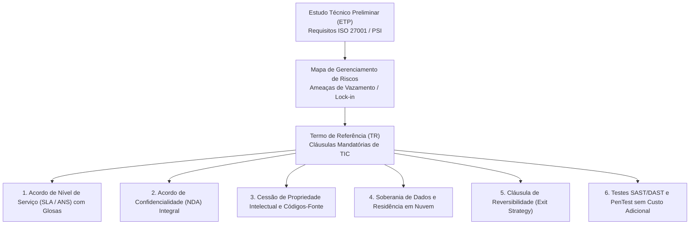
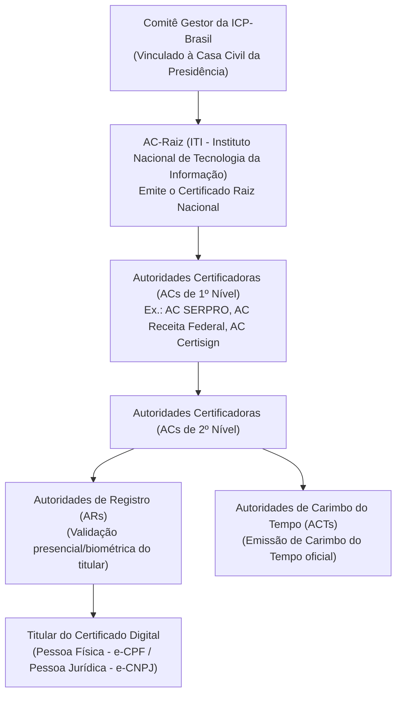
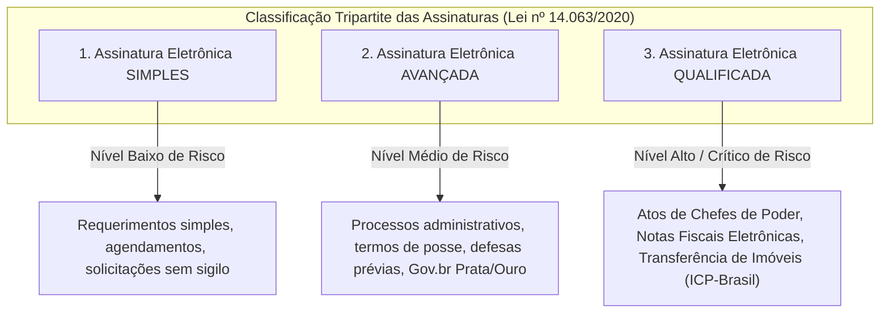

# 03 - Segurança em Contratações de TIC e Certificação Digital

> **Matéria:** Legislação Aplicada à Tecnologia da Informação  
> **Cargo:** B02 – Técnico de Controle Externo – Especialidade: Tecnologia da Informação  
> **Arquivo:** `03_seguranca_em_contratacoes_e_certificacao_digital.md`  
> **Atos Normativos:** Medida Provisória nº 2.200-2/2001 (ICP-Brasil), Lei Federal nº 14.063/2020 (Assinaturas Eletrônicas em Entes Públicos) e Lei Federal nº 14.133/2021 (Lei de Licitações e Contratos Administrativos)

---

## 📌 Ementa / Itens do Edital
- Requisitos de segurança da informação em editais e contratos de soluções de TIC
- Cláusulas essenciais de segurança, confidencialidade (NDA), privacidade e soberania de dados
- Certificação digital e infraestrutura de chaves públicas (MP nº 2.200-2/2001)
- Lei Federal nº 14.063/2020 (Assinaturas Eletrônicas em Interações com Entes Públicos)
- Aplicação prática da certificação digital em sistemas informatizados de processos e auditoria eletrônica

---

## 🧭 Sumário

1. [Requisitos de Segurança em Contratações de TIC no Setor Público](#1-requisitos-de-seguranca-em-contratacoes-de-tic-no-setor-publico)
1. [Fases do Planejamento e Segurança da Informação](#1-1-fases-do-planejamento-e-seguranca-da-informacao)
    1. [Teste 535](#Teste-535)
1. [Cláusulas Contratuais Críticas de Segurança](#1-2-clausulas-contratuais-criticas-de-seguranca)
    1. [Teste 536](#Teste-536)
2. [O Marco Legal da Certificação Digital e a ICP-Brasil (MP nº 2.200-2/2001)](#2-o-marco-legal-da-certificacao-digital-e-a-icp-brasil-mp-no-2200-22001)
2. [Estrutura e Atores da ICP-Brasil](#2-1-estrutura-e-atores-da-icp-brasil)
    1. [Teste 537](#Teste-537)
2. [Tipos de Certificados Digitais ICP-Brasil (A1 vs. A3)](#2-2-tipos-de-certificados-digitais-icp-brasil-a1-vs-a3)
    1. [Teste 538](#Teste-538)
2. [Presunção Legal de Veracidade e Validade de Assinaturas Não-ICP](#2-3-presuncao-legal-de-veracidade-e-validade-de-assinaturas-nao-icp)
    1. [Teste 539](#Teste-539)
3. [Classificação Tripartite das Assinaturas Eletrônicas (Lei nº 14.063/2020)](#3-classificacao-tripartite-das-assinaturas-eletronicas-lei-no-140632020)
3. [Assinaturas Simples, Avançadas e Qualificadas](#3-1-assinaturas-simples-avancadas-e-qualificadas)
    1. [Teste 540](#Teste-540)
    2. [Teste 541](#Teste-541)
3. [Princípio da Proporcionalidade e Hipóteses de Uso](#3-2-principio-da-proporcionalidade-e-hipoteses-de-uso)
    1. [Teste 542](#Teste-542)
4. [Aplicação Prática da Certificação Digital na Auditoria e Processo Eletrônico](#4-aplicacao-pratica-da-certificacao-digital-na-auditoria-e-processo-eletronico)
    1. [Teste 543](#Teste-543)
    2. [Teste 544](#Teste-544)
6. [Fontes Recomendadas na Internet](#6-fontes-recomendadas-na-internet)

---

## 1. Requisitos de Segurança em Contratações de TIC no Setor Público

A contratação de soluções de Tecnologia da Informação e Comunicação (TIC) na Administração Pública rege-se pela Lei nº 14.133/2021 (Lei de Licitações e Contratos Administrativos), em conjunto com normativos de governança digital (como a Instrução Normativa SGD/MGI nº 94/2022) e a jurisprudência consolidada do Tribunal de Contas da União (TCU) e dos Tribunais de Contas Estaduais.

---

## 1.1 Fases do Planejamento e Segurança da Informação

A segurança da informação não pode ser um apêndice acrescentado após a assinatura do contrato; ela deve ser arquitetada desde o início do planejamento da contratação:

1. **Documento de Oficialização da Demanda (DOD):** Identifica formalmente a necessidade institucional da área requisitante.
2. **Estudo Técnico Preliminar (ETP):** Mapeia a viabilidade técnica e define requisitos mandatórios de segurança da informação, alinhando a contratação à Política de Segurança da Informação (PSI) do Tribunal e aos padrões ABNT NBR ISO/IEC 27001 (Sistemas de Gestão de Segurança da Informação) e 27002 (Controles de Segurança).
3. **Mapa de Gerenciamento de Riscos:** Identifica ameaças cibernéticas, indisponibilidade, dependência de fornecedor (*vendor lock-in*) e vazamento de dados pessoais (LGPD), desenhando planos preventivos e contingenciais.
4. **Termo de Referência (TR):** Especifica objetivamente os requisitos técnicos, indicadores do Instrumento de Medição de Resultado (IMR), níveis mínimos de serviço e cláusulas resolutivas.

---

### Teste 535
**(FGV – TRT-24 – Analista Judiciario Area Apoio Especializado Tecnologia da Informacao – 2025)**
O anexo II da Portaria 162/2021 do Conselho Nacional de Justiça estabelece um protocolo de gerenciamento de crises cibernéticas do poder judiciário (PGCRC-PJ). O gerenciamento de crises se refere às atividades que devem ser executadas para avaliar o problema e determinar a resposta inicial diante da ocorrência de um evento adverso de segurança da informação. O gerenciamento de crises está divido em

* **A)** 3 fases.
* **B)** 4 fases.
* **C)** 5 fases.
* **D)** 6 fases.
* **E)** 7 fases.

---

> **Comentário Detalhado:**
>
> - **A)** **Correta.** Conforme fundamentado na seção *1.1 Fases do Planejamento e Segurança da Informação* deste guia, mapa de Gerenciamento de Riscos: Identifica ameaças cibernéticas, indisponibilidade, dependência de fornecedor (*vendor lock-in*) e vazamento de dados pessoais (LGPD), desenhando planos preventivos e contingenciais. Dessa forma, está plenamente correta a assertiva da banca (FGV – TRT-24/2025) ao estabelecer que "3 fases".
> - **B)** **Incorreta.** A opção apresenta proposição em desacordo com os fundamentos teóricos e técnicos do tópico ao afirmar que "4 fases". De acordo com a teoria estudada em *1.1 Fases do Planejamento e Segurança da Informação*, a segurança da informação não pode ser um apêndice acrescentado após a assinatura do contrato; ela deve ser arquitetada desde o início do planejamento da contratação.
> - **C)** **Incorreta.** A opção apresenta proposição em desacordo com os fundamentos teóricos e técnicos do tópico ao afirmar que "5 fases". De acordo com a teoria estudada em *1.1 Fases do Planejamento e Segurança da Informação*, documento de Oficialização da Demanda (DOD): Identifica formalmente a necessidade institucional da área requisitante.
> - **D)** **Incorreta.** A opção apresenta proposição em desacordo com os fundamentos teóricos e técnicos do tópico ao afirmar que "6 fases". De acordo com a teoria estudada em *1.1 Fases do Planejamento e Segurança da Informação*, estudo Técnico Preliminar (ETP): Mapeia a viabilidade técnica e define requisitos mandatórios de segurança da informação, alinhando a contratação à Política de Segurança da Informação (PSI) do Tribunal e aos padrões ABNT NBR ISO/IEC 27001 (Sistemas de Gestão de Segurança da Informação) e 27002 (Controles de Segurança).
> - **E)** **Incorreta.** A opção apresenta proposição em desacordo com os fundamentos teóricos e técnicos do tópico ao afirmar que "7 fases". De acordo com a teoria estudada em *1.1 Fases do Planejamento e Segurança da Informação*, termo de Referência (TR): Especifica objetivamente os requisitos técnicos, indicadores do Instrumento de Medição de Resultado (IMR), níveis mínimos de serviço e cláusulas resolutivas.
>
> **Gabarito: A**

---

## 1.2 Cláusulas Contratuais Críticas de Segurança

| Cláusula Contratual | Justificativa Técnica e Jurídica | Regra de Fiscalização e Controle Externo |
|---|---|---|
| **Acordo de Nível de Serviço (SLA / ANS)** | Define metas quantitativas mensuráveis (disponibilidade mínima de 99,8%, tempo de resposta para incidentes críticos $\le 1\text{h}$, RTO e RPO). | É **vedado o pagamento por homem-hora puro** sem atrelamento a resultados mensuráveis e qualidade (Súmula TCU nº 269). O descumprimento do SLA acarreta glosa financeira proporcional na fatura mensal. |
| **Termo de Confidencialidade (NDA)** | Impõe dever de segredo sobre dados, infraestrutura, credenciais, topologia de rede e regras de negócio do órgão. | Deve ser assinado pela pessoa jurídica contratada **e individualmente** por cada profissional ou prestador alocado na execução do contrato. |
| **Propriedade Intelectual e Códigos-Fonte** | Assegura que toda a solução customizada desenvolvida para a Administração pertença ao ente público. | O contrato deve obrigar a entrega periódica de commits no repositório de controle de versão do órgão (Git institucional), documentação técnica, diagramas e scripts de implantação (IaC). |
| **Soberania e Residência de Dados (Cloud)** | Protege a informação governamental contra jurisdições estrangeiras conflitantes (como o *Cloud Act* americano). | Exigência de que os dados sensíveis e críticos sejam armazenados em data centers localizados no território brasileiro ou em países com grau de proteção equivalente reconhecido pela ANPD. |
| **Cláusula de Reversibilidade (*Exit Strategy*)** | Evita o aprisionamento tecnológico (*vendor lock-in*) ao término do contrato. | Obriga o prestador a fornecer, ao fim do contrato ou em caso de rescisão, a exportação integral dos dados em formatos interoperáveis (SQL, JSON, CSV), auxílio na migração e destruição segura comprovada de cópias remanescentes. |
| **Auditoria e PenTest Periódico** | Garante que o software entregue não contenha vulnerabilidades do *OWASP Top 10* ou portas dos fundos (*backdoors*). | O Tribunal reserva-se o direito de executar varreduras estáticas (SAST), dinâmicas (DAST) e testes de intrusão (PenTest), obrigando a contratada a corrigir quaisquer falhas críticas sem ônus. |

> 🚨 **ALERTA DE PROVA / PEGADINHA FCC:**  
> A FCC adora cobrar a Súmula nº 269 do TCU em provas de governança de TIC: *"Nas contratações para prestação de serviços de tecnologia da informação, a remuneração deve ser vinculada a resultados ou ao alcance de níveis de serviço, sendo vedada a contratação com base exclusivamente em homem-hora"*. Além disso, contratos em nuvem sem cláusula de reversibilidade (*Exit Strategy*) são reiteradamente apontados como irregulares por auditorias de controle externo.

---

### Teste 536
**(FCC – TRT-15 – Analista Judiciario Tecnologia da Informacao – 2015)**
Na etapa de Desenho de Serviço da ITIL v3 atualizada em 2011, no processo de Gerenciamento de Nível de Serviço são firmados os Acordos de Nível de Serviço − ANS. Um

* **A)** ANS pode ser formal ou informal, realizado entre o provedor de serviços de TI e o cliente.
* **B)** ANS descreve os serviços de TI e documenta metas de nível de serviço, mas não especifica as responsabilidades das partes envolvidas.
* **C)** único ANS pode cobrir múltiplos serviços de TI ou múltiplos clientes.
* **D)** ANS cobre um serviço para todos os clientes desse serviço, neste caso, sendo chamado de ANS multi-nível baseado em Cliente.
* **E)** ANS é firmado, exclusivamente, entre o provedor de serviços de TI e outra parte da mesma organização.

---

> **Comentário Detalhado:**
>
> - **A)** **Incorreta.** A opção apresenta proposição em desacordo com os fundamentos teóricos e técnicos do tópico ao afirmar que "ANS pode ser formal ou informal, realizado entre o provedor de serviços de TI e o cliente". De acordo com a teoria estudada em *1.2 Cláusulas Contratuais Críticas de Segurança*, a FCC adora cobrar a Súmula nº 269 do TCU em provas de governança de TIC: *"Nas contratações para prestação de serviços de tecnologia da informação, a remuneração deve ser vinculada a resultados ou ao alcance de níveis de serviço, sendo vedada a contratação com base exclusivamente em homem-hora"*.
> - **B)** **Incorreta.** A opção apresenta proposição em desacordo com os fundamentos teóricos e técnicos do tópico ao afirmar que "ANS descreve os serviços de TI e documenta metas de nível de serviço, mas não especifica as responsabilidades das...". De acordo com a teoria estudada em *1.1 Fases do Planejamento e Segurança da Informação*, termo de Referência (TR): Especifica objetivamente os requisitos técnicos, indicadores do Instrumento de Medição de Resultado (IMR), níveis mínimos de serviço e cláusulas resolutivas.
> - **C)** **Correta.** Conforme fundamentado na seção *1.2 Cláusulas Contratuais Críticas de Segurança* deste guia, acordo de Nível de Serviço (SLA / ANS): Define metas quantitativas mensuráveis (disponibilidade mínima de 99,8%, tempo de resposta para incidentes críticos \$\le 1\text{h}\$, RTO e RPO). — É vedado o pagamento por homem-hora puro sem atrelamento a resultados mensuráveis e qualidade (Súmula TCU nº 269). Dessa forma, está plenamente correta a assertiva da banca (FCC – TRT-15/2015) ao estabelecer que "único ANS pode cobrir múltiplos serviços de TI ou múltiplos clientes".
> - **D)** **Incorreta.** A opção apresenta proposição em desacordo com os fundamentos teóricos e técnicos do tópico ao afirmar que "ANS cobre um serviço para todos os clientes desse serviço, neste caso, sendo chamado de ANS multi-nível baseado em...". De acordo com a teoria estudada em *3.2 Princípio da Proporcionalidade e Hipóteses de Uso*, a expressão "Assinatura Qualificada" na Lei nº 14.063/2020 é privativa e exclusiva de certificados ICP-Brasil. Nenhuma assinatura avançada (nem mesmo a conta Gov.br nível Ouro) pode ser chamada de "qualificada" em prova de concurso!.
> - **E)** **Incorreta.** A opção incorre em restrição indevida ao limitar o escopo conceitual ao afirmar que "ANS é firmado, exclusivamente, entre o provedor de serviços de TI e outra parte da mesma organização". De acordo com a teoria estudada em *1.1 Fases do Planejamento e Segurança da Informação*, a segurança da informação não pode ser um apêndice acrescentado após a assinatura do contrato; ela deve ser arquitetada desde o início do planejamento da contratação.
>
> **Gabarito: C**

---

## 2. O Marco Legal da Certificação Digital e a ICP-Brasil (MP nº 2.200-2/2001)

A **Infraestrutura de Chaves Públicas Brasileira (ICP-Brasil)** foi instituída pela Medida Provisória nº 2.200-2, de 24 de agosto de 2001, com o propósito de garantir a autenticidade, a integridade e a validade jurídica de documentos em forma eletrônica, das aplicações de suporte e das aplicações habilitadas que utilizem certificados digitais.

---

## 2.1 Estrutura e Atores da ICP-Brasil

1. **Comitê Gestor da ICP-Brasil:** Colegiado interministerial vinculado à Casa Civil responsável por formular políticas públicas e normativos técnicos da certificação digital no país.
2. **Autoridade Certificadora Raiz (AC-Raiz):** Operada privativamente pelo **Instituto Nacional de Tecnologia da Informação (ITI)**, autarquia federal. É a autoridade executiva máxima que emite os certificados das ACs de primeiro nível e credencia/fiscaliza as entidades da infraestrutura.
3. **Autoridade Certificadora (AC):** Entidade pública ou privada credenciada responsável por emitir, renovar, revogar e distribuir certificados digitais, além de manter a Lista de Certificados Revogados (LCR / CRL) e servidores OCSP (*Online Certificate Status Protocol*).
4. **Autoridade de Registro (AR):** Entidade vinculada a uma AC encarregada da verificação documental e validação biométrica do solicitante. A AR **não assina certificados**, apenas confere a identidade do titular.
5. **Autoridade de Carimbo do Tempo (ACT):** Entidade credenciada responsável por atestar, com base na hora legal brasileira emitida pelo Observatório Nacional, que determinado documento eletrônico existia em uma data e horário exatos.

---

### Teste 537
**(CEBRASPE – TJ-RJ – Analista Judiciario Grupo Tecnologia da Informacao Analista de Infraestrutura de Tic – 2021)**
De acordo com o Instituto de Tecnologia da Informação (ITI), responsável pela infraestrutura de chaves públicas do Brasil (ICP-Brasil), constitui uma identidade virtual que permite a identificação segura e inequívoca do autor de uma mensagem ou transação feita em meios eletrônicos

* **A)** a assinatura eletrônica.
* **B)** a autoridade certificadora.
* **C)** a mensagem resumo.
* **D)** a autoridade de registro.
* **E)** o certificado digital.

---

> **Comentário Detalhado:**
>
> - **A)** **Incorreta.** A opção apresenta proposição em desacordo com os fundamentos teóricos e técnicos do tópico ao afirmar que "a assinatura eletrônica". De acordo com a teoria estudada em *2. O Marco Legal da Certificação Digital e a ICP-Brasil (MP nº 2.200-2/2001)*, a Infraestrutura de Chaves Públicas Brasileira (ICP-Brasil) foi instituída pela Medida Provisória nº 2.200-2, de 24 de agosto de 2001, com o propósito de garantir a autenticidade, a integridade e a validade jurídica de documentos em forma eletrônica, das aplicações de suporte e das aplicações habilitadas que utilizem certificados digitais.
> - **B)** **Incorreta.** A opção apresenta proposição em desacordo com os fundamentos teóricos e técnicos do tópico ao afirmar que "a autoridade certificadora". De acordo com a teoria estudada em *2.1 Estrutura e Atores da ICP-Brasil*, autoridade Certificadora (AC): Entidade pública ou privada credenciada responsável por emitir, renovar, revogar e distribuir certificados digitais, além de manter a Lista de Certificados Revogados (LCR / CRL) e servidores OCSP (*Online Certificate Status Protocol*).
> - **C)** **Incorreta.** A opção apresenta proposição em desacordo com os fundamentos teóricos e técnicos do tópico ao afirmar que "a mensagem resumo". De acordo com a teoria estudada em *3.1 Assinaturas Simples, Avançadas e Qualificadas*, qualificada (Art. 3º, III): É obrigatoriamente aquela gerada mediante o uso de certificado digital emitido pela ICP-Brasil (MP 2.200-2/2001). — Assinatura com token A3 ou arquivo A1 ICP-Brasil em acórdãos de Tribunais, decisões judiciais e emissão de notas fiscais. — - Exigência mandatória restrita:` `1.
> - **D)** **Incorreta.** A opção apresenta proposição em desacordo com os fundamentos teóricos e técnicos do tópico ao afirmar que "a autoridade de registro". De acordo com a teoria estudada em *2.1 Estrutura e Atores da ICP-Brasil*, autoridade de Registro (AR): Entidade vinculada a uma AC encarregada da verificação documental e validação biométrica do solicitante. A AR não assina certificados, apenas confere a identidade do titular.
> - **E)** **Correta.** Conforme fundamentado na seção *2.1 Estrutura e Atores da ICP-Brasil* deste guia, autoridade Certificadora Raiz (AC-Raiz): Operada privativamente pelo Instituto Nacional de Tecnologia da Informação (ITI), autarquia federal. Dessa forma, está plenamente correta a assertiva da banca (CEBRASPE – TJ-RJ/2021) ao estabelecer que "o certificado digital".
>
> **Gabarito: E**

---

## 2.2 Tipos de Certificados Digitais ICP-Brasil (A1 vs. A3)

- **Certificados Tipo A (Assinatura Digital):** Destinados à comprovação de autoria, integridade e não-repúdio.
    - **A1:** Chave privada gerada por software e armazenada diretamente no computador ou dispositivo móvel (arquivo protegido por senha, padrão PKCS#12 / extensão `.pfx` ou `.p12`). Validade máxima de **1 ano**.
    - **A3:** Chave privada gerada e armazenada em hardware inviolável (*Smart Card*, *Token USB* criptográfico ou HSM com padrão mínimo FIPS 140-2 Level 2). A chave privada não pode ser copiada nem extraída do dispositivo. Validade de **até 3 ou 5 anos**.
- **Certificados Tipo S (Sigilo / Criptografia):** Utilizados para garantir a confidencialidade de arquivos e mensagens por meio de cifração assimétrica.
- **Certificados Tipo T (Tempo):** Utilizados pelas ACTs para emissão de carimbos do tempo.

---

### Teste 538
**(FCC – TRT-24 – Analista Judiciario Tecnologia da Informacao – 2017)**
Um Analista precisa escolher um Certificado de Assinatura Digital para ser utilizado na rede virtual privada da organização onde trabalha e na assinatura de documentos com verificação da integridade das informações. Optou corretamente por um certificado do tipo A2, cuja

* **A)** geração das chaves criptográficas é feita por software e seu armazenamento pode ser feito em hardware ou repositório protegido por senha, cifrado por software.
* **B)** geração das chaves criptográficas é feita em software e as mesmas são armazenadas em Cartão Inteligente ou Token, ambos sem capacidade de geração de chave e protegidos por senha.
* **C)** validade máxima é de um ano, sendo a frequência de publicação da Lista de Certificados Revogados de no máximo 48 horas e o prazo máximo admitido para conclusão do processo de revogação de 72 horas.
* **D)** chave criptográfica tem no mínimo 2048 bits e a validade máxima do certificado é de três anos, sendo a frequência de publicação da Lista de Certificados Revogados de no máximo12 horas.
* **E)** geração e o armazenamento das chaves criptográficas são feitos em cartão Inteligente ou Token, ambos com capacidade de geração de chaves e protegidos por senha, ou hardware criptográfico aprovado pela ICP-Brasil.

---

> **Comentário Detalhado:**
>
> - **A)** **Incorreta.** A opção apresenta proposição em desacordo com os fundamentos teóricos e técnicos do tópico ao afirmar que "geração das chaves criptográficas é feita por software e seu armazenamento pode ser feito em hardware ou...". De acordo com a teoria estudada em *2.2 Tipos de Certificados Digitais ICP-Brasil (A1 vs. A3)*, a1: Chave privada gerada por software e armazenada diretamente no computador ou dispositivo móvel (arquivo protegido por senha, padrão PKCS#12 / extensão `.pfx` ou `.p12`). Validade máxima de 1 ano.
> - **B)** **Incorreta.** A opção apresenta proposição em desacordo com os fundamentos teóricos e técnicos do tópico ao afirmar que "geração das chaves criptográficas é feita em software e as mesmas são armazenadas em Cartão Inteligente ou Token...". De acordo com a teoria estudada em *4. Aplicação Prática da Certificação Digital na Auditoria e Processo Eletrônico*, os certificados digitais institucionais utilizados para emissão de certidões eletrônicas em lote ficam custodiados em hardware inviolável (HSM) certificado FIPS 140-2 Nível 3, impedindo o vazamento da chave privada institucional por invasões cibernéticas.
> - **C)** **Incorreta.** A opção apresenta proposição em desacordo com os fundamentos teóricos e técnicos do tópico ao afirmar que "validade máxima é de um ano, sendo a frequência de publicação da Lista de Certificados Revogados de no máximo 48...". De acordo com a teoria estudada em *2.1 Estrutura e Atores da ICP-Brasil*, autoridade Certificadora (AC): Entidade pública ou privada credenciada responsável por emitir, renovar, revogar e distribuir certificados digitais, além de manter a Lista de Certificados Revogados (LCR / CRL) e servidores OCSP (*Online Certificate Status Protocol*).
> - **D)** **Incorreta.** A opção apresenta proposição em desacordo com os fundamentos teóricos e técnicos do tópico ao afirmar que "chave criptográfica tem no mínimo 2048 bits e a validade máxima do certificado é de três anos, sendo a frequência...". De acordo com a teoria estudada em *2. O Marco Legal da Certificação Digital e a ICP-Brasil (MP nº 2.200-2/2001)*, a Infraestrutura de Chaves Públicas Brasileira (ICP-Brasil) foi instituída pela Medida Provisória nº 2.200-2, de 24 de agosto de 2001, com o propósito de garantir a autenticidade, a integridade e a validade jurídica de documentos em forma eletrônica, das aplicações de suporte e das aplicações habilitadas que utilizem certificados digitais.
> - **E)** **Correta.** Conforme fundamentado na seção *2.2 Tipos de Certificados Digitais ICP-Brasil (A1 vs. A3)* deste guia, a3: Chave privada gerada e armazenada em hardware inviolável (*Smart Card*, *Token USB* criptográfico ou HSM com padrão mínimo FIPS 140-2 Level 2). A chave privada não pode ser copiada nem extraída do dispositivo. Validade de até 3 ou 5 anos. Dessa forma, está plenamente correta a assertiva da banca (FCC – TRT-24/2017) ao estabelecer que "geração e o armazenamento das chaves criptográficas são feitos em cartão Inteligente ou Token, ambos com...".
>
> **Gabarito: E**

---

## 2.3 Presunção Legal de Veracidade e Validade de Assinaturas Não-ICP

- **Art. 10, § 1º (Regime ICP-Brasil):** Os documentos eletrônicos assinados digitalmente com certificados emitidos no âmbito da ICP-Brasil presumem-se verdadeiros em relação aos signatários na forma do art. 219 do Código Civil. Há **presunção legal relativa (*juris tantum*) de autoria e integridade**.
- **Art. 10, § 2º (Regime Não-ICP-Brasil):** O dispositivo assegura a validade de **outros meios de comprovação da autoria e integridade** de documentos em forma eletrônica, inclusive os que utilizem certificados não emitidos pela ICP-Brasil, **desde que admitido pelas partes como válido ou aceito pela pessoa a quem for oposto o documento**.

> 🚨 **ALERTA DE PROVA / PEGADINHA FCC:**  
> A MP 2.200-2/2001 **não** proibiu nem tornou nulas as assinaturas eletrônicas fora da ICP-Brasil! O Art. 10, § 2º autoriza explicitamente assinaturas não-ICP se aceitas pelos participantes, o que forneceu a base jurídica para as assinaturas Gov.br e sistemas corporativos.

---

### Teste 539
**(FCC – TRT-6 – Analista Judiciario Apoio Especializado Tecnologia da Informacao – 2012)**
Com relação à Infraestrutura de Chaves Públicas brasileira, é correto afirmar que

* **A)** a utilização da assinatura digital em um documento tem a vantagem adicional de tornar o seu próprio conteúdo, também ele, sigiloso.
* **B)** os certificados utilizam criptografia simétrica.
* **C)** os documentos eletrônicos assinados digitalmente com o uso de certificados emitidos no âmbito da ICP-Brasil têm a mesma validade jurídica que os documentos em papel com assinaturas manuscritas.
* **D)** a interoperabilidade dentro da ICP-Brasil está concebida de tal forma que o correto funcionamento de um sistema com um certificado da ICP-Brasil pode depender da autoridade certificadora que o tenha emitido.
* **E)** o certificado digital não possui um prazo de validade, sendo válido até sua revogação por parte do usuário ou da autoridade certificadora.

---

> **Comentário Detalhado:**
>
> - **A)** **Incorreta.** A opção apresenta proposição em desacordo com os fundamentos teóricos e técnicos do tópico ao afirmar que "a utilização da assinatura digital em um documento tem a vantagem adicional de tornar o seu próprio conteúdo...". De acordo com a teoria estudada em *2.3 Presunção Legal de Veracidade e Validade de Assinaturas Não-ICP*, art. 10, § 2º (Regime Não-ICP-Brasil): O dispositivo assegura a validade de outros meios de comprovação da autoria e integridade de documentos em forma eletrônica, inclusive os que utilizem certificados não emitidos pela ICP-Brasil, desde que admitido pelas partes como válido ou aceito pela pessoa a quem for oposto o documento.
> - **B)** **Incorreta.** A opção apresenta proposição em desacordo com os fundamentos teóricos e técnicos do tópico ao afirmar que "os certificados utilizam criptografia simétrica". De acordo com a teoria estudada em *2. O Marco Legal da Certificação Digital e a ICP-Brasil (MP nº 2.200-2/2001)*, a Infraestrutura de Chaves Públicas Brasileira (ICP-Brasil) foi instituída pela Medida Provisória nº 2.200-2, de 24 de agosto de 2001, com o propósito de garantir a autenticidade, a integridade e a validade jurídica de documentos em forma eletrônica, das aplicações de suporte e das aplicações habilitadas que utilizem certificados digitais.
> - **C)** **Correta.** Conforme fundamentado na seção *2.3 Presunção Legal de Veracidade e Validade de Assinaturas Não-ICP* deste guia, art. 10, § 1º (Regime ICP-Brasil): Os documentos eletrônicos assinados digitalmente com certificados emitidos no âmbito da ICP-Brasil presumem-se verdadeiros em relação aos signatários na forma do art. 219 do Código Civil. Dessa forma, está plenamente correta a assertiva da banca (FCC – TRT-6/2012) ao estabelecer que "os documentos eletrônicos assinados digitalmente com o uso de certificados emitidos no âmbito da ICP-Brasil têm a...".
> - **D)** **Incorreta.** A opção apresenta proposição em desacordo com os fundamentos teóricos e técnicos do tópico ao afirmar que "a interoperabilidade dentro da ICP-Brasil está concebida de tal forma que o correto funcionamento de um sistema...". De acordo com a teoria estudada em *3.1 Assinaturas Simples, Avançadas e Qualificadas*, qualificada (Art. 3º, III): É obrigatoriamente aquela gerada mediante o uso de certificado digital emitido pela ICP-Brasil (MP 2.200-2/2001). — Assinatura com token A3 ou arquivo A1 ICP-Brasil em acórdãos de Tribunais, decisões judiciais e emissão de notas fiscais. — - Exigência mandatória restrita:` `1.
> - **E)** **Incorreta.** A opção apresenta proposição em desacordo com os fundamentos teóricos e técnicos do tópico ao afirmar que "o certificado digital não possui um prazo de validade, sendo válido até sua revogação por parte do usuário ou da...". De acordo com a teoria estudada em *2.1 Estrutura e Atores da ICP-Brasil*, autoridade Certificadora (AC): Entidade pública ou privada credenciada responsável por emitir, renovar, revogar e distribuir certificados digitais, além de manter a Lista de Certificados Revogados (LCR / CRL) e servidores OCSP (*Online Certificate Status Protocol*).
>
> **Gabarito: C**

---

## 3. Classificação Tripartite das Assinaturas Eletrônicas (Lei nº 14.063/2020)

A Lei Federal nº 14.063/2020 disciplinou o uso das assinaturas eletrônicas nas interações entre cidadãos e pessoas jurídicas com o Poder Público, dividindo-as em três modalidades:

---

## 3.1 Assinaturas Simples, Avançadas e Qualificadas

| Modalidade de Assinatura | Requisitos Técnicos Legais | Exemplos Práticos no Setor Público | Hipóteses de Uso Típicas e Vedações |
|---|---|---|---|
| **Simples** (Art. 3º, I) | Permite identificar o seu signatário e anexa ou associa dados a outros dados eletrônicos do signatário. | Login com usuário e senha em portal de ouvidoria; confirmação por link de e-mail ou código SMS; formulário de agendamento. | - Permitida em interações de baixo risco que não envolvam informações protegidas por sigilo. - **Vedada** para transferência de bens imóveis ou atos de segurança de Estado. |
| **Avançada** (Art. 3º, II) | a) Associada ao signatário de maneira unívoca; b) Utiliza dados para criação sob controle exclusivo do signatário; c) Relacionada aos dados de tal modo que qualquer alteração posterior é detectável. | Assinatura no portal **Gov.br (contas nível Prata e Ouro)**; certificados digitais corporativos emitidos pelo Tribunal para seus próprios servidores. | - Amplamente aceita em processos administrativos ordinários, manifestações processuais perante o TCE-GO e celebração de contratos comuns. - **Regra preferencial** para desonerar o cidadão! |
| **Qualificada** (Art. 3º, III) | É **obrigatoriamente** aquela gerada mediante o uso de certificado digital emitido pela **ICP-Brasil** (MP 2.200-2/2001). | Assinatura com token A3 ou arquivo A1 ICP-Brasil em acórdãos de Tribunais, decisões judiciais e emissão de notas fiscais. | - **Exigência mandatória restrita:** 1. Atos assinados por Chefes de Poder, Ministros e titulares de Poder; 2. Emissão de Notas Fiscais Eletrônicas (salvo MEI); 3. Transferência e registro de bens imóveis. |

---

### Teste 540
**(FCC – TRT-14 – Analista Judiciario Apoio Especializado Tecnologia da Informacao – 2016)**
Uma proposta enviada a um Tribunal por um fornecedor externo previa os seguintes recursos de TI: I. Entrega de aplicativo portável dentro de ambientes Linux e Unix, sem compatibilidade com plataformas proprietárias. II. Padrões de interoperabilidade de acordo com as regras do fornecedor. III. Suporte para assinatura baseado em certificado emitido por Autoridade Certificadora credenciada na forma da Infraestrutura de Chaves Públicas Brasileira − ICP Brasil. IV. Link de transmissão entre o fornecedor e o Tribunal para o tráfego de dados e informações, garantindo a disponibilidade exigida pelo aplicativo de, no mínimo, de 2 Gbps. Ao analisar os recursos de TI previstos, um Analista do Tribunal concluiu corretamente que o contrato com o fornecedor

* **A)** poderia ser assinado, pois todos os recursos estão de acordo com a Resolução CNJ no 90/2009.
* **B)** poderia ser assinado, modificando-se apenas o recurso constante no item II para respeitar as regras de interoperabilidade do governo eletrônico e-MAG.
* **C)** não poderia ser assinado, pois o link teria que ser limitado a 1 Gbps.
* **D)** não poderia ser assinado, pois alguns recursos conflitam com a Resolução CNJ no 90/2009.
* **E)** poderia ser assinado, pois todos os recursos estão de acordo com a Resolução CNJ no 182/2013.

---

> **Comentário Detalhado:**
>
> - **A)** **Incorreta.** A opção apresenta proposição em desacordo com os fundamentos teóricos e técnicos do tópico ao afirmar que "poderia ser assinado, pois todos os recursos estão de acordo com a Resolução CNJ no 90/2009". De acordo com a teoria estudada em *2. O Marco Legal da Certificação Digital e a ICP-Brasil (MP nº 2.200-2/2001)*, a Infraestrutura de Chaves Públicas Brasileira (ICP-Brasil) foi instituída pela Medida Provisória nº 2.200-2, de 24 de agosto de 2001, com o propósito de garantir a autenticidade, a integridade e a validade jurídica de documentos em forma eletrônica, das aplicações de suporte e das aplicações habilitadas que utilizem certificados digitais.
> - **B)** **Incorreta.** A opção incorre em restrição indevida ao limitar o escopo conceitual ao afirmar que "poderia ser assinado, modificando-se apenas o recurso constante no item II para respeitar as regras de...". De acordo com a teoria estudada em *4. Aplicação Prática da Certificação Digital na Auditoria e Processo Eletrônico*, na interoperabilidade entre os clusters do TCE-GO e da SEFAZ-GO para coleta automatizada de dados fiscais e contábeis, a comunicação utiliza APIs protegidas por mTLS (*mutual TLS*), em que tanto o cliente quanto o servidor apresentam certificados digitais X.509 no handshake criptográfico, prevenindo ataques do tipo *Man-in-the-Middle*.
> - **C)** **Incorreta.** A opção apresenta proposição em desacordo com os fundamentos teóricos e técnicos do tópico ao afirmar que "não poderia ser assinado, pois o link teria que ser limitado a 1 Gbps". De acordo com a teoria estudada em *3.1 Assinaturas Simples, Avançadas e Qualificadas*, simples (Art. 3º, I): Permite identificar o seu signatário e anexa ou associa dados a outros dados eletrônicos do signatário. — Login com usuário e senha em portal de ouvidoria; confirmação por link de e-mail ou código SMS; formulário de agendamento. — - Permitida em interações de baixo risco que não envolvam informações protegidas por sigilo.` `- Vedada para transferência de bens imóveis ou atos de segurança de Estado.
> - **D)** **Correta.** Conforme fundamentado na seção *1.2 Cláusulas Contratuais Críticas de Segurança* deste guia, termo de Confidencialidade (NDA): Impõe dever de segredo sobre dados, infraestrutura, credenciais, topologia de rede e regras de negócio do órgão. — Deve ser assinado pela pessoa jurídica contratada e individualmente por cada profissional ou prestador alocado na execução do contrato. Dessa forma, está plenamente correta a assertiva da banca (FCC – TRT-14/2016) ao estabelecer que "não poderia ser assinado, pois alguns recursos conflitam com a Resolução CNJ no 90/2009".
> - **E)** **Incorreta.** A opção apresenta proposição em desacordo com os fundamentos teóricos e técnicos do tópico ao afirmar que "poderia ser assinado, pois todos os recursos estão de acordo com a Resolução CNJ no 182/2013". De acordo com a teoria estudada em *3.1 Assinaturas Simples, Avançadas e Qualificadas*, qualificada (Art. 3º, III): É obrigatoriamente aquela gerada mediante o uso de certificado digital emitido pela ICP-Brasil (MP 2.200-2/2001). — Assinatura com token A3 ou arquivo A1 ICP-Brasil em acórdãos de Tribunais, decisões judiciais e emissão de notas fiscais. — - Exigência mandatória restrita:` `1.
>
> **Gabarito: D**

---

### Teste 541
**(IBFC – TJ-MG – Analista Judiciario Classe C Analista de Tecnologia da Informacao – 2022)**
Quanto aos conceitos básicos sobre Certificação Digital, analise as afirmativas a seguir. I. A assinatura digital, gerada pelos certificados digitais, dispensa a criptografia. II. Documentos assinados com certificado digital ainda não têm validade nacional. III. O sistema utilizado é de um par de chaves criptográficas que nunca se repetem. IV. O certificado digital, tipo A3, é armazenado em token ou em smartcard. Das afirmativas:

* **A)** I e II são tecnicamente verdadeiras
* **B)** II e III são tecnicamente verdadeiras
* **C)** III e IV são tecnicamente verdadeiras
* **D)** I e III são tecnicamente verdadeiras
* **E)** II e IV são tecnicamente verdadeiras

---

> **Comentário Detalhado:**
>
> - **A)** **Incorreta.** A opção apresenta proposição em desacordo com os fundamentos teóricos e técnicos do tópico ao afirmar que "I e II são tecnicamente verdadeiras". De acordo com a teoria estudada em *2. O Marco Legal da Certificação Digital e a ICP-Brasil (MP nº 2.200-2/2001)*, a Infraestrutura de Chaves Públicas Brasileira (ICP-Brasil) foi instituída pela Medida Provisória nº 2.200-2, de 24 de agosto de 2001, com o propósito de garantir a autenticidade, a integridade e a validade jurídica de documentos em forma eletrônica, das aplicações de suporte e das aplicações habilitadas que utilizem certificados digitais.
> - **B)** **Incorreta.** A opção apresenta proposição em desacordo com os fundamentos teóricos e técnicos do tópico ao afirmar que "II e III são tecnicamente verdadeiras". De acordo com a teoria estudada em *4. Aplicação Prática da Certificação Digital na Auditoria e Processo Eletrônico*, na interoperabilidade entre os clusters do TCE-GO e da SEFAZ-GO para coleta automatizada de dados fiscais e contábeis, a comunicação utiliza APIs protegidas por mTLS (*mutual TLS*), em que tanto o cliente quanto o servidor apresentam certificados digitais X.509 no handshake criptográfico, prevenindo ataques do tipo *Man-in-the-Middle*.
> - **C)** **Correta.** Conforme fundamentado na seção *3.1 Assinaturas Simples, Avançadas e Qualificadas* deste guia, qualificada (Art. 3º, III): É obrigatoriamente aquela gerada mediante o uso de certificado digital emitido pela ICP-Brasil (MP 2.200-2/2001). — Assinatura com token A3 ou arquivo A1 ICP-Brasil em acórdãos de Tribunais, decisões judiciais e emissão de notas fiscais. — - Exigência mandatória restrita:` `1. Dessa forma, está plenamente correta a assertiva da banca (IBFC – TJ-MG/2022) ao estabelecer que "III e IV são tecnicamente verdadeiras".
> - **D)** **Incorreta.** A opção apresenta proposição em desacordo com os fundamentos teóricos e técnicos do tópico ao afirmar que "I e III são tecnicamente verdadeiras". De acordo com a teoria estudada em *2.2 Tipos de Certificados Digitais ICP-Brasil (A1 vs. A3)*, a3: Chave privada gerada e armazenada em hardware inviolável (*Smart Card*, *Token USB* criptográfico ou HSM com padrão mínimo FIPS 140-2 Level 2). A chave privada não pode ser copiada nem extraída do dispositivo. Validade de até 3 ou 5 anos.
> - **E)** **Incorreta.** A opção apresenta proposição em desacordo com os fundamentos teóricos e técnicos do tópico ao afirmar que "II e IV são tecnicamente verdadeiras". De acordo com a teoria estudada em *6. Fontes Recomendadas na Internet*, cartilha de Segurança para a Internet (CERT.br) - Certificados Digitais - Conceitos de certificação digital, hierarquia de ACs e integridade documental.
>
> **Gabarito: C**

---

## 3.2 Princípio da Proporcionalidade e Hipóteses de Uso

O Art. 5º, § 2º da Lei nº 14.063/2020 fixou o **Princípio da Vedação ao Excesso de Exigência**:
> *"É VEDADA a exigência de assinatura eletrônica qualificada nas interações com o ente público se a assinatura eletrônica simples ou avançada for suficiente para a mitigação de risco e para o atingimento da finalidade pretendida."*

A regra visa desonerar o cidadão do custo de adquirir certificados digitais pagos em cartórios e autoridades certificadoras para meros requerimentos administrativos ordinários.

> 🚨 **ALERTA DE PROVA / PEGADINHA FCC:**  
> A expressão **"Assinatura Qualificada"** na Lei nº 14.063/2020 é privativa e exclusiva de certificados **ICP-Brasil**. Nenhuma assinatura avançada (nem mesmo a conta Gov.br nível Ouro) pode ser chamada de "qualificada" em prova de concurso!

---

### Teste 542
**(FUMARC – TRT-3 – Analista Judiciario Apoio Especializado Tecnologia da Informacao – 2022)**
A portaria do CNJ responsável por instituir a Estratégia Nacional de Segurança Cibernética do Poder Judiciário (ENSEC-PJ) é a:

* **A)** CNJ nº 131/2021.
* **B)** CNJ nº 252/2020.
* **C)** CNJ nº 253/2020.
* **D)** CNJ nº 335/2020.
* **E)** CNJ nº 396/2021.

---

> **Comentário Detalhado:**
>
> - **A)** **Incorreta.** A opção apresenta proposição em desacordo com os fundamentos teóricos e técnicos do tópico ao afirmar que "CNJ nº 131/2021". De acordo com a teoria estudada em *6. Fontes Recomendadas na Internet*, jUSTEN FILHO, Marçal. Comentários à Lei de Licitações e Contratações Administrativas: Lei 14.133/2021. 2. ed. São Paulo: Thomson Reuters Brasil, 2023. (Cap. VII - Cláusulas de Segurança e Execução Contratual).
> - **B)** **Incorreta.** A opção apresenta proposição em desacordo com os fundamentos teóricos e técnicos do tópico ao afirmar que "CNJ nº 252/2020". De acordo com a teoria estudada em *3. Classificação Tripartite das Assinaturas Eletrônicas (Lei nº 14.063/2020)*, a Lei Federal nº 14.063/2020 disciplinou o uso das assinaturas eletrônicas nas interações entre cidadãos e pessoas jurídicas com o Poder Público, dividindo-as em três modalidades.
> - **C)** **Incorreta.** A opção apresenta proposição em desacordo com os fundamentos teóricos e técnicos do tópico ao afirmar que "CNJ nº 253/2020". De acordo com a teoria estudada em *6. Fontes Recomendadas na Internet*, decreto nº 10.543/2020 (Níveis de Assinatura Eletrônica na Administração Pública) - Regulamenta o uso das assinaturas eletrônicas nas interações com o poder público federal.
> - **D)** **Incorreta.** A opção apresenta proposição em desacordo com os fundamentos teóricos e técnicos do tópico ao afirmar que "CNJ nº 335/2020". De acordo com a teoria estudada em *3.2 Princípio da Proporcionalidade e Hipóteses de Uso*, o Art. 5º, § 2º da Lei nº 14.063/2020 fixou o Princípio da Vedação ao Excesso de Exigência.
> - **E)** **Correta.** Conforme fundamentado na seção *1. Requisitos de Segurança em Contratações de TIC no Setor Público* deste guia, a contratação de soluções de Tecnologia da Informação e Comunicação (TIC) na Administração Pública rege-se pela Lei nº 14.133/2021 (Lei de Licitações e Contratos Administrativos), em conjunto com normativos de governança digital (como a Instrução Normativa SGD/MGI nº 94/2022) e a jurisprudência consolidada do Tribunal de Contas da União (TCU) e dos Tribunais de Contas Estaduais. Dessa forma, está plenamente correta a assertiva da banca (FUMARC – TRT-3/2022) ao estabelecer que "CNJ nº 396/2021".
>
> **Gabarito: E**

---

## 4. Aplicação Prática da Certificação Digital na Auditoria e Processo Eletrônico

Nos sistemas informatizados de auditoria governamental e processo eletrônico do Tribunal de Contas do Estado de Goiás (TCE-GO), a certificação digital cumpre funções técnicas fundamentais:

1. **Processo Eletrônico (PAdES e Carimbo do Tempo):**
    - Assinatura no padrão PAdES (*PDF Advanced Electronic Signatures*) com inserção de **Carimbo do Tempo (Timestamp)** emitido por Autoridade de Carimbo do Tempo (ACT) credenciada. O carimbo garante comprovação incontestável de que o relatório de auditoria ou acórdão foi assinado antes do término do prazo legal ou regimental, mesmo que a chave do certificado expire posteriormente.

2. **Autenticação Mútua Máquina-a-Máquina (mTLS):**
    - Na interoperabilidade entre os clusters do TCE-GO e da SEFAZ-GO para coleta automatizada de dados fiscais e contábeis, a comunicação utiliza APIs protegidas por mTLS (*mutual TLS*), em que tanto o cliente quanto o servidor apresentam certificados digitais X.509 no handshake criptográfico, prevenindo ataques do tipo *Man-in-the-Middle*.

3. **Módulos de Segurança em Hardware (HSM - *Hardware Security Module*):**
    - Os certificados digitais institucionais utilizados para emissão de certidões eletrônicas em lote ficam custodiados em hardware inviolável (HSM) certificado FIPS 140-2 Nível 3, impedindo o vazamento da chave privada institucional por invasões cibernéticas.

---

### Teste 543
**(CEBRASPE – TJ-RJ – Analista Judiciario Grupo Tecnologia da Informacao Analista de Gestao de Tic – 2021)**
Em relação aos sistemas de transmissão do serviço de radiodifusão de sons e imagens e do serviço de retransmissão de televisão, é correto afirmar que

* **A)** novas outorgas para exploração de serviços em tecnologia analógica são possíveis, desde que economicamente viáveis.
* **B)** o Sistema Brasileiro de Televisão Digital Terrestre (SBTVD-T) possibilitará a transmissão digital em alta definição (HDTV).
* **C)** o SBTVD-T inviabilizou a transmissão digital simultânea para as recepções fixa e móvel.
* **D)** as concessionárias do serviço de radiodifusão de imagens podem escolher por permanecer no sistema analógico.
* **E)** o acesso ao SBTVD-T será realizado mediante assinatura, por valores módicos, para permitir o acesso do público em geral.

---

> **Comentário Detalhado:**
>
> - **A)** **Incorreta.** A opção apresenta proposição em desacordo com os fundamentos teóricos e técnicos do tópico ao afirmar que "novas outorgas para exploração de serviços em tecnologia analógica são possíveis, desde que economicamente viáveis". De acordo com a teoria estudada em *1.2 Cláusulas Contratuais Críticas de Segurança*, a FCC adora cobrar a Súmula nº 269 do TCU em provas de governança de TIC: *"Nas contratações para prestação de serviços de tecnologia da informação, a remuneração deve ser vinculada a resultados ou ao alcance de níveis de serviço, sendo vedada a contratação com base exclusivamente em homem-hora"*.
> - **B)** **Correta.** Conforme fundamentado na seção *1.2 Cláusulas Contratuais Críticas de Segurança* deste guia, soberania e Residência de Dados (Cloud): Protege a informação governamental contra jurisdições estrangeiras conflitantes (como o *Cloud Act* americano). — Exigência de que os dados sensíveis e críticos sejam armazenados em data centers localizados no território brasileiro ou em países com grau de proteção equivalente reconhecido pela ANPD. Dessa forma, está plenamente correta a assertiva da banca (CEBRASPE – TJ-RJ/2021) ao estabelecer que "o Sistema Brasileiro de Televisão Digital Terrestre (SBTVD-T) possibilitará a transmissão digital em alta...".
> - **C)** **Incorreta.** A opção apresenta proposição em desacordo com os fundamentos teóricos e técnicos do tópico ao afirmar que "o SBTVD-T inviabilizou a transmissão digital simultânea para as recepções fixa e móvel". De acordo com a teoria estudada em *2.2 Tipos de Certificados Digitais ICP-Brasil (A1 vs. A3)*, a1: Chave privada gerada por software e armazenada diretamente no computador ou dispositivo móvel (arquivo protegido por senha, padrão PKCS#12 / extensão `.pfx` ou `.p12`). Validade máxima de 1 ano.
> - **D)** **Incorreta.** A opção apresenta proposição em desacordo com os fundamentos teóricos e técnicos do tópico ao afirmar que "as concessionárias do serviço de radiodifusão de imagens podem escolher por permanecer no sistema analógico". De acordo com a teoria estudada em *1.1 Fases do Planejamento e Segurança da Informação*, termo de Referência (TR): Especifica objetivamente os requisitos técnicos, indicadores do Instrumento de Medição de Resultado (IMR), níveis mínimos de serviço e cláusulas resolutivas.
> - **E)** **Incorreta.** A opção apresenta proposição em desacordo com os fundamentos teóricos e técnicos do tópico ao afirmar que "o acesso ao SBTVD-T será realizado mediante assinatura, por valores módicos, para permitir o acesso do público em...". De acordo com a teoria estudada em *3.1 Assinaturas Simples, Avançadas e Qualificadas*, qualificada (Art. 3º, III): É obrigatoriamente aquela gerada mediante o uso de certificado digital emitido pela ICP-Brasil (MP 2.200-2/2001). — Assinatura com token A3 ou arquivo A1 ICP-Brasil em acórdãos de Tribunais, decisões judiciais e emissão de notas fiscais. — - Exigência mandatória restrita:` `1.
>
> **Gabarito: B**

---

---

### Teste 544
**(CEBRASPE – TJ-RJ – Analista Judiciario Grupo Tecnologia da Informacao Analista de Gestao de Tic – 2021)**
De acordo com as resoluções do CNJ,

* **A)** os planos estratégicos dos órgãos do Poder Judiciário devem ser alinhados à Estratégia Judiciário e ter abrangência máxima de seis anos.
* **B)** no caso de emissão de certidão judicial, a ausência de alguns dos dados impede a expedição da certidão negativa, ainda que não haja dúvida quanto à identificação física da pessoa.
* **C)** o modelo de requisitos para sistemas informatizados de gestão de processos e documentos do Poder Judiciário brasileiro, no que concerne à segurança, é requisito imprescindível para garantir a origem e a integridade dos documentos com assinatura digital.
* **D)** a gestão da segurança da informação somente pode ser objeto de contratação caso a empresa contratada que provê a solução de TIC não seja a mesma que avalia ou fiscaliza o objeto da contratação.
* **E)** a administração do sistema Processo Judicial Eletrônico cabe exclusivamente ao CNJ, garantida a participação de representantes dos tribunais superiores, cujas atribuições serão definidas por ato do presidente do CNJ.

---

> **Comentário Detalhado:**
>
> - **A)** **Incorreta.** A opção apresenta proposição em desacordo com os fundamentos teóricos e técnicos do tópico ao afirmar que "os planos estratégicos dos órgãos do Poder Judiciário devem ser alinhados à Estratégia Judiciário e ter...". De acordo com a teoria estudada em *6. Fontes Recomendadas na Internet*, fERNANDES, Aguinaldo Aragon; ABREU, Vladimir Ferraz de. Implantando a Governança de TI: da Estratégia aos Processos. 4. ed. Rio de Janeiro: Brasport, 2014. (Cap. 11 - Contratações de TIC e Gestão de Riscos Contratuais).
> - **B)** **Incorreta.** A opção apresenta proposição em desacordo com os fundamentos teóricos e técnicos do tópico ao afirmar que "no caso de emissão de certidão judicial, a ausência de alguns dos dados impede a expedição da certidão negativa...". De acordo com a teoria estudada em *1.1 Fases do Planejamento e Segurança da Informação*, estudo Técnico Preliminar (ETP): Mapeia a viabilidade técnica e define requisitos mandatórios de segurança da informação, alinhando a contratação à Política de Segurança da Informação (PSI) do Tribunal e aos padrões ABNT NBR ISO/IEC 27001 (Sistemas de Gestão de Segurança da Informação) e 27002 (Controles de Segurança).
> - **C)** **Correta.** Conforme fundamentado na seção *2. O Marco Legal da Certificação Digital e a ICP-Brasil (MP nº 2.200-2/2001)* deste guia, a Infraestrutura de Chaves Públicas Brasileira (ICP-Brasil) foi instituída pela Medida Provisória nº 2.200-2, de 24 de agosto de 2001, com o propósito de garantir a autenticidade, a integridade e a validade jurídica de documentos em forma eletrônica, das aplicações de suporte e das aplicações habilitadas que utilizem certificados digitais. Dessa forma, está plenamente correta a assertiva da banca (CEBRASPE – TJ-RJ/2021) ao estabelecer que "o modelo de requisitos para sistemas informatizados de gestão de processos e documentos do Poder Judiciário...".
> - **D)** **Incorreta.** A opção incorre em restrição indevida ao limitar o escopo conceitual ao afirmar que "a gestão da segurança da informação somente pode ser objeto de contratação caso a empresa contratada que provê a...". De acordo com a teoria estudada em *1.1 Fases do Planejamento e Segurança da Informação*, a segurança da informação não pode ser um apêndice acrescentado após a assinatura do contrato; ela deve ser arquitetada desde o início do planejamento da contratação.
> - **E)** **Incorreta.** A opção incorre em restrição indevida ao limitar o escopo conceitual ao afirmar que "a administração do sistema Processo Judicial Eletrônico cabe exclusivamente ao CNJ, garantida a participação de...". De acordo com a teoria estudada em *4. Aplicação Prática da Certificação Digital na Auditoria e Processo Eletrônico*, nos sistemas informatizados de auditoria governamental e processo eletrônico do Tribunal de Contas do Estado de Goiás (TCE-GO), a certificação digital cumpre funções técnicas fundamentais.
>
> **Gabarito: C**

---

## 6. Fontes Recomendadas na Internet

* [Medida Provisória nº 2.200-2/2001 (ICP-Brasil no Planalto)](https://www.planalto.gov.br/ccivil_03/mpv/antigas_2001/2200-2.htm) - Norma oficial permanente que institui a Infraestrutura de Chaves Públicas Brasileira (ICP-Brasil).
* [Lei nº 14.063/2020 (Uso de Assinaturas Eletrônicas em Entes Públicos)](https://www.planalto.gov.br/ccivil_03/_ato2019-2022/2020/lei/l14063.htm) - Regras para aceitação e níveis de exigência de assinaturas simples, avançadas e qualificadas.
* [Decreto nº 10.543/2020 (Níveis de Assinatura Eletrônica na Administração Pública)](https://www.planalto.gov.br/ccivil_03/_ato2019-2022/2020/decreto/d10543.htm) - Regulamenta o uso das assinaturas eletrônicas nas interações com o poder público federal.
* [Governo Digital - Guia de Boas Práticas em Assinaturas Eletrônicas](https://www.gov.br/governodigital/pt-br/assinatura-eletronica) - Orientações práticas e requisitos de validade jurídica das assinaturas eletrônicas governamentais.
* [Cartilha de Segurança para a Internet (CERT.br) - Certificados Digitais](https://cartilha.cert.br/livro/cartilha-seguranca-internet.pdf) - Conceitos de certificação digital, hierarquia de ACs e integridade documental.
* STALLINGS, William. **Criptografia e Segurança de Redes: Princípios e Práticas**. 7. ed. São Paulo: Pearson Education do Brasil, 2018. (Cap. 13 - Assinaturas Digitais e Padrões de Autenticação).
* FERNANDES, Aguinaldo Aragon; ABREU, Vladimir Ferraz de. **Implantando a Governança de TI: da Estratégia aos Processos**. 4. ed. Rio de Janeiro: Brasport, 2014. (Cap. 11 - Contratações de TIC e Gestão de Riscos Contratuais).
* JUSTEN FILHO, Marçal. **Comentários à Lei de Licitações e Contratações Administrativas: Lei 14.133/2021**. 2. ed. São Paulo: Thomson Reuters Brasil, 2023. (Cap. VII - Cláusulas de Segurança e Execução Contratual).
