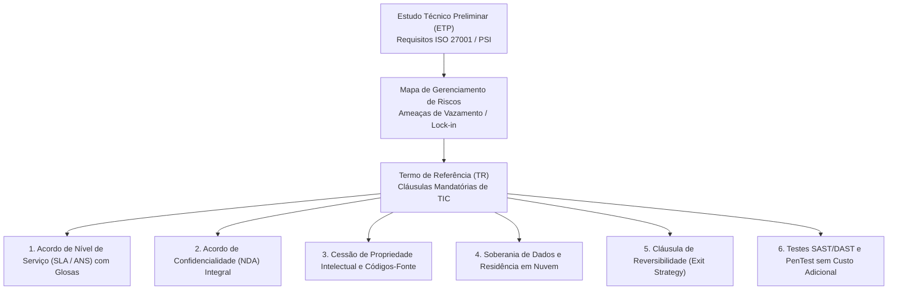
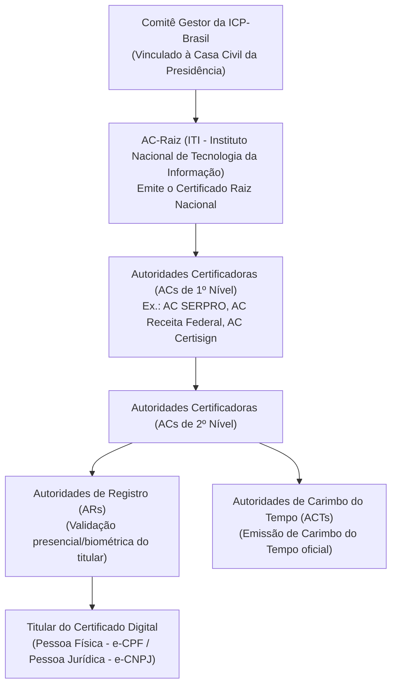
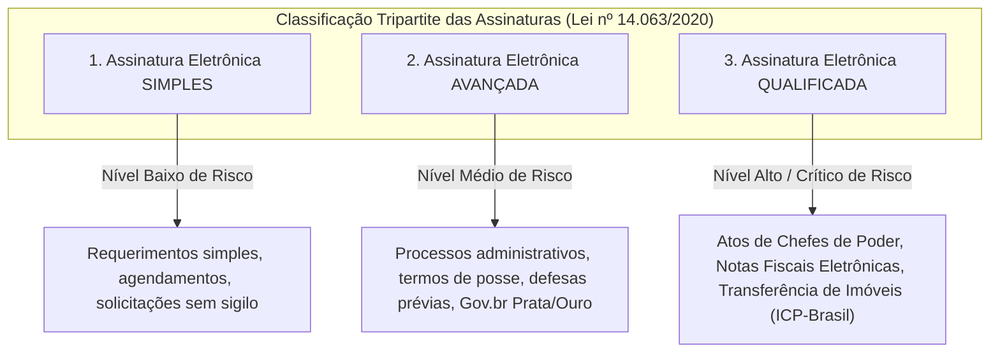

# 03 - Segurança em Contratações de TIC e Certificação Digital

> **Matéria:** Legislação Aplicada à Tecnologia da Informação  
> **Cargo:** B02 – Técnico de Controle Externo – Especialidade: Tecnologia da Informação  
> **Arquivo:** `03_seguranca_em_contratacoes_e_certificacao_digital.md`  
> **Atos Normativos:** Medida Provisória nº 2.200-2/2001 (ICP-Brasil), Lei Federal nº 14.063/2020 (Assinaturas Eletrônicas em Entes Públicos) e Lei Federal nº 14.133/2021 (Lei de Licitações e Contratos Administrativos)

---

## 📌 Ementa / Itens do Edital
- Requisitos de segurança da informação em editais e contratos de soluções de TIC
- Cláusulas essenciais de segurança, confidencialidade (NDA), privacidade e soberania de dados
- Certificação digital e infraestrutura de chaves públicas (MP nº 2.200-2/2001)
- Lei Federal nº 14.063/2020 (Assinaturas Eletrônicas em Interações com Entes Públicos)
- Aplicação prática da certificação digital em sistemas informatizados de processos e auditoria eletrônica

---

## 🧭 Sumário

1. [Requisitos de Segurança em Contratações de TIC no Setor Público](#1-requisitos-de-seguranca-em-contratacoes-de-tic-no-setor-publico)
1. [Fases do Planejamento e Segurança da Informação](#1-1-fases-do-planejamento-e-seguranca-da-informacao)
    1. [Teste 535](#Teste-535)
1. [Cláusulas Contratuais Críticas de Segurança](#1-2-clausulas-contratuais-criticas-de-seguranca)
    1. [Teste 536](#Teste-536)
2. [O Marco Legal da Certificação Digital e a ICP-Brasil (MP nº 2.200-2/2001)](#2-o-marco-legal-da-certificacao-digital-e-a-icp-brasil-mp-no-2200-22001)
2. [Estrutura e Atores da ICP-Brasil](#2-1-estrutura-e-atores-da-icp-brasil)
    1. [Teste 537](#Teste-537)
2. [Tipos de Certificados Digitais ICP-Brasil (A1 vs. A3)](#2-2-tipos-de-certificados-digitais-icp-brasil-a1-vs-a3)
    1. [Teste 538](#Teste-538)
2. [Presunção Legal de Veracidade e Validade de Assinaturas Não-ICP](#2-3-presuncao-legal-de-veracidade-e-validade-de-assinaturas-nao-icp)
    1. [Teste 539](#Teste-539)
3. [Classificação Tripartite das Assinaturas Eletrônicas (Lei nº 14.063/2020)](#3-classificacao-tripartite-das-assinaturas-eletronicas-lei-no-140632020)
3. [Assinaturas Simples, Avançadas e Qualificadas](#3-1-assinaturas-simples-avancadas-e-qualificadas)
    1. [Teste 540](#Teste-540)
    2. [Teste 541](#Teste-541)
3. [Princípio da Proporcionalidade e Hipóteses de Uso](#3-2-principio-da-proporcionalidade-e-hipoteses-de-uso)
    1. [Teste 542](#Teste-542)
4. [Aplicação Prática da Certificação Digital na Auditoria e Processo Eletrônico](#4-aplicacao-pratica-da-certificacao-digital-na-auditoria-e-processo-eletronico)
    1. [Teste 543](#Teste-543)
    2. [Teste 544](#Teste-544)
6. [Fontes Recomendadas na Internet](#6-fontes-recomendadas-na-internet)

---

## 1. Requisitos de Segurança em Contratações de TIC no Setor Público

A contratação de soluções de Tecnologia da Informação e Comunicação (TIC) na Administração Pública rege-se pela Lei nº 14.133/2021 (Lei de Licitações e Contratos Administrativos), em conjunto com normativos de governança digital (como a Instrução Normativa SGD/MGI nº 94/2022) e a jurisprudência consolidada do Tribunal de Contas da União (TCU) e dos Tribunais de Contas Estaduais.

---

## 1.1 Fases do Planejamento e Segurança da Informação

A segurança da informação não pode ser um apêndice acrescentado após a assinatura do contrato; ela deve ser arquitetada desde o início do planejamento da contratação:

1. **Documento de Oficialização da Demanda (DOD):** Identifica formalmente a necessidade institucional da área requisitante.
2. **Estudo Técnico Preliminar (ETP):** Mapeia a viabilidade técnica e define requisitos mandatórios de segurança da informação, alinhando a contratação à Política de Segurança da Informação (PSI) do Tribunal e aos padrões ABNT NBR ISO/IEC 27001 (Sistemas de Gestão de Segurança da Informação) e 27002 (Controles de Segurança).
3. **Mapa de Gerenciamento de Riscos:** Identifica ameaças cibernéticas, indisponibilidade, dependência de fornecedor (*vendor lock-in*) e vazamento de dados pessoais (LGPD), desenhando planos preventivos e contingenciais.
4. **Termo de Referência (TR):** Especifica objetivamente os requisitos técnicos, indicadores do Instrumento de Medição de Resultado (IMR), níveis mínimos de serviço e cláusulas resolutivas.

---

### Teste 535
**(CEBRASPE – STJ – 2015 – Analista Judiciario Suporte Em Tecnologia Da Informacao)**
De acordo com a norma ISO 27003, na fase de definição de requisitos de segurança da informação para o sistema de gerenciamento da segurança da informação, não é necessário realizar uma descrição detalhada da tecnologia da informação.

* **C)** Certo
* **E)** Errado

---

> **Comentário Detalhado:**
>
> - **C)** **Correta.** O item está **Certo**. Conforme fundamentado na seção *1.1 Fases do Planejamento e Segurança da Informação* deste guia, estudo Técnico Preliminar (ETP): Mapeia a viabilidade técnica e define requisitos mandatórios de segurança da informação, alinhando a contratação à Política de Segurança da Informação (PSI) do Tribunal e aos padrões ABNT NBR ISO/IEC 27001 (Sistemas de Gestão de Segurança da Informação) e 27002 (Controles de Segurança). Dessa forma, está plenamente correta a proposição da banca (CEBRASPE – STJ/2015) ao afirmar que "De acordo com a norma ISO 27003, na fase de definição de requisitos de segurança da informação para o sistema...".
> - **E)** **Incorreta.** A marcação como **Errado** não procede, visto que a assertiva guarda integral conformidade com a teoria estudada em *1. Requisitos de Segurança em Contratações de TIC no Setor Público*, segundo a qual a contratação de soluções de Tecnologia da Informação e Comunicação (TIC) na Administração Pública rege-se pela Lei nº 14.133/2021 (Lei de Licitações e Contratos Administrativos), em conjunto com normativos de governança digital (como a Instrução Normativa SGD/MGI nº 94/2022) e a jurisprudência consolidada do Tribunal de Contas da União (TCU) e dos Tribunais de Contas Estaduais.
>
> **Gabarito: C**

---

## 1.2 Cláusulas Contratuais Críticas de Segurança

| Cláusula Contratual | Justificativa Técnica e Jurídica | Regra de Fiscalização e Controle Externo |
|---|---|---|
| **Acordo de Nível de Serviço (SLA / ANS)** | Define metas quantitativas mensuráveis (disponibilidade mínima de 99,8%, tempo de resposta para incidentes críticos $\le 1\text{h}$, RTO e RPO). | É **vedado o pagamento por homem-hora puro** sem atrelamento a resultados mensuráveis e qualidade (Súmula TCU nº 269). O descumprimento do SLA acarreta glosa financeira proporcional na fatura mensal. |
| **Termo de Confidencialidade (NDA)** | Impõe dever de segredo sobre dados, infraestrutura, credenciais, topologia de rede e regras de negócio do órgão. | Deve ser assinado pela pessoa jurídica contratada **e individualmente** por cada profissional ou prestador alocado na execução do contrato. |
| **Propriedade Intelectual e Códigos-Fonte** | Assegura que toda a solução customizada desenvolvida para a Administração pertença ao ente público. | O contrato deve obrigar a entrega periódica de commits no repositório de controle de versão do órgão (Git institucional), documentação técnica, diagramas e scripts de implantação (IaC). |
| **Soberania e Residência de Dados (Cloud)** | Protege a informação governamental contra jurisdições estrangeiras conflitantes (como o *Cloud Act* americano). | Exigência de que os dados sensíveis e críticos sejam armazenados em data centers localizados no território brasileiro ou em países com grau de proteção equivalente reconhecido pela ANPD. |
| **Cláusula de Reversibilidade (*Exit Strategy*)** | Evita o aprisionamento tecnológico (*vendor lock-in*) ao término do contrato. | Obriga o prestador a fornecer, ao fim do contrato ou em caso de rescisão, a exportação integral dos dados em formatos interoperáveis (SQL, JSON, CSV), auxílio na migração e destruição segura comprovada de cópias remanescentes. |
| **Auditoria e PenTest Periódico** | Garante que o software entregue não contenha vulnerabilidades do *OWASP Top 10* ou portas dos fundos (*backdoors*). | O Tribunal reserva-se o direito de executar varreduras estáticas (SAST), dinâmicas (DAST) e testes de intrusão (PenTest), obrigando a contratada a corrigir quaisquer falhas críticas sem ônus. |

> 🚨 **ALERTA DE PROVA / PEGADINHA FCC:**  
> A FCC adora cobrar a Súmula nº 269 do TCU em provas de governança de TIC: *"Nas contratações para prestação de serviços de tecnologia da informação, a remuneração deve ser vinculada a resultados ou ao alcance de níveis de serviço, sendo vedada a contratação com base exclusivamente em homem-hora"*. Além disso, contratos em nuvem sem cláusula de reversibilidade (*Exit Strategy*) são reiteradamente apontados como irregulares por auditorias de controle externo.

---

### Teste 536
**(FGV – TJ/AP – 2023 – Analista Judiciario Apoio Especializado Tecnologia Da Informacao Seguranca Da Informacao)**
O setor de Tecnologia da Informação (TI) realiza as cópias de segurança (backup) de acordo com as políticas de backup definidas para cada sistema, conforme os requisitos estabelecidos pelos seus gestores. A fim de agilizar a cópia dos dados e diminuir o tempo da janela de backup diária, o setor de TI implementou um tipo de backup que copia nos dias úteis somente os dados modificados desde o último backup. Essa estratégia implementa um backup:

* **A)** híbrido;
* **B)** completo;
* **C)** diferencial;
* **D)** incremental;
* **E)** em disco.

---

> **Comentário Detalhado:**
>
> - **A)** **Incorreta.** A opção apresenta proposição em desacordo com os fundamentos teóricos e técnicos do tópico ao afirmar que "híbrido". De acordo com a teoria estudada em *1. Requisitos de Segurança em Contratações de TIC no Setor Público*, a contratação de soluções de Tecnologia da Informação e Comunicação (TIC) na Administração Pública rege-se pela Lei nº 14.133/2021 (Lei de Licitações e Contratos Administrativos), em conjunto com normativos de governança digital (como a Instrução Normativa SGD/MGI nº 94/2022) e a jurisprudência consolidada do Tribunal de Contas da União (TCU) e dos Tribunais de Contas Estaduais.
> - **B)** **Incorreta.** A opção apresenta proposição em desacordo com os fundamentos teóricos e técnicos do tópico ao afirmar que "completo". De acordo com a teoria estudada em *1.2 Cláusulas Contratuais Críticas de Segurança*, a FCC adora cobrar a Súmula nº 269 do TCU em provas de governança de TIC: *"Nas contratações para prestação de serviços de tecnologia da informação, a remuneração deve ser vinculada a resultados ou ao alcance de níveis de serviço, sendo vedada a contratação com base exclusivamente em homem-hora"*.
> - **C)** **Incorreta.** A opção apresenta proposição em desacordo com os fundamentos teóricos e técnicos do tópico ao afirmar que "diferencial". De acordo com a teoria estudada em *1.2 Cláusulas Contratuais Críticas de Segurança*, soberania e Residência de Dados (Cloud): Protege a informação governamental contra jurisdições estrangeiras conflitantes (como o *Cloud Act* americano). — Exigência de que os dados sensíveis e críticos sejam armazenados em data centers localizados no território brasileiro ou em países com grau de proteção equivalente reconhecido pela ANPD.
> - **D)** **Correta.** Conforme fundamentado na seção *1.2 Cláusulas Contratuais Críticas de Segurança* deste guia, cláusula de Reversibilidade (*Exit Strategy*): Evita o aprisionamento tecnológico (*vendor lock-in*) ao término do contrato. — Obriga o prestador a fornecer, ao fim do contrato ou em caso de rescisão, a exportação integral dos dados em formatos interoperáveis (SQL, JSON, CSV), auxílio na migração e destruição segura comprovada de cópias remanescentes. Dessa forma, está plenamente correta a assertiva da banca (FGV – TJ/AP/2023) ao estabelecer que "incremental".
> - **E)** **Incorreta.** A opção apresenta proposição em desacordo com os fundamentos teóricos e técnicos do tópico ao afirmar que "em disco". De acordo com a teoria estudada em *1.1 Fases do Planejamento e Segurança da Informação*, a segurança da informação não pode ser um apêndice acrescentado após a assinatura do contrato; ela deve ser arquitetada desde o início do planejamento da contratação.
>
> **Gabarito: D**

---

## 2. O Marco Legal da Certificação Digital e a ICP-Brasil (MP nº 2.200-2/2001)

A **Infraestrutura de Chaves Públicas Brasileira (ICP-Brasil)** foi instituída pela Medida Provisória nº 2.200-2, de 24 de agosto de 2001, com o propósito de garantir a autenticidade, a integridade e a validade jurídica de documentos em forma eletrônica, das aplicações de suporte e das aplicações habilitadas que utilizem certificados digitais.

---

## 2.1 Estrutura e Atores da ICP-Brasil

1. **Comitê Gestor da ICP-Brasil:** Colegiado interministerial vinculado à Casa Civil responsável por formular políticas públicas e normativos técnicos da certificação digital no país.
2. **Autoridade Certificadora Raiz (AC-Raiz):** Operada privativamente pelo **Instituto Nacional de Tecnologia da Informação (ITI)**, autarquia federal. É a autoridade executiva máxima que emite os certificados das ACs de primeiro nível e credencia/fiscaliza as entidades da infraestrutura.
3. **Autoridade Certificadora (AC):** Entidade pública ou privada credenciada responsável por emitir, renovar, revogar e distribuir certificados digitais, além de manter a Lista de Certificados Revogados (LCR / CRL) e servidores OCSP (*Online Certificate Status Protocol*).
4. **Autoridade de Registro (AR):** Entidade vinculada a uma AC encarregada da verificação documental e validação biométrica do solicitante. A AR **não assina certificados**, apenas confere a identidade do titular.
5. **Autoridade de Carimbo do Tempo (ACT):** Entidade credenciada responsável por atestar, com base na hora legal brasileira emitida pelo Observatório Nacional, que determinado documento eletrônico existia em uma data e horário exatos.

---

### Teste 537
**(CEBRASPE – TJ/DFT – 2015 – Analista Judiciario Suporte Em Tecnologia Da Informacao)**
GlassFish e TomCat são exemplos de servidores de aplicação JEE que suportam a tecnologia EJB.

* **C)** Certo
* **E)** Errado

---

> **Comentário Detalhado:**
>
> - **C)** **Incorreta.** A marcação como **Certo** não procede, pois o enunciado apresenta proposição em desacordo com os fundamentos teóricos e técnicos do tópico ao afirmar que "GlassFish e TomCat são exemplos de servidores de aplicação JEE que suportam a tecnologia EJB". De acordo com a teoria estudada em *2.1 Estrutura e Atores da ICP-Brasil*, autoridade Certificadora (AC): Entidade pública ou privada credenciada responsável por emitir, renovar, revogar e distribuir certificados digitais, além de manter a Lista de Certificados Revogados (LCR / CRL) e servidores OCSP (*Online Certificate Status Protocol*).
> - **E)** **Correta.** O item está **Errado** (gabarito oficial: **E**). Conforme fundamentado na seção *3.1 Assinaturas Simples, Avançadas e Qualificadas* deste guia, modalidade de Assinatura: Requisitos Técnicos Legais — Exemplos Práticos no Setor Público — Hipóteses de Uso Típicas e Vedações. Portanto, a assertiva examinada pela banca (CEBRASPE – TJ/DFT/2015) viola os preceitos técnicos do tópico.
>
> **Gabarito: E**

---

## 2.2 Tipos de Certificados Digitais ICP-Brasil (A1 vs. A3)

- **Certificados Tipo A (Assinatura Digital):** Destinados à comprovação de autoria, integridade e não-repúdio.
    - **A1:** Chave privada gerada por software e armazenada diretamente no computador ou dispositivo móvel (arquivo protegido por senha, padrão PKCS#12 / extensão `.pfx` ou `.p12`). Validade máxima de **1 ano**.
    - **A3:** Chave privada gerada e armazenada em hardware inviolável (*Smart Card*, *Token USB* criptográfico ou HSM com padrão mínimo FIPS 140-2 Level 2). A chave privada não pode ser copiada nem extraída do dispositivo. Validade de **até 3 ou 5 anos**.
- **Certificados Tipo S (Sigilo / Criptografia):** Utilizados para garantir a confidencialidade de arquivos e mensagens por meio de cifração assimétrica.
- **Certificados Tipo T (Tempo):** Utilizados pelas ACTs para emissão de carimbos do tempo.

---

### Teste 538
**(CEBRASPE – STJ – 2024 – Analista Judiciário - Apoio Especializado - Suporte em Tecnologia da Informação)**
Zuul é uma solução que permite a realização de roteamento dinâmico e monitoramento, e seus filtros são capazes de atuar na segurança por meio da identificação de requisitos de autenticação para cada recurso e da rejeição de solicitações que não os satisfaçam.

* **C)** Certo
* **E)** Errado

---

> **Comentário Detalhado:**
>
> - **C)** **Correta.** O item está **Certo**. Conforme fundamentado na seção *3.1 Assinaturas Simples, Avançadas e Qualificadas* deste guia, simples (Art. 3º, I): Permite identificar o seu signatário e anexa ou associa dados a outros dados eletrônicos do signatário. — Login com usuário e senha em portal de ouvidoria; confirmação por link de e-mail ou código SMS; formulário de agendamento. — - Permitida em interações de baixo risco que não envolvam informações protegidas por sigilo.` `- Vedada para transferência de bens imóveis ou atos de segurança de Estado. Dessa forma, está plenamente correta a proposição da banca (CEBRASPE – STJ/2024) ao afirmar que "Zuul é uma solução que permite a realização de roteamento dinâmico e monitoramento, e seus filtros são...".
> - **E)** **Incorreta.** A marcação como **Errado** não procede, visto que a assertiva guarda integral conformidade com a teoria estudada em *2.2 Tipos de Certificados Digitais ICP-Brasil (A1 vs. A3)*, segundo a qual certificados Tipo S (Sigilo / Criptografia): Utilizados para garantir a confidencialidade de arquivos e mensagens por meio de cifração assimétrica.
>
> **Gabarito: C**

---

## 2.3 Presunção Legal de Veracidade e Validade de Assinaturas Não-ICP

- **Art. 10, § 1º (Regime ICP-Brasil):** Os documentos eletrônicos assinados digitalmente com certificados emitidos no âmbito da ICP-Brasil presumem-se verdadeiros em relação aos signatários na forma do art. 219 do Código Civil. Há **presunção legal relativa (*juris tantum*) de autoria e integridade**.
- **Art. 10, § 2º (Regime Não-ICP-Brasil):** O dispositivo assegura a validade de **outros meios de comprovação da autoria e integridade** de documentos em forma eletrônica, inclusive os que utilizem certificados não emitidos pela ICP-Brasil, **desde que admitido pelas partes como válido ou aceito pela pessoa a quem for oposto o documento**.

> 🚨 **ALERTA DE PROVA / PEGADINHA FCC:**  
> A MP 2.200-2/2001 **não** proibiu nem tornou nulas as assinaturas eletrônicas fora da ICP-Brasil! O Art. 10, § 2º autoriza explicitamente assinaturas não-ICP se aceitas pelos participantes, o que forneceu a base jurídica para as assinaturas Gov.br e sistemas corporativos.

---

### Teste 539
**(FGV – TCE/PA – 2024 – Auditor de Controle Externo - Fiscalização - Ciências Atuariais)**
A sociedade empresária “Conhecendo o Brasil”, especializada em turismo doméstico, regularmente constituída e com sede em Bonito (PA), conforme seu ato constitutivo, resolveu expandir os negócios e, para tal, constituiu três filiais. Assim, a diretoria permaneceu situada em Bonito (PA) e foram criadas filiais em Salvador (BA), Guarapari (ES) e Florianópolis (SC). Todas as unidades estão em funcionamento e são geridas como unidades de negócios. Recentemente, o gerente da filial de Guarapari foi questionado por um dos parceiros comerciais locais acerca da indicação do domicílio da “Conhecendo Brasil” no contrato com ele firmado. Segundo o parceiro comercial, a indicação de Bonito como domicílio está errada, pois o contrato foi celebrado em Guarapari. Sobre a situação narrada e em conformidade com a legislação vigente, é correto afirmar que

* **A)** não assiste razão ao parceiro comercial da filial de Guarapari, pois, de fato, o domicílio da “Conhecendo o Brasil” é, exclusivamente, Bonito (PA).
* **B)** não assiste razão ao parceiro comercial da filial de Guarapari, pois a sede e as filiais da “Conhecendo o Brasil” são consideradas como domicílio da pessoa jurídica para os atos nele praticados.
* **C)** assiste razão ao parceiro comercial da filial de Guarapari, pois o domicílio para o exercício dos direitos e obrigações da “Conhecendo o Brasil” deverá ser o local onde os contratos foram firmados, não sendo possível especificar domicílio diverso nos contratos escritos.
* **D)** não assiste razão ao parceiro comercial da filial de Guarapari, pois o domicílio da “Conhecendo o Brasil” é o local em que a sociedade empresária ficar sediada em ânimo definitivo.
* **E)** assiste razão ao parceiro comercial da filial de Guarapari, pois à pessoa jurídica que possui filiais, aplica-se o princípio da pluralidade domiciliar e, conjuntamente, a regra do domicílio necessário que será aquele onde os atos tiverem sido praticados.

---

> **Comentário Detalhado:**
>
> - **A)** **Incorreta.** A opção incorre em restrição indevida ao limitar o escopo conceitual ao afirmar que "não assiste razão ao parceiro comercial da filial de Guarapari, pois, de fato, o domicílio da “Conhecendo o...". De acordo com a teoria estudada em *2.3 Presunção Legal de Veracidade e Validade de Assinaturas Não-ICP*, art. 10, § 2º (Regime Não-ICP-Brasil): O dispositivo assegura a validade de outros meios de comprovação da autoria e integridade de documentos em forma eletrônica, inclusive os que utilizem certificados não emitidos pela ICP-Brasil, desde que admitido pelas partes como válido ou aceito pela pessoa a quem for oposto o documento.
> - **B)** **Correta.** Conforme fundamentado na seção *1.2 Cláusulas Contratuais Críticas de Segurança* deste guia, termo de Confidencialidade (NDA): Impõe dever de segredo sobre dados, infraestrutura, credenciais, topologia de rede e regras de negócio do órgão. — Deve ser assinado pela pessoa jurídica contratada e individualmente por cada profissional ou prestador alocado na execução do contrato. Dessa forma, está plenamente correta a assertiva da banca (FGV – TCE/PA/2024) ao estabelecer que "não assiste razão ao parceiro comercial da filial de Guarapari, pois a sede e as filiais da “Conhecendo o Brasil”...".
> - **C)** **Incorreta.** A opção apresenta proposição em desacordo com os fundamentos teóricos e técnicos do tópico ao afirmar que "assiste razão ao parceiro comercial da filial de Guarapari, pois o domicílio para o exercício dos direitos e...". De acordo com a teoria estudada em *1.2 Cláusulas Contratuais Críticas de Segurança*, a FCC adora cobrar a Súmula nº 269 do TCU em provas de governança de TIC: *"Nas contratações para prestação de serviços de tecnologia da informação, a remuneração deve ser vinculada a resultados ou ao alcance de níveis de serviço, sendo vedada a contratação com base exclusivamente em homem-hora"*.
> - **D)** **Incorreta.** A opção apresenta proposição em desacordo com os fundamentos teóricos e técnicos do tópico ao afirmar que "não assiste razão ao parceiro comercial da filial de Guarapari, pois o domicílio da “Conhecendo o Brasil” é o...". De acordo com a teoria estudada em *2.3 Presunção Legal de Veracidade e Validade de Assinaturas Não-ICP*, a MP 2.200-2/2001 não proibiu nem tornou nulas as assinaturas eletrônicas fora da ICP-Brasil! O Art. 10, § 2º autoriza explicitamente assinaturas não-ICP se aceitas pelos participantes, o que forneceu a base jurídica para as assinaturas Gov.br e sistemas corporativos.
> - **E)** **Incorreta.** A opção apresenta proposição em desacordo com os fundamentos teóricos e técnicos do tópico ao afirmar que "assiste razão ao parceiro comercial da filial de Guarapari, pois à pessoa jurídica que possui filiais, aplica-se o...". De acordo com a teoria estudada em *1.2 Cláusulas Contratuais Críticas de Segurança*, cláusula Contratual: Justificativa Técnica e Jurídica — Regra de Fiscalização e Controle Externo.
>
> **Gabarito: B**

---

## 3. Classificação Tripartite das Assinaturas Eletrônicas (Lei nº 14.063/2020)

A Lei Federal nº 14.063/2020 disciplinou o uso das assinaturas eletrônicas nas interações entre cidadãos e pessoas jurídicas com o Poder Público, dividindo-as em três modalidades:

---

## 3.1 Assinaturas Simples, Avançadas e Qualificadas

| Modalidade de Assinatura | Requisitos Técnicos Legais | Exemplos Práticos no Setor Público | Hipóteses de Uso Típicas e Vedações |
|---|---|---|---|
| **Simples** (Art. 3º, I) | Permite identificar o seu signatário e anexa ou associa dados a outros dados eletrônicos do signatário. | Login com usuário e senha em portal de ouvidoria; confirmação por link de e-mail ou código SMS; formulário de agendamento. | - Permitida em interações de baixo risco que não envolvam informações protegidas por sigilo. - **Vedada** para transferência de bens imóveis ou atos de segurança de Estado. |
| **Avançada** (Art. 3º, II) | a) Associada ao signatário de maneira unívoca; b) Utiliza dados para criação sob controle exclusivo do signatário; c) Relacionada aos dados de tal modo que qualquer alteração posterior é detectável. | Assinatura no portal **Gov.br (contas nível Prata e Ouro)**; certificados digitais corporativos emitidos pelo Tribunal para seus próprios servidores. | - Amplamente aceita em processos administrativos ordinários, manifestações processuais perante o TCE-GO e celebração de contratos comuns. - **Regra preferencial** para desonerar o cidadão! |
| **Qualificada** (Art. 3º, III) | É **obrigatoriamente** aquela gerada mediante o uso de certificado digital emitido pela **ICP-Brasil** (MP 2.200-2/2001). | Assinatura com token A3 ou arquivo A1 ICP-Brasil em acórdãos de Tribunais, decisões judiciais e emissão de notas fiscais. | - **Exigência mandatória restrita:** 1. Atos assinados por Chefes de Poder, Ministros e titulares de Poder; 2. Emissão de Notas Fiscais Eletrônicas (salvo MEI); 3. Transferência e registro de bens imóveis. |

---

### Teste 540
**(FGV – TJ/RR – 2024 – Analista Judiciario Infraestrutura De Tecnologia Da Informacao)**
A última versão do sistema operacional Windows foi lançada em 2021. Batizada de Windows 11, ela apresenta diversos avanços quando comparada à sua versão anterior, o Windows 10. Entre tais avanços destaca-se

* **A)** a especificação de requisitos mínimos de hardware para que todas as proteções de segurança nativas possam ser usadas.
* **B)** o suporte para arquitetura ARM 32.
* **C)** o sistema de armazenamento unificado WinFS para a busca e organização de dados e arquivos, em substituição ao NTFS.
* **D)** a tecnologia plug-and-play, que permite a instalação de placas PCI sem a necessidade de configuração manual de jumpers.
* **E)** o suporte para a arquitetura PowerPC.

---

> **Comentário Detalhado:**
>
> - **A)** **Correta.** Conforme fundamentado na seção *1.1 Fases do Planejamento e Segurança da Informação* deste guia, termo de Referência (TR): Especifica objetivamente os requisitos técnicos, indicadores do Instrumento de Medição de Resultado (IMR), níveis mínimos de serviço e cláusulas resolutivas. Dessa forma, está plenamente correta a assertiva da banca (FGV – TJ/RR/2024) ao estabelecer que "a especificação de requisitos mínimos de hardware para que todas as proteções de segurança nativas possam ser...".
> - **B)** **Incorreta.** A opção apresenta proposição em desacordo com os fundamentos teóricos e técnicos do tópico ao afirmar que "o suporte para arquitetura ARM 32". De acordo com a teoria estudada em *2.2 Tipos de Certificados Digitais ICP-Brasil (A1 vs. A3)*, a3: Chave privada gerada e armazenada em hardware inviolável (*Smart Card*, *Token USB* criptográfico ou HSM com padrão mínimo FIPS 140-2 Level 2). A chave privada não pode ser copiada nem extraída do dispositivo. Validade de até 3 ou 5 anos.
> - **C)** **Incorreta.** A opção apresenta proposição em desacordo com os fundamentos teóricos e técnicos do tópico ao afirmar que "o sistema de armazenamento unificado WinFS para a busca e organização de dados e arquivos, em substituição ao NTFS". De acordo com a teoria estudada em *1.2 Cláusulas Contratuais Críticas de Segurança*, termo de Confidencialidade (NDA): Impõe dever de segredo sobre dados, infraestrutura, credenciais, topologia de rede e regras de negócio do órgão. — Deve ser assinado pela pessoa jurídica contratada e individualmente por cada profissional ou prestador alocado na execução do contrato.
> - **D)** **Incorreta.** A opção apresenta proposição em desacordo com os fundamentos teóricos e técnicos do tópico ao afirmar que "a tecnologia plug-and-play, que permite a instalação de placas PCI sem a necessidade de configuração manual de...". De acordo com a teoria estudada em *1. Requisitos de Segurança em Contratações de TIC no Setor Público*, a contratação de soluções de Tecnologia da Informação e Comunicação (TIC) na Administração Pública rege-se pela Lei nº 14.133/2021 (Lei de Licitações e Contratos Administrativos), em conjunto com normativos de governança digital (como a Instrução Normativa SGD/MGI nº 94/2022) e a jurisprudência consolidada do Tribunal de Contas da União (TCU) e dos Tribunais de Contas Estaduais.
> - **E)** **Incorreta.** A opção apresenta proposição em desacordo com os fundamentos teóricos e técnicos do tópico ao afirmar que "o suporte para a arquitetura PowerPC". De acordo com a teoria estudada em *4. Aplicação Prática da Certificação Digital na Auditoria e Processo Eletrônico*, módulos de Segurança em Hardware (HSM - *Hardware Security Module*).
>
> **Gabarito: A**

---

### Teste 541
**(FGV – TCE/PA – 2024 – Auditor de Controle Externo - Administrativa - Engenharia Telecomunicação)**
Indicadores de desempenho em modulações digitais com ruído gaussiano branco aditivo são essenciais para avaliar a eficiência e a robustez das comunicações digitais. A taxa de erro de bit mede a proporção de bits incorretamente recebidos. A relação sinal- ruído indica a qualidade do sinal em meio ao ruído, impactando diretamente a taxa de erro de bits. A eficiência espectral, que quantifica a taxa de transmissão de dados por unidade de largura de banda. Esses indicadores permitem uma análise abrangente do desempenho e adequação de diferentes esquemas de modulação em cenários com ruído gaussiano branco. A seguir, é apresentado um gráfico da Taxa de Erro de Bit em função da Razão Sinal-Ruído em dB, para diferentes esquemas de modulação em um canal com ruído gaussiano branco aditivo. Considerando os indicadores de desempenho dos sistemas de transmissão digital e as modulações digitais apresentadas no gráfico acima, analise as seguintes afirmativas: I. A modulação 16QAM apresenta a maior eficiência espectral. II. As modulações BPSK e QPSK apresentam a mesma eficiência espectral. III. Para uma Razão Sinal Ruído de 6 dB, a modulação 16QAM apresenta menor taxa de erro de bit. Está correto o que se afirma em

* **A)** I, apenas.
* **B)** I e II, apenas.
* **C)** I e III, apenas.
* **D)** II e III, apenas.
* **E)** I, II e III.

---

> **Comentário Detalhado:**
>
> - **A)** **Correta.** Conforme fundamentado na seção *4. Aplicação Prática da Certificação Digital na Auditoria e Processo Eletrônico* deste guia, na interoperabilidade entre os clusters do TCE-GO e da SEFAZ-GO para coleta automatizada de dados fiscais e contábeis, a comunicação utiliza APIs protegidas por mTLS (*mutual TLS*), em que tanto o cliente quanto o servidor apresentam certificados digitais X.509 no handshake criptográfico, prevenindo ataques do tipo *Man-in-the-Middle*. Dessa forma, está plenamente correta a assertiva da banca (FGV – TCE/PA/2024) ao estabelecer que "I, apenas".
> - **B)** **Incorreta.** A opção incorre em restrição indevida ao limitar o escopo conceitual ao afirmar que "I e II, apenas". De acordo com a teoria estudada em *3.1 Assinaturas Simples, Avançadas e Qualificadas*, qualificada (Art. 3º, III): É obrigatoriamente aquela gerada mediante o uso de certificado digital emitido pela ICP-Brasil (MP 2.200-2/2001). — Assinatura com token A3 ou arquivo A1 ICP-Brasil em acórdãos de Tribunais, decisões judiciais e emissão de notas fiscais. — - Exigência mandatória restrita:` `1.
> - **C)** **Incorreta.** A opção incorre em restrição indevida ao limitar o escopo conceitual ao afirmar que "I e III, apenas". De acordo com a teoria estudada em *3.1 Assinaturas Simples, Avançadas e Qualificadas*, avançada (Art. 3º, II): a) Associada ao signatário de maneira unívoca;` `b) Utiliza dados para criação sob controle exclusivo do signatário;` `c) Relacionada aos dados de tal modo que qualquer alteração posterior é detectável. — Assinatura no portal Gov.br (contas nível Prata e Ouro); certificados digitais corporativos emitidos pelo Tribunal para seus próprios servidores. — - Amplamente aceita em processos administrativos ordinários, manifestações processuais perante o TCE-GO e celebração de contratos comuns.` `- Regra preferencial para desonerar o cidadão!.
> - **D)** **Incorreta.** A opção incorre em restrição indevida ao limitar o escopo conceitual ao afirmar que "II e III, apenas". De acordo com a teoria estudada em *2.2 Tipos de Certificados Digitais ICP-Brasil (A1 vs. A3)*, a1: Chave privada gerada por software e armazenada diretamente no computador ou dispositivo móvel (arquivo protegido por senha, padrão PKCS#12 / extensão `.pfx` ou `.p12`). Validade máxima de 1 ano.
> - **E)** **Incorreta.** A opção apresenta proposição em desacordo com os fundamentos teóricos e técnicos do tópico ao afirmar que "I, II e III". De acordo com a teoria estudada em *2.2 Tipos de Certificados Digitais ICP-Brasil (A1 vs. A3)*, certificados Tipo S (Sigilo / Criptografia): Utilizados para garantir a confidencialidade de arquivos e mensagens por meio de cifração assimétrica.
>
> **Gabarito: A**

---

## 3.2 Princípio da Proporcionalidade e Hipóteses de Uso

O Art. 5º, § 2º da Lei nº 14.063/2020 fixou o **Princípio da Vedação ao Excesso de Exigência**:
> *"É VEDADA a exigência de assinatura eletrônica qualificada nas interações com o ente público se a assinatura eletrônica simples ou avançada for suficiente para a mitigação de risco e para o atingimento da finalidade pretendida."*

A regra visa desonerar o cidadão do custo de adquirir certificados digitais pagos em cartórios e autoridades certificadoras para meros requerimentos administrativos ordinários.

> 🚨 **ALERTA DE PROVA / PEGADINHA FCC:**  
> A expressão **"Assinatura Qualificada"** na Lei nº 14.063/2020 é privativa e exclusiva de certificados **ICP-Brasil**. Nenhuma assinatura avançada (nem mesmo a conta Gov.br nível Ouro) pode ser chamada de "qualificada" em prova de concurso!

---

### Teste 542
**(CEBRASPE – TRT/10 – 2013 – Analista Judiciario Tecnologia Da Informacao)**
Diferentes soluções de TI podem ser utilizadas para atender a necessidades de TI e de informação semelhantes, razão por que, ao se realizar o planejamento de contratações, devem-se analisar diversas alternativas, com vistas a estabelecer a que seja mais economicamente vantajosa.

* **C)** Certo
* **E)** Errado

---

> **Comentário Detalhado:**
>
> - **C)** **Incorreta.** A marcação como **Certo** não procede, pois o enunciado apresenta proposição em desacordo com os fundamentos teóricos e técnicos do tópico ao afirmar que "Diferentes soluções de TI podem ser utilizadas para atender a necessidades de TI e de informação semelhantes...". De acordo com a teoria estudada em *1.2 Cláusulas Contratuais Críticas de Segurança*, a FCC adora cobrar a Súmula nº 269 do TCU em provas de governança de TIC: *"Nas contratações para prestação de serviços de tecnologia da informação, a remuneração deve ser vinculada a resultados ou ao alcance de níveis de serviço, sendo vedada a contratação com base exclusivamente em homem-hora"*.
> - **E)** **Correta.** O item está **Errado** (gabarito oficial: **E**). Conforme fundamentado na seção *1. Requisitos de Segurança em Contratações de TIC no Setor Público* deste guia, a contratação de soluções de Tecnologia da Informação e Comunicação (TIC) na Administração Pública rege-se pela Lei nº 14.133/2021 (Lei de Licitações e Contratos Administrativos), em conjunto com normativos de governança digital (como a Instrução Normativa SGD/MGI nº 94/2022) e a jurisprudência consolidada do Tribunal de Contas da União (TCU) e dos Tribunais de Contas Estaduais. Portanto, a assertiva examinada pela banca (CEBRASPE – TRT/10/2013) viola os preceitos técnicos do tópico.
>
> **Gabarito: E**

---

## 4. Aplicação Prática da Certificação Digital na Auditoria e Processo Eletrônico

Nos sistemas informatizados de auditoria governamental e processo eletrônico do Tribunal de Contas do Estado de Goiás (TCE-GO), a certificação digital cumpre funções técnicas fundamentais:

1. **Processo Eletrônico (PAdES e Carimbo do Tempo):**
    - Assinatura no padrão PAdES (*PDF Advanced Electronic Signatures*) com inserção de **Carimbo do Tempo (Timestamp)** emitido por Autoridade de Carimbo do Tempo (ACT) credenciada. O carimbo garante comprovação incontestável de que o relatório de auditoria ou acórdão foi assinado antes do término do prazo legal ou regimental, mesmo que a chave do certificado expire posteriormente.

2. **Autenticação Mútua Máquina-a-Máquina (mTLS):**
    - Na interoperabilidade entre os clusters do TCE-GO e da SEFAZ-GO para coleta automatizada de dados fiscais e contábeis, a comunicação utiliza APIs protegidas por mTLS (*mutual TLS*), em que tanto o cliente quanto o servidor apresentam certificados digitais X.509 no handshake criptográfico, prevenindo ataques do tipo *Man-in-the-Middle*.

3. **Módulos de Segurança em Hardware (HSM - *Hardware Security Module*):**
    - Os certificados digitais institucionais utilizados para emissão de certidões eletrônicas em lote ficam custodiados em hardware inviolável (HSM) certificado FIPS 140-2 Nível 3, impedindo o vazamento da chave privada institucional por invasões cibernéticas.

---

### Teste 543
**(CEBRASPE – TRT/10 – 2013 – Analista Judiciario Tecnologia Da Informacao)**
A criação da estrutura analítica de projeto assim como as atividades de definição e verificação de escopo são entradas para a atividade de coleta de requisitos de um projeto. Com relação à certificação digital, julgue os itens que se seguem.

* **C)** Certo
* **E)** Errado

---

> **Comentário Detalhado:**
>
> - **C)** **Incorreta.** A marcação como **Certo** não procede, pois o enunciado apresenta proposição em desacordo com os fundamentos teóricos e técnicos do tópico ao afirmar que "A criação da estrutura analítica de projeto assim como as atividades de definição e verificação de escopo são...". De acordo com a teoria estudada em *2.1 Estrutura e Atores da ICP-Brasil*, autoridade de Registro (AR): Entidade vinculada a uma AC encarregada da verificação documental e validação biométrica do solicitante. A AR não assina certificados, apenas confere a identidade do titular.
> - **E)** **Correta.** O item está **Errado** (gabarito oficial: **E**). Conforme fundamentado na seção *4. Aplicação Prática da Certificação Digital na Auditoria e Processo Eletrônico* deste guia, na interoperabilidade entre os clusters do TCE-GO e da SEFAZ-GO para coleta automatizada de dados fiscais e contábeis, a comunicação utiliza APIs protegidas por mTLS (*mutual TLS*), em que tanto o cliente quanto o servidor apresentam certificados digitais X.509 no handshake criptográfico, prevenindo ataques do tipo *Man-in-the-Middle*. Portanto, a assertiva examinada pela banca (CEBRASPE – TRT/10/2013) viola os preceitos técnicos do tópico.
>
> **Gabarito: E**

---

---

### Teste 544
**(FGV – TRF/1 – 2024 – Analista Judiciario Area Apoio Especializado Especialidade Suporte Em Tecnologia Da Informacao)**
A plataforma digital do Poder Judiciário brasileiro (PDPJ-Br) foi criada com o objetivo integrar e consolidar todos os sistemas eletrônicos do Judiciário brasileiro em um único ambiente unificado. Para tanto, a PDPJ-BR adota soluções que abrangem o conceito de computação em nuvem. A PDPJ-Br poderá ser provida por um serviço de computação em nuvem fornecido por uma empresa privada, desde que:

* **A)** o armazenamento dos dados ocorra em datacenter abrigado na sede da empresa contratada;
* **B)** atenda aos requisitos de disponibilidade, de escalabilidade, de redundância e de criptografia;
* **C)** permita o compartilhamento não oneroso do código-fonte dos artefatos que venham a ser hospedados na nuvem;
* **D)** permita a mensuração de uso dos recursos da nuvem conforme critérios pactuados pela empresa contratada;
* **E)** possibilite a conformidade com as normas técnicas e outras estabelecidas em ato próprio do coordenador do comitê gestor de segurança da informação do Poder Judiciário.

---

> **Comentário Detalhado:**
>
> - **A)** **Incorreta.** A opção apresenta proposição em desacordo com os fundamentos teóricos e técnicos do tópico ao afirmar que "o armazenamento dos dados ocorra em datacenter abrigado na sede da empresa contratada". De acordo com a teoria estudada em *1.2 Cláusulas Contratuais Críticas de Segurança*, termo de Confidencialidade (NDA): Impõe dever de segredo sobre dados, infraestrutura, credenciais, topologia de rede e regras de negócio do órgão. — Deve ser assinado pela pessoa jurídica contratada e individualmente por cada profissional ou prestador alocado na execução do contrato.
> - **B)** **Correta.** Conforme fundamentado na seção *1.2 Cláusulas Contratuais Críticas de Segurança* deste guia, acordo de Nível de Serviço (SLA / ANS): Define metas quantitativas mensuráveis (disponibilidade mínima de 99,8%, tempo de resposta para incidentes críticos $\le 1\text{h}$, RTO e RPO). — É vedado o pagamento por homem-hora puro sem atrelamento a resultados mensuráveis e qualidade (Súmula TCU nº 269). Dessa forma, está plenamente correta a assertiva da banca (FGV – TRF/1/2024) ao estabelecer que "atenda aos requisitos de disponibilidade, de escalabilidade, de redundância e de criptografia".
> - **C)** **Incorreta.** A opção apresenta proposição em desacordo com os fundamentos teóricos e técnicos do tópico ao afirmar que "permita o compartilhamento não oneroso do código-fonte dos artefatos que venham a ser hospedados na nuvem". De acordo com a teoria estudada em *1.2 Cláusulas Contratuais Críticas de Segurança*, além disso, contratos em nuvem sem cláusula de reversibilidade (*Exit Strategy*) são reiteradamente apontados como irregulares por auditorias de controle externo.
> - **D)** **Incorreta.** A opção apresenta proposição em desacordo com os fundamentos teóricos e técnicos do tópico ao afirmar que "permita a mensuração de uso dos recursos da nuvem conforme critérios pactuados pela empresa contratada". De acordo com a teoria estudada em *3.1 Assinaturas Simples, Avançadas e Qualificadas*, modalidade de Assinatura: Requisitos Técnicos Legais — Exemplos Práticos no Setor Público — Hipóteses de Uso Típicas e Vedações.
> - **E)** **Incorreta.** A opção apresenta proposição em desacordo com os fundamentos teóricos e técnicos do tópico ao afirmar que "possibilite a conformidade com as normas técnicas e outras estabelecidas em ato próprio do coordenador do comitê...". De acordo com a teoria estudada em *2.1 Estrutura e Atores da ICP-Brasil*, comitê Gestor da ICP-Brasil: Colegiado interministerial vinculado à Casa Civil responsável por formular políticas públicas e normativos técnicos da certificação digital no país.
>
> **Gabarito: B**

---

## 6. Fontes Recomendadas na Internet

* [Medida Provisória nº 2.200-2/2001 (ICP-Brasil no Planalto)](https://www.planalto.gov.br/ccivil_03/mpv/antigas_2001/2200-2.htm) - Norma oficial permanente que institui a Infraestrutura de Chaves Públicas Brasileira (ICP-Brasil).
* [Lei nº 14.063/2020 (Uso de Assinaturas Eletrônicas em Entes Públicos)](https://www.planalto.gov.br/ccivil_03/_ato2019-2022/2020/lei/l14063.htm) - Regras para aceitação e níveis de exigência de assinaturas simples, avançadas e qualificadas.
* [Decreto nº 10.543/2020 (Níveis de Assinatura Eletrônica na Administração Pública)](https://www.planalto.gov.br/ccivil_03/_ato2019-2022/2020/decreto/d10543.htm) - Regulamenta o uso das assinaturas eletrônicas nas interações com o poder público federal.
* [Governo Digital - Guia de Boas Práticas em Assinaturas Eletrônicas](https://www.gov.br/governodigital/pt-br/assinatura-eletronica) - Orientações práticas e requisitos de validade jurídica das assinaturas eletrônicas governamentais.
* [Cartilha de Segurança para a Internet (CERT.br) - Certificados Digitais](https://cartilha.cert.br/livro/cartilha-seguranca-internet.pdf) - Conceitos de certificação digital, hierarquia de ACs e integridade documental.
* STALLINGS, William. **Criptografia e Segurança de Redes: Princípios e Práticas**. 7. ed. São Paulo: Pearson Education do Brasil, 2018. (Cap. 13 - Assinaturas Digitais e Padrões de Autenticação).
* FERNANDES, Aguinaldo Aragon; ABREU, Vladimir Ferraz de. **Implantando a Governança de TI: da Estratégia aos Processos**. 4. ed. Rio de Janeiro: Brasport, 2014. (Cap. 11 - Contratações de TIC e Gestão de Riscos Contratuais).
* JUSTEN FILHO, Marçal. **Comentários à Lei de Licitações e Contratações Administrativas: Lei 14.133/2021**. 2. ed. São Paulo: Thomson Reuters Brasil, 2023. (Cap. VII - Cláusulas de Segurança e Execução Contratual).
