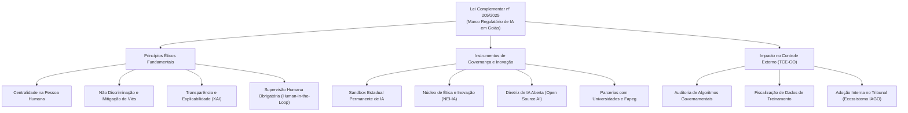
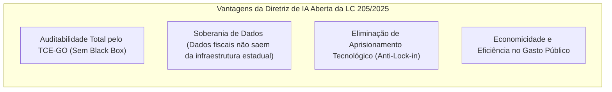
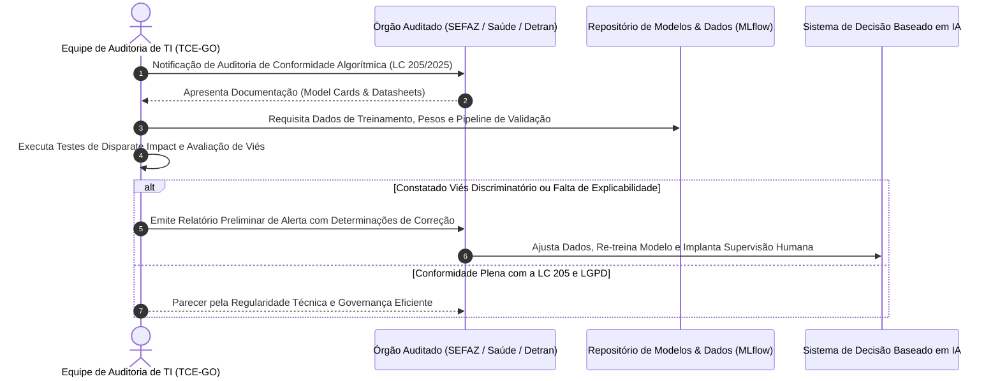

# 04 - Lei Complementar Estadual de Goiás nº 205/2025

> **Matéria:** Legislação Aplicada à Tecnologia da Informação  
> **Cargo:** B02 – Técnico de Controle Externo – Especialidade: Tecnologia da Informação  
> **Arquivo:** `04_lei_complementar_estadual_205_2025.md`  
> **Ato Normativo:** Lei Complementar Estadual (Goiás) nº 205, de 19 de maio de 2025 (Política Estadual de Fomento à Inovação e Governança em Inteligência Artificial do Estado de Goiás)

---

## 📌 Ementa / Itens do Edital
- Lei Complementar estadual nº 205, de 19 de maio de 2025 (Estado de Goiás)
- Contexto normativo e objetivos da lei no âmbito da administração pública goiana
- Disposições relativas à modernização institucional, transparência, inovação e governança de tecnologia
- Relação com as competências fiscalizatórias e operacionais do Tribunal de Contas do Estado de Goiás (TCE-GO)

---

## 🧭 Sumário

1. [Contexto e Princípios Fundamentais da LC nº 205/2025](#1-contexto-e-principios-fundamentais-da-lc-no-2052025)
1. [Objetivos e Escopo da Política Estadual de IA](#1-1-objetivos-e-escopo-da-politica-estadual-de-ia)
    1. [Teste 545](#Teste-545)
1. [Princípios Norteadores de IA no Setor Público Goiano](#1-2-principios-norteadores-de-ia-no-setor-publico-goiano)
    1. [Teste 546](#Teste-546)
    2. [Teste 547](#Teste-547)
2. [Instrumentos Estratégicos Criados pela LC nº 205/2025](#2-instrumentos-estrategicos-criados-pela-lc-no-2052025)
2. [Sandbox Estadual Permanente de Inteligência Artificial](#2-1-sandbox-estadual-permanente-de-inteligencia-artificial)
    1. [Teste 548](#Teste-548)
    2. [Teste 549](#Teste-549)
2. [Núcleo de Ética e Inovação em Inteligência Artificial (NEI-IA)](#2-2-nucleo-de-etica-e-inovacao-em-inteligencia-artificial-nei-ia)
    1. [Teste 550](#Teste-550)
2. [A Diretriz Mandatória de IA Aberta (Open Source AI)](#2-3-a-diretriz-mandatoria-de-ia-aberta-open-source-ai)
    1. [Teste 551](#Teste-551)
    2. [Teste 552](#Teste-552)
3. [O Papel Fiscalizatório do TCE-GO sobre Sistemas de IA](#3-o-papel-fiscalizatorio-do-tce-go-sobre-sistemas-de-ia)
3. [As Três Dimensões da Auditoria de IA Governamental](#3-1-as-tres-dimensoes-da-auditoria-de-ia-governamental)
    1. [Teste 553](#Teste-553)
3. [Uso Interno de IA no TCE-GO: O Ecossistema IAGO e a RA nº 24/2024](#3-2-uso-interno-de-ia-no-tce-go-o-ecossistema-iago-e-a-ra-no-242024)
    1. [Teste 554](#Teste-554)
6. [Fontes Recomendadas na Internet](#6-fontes-recomendadas-na-internet)

---

## 1. Contexto e Princípios Fundamentais da LC nº 205/2025

A **Lei Complementar Estadual nº 205, de 19 de maio de 2025**, posicionou o Estado de Goiás na vanguarda legislativa do país ao estabelecer a primeira **Política Estadual de Fomento à Inovação e Governança em Inteligência Artificial** no plano subnacional.

---

## 1.1 Objetivos e Escopo da Política Estadual de IA

A norma foi concebida para conciliar dois vetores complementares:

1. **Fomento à Inovação Econômica e Governança Digital:** Estruturar um ecossistema fértil para que startups, centros de pesquisa, universidades e órgãos públicos desenvolvam aplicações avançadas de inteligência artificial;
2. **Salvaguardas de Direitos Fundamentais e Ética Algorítmica:** Assegurar que os sistemas de IA empregados na administração pública estadual respeitem os direitos dos cidadãos, a legalidade, a transparência, a não discriminação e a privacidade de dados pessoais (LGPD).

---

### Teste 545
**(FGV – TRT-1 – Analista Judiciario Area Administrativa – 2024)**
Um decreto federal assegurou à pessoa com deficiência tratamento prioritário. Dispôs ele que: 1) ficaria assegurada à pessoa com deficiência física, mental ou sensorial a prioridade de vaga em escola pública que estivesse localizada mais próxima de sua residência; 2) seriam consideradas deficiências todas aquelas que necessitassem de assistência especial, decorrentes de problemas visuais, auditivos, mentais, motores, ou má- formação congênita; 3) as deficiências dos estudantes beneficiados seriam comprovadas por meio de laudo médico fornecido por instituições médico-hospitalares públicas e competentes para prestar tal comprovação; e, 4) ficariam excluídos da prioridade do item 1 os estabelecimentos de ensino que não possuíssem as condições necessárias para educação de portadores de deficiência mental e sensorial. Levando em conta a Agenda 2030 da Organização das Nações Unidas (ONU), os direitos humanos e fundamentais da pessoa com deficiência e a Lei nº 13.146/2015, é correto afirmar que:

* **A)** o referido decreto acerta ao dispor de todos os problemas (visuais, auditivos, mentais, motores, ou má formação congênita) para fins de consideração da pessoa com deficiência, adotando-se o conceito amplo proposto pela Lei nº 13.146/2015;
* **B)** a exigência de que as deficiências dos estudantes beneficiados sejam comprovadas por meio de laudo médico fornecido por instituições médico-hospitalares públicas e competentes para prestar tal comprovação atende ao que reclama a Lei nº 13.146/2015;
* **C)** o item 4 se choca com a imposição de assegurar um sistema educacional inclusivo, estabelecido no sistema constitucional e na Lei nº 13.146/2015, e com o amparo no objetivo de desenvolvimento sustentável referente à educação da Agenda 2030 da ONU;
* **D)** a Agenda 2030 da ONU não trata do tema educação em relação a pessoas com deficiência, de modo que o único objetivo de desenvolvimento sustentável apto a conferir um olhar mais específico à questão é o referente a instituições eficazes;
* **E)** a exclusão relacionada aos estabelecimentos de ensino estaria corretamente justificada na liberdade de conformação legislativa e na discricionariedade administrativa quando da concretização da política pública.

---

> **Comentário Detalhado:**
>
> - **A)** **Incorreta.** A opção apresenta proposição em desacordo com os fundamentos teóricos e técnicos do tópico ao afirmar que "o referido decreto acerta ao dispor de todos os problemas (visuais, auditivos, mentais, motores, ou má formação...". De acordo com a teoria estudada em *1.2 Princípios Norteadores de IA no Setor Público Goiano*, supervisão Humana (*Human-in-the-Loop*): Nenhuma decisão administrativa que suprima, restrinja ou afete direitos de pessoa física ou jurídica pode ser 100% autônoma e irrevogável por máquina. — Obrigatoriedade de intervenção, validação ou possibilidade de reanálise por um agente público humano capacitado.
> - **B)** **Incorreta.** A opção apresenta proposição em desacordo com os fundamentos teóricos e técnicos do tópico ao afirmar que "a exigência de que as deficiências dos estudantes beneficiados sejam comprovadas por meio de laudo médico...". De acordo com a teoria estudada em *2. Instrumentos Estratégicos Criados pela LC nº 205/2025*, a Lei Complementar nº 205/2025 estrutura a política pública estadual sobre três grandes pilares institucionais.
> - **C)** **Incorreta.** A opção apresenta proposição em desacordo com os fundamentos teóricos e técnicos do tópico ao afirmar que "o item 4 se choca com a imposição de assegurar um sistema educacional inclusivo, estabelecido no sistema...". De acordo com a teoria estudada em *1.2 Princípios Norteadores de IA no Setor Público Goiano*, centralidade na Pessoa Humana (*Human-Centric AI*): A inteligência artificial deve servir ao bem-estar coletivo, ampliação de direitos e desenvolvimento socioeconômico sustentável. — Sistemas de IA não podem substituir a dignidade humana ou desumanizar o atendimento ao cidadão nos serviços públicos.
> - **D)** **Incorreta.** A opção apresenta proposição em desacordo com os fundamentos teóricos e técnicos do tópico ao afirmar que "a Agenda 2030 da ONU não trata do tema educação em relação a pessoas com deficiência, de modo que o único objetivo...". De acordo com a teoria estudada em *1.2 Princípios Norteadores de IA no Setor Público Goiano*, não Discriminação e Mitigação de Vieses: Proibição de parâmetros algorítmicos que reproduzam ou amplifiquem preconceitos ilegais por raça, gênero, classe social ou deficiência. — Testes estatísticos de disparidade (*Disparate Impact Analysis*) nos dados de treino e saídas (*outputs*) dos modelos preditivos antes do deploy.
> - **E)** **Correta.** Conforme fundamentado na seção *1. Contexto e Princípios Fundamentais da LC nº 205/2025* deste guia, a Lei Complementar Estadual nº 205, de 19 de maio de 2025, posicionou o Estado de Goiás na vanguarda legislativa do país ao estabelecer a primeira Política Estadual de Fomento à Inovação e Governança em Inteligência Artificial no plano subnacional. Dessa forma, está plenamente correta a assertiva da banca (FGV – TRT-1/2024) ao estabelecer que "a exclusão relacionada aos estabelecimentos de ensino estaria corretamente justificada na liberdade de conformação...".
>
> **Gabarito: E**

---

---

## 1.2 Princípios Norteadores de IA no Setor Público Goiano

| Princípio da LC nº 205/2025 | Conteúdo Teórico | Tradução Prática em Sistemas de TI |
|---|---|---|
| **Centralidade na Pessoa Humana (*Human-Centric AI*)** | A inteligência artificial deve servir ao bem-estar coletivo, ampliação de direitos e desenvolvimento socioeconômico sustentável. | Sistemas de IA não podem substituir a dignidade humana ou desumanizar o atendimento ao cidadão nos serviços públicos. |
| **Não Discriminação e Mitigação de Vieses** | Proibição de parâmetros algorítmicos que reproduzam ou amplifiquem preconceitos ilegais por raça, gênero, classe social ou deficiência. | Testes estatísticos de disparidade (*Disparate Impact Analysis*) nos dados de treino e saídas (*outputs*) dos modelos preditivos antes do deploy. |
| **Transparência Algorítmica e Explicabilidade (*XAI*)** | O cidadão e os órgãos de controle têm o direito de conhecer as variáveis determinantes e a lógica adotada pelas redes neurais e algoritmos. | Adoção de técnicas de explicabilidade (*SHAP values*, *LIME*, árvores substitutas) para justificar atos administrativos baseados em IA. |
| **Supervisão Humana (*Human-in-the-Loop*)** | Nenhuma decisão administrativa que suprima, restrinja ou afete direitos de pessoa física ou jurídica pode ser 100% autônoma e irrevogável por máquina. | Obrigatoriedade de intervenção, validação ou possibilidade de reanálise por um agente público humano capacitado. |
| **Segurança e Robustez Técnica** | Os sistemas de IA devem ser resistentes a falhas técnicas, alucinações perigosas, envenenamento de dados (*data poisoning*) e ataques adversariais. | Implementação de esteiras de MLOps seguras com validação cruzada, testes de estresse e proteção de modelos contra exfiltração de pesos. |

> 🚨 **ALERTA DE PROVA / PEGADINHA FCC:**  
> A FCC adora cobrar a regra da **Supervisão Humana (*Human-in-the-Loop*)**. É vedada no Estado de Goiás a tomada de decisão administrativa puramente automatizada e irrecorrível por IA que restrinja direitos de cidadãos ou empresas (como cancelamento de benefício ou sanção fiscal). O cidadão tem o direito de requerer a revisão humana da decisão!

---

### Teste 546
**(FCC – TRT-11 – Analista Judiciario Tecnologia da Informacao – 2017)**
Alunos de um curso de Direito participaram de um evento organizado pelo Governo do Estado do Amazonas sobre os direitos das pessoas com deficiência. A primeira discussão tratou dos seguintes temas relacionados à Política Nacional para a Integração da Pessoa Portadora de Deficiência: I. O desenvolvimento de ação conjunta do Estado e da sociedade civil, de modo a assegurar a plena integração da pessoa portadora de deficiência no contexto socioeconômico e cultural. II. A adoção de estratégias de articulação com órgãos e entidades públicos e privados, bem assim com organismos internacionais e estrangeiros para a implantação da Política Nacional para a Integração da Pessoa Portadora de Deficiência. III. O desenvolvimento de programas setoriais destinados ao atendimento das necessidades especiais da pessoa portadora de deficiência. IV. O fomento da tecnologia de bioengenharia voltada para a pessoa portadora de deficiência, bem como a facilitação da importação de equipamentos. V. A fiscalização do cumprimento da legislação pertinente à pessoa portadora de deficiência. Para a Política Nacional para a Integração da Pessoa Portadora de Deficiência e nos termos do Decreto no 3.298/1999, esses temas são conceituados, respectivamente, como:

* **A)** diretriz, princípio, instrumento, princípio e objetivo.
* **B)** objetivo, princípio, princípio, diretriz e diretriz.
* **C)** instrumento, princípio, diretriz, objetivo e instrumento.
* **D)** princípio, diretriz, objetivo, instrumento e instrumento.
* **E)** princípio, princípio, diretriz, instrumento e objetivo.

---

> **Comentário Detalhado:**
>
> - **A)** **Incorreta.** A opção apresenta proposição em desacordo com os fundamentos teóricos e técnicos do tópico ao afirmar que "diretriz, princípio, instrumento, princípio e objetivo". De acordo com a teoria estudada em *2.3 A Diretriz Mandatória de IA Aberta (Open Source AI)*, a LC nº 205/2025 prescreve a preferência pelo uso de soluções, modelos de linguagem e softwares de inteligência artificial de código aberto (*open-source*) pelos órgãos e entidades da Administração Pública Estadual de Goiás.
> - **B)** **Incorreta.** A opção apresenta proposição em desacordo com os fundamentos teóricos e técnicos do tópico ao afirmar que "objetivo, princípio, princípio, diretriz e diretriz". De acordo com a teoria estudada em *1.2 Princípios Norteadores de IA no Setor Público Goiano*, princípio da LC nº 205/2025: Conteúdo Teórico — Tradução Prática em Sistemas de TI.
> - **C)** **Incorreta.** A opção apresenta proposição em desacordo com os fundamentos teóricos e técnicos do tópico ao afirmar que "instrumento, princípio, diretriz, objetivo e instrumento". De acordo com a teoria estudada em *1. Contexto e Princípios Fundamentais da LC nº 205/2025*, a Lei Complementar Estadual nº 205, de 19 de maio de 2025, posicionou o Estado de Goiás na vanguarda legislativa do país ao estabelecer a primeira Política Estadual de Fomento à Inovação e Governança em Inteligência Artificial no plano subnacional.
> - **D)** **Correta.** Conforme fundamentado na seção *1.2 Princípios Norteadores de IA no Setor Público Goiano* deste guia, centralidade na Pessoa Humana (*Human-Centric AI*): A inteligência artificial deve servir ao bem-estar coletivo, ampliação de direitos e desenvolvimento socioeconômico sustentável. — Sistemas de IA não podem substituir a dignidade humana ou desumanizar o atendimento ao cidadão nos serviços públicos. Dessa forma, está plenamente correta a assertiva da banca (FCC – TRT-11/2017) ao estabelecer que "princípio, diretriz, objetivo, instrumento e instrumento".
> - **E)** **Incorreta.** A opção apresenta proposição em desacordo com os fundamentos teóricos e técnicos do tópico ao afirmar que "princípio, princípio, diretriz, instrumento e objetivo". De acordo com a teoria estudada em *1.2 Princípios Norteadores de IA no Setor Público Goiano*, transparência Algorítmica e Explicabilidade (*XAI*): O cidadão e os órgãos de controle têm o direito de conhecer as variáveis determinantes e a lógica adotada pelas redes neurais e algoritmos. — Adoção de técnicas de explicabilidade (*SHAP values*, *LIME*, árvores substitutas) para justificar atos administrativos baseados em IA.
>
> **Gabarito: D**

---

### Teste 547
**(FCC – TRT-24 – Analista Judiciario Tecnologia da Informacao – 2017)**
A legislação mais moderna se refere à pessoa que tem “impedimento de longo prazo de natureza física, mental, intelectual ou sensorial, o qual, em interação com uma ou mais barreiras, pode obstruir sua participação plena e efetiva na sociedade em igualdade de condições com as demais pessoas”, como

* **A)** pessoa portadora de necessidades especiais.
* **B)** excepcional.
* **C)** deficiente.
* **D)** pessoa com deficiência.
* **E)** pessoa portadora de deficiência.

---

> **Comentário Detalhado:**
>
> - **A)** **Incorreta.** A opção apresenta proposição em desacordo com os fundamentos teóricos e técnicos do tópico ao afirmar que "pessoa portadora de necessidades especiais". De acordo com a teoria estudada em *1.2 Princípios Norteadores de IA no Setor Público Goiano*, centralidade na Pessoa Humana (*Human-Centric AI*): A inteligência artificial deve servir ao bem-estar coletivo, ampliação de direitos e desenvolvimento socioeconômico sustentável. — Sistemas de IA não podem substituir a dignidade humana ou desumanizar o atendimento ao cidadão nos serviços públicos.
> - **B)** **Incorreta.** A opção apresenta proposição em desacordo com os fundamentos teóricos e técnicos do tópico ao afirmar que "excepcional". De acordo com a teoria estudada em *2.2 Núcleo de Ética e Inovação em Inteligência Artificial (NEI-IA)*, colegiado de natureza consultiva e propositiva, reunindo representantes do Poder Executivo (Secretaria de Ciência, Tecnologia e Inovação - Secti), universidades públicas, comunidade científica, sociedade civil e setor empresarial de tecnologia.
> - **C)** **Correta.** Conforme fundamentado na seção *1.2 Princípios Norteadores de IA no Setor Público Goiano* deste guia, supervisão Humana (*Human-in-the-Loop*): Nenhuma decisão administrativa que suprima, restrinja ou afete direitos de pessoa física ou jurídica pode ser 100% autônoma e irrevogável por máquina. — Obrigatoriedade de intervenção, validação ou possibilidade de reanálise por um agente público humano capacitado. Dessa forma, está plenamente correta a assertiva da banca (FCC – TRT-24/2017) ao estabelecer que "deficiente".
> - **D)** **Incorreta.** A opção apresenta proposição em desacordo com os fundamentos teóricos e técnicos do tópico ao afirmar que "pessoa com deficiência". De acordo com a teoria estudada em *1.2 Princípios Norteadores de IA no Setor Público Goiano*, não Discriminação e Mitigação de Vieses: Proibição de parâmetros algorítmicos que reproduzam ou amplifiquem preconceitos ilegais por raça, gênero, classe social ou deficiência. — Testes estatísticos de disparidade (*Disparate Impact Analysis*) nos dados de treino e saídas (*outputs*) dos modelos preditivos antes do deploy.
> - **E)** **Incorreta.** A opção apresenta proposição em desacordo com os fundamentos teóricos e técnicos do tópico ao afirmar que "pessoa portadora de deficiência". De acordo com a teoria estudada em *2.1 Sandbox Estadual Permanente de Inteligência Artificial*, conceito: Ambiente regulatório experimental seguro e controlado onde pessoas jurídicas (startups, empresas de tecnologia, institutos de ciência e tecnologia - ICTs e consórcios) podem testar produtos, serviços e modelos de IA inovadores com dispensa ou flexibilização temporária e monitorada de certas exigências regulatórias estaduais.
>
> **Gabarito: C**

---

## 2. Instrumentos Estratégicos Criados pela LC nº 205/2025

A Lei Complementar nº 205/2025 estrutura a política pública estadual sobre três grandes pilares institucionais:

---

## 2.1 Sandbox Estadual Permanente de Inteligência Artificial

- **Conceito:** Ambiente regulatório experimental seguro e controlado onde pessoas jurídicas (startups, empresas de tecnologia, institutos de ciência e tecnologia - ICTs e consórcios) podem testar produtos, serviços e modelos de IA inovadores com dispensa ou flexibilização temporária e monitorada de certas exigências regulatórias estaduais.
- **Natureza Permanente:** Diferente de sandboxes pontuais que se extinguem em meses, Goiás instituiu um ambiente regulatório experimental **permanente**, com ciclos regulares de chamadas públicas (editais da Secti).
- **Salvaguardas Inegociáveis:**
    - Estrita observância aos direitos fundamentais e à Lei Geral de Proteção de Dados Pessoais (LGPD);
    - Apresentação obrigatória de **Matriz de Riscos e Plano de Mitigação de Danos**;
    - Responsabilidade civil preservada para eventuais danos materiais ou morais causados a terceiros;
    - Limitação temporal de permanência no ambiente experimental.

---

### Teste 548
**(FGV – TRT-1 – Analista Judiciario Area Administrativa – 2024)**
A Lei nº 10.048/2000 trata da prioridade de atendimento às pessoas que especifica, dentre as quais a pessoa com deficiência. Sua estrutura basicamente se divide em apontar as pessoas beneficiárias da prioridade e quem deve respeito à legislação, sobretudo o Estado e pessoas jurídicas de direito privado, além da previsão das consequências pelo descumprimento. Quanto à referida lei, é correto afirmar que:

* **A)** os acompanhantes pessoais da pessoa com deficiência somente serão atendidos após o atendimento de todas as pessoas com deficiência que estejam presentes no momento e queiram ser atendidas;
* **B)** o Poder Judiciário não se submete à imposição de atendimento prioritário, por meio de serviços coletivos, que prezem pelo tratamento igualitário à pessoa com deficiência, por conta da separação de poderes;
* **C)** o atendimento por meio de postos, caixas, guichês, linhas ou atendentes específicos para pessoas com deficiência não deve ser realizado, porque essa conduta acaba por expor e discriminar tal parcela da sociedade;
* **D)** o atendente pessoal da pessoa com deficiência, diferentemente do acompanhante, deve ser atendido separadamente da pessoa com prioridade, porquanto entendeu o legislador ter ela menos relevância;
* **E)** o atendimento à pessoa com deficiência deve se dar imediatamente após findo o atendimento em andamento e antes de qualquer outro, caso inexistam postos, caixas, guichês, linhas ou atendentes específicos destinados ao público prioritário.

---

> **Comentário Detalhado:**
>
> - **A)** **Incorreta.** A opção incorre em restrição indevida ao limitar o escopo conceitual ao afirmar que "os acompanhantes pessoais da pessoa com deficiência somente serão atendidos após o atendimento de todas as pessoas...". De acordo com a teoria estudada em *1.2 Princípios Norteadores de IA no Setor Público Goiano*, supervisão Humana (*Human-in-the-Loop*): Nenhuma decisão administrativa que suprima, restrinja ou afete direitos de pessoa física ou jurídica pode ser 100% autônoma e irrevogável por máquina. — Obrigatoriedade de intervenção, validação ou possibilidade de reanálise por um agente público humano capacitado.
> - **B)** **Incorreta.** A opção apresenta proposição em desacordo com os fundamentos teóricos e técnicos do tópico ao afirmar que "o Poder Judiciário não se submete à imposição de atendimento prioritário, por meio de serviços coletivos, que...". De acordo com a teoria estudada em *2.1 Sandbox Estadual Permanente de Inteligência Artificial*, conceito: Ambiente regulatório experimental seguro e controlado onde pessoas jurídicas (startups, empresas de tecnologia, institutos de ciência e tecnologia - ICTs e consórcios) podem testar produtos, serviços e modelos de IA inovadores com dispensa ou flexibilização temporária e monitorada de certas exigências regulatórias estaduais.
> - **C)** **Correta.** Conforme fundamentado na seção *1.2 Princípios Norteadores de IA no Setor Público Goiano* deste guia, centralidade na Pessoa Humana (*Human-Centric AI*): A inteligência artificial deve servir ao bem-estar coletivo, ampliação de direitos e desenvolvimento socioeconômico sustentável. — Sistemas de IA não podem substituir a dignidade humana ou desumanizar o atendimento ao cidadão nos serviços públicos. Dessa forma, está plenamente correta a assertiva da banca (FGV – TRT-1/2024) ao estabelecer que "o atendimento por meio de postos, caixas, guichês, linhas ou atendentes específicos para pessoas com deficiência...".
> - **D)** **Incorreta.** A opção apresenta proposição em desacordo com os fundamentos teóricos e técnicos do tópico ao afirmar que "o atendente pessoal da pessoa com deficiência, diferentemente do acompanhante, deve ser atendido separadamente da...". De acordo com a teoria estudada em *1.2 Princípios Norteadores de IA no Setor Público Goiano*, não Discriminação e Mitigação de Vieses: Proibição de parâmetros algorítmicos que reproduzam ou amplifiquem preconceitos ilegais por raça, gênero, classe social ou deficiência. — Testes estatísticos de disparidade (*Disparate Impact Analysis*) nos dados de treino e saídas (*outputs*) dos modelos preditivos antes do deploy.
> - **E)** **Incorreta.** A opção promove generalização excessiva que desconsidera as condições técnicas e normativas ao afirmar que "o atendimento à pessoa com deficiência deve se dar imediatamente após findo o atendimento em andamento e antes de...". De acordo com a teoria estudada em *2.2 Núcleo de Ética e Inovação em Inteligência Artificial (NEI-IA)*, colegiado de natureza consultiva e propositiva, reunindo representantes do Poder Executivo (Secretaria de Ciência, Tecnologia e Inovação - Secti), universidades públicas, comunidade científica, sociedade civil e setor empresarial de tecnologia.
>
> **Gabarito: C**

---

### Teste 549
**(FGV – TRT-1 – Analista Judiciario Area Administrativa – 2024)**
Uma lei impôs aos estabelecimentos federais de ensino a utilização de cadeiras adaptadas para alunos com deficiência física ou mobilidade reduzida. Nela foi determinado que o número de cadeiras adaptadas deve ser, no mínimo, igual ao número de alunos regularmente matriculados em cada sala. Deixou a lei de tratar sobre pessoas com deficiência auditiva e visual. Com relação ao tema do enunciado, à Lei nº 10.098/2000, que trata sobre normas gerais e critérios básicos para a promoção da acessibilidade das pessoas com deficiência ou com mobilidade reduzida, e ao pensamento do Supremo Tribunal Federal (STF), é correto afirmar que:

* **A)** a Lei nº 10.098/2000 não tratou dos locais de aula para pessoas que utilizam cadeiras de roda, deixando um vácuo suplementado pela aludida lei, que optou pelo uso de cadeiras adaptadas;
* **B)** a lei federal, em respeito ao princípio da proporcionalidade, deveria estabelecer que o número de cadeiras adaptadas seria o número de alunos com deficiência regularmente matriculados em cada sala;
* **C)** a Lei nº 10.098/2000 dispôs sobre lugares específicos para pessoas com deficiência auditiva e visual, mas não sobre a presença do respectivo acompanhante, o que obedece à ideia de autonomia;
* **D)** o respeito à imposição legal não seria um problema orçamentário, pois o aludido critério do número de alunos regularmente matriculados obedece à lógica da integração social;
* **E)** a referida imposição aos estabelecimentos federais de ensino viola a não discriminação, porque as pessoas com deficiência receberiam tratamento diferenciado em decorrência dessa condição.

---

> **Comentário Detalhado:**
>
> - **A)** **Incorreta.** A opção apresenta proposição em desacordo com os fundamentos teóricos e técnicos do tópico ao afirmar que "a Lei nº 10.098/2000 não tratou dos locais de aula para pessoas que utilizam cadeiras de roda, deixando um vácuo...". De acordo com a teoria estudada em *2.1 Sandbox Estadual Permanente de Inteligência Artificial*, conceito: Ambiente regulatório experimental seguro e controlado onde pessoas jurídicas (startups, empresas de tecnologia, institutos de ciência e tecnologia - ICTs e consórcios) podem testar produtos, serviços e modelos de IA inovadores com dispensa ou flexibilização temporária e monitorada de certas exigências regulatórias estaduais.
> - **B)** **Correta.** Conforme fundamentado na seção *1. Contexto e Princípios Fundamentais da LC nº 205/2025* deste guia, a Lei Complementar Estadual nº 205, de 19 de maio de 2025, posicionou o Estado de Goiás na vanguarda legislativa do país ao estabelecer a primeira Política Estadual de Fomento à Inovação e Governança em Inteligência Artificial no plano subnacional. Dessa forma, está plenamente correta a assertiva da banca (FGV – TRT-1/2024) ao estabelecer que "a lei federal, em respeito ao princípio da proporcionalidade, deveria estabelecer que o número de cadeiras...".
> - **C)** **Incorreta.** A opção apresenta proposição em desacordo com os fundamentos teóricos e técnicos do tópico ao afirmar que "a Lei nº 10.098/2000 dispôs sobre lugares específicos para pessoas com deficiência auditiva e visual, mas não...". De acordo com a teoria estudada em *1.2 Princípios Norteadores de IA no Setor Público Goiano*, não Discriminação e Mitigação de Vieses: Proibição de parâmetros algorítmicos que reproduzam ou amplifiquem preconceitos ilegais por raça, gênero, classe social ou deficiência. — Testes estatísticos de disparidade (*Disparate Impact Analysis*) nos dados de treino e saídas (*outputs*) dos modelos preditivos antes do deploy.
> - **D)** **Incorreta.** A opção apresenta proposição em desacordo com os fundamentos teóricos e técnicos do tópico ao afirmar que "o respeito à imposição legal não seria um problema orçamentário, pois o aludido critério do número de alunos...". De acordo com a teoria estudada em *2.1 Sandbox Estadual Permanente de Inteligência Artificial*, estrita observância aos direitos fundamentais e à Lei Geral de Proteção de Dados Pessoais (LGPD).
> - **E)** **Incorreta.** A opção apresenta proposição em desacordo com os fundamentos teóricos e técnicos do tópico ao afirmar que "a referida imposição aos estabelecimentos federais de ensino viola a não discriminação, porque as pessoas com...". De acordo com a teoria estudada em *1.2 Princípios Norteadores de IA no Setor Público Goiano*, princípio da LC nº 205/2025: Conteúdo Teórico — Tradução Prática em Sistemas de TI.
>
> **Gabarito: B**

---

## 2.2 Núcleo de Ética e Inovação em Inteligência Artificial (NEI-IA)

Colegiado de natureza **consultiva e propositiva**, reunindo representantes do Poder Executivo (Secretaria de Ciência, Tecnologia e Inovação - Secti), universidades públicas, comunidade científica, sociedade civil e setor empresarial de tecnologia.

**Atribuições Principais:**

1. Elaborar e atualizar o Código de Boas Práticas e Governança Ética de IA para a administração pública goiana;
2. Emitir pareceres técnicos prévios sobre projetos de IA classificados como de **alto risco** pelo Estado;
3. Propor diretrizes para a governança de dados governamentais utilizados em modelos analíticos;
4. Fomentar programas de formação e letramento digital em inteligência artificial para servidores públicos.

---

### Teste 550
**(FGV – TRT-13 – Analista Judiciario Tecnologia da Informacao – 2022)**
Milton, Nei e Otávio são técnicos e trabalham no interior do estado da Paraíba. Neste ano de 2022, os três fizeram cursos de aperfeiçoamento no Centro de Treinamento (CT) em João Pessoa. Considere as informações: • Milton chegou no CT em 27 de abril e permaneceu lá por 40 dias. • Nei chegou no CT em 03 de maio e permaneceu lá por 37 dias. • Otávio chegou no CT em 25 de abril e permaneceu lá por 36 dias. Nas informações acima, o dia de chegada e o dia da partida são considerados como dias de permanência no CT. O número de dias que Milton, Nei e Otávio estiveram juntos no CT foi

* **A)** 27.
* **B)** 28.
* **C)** 29.
* **D)** 30.
* **E)** 31.

---

> **Comentário Detalhado:**
>
> - **A)** **Incorreta.** A opção apresenta proposição em desacordo com os fundamentos teóricos e técnicos do tópico ao afirmar que "27". De acordo com a teoria estudada em *3.1 As Três Dimensões da Auditoria de IA Governamental*, auditoria de Dados de Treinamento (*Data-Centric AI Audit*).
> - **B)** **Correta.** Conforme fundamentado na seção *2.2 Núcleo de Ética e Inovação em Inteligência Artificial (NEI-IA)* deste guia, emitir pareceres técnicos prévios sobre projetos de IA classificados como de alto risco pelo Estado. Dessa forma, está plenamente correta a assertiva da banca (FGV – TRT-13/2022) ao estabelecer que "28".
> - **C)** **Incorreta.** A opção apresenta proposição em desacordo com os fundamentos teóricos e técnicos do tópico ao afirmar que "29". De acordo com a teoria estudada em *2.2 Núcleo de Ética e Inovação em Inteligência Artificial (NEI-IA)*, colegiado de natureza consultiva e propositiva, reunindo representantes do Poder Executivo (Secretaria de Ciência, Tecnologia e Inovação - Secti), universidades públicas, comunidade científica, sociedade civil e setor empresarial de tecnologia.
> - **D)** **Incorreta.** A opção apresenta proposição em desacordo com os fundamentos teóricos e técnicos do tópico ao afirmar que "30". De acordo com a teoria estudada em *2.2 Núcleo de Ética e Inovação em Inteligência Artificial (NEI-IA)*, elaborar e atualizar o Código de Boas Práticas e Governança Ética de IA para a administração pública goiana.
> - **E)** **Incorreta.** A opção apresenta proposição em desacordo com os fundamentos teóricos e técnicos do tópico ao afirmar que "31". De acordo com a teoria estudada em *2.2 Núcleo de Ética e Inovação em Inteligência Artificial (NEI-IA)*, propor diretrizes para a governança de dados governamentais utilizados em modelos analíticos.
>
> **Gabarito: B**

---

## 2.3 A Diretriz Mandatória de IA Aberta (Open Source AI)

A LC nº 205/2025 prescreve a **preferência pelo uso de soluções, modelos de linguagem e softwares de inteligência artificial de código aberto (*open-source*)** pelos órgãos e entidades da Administração Pública Estadual de Goiás.

- **Auditabilidade e Controle:** Permite aos auditores do TCE-GO inspecionar códigos-fonte, pesos sinápticos e pipelines de dados, evitando a opacidade de sistemas proprietários tipo "caixa preta" (*black box*);
- **Independência Tecnológica (*Anti-Lock-In*):** Evita que o Estado fique refém de monopólios internacionais de computação em nuvem com licenças caras cotadas em moeda estrangeira;
- **Segurança e Privacidade:** Permite a hospedagem em infraestrutura própria (*on-premises* ou nuvem governamental), garantindo que dados fiscais e cadastrais de cidadãos goianos não sejam transferidos para o exterior;
- **Customização Local:** Facilita o ajuste fino (*fine-tuning*) dos modelos para atender particularidades regionais, jurídicas e econômicas de Goiás.

---

### Teste 551
**(FCC – TRT-6 – Analista Judiciario Apoio Especializado Tecnologia da Informacao – 2012)**
O Decreto no 5.296/2004, Art. 8o, inciso II, define como barreiras: qualquer entrave ou obstáculo que limite ou impeça o acesso, a liberdade de movimento, a circulação com segurança e a possibilidade de as pessoas se comunicarem ou terem acesso à informação. Segundo o Decreto, essas barreiras podem ser classificadas, entre outras, como

* **A)** públicas e privadas.
* **B)** urbanísticas e nas edificações.
* **C)** permanentes e móveis.
* **D)** internas e externas.
* **E)** de limitação de mobilidade e de limitação de interatividade.

---

> **Comentário Detalhado:**
>
> - **A)** **Incorreta.** A opção apresenta proposição em desacordo com os fundamentos teóricos e técnicos do tópico ao afirmar que "públicas e privadas". De acordo com a teoria estudada em *2.1 Sandbox Estadual Permanente de Inteligência Artificial*, natureza Permanente: Diferente de sandboxes pontuais que se extinguem em meses, Goiás instituiu um ambiente regulatório experimental permanente, com ciclos regulares de chamadas públicas (editais da Secti).
> - **B)** **Correta.** Conforme fundamentado na seção *1.2 Princípios Norteadores de IA no Setor Público Goiano* deste guia, supervisão Humana (*Human-in-the-Loop*): Nenhuma decisão administrativa que suprima, restrinja ou afete direitos de pessoa física ou jurídica pode ser 100% autônoma e irrevogável por máquina. — Obrigatoriedade de intervenção, validação ou possibilidade de reanálise por um agente público humano capacitado. Dessa forma, está plenamente correta a assertiva da banca (FCC – TRT-6/2012) ao estabelecer que "urbanísticas e nas edificações".
> - **C)** **Incorreta.** A opção apresenta proposição em desacordo com os fundamentos teóricos e técnicos do tópico ao afirmar que "permanentes e móveis". De acordo com a teoria estudada em *2.1 Sandbox Estadual Permanente de Inteligência Artificial*, conceito: Ambiente regulatório experimental seguro e controlado onde pessoas jurídicas (startups, empresas de tecnologia, institutos de ciência e tecnologia - ICTs e consórcios) podem testar produtos, serviços e modelos de IA inovadores com dispensa ou flexibilização temporária e monitorada de certas exigências regulatórias estaduais.
> - **D)** **Incorreta.** A opção apresenta proposição em desacordo com os fundamentos teóricos e técnicos do tópico ao afirmar que "internas e externas". De acordo com a teoria estudada em *1.2 Princípios Norteadores de IA no Setor Público Goiano*, segurança e Robustez Técnica: Os sistemas de IA devem ser resistentes a falhas técnicas, alucinações perigosas, envenenamento de dados (*data poisoning*) e ataques adversariais. — Implementação de esteiras de MLOps seguras com validação cruzada, testes de estresse e proteção de modelos contra exfiltração de pesos.
> - **E)** **Incorreta.** A opção apresenta proposição em desacordo com os fundamentos teóricos e técnicos do tópico ao afirmar que "de limitação de mobilidade e de limitação de interatividade". De acordo com a teoria estudada em *2.1 Sandbox Estadual Permanente de Inteligência Artificial*, limitação temporal de permanência no ambiente experimental.
>
> **Gabarito: B**

---

### Teste 552
**(FCC – TRT-11 – Analista Judiciario Tecnologia da Informacao – 2017)**
A Lei no 13.146/2015 instituiu a Lei Brasileira de Inclusão da Pessoa com Deficiência, também conhecida como o Estatuto da Pessoa com Deficiência. Entre os assuntos tratados por essa norma estão os entraves, obstáculos, atitudes ou comportamentos que limitem ou impeçam a participação social da pessoa, bem como o gozo, a fruição e o exercício de seus direitos à acessibilidade, à liberdade de movimento e de expressão, à comunicação, ao acesso à informação, à compreensão, à circulação com segurança, entre outros. Esses fatores são legal e tecnicamente denominados

* **A)** fatos de desagregação social.
* **B)** socioambientais de limitação.
* **C)** barreiras.
* **D)** limítrofes.
* **E)** impeditivos de fruição de direitos.

---

> **Comentário Detalhado:**
>
> - **A)** **Incorreta.** A opção apresenta proposição em desacordo com os fundamentos teóricos e técnicos do tópico ao afirmar que "fatos de desagregação social". De acordo com a teoria estudada em *1.2 Princípios Norteadores de IA no Setor Público Goiano*, não Discriminação e Mitigação de Vieses: Proibição de parâmetros algorítmicos que reproduzam ou amplifiquem preconceitos ilegais por raça, gênero, classe social ou deficiência. — Testes estatísticos de disparidade (*Disparate Impact Analysis*) nos dados de treino e saídas (*outputs*) dos modelos preditivos antes do deploy.
> - **B)** **Incorreta.** A opção apresenta proposição em desacordo com os fundamentos teóricos e técnicos do tópico ao afirmar que "socioambientais de limitação". De acordo com a teoria estudada em *2.1 Sandbox Estadual Permanente de Inteligência Artificial*, limitação temporal de permanência no ambiente experimental.
> - **C)** **Correta.** Conforme fundamentado na seção *1.2 Princípios Norteadores de IA no Setor Público Goiano* deste guia, centralidade na Pessoa Humana (*Human-Centric AI*): A inteligência artificial deve servir ao bem-estar coletivo, ampliação de direitos e desenvolvimento socioeconômico sustentável. — Sistemas de IA não podem substituir a dignidade humana ou desumanizar o atendimento ao cidadão nos serviços públicos. Dessa forma, está plenamente correta a assertiva da banca (FCC – TRT-11/2017) ao estabelecer que "barreiras".
> - **D)** **Incorreta.** A opção apresenta proposição em desacordo com os fundamentos teóricos e técnicos do tópico ao afirmar que "limítrofes". De acordo com a teoria estudada em *1.2 Princípios Norteadores de IA no Setor Público Goiano*, supervisão Humana (*Human-in-the-Loop*): Nenhuma decisão administrativa que suprima, restrinja ou afete direitos de pessoa física ou jurídica pode ser 100% autônoma e irrevogável por máquina. — Obrigatoriedade de intervenção, validação ou possibilidade de reanálise por um agente público humano capacitado.
> - **E)** **Incorreta.** A opção apresenta proposição em desacordo com os fundamentos teóricos e técnicos do tópico ao afirmar que "impeditivos de fruição de direitos". De acordo com a teoria estudada em *2.1 Sandbox Estadual Permanente de Inteligência Artificial*, estrita observância aos direitos fundamentais e à Lei Geral de Proteção de Dados Pessoais (LGPD).
>
> **Gabarito: C**

---

## 3. O Papel Fiscalizatório do TCE-GO sobre Sistemas de IA

A vigência da LC nº 205/2025 amplia o escopo da auditoria de controle externo a cargo do Tribunal de Contas do Estado de Goiás (TCE-GO). O auditor de TI atua na avaliação técnica, ética e jurídica dos modelos algorítmicos adotados pelo poder público estadual.

---

## 3.1 As Três Dimensões da Auditoria de IA Governamental

1. **Auditoria de Dados de Treinamento (*Data-Centric AI Audit*):**
    - Licitude da base de dados perante a LGPD;
    - Representatividade estatística e qualidade da rotulagem;
    - Ausência de distorções históricas que discriminem grupos vulneráveis.

2. **Auditoria do Modelo e Desempenho (*Model Audit*):**
    - Avaliação de acurácia, precisão, recall, F1-score e curva ROC-AUC;
    - Resistência a alucinações e robustez contra ataques adversariais;
    - Verificação da diretriz de código aberto (*open source*).

3. **Auditoria de Processo e Governança (*Process Audit*):**
    - Existência de supervisão humana (*Human-in-the-Loop*);
    - Trilhas de auditoria registrando inputs, scores de confiança e identificação do servidor responsável pela homologação final do ato.

---

### Teste 553
**(FGV – TJ-SC – Analista Administrativo – 2026)**
A ordem jurídica brasileira prevê mecanismos específicos de proteção destinados à promoção da igualdade e à prevenção de discriminações contra grupos vulneráveis. Considerando a Constituição Federal, a legislação vigente e a jurisprudência dos tribunais superiores, assinale a afirmativa correta.

* **A)** É obrigação do poder público assegurar à pessoa idosa, diversas garantias, entre elas, a prioridade no recebimento da restituição do Imposto de Renda.
* **B)** A deficiência não afeta a plena capacidade civil da pessoa, salvo o exercício do direito à curatela e à adoção, como adotante ou adotando.
* **C)** Nos processos seletivos para ingresso nos cursos de instituições de ensino superior, deve haver atendimento preferencial à pessoa com deficiência, não sendo possível conceder dilação de tempo.
* **D)** A Constituição Federal protege a liberdade de consciência e de crença, não sendo assegurada a assistência religiosa aos praticantes de quaisquer religiões, internados em hospitais públicos, diante da laicidade do Estado.
* **E)** O Supremo Tribunal Federal, por não equiparar a homofobia e a transfobia ao crime de racismo, não permite aplicar à homofobia as sanções previstas na Lei nº 7.716/1989.

---

> **Comentário Detalhado:**
>
> - **A)** **Incorreta.** A opção apresenta proposição em desacordo com os fundamentos teóricos e técnicos do tópico ao afirmar que "É obrigação do poder público assegurar à pessoa idosa, diversas garantias, entre elas, a prioridade no recebimento...". De acordo com a teoria estudada em *1.2 Princípios Norteadores de IA no Setor Público Goiano*, supervisão Humana (*Human-in-the-Loop*): Nenhuma decisão administrativa que suprima, restrinja ou afete direitos de pessoa física ou jurídica pode ser 100% autônoma e irrevogável por máquina. — Obrigatoriedade de intervenção, validação ou possibilidade de reanálise por um agente público humano capacitado.
> - **B)** **Incorreta.** A opção apresenta proposição em desacordo com os fundamentos teóricos e técnicos do tópico ao afirmar que "A deficiência não afeta a plena capacidade civil da pessoa, salvo o exercício do direito à curatela e à adoção...". De acordo com a teoria estudada em *1.2 Princípios Norteadores de IA no Setor Público Goiano*, transparência Algorítmica e Explicabilidade (*XAI*): O cidadão e os órgãos de controle têm o direito de conhecer as variáveis determinantes e a lógica adotada pelas redes neurais e algoritmos. — Adoção de técnicas de explicabilidade (*SHAP values*, *LIME*, árvores substitutas) para justificar atos administrativos baseados em IA.
> - **C)** **Incorreta.** A opção apresenta proposição em desacordo com os fundamentos teóricos e técnicos do tópico ao afirmar que "Nos processos seletivos para ingresso nos cursos de instituições de ensino superior, deve haver atendimento...". De acordo com a teoria estudada em *1.2 Princípios Norteadores de IA no Setor Público Goiano*, centralidade na Pessoa Humana (*Human-Centric AI*): A inteligência artificial deve servir ao bem-estar coletivo, ampliação de direitos e desenvolvimento socioeconômico sustentável. — Sistemas de IA não podem substituir a dignidade humana ou desumanizar o atendimento ao cidadão nos serviços públicos.
> - **D)** **Incorreta.** A opção apresenta proposição em desacordo com os fundamentos teóricos e técnicos do tópico ao afirmar que "A Constituição Federal protege a liberdade de consciência e de crença, não sendo assegurada a assistência...". De acordo com a teoria estudada em *2.3 A Diretriz Mandatória de IA Aberta (Open Source AI)*, auditabilidade e Controle: Permite aos auditores do TCE-GO inspecionar códigos-fonte, pesos sinápticos e pipelines de dados, evitando a opacidade de sistemas proprietários tipo "caixa preta" (*black box*).
> - **E)** **Correta.** Conforme fundamentado na seção *2.1 Sandbox Estadual Permanente de Inteligência Artificial* deste guia, estrita observância aos direitos fundamentais e à Lei Geral de Proteção de Dados Pessoais (LGPD). Dessa forma, está plenamente correta a assertiva da banca (FGV – TJ-SC/2026) ao estabelecer que "O Supremo Tribunal Federal, por não equiparar a homofobia e a transfobia ao crime de racismo, não permite aplicar...".
>
> **Gabarito: E**

---

## 3.2 Uso Interno de IA no TCE-GO: O Ecossistema IAGO e a RA nº 24/2024

O próprio TCE-GO, alinhado à LC nº 205/2025, implementou regulação interna (Resolução Administrativa nº 24/2024) para o uso ético e seguro de IA generativa e preditiva no controle externo, operacionalizado no **Ecossistema IAGO** (*Inteligência Artificial de Goiás*):

- Análise preditiva e cruzamento massivo de dados em editais de licitação e contratos antes da homologação;
- Detecção automatizada de sobrepreço e cartelização em compras públicas;
- Elaboração assistida de minutas técnicas, **sempre sob validação humana obrigatória do auditor responsável**, mantendo-se a responsabilidade funcional pessoal do agente público.

---

### Teste 554
**(FGV – TRT-1 – Analista Judiciario Area Administrativa – 2024)**
Os objetivos de desenvolvimento sustentável, presentes na Agenda 2030 da Organização das Nações Unidas (ONU), são amplos e muito diversos. Eles tendem a trazer problemas e soluções comuns a diversos países. Um desses problemas é a criminalidade, e um objetivo, batizado como paz, justiça e instituições eficazes, aborda ideias consideradas relevantes. Quanto ao tema do enunciado, em especial com relação ao objetivo mencionado, é correto afirmar que:

* **A)** o tráfico internacional de drogas ganhou destaque expresso e foi considerado como primeiro assunto na listagem, ante o problema global que representa;
* **B)** as armas ilegais e a prática de crimes violentos, executados com o emprego delas, por terem sido compreendidos como um problema nacional de cada país, não mereceram atenção;
* **C)** a proteção às crianças foi enfatizada e, com relação a elas, foi expresso o ambicioso objetivo de acabar com o abuso, a exploração, o tráfico e todas as formas de violência e tortura;
* **D)** a existência de regimes autocráticos foi enfatizada como responsável pelo fomento à criminalidade transnacional, devido ao fato de a ausência de liberdade levar a uma maior ocorrência de ilícitos penais;
* **E)** a opção pela formatação de instituições que atuem à base da decretação de sigilo e sem responsividade foi compreendida como a mais eficaz no combate ao crime organizado internacional.

---

> **Comentário Detalhado:**
>
> - **A)** **Incorreta.** A opção apresenta proposição em desacordo com os fundamentos teóricos e técnicos do tópico ao afirmar que "o tráfico internacional de drogas ganhou destaque expresso e foi considerado como primeiro assunto na listagem...". De acordo com a teoria estudada em *1.2 Princípios Norteadores de IA no Setor Público Goiano*, centralidade na Pessoa Humana (*Human-Centric AI*): A inteligência artificial deve servir ao bem-estar coletivo, ampliação de direitos e desenvolvimento socioeconômico sustentável. — Sistemas de IA não podem substituir a dignidade humana ou desumanizar o atendimento ao cidadão nos serviços públicos.
> - **B)** **Incorreta.** A opção apresenta proposição em desacordo com os fundamentos teóricos e técnicos do tópico ao afirmar que "as armas ilegais e a prática de crimes violentos, executados com o emprego delas, por terem sido compreendidos...". De acordo com a teoria estudada em *1. Contexto e Princípios Fundamentais da LC nº 205/2025*, a Lei Complementar Estadual nº 205, de 19 de maio de 2025, posicionou o Estado de Goiás na vanguarda legislativa do país ao estabelecer a primeira Política Estadual de Fomento à Inovação e Governança em Inteligência Artificial no plano subnacional.
> - **C)** **Incorreta.** A opção apresenta proposição em desacordo com os fundamentos teóricos e técnicos do tópico ao afirmar que "a proteção às crianças foi enfatizada e, com relação a elas, foi expresso o ambicioso objetivo de acabar com o...". De acordo com a teoria estudada em *1.2 Princípios Norteadores de IA no Setor Público Goiano*, segurança e Robustez Técnica: Os sistemas de IA devem ser resistentes a falhas técnicas, alucinações perigosas, envenenamento de dados (*data poisoning*) e ataques adversariais. — Implementação de esteiras de MLOps seguras com validação cruzada, testes de estresse e proteção de modelos contra exfiltração de pesos.
> - **D)** **Incorreta.** A opção apresenta proposição em desacordo com os fundamentos teóricos e técnicos do tópico ao afirmar que "a existência de regimes autocráticos foi enfatizada como responsável pelo fomento à criminalidade transnacional...". De acordo com a teoria estudada em *1.1 Objetivos e Escopo da Política Estadual de IA*, fomento à Inovação Econômica e Governança Digital: Estruturar um ecossistema fértil para que startups, centros de pesquisa, universidades e órgãos públicos desenvolvam aplicações avançadas de inteligência artificial.
> - **E)** **Correta.** Conforme fundamentado na seção *3.1 As Três Dimensões da Auditoria de IA Governamental* deste guia, licitude da base de dados perante a LGPD. Dessa forma, está plenamente correta a assertiva da banca (FGV – TRT-1/2024) ao estabelecer que "a opção pela formatação de instituições que atuem à base da decretação de sigilo e sem responsividade foi...".
>
> **Gabarito: E**

---

## 6. Fontes Recomendadas na Internet

* [Lei Complementar Estadual de Goiás nº 205/2025](https://legisla.casacivil.go.gov.br/pesquisa_legislacao/110694/lei-complementar-205) - Norma que dispõe sobre a Política Estadual de Inteligência Artificial no Estado de Goiás.
* [Lei Complementar Estadual de Goiás nº 215/2026](https://legisla.casacivil.go.gov.br/pesquisa_legislacao/117340/lei-complementar-215) - Altera a LC nº 205/2025, aprimorando diretrizes de governança e fomento à inovação.
* [NIST AI Risk Management Framework (AI RMF 1.0)](https://www.nist.gov/itl/ai-risk-management-framework) - Framework de gestão de riscos em IA alinhado aos princípios de transparência e segurança da LC 205/2025.
* [Governo Digital - Inteligência Artificial no Setor Público Brasileiro](https://www.gov.br/governodigital/pt-br/infraestrutura-nacional-de-dados/inteligencia-artificial-1) - Diretrizes éticas e casos de uso de IA na administração pública.
* [TCE-GO - Competências e Jurisdição Institucional](https://portal.tce.go.gov.br/competencias) - Portal institucional com as atribuições de controle externo sobre políticas públicas de inovação do Estado de Goiás.
* RUSSELL, Stuart; NORVIG, Peter. **Inteligência Artificial: Uma Abordagem Moderna**. 4. ed. Rio de Janeiro: GEN LTC, 2022. (Cap. 27 - Ética e Governança da Inteligência Artificial).
* DONEDA, Danilo et al. **Inteligência Artificial e Direito: Ética, Regulação e Responsabilidade**. São Paulo: Thomson Reuters Brasil, 2021. (Cap. 1 a 5 - Princípios de IA e Responsabilidade Algorítmica).
* CHAVES, Francisco Eduardo Carrilho. **Controle Externo da Gestão Pública**. 3. ed. Niterói: Impetus, 2016. (Cap. 4 - Controle Operacional e Avaliação de Políticas Públicas).
