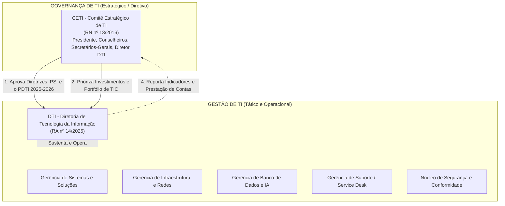
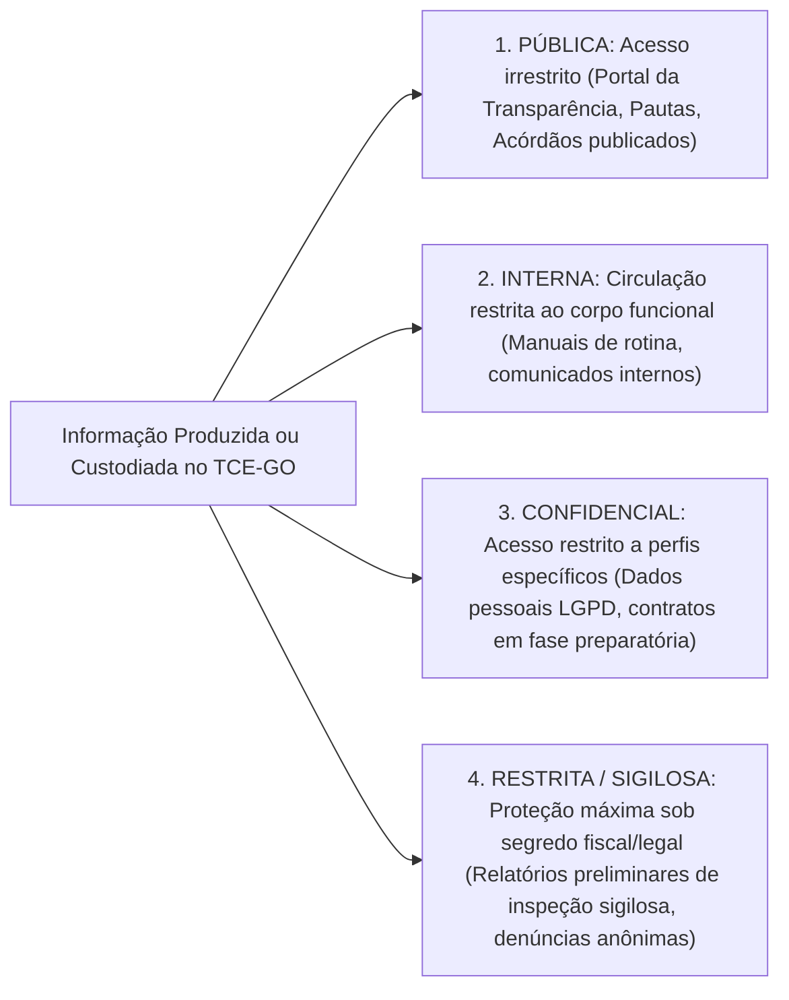
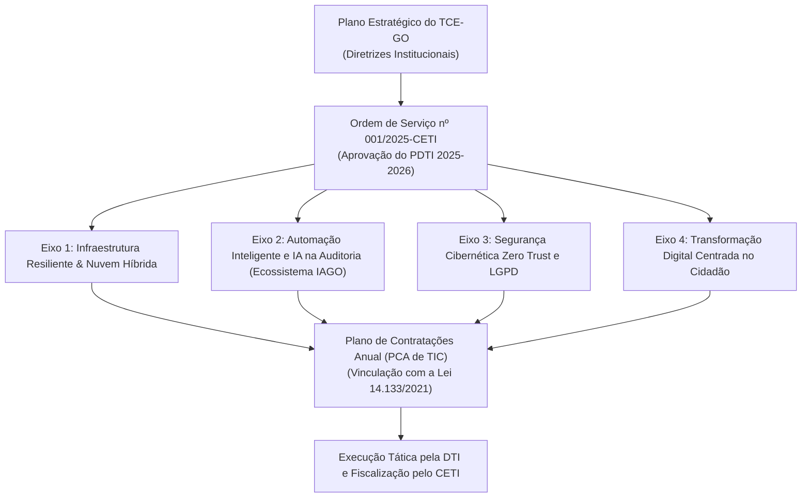

# 05 - Normativos Internos e Planejamento de TI do TCE-GO

> **Matéria:** Legislação Aplicada à Tecnologia da Informação  
> **Cargo:** B02 – Técnico de Controle Externo – Especialidade: Tecnologia da Informação  
> **Arquivo:** `05_normativos_e_planejamento_de_ti_tce_go.md`  
> **Atos Normativos:** Resoluções RN 13/2016, RA 14/2024, RA 17/2024, RA 14/2025 e PDTI 2025–2026 (Ordem de Serviço nº 001/2025-CETI)

---

## 📌 Ementa / Itens do Edital
- Normativos institucionais do Tribunal de Contas do Estado de Goiás sobre Governança, Planejamento e Segurança de TI:
    - **Resolução Normativa nº 13/2016 (compilada):** Instituição, composição e atribuições do Comitê Estratégico de TI (CETI)
    - **Resolução Administrativa nº 14/2024:** Política de Governança Organizacional do TCE-GO
    - **Resolução Administrativa nº 17/2024:** Política de Segurança da Informação (PSI) do TCE-GO
    - **Resolução Administrativa nº 14/2025:** Estrutura e competências privativas da Diretoria de Tecnologia da Informação (DTI) e gerências vinculadas
    - **Plano Diretor de Tecnologia da Informação (PDTI) 2025–2026:** Aprovado pela Ordem de Serviço nº 001/2025-CETI

---

## 🧭 Sumário

1. [O Comitê Estratégico de Tecnologia da Informação - CETI (Resolução Normativa nº 13/2016)](#1-o-comite-estrategico-de-tecnologia-da-informacao-ceti-resolucao-normativa-no-132016)
1. [Natureza e Segregação entre Governança e Gestão](#1-1-natureza-e-segregacao-entre-governanca-e-gestao)
    1. [Teste 555](#Teste-555)
    2. [Teste 556](#Teste-556)
1. [Composição e Competências Primordiais do CETI](#1-2-composicao-e-competencias-primordiais-do-ceti)
    1. [Teste 557](#Teste-557)
2. [Política de Governança Organizacional (Resolução Administrativa nº 14/2024)](#2-politica-de-governanca-organizacional-resolucao-administrativa-no-142024)
    1. [Teste 558](#Teste-558)
3. [Política de Segurança da Informação - PSI (Resolução Administrativa nº 17/2024)](#3-politica-de-seguranca-da-informacao-psi-resolucao-administrativa-no-172024)
3. [Classificação Corporativa da Informação no TCE-GO](#3-1-classificacao-corporativa-da-informacao-no-tce-go)
    1. [Teste 559](#Teste-559)
3. [Diretrizes de Uso Seguro, Teletrabalho e Resposta a Incidentes](#3-2-diretrizes-de-uso-seguro-teletrabalho-e-resposta-a-incidentes)
    1. [Teste 560](#Teste-560)
4. [Estrutura e Competências da Diretoria de TI (Resolução Administrativa nº 14/2025)](#4-estrutura-e-competencias-da-diretoria-de-ti-resolucao-administrativa-no-142025)
4. [Competências Executivas Privativas da DTI](#4-1-competencias-executivas-privativas-da-dti)
    1. [Teste 561](#Teste-561)
4. [Divisão Funcional das Gerências Vinculadas](#4-2-divisao-funcional-das-gerencias-vinculadas)
    1. [Teste 562](#Teste-562)
5. [Plano Diretor de TI - PDTI 2025–2026 (Ordem de Serviço nº 001/2025-CETI)](#5-plano-diretor-de-ti-pdti-20252026-ordem-de-servico-no-0012025-ceti)
5. [Diagnóstico Estratégico SWOT](#5-1-diagnostico-estrategico-swot)
    1. [Teste 563](#Teste-563)
5. [Os Quatro Eixos Estratégicos do PDTI 2025–2026](#5-2-os-quatro-eixos-estrategicos-do-pdti-20252026)
    1. [Teste 564](#Teste-564)
6. [Fontes Recomendadas na Internet](#6-fontes-recomendadas-na-internet)

---

## 1. O Comitê Estratégico de Tecnologia da Informação - CETI (Resolução Normativa nº 13/2016)

O **Comitê Estratégico de Tecnologia da Informação (CETI)** do Tribunal de Contas do Estado de Goiás (TCE-GO) é o órgão colegiado permanente que materializa a instância máxima de **Governança de TIC** no Tribunal, assegurando a necessária segregação entre as decisões estratégicas da alta administração e a gestão operacional da área técnica.

---

## 1.1 Natureza e Segregação entre Governança e Gestão

- **O CETI Governa:** Atua nas funções de avaliar, direcionar e monitorar (*Evaluate, Direct, Monitor*), aprovando formalmente o PDTI, definindo prioridades orçamentárias de TIC e estabelecendo as diretrizes gerais da PSI. O CETI não executa tarefas operacionais.
- **A DTI Gere e Opera:** Atua nas funções de planejar, construir, entregar e sustentar (*Plan, Build, Run, Monitor*). Desenvolve software, configura roteadores e servidores, gerencia bancos de dados e atende aos chamados dos usuários.

> 🚨 **ALERTA DE PROVA / PEGADINHA FCC:**  
> A banca FCC costuma perguntar quem é a autoridade competente para aprovar o PDTI no TCE-GO. O PDTI é **aprovado pelo CETI** (por meio de Ordem de Serviço, como a OS nº 001/2025-CETI) e **não** monocraticamente pelo Diretor de TI! A DTI apenas elabora a proposta técnica e executa as metas aprovadas.

---

### Teste 555
**(FGV – TCE/PA – 2024 – Auditor de Controle Externo - Administrativa - Ciência de Dados)**
Conjuntos de boas práticas, diretrizes e ferramentas de governança e gestão de TI são mapeados por meio de frameworks para auxiliar a implantação de tais instrumentos nas empresas. Um dos principais frameworks na indústria é o COBIT 2019. O principal objetivo do framework COBIT 2019 na governança e gestão de TI é

* **A)** estabelecer padrões internacionais para desenvolvimento de software.
* **B)** fornecer metodologias para análise de mercado de TI.
* **C)** definir diretrizes para a gestão e controle de tecnologia da informação.
* **D)** implementar práticas para otimização de infraestrutura de rede.
* **E)** padronizar processos para conformidade fiscal em TI.

---

> **Comentário Detalhado:**
>
> - **A)** **Incorreta.** A opção apresenta proposição em desacordo com os fundamentos teóricos e técnicos do tópico ao afirmar que "estabelecer padrões internacionais para desenvolvimento de software". De acordo com a teoria estudada em *4.2 Divisão Funcional das Gerências Vinculadas*, gerência de Sistemas de Informação: Análise, desenvolvimento, sustentação e testes de software, empregando metodologias ágeis (Scrum/Kanban) e práticas de DevSecOps.
> - **B)** **Incorreta.** A opção apresenta proposição em desacordo com os fundamentos teóricos e técnicos do tópico ao afirmar que "fornecer metodologias para análise de mercado de TI". De acordo com a teoria estudada em *1.1 Natureza e Segregação entre Governança e Gestão*, o CETI Governa: Atua nas funções de avaliar, direcionar e monitorar (*Evaluate, Direct, Monitor*), aprovando formalmente o PDTI, definindo prioridades orçamentárias de TIC e estabelecendo as diretrizes gerais da PSI. O CETI não executa tarefas operacionais.
> - **C)** **Correta.** Conforme fundamentado na seção *1. O Comitê Estratégico de Tecnologia da Informação - CETI (Resolução Normativa nº 13/2016)* deste guia, o Comitê Estratégico de Tecnologia da Informação (CETI) do Tribunal de Contas do Estado de Goiás (TCE-GO) é o órgão colegiado permanente que materializa a instância máxima de Governança de TIC no Tribunal, assegurando a necessária segregação entre as decisões estratégicas da alta administração e a gestão operacional da área técnica. Dessa forma, está plenamente correta a assertiva da banca (FGV – TCE/PA/2024) ao estabelecer que "definir diretrizes para a gestão e controle de tecnologia da informação".
> - **D)** **Incorreta.** A opção apresenta proposição em desacordo com os fundamentos teóricos e técnicos do tópico ao afirmar que "implementar práticas para otimização de infraestrutura de rede". De acordo com a teoria estudada em *Composição Colegiada*, secretário-Geral de Administração (representando a área de gestão e infraestrutura).
> - **E)** **Incorreta.** A opção apresenta proposição em desacordo com os fundamentos teóricos e técnicos do tópico ao afirmar que "padronizar processos para conformidade fiscal em TI". De acordo com a teoria estudada em *3.1 Classificação Corporativa da Informação no TCE-GO*, pública: Informações de livre acesso à sociedade, em cumprimento à LAI e ao princípio da publicidade. — Não exige controle de confidencialidade; exige garantia de integridade e disponibilidade. — Acórdãos transitados em julgado, relatórios de gestão fiscal publicados.
>
> **Gabarito: C**

---

### Teste 556
**(FGV – TJ/DFT – 2022 – Analista Judiciario Suporte Em Tecnologia Da Informacao)**
A Estratégia Nacional de Tecnologia da Informação e Comunicação do Poder Judiciário (ENTIC-JUD) visa ao incremento da governança, da gestão e da colaboração tecnológica no âmbito do Poder Judiciário, com o objetivo de maximizar os resultados com otimização de recursos, pautados em eficiência, eficácia, efetividade e economicidade dos órgãos. A fim de cumprir o objetivo da ENTIC-JUD, todos os órgãos do Poder Judiciário devem constituir um Comitê de Governança de Tecnologia da Informação e Comunicação multidisciplinar. Uma das atribuições desse comitê, de acordo com a Resolução CNJ nº 370/2021, é:

* **A)** acompanhar o andamento das iniciativas estratégicas bem como seus desdobramentos;
* **B)** estabelecer plano de ação para iniciativas de curta duração ou escopo simplificado;
* **C)** monitorar a execução orçamentária e financeira de Tecnologia da Informação e Comunicações (TIC);
* **D)** aprovar planos táticos e operacionais junto à alta administração, disseminando a importância da área de TIC nos tribunais;
* **E)** promover ações de transparência, responsabilidade e prestação de conta, possibilitando um maior controle e acompanhamento da governança para convergência dos interesses entre Poder Judiciário e a sociedade.

---

> **Comentário Detalhado:**
>
> - **A)** **Incorreta.** A opção apresenta proposição em desacordo com os fundamentos teóricos e técnicos do tópico ao afirmar que "acompanhar o andamento das iniciativas estratégicas bem como seus desdobramentos". De acordo com a teoria estudada em *1. O Comitê Estratégico de Tecnologia da Informação - CETI (Resolução Normativa nº 13/2016)*, o Comitê Estratégico de Tecnologia da Informação (CETI) do Tribunal de Contas do Estado de Goiás (TCE-GO) é o órgão colegiado permanente que materializa a instância máxima de Governança de TIC no Tribunal, assegurando a necessária segregação entre as decisões estratégicas da alta administração e a gestão operacional da área técnica.
> - **B)** **Incorreta.** A opção apresenta proposição em desacordo com os fundamentos teóricos e técnicos do tópico ao afirmar que "estabelecer plano de ação para iniciativas de curta duração ou escopo simplificado". De acordo com a teoria estudada em *2. Política de Governança Organizacional (Resolução Administrativa nº 14/2024)*, conexão com a TIC: A Governança de TI não é uma ilha isolada; os objetivos tecnológicos do PDTI são derivados diretamente dos objetivos estratégicos da RA nº 14/2024 para maximizar o valor público entregue pelo Tribunal à sociedade goiana.
> - **C)** **Incorreta.** A opção apresenta proposição em desacordo com os fundamentos teóricos e técnicos do tópico ao afirmar que "monitorar a execução orçamentária e financeira de Tecnologia da Informação e Comunicações (TIC)". De acordo com a teoria estudada em *1.1 Natureza e Segregação entre Governança e Gestão*, o CETI Governa: Atua nas funções de avaliar, direcionar e monitorar (*Evaluate, Direct, Monitor*), aprovando formalmente o PDTI, definindo prioridades orçamentárias de TIC e estabelecendo as diretrizes gerais da PSI. O CETI não executa tarefas operacionais.
> - **D)** **Incorreta.** A opção apresenta proposição em desacordo com os fundamentos teóricos e técnicos do tópico ao afirmar que "aprovar planos táticos e operacionais junto à alta administração, disseminando a importância da área de TIC nos...". De acordo com a teoria estudada em *1.1 Natureza e Segregação entre Governança e Gestão*, a banca FCC costuma perguntar quem é a autoridade competente para aprovar o PDTI no TCE-GO.
> - **E)** **Correta.** Conforme fundamentado na seção *2. Política de Governança Organizacional (Resolução Administrativa nº 14/2024)* deste guia, princípios Estruturantes: Integridade, confiabilidade, transparência, prestação de contas (*accountability*), tempestividade e foco no cidadão. Dessa forma, está plenamente correta a assertiva da banca (FGV – TJ/DFT/2022) ao estabelecer que "promover ações de transparência, responsabilidade e prestação de conta, possibilitando um maior controle e...".
>
> **Gabarito: E**

---

## 1.2 Composição e Competências Primordiais do CETI

#### Composição Colegiada
O CETI é composto por membros natos e designados da alta cúpula decisória do Tribunal:

- Conselheiro-Presidente (ou Conselheiro formalmente designado para presidir o Comitê);
- Diretor-Geral do Tribunal;
- Secretário-Geral de Controle Externo (representando a área finalística de auditoria);
- Secretário-Geral de Administração (representando a área de gestão e infraestrutura);
- Diretor de Tecnologia da Informação (membro executivo e relator técnico das matérias).

#### Competências Primordiais do CETI (RN nº 13/2016)
1. **Deliberação Estratégica:** Aprovar formalmente o Plano Diretor de TI (PDTI) e suas revisões periódicas, alinhando-o ao Plano Estratégico do TCE-GO;
2. **Política de Segurança:** Apreciar e submeter a Política de Segurança da Informação (PSI) e suas normas complementares;
3. **Priorização de Demandas:** Estabelecer a ordem de prioridade dos projetos e contratações de TIC de grande vulto, evitando dispersão orçamentária;
4. **Monitoramento e Avaliação:** Analisar relatórios semestrais de execução do PDTI e desempenho dos serviços de tecnologia;
5. **Resolução de Conflitos:** Dirimir impasses sobre demandas concorrentes entre a área de controle externo e a área administrativa.

---

### Teste 557
**(FGV – TJ/RR – 2024 – Analista Judiciario Gestao E Governanca De Tecnologia Da Informacao)**
Os Manuais e Protocolos criados pela Resolução CNJ nº 396/2021, que instituiu a Estratégia Nacional de Segurança Cibernética do Poder Judiciário (ENSEC-PJ), aprovados pela Portaria nº 162, de 10/06/2021, normatizam diversas atividades na área de segurança cibernética a serem implantadas pelos diversos órgãos do Poder Judiciário. Com base nos Manuais e Protocolos aprovados pela Portaria nº 162 de 10/06/2021, analise as afirmações a seguir. I. Os Protocolos e Manuais serão atualizados a qualquer tempo por indicação do Comitê Gestor de Segurança Cibernética do Poder Judiciário. II. O Protocolo de Investigação de Ilícitos Cibernéticos do Poder Judiciário (PIILC-PJ) deverá ser implementado por todos os órgãos do Poder Judiciário, com exceção do Supremo Tribunal Federal. III. O Manual de Proteção de Infraestruturas de TIC descreve as ações responsivas a serem colocadas em prática quando ficar evidente que um incidente de segurança cibernética não será mitigado rapidamente e poderá durar dias, semanas ou meses. Está correto o que se afirma em

* **A)** I, apenas.
* **B)** I e II, apenas.
* **C)** I e III, apenas.
* **D)** II e III, apenas.
* **E)** I, II e III.

---

> **Comentário Detalhado:**
>
> - **A)** **Incorreta.** A opção incorre em restrição indevida ao limitar o escopo conceitual ao afirmar que "I, apenas". De acordo com a teoria estudada em *1. O Comitê Estratégico de Tecnologia da Informação - CETI (Resolução Normativa nº 13/2016)*, o Comitê Estratégico de Tecnologia da Informação (CETI) do Tribunal de Contas do Estado de Goiás (TCE-GO) é o órgão colegiado permanente que materializa a instância máxima de Governança de TIC no Tribunal, assegurando a necessária segregação entre as decisões estratégicas da alta administração e a gestão operacional da área técnica.
> - **B)** **Correta.** Conforme fundamentado na seção *5.2 Os Quatro Eixos Estratégicos do PDTI 2025–2026* deste guia, nenhuma contratação de TIC pode ser iniciada no TCE-GO sem previsão expressa no PDTI vigente e no Plano de Contratações Anual (PCA de TIC), sob pena de nulidade insanável perante a Lei nº 14.133/2021 e normas de controle interno. Dessa forma, está plenamente correta a assertiva da banca (FGV – TJ/RR/2024) ao estabelecer que "I e II, apenas".
> - **C)** **Incorreta.** A opção incorre em restrição indevida ao limitar o escopo conceitual ao afirmar que "I e III, apenas". De acordo com a teoria estudada em *5.2 Os Quatro Eixos Estratégicos do PDTI 2025–2026*, eixo Estratégico III - Cibersegurança e Proteção de Dados: Adoção progressiva do paradigma Zero Trust Architecture (ZTA), autenticação multifator em 100% dos serviços e monitoramento 24x7 através de SIEM corporativo.
> - **D)** **Incorreta.** A opção incorre em restrição indevida ao limitar o escopo conceitual ao afirmar que "II e III, apenas". De acordo com a teoria estudada em *Competências Primordiais do CETI (RN nº 13/2016)*, resolução de Conflitos: Dirimir impasses sobre demandas concorrentes entre a área de controle externo e a área administrativa.
> - **E)** **Incorreta.** A opção apresenta proposição em desacordo com os fundamentos teóricos e técnicos do tópico ao afirmar que "I, II e III". De acordo com a teoria estudada em *5. Plano Diretor de TI - PDTI 2025–2026 (Ordem de Serviço nº 001/2025-CETI)*, aprovado formalmente pelo Comitê Estratégico de TI por meio da Ordem de Serviço nº 001/2025-CETI, o PDTI 2025–2026 é o instrumento tático-operacional de planejamento da TIC que estabelece os rumos tecnológicos do TCE-GO para o biênio 2025–2026.
>
> **Gabarito: B**

---

## 2. Política de Governança Organizacional (Resolução Administrativa nº 14/2024)

A Resolução Administrativa nº 14/2024 consolidou o modelo de Governança Pública no TCE-GO, alinhado aos referenciais do Tribunal de Contas da União (TCU) e da OCDE (*Organização para a Cooperação e Desenvolvimento Econômico*):

1. **Princípios Estruturantes:** Integridade, confiabilidade, transparência, prestação de contas (*accountability*), tempestividade e foco no cidadão.
2. **Modelo das Três Linhas:**
    - *1ª Linha (Gestores Operacionais):* Responsáveis pela execução direta das rotinas e pelos controles internos primários em cada unidade;
    - *2ª Linha (Unidades de Riscos e Integridade):* Responsáveis pelo monitoramento de conformidade, desenho de políticas de riscos e suporte metodológico;
    - *3ª Linha (Auditoria Interna):* Fornece avaliação independente e objetiva da eficácia dos processos de governança e controles institucionais.

3. **Conexão com a TIC:** A Governança de TI não é uma ilha isolada; os objetivos tecnológicos do PDTI são derivados diretamente dos objetivos estratégicos da RA nº 14/2024 para maximizar o valor público entregue pelo Tribunal à sociedade goiana.

---

### Teste 558
**(FGV – TCE/SC – 2026 – Auditor Fiscal de Controle Externo - Administração)**
Fundada na dignidade da pessoa humana e no valor social do trabalho, foi instituída, por meio da Resolução N. TC-254/2024, a Política de Prevenção e de Enfrentamento do Assédio Moral, do Assédio Sexual e da Discriminação no TCE/SC. No contexto de referida resolução, os atos de i) manifestar publicamente desdém ou desprezo pelo produto do trabalho, ii) gerir por estresse, por injúria ou por medo e iii) realizar premiações negativas, ameaças e cobranças exageradas, podem configurar, respectivamente:

* **A)** assédio moral, assédio moral e assédio moral organizacional.
* **B)** assédio moral, assédio sexual e assédio moral organizacional.
* **C)** assédio moral organizacional, assédio moral organizacional e assédio moral.
* **D)** assédio institucional, assédio moral organizacional e assédio institucional.
* **E)** assédio moral, assédio moral organizacional e assédio moral organizacional.

---

> **Comentário Detalhado:**
>
> - **A)** **Incorreta.** A opção apresenta proposição em desacordo com os fundamentos teóricos e técnicos do tópico ao afirmar que "assédio moral, assédio moral e assédio moral organizacional". De acordo com a teoria estudada em *2. Política de Governança Organizacional (Resolução Administrativa nº 14/2024)*, a Resolução Administrativa nº 14/2024 consolidou o modelo de Governança Pública no TCE-GO, alinhado aos referenciais do Tribunal de Contas da União (TCU) e da OCDE (*Organização para a Cooperação e Desenvolvimento Econômico*).
> - **B)** **Incorreta.** A opção apresenta proposição em desacordo com os fundamentos teóricos e técnicos do tópico ao afirmar que "assédio moral, assédio sexual e assédio moral organizacional". De acordo com a teoria estudada em *2. Política de Governança Organizacional (Resolução Administrativa nº 14/2024)*, princípios Estruturantes: Integridade, confiabilidade, transparência, prestação de contas (*accountability*), tempestividade e foco no cidadão.
> - **C)** **Incorreta.** A opção apresenta proposição em desacordo com os fundamentos teóricos e técnicos do tópico ao afirmar que "assédio moral organizacional, assédio moral organizacional e assédio moral". De acordo com a teoria estudada em *2. Política de Governança Organizacional (Resolução Administrativa nº 14/2024)*, *1ª Linha (Gestores Operacionais):* Responsáveis pela execução direta das rotinas e pelos controles internos primários em cada unidade.
> - **D)** **Incorreta.** A opção apresenta proposição em desacordo com os fundamentos teóricos e técnicos do tópico ao afirmar que "assédio institucional, assédio moral organizacional e assédio institucional". De acordo com a teoria estudada em *2. Política de Governança Organizacional (Resolução Administrativa nº 14/2024)*, *2ª Linha (Unidades de Riscos e Integridade):* Responsáveis pelo monitoramento de conformidade, desenho de políticas de riscos e suporte metodológico.
> - **E)** **Correta.** Conforme fundamentado na seção *2. Política de Governança Organizacional (Resolução Administrativa nº 14/2024)* deste guia, conexão com a TIC: A Governança de TI não é uma ilha isolada; os objetivos tecnológicos do PDTI são derivados diretamente dos objetivos estratégicos da RA nº 14/2024 para maximizar o valor público entregue pelo Tribunal à sociedade goiana. Dessa forma, está plenamente correta a assertiva da banca (FGV – TCE/SC/2026) ao estabelecer que "assédio moral, assédio moral organizacional e assédio moral organizacional".
>
> **Gabarito: E**

---

## 3. Política de Segurança da Informação - PSI (Resolução Administrativa nº 17/2024)

A PSI do TCE-GO estabelece os padrões e comportamentos mandatórios para assegurar a **Confidencialidade, Integridade, Disponibilidade, Autenticidade e Não-Repúdio (CIDAN)** dos ativos de informação do Tribunal.

---

## 3.1 Classificação Corporativa da Informação no TCE-GO

| Nível de Classificação | Definição Normativa | Requisitos de Proteção e Tratamento | Exemplo Típico |
|---|---|---|---|
| **Pública** | Informações de livre acesso à sociedade, em cumprimento à LAI e ao princípio da publicidade. | Não exige controle de confidencialidade; exige garantia de integridade e disponibilidade. | Acórdãos transitados em julgado, relatórios de gestão fiscal publicados. |
| **Interna** | Informações voltadas ao uso operacional cotidiano dos servidores e colaboradores do Tribunal. | Acesso vedado ao público externo sem autorização; compartilhamento limitado ao ambiente institucional. | Modelos de pareceres internos, notas técnicas de rotina, lista de ramais. |
| **Confidencial** | Informações cuja divulgação não autorizada possa comprometer operações ou violar direitos de terceiros (LGPD). | Controle rigoroso de privilégios (RBAC), registro de trilhas de auditoria e criptografia em trânsito e repouso. | Folha de pagamento com dados bancários, atestados de saúde, logs de acesso individualizados. |
| **Restrita / Sigilosa** | Informações protegidas por sigilo legal estrito (fiscal, bancário, judicial ou de auditoria preliminar). | Acesso restrito exclusivamente aos auditores designados na portaria; proibição de cópia externa; custódia em pastas seguras com criptografia de disco. | Relatório de auditoria preliminar de fraude antes da notificação do jurisdicionado; denúncias de corrupção protegidas. |

> 🚨 **ALERTA DE PROVA / PEGADINHA FCC:**  
> Informações preliminares de fiscalização que envolvam dados bancários ou fiscais de jurisdicionados, bem como denúncias anônimas antes da deliberação plenária, recebem o nível **Restrita / Sigilosa**. Disponibilizar esses dados prematuramente viola a PSI e acarreta responsabilidade funcional e criminal.

---

### Teste 559
**(FGV – TJ/RR – 2024 – Analista Judiciario Infraestrutura De Tecnologia Da Informacao)**
O Tribunal de Justiça do Estado de Roraima está modernizando sua infraestrutura de rede para melhorar a segurança e a eficiência na comunicação de dados. A equipe de Tecnologia da Informação está implementando mecanismos de Network Address Translation (NAT) e Port Address Translation (PAT) para otimizar o uso de endereços IP públicos e proteger a rede interna. Além disso, estão avaliando quais protocolos e padrões de segurança sem fio devem ser adotados para garantir a confidencialidade e integridade das informações transmitidas. Entre as opções consideradas estão os protocolos WEP, WPA, WPA2, WPA3 e a implementação do padrão IEEE 802.1X em conjunto com o EAP (Extensible Authentication Protocol). Considerando o cenário apresentado, a equipe de TI precisa entender o funcionamento do PAT na rede e selecionar o protocolo de segurança sem fio mais adequado para proteger as comunicações sem comprometer a eficiência. Com base nas informações fornecidas, assinale a opção que interpreta corretamente o papel do PAT na rede e identifica o protocolo de segurança sem fio mais adequado para garantir a confidencialidade e integridade dos dados transmitidos.

* **A)** O PAT permite que cada dispositivo interno tenha um endereço IP público exclusivo; o protocolo WEP deve ser implementado para proteger a rede sem fio.
* **B)** O PAT traduz múltiplos endereços IP privados em um único endereço IP público usando números de porta para diferenciar as saídas; o protocolo WPA3 é o mais adequado para proteger a rede sem fio.
* **C)** O PAT mapeia cada endereço IP privado para um endereço IP público diferente; o protocolo WPA deve ser utilizado para a segurança da rede sem fio.
* **D)** O PAT não é necessário quando o NAT está em uso; o protocolo EAP é suficiente para proteger a rede sem fio.
* **E)** O PAT converte endereços IPv4 em IPv6; o padrão IEEE 802.1X deve ser aplicado para garantir a segurança da rede sem fio.

---

> **Comentário Detalhado:**
>
> - **A)** **Incorreta.** A opção apresenta proposição em desacordo com os fundamentos teóricos e técnicos do tópico ao afirmar que "O PAT permite que cada dispositivo interno tenha um endereço IP público exclusivo; o protocolo WEP deve ser...". De acordo com a teoria estudada em *5.2 Os Quatro Eixos Estratégicos do PDTI 2025–2026*, nenhuma contratação de TIC pode ser iniciada no TCE-GO sem previsão expressa no PDTI vigente e no Plano de Contratações Anual (PCA de TIC), sob pena de nulidade insanável perante a Lei nº 14.133/2021 e normas de controle interno.
> - **B)** **Correta.** Conforme fundamentado na seção *3. Política de Segurança da Informação - PSI (Resolução Administrativa nº 17/2024)* deste guia, a PSI do TCE-GO estabelece os padrões e comportamentos mandatórios para assegurar a Confidencialidade, Integridade, Disponibilidade, Autenticidade e Não-Repúdio (CIDAN) dos ativos de informação do Tribunal. Dessa forma, está plenamente correta a assertiva da banca (FGV – TJ/RR/2024) ao estabelecer que "O PAT traduz múltiplos endereços IP privados em um único endereço IP público usando números de porta para...".
> - **C)** **Incorreta.** A opção apresenta proposição em desacordo com os fundamentos teóricos e técnicos do tópico ao afirmar que "O PAT mapeia cada endereço IP privado para um endereço IP público diferente; o protocolo WPA deve ser utilizado...". De acordo com a teoria estudada em *Competências Primordiais do CETI (RN nº 13/2016)*, política de Segurança: Apreciar e submeter a Política de Segurança da Informação (PSI) e suas normas complementares.
> - **D)** **Incorreta.** A opção apresenta proposição em desacordo com os fundamentos teóricos e técnicos do tópico ao afirmar que "O PAT não é necessário quando o NAT está em uso; o protocolo EAP é suficiente para proteger a rede sem fio". De acordo com a teoria estudada em *3.2 Diretrizes de Uso Seguro, Teletrabalho e Resposta a Incidentes*, senhas pessoais, intransferíveis e secretas com política de complexidade mínima (números, caracteres especiais, maiúsculas e minúsculas).
> - **E)** **Incorreta.** A opção apresenta proposição em desacordo com os fundamentos teóricos e técnicos do tópico ao afirmar que "O PAT converte endereços IPv4 em IPv6; o padrão IEEE 802.1X deve ser aplicado para garantir a segurança da rede...". De acordo com a teoria estudada em *4.1 Competências Executivas Privativas da DTI*, garantir a alta disponibilidade da infraestrutura de servidores, data centers, redes e serviços em nuvem.
>
> **Gabarito: B**

---

## 3.2 Diretrizes de Uso Seguro, Teletrabalho e Resposta a Incidentes

1. **Credenciais e Autenticação:**
    - Senhas pessoais, intransferíveis e secretas com política de complexidade mínima (números, caracteres especiais, maiúsculas e minúsculas);
    - Uso compulsório de **Autenticação Multifator (MFA)** para todos os acessos externos e sistemas corporativos sensíveis.

2. **Teletrabalho e Acesso Remoto:**
    - Conexão remota permitida exclusivamente por meio de túnel criptografado **VPN (*Virtual Private Network*) corporativa** do Tribunal;
    - Proibição de armazenamento de documentos restritos em dispositivos particulares (computadores domésticos compartilhados sem antivírus gerenciado);
    - Bloqueio automático de tela configurado para tempo máximo de inatividade (ex.: 5 minutos).

3. **Dispositivos Móveis de Armazenamento:**
    - Bloqueio por política de grupo (GPO) do uso de dispositivos USB (*pendrives*, HDs externos) não homologados nas estações de trabalho do Tribunal.

4. **Tratamento de Incidentes de Segurança:**
    - Existência de equipe especializada de resposta a incidentes cibernéticos (CSIRT do TCE-GO);
    - Dever funcional de todo servidor de comunicar imediatamente à DTI qualquer indício de infecção por malware, tentativa de *phishing* ou perda de equipamento funcional.

---

### Teste 560
**(FGV – TJ/RR – 2024 – Analista Judiciario Gestao E Governanca De Tecnologia Da Informacao)**
O Poder Judiciário adotou o modelo centralizado de governança na segurança cibernética, de acordo com a Resolução Nº 396 de 07/06/2021 que instituiu a Estratégia Nacional de Segurança Cibernética do Poder Judiciário (ENSEC-PJ). Nesse modelo, o órgão central que coordena as ações para viabilizar a governança na segurança cibernética é

* **A)** o Conselho Nacional de Justiça (CNJ).
* **B)** o Comitê Gestor de Segurança da Informação do Poder Judiciário (CGSI-PJ).
* **C)** o Centro de Prevenção, Tratamento e Resposta a Incidentes Cibernéticos do Poder Judiciário (CPTRIC-PJ).
* **D)** a Equipe de Tratamento e Resposta a Incidentes de Segurança Cibernética (ETIR).
* **E)** o Sistema de Gestão de Segurança da Informação do Poder Judiciário (SGSI-PJ).

---

> **Comentário Detalhado:**
>
> - **A)** **Correta.** Conforme fundamentado na seção *1. O Comitê Estratégico de Tecnologia da Informação - CETI (Resolução Normativa nº 13/2016)* deste guia, o Comitê Estratégico de Tecnologia da Informação (CETI) do Tribunal de Contas do Estado de Goiás (TCE-GO) é o órgão colegiado permanente que materializa a instância máxima de Governança de TIC no Tribunal, assegurando a necessária segregação entre as decisões estratégicas da alta administração e a gestão operacional da área técnica. Dessa forma, está plenamente correta a assertiva da banca (FGV – TJ/RR/2024) ao estabelecer que "o Conselho Nacional de Justiça (CNJ)".
> - **B)** **Incorreta.** A opção apresenta proposição em desacordo com os fundamentos teóricos e técnicos do tópico ao afirmar que "o Comitê Gestor de Segurança da Informação do Poder Judiciário (CGSI-PJ)". De acordo com a teoria estudada em *3. Política de Segurança da Informação - PSI (Resolução Administrativa nº 17/2024)*, a PSI do TCE-GO estabelece os padrões e comportamentos mandatórios para assegurar a Confidencialidade, Integridade, Disponibilidade, Autenticidade e Não-Repúdio (CIDAN) dos ativos de informação do Tribunal.
> - **C)** **Incorreta.** A opção apresenta proposição em desacordo com os fundamentos teóricos e técnicos do tópico ao afirmar que "o Centro de Prevenção, Tratamento e Resposta a Incidentes Cibernéticos do Poder Judiciário (CPTRIC-PJ)". De acordo com a teoria estudada em *3.2 Diretrizes de Uso Seguro, Teletrabalho e Resposta a Incidentes*, existência de equipe especializada de resposta a incidentes cibernéticos (CSIRT do TCE-GO).
> - **D)** **Incorreta.** A opção apresenta proposição em desacordo com os fundamentos teóricos e técnicos do tópico ao afirmar que "a Equipe de Tratamento e Resposta a Incidentes de Segurança Cibernética (ETIR)". De acordo com a teoria estudada em *3.2 Diretrizes de Uso Seguro, Teletrabalho e Resposta a Incidentes*, senhas pessoais, intransferíveis e secretas com política de complexidade mínima (números, caracteres especiais, maiúsculas e minúsculas).
> - **E)** **Incorreta.** A opção apresenta proposição em desacordo com os fundamentos teóricos e técnicos do tópico ao afirmar que "o Sistema de Gestão de Segurança da Informação do Poder Judiciário (SGSI-PJ)". De acordo com a teoria estudada em *4.2 Divisão Funcional das Gerências Vinculadas*, núcleo de Segurança da Informação e Conformidade: Gestão contínua de vulnerabilidades, monitoramento de SOC (*Security Operations Center*), auditoria de logs e conformidade com a PSI e a LGPD.
>
> **Gabarito: A**

---

## 4. Estrutura e Competências da Diretoria de TI (Resolução Administrativa nº 14/2025)

A Resolução Administrativa nº 14/2025 modernizou a estrutura organizacional da **Diretoria de Tecnologia da Informação (DTI)** do TCE-GO:

---

## 4.1 Competências Executivas Privativas da DTI

- Planejar, gerenciar, executar e manter o ecossistema tecnológico do Tribunal;
- Subsidiar tecnicamente o CETI na elaboração e revisão do PDTI e da PSI;
- Conduzir o planejamento das contratações de TIC, elaborando os Estudos Técnicos Preliminares (ETP) e Termos de Referência (TR);
- Gerenciar o ciclo de vida dos softwares corporativos de auditoria e processo eletrônico;
- Garantir a alta disponibilidade da infraestrutura de servidores, data centers, redes e serviços em nuvem.

---

### Teste 561
**(FGV – TCE/PA – 2024 – Auditor de Controle Externo - Administrativa - Gestão Governamental)**
Nos termos da ISSAI 20, Accountability e transparência são dois elementos importantes de boa governança. A transparência é uma força poderosa que, quando aplicada de forma consistente, pode ajudar a combater a corrupção, melhorar a governança e promover a accountability. Considerando as disposições da referida norma, analise as afirmativas a seguir sobre os conceitos de accountability, transparência e sobre os princípios nela veiculados: I. É difícil separar accountability de transparência: ambas englobam muitas das mesmas ações, como por exemplo, a comunicação pública. II. A noção de transparência refere-se à informação pública tempestiva, confiável, clara e relevante da EFS sobre sua situação, seu mandato, sua estratégia, suas atividades, sua gestão financeira, suas operações e seus resultados. III. As EFS garantem que esses princípios de accountability e transparência não são comprometidos quando terceirizam suas atividades, inclusive as funções fiscalizadora e sancionadora. IV. O conceito de accountability refere-se à estrutura jurídica e de comunicação, à estrutura organizacional e estratégia, aos procedimentos e às ações para garantir que o dirigente da EFS, os membros (de instituições colegiais) e o servidores da EFS possam ser responsabilizados pelos seus atos, dentre outras iniciativas. Está correto o que se afirma em

* **A)** I, II e III, somente.
* **B)** I, II e IV, somente.
* **C)** I, II, III e IV.
* **D)** II e IV, somente.
* **E)** I e II, somente.

---

> **Comentário Detalhado:**
>
> - **A)** **Incorreta.** A opção incorre em restrição indevida ao limitar o escopo conceitual ao afirmar que "I, II e III, somente". De acordo com a teoria estudada em *5.2 Os Quatro Eixos Estratégicos do PDTI 2025–2026*, eixo Estratégico III - Cibersegurança e Proteção de Dados: Adoção progressiva do paradigma Zero Trust Architecture (ZTA), autenticação multifator em 100% dos serviços e monitoramento 24x7 através de SIEM corporativo.
> - **B)** **Correta.** Conforme fundamentado na seção *2. Política de Governança Organizacional (Resolução Administrativa nº 14/2024)* deste guia, princípios Estruturantes: Integridade, confiabilidade, transparência, prestação de contas (*accountability*), tempestividade e foco no cidadão. Dessa forma, está plenamente correta a assertiva da banca (FGV – TCE/PA/2024) ao estabelecer que "I, II e IV, somente".
> - **C)** **Incorreta.** A opção apresenta proposição em desacordo com os fundamentos teóricos e técnicos do tópico ao afirmar que "I, II, III e IV". De acordo com a teoria estudada em *1.1 Natureza e Segregação entre Governança e Gestão*, a DTI Gere e Opera: Atua nas funções de planejar, construir, entregar e sustentar (*Plan, Build, Run, Monitor*). Desenvolve software, configura roteadores e servidores, gerencia bancos de dados e atende aos chamados dos usuários.
> - **D)** **Incorreta.** A opção incorre em restrição indevida ao limitar o escopo conceitual ao afirmar que "II e IV, somente". De acordo com a teoria estudada em *4.1 Competências Executivas Privativas da DTI*, garantir a alta disponibilidade da infraestrutura de servidores, data centers, redes e serviços em nuvem.
> - **E)** **Incorreta.** A opção incorre em restrição indevida ao limitar o escopo conceitual ao afirmar que "I e II, somente". De acordo com a teoria estudada em *5.2 Os Quatro Eixos Estratégicos do PDTI 2025–2026*, nenhuma contratação de TIC pode ser iniciada no TCE-GO sem previsão expressa no PDTI vigente e no Plano de Contratações Anual (PCA de TIC), sob pena de nulidade insanável perante a Lei nº 14.133/2021 e normas de controle interno.
>
> **Gabarito: B**

---

## 4.2 Divisão Funcional das Gerências Vinculadas

1. **Gerência de Sistemas de Informação:** Análise, desenvolvimento, sustentação e testes de software, empregando metodologias ágeis (Scrum/Kanban) e práticas de DevSecOps.
2. **Gerência de Infraestrutura e Redes:** Operação dos data centers primário e secundário, enlaces de fibra óptica, roteadores, switches, virtualização de servidores (VMware/Hyper-V/Kubernetes) e serviços em nuvem híbrida.
3. **Gerência de Banco de Dados e Informações Estratégicas:** Administração de bancos relacionais e NoSQL, data lake, pipelines ETL/ELT, inteligência analítica de dados e suporte ao treinamento de modelos de IA (Ecossistema IAGO).
4. **Gerência de Atendimento e Suporte ao Usuário (Service Desk):** Ponto único de contato (SPOC) para suporte a usuários internos e externos, microinformática, gestão de ativos de TI e incidentes operacionais de Nível 1 e 2.
5. **Núcleo de Segurança da Informação e Conformidade:** Gestão contínua de vulnerabilidades, monitoramento de SOC (*Security Operations Center*), auditoria de logs e conformidade com a PSI e a LGPD.

---

### Teste 562
**(FGV – TRT/DA – 2025 – Analista Judiciario Area Apoio Especializado Tecnologia Da Informacao)**
A Resolução 396/2021 do Conselho Nacional de Justiça institui a Estratégia Nacional de Segurança Cibernética do Poder Judiciário (ENSEC-PJ). A respeito dos objetivos da ENSEC-PJ, avalie as afirmativas a seguir. I. Baratear a execução das atividades do Judiciário no ambiente digital para reduzir o tempo de atendimento e recuperação de falhas. II. Aumentar a resiliência às ameaças cibernéticas por meio da gestão ativa de permissões de usuários de sistemas informatizados. III. Permitir a manutenção e a continuidade dos serviços, ou o seu restabelecimento em menor tempo possível. IV. Estabelecer governança de segurança cibernética e fortalecer a gestão e coordenação integrada de ações de segurança cibernética nos órgãos do Poder Judiciário. Está correto o que se afirma em

* **A)** I e II, apenas.
* **B)** II e III, apenas.
* **C)** III e IV, apenas.
* **D)** I, III e IV, apenas.
* **E)** II, III e IV, apenas.

---

> **Comentário Detalhado:**
>
> - **A)** **Incorreta.** A opção incorre em restrição indevida ao limitar o escopo conceitual ao afirmar que "I e II, apenas". De acordo com a teoria estudada em *4.2 Divisão Funcional das Gerências Vinculadas*, gerência de Atendimento e Suporte ao Usuário (Service Desk): Ponto único de contato (SPOC) para suporte a usuários internos e externos, microinformática, gestão de ativos de TI e incidentes operacionais de Nível 1 e 2.
> - **B)** **Incorreta.** A opção incorre em restrição indevida ao limitar o escopo conceitual ao afirmar que "II e III, apenas". De acordo com a teoria estudada em *2. Política de Governança Organizacional (Resolução Administrativa nº 14/2024)*, conexão com a TIC: A Governança de TI não é uma ilha isolada; os objetivos tecnológicos do PDTI são derivados diretamente dos objetivos estratégicos da RA nº 14/2024 para maximizar o valor público entregue pelo Tribunal à sociedade goiana.
> - **C)** **Correta.** Conforme fundamentado na seção *5.2 Os Quatro Eixos Estratégicos do PDTI 2025–2026* deste guia, eixo Estratégico III - Cibersegurança e Proteção de Dados: Adoção progressiva do paradigma Zero Trust Architecture (ZTA), autenticação multifator em 100% dos serviços e monitoramento 24x7 através de SIEM corporativo. Dessa forma, está plenamente correta a assertiva da banca (FGV – TRT/DA/2025) ao estabelecer que "III e IV, apenas".
> - **D)** **Incorreta.** A opção incorre em restrição indevida ao limitar o escopo conceitual ao afirmar que "I, III e IV, apenas". De acordo com a teoria estudada em *5.2 Os Quatro Eixos Estratégicos do PDTI 2025–2026*, eixo Estratégico I - Infraestrutura Resiliente e Nuvem Híbrida: Modernização do Data Center primário e consolidação do site de recuperação de desastres (*Disaster Recovery*) em nuvem; metas de disponibilidade global $\ge 99,5\%$ e tempo máximo de recuperação pós-falha (RTO) inferior a 2 horas.
> - **E)** **Incorreta.** A opção incorre em restrição indevida ao limitar o escopo conceitual ao afirmar que "II, III e IV, apenas". De acordo com a teoria estudada em *1.1 Natureza e Segregação entre Governança e Gestão*, a DTI Gere e Opera: Atua nas funções de planejar, construir, entregar e sustentar (*Plan, Build, Run, Monitor*). Desenvolve software, configura roteadores e servidores, gerencia bancos de dados e atende aos chamados dos usuários.
>
> **Gabarito: C**

---

## 5. Plano Diretor de TI - PDTI 2025–2026 (Ordem de Serviço nº 001/2025-CETI)

Aprovado formalmente pelo Comitê Estratégico de TI por meio da **Ordem de Serviço nº 001/2025-CETI**, o **PDTI 2025–2026** é o instrumento tático-operacional de planejamento da TIC que estabelece os rumos tecnológicos do TCE-GO para o biênio 2025–2026.

---

## 5.1 Diagnóstico Estratégico SWOT

- **Forças (Strengths):** Quadro técnico qualificado e especializado; governança institucional madura com o CETI atuante; sistemas de processo eletrônico consolidados.
- **Fraquezas (Weaknesses):** Legados tecnológicos demandando refatoração para microsserviços; necessidade de ampliação contínua da capacidade de armazenamento para dados de auditoria contínua.
- **Oportunidades (Opportunities):** Expansão do uso de Inteligência Artificial generativa e preditiva no controle de despesas públicas estaduais; adoção de soluções de nuvem governamental elástica.
- **Ameaças (Threats):** Sofisticação crescente de ataques cibernéticos globais (*ransomware*); retenção de talentos técnicos em face da concorrência do mercado privado global.

---

### Teste 563
**(CEBRASPE – TRT/10 – 2013 – Analista Judiciario Tecnologia Da Informacao)**
O CMMI 1.3 apresenta três modelos: o CMMI-DEV — para processos de desenvolvimento de produtos e serviços —, o CMMI-ACQ — para processos de aquisição e terceirização de bens e serviços —, e o CMMI-SVC — para processos de prestação de serviços. O planejamento estratégico de tecnologia da informação (PETI) constitui atividade norteadora dos objetivos e estratégias institucionais de longo prazo. Nesse planejamento, a TI é analisada como componente da estratégia geral da organização, sendo importante a identificação de objetivos de TI que estejam alinhados aos objetivos estratégicos organizacionais. Um modelo de referência simples, porém eficaz, para estabelecimento do alinhamento estratégico entre a TI e o negócio corporativo consiste na identificação de necessidades de informação e respectivas necessidades de serviços de TI, a partir das estratégias organizacionais, conforme ilustrado na figura a seguir. Estratégias da Organização demandam alinham-se a Necessidades de Informação são atendidas por atendem Necessidades de TI ENAP. Curso de elaboração do plano diretor de TI. (com adaptações). Tendo como referência as informações acima, julgue os itens a seguir, a respeito desse planejamento e do alinhamento de TI e negócio buscado nesse processo.

* **C)** Certo
* **E)** Errado

---

> **Comentário Detalhado:**
>
> - **C)** **Correta.** O item está **Certo**. Conforme fundamentado na seção *2. Política de Governança Organizacional (Resolução Administrativa nº 14/2024)* deste guia, a Resolução Administrativa nº 14/2024 consolidou o modelo de Governança Pública no TCE-GO, alinhado aos referenciais do Tribunal de Contas da União (TCU) e da OCDE (*Organização para a Cooperação e Desenvolvimento Econômico*). Dessa forma, está plenamente correta a proposição da banca (CEBRASPE – TRT/10/2013) ao afirmar que "O CMMI 1.3 apresenta três modelos: o CMMI-DEV — para processos de desenvolvimento de produtos e serviços —, o...".
> - **E)** **Incorreta.** A marcação como **Errado** não procede, visto que a assertiva guarda integral conformidade com a teoria estudada em *5. Plano Diretor de TI - PDTI 2025–2026 (Ordem de Serviço nº 001/2025-CETI)*, segundo a qual aprovado formalmente pelo Comitê Estratégico de TI por meio da Ordem de Serviço nº 001/2025-CETI, o PDTI 2025–2026 é o instrumento tático-operacional de planejamento da TIC que estabelece os rumos tecnológicos do TCE-GO para o biênio 2025–2026.
>
> **Gabarito: C**

---

## 5.2 Os Quatro Eixos Estratégicos do PDTI 2025–2026

1. **Eixo Estratégico I - Infraestrutura Resiliente e Nuvem Híbrida:** Modernização do Data Center primário e consolidação do site de recuperação de desastres (*Disaster Recovery*) em nuvem; metas de disponibilidade global $\ge 99,5\%$ e tempo máximo de recuperação pós-falha (RTO) inferior a 2 horas.
2. **Eixo Estratégico II - Inteligência Artificial e Automação no Controle Externo:** Expansão do **Ecossistema IAGO** para leitura e cruzamento automatizado de editais de licitação, folhas de pagamento dos municípios e dados fiscais da SEFAZ, empregando modelos de código aberto nos termos da LC nº 205/2025 e da RA nº 24/2024.
3. **Eixo Estratégico III - Cibersegurança e Proteção de Dados:** Adoção progressiva do paradigma **Zero Trust Architecture (ZTA)**, autenticação multifator em 100% dos serviços e monitoramento 24x7 através de SIEM corporativo.
4. **Eixo Estratégico IV - Experiência Digital do Usuário e Jurisdicionado:** Remodelação do portal de serviços e processos do TCE-GO com foco em design centrado no usuário (*UX/UI*), acessibilidade web (e-MAG) e integração completa ao login único Gov.br nos termos da Lei nº 14.063/2020.

> 🚨 **ALERTA DE PROVA / PEGADINHA FCC:**  
> Nenhuma contratação de TIC pode ser iniciada no TCE-GO sem previsão expressa no PDTI vigente e no Plano de Contratações Anual (PCA de TIC), sob pena de nulidade insanável perante a Lei nº 14.133/2021 e normas de controle interno.

---

### Teste 564
**(FCC – TRT 2ª – 2014 – Analista Judiciário - Tecnologia da Informação)**
A instrução Normativa no 04/2010 (MPOG/SLTI IN 04 2010) dispõe sobre o Processo de Contratação de Soluções de Tecnologia da Informação (TI) pelos órgãos integrantes do Sistema de Administração dos Recursos de Informação e Informática (SISP) do Poder Executivo Federal. No capítulo II, que trata do Processo de Contratação, o Artigo 10 dispõe que a fase de Planejamento da Contratação consiste nas etapas de Análise de Viabilidade da Contratação,

* **A)** Plano de Negócio, Estratégia da Contratação, Análise de Riscos e Termo de Contratação.
* **B)** Plano de Sustentação, Estratégia da Contratação, Análise de Riscos e Termo de Referência ou Projeto Básico.
* **C)** Planejamento Estratégico, Planejamento de Governança Corporativa, Planejamento de Gerenciamento de Serviços e Efetivação de Acordo Contratual.
* **D)** Plano de Sustentação, Plano de Governança Corporativa, Análise de Riscos e Termo de Aceitação do Projeto.
* **E)** Planejamento Estratégico, Análise de Riscos, Termo de Referência e Projeto Básico.

---

> **Comentário Detalhado:**
>
> - **A)** **Incorreta.** A opção apresenta proposição em desacordo com os fundamentos teóricos e técnicos do tópico ao afirmar que "Plano de Negócio, Estratégia da Contratação, Análise de Riscos e Termo de Contratação". De acordo com a teoria estudada em *5.2 Os Quatro Eixos Estratégicos do PDTI 2025–2026*, nenhuma contratação de TIC pode ser iniciada no TCE-GO sem previsão expressa no PDTI vigente e no Plano de Contratações Anual (PCA de TIC), sob pena de nulidade insanável perante a Lei nº 14.133/2021 e normas de controle interno.
> - **B)** **Correta.** Conforme fundamentado na seção *4.2 Divisão Funcional das Gerências Vinculadas* deste guia, gerência de Sistemas de Informação: Análise, desenvolvimento, sustentação e testes de software, empregando metodologias ágeis (Scrum/Kanban) e práticas de DevSecOps. Dessa forma, está plenamente correta a assertiva da banca (FCC – TRT 2ª/2014) ao estabelecer que "Plano de Sustentação, Estratégia da Contratação, Análise de Riscos e Termo de Referência ou Projeto Básico".
> - **C)** **Incorreta.** A opção apresenta proposição em desacordo com os fundamentos teóricos e técnicos do tópico ao afirmar que "Planejamento Estratégico, Planejamento de Governança Corporativa, Planejamento de Gerenciamento de Serviços e...". De acordo com a teoria estudada em *5. Plano Diretor de TI - PDTI 2025–2026 (Ordem de Serviço nº 001/2025-CETI)*, aprovado formalmente pelo Comitê Estratégico de TI por meio da Ordem de Serviço nº 001/2025-CETI, o PDTI 2025–2026 é o instrumento tático-operacional de planejamento da TIC que estabelece os rumos tecnológicos do TCE-GO para o biênio 2025–2026.
> - **D)** **Incorreta.** A opção apresenta proposição em desacordo com os fundamentos teóricos e técnicos do tópico ao afirmar que "Plano de Sustentação, Plano de Governança Corporativa, Análise de Riscos e Termo de Aceitação do Projeto". De acordo com a teoria estudada em *2. Política de Governança Organizacional (Resolução Administrativa nº 14/2024)*, *2ª Linha (Unidades de Riscos e Integridade):* Responsáveis pelo monitoramento de conformidade, desenho de políticas de riscos e suporte metodológico.
> - **E)** **Incorreta.** A opção apresenta proposição em desacordo com os fundamentos teóricos e técnicos do tópico ao afirmar que "Planejamento Estratégico, Análise de Riscos, Termo de Referência e Projeto Básico". De acordo com a teoria estudada em *4.1 Competências Executivas Privativas da DTI*, conduzir o planejamento das contratações de TIC, elaborando os Estudos Técnicos Preliminares (ETP) e Termos de Referência (TR).
>
> **Gabarito: B**

---

## 6. Fontes Recomendadas na Internet

* [TCE-GO - Tecnologia da Informação Institucional](https://portal.tce.go.gov.br/tecnologia-da-informacao2) - Diretrizes, sistemas de processo eletrônico e estrutura de tecnologia da informação do TCE-GO.
* [TCE-GO - Atos Normativos e Resoluções no TCE-Juris](https://portal.tce.go.gov.br/tce-juris/atos-normativos-do-tce-go) - Repositório oficial com as resoluções e instruções normativas de TI do tribunal.
* [TCE-GO - Competências Constitucionais e Legais](https://portal.tce.go.gov.br/competencias) - Atribuições finalísticas do Tribunal de Contas do Estado de Goiás.
* [TCE-GO - Resolução nº 22/2008 (Regimento Interno no GNOI)](https://gnoi.tce.go.gov.br/atoNormativo/Publicado?id=9544) - Regimento Interno do TCE-GO que disciplina a estrutura organizacional e comitês de TI.
* [TCU - Governança Institucional e Fiscalização de TI](https://portal.tcu.gov.br/governanca/governanca-no-tcu/) - Referencial de auditoria e governança de tecnologia adotado em colaboração pelos tribunais de contas.
* FERNANDES, Aguinaldo Aragon; ABREU, Vladimir Ferraz de. **Implantando a Governança de TI: da Estratégia aos Processos**. 4. ed. Rio de Janeiro: Brasport, 2014. (Cap. 1 a 3 - Governança no Setor Público e Comitês Diretivos).
* CHAVES, Francisco Eduardo Carrilho. **Controle Externo da Gestão Pública**. 3. ed. Niterói: Impetus, 2016. (Cap. 6 - Instrumentos de Fiscalização dos Tribunais de Contas).
* ZYMLER, Benjamin. **Direito Administrativo e Controle**. 3. ed. Belo Horizonte: Fórum, 2015. (Cap. 5 - Fiscalização Operacional e Governança da Administração Pública).
