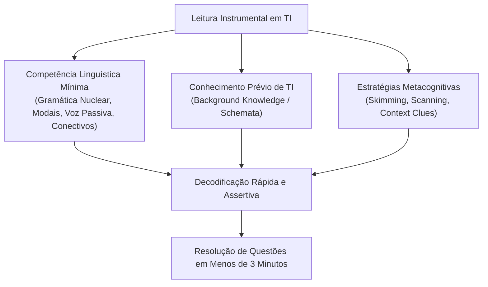
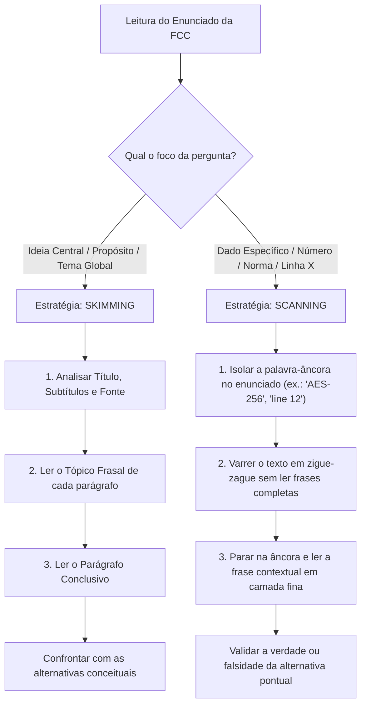
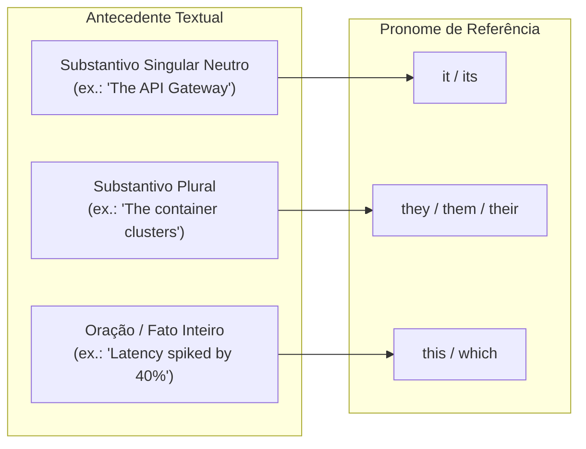

# 01 - Estratégias de Leitura Instrumental: Skimming, Scanning e Inferência

> **Matéria:** Língua Inglesa (Leitura Técnica)  
> **Cargo:** B02 – Técnico de Controle Externo – Especialidade: Tecnologia da Informação  
> **Arquivo:** `01_estrategias_de_leitura_skimming_scanning_e_inferencia.md`  

---

## 📌 Ementa / Itens do Edital
- Compreensão e interpretação de textos técnicos e científicos em língua inglesa
- Estratégias de leitura instrumental: Skimming (identificação da ideia principal)
- Estratégias de leitura instrumental: Scanning (localização de informações específicas)
- Predição, pistas tipográficas e inferência contextual de vocabulário
- Falsos amigos / Falsos cognatos (*False Friends / False Cognates*)

---

## 🧭 Sumário

1. [Fundamentos do Inglês Instrumental (English for Specific Purposes - ESP)](#1-fundamentos-do-ingles-instrumental-english-for-specific-purposes-esp)
    1. [Tripé de Competências Cognitivas](#11-tripe-de-competencias-cognitivas)
    2. [Fases do Processo de Leitura Técnica](#12-fases-do-processo-de-leitura-tecnica)
    3. [Teste 565](#Teste-565)
2. [Skimming: Leitura Rápida Panorâmica (Main Idea & Gist)](#2-skimming-leitura-rapida-panoramica-main-idea-gist)
    1. [Mecânica de Execução e Tópico Frasal](#21-mecanica-de-execucao-e-topico-frasal)
    2. [Identificação de Tipos de Questões FCC](#22-identificacao-de-tipos-de-questoes-fcc)
    3. [Teste 566](#Teste-566)
3. [Scanning: Leitura de Varredura Seletiva (Locating Specific Data)](#3-scanning-leitura-de-varredura-seletiva-locating-specific-data)
    1. [Mecânica de Execução e Pistas Tipográficas](#31-mecanica-de-execucao-e-pistas-tipograficas)
    2. [Matriz Comparativa: Skimming vs. Scanning](#32-matriz-comparativa-skimming-vs-scanning)
    3. [Teste 567](#Teste-567)
4. [Predição e Pistas Contextuais de Vocabulário (Context Clues)](#4-predicao-e-pistas-contextuais-de-vocabulario-context-clues)
    1. [Pistas de Definição, Paráfrase e Exemplificação](#41-pistas-de-definicao-parafrase-e-exemplificacao)
    2. [Pistas de Contraste, Oposição, Causa e Efeito](#42-pistas-de-contraste-oposicao-causa-e-efeito)
    3. [Decomposição Morfológica (Prefixos, Raízes e Sufixos)](#43-decomposicao-morfologica-prefixos-raizes-e-sufixos)
    4. [Vocabulário Crítico de Engenharia e Arquitetura de Software](#44-vocabulario-critico-de-engenharia-e-arquitetura-de-software)
    5. [Teste 568](#Teste-568)
    6. [Teste 569](#Teste-569)
    7. [Teste 570](#Teste-570)
5. [Falsos Cognatos Críticos em TI (False Friends)](#5-falsos-cognatos-criticos-em-ti-false-friends)
    1. [Cognatos Verdadeiros vs. Falsos Amigos](#51-cognatos-verdadeiros-vs-falsos-amigos)
    2. [Quadro Lexical de Falsos Cognatos Críticos](#52-quadro-lexical-de-falsos-cognatos-criticos)
    3. [Teste 571](#Teste-571)
    4. [Teste 572](#Teste-572)
6. [Coesão Textual e Referência Pronominal (Reference Words)](#6-coesao-textual-e-referencia-pronominal-reference-words)
    1. [Anáfora e Catáfora em Textos Técnicos](#61-anafora-e-catafora-em-textos-tecnicos)
    2. [Encapsulamento Conceitual com Demonstrativos](#62-encapsulamento-conceitual-com-demonstrativos)
    3. [Teste 573](#Teste-573)
    4. [Teste 574](#Teste-574)
6. [Fontes Recomendadas na Internet](#6-fontes-recomendadas-na-internet)

---

## 1. Fundamentos do Inglês Instrumental (English for Specific Purposes - ESP)

O **Inglês Instrumental** (*English for Specific Purposes - ESP*) rege-se pelo princípio da **utilidade pragmática**: o propósito do candidato ou técnico não é adquirir fluência de conversação, pronúncia nativa ou redação literária, mas sim a **decodificação rápida, crítica e exata** de textos técnicos especializados no domínio de Tecnologia da Informação.

Em certames públicos organizados pela Fundação Carlos Chagas (FCC) para cargos de Auditoria e Tecnologia de Controle Externo, o tempo médio disponível por questão gira em torno de 3 minutos. Candidatos que adotam a estratégia ingênua de tentar traduzir mentalmente o texto palavra por palavra (*word-by-word translation*) exaurem o tempo de prova, sobrecarregam a memória de trabalho e perdem a percepção da macroestrutura argumentativa do autor.

### 1.1 Tripé de Competências Cognitivas

A proficiência instrumental sólida decorre da integração sinérgica de três dimensões cognitivas:

1. **Competência Linguística Mínima (*Linguistic Competence*):** Domínio de estruturas morfossintáticas centrais (voz passiva abundante em relatórios técnicos, verbos modais que regulam graus de certeza e obrigatoriedade, ordem sintática modificador-núcleo e conectivos de coesão lógica).
2. **Esquemas Prévios de Conhecimento (*Background Knowledge / Schemata*):** O repertório técnico prévio do candidato (conceitos de bancos de dados, governança de TI, microsserviços, criptografia, redes, inteligência artificial) atua como um acelerador de compreensão. As lacunas no vocabulário em língua inglesa são compensadas e preenchidas pela familiaridade com o objeto computacional discutido.
3. **Estratégias Metacognitivas de Leitura (*Metacognitive Reading Strategies*):** Capacidade de monitorar conscientemente o ato de ler, selecionando dinamicamente entre *Skimming*, *Scanning*, *Prediction* e *Inferencing* conforme a demanda da banca avaliadora.

### 1.2 Fases do Processo de Leitura Técnica

Para maximizar a eficiência, a leitura técnica orientada a concurso estrutura-se em três etapas sequenciais:

- **Pré-leitura (*Pre-reading*):** Leitura prévia do enunciado e das alternativas da questão antes de examinar o corpo do texto. Observação rápida do título, subtítulos, autor, fonte bibliográfica e elementos não-verbais (tabelas, figuras, trechos de código).
- **Leitura Atenta / Focada (*While-reading*):** Aplicação de *skimming* para localização da ideia central ou de *scanning* para rastreamento cirúrgico de evidências pontuais.
- **Pós-leitura (*Post-reading*):** Confrontação das evidências colhidas no texto com as asserções de cada alternativa de A a E, desmascarando distorções, generalizações indevidas e falsos cognatos.

---

### Teste 565
**(FGV – TCE/PA – 2024 – Auditor de Controle Externo - Administrativa - Gestão Governamental)**
As frases abaixo mostram uma comparação. Assinale a opção em que a comparação não é explicada.

* **A)** Ideias são como crianças. As nossas são sempre maravilhosas.
* **B)** As bibliotecas são como as farmácias: muitos venenos e poucos remédios.
* **C)** A leitura, como a comida, não alimenta se não digerida.
* **D)** Os discursos são como as orações copiadas dos textos religiosos.
* **E)** Os talheres são como o papel higiênico: só ficam limpos se não forem usados.

---

> **Comentário Detalhado:**
>
> - **A)** **Incorreta.** A opção promove generalização excessiva que desconsidera as condições técnicas e normativas ao afirmar que "Ideias são como crianças. As nossas são sempre maravilhosas". De acordo com a teoria estudada em *6.1 Anáfora e Catáfora em Textos Técnicos*, referência Anafórica (*Anaphora*): O pronome retoma um termo ou ideia explicitado anteriormente no fluxo textual.
> - **B)** **Incorreta.** A opção apresenta proposição em desacordo com os fundamentos teóricos e técnicos do tópico ao afirmar que "As bibliotecas são como as farmácias: muitos venenos e poucos remédios". De acordo com a teoria estudada em *6.1 Anáfora e Catáfora em Textos Técnicos*, regras Estritas de Concordância Primitiva.
> - **C)** **Incorreta.** A opção apresenta proposição em desacordo com os fundamentos teóricos e técnicos do tópico ao afirmar que "A leitura, como a comida, não alimenta se não digerida". De acordo com a teoria estudada em *1.1 Tripé de Competências Cognitivas*, estratégias Metacognitivas de Leitura (*Metacognitive Reading Strategies*): Capacidade de monitorar conscientemente o ato de ler, selecionando dinamicamente entre *Skimming*, *Scanning*, *Prediction* e *Inferencing* conforme a demanda da banca avaliadora.
> - **D)** **Correta.** Conforme fundamentado na seção *1. Fundamentos do Inglês Instrumental (English for Specific Purposes - ESP)* deste guia, o Inglês Instrumental (*English for Specific Purposes - ESP*) rege-se pelo princípio da utilidade pragmática: o propósito do candidato ou técnico não é adquirir fluência de conversação, pronúncia nativa ou redação literária, mas sim a decodificação rápida, crítica e exata de textos técnicos especializados no domínio de Tecnologia da Informação. Dessa forma, está plenamente correta a assertiva da banca (FGV – TCE/PA/2024) ao estabelecer que "Os discursos são como as orações copiadas dos textos religiosos".
> - **E)** **Incorreta.** A opção apresenta proposição em desacordo com os fundamentos teóricos e técnicos do tópico ao afirmar que "Os talheres são como o papel higiênico: só ficam limpos se não forem usados". De acordo com a teoria estudada em *6.1 Anáfora e Catáfora em Textos Técnicos*, it / Its: Retoma substantivos neutros singulares (um protocolo, um sistema, um servidor, um vetor de ataque).
>
> **Gabarito: D**

---

## 2. Skimming: Leitura Rápida Panorâmica (Main Idea & Gist)

O **Skimming** (derivado do verbo *to skim*, "desnatar", retirar a camada superior) consiste em uma leitura acelerada e panorâmica com o objetivo precípuo de **captar a ideia principal (*gist / main idea*), o tema global, o tom e a arquitetura macrotextual**, sem deter-se em pormenores secundários, dados numéricos isolados ou termos desconhecidos.

### 2.1 Mecânica de Execução e Tópico Frasal

1. **Inspeção de Cabeçalho e Metadados:** Ler com atenção o título (*title*), subtítulos (*headings*), notas de rodapé e a referência bibliográfica (veículo como IEEE, ACM, Gartner, NIST, data de publicação).
2. **Priorização do Tópico Frasal (*Topic Sentence*):** Na literatura técnica e acadêmica formal em língua inglesa, a primeira ou a segunda oração de cada parágrafo sintetiza a proposição nuclear que será desenvolvida no restante do parágrafo. Concentrar o foco no início dos parágrafos proporciona um mapa conceitual imediato de todo o texto.
3. **Leitura da Sentença Conclusiva (*Concluding Sentence*):** A última oração do parágrafo frequentemente sintetiza a dedução obtida ou fornece o gancho lógico (*bridge*) para a seção subsequente.
4. **Leitura Aprofundada do Último Parágrafo:** No parágrafo final, os autores habitualmente condensam suas conclusões, recomendações práticas ou implicações (*findings, concluding remarks, takeaways*).
5. **Cadência Visual:** A velocidade recomendada para o *skimming* varia entre 600 e 800 palavras por minuto, o que representa uma velocidade 3 a 4 vezes superior à leitura analítica linear.

### 2.2 Identificação de Tipos de Questões FCC

A FCC recorre frequentemente a comandos que demandam exclusivamente a aplicação de *Skimming*:

- *"The main purpose of the text is to.."* (O objetivo central do texto é..)
- *"Which of the following statements best expresses the primary argument of the author?"* (Qual afirmação melhor resume a tese primordial do autor?)
- *"The central theme discussed in the passage revolves around.."* (O tema central discutido no texto gira em torno de..)
- *"The overall tone of the author can be characterized as.."* (O tom do autor pode ser classificado como neutro, analítico, prescritivo, cético ou laudatório).

> 💡 **Dica de Prova FCC:**  
> Ao resolver questões de ideia principal (*Skimming*), elimine imediatamente alternativas que apresentem fatos verdadeiros contidos no texto, mas que se refiram a detalhes secundários ou exemplos pontuais de um único parágrafo. Uma ideia central deve cobrir a totalidade do texto, e não um aspecto isolado.

---

### Teste 566
**(FCC – TRT 16ª – 2014 – Analista Judiciário - Tecnologia da Informação)**
Quanto à pontuação, a frase inteiramente correta é:

* **A)** Já pela má fama adquirida já por preconceito, sem- pre haverá por parte de certos leitores, alguma relu- tância diante da leitura de um prefácio.
* **B)** O autor do texto não hesita honestamente, de re- correr a experiências pessoais, para demonstrar sua tese, favorável em boa parte à existência mesma dos prefácios.
* **C)** A escritora Cecília Meireles tão talentosa quanto bo- nita, é citada no texto como parâmetro de excelên- cia, na comparação com uma jovem, bela e pouco inspirada poetisa.
* **D)** Muita gente acabará por confessar tal como fez o autor, que um prefácio pode prender nossa atenção, com muito mais força, do que o texto principal de uma obra.
* **E)** O autor conclui, não sem razão, que as bibliografias que indicam apenas o prefácio de uma obra per- mitem deduzir, não há dúvida, que o restante do li- pírito das leis, obra clássica do filósofo francês Montesquieu, publicada em 1748. [Do espírito das leis] Falta muito para que o mundo inteligente seja tão bem governado quanto o mundo físico, pois ainda que o mundo inteligente possua também leis que por sua natureza são invariáveis, não as segue constantemente como o mundo físico segue as suas. A razão disso reside no fato de estarem os seres particulares inteligentes limitados por sua natureza e, consequentemente, sujeitos a erro; e, por outro lado, é próprio de sua natureza agirem por si mesmos. (...) O homem, como ser físico, tal como os outros corpos da natureza, é governado por leis invariáveis. Como ser inteligente, _________________________________________________________ viola incessantemente as leis que Deus estabeleceu e modifica as que ele próprio estabeleceu. Tal ser poderia, a todo instante, esquecer seu criador − Deus, pelas leis da religião, chamou-o a si; um tal ser poderia, a todo instante, esquecer-se de si mesmo − os filósofos advertiram-no pelas leis da moral. (Montesquieu − Os Pensadores. São Paulo: Abril Cultural, 1973, p. 33 e 34)

---

> **Comentário Detalhado:**
>
> - **A)** **Incorreta.** A opção apresenta proposição em desacordo com os fundamentos teóricos e técnicos do tópico ao afirmar que "Já pela má fama adquirida já por preconceito, sem- pre haverá por parte de certos leitores, alguma relu- tância...". De acordo com a teoria estudada em *1.2 Fases do Processo de Leitura Técnica*, pré-leitura (*Pre-reading*): Leitura prévia do enunciado e das alternativas da questão antes de examinar o corpo do texto. Observação rápida do título, subtítulos, autor, fonte bibliográfica e elementos não-verbais (tabelas, figuras, trechos de código).
> - **B)** **Incorreta.** A opção apresenta proposição em desacordo com os fundamentos teóricos e técnicos do tópico ao afirmar que "O autor do texto não hesita honestamente, de re- correr a experiências pessoais, para demonstrar sua tese...". De acordo com a teoria estudada em *2.2 Identificação de Tipos de Questões FCC*, *"Which of the following statements best expresses the primary argument of the author?"* (Qual afirmação melhor resume a tese primordial do autor?).
> - **C)** **Incorreta.** A opção apresenta proposição em desacordo com os fundamentos teóricos e técnicos do tópico ao afirmar que "A escritora Cecília Meireles tão talentosa quanto bo- nita, é citada no texto como parâmetro de excelên- cia, na...". De acordo com a teoria estudada em *4.1 Pistas de Definição, Paráfrase e Exemplificação*, definição Direta e Paráfrase (*Definition / Restatement Clues*): O próprio texto elucida o termo desconhecido na sequência, frequentemente isolado por vírgulas, travessões, parênteses ou conjunções explicativas (*that is, in other words, known as, which means, defined as, namely*).
> - **D)** **Incorreta.** A opção apresenta proposição em desacordo com os fundamentos teóricos e técnicos do tópico ao afirmar que "Muita gente acabará por confessar tal como fez o autor, que um prefácio pode prender nossa atenção, com muito mais...". De acordo com a teoria estudada em *2.2 Identificação de Tipos de Questões FCC*, ao resolver questões de ideia principal (*Skimming*), elimine imediatamente alternativas que apresentem fatos verdadeiros contidos no texto, mas que se refiram a detalhes secundários ou exemplos pontuais de um único parágrafo.
> - **E)** **Correta.** Conforme fundamentado na seção *2.2 Identificação de Tipos de Questões FCC* deste guia, *"The overall tone of the author can be characterized as.."* (O tom do autor pode ser classificado como neutro, analítico, prescritivo, cético ou laudatório). Dessa forma, está plenamente correta a assertiva da banca (FCC – TRT 16ª/2014) ao estabelecer que "O autor conclui, não sem razão, que as bibliografias que indicam apenas o prefácio de uma obra per- mitem deduzir...".
>
> **Gabarito: E**

---

## 3. Scanning: Leitura de Varredura Seletiva (Locating Specific Data)

O **Scanning** (análogo à operação de busca de um comando `grep` ou ao feixe de um leitor óptico) é a estratégia não-linear de leitura orientada à **localização instantânea de uma informação específica pontual**, dispensando por completo a leitura integral do texto.

### 3.1 Mecânica de Execução e Pistas Tipográficas

1. **Definição da Âncora no Enunciado:** Antes de olhar para o texto, o candidato identifica o termo-chave (*anchor word / keyword*) no comando da questão ou nas alternativas (por exemplo: um número de norma ISO/IEC, um percentual de redução, o nome de um algoritmo, uma porta de comunicação, um autor ou uma linha indicada).
2. **Mapeamento do Padrão Gráfico:**
    - **Numéricos e Temporais:** Algarismos arábicos (`2024`, `99.99%`, `128-bit`, `500 ms`).
    - **Nomes Próprios e Acrônimos:** Grafia em caixa alta ou siglas conhecidas (`NIST`, `OAuth 2.0`, `PostgreSQL`, `Kubernetes`).
    - **Termos de Sintaxe / TI:** Palavras grafadas em itálico, com formatação monotipada ou entre aspas (`idempotent`, `deadlock`, `mutex`).

3. **Varredura Ocular Não-Linear:** Percorrer os olhos rapidamente em zigue-zague ou verticalmente pela página, inibindo qualquer subvocalização. Tudo o que não coincide com a âncora gráfica é visualmente descartado.
4. **Foco Cirúrgico Local:** Ao identificar visualmente a âncora, interromper a varredura e realizar uma leitura analítica rigorosa apenas da oração que contém o termo, bem como da oração imediatamente anterior e posterior.

### 3.2 Matriz Comparativa: Skimming vs. Scanning

| Critério de Comparação | *Skimming* (Leitura Panorâmica) | *Scanning* (Varredura Seletiva) |
| :--- | :--- | :--- |
| **Objetivo Central** | Captar a ideia geral (*gist*), o tema primordial e o tom argumentativo | Localizar uma evidência específica e pontual (fato, dado numérico, protocolo) |
| **Ponto de Partida** | Inicia no topo do texto, percorrendo as seções estruturantes | Inicia **no enunciado da questão**, definindo a âncora antes de ir ao texto |
| **Modo de Varredura** | Linear seletivo (lê os tópicos frasais de cima para baixo) | Totalmente não-linear (olhos movem-se em zigue-zague buscando o padrão gráfico) |
| **Velocidade** | Acelerada (600 a 800 palavras por minuto) | Instantânea (tempo estritamente necessário para localizar a âncora) |
| **Comandos Típicos FCC** | *"The main purpose is..", "The author primarily argues.."* | *"According to paragraph 2..", "The latency threshold in 2025 was.."* |

---

### Teste 567
**(FCC – TRT 3ª – 2015 – Analista Judiciário - Tecnologia da Informação)**
Compreende-se corretamente do texto: O autor

* **A)** defende a ideia de que jornais instigantes são os que contam com um leitor crítico e atualizado, disposto a preencher as involuntárias lacunas das matérias veiculadas.
* **B)** atribui interpretações grosseiras de notícias e o desejo de enxergar a não-notícia à prática constante de analisá-las sob perspectiva cética, resultado de juízo crítico muito aguçado e resistente à distensão.
* **C)** considera a leitura de jornais um exercício divertido sempre que a matéria se dispõe a adivinhações, desvendamentos relacionados tanto à construção do texto, quanto aos fatos reais que a teriam inspirado.
* **D)** mostra que matérias jornalísticas informam não só pelo que explicitamente comunicam, mas também pelo que evitam comunicar; esse modo de noticiar, em sua concretude, permite o desvendamento de propósitos de autores e editores.
* **E)** expõe a ambiguidade que a imprensa pode manifestar quando é imprecisa no trato do assunto, falta de precisão originada por "palavras cruzadas", isto é, intrincadas conexões na estrutura verbal.

---

> **Comentário Detalhado:**
>
> - **A)** **Incorreta.** A opção apresenta proposição em desacordo com os fundamentos teóricos e técnicos do tópico ao afirmar que "defende a ideia de que jornais instigantes são os que contam com um leitor crítico e atualizado, disposto a...". De acordo com a teoria estudada em *3. Scanning: Leitura de Varredura Seletiva (Locating Specific Data)*, o Scanning (análogo à operação de busca de um comando `grep` ou ao feixe de um leitor óptico) é a estratégia não-linear de leitura orientada à localização instantânea de uma informação específica pontual, dispensando por completo a leitura integral do texto.
> - **B)** **Incorreta.** A opção apresenta proposição em desacordo com os fundamentos teóricos e técnicos do tópico ao afirmar que "atribui interpretações grosseiras de notícias e o desejo de enxergar a não-notícia à prática constante de...". De acordo com a teoria estudada em *4.2 Pistas de Contraste, Oposição, Causa e Efeito*, causa e Efeito (*Cause and Effect Clues*): A relação de causalidade expressa por *because, since, as a result, consequently, thereby, thus, leading to* permite inferir o significado a partir do resultado prático.
> - **C)** **Incorreta.** A opção promove generalização excessiva que desconsidera as condições técnicas e normativas ao afirmar que "considera a leitura de jornais um exercício divertido sempre que a matéria se dispõe a adivinhações...". De acordo com a teoria estudada em *2.2 Identificação de Tipos de Questões FCC*, ao resolver questões de ideia principal (*Skimming*), elimine imediatamente alternativas que apresentem fatos verdadeiros contidos no texto, mas que se refiram a detalhes secundários ou exemplos pontuais de um único parágrafo.
> - **D)** **Correta.** Conforme fundamentado na seção *3.2 Matriz Comparativa: Skimming vs. Scanning* deste guia, modo de Varredura: Linear seletivo (lê os tópicos frasais de cima para baixo) — Totalmente não-linear (olhos movem-se em zigue-zague buscando o padrão gráfico). Dessa forma, está plenamente correta a assertiva da banca (FCC – TRT 3ª/2015) ao estabelecer que "mostra que matérias jornalísticas informam não só pelo que explicitamente comunicam, mas também pelo que evitam...".
> - **E)** **Incorreta.** A opção apresenta proposição em desacordo com os fundamentos teóricos e técnicos do tópico ao afirmar que "expõe a ambiguidade que a imprensa pode manifestar quando é imprecisa no trato do assunto, falta de precisão...". De acordo com a teoria estudada em *2.2 Identificação de Tipos de Questões FCC*, *"The overall tone of the author can be characterized as.."* (O tom do autor pode ser classificado como neutro, analítico, prescritivo, cético ou laudatório).
>
> **Gabarito: D**

---

## 4. Predição e Pistas Contextuais de Vocabulário (Context Clues)

Em certames da FCC para a área de TI, é praxe a inclusão de vocabulário técnico rebuscado, jargões emergentes ou termos polissêmicos. O candidato não precisa conhecer previamente todos os verbetes da língua inglesa; precisa, sim, saber utilizar as **pistas contextuais (*Context Clues*)** para deduzir o significado exato de palavras desconhecidas diretamente da oração em que figuram.

### 4.1 Pistas de Definição, Paráfrase e Exemplificação

- **Definição Direta e Paráfrase (*Definition / Restatement Clues*):** O próprio texto elucida o termo desconhecido na sequência, frequentemente isolado por vírgulas, travessões, parênteses ou conjunções explicativas (*that is, in other words, known as, which means, defined as, namely*).
    - *Exemplo:* *"The distributed service implements an **idempotent** operation—**that is, an action that can be executed multiple times without altering the outcome beyond the initial invocation**—thereby preventing accidental billing duplicates."*  
    $\rightarrow$ A definição formal está dada entre travessões: operação repetível que não altera o estado do sistema além da primeira execução.
- **Exemplificação (*Example Clues*):** O sentido de uma categoria complexa ou abstrata é revelado pela enumeração de exemplos concretos introduzidos por marcadores como *such as, for instance, for example, e.g., including*.
    - *Exemplo:* *"The migration revealed several **ephemeral** storage configurations, **such as temporary in-memory caches and non-persistent container volumes**, that caused data loss upon reboot."*  
    $\rightarrow$ Os exemplos práticos (*temporary, non-persistent*) revelam com precisão que *ephemeral* significa volátil, transitório ou efêmero.

### 4.2 Pistas de Contraste, Oposição, Causa e Efeito

- **Contraste e Antônimos (*Contrast / Antonym Clues*):** O termo opõe-se a uma ideia conhecida por meio de conectivos adversativos ou concessivos (*unlike, whereas, while, in contrast to, instead of, on the contrary, but, however*).
    - *Exemplo:* *"**Unlike** legacy monolithic repositories that are completely **intertwined**, modern cloud applications are composed of **loosely coupled**, independent microservices."*  
    $\rightarrow$ Se os microsserviços são *loosely coupled* (fracamente acoplados / independentes), o conectivo *Unlike* explicita que os monólitos *intertwined* são fortemente entrelaçados ou acoplados.
- **Causa e Efeito (*Cause and Effect Clues*):** A relação de causalidade expressa por *because, since, as a result, consequently, thereby, thus, leading to* permite inferir o significado a partir do resultado prático.
    - *Exemplo:* *"Because the automated script lacked input validation, it allowed arbitrary SQL injection, **leading to catastrophic** data corruption."*  
    $\rightarrow$ A consequência danosa clarifica o teor destrutivo de *catastrophic*.

### 4.3 Decomposição Morfológica (Prefixos, Raízes e Sufixos)

A morfologia vocabular permite dissecar o verbete técnico desconhecido:

- **Prefixos de Negação e Reversão:** *un-* (*unpatched*, não corrigido), *in-/im-* (*immutable*, imutável), *dis-* (*disrupt*, interromper/desestruturar), *mis-* (*misconfiguration*, erro de configuração).
- **Prefixos de Tempo e Escala:** *pre-* (*pre-computation*), *post-* (*postmortem analysis*), *micro-* (*microsegmentation*), *hyper-* (*hypervisor*).
- **Sufixos Gramaticais:**
    - Substantivos: *-tion* (*authentication*), *-ment* (*deployment*), *-ity* (*scalability*), *-ness* (*responsiveness*).
    - Adjetivos: *-able/-ible* (*scalable*, *accessible*), *-ive* (*predictive*), *-al* (*procedural*).
    - Advérbios: *-ly* (*continually*, *actually*).

### 4.4 Vocabulário Crítico de Engenharia e Arquitetura de Software

Determinados termos técnicos de língua inglesa possuem acepções altamente especializadas frequentemente cobradas em provas da FCC:

- **Bottleneck (Gargalo):** Ponto de estrangulamento em uma cadeia de processamento ou infraestrutura de rede que limita a vazão (*throughput*) e o desempenho global do sistema.  
  > ⚠️ **Alerta FCC:** A banca tenta afirmar que *bottleneck* é um facilitador ou acelerador de velocidade. Trata-se de uma restrição/obstáculo de desempenho!
- **Trade-off (Relação de Compromisso / Perda e Ganho):** Decisão de projeto em que a obtenção de um benefício (ex.: agilidade de entrega, escalabilidade) acarreta necessariamente uma contrapartida desfavorável ou custo operacional adicional (ex.: complexidade distribuída, latência de rede).
- **Remediate (Sanar / Remediar / Mitigar):** Ato de aplicar contramedidas técnicas, correções e restaurações em um ambiente violado ou defeituoso para devolvê-lo ao estado seguro e operacional. Não significa "tolerar passivamente".
- **Compromise (Violar a Segurança / Invadir):** Em cibersegurança, *to compromise a system* significa violar sua integridade, confidencialidade ou controle de acesso. Não significa "fazer um acordo amigável" ou "ter um compromisso na agenda".
- **Novel (Inovador / Inédito / Original):** Quando empregado como adjetivo (*a novel approach*), significa inovador, novo ou original. Não significa "novela" de televisão ou literatura romântica.
- **Sensible vs. Sensitive:**  
    - *Sensible:* Sensato, criterioso, razoável, prudente (*a sensible decision*).  
    - *Sensitive:* Sensível, delicado, confidencial (*sensitive data*, dados sensíveis sob a LGPD).

---

### Teste 568
**(FGV – TCE/PA – 2024 – Auditor de Controle Externo - Administrativa - Engenharia Telecomunicação)**
As técnicas de acesso são essenciais na telefonia celular, permitindo a transmissão simultânea de múltiplos sinais de diferentes usuários por meio de um único meio de transmissão. A principal questão é como combinar esses sinais para transmissão no mesmo meio e separá-los na recepção, de modo a recuperar corretamente as informações individuais de cada usuário. Analise as seguintes afirmativas sobre as técnicas de acesso: I. FDMA: Os sinais de cada canal são transmitidos usando diferentes frequências e em diferentes intervalos de tempo distintos. O objetivo de utilizar diferentes frequências e intervalos de tempo é reduzir a interferência entre símbolos. II. TDMA: Vários canais compartilham a mesma portadora, sendo que cada portadora é utilizada em intervalos de tempo distintos, cada uma correspondendo a um canal de usuário. III. CDMA: Usuários se comunicam usando as mesmas frequências simultaneamente, separados por códigos ortogonais, permitindo que todos transmitam simultaneamente numa mesma banda de frequências. Está correto o que se afirma em

* **A)** I, apenas.
* **B)** I e II, apenas.
* **C)** I e III, apenas.
* **D)** II e III, apenas.
* **E)** I, II e III.

---

> **Comentário Detalhado:**
>
> - **A)** **Incorreta.** A opção incorre em restrição indevida ao limitar o escopo conceitual ao afirmar que "I, apenas". De acordo com a teoria estudada em *2.2 Identificação de Tipos de Questões FCC*, ao resolver questões de ideia principal (*Skimming*), elimine imediatamente alternativas que apresentem fatos verdadeiros contidos no texto, mas que se refiram a detalhes secundários ou exemplos pontuais de um único parágrafo.
> - **B)** **Incorreta.** A opção incorre em restrição indevida ao limitar o escopo conceitual ao afirmar que "I e II, apenas". De acordo com a teoria estudada em *2. Skimming: Leitura Rápida Panorâmica (Main Idea & Gist)*, o Skimming (derivado do verbo *to skim*, "desnatar", retirar a camada superior) consiste em uma leitura acelerada e panorâmica com o objetivo precípuo de captar a ideia principal (*gist / main idea*), o tema global, o tom e a arquitetura macrotextual, sem deter-se em pormenores secundários, dados numéricos isolados ou termos desconhecidos.
> - **C)** **Incorreta.** A opção incorre em restrição indevida ao limitar o escopo conceitual ao afirmar que "I e III, apenas". De acordo com a teoria estudada em *4. Predição e Pistas Contextuais de Vocabulário (Context Clues)*, o candidato não precisa conhecer previamente todos os verbetes da língua inglesa; precisa, sim, saber utilizar as pistas contextuais (*Context Clues*) para deduzir o significado exato de palavras desconhecidas diretamente da oração em que figuram.
> - **D)** **Correta.** Conforme fundamentado na seção *5.1 Cognatos Verdadeiros vs. Falsos Amigos* deste guia, os Cognatos Verdadeiros (*True Cognates*) são termos que compartilham a mesma etimologia e significado em português e inglês (ex.: *computation, memory, protocol, infrastructure, terminal, vulnerability*). Dessa forma, está plenamente correta a assertiva da banca (FGV – TCE/PA/2024) ao estabelecer que "II e III, apenas".
> - **E)** **Incorreta.** A opção apresenta proposição em desacordo com os fundamentos teóricos e técnicos do tópico ao afirmar que "I, II e III". De acordo com a teoria estudada em *4.2 Pistas de Contraste, Oposição, Causa e Efeito*, contraste e Antônimos (*Contrast / Antonym Clues*): O termo opõe-se a uma ideia conhecida por meio de conectivos adversativos ou concessivos (*unlike, whereas, while, in contrast to, instead of, on the contrary, but, however*).
>
> **Gabarito: D**

---

### Teste 569
**(FGV – TCE/GO – 2024 – Analista de Controle Externo - Ciências Contábeis)**
Assinale a opção em que a preposição A – sozinha ou combinada - tem valor semântico diferente dos demais.

* **A)** O Presidente, com sua mulher, acompanhou os convidados à sala de música.
* **B)** O policial atirou-se ao chão, cobrindo a cabeça com as mãos.
* **C)** O ministro deverá ir a São Paulo ainda hoje para a recepção dos novos diplomatas.
* **D)** Os seguranças dirigiram-se aos carros dos ministros e os acompanharam no desfile.
* **E)** O banqueiro é sócio do empresário em um hotel à Rua Santa Clara, em Copacabana. Língua Inglesa READ THE TEXT AND ANSWER QUESTIONS 01 to 08: Artificial intelligence and the future of humanity Thinking and learning about artificial intelligence are the mental equivalent of a fission chain reaction. The questions get really big, really quickly. The most familiar concerns revolve around short-term impacts: the opportunities for economic productivity, health care, manufacturing, education, solving global challenges such as climate change and, on the flip side, the risks of mass unemployment, disinformation, killer robots, and concentrations of economic and strategic power. Each of these is critical, but they’re only the most immediate considerations. The deeper issue is our capacity to live meaningful, fulfilling lives in a world in which we no longer have intelligence supremacy. As long as humanity has existed, we’ve had an effective monopoly on intelligence. We have been, as far as we know, the smartest entities in the universe. At its most noble, this extraordinary gift of our evolution drives us to explore, discover and expand. Over the past roughly 50,000 years—accelerating 10,000 years ago and then even more steeply from around 300 years ago—we’ve built a vast intellectual empire made up of science, philosophy, theology, engineering, storytelling, art, technology and culture. If our civilisations—and in varying ways our individual lives—have meaning, it is found in this constant exploration, discovery and intellectual expansion. Intelligence is the raw material for it all. But what happens when we’re no longer the smartest beings in the universe? We haven’t yet achieved artificial general intelligence (AGI)—the term for an AI that could do anything we can do. But there’s no barrier in principle to doing so, and no reason it wouldn’t quickly outstrip us by orders of magnitude. Even if we solve the economic equality questions through something like a universal basic income and replace notions of ‘paid work’ with ‘meaningful activity’, how are we going to spend our lives in ways that we find meaningful, given that we’ve evolved to strive and thrive and compete? Adapted from https://www.aspistrategist.org.au/artificial- intelligence-and-the-future-of-humanity/

---

> **Comentário Detalhado:**
>
> - **A)** **Incorreta.** A opção apresenta proposição em desacordo com os fundamentos teóricos e técnicos do tópico ao afirmar que "O Presidente, com sua mulher, acompanhou os convidados à sala de música". De acordo com a teoria estudada em *5.2 Quadro Lexical de Falsos Cognatos Críticos*, realize: Perceber, dar-se conta; concretizar/tornar real — Realizar (fazer uma tarefa ordinária) — *Perform, execute, conduct* — *"The incident response team did not realize that the token had expired."*.
> - **B)** **Incorreta.** A opção apresenta proposição em desacordo com os fundamentos teóricos e técnicos do tópico ao afirmar que "O policial atirou-se ao chão, cobrindo a cabeça com as mãos". De acordo com a teoria estudada em *4.1 Pistas de Definição, Paráfrase e Exemplificação*, *Exemplo:* *"The distributed service implements an idempotent operation—that is, an action that can be executed multiple times without altering the outcome beyond the initial invocation—thereby preventing accidental billing duplicates."*.
> - **C)** **Incorreta.** A opção apresenta proposição em desacordo com os fundamentos teóricos e técnicos do tópico ao afirmar que "O ministro deverá ir a São Paulo ainda hoje para a recepção dos novos diplomatas". De acordo com a teoria estudada em *4.2 Pistas de Contraste, Oposição, Causa e Efeito*, *Exemplo:* *"Unlike legacy monolithic repositories that are completely intertwined, modern cloud applications are composed of loosely coupled, independent microservices."*.
> - **D)** **Incorreta.** A opção apresenta proposição em desacordo com os fundamentos teóricos e técnicos do tópico ao afirmar que "Os seguranças dirigiram-se aos carros dos ministros e os acompanharam no desfile". De acordo com a teoria estudada em *4. Predição e Pistas Contextuais de Vocabulário (Context Clues)*, o candidato não precisa conhecer previamente todos os verbetes da língua inglesa; precisa, sim, saber utilizar as pistas contextuais (*Context Clues*) para deduzir o significado exato de palavras desconhecidas diretamente da oração em que figuram.
> - **E)** **Correta.** Conforme fundamentado na seção *4.1 Pistas de Definição, Paráfrase e Exemplificação* deste guia, *Exemplo:* *"The migration revealed several ephemeral storage configurations, such as temporary in-memory caches and non-persistent container volumes, that caused data loss upon reboot."*. Dessa forma, está plenamente correta a assertiva da banca (FGV – TCE/GO/2024) ao estabelecer que "O banqueiro é sócio do empresário em um hotel à Rua Santa Clara, em Copacabana. Língua Inglesa READ THE TEXT AND...".
>
> **Gabarito: E**

---

### Teste 570
**(FCC – TRT 23ª – 2016 – Analista Judiciário - Apoio Especializado - Tecnologia da Informação)**
A disponibilização de informações referentes a web services pode ser feita utilizando especificações que usam um modelo centralizado ou um modelo distribuído. A especificação que utiliza um modelo completamente distribuído, de forma que as descrições dos serviços possam ser armazenadas em qualquer localização, e os pedidos para se obter tais informações possam ser processados junto às entidades que prestam tais serviços, é conhecida como

* **A)** Representational State Transfer − REST.
* **B)** Web Services Description Language − WSDL.
* **C)** Universal Description Discovery and Integration − UDDI.
* **D)** Web Services Interoperability − WS-I.
* **E)** Web Services Inspection Language − WSIL.

---

> **Comentário Detalhado:**
>
> - **A)** **Incorreta.** A opção apresenta proposição em desacordo com os fundamentos teóricos e técnicos do tópico ao afirmar que "Representational State Transfer − REST". De acordo com a teoria estudada em *5.2 Quadro Lexical de Falsos Cognatos Críticos*, require: Exigir, demandar, ser mandatório — Requerer juridicamente em juízo — *Request, petition, file a motion* — *"Strict data privacy regulations require encryption of data at rest."*.
> - **B)** **Incorreta.** A opção apresenta proposição em desacordo com os fundamentos teóricos e técnicos do tópico ao afirmar que "Web Services Description Language − WSDL". De acordo com a teoria estudada em *2.2 Identificação de Tipos de Questões FCC*, *"The overall tone of the author can be characterized as.."* (O tom do autor pode ser classificado como neutro, analítico, prescritivo, cético ou laudatório).
> - **C)** **Incorreta.** A opção apresenta proposição em desacordo com os fundamentos teóricos e técnicos do tópico ao afirmar que "Universal Description Discovery and Integration − UDDI". De acordo com a teoria estudada em *4.1 Pistas de Definição, Paráfrase e Exemplificação*, *Exemplo:* *"The migration revealed several ephemeral storage configurations, such as temporary in-memory caches and non-persistent container volumes, that caused data loss upon reboot."*.
> - **D)** **Incorreta.** A opção apresenta proposição em desacordo com os fundamentos teóricos e técnicos do tópico ao afirmar que "Web Services Interoperability − WS-I". De acordo com a teoria estudada em *4.2 Pistas de Contraste, Oposição, Causa e Efeito*, contraste e Antônimos (*Contrast / Antonym Clues*): O termo opõe-se a uma ideia conhecida por meio de conectivos adversativos ou concessivos (*unlike, whereas, while, in contrast to, instead of, on the contrary, but, however*).
> - **E)** **Correta.** Conforme fundamentado na seção *5.2 Quadro Lexical de Falsos Cognatos Críticos* deste guia, a pegadinha com "Eventually" é recorrente na FCC. Em arquitetura de software distribuído, o teorema CAP e o modelo BASE definem a consistência eventual (*eventual consistency*). Dessa forma, está plenamente correta a assertiva da banca (FCC – TRT 23ª/2016) ao estabelecer que "Web Services Inspection Language − WSIL".
>
> **Gabarito: E**

---

## 5. Falsos Cognatos Críticos em TI (False Friends)

### 5.1 Cognatos Verdadeiros vs. Falsos Amigos

Os **Cognatos Verdadeiros (*True Cognates*)** são termos que compartilham a mesma etimologia e significado em português e inglês (ex.: *computation, memory, protocol, infrastructure, terminal, vulnerability*).

Já os **Falsos Cognatos (*False Friends / False Cognates*)** possuem grafia e pronúncia que lembram palavras do português, mas carregam significados semânticos completamente distintos. A banca FCC utiliza reiteradamente esses vocábulos nas alternativas erradas para capturar candidatos desatentos.

### 5.2 Quadro Lexical de Falsos Cognatos Críticos

| Termo em Inglês | Significado Real no Contexto Técnico | Falsa Tradução (Pegadinha FCC) | Tradução Correta para a Pegadinha | Exemplo Prático em TI |
| :--- | :--- | :--- | :--- | :--- |
| **Actually** | Na verdade, de fato, realmente, efetivamente | Atualmente, nos dias de hoje | *Currently, nowadays, presently* | *"The benchmark **actually** revealed a 30% reduction in query execution time."* |
| **Eventually** | No final das contas, por fim, com o passar do tempo | Eventualmente, de vez em quando, esporadicamente | *Occasionally, intermittently, sporadically* | *"In distributed NoSQL systems, replicas **eventually** achieve full data consistency."* |
| **Pretend** | Fingir, simular, aparentar falsamente | Pretender, ter a intenção de | *Intend, aim to, plan to* | *"The malicious packet **pretended** to originate from an internal gateway."* |
| **Policy** | Política institucional, diretriz de segurança, norma | Polícia (órgão de segurança pública) | *Police* | *"The IAM access **policy** enforces multifactor authentication for all admins."* |
| **Notice** | Notar, perceber; aviso formal, notificação | Notícia jornalística | *News* | *"The automated monitor triggers an alert upon **notice** of thread starvation."* |
| **Push** | Empurrar, enviar para frente / publicar | Puxar (trazer em sua direção) | *Pull* | *"Developers **push** code to the remote repository; servers **pull** configurations."* |
| **Comprehensive** | Abrangente, amplo, exaustivo, minucioso | Compreensivo, tolerante, benevolente | *Understanding, tolerant* | *"The auditors conducted a **comprehensive** review of the cryptographic source code."* |
| **Library** | Biblioteca de código ou de obras bibliográficas | Livraria (loja comercial de livros) | *Bookstore* | *"Developers imported an open-source SSL **library** into the microservice."* |
| **Resume** | Retomar, reiniciar após interrupção | Resumo, síntese condensada | *Summary, abstract* (Nota: *résumé* é currículo) | *"The replication process will **resume** as soon as network connectivity is restored."* |
| **Require** | Exigir, demandar, ser mandatório | Requerer juridicamente em juízo | *Request, petition, file a motion* | *"Strict data privacy regulations **require** encryption of data at rest."* |
| **Assist** | Auxiliar, ajudar, dar suporte técnico | Assistir (ver passivamente, presenciar) | *Watch, witness, attend* | *"AI copilots **assist** engineers in detecting concurrency bugs."* |
| **Attend** | Comparecer, participar ativamente de ato/reunião | Atender (prestar suporte, servir) | *Serve, support, answer* | *"The Chief Information Officer must **attend** the board committee meeting."* |
| **Realize** | Perceber, dar-se conta; concretizar/tornar real | Realizar (fazer uma tarefa ordinária) | *Perform, execute, conduct* | *"The incident response team did not **realize** that the token had expired."* |

> 🚨 **ALERTA MÁXIMO DE PROVA FCC:**  
> A pegadinha com **"Eventually"** é recorrente na FCC. Em arquitetura de software distribuído, o teorema CAP e o modelo BASE definem a consistência eventual (*eventual consistency*). Isso significa que, na ausência de novas atualizações, todos os nós **obrigatoriamente convergirão e se tornarão consistentes com o passar do tempo** (*ultimately / in the end*). As alternativas da banca insistem em traduzir como se o sistema fosse consistente "apenas às vezes" ou "de maneira imprevisível e esporádica" (*occasionally*). Elimine essa assertiva sem hesitar!

---

### Teste 571
**(CEBRASPE – TRF 6ª – 2025 – Analista Judiciário - Apoio Especializado - Governança e Gestão de Tecnologia da Informação)**
Um data mart de vendas oferece dados específicos, como metas, desempenho por região, histórico de clientes e sazonalidade de produtos, informações cruciais para que a equipe de vendas faça análises detalhadas e rápidas, comparando o desempenho entre regiões e ajustando estratégias com base em históricos e tendências específicas.

* **C)** Certo
* **E)** Errado

---

> **Comentário Detalhado:**
>
> - **C)** **Correta.** O item está **Certo**. Conforme fundamentado na seção *4.4 Vocabulário Crítico de Engenharia e Arquitetura de Software* deste guia, *Sensitive:* Sensível, delicado, confidencial (*sensitive data*, dados sensíveis sob a LGPD). Dessa forma, está plenamente correta a proposição da banca (CEBRASPE – TRF 6ª/2025) ao afirmar que "Um data mart de vendas oferece dados específicos, como metas, desempenho por região, histórico de clientes e...".
> - **E)** **Incorreta.** A marcação como **Errado** não procede, visto que a assertiva guarda integral conformidade com a teoria estudada em *5.2 Quadro Lexical de Falsos Cognatos Críticos*, segundo a qual a pegadinha com "Eventually" é recorrente na FCC. Em arquitetura de software distribuído, o teorema CAP e o modelo BASE definem a consistência eventual (*eventual consistency*).
>
> **Gabarito: C**

---

### Teste 572
**(FGV – TCE/PA – 2024 – Auditor de Controle Externo - Administrativa - Engenharia Telecomunicação)**
O sistema de multiplexação por comprimento de onda (WDM) consiste na utilização de múltiplas fontes ópticas que operam em diferentes comprimentos de onda (𝜆 ,𝜆 ,…𝜆 ) que transmitem 1 2 𝑁 fluxos de informações independentes pela mesma fibra simultaneamente, como ilustra a figura abaixo. Essa técnica de multiplexação é equivalente à multiplexação

* **A)** por divisão do tempo (TDM).
* **B)** por divisão de polarização óptica (OPDM).
* **C)** por divisão em código (CDM).
* **D)** por divisão do espaço (SDM).
* **E)** por divisão de frequência (FDM).

---

> **Comentário Detalhado:**
>
> - **A)** **Incorreta.** A opção apresenta proposição em desacordo com os fundamentos teóricos e técnicos do tópico ao afirmar que "por divisão do tempo (TDM)". De acordo com a teoria estudada em *5.2 Quadro Lexical de Falsos Cognatos Críticos*, eventually: No final das contas, por fim, com o passar do tempo — Eventualmente, de vez em quando, esporadicamente — *Occasionally, intermittently, sporadically* — *"In distributed NoSQL systems, replicas eventually achieve full data consistency."*.
> - **B)** **Incorreta.** A opção apresenta proposição em desacordo com os fundamentos teóricos e técnicos do tópico ao afirmar que "por divisão de polarização óptica (OPDM)". De acordo com a teoria estudada em *5.2 Quadro Lexical de Falsos Cognatos Críticos*, as alternativas da banca insistem em traduzir como se o sistema fosse consistente "apenas às vezes" ou "de maneira imprevisível e esporádica" (*occasionally*). Elimine essa assertiva sem hesitar!.
> - **C)** **Incorreta.** A opção apresenta proposição em desacordo com os fundamentos teóricos e técnicos do tópico ao afirmar que "por divisão em código (CDM)". De acordo com a teoria estudada em *1.2 Fases do Processo de Leitura Técnica*, pré-leitura (*Pre-reading*): Leitura prévia do enunciado e das alternativas da questão antes de examinar o corpo do texto. Observação rápida do título, subtítulos, autor, fonte bibliográfica e elementos não-verbais (tabelas, figuras, trechos de código).
> - **D)** **Incorreta.** A opção apresenta proposição em desacordo com os fundamentos teóricos e técnicos do tópico ao afirmar que "por divisão do espaço (SDM)". De acordo com a teoria estudada em *4.2 Pistas de Contraste, Oposição, Causa e Efeito*, $\rightarrow$ Se os microsserviços são *loosely coupled* (fracamente acoplados / independentes), o conectivo *Unlike* explicita que os monólitos *intertwined* são fortemente entrelaçados ou acoplados.
> - **E)** **Correta.** Conforme fundamentado na seção *5.1 Cognatos Verdadeiros vs. Falsos Amigos* deste guia, os Cognatos Verdadeiros (*True Cognates*) são termos que compartilham a mesma etimologia e significado em português e inglês (ex.: *computation, memory, protocol, infrastructure, terminal, vulnerability*). Dessa forma, está plenamente correta a assertiva da banca (FGV – TCE/PA/2024) ao estabelecer que "por divisão de frequência (FDM)".
>
> **Gabarito: E**

---

## 6. Coesão Textual e Referência Pronominal (Reference Words)

Um dos tipos de questões favoritos da FCC consiste em destacar um pronome em determinada linha do texto e questionar a qual termo antecedente ou subsequente ele se refere (*referência anafórica ou catafórica*).

### 6.1 Anáfora e Catáfora em Textos Técnicos

- **Referência Anafórica (*Anaphora*):** O pronome retoma um termo ou ideia explicitado anteriormente no fluxo textual.
- **Regras Estritas de Concordância Primitiva:**
    - **It / Its:** Retoma substantivos neutros singulares (um protocolo, um sistema, um servidor, um vetor de ataque).
    - **They / Their / Them:** Retoma substantivos plurais, sejam pessoas (desenvolvedores, peritos) ou entidades neutras (microsserviços, registros, contêineres).
    - **Who / Whom:** Aplica-se exclusivamente a pessoas humanas (*analysts who detected the flaw*).
    - **Which / That:** Aplica-se a coisas, sistemas e conceitos inanimados.

### 6.2 Encapsulamento Conceitual com Demonstrativos

Muitas vezes o pronome demonstrativo neutro singular (**this**, **that**) não retoma uma única palavra isolada, mas atua como um mecanismo de **encapsulamento conceitual**, sintetizando toda a proposição, problema ou processo delineado na oração imediatamente antecedente.

- *Exemplo:* *"Undetected algorithmic bias can unfairly deny social benefits to vulnerable citizens. **To prevent this**, regulators mandated transparent audit logs."*  
  $\rightarrow$ O demonstrativo *"this"* retoma todo o fato de que "o viés algorítmico não detectado prejudica cidadãos vulneráveis negando-lhes benefícios", e não uma palavra solta.

---

### Teste 573
**(CEBRASPE – STF – 2008 – Analista Judiciario Suporte Em Tecnologia Da Informacao)**
Na arquitetura SNMP, estações de gerência podem solicitar informações acerca de objetos nas MIBs enviando mensagens para agentes. Os agentes, sem receber mensagens de solicitação, podem enviar notificações para estações de gerência. Os objetos nas MIBs estão organizados hierarquicamente e cada objeto tem um identificador que informa a sua localização na hierarquia.

* **C)** Certo
* **E)** Errado

---

> **Comentário Detalhado:**
>
> - **C)** **Correta.** O item está **Certo**. Conforme fundamentado na seção *1. Fundamentos do Inglês Instrumental (English for Specific Purposes - ESP)* deste guia, em certames públicos organizados pela Fundação Carlos Chagas (FCC) para cargos de Auditoria e Tecnologia de Controle Externo, o tempo médio disponível por questão gira em torno de 3 minutos. Dessa forma, está plenamente correta a proposição da banca (CEBRASPE – STF/2008) ao afirmar que "Na arquitetura SNMP, estações de gerência podem solicitar informações acerca de objetos nas MIBs enviando...".
> - **E)** **Incorreta.** A marcação como **Errado** não procede, visto que a assertiva guarda integral conformidade com a teoria estudada em *1.1 Tripé de Competências Cognitivas*, segundo a qual as lacunas no vocabulário em língua inglesa são compensadas e preenchidas pela familiaridade com o objeto computacional discutido.
>
> **Gabarito: C**

---

### Teste 574
**(FCC – TRT 13ª – 2014 – Analista Judiciário - Tecnologia da Informação)**
Um web service deve ser visto como a convergência de um conjunto de tecnologias, dentre elas o UDDI, que é um padrão para publicação e localização de web services por meio de consultas (queries) baseadas em mensagens SOAP e documentos XML. O UDDI é responsável por armazenar informações sobre o responsável pelo web service, o que o web service faz, a localização do web service e sobre como acessar seus serviços. Estas informações são divididas e organizadas em grupos semânticos conhecidos como páginas (pages). As páginas que contêm informações técnicas que descrevem o comportamento e as operações suportadas pelo serviço hospedado (incluindo indicadores para a localização do serviço) são conhecidas como

* **A)** 13 e 21.
* **B)** 8 e 13.
* **C)** 5 e 10.
* **D)** 13 e 20.
* **E)** 8 e 10.

---

> **Comentário Detalhado:**
>
> - **A)** **Correta.** Conforme fundamentado na seção *2.1 Mecânica de Execução e Tópico Frasal* deste guia, inspeção de Cabeçalho e Metadados: Ler com atenção o título (*title*), subtítulos (*headings*), notas de rodapé e a referência bibliográfica (veículo como IEEE, ACM, Gartner, NIST, data de publicação). Dessa forma, está plenamente correta a assertiva da banca (FCC – TRT 13ª/2014) ao estabelecer que "13 e 21".
> - **B)** **Incorreta.** A opção apresenta proposição em desacordo com os fundamentos teóricos e técnicos do tópico ao afirmar que "8 e 13". De acordo com a teoria estudada em *2.2 Identificação de Tipos de Questões FCC*, uma ideia central deve cobrir a totalidade do texto, e não um aspecto isolado.
> - **C)** **Incorreta.** A opção apresenta proposição em desacordo com os fundamentos teóricos e técnicos do tópico ao afirmar que "5 e 10". De acordo com a teoria estudada em *3.1 Mecânica de Execução e Pistas Tipográficas*, nomes Próprios e Acrônimos: Grafia em caixa alta ou siglas conhecidas (`NIST`, `OAuth 2.0`, `PostgreSQL`, `Kubernetes`).
> - **D)** **Incorreta.** A opção apresenta proposição em desacordo com os fundamentos teóricos e técnicos do tópico ao afirmar que "13 e 20". De acordo com a teoria estudada em *3.1 Mecânica de Execução e Pistas Tipográficas*, foco Cirúrgico Local: Ao identificar visualmente a âncora, interromper a varredura e realizar uma leitura analítica rigorosa apenas da oração que contém o termo, bem como da oração imediatamente anterior e posterior.
> - **E)** **Incorreta.** A opção apresenta proposição em desacordo com os fundamentos teóricos e técnicos do tópico ao afirmar que "8 e 10". De acordo com a teoria estudada em *3.2 Matriz Comparativa: Skimming vs. Scanning*, modo de Varredura: Linear seletivo (lê os tópicos frasais de cima para baixo) — Totalmente não-linear (olhos movem-se em zigue-zague buscando o padrão gráfico).
>
> **Gabarito: A**

---

## 6. Fontes Recomendadas na Internet

* [IETF RFC 2119 - Key words for use in RFCs to Indicate Requirement Levels](https://datatracker.ietf.org/doc/html/rfc2119) - Norma seminal em inglês definindo o significado imperativo de termos como MUST, SHALL, SHOULD e MAY na documentação técnica.
* [Google Technical Writing Courses - Style Guide and Best Practices](https://developers.google.com/tech-writing/one) - Curso oficial do Google para redação e compreensão precisa de textos técnicos de engenharia de software.
* [MDN Web Docs - An Overview of HTTP (English)](https://developer.mozilla.org/en-US/docs/Web/HTTP/Overview) - Texto de referência técnica oficial para aplicação prática de estratégias de leitura de skimming e scanning.
* [Python Official Documentation - Tutorial (English)](https://docs.python.org/3/tutorial/index.html) - Documentação técnica de software amplamente utilizada para treinamento de inferência de significado e leitura estruturada.
* [MDN Web Docs - Accessibility Guidelines (English)](https://developer.mozilla.org/en-US/docs/Web/Accessibility) - Documentação oficial em inglês para prática de leitura direcionada a diretrizes de acessibilidade e padrões web.
* SWALES, John M.; FEAK, Christine B. **Academic Writing for Graduate Students: Essential Tasks and Skills**. 3. ed. Ann Arbor: University of Michigan Press, 2012. (Unit 1 - An Approach to Academic Writing; Unit 4 - Data Commentary).
* MURPHY, Raymond. **English Grammar in Use**. 5. ed. Cambridge: Cambridge University Press, 2019. (Units 26 to 37 - Modals: Must, Should, Can, May).
* GLENDINNING, Eric H.; MCEWAN, John. **Oxford English for Information Technology**. 2. ed. Oxford: Oxford University Press, 2006. (Units 1 to 5 - Computer Architecture and Technical Reading Skills).
