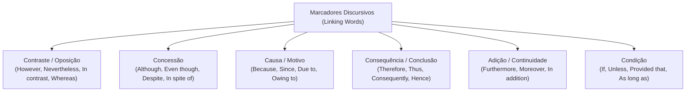
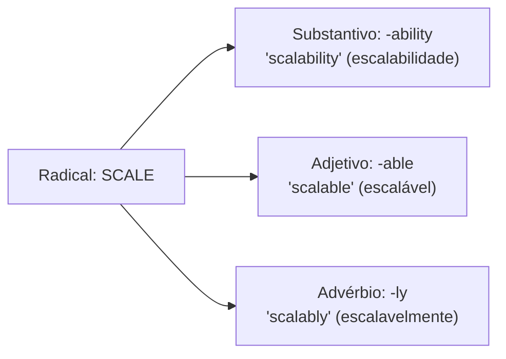
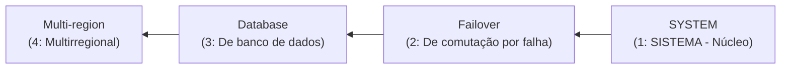

# 02 - Vocabulário Técnico de TI, Coesão e Conectivos

> **Matéria:** Língua Inglesa (Leitura Técnica)  
> **Cargo:** B02 – Técnico de Controle Externo – Especialidade: Tecnologia da Informação  
> **Arquivo:** `02_vocabulario_tecnico_de_ti_e_conjuncoes.md`  

---

## 📌 Ementa / Itens do Edital
- Vocabulário técnico especializado da área de Tecnologia da Informação
- Formação de palavras em inglês (Prefixos, Sufixos e Compostos)
- Marcadores discursivos e conectivos lógicos (Linking Words / Transition Words)
- Relações semânticas de causa, consequência, contraste, concessão, condição e adição

---

## 🧭 Sumário

1. [Conectivos Lógicos e Marcadores Discursivos (Linking Words)](#1-conectivos-logicos-e-marcadores-discursivos-linking-words)
    1. [Relações de Contraste e Adversidade](#11-relacoes-de-contraste-e-adversidade)
    2. [Relações de Concessão e a Regra do Despite](#12-relacoes-de-concessao-e-a-regra-do-despite)
    3. [Relações de Causa, Explicação e Motivo](#13-relacoes-de-causa-explicacao-e-motivo)
    4. [Relações de Consequência, Efeito e Conclusão](#14-relacoes-de-consequencia-efeito-e-conclusao)
    5. [Relações de Adição, Continuidade e Ênfase](#15-relacoes-de-adicao-continuidade-e-enfase)
    6. [Relações de Condição e a Lógica do Unless](#16-relacoes-de-condicao-e-a-logica-do-unless)
    7. [Tabela Canônica de Conectivos e Substituições Intercambiáveis](#17-tabela-canonica-de-conectivos-e-substituicoes-intercambiaveis)
    8. [Teste 575](#Teste-575)
    9. [Teste 576](#Teste-576)
    10. [Teste 577](#Teste-577)
    11. [Teste 578](#Teste-578)
    12. [Teste 579](#Teste-579)
2. [Morfologia e Formação de Palavras Técnicas (Word Formation)](#2-morfologia-e-formacao-de-palavras-tecnicas-word-formation)
    1. [Prefixos Técnicos Recorrentes em Computação](#21-prefixos-tecnicos-recorrentes-em-computacao)
    2. [Famílias de Palavras e Sufixos Gramaticais](#22-familias-de-palavras-e-sufixos-gramaticais)
    3. [Substantivos Compostos e Leitura Reversa (Noun Adjuncts)](#23-substantivos-compostos-e-leitura-reversa-noun-adjuncts)
    4. [Teste 580](#Teste-580)
    5. [Teste 581](#Teste-581)
3. [Glossário Técnico Essencial por Domínio de TI](#3-glossario-tecnico-essencial-por-dominio-de-ti)
    1. [Arquitetura e Engenharia de Software](#31-arquitetura-e-engenharia-de-software)
    2. [Concorrência e Sistemas Operacionais](#32-concorrencia-e-sistemas-operacionais)
    3. [Computação em Nuvem e Infraestrutura](#33-computacao-em-nuvem-e-infraestrutura)
    4. [Segurança Cibernética e Auditoria de Sistemas](#34-seguranca-cibernetica-e-auditoria-de-sistemas)
    5. [Teste 582](#Teste-582)
    6. [Teste 583](#Teste-583)
    7. [Teste 584](#Teste-584)
6. [Fontes Recomendadas na Internet](#6-fontes-recomendadas-na-internet)

---

## 1. Conectivos Lógicos e Marcadores Discursivos (Linking Words)

Os conectivos lógicos (também categorizados na literatura linguística como *Transition Words*, *Discourse Markers* ou *Connectors*) configuram os nós estruturais que asseguram a coesão referencial e a progressão lógica do pensamento em textos formais. 

Nas avaliações da Fundação Carlos Chagas (FCC) para cargos de Auditoria e Tecnologia da Informação, os testes acerca de conectivos concentram-se em dois formatos essenciais:

1. **Identificação da Relação Semântica Primária:** Exige classificar se a partícula expressa *contraste*, *concessão*, *causa*, *consequência/conclusão*, *condição* ou *adição*.
2. **Substituição sem Prejuízo de Sentido ou Gramática:** Demanda apontar o termo perfeitamente intercambiável (*synonymous transition*) respeitando rigorosamente as exigências de regência sintática (por exemplo, diferenciação entre conjunções seguidas de oração completa vs. preposições seguidas de sintagmas nominais).

### 1.1 Relações de Contraste e Adversidade

Os conectivos de contraste indicam oposição, contraposição direta ou divergência entre duas ideias, componentes ou sistemas concorrentes:

- **However, Nevertheless, Nonetheless (No entanto, todavia, contudo, não obstante):** Conectivos coordenados que introduzem ressalvas ou contra-argumentos à declaração precedente. São costumeiramente posicionados no início de uma oração independente seguidos de vírgula, ou após ponto e vírgula.
    - *Exemplo:* *"The microservices architecture offers superior scalability; **nevertheless**, it introduces non-trivial operational complexity."*
- **In contrast, On the contrary, Conversely (Em contrapartida, pelo contrário, inversamente):** Estabelecem um contraponto simétrico entre dois paradigmas tecnológicos distintos.
    - *Exemplo:* *"Relational databases enforce strict schemas. **In contrast**, document stores provide dynamic schemas."*
- **Whereas, While (Ao passo que, enquanto que):** Conjunções subordinativas que operam a comparação simultânea entre dois fatos ou entidades em paralelo.
    - *Exemplo:* *"SQL systems prioritize ACID transactions, **whereas** NoSQL systems emphasize eventual consistency and horizontal elasticity."*

### 1.2 Relações de Concessão e a Regra do Despite

A concessão introduz uma circunstância desfavorável, limitação técnica ou obstáculo que, embora real, **não impede a realização do fato principal** (quebra de expectativa):

- **Although, Even though, Though (Embora, ainda que, se bem que):** Conjunções subordinativas concessivas que exigem **oração completa com Sujeito e Verbo conjugado** (*Subject + Finite Verb*).
    - *Exemplo:* *"**Although** the cluster experienced hardware failures, no transaction was lost."*
- **Despite, In spite of (Apesar de, a despeito de, não obstante):** Locuções prepositivas que exigem **obrigatoriamente um Sintagma Nominal (*Noun Phrase*)** ou um verbo na forma nominal de **gerúndio (*-ing*)**.
    - *Exemplo:* *"**Despite** the heavy network traffic, the load balancer maintained sub-second response times."*

> 🚨 **ALERTA CRÍTICO DE PROVA FCC:**  
> A forma **"Despite of" NÃO EXISTE** na língua inglesa padrão! É uma armadilha sintática que a FCC insere deliberadamente nas alternativas de substituição. 
>
> - Correto: **Despite** + Substantivo (*despite the error*).  
> - Correto: **In spite of** + Substantivo (*in spite of the error*).  
> - Totalmente incorreto: *Despite of the error*. Descarte de imediato qualquer opção que use "despite of"!

### 1.3 Relações de Causa, Explicação e Motivo

Indicam o fundamento, premissa ou razão determinante para que determinado evento computacional ocorra:

- **Because, Since, As, For, Inasmuch as (Porque, já que, visto que, dado que):** Conjunções causais que introduzem orações subordinadas explicativas estruturadas com sujeito e predicado verbal.
    - *Exemplo:* *"The Kubernetes pod crashed **because** it exceeded its memory limit."*
- **Due to, Owing to, Because of, On account of (Devido a, em razão de, em virtude de):** Expressões prepositivas que introduzem diretamente sintagmas nominais causais.
    - *Exemplo:* *"The latency degradation occurred **due to** excessive garbage collection cycles."*

### 1.4 Relações de Consequência, Efeito e Conclusão

Indicam o resultado lógico derivado, a dedução ou a conclusão necessária a partir do que foi explanado:

- **Therefore, Thus, Hence, Consequently, Accordingly (Portanto, por conseguinte, logo, assim, desse modo):** Advérbios conectivos plenamente intercambiáveis que conectam a premissa à sua decorrência inevitável.
    - *Exemplo:* *"The primary node failed health checks; **therefore**, the orchestrator initiated an automated failover."*
- **As a result, For this reason (Como resultado, por este motivo):** Locuções conclusivas que fecham cadeias argumentativas de causa e efeito.

### 1.5 Relações de Adição, Continuidade e Ênfase

Acrescentam argumentos adicionais alinhados à mesma linha de raciocínio, sem introduzir restrições:

- **Furthermore, Moreover, In addition, Additionally, Besides (Além disso, ademais, outrossim):** Conectivos aditivos cumulativos que introduzem novos fatos reforçadores.
    - *Exemplo:* *"The firewall blocks unauthorized IP subnets; **furthermore**, it inspects deep application payloads."*
- **Not only.. but also.. (Não apenas.. mas também..):** Estrutura correlativa de soma e reforço enfático.

### 1.6 Relações de Condição e a Lógica do Unless

Estabelecem os pré-requisitos lógicos para que determinada asserção técnica se concretize:

- **If (Se):** Condição direta afirmativa.
- **Provided that, Providing that, As long as, On condition that (Contanto que, desde que):** Conectivos que introduzem condições necessárias ou restrições de conformidade.
    - *Exemplo:* *"The gateway accepts API requests **provided that** a valid JWT bearer token is supplied."*
- **Unless (A não ser que, a menos que):** Conjunção que embute semanticamente uma condição negativa, equivalendo estritamente a **"if.. not"** ou **"except if"**.
    - *Exemplo:* *"The transaction will not be committed **unless** all distributed replicas acknowledge receipt."*  
    $\equiv$ *"The transaction will not be committed **if** all distributed replicas **do not** acknowledge receipt."*

> ⚠️ **Ponto de Atenção FCC:**  
> A partícula *Unless* já é inerentemente negativa. Construções que associam *unless* a verbos no negativo (*unless you don't comply*) criam dupla negação confusa, explorada pela banca em itens interpretativos capciosos.

### 1.7 Tabela Canônica de Conectivos e Substituições Intercambiáveis

| Relação Semântica | Conectivos Canônicos | Estrutura Sintática Requerida | Substitutos Plenamente Equivalentes | Exemplo Prático de TI |
| :--- | :--- | :--- | :--- | :--- |
| **Contraste / Oposição** | *However, Nevertheless, Nonetheless* | Seguidos de vírgula ou entre pontuação forte; orações independentes | *However $\leftrightarrow$ Nevertheless $\leftrightarrow$ Nonetheless* | *"The query returned in 5ms; **however**, the cache failed."* |
| **Contraste Direto** | *Whereas, While, In contrast* | Paralelismo comparativo entre duas cláusulas | *Whereas $\leftrightarrow$ While* | *"C prioritizes speed, **whereas** Python emphasizes readability."* |
| **Concessão (Oração)** | *Although, Even though, Though* | Sujeito + Verbo finito conjugado | *Although $\leftrightarrow$ Even though $\leftrightarrow$ Though* | *"**Although** CPU usage was at 90%, throughput did not drop."* |
| **Concessão (Sintagma)** | *Despite, In spite of* | Apenas Substantivo ou Verbo em *-ing* (NUNCA *despite of*) | *Despite $\leftrightarrow$ In spite of* | *"**In spite of** the replication lag, data consistency held."* |
| **Causa (Oração)** | *Because, Since, As, Inasmuch as* | Oração com verbo conjugado | *Because $\leftrightarrow$ Since $\leftrightarrow$ As* | *"The build failed **since** unit tests did not pass."* |
| **Causa (Sintagma)** | *Due to, Owing to, Because of* | Seguidos de sintagma nominal | *Due to $\leftrightarrow$ Owing to $\leftrightarrow$ Because of* | *"Network slowdowns occurred **due to** routing packet loss."* |
| **Consequência / Conclusão** | *Therefore, Thus, Hence, Consequently* | Oração conclusiva decorrente | *Therefore $\leftrightarrow$ Thus $\leftrightarrow$ Consequently $\leftrightarrow$ Hence* | *"The token expired; **hence**, access was denied."* |
| **Adição / Continuidade** | *Furthermore, Moreover, In addition* | Adiciona proposição cumulativa | *Furthermore $\leftrightarrow$ Moreover $\leftrightarrow$ Additionally* | *"The tool scans code; **moreover**, it audits cloud IAM roles."* |
| **Condição Negativa** | *Unless* | Equivale logicamente a *if.. not* | *Unless $\equiv$ Except if $\equiv$ If not* | *"Data will be deleted **unless** archives are verified."* |
| **Condição Restritiva** | *Provided that, As long as* | Condição mandatória requerida | *Provided that $\leftrightarrow$ As long as* | *"Requests succeed **provided that** rate limits are respected."* |

---

### Teste 575
**(FCC – TRT 24ª – 2017 – Analista Judiciário - Tecnologia da Informação)**
Um Analista foi designado para participar como Integrante Técnico na Equipe de Planejamento da Contratação de uma Solução de Tecnologia da Informação e Comunicação. De acordo com a Resolução CNJ no 182/2013, a única atividade, dentre as lista- das abaixo, que NÃO está dentro de sua área de atuação é definir

* **A)** como será realizada a manutenção preventiva, corretiva, adaptativa e evolutiva da solução, aspectos que exigem a neces- sidade de serviços complementares.
* **B)** os critérios de formação acadêmica e experiência profissional da equipe que projetará, implantará e manterá a solução, bem como as respectivas formas de comprovação.
* **C)** o ambiente tecnológico dos treinamentos, os perfis dos instrutores e o conteúdo técnico envolvidos na solução.
* **D)** os padrões de interoperabilidade e de acessibilidade, bem como a linguagem de programação e as interfaces da solução.
* **E)** o projeto de implantação da solução, incluindo a sua disponibilização em ambiente de produção.

---

> **Comentário Detalhado:**
>
> - **A)** **Incorreta.** A opção apresenta proposição em desacordo com os fundamentos teóricos e técnicos do tópico ao afirmar que "como será realizada a manutenção preventiva, corretiva, adaptativa e evolutiva da solução, aspectos que exigem a...". De acordo com a teoria estudada em *1.2 Relações de Concessão e a Regra do Despite*, despite, In spite of (Apesar de, a despeito de, não obstante): Locuções prepositivas que exigem obrigatoriamente um Sintagma Nominal (*Noun Phrase*) ou um verbo na forma nominal de gerúndio (*-ing*).
> - **B)** **Correta.** Conforme fundamentado na seção *1.2 Relações de Concessão e a Regra do Despite* deste guia, although, Even though, Though (Embora, ainda que, se bem que): Conjunções subordinativas concessivas que exigem oração completa com Sujeito e Verbo conjugado (*Subject + Finite Verb*). Dessa forma, está plenamente correta a assertiva da banca (FCC – TRT 24ª/2017) ao estabelecer que "os critérios de formação acadêmica e experiência profissional da equipe que projetará, implantará e manterá a...".
> - **C)** **Incorreta.** A opção apresenta proposição em desacordo com os fundamentos teóricos e técnicos do tópico ao afirmar que "o ambiente tecnológico dos treinamentos, os perfis dos instrutores e o conteúdo técnico envolvidos na solução". De acordo com a teoria estudada em *2. Morfologia e Formação de Palavras Técnicas (Word Formation)*, a morfologia vocabular em língua inglesa fornece as ferramentas analíticas para decodificar neologismos, jargões técnicos e famílias de palavras sem a necessidade de memorização isolada.
> - **D)** **Incorreta.** A opção apresenta proposição em desacordo com os fundamentos teóricos e técnicos do tópico ao afirmar que "os padrões de interoperabilidade e de acessibilidade, bem como a linguagem de programação e as interfaces da...". De acordo com a teoria estudada em *2.1 Prefixos Técnicos Recorrentes em Computação*, inter- vs. intra-: *interoperability* (interoperabilidade entre sistemas heterogêneos distintos) vs. *intranet* (rede interna privativa).
> - **E)** **Incorreta.** A opção apresenta proposição em desacordo com os fundamentos teóricos e técnicos do tópico ao afirmar que "o projeto de implantação da solução, incluindo a sua disponibilização em ambiente de produção". De acordo com a teoria estudada em *3.3 Computação em Nuvem e Infraestrutura*, on-premises (Infraestrutura Local Própria): Modelo de implantação em que servidores e equipamentos físicos operam fisicamente dentro das dependências prediais da entidade governamental.
>
> **Gabarito: B**

---

### Teste 576
**(CEBRASPE – TJ/DFT – 2015 – Analista Judiciario Suporte Em Tecnologia Da Informacao)**
Em “mas, sobretudo, realizada por todos” (R.51), a palavra “sobretudo” significa especialmente e serve para reforçar a ideia de oposição veiculada pela conjunção “mas”. ***. 118/MJ Em 12 de maio de 2011 À Excelentíssima Sra. Chefe da Gerência de Manutenção e Tecnologia do MJ Assunto: Administração. Pedido de agendamento de manutenção em equipamentos. 1. Com o objetivo de dar cumprimento ao Plano Geral de Reparos e Modernização dos equipamentos de tecnologia deste Órgão, gentilmente, solicito a Você o agendamento de visita técnica a este Departamento. 2. Durante as últimas semanas, foram constatados diversos defeitos nos computadores e nos monitores utilizados pelos funcionários. Será necessário reparos e substituições de alguns equipamentos. Por esta razão, solicitamos que a equipe de manutenção dirija-se ao local com peças de substituição. 3. Os equipamentos a serem substituídos são três teclados e três estabilizadores, conforme relatório produzido pela área técnica do Departamento, que segue anexo. 4. Solicitamos que o agendamento seja realizado o mais rapidamente possível pois a inoperância dos equipamentos ocasiona atraso no andamento dos processos que estão sob nossa responsabilidade. Respeitosamente, Maria Helena Júlia Diretora do Departamento de Comunicação Social do MJ

* **C)** Certo
* **E)** Errado

---

> **Comentário Detalhado:**
>
> - **C)** **Incorreta.** A marcação como **Certo** não procede, pois o enunciado apresenta proposição em desacordo com os fundamentos teóricos e técnicos do tópico ao afirmar que "Em “mas, sobretudo, realizada por todos” (R.51), a palavra “sobretudo” significa especialmente e serve para...". De acordo com a teoria estudada em *3.3 Computação em Nuvem e Infraestrutura*, on-premises (Infraestrutura Local Própria): Modelo de implantação em que servidores e equipamentos físicos operam fisicamente dentro das dependências prediais da entidade governamental.
> - **E)** **Correta.** O item está **Errado** (gabarito oficial: **E**). Conforme fundamentado na seção *3.2 Concorrência e Sistemas Operacionais* deste guia, deadlock (Impasse Mútuo / Travamento Recíproco): Condição anômala em que dois ou mais processos ou threads concorrentes ficam eternamente paralisados aguardando a liberação de recursos bloqueados entre si. Portanto, a assertiva examinada pela banca (CEBRASPE – TJ/DFT/2015) viola os preceitos técnicos do tópico.
>
> **Gabarito: E**

---

### Teste 577
**(FCC – TRT 13ª – 2014 – Analista Judiciário - Tecnologia da Informação)**
O Analista de Tecnologia da Informação do TRT da 13a Região participa da comissão que está definindo o projeto de cabeamento de rede a ser utilizado entre o prédio principal e o anexo, localizado à distância de 500 m. Dentre as opções de cabos de fibra óptica, a melhor escolha é a fibra

* **A)** Rede − Switch L2 / Transporte − Roteador.
* **B)** Enlace − Switch L2 / Rede − Roteador.
* **C)** Rede − Bridge / Transporte − Gateway.
* **D)** Enlace − Gateway / Aplicação − Roteador.
* **E)** Transporte − Gateway / Aplicação − Bridge.

---

> **Comentário Detalhado:**
>
> - **A)** **Correta.** Conforme fundamentado na seção *2.1 Prefixos Técnicos Recorrentes em Computação* deste guia, inter- vs. intra-: *interoperability* (interoperabilidade entre sistemas heterogêneos distintos) vs. *intranet* (rede interna privativa). Dessa forma, está plenamente correta a assertiva da banca (FCC – TRT 13ª/2014) ao estabelecer que "Rede − Switch L2 / Transporte − Roteador".
> - **B)** **Incorreta.** A opção apresenta proposição em desacordo com os fundamentos teóricos e técnicos do tópico ao afirmar que "Enlace − Switch L2 / Rede − Roteador". De acordo com a teoria estudada em *3.1 Arquitetura e Engenharia de Software*, bottleneck (Gargalo / Ponto de Estrangulamento): Componente, recurso computacional ou enlace que restringe e dita a capacidade máxima de todo o ecossistema.
> - **C)** **Incorreta.** A opção apresenta proposição em desacordo com os fundamentos teóricos e técnicos do tópico ao afirmar que "Rede − Bridge / Transporte − Gateway". De acordo com a teoria estudada em *1.6 Relações de Condição e a Lógica do Unless*, *Exemplo:* *"The gateway accepts API requests provided that a valid JWT bearer token is supplied."*.
> - **D)** **Incorreta.** A opção apresenta proposição em desacordo com os fundamentos teóricos e técnicos do tópico ao afirmar que "Enlace − Gateway / Aplicação − Roteador". De acordo com a teoria estudada em *1. Conectivos Lógicos e Marcadores Discursivos (Linking Words)*, nas avaliações da Fundação Carlos Chagas (FCC) para cargos de Auditoria e Tecnologia da Informação, os testes acerca de conectivos concentram-se em dois formatos essenciais.
> - **E)** **Incorreta.** A opção apresenta proposição em desacordo com os fundamentos teóricos e técnicos do tópico ao afirmar que "Transporte − Gateway / Aplicação − Bridge". De acordo com a teoria estudada em *1.2 Relações de Concessão e a Regra do Despite*, a concessão introduz uma circunstância desfavorável, limitação técnica ou obstáculo que, embora real, não impede a realização do fato principal (quebra de expectativa).
>
> **Gabarito: A**

---

### Teste 578
**(FGV – TJ/SC – 2026 – Analista Administrativo)**
Saúde SC reforça importância da vacinação contra o Vírus Sincicial Respiratório em gestantes Com a aproximação do frio, a Secretaria de Estado da Saúde (SES) reforça a importância da vacinação de gestantes contra o Vírus Sincicial Respiratório (VSR). A imunização tem como principal objetivo reduzir complicações respiratórias em bebês nos primeiros meses de vida, como bronquiolite e pneumonia — doenças que tendem a aumentar durante o inverno e podem levar a internações. https://saude.sc.gov.br A utilização de letras maiúsculas na apresentação do “Vírus Sincicial Respiratório”, em todas as ocorrências no texto, serve para

* **A)** indicar destaque informativo dentro do texto, relacionado à relevância do tema abordado.
* **B)** ser uma estratégia de destaque para enfatizar a gravidade da doença mencionada no texto.
* **C)** apresentar o uso de linguagem técnica, comum em textos da área da saúde.
* **D)** corresponder à denominação oficial de um agente viral específico, funcionando como nome próprio.
* **E)** marcar a presença de termos estrangeiros incorporados ao vocabulário científico. Legislação Institucional do PJSC

---

> **Comentário Detalhado:**
>
> - **A)** **Incorreta.** A opção apresenta proposição em desacordo com os fundamentos teóricos e técnicos do tópico ao afirmar que "indicar destaque informativo dentro do texto, relacionado à relevância do tema abordado". De acordo com a teoria estudada em *3.3 Computação em Nuvem e Infraestrutura*, on-premises (Infraestrutura Local Própria): Modelo de implantação em que servidores e equipamentos físicos operam fisicamente dentro das dependências prediais da entidade governamental.
> - **B)** **Incorreta.** A opção apresenta proposição em desacordo com os fundamentos teóricos e técnicos do tópico ao afirmar que "ser uma estratégia de destaque para enfatizar a gravidade da doença mencionada no texto". De acordo com a teoria estudada em *1.6 Relações de Condição e a Lógica do Unless*, unless (A não ser que, a menos que): Conjunção que embute semanticamente uma condição negativa, equivalendo estritamente a "if.. not" ou "except if".
> - **C)** **Incorreta.** A opção apresenta proposição em desacordo com os fundamentos teóricos e técnicos do tópico ao afirmar que "apresentar o uso de linguagem técnica, comum em textos da área da saúde". De acordo com a teoria estudada em *1. Conectivos Lógicos e Marcadores Discursivos (Linking Words)*, os conectivos lógicos (também categorizados na literatura linguística como *Transition Words*, *Discourse Markers* ou *Connectors*) configuram os nós estruturais que asseguram a coesão referencial e a progressão lógica do pensamento em textos formais.
> - **D)** **Correta.** Conforme fundamentado na seção *2.2 Famílias de Palavras e Sufixos Gramaticais* deste guia, *-er / -or:* Agente processador, software ou pessoa responsável (*scheduler, compiler, dispatcher, load balancer, auditor*). Dessa forma, está plenamente correta a assertiva da banca (FGV – TJ/SC/2026) ao estabelecer que "corresponder à denominação oficial de um agente viral específico, funcionando como nome próprio".
> - **E)** **Incorreta.** A opção apresenta proposição em desacordo com os fundamentos teóricos e técnicos do tópico ao afirmar que "marcar a presença de termos estrangeiros incorporados ao vocabulário científico. Legislação Institucional do PJSC". De acordo com a teoria estudada em *1.1 Relações de Contraste e Adversidade*, however, Nevertheless, Nonetheless (No entanto, todavia, contudo, não obstante): Conectivos coordenados que introduzem ressalvas ou contra-argumentos à declaração precedente.
>
> **Gabarito: D**

---

### Teste 579
**(CEBRASPE – TRF/6 – 2025 – Analista Judiciario Apoio Especializado Tecnologia Da Informacao)**
O COBIT 2019 estabelece que os recursos de tecnologia da informação devem ser utilizados de forma alinhada aos

* **C)** Certo
* **E)** Errado

---

> **Comentário Detalhado:**
>
> - **C)** **Correta.** O item está **Certo**. Conforme fundamentado na seção *1. Conectivos Lógicos e Marcadores Discursivos (Linking Words)* deste guia, nas avaliações da Fundação Carlos Chagas (FCC) para cargos de Auditoria e Tecnologia da Informação, os testes acerca de conectivos concentram-se em dois formatos essenciais. Dessa forma, está plenamente correta a proposição da banca (CEBRASPE – TRF/6/2025) ao afirmar que "O COBIT 2019 estabelece que os recursos de tecnologia da informação devem ser utilizados de forma alinhada aos".
> - **E)** **Incorreta.** A marcação como **Errado** não procede, visto que a assertiva guarda integral conformidade com a teoria estudada em *1.6 Relações de Condição e a Lógica do Unless*, segundo a qual unless (A não ser que, a menos que): Conjunção que embute semanticamente uma condição negativa, equivalendo estritamente a "if.. not" ou "except if".
>
> **Gabarito: C**

---

## 2. Morfologia e Formação de Palavras Técnicas (Word Formation)

A morfologia vocabular em língua inglesa fornece as ferramentas analíticas para decodificar neologismos, jargões técnicos e famílias de palavras sem a necessidade de memorização isolada.

### 2.1 Prefixos Técnicos Recorrentes em Computação

Os prefixos acoplam-se ao radical modificando sua polaridade, direção ou escala:

- **un- (Inversão / Negação / Privação):** *unauthorized* (não autorizado), *unpatched* (sem correção de segurança), *unresponsive* (sem resposta/travado), *untrusted* (não confiável).
- **in- / im- / il- / ir- (Negação Estrita):** *immutable* (imutável — propriedade de estruturas que não admitem alteração após a criação), *inaccessible* (inacessível), *invalid* (inválido).
- **dis- (Separação / Desativação / Ruptura):** *disabled* (desativado), *disrupt* (interromper/desestruturar), *disconnected* (desconectado).
- **mis- (Execução Errônea ou Inadequada):** *misconfiguration* (falha ou erro de configuração — causa primordial de vazamentos em nuvem), *misleading* (enganoso), *misuse* (uso indevido).
- **de- (Reversão / Desfazimento / Remoção):** *decouple* (desacoplar), *deprecate* (descontinuar/tornar obsoleto), *decommission* (descomissionar/desativar infraestrutura), *decrypt* (descriptografar).
- **inter- vs. intra-:** *interoperability* (interoperabilidade entre sistemas heterogêneos distintos) vs. *intranet* (rede interna privativa).
- **multi- vs. mono-:** *multitenant* (arquitetura multilocatária compartilhada) vs. *monolithic* (monolítico unificado).

### 2.2 Famílias de Palavras e Sufixos Gramaticais

Os sufixos definem a classe gramatical da palavra (*part of speech*). Saber identificar o sufixo impede que o candidato confunda uma propriedade abstrata (substantivo) com uma qualidade do componente (adjetivo) ou com a forma de execução (advérbio):

- **Sufixos Formadores de Substantivos:**
    - *-ity / -ty:* Qualidade, estado ou métrica formal (*availability, elasticity, scalability, integrity, latency*).
    - *-tion / -sion:* Ação, processo ou resultado (*authentication, serialization, compression, migration*).
    - *-ment:* Instrumento, estado ou resultado prático (*deployment, enhancement, containment*).
    - *-ance / -ence:* Condição ou propriedade contínua (*compliance, persistence, tolerance, resilience*).
    - *-er / -or:* Agente processador, software ou pessoa responsável (*scheduler, compiler, dispatcher, load balancer, auditor*).
- **Sufixos Formadores de Adjetivos:**
    - *-able / -ible:* Denota capacidade, passibilidade ou viabilidade técnica (*scalable* = capaz de escalar; *feasible* = viável; *reliable* = confiável; *accessible* = acessível).
    - *-ive:* Natureza dinâmica ou operacional (*predictive, recursive, preventive, defensive*).
    - *-al:* Pertinência conceitual (*transactional, architectural, operational, computational*).
- **Sufixos Formadores de Advérbios:**
    - *-ly:* Adicionado ao adjetivo para exprimir o modo de execução (*seamlessly* = perfeitamente, sem interrupção perceptível; *concurrently* = simultaneamente; *asynchronously* = de maneira assíncrona).

### 2.3 Substantivos Compostos e Leitura Reversa (Noun Adjuncts)

Na redação técnica de computação, sequências de três, quatro ou cinco palavras justapostas formam conceitos compostos complexos (*Noun Adjuncts / Compound Nouns*).

#### A Regra de Interpretação da Direita para a Esquerda:
O substantivo núcleo (*Head Noun*) situa-se **sempre na última posição**. Todas as palavras que o precedem funcionam como qualificadores adjetivos. O leitor brasileiro deve localizar o último vocábulo e interpretá-lo lendo de trás para frente:

- *Exemplo 1:* `Fault-tolerant high-availability cluster provisioning system`  
  $\rightarrow$ 1. *System* (Sistema) $\rightarrow$ 2. *provisioning* (de provisionamento) $\rightarrow$ 3. *cluster* (de cluster) $\rightarrow$ 4. *high-availability* (de alta disponibilidade) $\rightarrow$ 5. *fault-tolerant* (tolerante a falhas).  
  **Sentido:** *Sistema de provisionamento de cluster de alta disponibilidade tolerante a falhas*.
- *Exemplo 2:* `Automated source code security vulnerability scanner`  
  $\rightarrow$ *Scanner de vulnerabilidades de segurança em código-fonte automatizado*.
- *Exemplo 3:* `Zero-downtime database schema migration procedure`  
  $\rightarrow$ *Procedimento de migração de esquema de banco de dados sem tempo de inatividade*.

---

### Teste 580
**(FGV – TJ/AP – 2023 – Analista Judiciario Apoio Especializado Tecnologia Da Informacao Banco De Dados)**
Observe a estrutura da tabela “Cliente” abaixo: CREATE TABLE cliente ( cliente_ID NUMBER(12) PRIMARY KEY, cidade VARCHAR2(50) NOT NULL, limite_credito NUMBER(13,2) DEFAULT 0 ); Com o objetivo de gerar um relatório que mostre o limite de crédito médio para clientes em “Sao Paulo” e “Belo Horizonte”, a consulta a ser executada é:

* **A)** SELECT cidade, AVG(NVL(limite_credito,0)) FROM cliente WHERE cidade IN ('SAO PAULO','BELO HORIZONTE');
* **B)** SELECT cidade, AVG(limite_credito) FROM cliente WHERE cidade IN ('SAO PAULO','BELO HORIZONTE') GROUP BY cidade;
* **C)** SELECT cidade, AVG(limite_credito) FROM cliente WHERE cidade IN ('SAO PAULO','BELO HORIZONTE') GROUP BY cliente_ID;
* **D)** SELECT cidade, AVG(limite_credito) FROM cliente WHERE cidade IN ('SAO PAULO','BELO HORIZONTE') GROUP BY cidade, limite_credito;
* **E)** SELECT cidade, AVG(limite_credito) FROM cliente WHERE cidade IN ('SAO PAULO','BELO HORIZONTE') GROUP BY limite_credito, cidade;

---

> **Comentário Detalhado:**
>
> - **A)** **Incorreta.** A opção apresenta proposição em desacordo com os fundamentos teóricos e técnicos do tópico ao afirmar que "SELECT cidade, AVG(NVL(limite_credito,0)) FROM cliente WHERE cidade IN ('SAO PAULO','BELO HORIZONTE')". De acordo com a teoria estudada em *1.5 Relações de Adição, Continuidade e Ênfase*, not only.. but also.. (Não apenas.. mas também..): Estrutura correlativa de soma e reforço enfático.
> - **B)** **Correta.** Conforme fundamentado na seção *3.2 Concorrência e Sistemas Operacionais* deste guia, polling (Sondagem Ativa / Consulta Periódica): Mecanismo síncrono em que um cliente envia requisições repetidas ao servidor para verificar se houve atualização. Dessa forma, está plenamente correta a assertiva da banca (FGV – TJ/AP/2023) ao estabelecer que "SELECT cidade, AVG(limite_credito) FROM cliente WHERE cidade IN ('SAO PAULO','BELO HORIZONTE') GROUP BY cidade".
> - **C)** **Incorreta.** A opção apresenta proposição em desacordo com os fundamentos teóricos e técnicos do tópico ao afirmar que "SELECT cidade, AVG(limite_credito) FROM cliente WHERE cidade IN ('SAO PAULO','BELO HORIZONTE') GROUP BY cliente_ID". De acordo com a teoria estudada em *1.6 Relações de Condição e a Lógica do Unless*, unless (A não ser que, a menos que): Conjunção que embute semanticamente uma condição negativa, equivalendo estritamente a "if.. not" ou "except if".
> - **D)** **Incorreta.** A opção apresenta proposição em desacordo com os fundamentos teóricos e técnicos do tópico ao afirmar que "SELECT cidade, AVG(limite_credito) FROM cliente WHERE cidade IN ('SAO PAULO','BELO HORIZONTE') GROUP BY cidade...". De acordo com a teoria estudada em *1.7 Tabela Canônica de Conectivos e Substituições Intercambiáveis*, relação Semântica: Conectivos Canônicos — Estrutura Sintática Requerida — Substitutos Plenamente Equivalentes — Exemplo Prático de TI.
> - **E)** **Incorreta.** A opção apresenta proposição em desacordo com os fundamentos teóricos e técnicos do tópico ao afirmar que "SELECT cidade, AVG(limite_credito) FROM cliente WHERE cidade IN ('SAO PAULO','BELO HORIZONTE') GROUP BY...". De acordo com a teoria estudada em *1.7 Tabela Canônica de Conectivos e Substituições Intercambiáveis*, concessão (Oração): *Although, Even though, Though* — Sujeito + Verbo finito conjugado — *Although $\leftrightarrow$ Even though $\leftrightarrow$ Though* — *"Although CPU usage was at 90%, throughput did not drop."*.
>
> **Gabarito: B**

---

### Teste 581
**(FCC – TRT 15ª – 2015 – Analista Judiciário - Tecnologia da Informação)**
Um analista da área de Tecnologia da Informação criou uma Matriz de Probabilidade e Impacto para classificar os riscos e priorizar as respostas a eles. Como esse Analista segue à risca o PMBoK 4a edição, esta matriz foi utilizada como técnica (ou ferramenta) do processo

* **A)** ANS pode ser formal ou informal, realizado entre o provedor de serviços de TI e o cliente.
* **B)** ANS descreve os serviços de TI e documenta metas de nível de serviço, mas não especifica as responsabilidades das partes envolvidas.
* **C)** único ANS pode cobrir múltiplos serviços de TI ou múltiplos clientes.
* **D)** ANS cobre um serviço para todos os clientes desse serviço, neste caso, sendo chamado de ANS multi-nível baseado em Cliente.
* **E)** ANS é firmado, exclusivamente, entre o provedor de serviços de TI e outra parte da mesma organização.

---

> **Comentário Detalhado:**
>
> - **A)** **Correta.** Conforme fundamentado na seção *3.4 Segurança Cibernética e Auditoria de Sistemas* deste guia, flaw / Vulnerability (Falha / Vulnerabilidade): Fragilidade lógica de design ou implementação que pode ser explorada por agentes hostis. Dessa forma, está plenamente correta a assertiva da banca (FCC – TRT 15ª/2015) ao estabelecer que "ANS pode ser formal ou informal, realizado entre o provedor de serviços de TI e o cliente".
> - **B)** **Incorreta.** A opção apresenta proposição em desacordo com os fundamentos teóricos e técnicos do tópico ao afirmar que "ANS descreve os serviços de TI e documenta metas de nível de serviço, mas não especifica as responsabilidades das...". De acordo com a teoria estudada em *3.3 Computação em Nuvem e Infraestrutura*, outage (Interrupção Geral de Serviço / Apagão): Período crítico de inatividade em que serviços essenciais ficam completamente inacessíveis aos usuários.
> - **C)** **Incorreta.** A opção apresenta proposição em desacordo com os fundamentos teóricos e técnicos do tópico ao afirmar que "único ANS pode cobrir múltiplos serviços de TI ou múltiplos clientes". De acordo com a teoria estudada em *2.2 Famílias de Palavras e Sufixos Gramaticais*, *-ity / -ty:* Qualidade, estado ou métrica formal (*availability, elasticity, scalability, integrity, latency*).
> - **D)** **Incorreta.** A opção apresenta proposição em desacordo com os fundamentos teóricos e técnicos do tópico ao afirmar que "ANS cobre um serviço para todos os clientes desse serviço, neste caso, sendo chamado de ANS multi-nível baseado em...". De acordo com a teoria estudada em *2.1 Prefixos Técnicos Recorrentes em Computação*, multi- vs. mono-: *multitenant* (arquitetura multilocatária compartilhada) vs. *monolithic* (monolítico unificado).
> - **E)** **Incorreta.** A opção incorre em restrição indevida ao limitar o escopo conceitual ao afirmar que "ANS é firmado, exclusivamente, entre o provedor de serviços de TI e outra parte da mesma organização". De acordo com a teoria estudada em *1.5 Relações de Adição, Continuidade e Ênfase*, acrescentam argumentos adicionais alinhados à mesma linha de raciocínio, sem introduzir restrições.
>
> **Gabarito: A**

---

## 3. Glossário Técnico Essencial por Domínio de TI

### 3.1 Arquitetura e Engenharia de Software

- **Throughput (Vazão / Taxa de Processamento):** Volume de unidades de trabalho ou requisições processadas com êxito por unidade de tempo (ex.: transações por segundo - TPS).
- **Latency (Latência):** Intervalo de tempo entre o envio de uma requisição e a recepção da resposta correspondente.
- **Bottleneck (Gargalo / Ponto de Estrangulamento):** Componente, recurso computacional ou enlace que restringe e dita a capacidade máxima de todo o ecossistema.
- **Overhead (Sobrecarga Computacional / Custo de Processamento Adicional):** Consumo extra de CPU, memória, ciclos de clock ou bytes de cabeçalho incorrido para prover abstrações, controle, criptografia ou orquestração.  
  > ⚠️ **Alerta FCC:** A banca costuma tentar fazer o candidato interpretar *overhead* como despesa monetária de licença. Em arquitetura de software, *overhead* é sobrecarga técnica de processamento!
- **Trade-off (Concessão Mútua / Relação de Compromisso):** Decisão de projeto em que uma vantagem obtida implica forçosamente a aceitação de uma contrapartida desfavorável.
- **Deprecate / Deprecated (Descontinuar / Obsoleto):** Recurso que permanece temporariamente disponível para fins de compatibilidade retroativa, mas cuja utilização é desaconselhada devido à descontinuação iminente.
- **Boilerplate (Código Padronizado / Repetitivo):** Seções de código repetitivo e verboso necessárias para compilação ou configuração inicial, sem valor funcional direto de negócio.

### 3.2 Concorrência e Sistemas Operacionais

- **Deadlock (Impasse Mútuo / Travamento Recíproco):** Condição anômala em que dois ou mais processos ou threads concorrentes ficam eternamente paralisados aguardando a liberação de recursos bloqueados entre si.
- **Race Condition (Condição de Corrida):** Defeito concorrencial em que a saída final do programa torna-se imprevisível ou corrompida em função da ordem temporal aleatória de execução das threads sobre dados compartilhados.
- **Thread-safe (Seguro para Execução Concorrente):** Propriedade de classes ou estruturas projetadas para suportar acessos simultâneos por múltiplas threads sem incorrer em corrupção de estado.
- **Polling (Sondagem Ativa / Consulta Periódica):** Mecanismo síncrono em que um cliente envia requisições repetidas ao servidor para verificar se houve atualização.
- **Payload (Carga Útil):** O conteúdo substantivo de dados de negócio transportado por um pacote ou mensagem, expurgados os metadados de protocolo.
- **Spawn (Gerar / Instanciar Processo Filho):** Ação pela qual um processo pai invoca o kernel do sistema operacional para criar uma nova linha de execução.

### 3.3 Computação em Nuvem e Infraestrutura

- **On-premises (Infraestrutura Local Própria):** Modelo de implantação em que servidores e equipamentos físicos operam fisicamente dentro das dependências prediais da entidade governamental.
- **Failover (Comutação Automática por Falha):** Mecanismo de contingência operacional que transfere a carga de processamento de um nó primário indisponível para um nó secundário em espera de forma autônoma e transparente.
- **Outage (Interrupção Geral de Serviço / Apagão):** Período crítico de inatividade em que serviços essenciais ficam completamente inacessíveis aos usuários.
- **Provisioning (Provisionamento de Recursos):** Ação de orquestrar, configurar e disponibilizar máquinas virtuais, balanceadores, IPs e discos na infraestrutura de nuvem.
- **Cold Start (Inicialização a Frio):** Latência adicional experimentada em arquiteturas *serverless* quando a plataforma precisa instanciar um novo contêiner de execução para atender a uma requisição inaugural.

### 3.4 Segurança Cibernética e Auditoria de Sistemas

- **Breach (Violação / Vazamento de Dados):** Incidente de segurança formalmente comprovado no qual informações confidenciais foram expostas, furtadas ou violadas.
- **Flaw / Vulnerability (Falha / Vulnerabilidade):** Fragilidade lógica de design ou implementação que pode ser explorada por agentes hostis.
- **Patch (Atualização / Correção de Segurança):** Pacote binário ou código corretivo liberado pelo mantenedor para sanar falhas reportadas.
- **Tamper / Tampering / Tamper-proof (Adulteração / À Prova de Adulteração):** Ação não autorizada de modificar dados ou trilhas de log. Registros *tamper-proof* garantem integridade imutável que impossibilita a alteração silenciosa.
- **Spoofing (Falsificação de Identidade / Mascaramento):** Técnica de usurpação de identidade digital (IP spoofing, DNS spoofing, e-mail spoofing).
- **Bypass (Burlar / Contornar):** Ato de contornar ou neutralizar controles e barreiras de segurança pré-existentes.
- **Mitigate / Mitigation (Mitigar / Atenuar):** Adoção de salvaguardas técnicas destinadas a minimizar a severidade, o impacto ou a probabilidade de exploração de um risco de segurança.

---

### Teste 582
**(FGV – TRF/1 – 2024 – Analista Judiciario Area Apoio Especializado Especialidade Suporte Em Tecnologia Da Informacao)**
A equipe de tecnologia da informação (TI) de um órgão está enfrentando dificuldades de disponibilidade de seu site de Internet após a divulgação de novos serviços com prazos rígidos para seus clientes. O site de Internet não está suportando o volume de acessos simultâneos. Para incrementar a disponibilidade do site, a equipe de TI replicou os servidores web e contratou uma solução que instalou um equipamento na frente das várias réplicas do site. Esse equipamento recebe as solicitações dos usuários da Internet, direcionando-as para os diversos servidores web internos, balanceando a carga entre eles. O certificado digital foi instalado nele para reduzir o processamento dos servidores web interno. O equipamento da solução contratada é um Proxy:

* **A)** de encaminhamento;
* **B)** transparente;
* **C)** anônimo;
* **D)** reverso;
* **E)** de distorção.

---

> **Comentário Detalhado:**
>
> - **A)** **Incorreta.** A opção apresenta proposição em desacordo com os fundamentos teóricos e técnicos do tópico ao afirmar que "de encaminhamento". De acordo com a teoria estudada em *3.3 Computação em Nuvem e Infraestrutura*, outage (Interrupção Geral de Serviço / Apagão): Período crítico de inatividade em que serviços essenciais ficam completamente inacessíveis aos usuários.
> - **B)** **Incorreta.** A opção apresenta proposição em desacordo com os fundamentos teóricos e técnicos do tópico ao afirmar que "transparente". De acordo com a teoria estudada em *3.3 Computação em Nuvem e Infraestrutura*, failover (Comutação Automática por Falha): Mecanismo de contingência operacional que transfere a carga de processamento de um nó primário indisponível para um nó secundário em espera de forma autônoma e transparente.
> - **C)** **Incorreta.** A opção apresenta proposição em desacordo com os fundamentos teóricos e técnicos do tópico ao afirmar que "anônimo". De acordo com a teoria estudada em *3.1 Arquitetura e Engenharia de Software*, throughput (Vazão / Taxa de Processamento): Volume de unidades de trabalho ou requisições processadas com êxito por unidade de tempo (ex.: transações por segundo - TPS).
> - **D)** **Correta.** Conforme fundamentado na seção *3.2 Concorrência e Sistemas Operacionais* deste guia, thread-safe (Seguro para Execução Concorrente): Propriedade de classes ou estruturas projetadas para suportar acessos simultâneos por múltiplas threads sem incorrer em corrupção de estado. Dessa forma, está plenamente correta a assertiva da banca (FGV – TRF/1/2024) ao estabelecer que "reverso".
> - **E)** **Incorreta.** A opção apresenta proposição em desacordo com os fundamentos teóricos e técnicos do tópico ao afirmar que "de distorção". De acordo com a teoria estudada em *1. Conectivos Lógicos e Marcadores Discursivos (Linking Words)*, nas avaliações da Fundação Carlos Chagas (FCC) para cargos de Auditoria e Tecnologia da Informação, os testes acerca de conectivos concentram-se em dois formatos essenciais.
>
> **Gabarito: D**

---

### Teste 583
**(FGV – TJ/DFT – 2022 – Analista Judiciario Suporte Em Tecnologia Da Informacao)**
João trabalha na área de Tecnologia da Informação de um Tribunal de Justiça e ficou responsável por atribuir as faixas de endereçamento IP de 4 novas varas cíveis, que necessitarão de 126 endereços de hosts cada. Sabe-se que a rede 10.112.0.0/20 está disponível. Para realizar a distribuição com o mínimo de desperdício de endereços, João deve dividir a rede da seguinte forma:

* **A)** nas sub-redes 10.112.0.0 com máscara 255.255.128.0, 10.112.0.128 com máscara 255.255.128.0, 10.112.1.0 com máscara 255.255.128.0 e 10.112.1.128 com máscara 255.255.128.0;
* **B)** nas sub-redes 10.112.0.0 com máscara 255.255.255.0, 10.112.1.0 com máscara 255.255.255.0, 10.112.2.0 com máscara 255.255.255.0 e 10.112.3.0 com máscara 255.255.255.0;
* **C)** nas sub-redes 10.112.0.0 com máscara 255.255.255.128, 10.112.0.128 com máscara 255.255.255.128, 10.112.1.0 com máscara 255.255.255.128 e 10.112.1.128 com máscara 255.255.255.128;
* **D)** nas sub-redes 10.112.0.0/26, 10.112.0.128/26, 10.112.1.0/26 e 10.112.1.128/26;
* **E)** a rede disponível não atende a demanda de endereços necessária.

---

> **Comentário Detalhado:**
>
> - **A)** **Incorreta.** A opção apresenta proposição em desacordo com os fundamentos teóricos e técnicos do tópico ao afirmar que "nas sub-redes 10.112.0.0 com máscara 255.255.128.0, 10.112.0.128 com máscara 255.255.128.0, 10.112.1.0 com máscara...". De acordo com a teoria estudada em *1. Conectivos Lógicos e Marcadores Discursivos (Linking Words)*, nas avaliações da Fundação Carlos Chagas (FCC) para cargos de Auditoria e Tecnologia da Informação, os testes acerca de conectivos concentram-se em dois formatos essenciais.
> - **B)** **Incorreta.** A opção apresenta proposição em desacordo com os fundamentos teóricos e técnicos do tópico ao afirmar que "nas sub-redes 10.112.0.0 com máscara 255.255.255.0, 10.112.1.0 com máscara 255.255.255.0, 10.112.2.0 com máscara...". De acordo com a teoria estudada em *3.1 Arquitetura e Engenharia de Software*, deprecate / Deprecated (Descontinuar / Obsoleto): Recurso que permanece temporariamente disponível para fins de compatibilidade retroativa, mas cuja utilização é desaconselhada devido à descontinuação iminente.
> - **C)** **Correta.** Conforme fundamentado na seção *1.2 Relações de Concessão e a Regra do Despite* deste guia, *Exemplo:* *"Despite the heavy network traffic, the load balancer maintained sub-second response times."*. Dessa forma, está plenamente correta a assertiva da banca (FGV – TJ/DFT/2022) ao estabelecer que "nas sub-redes 10.112.0.0 com máscara 255.255.255.128, 10.112.0.128 com máscara 255.255.255.128, 10.112.1.0 com...".
> - **D)** **Incorreta.** A opção apresenta proposição em desacordo com os fundamentos teóricos e técnicos do tópico ao afirmar que "nas sub-redes 10.112.0.0/26, 10.112.0.128/26, 10.112.1.0/26 e 10.112.1.128/26". De acordo com a teoria estudada em *3.3 Computação em Nuvem e Infraestrutura*, failover (Comutação Automática por Falha): Mecanismo de contingência operacional que transfere a carga de processamento de um nó primário indisponível para um nó secundário em espera de forma autônoma e transparente.
> - **E)** **Incorreta.** A opção apresenta proposição em desacordo com os fundamentos teóricos e técnicos do tópico ao afirmar que "a rede disponível não atende a demanda de endereços necessária". De acordo com a teoria estudada em *2.1 Prefixos Técnicos Recorrentes em Computação*, inter- vs. intra-: *interoperability* (interoperabilidade entre sistemas heterogêneos distintos) vs. *intranet* (rede interna privativa).
>
> **Gabarito: C**

---

### Teste 584
**(FGV – TJ/DFT – 2022 – Analista Judiciario Suporte Em Tecnologia Da Informacao)**
The passage in which the verb phrase indicates a necessity is:

* **A)** “this incredible ability of the brain […] may be fundamental”;
* **B)** “some engineers can come up with something”;
* **C)** “computers don’t work this way”;
* **D)** “brains don’t store information”;
* **E)** “it must regulate a body”. NOÇÕES DE DIREITO ADMINISTRATIVO E DE DIREITO CONSTITUCIONAL

---

> **Comentário Detalhado:**
>
> - **A)** **Incorreta.** A opção apresenta proposição em desacordo com os fundamentos teóricos e técnicos do tópico ao afirmar que "“this incredible ability of the brain […] may be fundamental”". De acordo com a teoria estudada em *1.4 Relações de Consequência, Efeito e Conclusão*, as a result, For this reason (Como resultado, por este motivo): Locuções conclusivas que fecham cadeias argumentativas de causa e efeito.
> - **B)** **Incorreta.** A opção apresenta proposição em desacordo com os fundamentos teóricos e técnicos do tópico ao afirmar que "“some engineers can come up with something”". De acordo com a teoria estudada em *1.2 Relações de Concessão e a Regra do Despite*, despite, In spite of (Apesar de, a despeito de, não obstante): Locuções prepositivas que exigem obrigatoriamente um Sintagma Nominal (*Noun Phrase*) ou um verbo na forma nominal de gerúndio (*-ing*).
> - **C)** **Incorreta.** A opção apresenta proposição em desacordo com os fundamentos teóricos e técnicos do tópico ao afirmar que "“computers don’t work this way”". De acordo com a teoria estudada em *1.6 Relações de Condição e a Lógica do Unless*, a partícula *Unless* já é inerentemente negativa. Construções que associam *unless* a verbos no negativo (*unless you don't comply*) criam dupla negação confusa, explorada pela banca em itens interpretativos capciosos.
> - **D)** **Incorreta.** A opção apresenta proposição em desacordo com os fundamentos teóricos e técnicos do tópico ao afirmar que "“brains don’t store information”". De acordo com a teoria estudada em *1.1 Relações de Contraste e Adversidade*, *Exemplo:* *"The microservices architecture offers superior scalability; nevertheless, it introduces non-trivial operational complexity."*.
> - **E)** **Correta.** Conforme fundamentado na seção *1.2 Relações de Concessão e a Regra do Despite* deste guia, although, Even though, Though (Embora, ainda que, se bem que): Conjunções subordinativas concessivas que exigem oração completa com Sujeito e Verbo conjugado (*Subject + Finite Verb*). Dessa forma, está plenamente correta a assertiva da banca (FGV – TJ/DFT/2022) ao estabelecer que "“it must regulate a body”. NOÇÕES DE DIREITO ADMINISTRATIVO E DE DIREITO CONSTITUCIONAL".
>
> **Gabarito: E**

---

## 6. Fontes Recomendadas na Internet

* [IETF RFC 2119 - Requirement Levels Vocabulary](https://datatracker.ietf.org/doc/html/rfc2119) - Especificação padrão do vocabulário mandatório e condicional em especificações internacionais de tecnologia.
* [MDN Web Docs - Glossary of Web Terms](https://developer.mozilla.org/en-US/docs/Glossary) - Glossário oficial e terminologia primária de engenharia web, redes e desenvolvimento de software.
* [OpenAPI Specification 3.1.0 (English)](https://spec.openapis.org/oas/v3.1.0) - Especificação técnica formal em inglês ideal para identificação de conectivos, sufixos, prefixos e vocabulário técnico de APIs.
* [PostgreSQL 17 Official Documentation - Architecture Fundamentals](https://www.postgresql.org/docs/current/overview.html) - Manual técnico avançado em inglês com vocabulário de persistência, índices e concorrência.
* [Google Technical Writing Courses - Clarifying Ambiguities](https://developers.google.com/tech-writing/one/words) - Guia de precisão lexical, conectivos lógicos e eliminação de ambiguidades em documentação técnica.
* HEWINGS, Martin. **Advanced Grammar in Use**. 3. ed. Cambridge: Cambridge University Press, 2013. (Units 71 to 78 - Linking Words and Conjunctions: Reason, Purpose, Contrast and Condition).
* MURPHY, Raymond. **English Grammar in Use**. 5. ed. Cambridge: Cambridge University Press, 2019. (Units 113 to 120 - Conjunctions and Prepositions: Although, In Spite Of, Unless, As Long As).
* GLENDINNING, Eric H.; MCEWAN, John. **Oxford English for Information Technology**. 2. ed. Oxford: Oxford University Press, 2006. (Units 10 to 15 - Software Engineering Vocabulary and Connectors).
