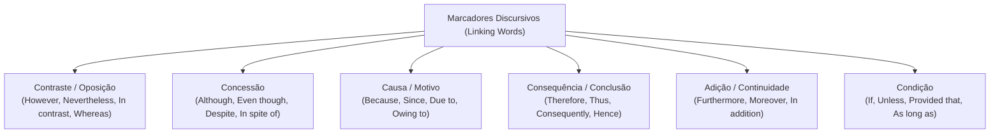
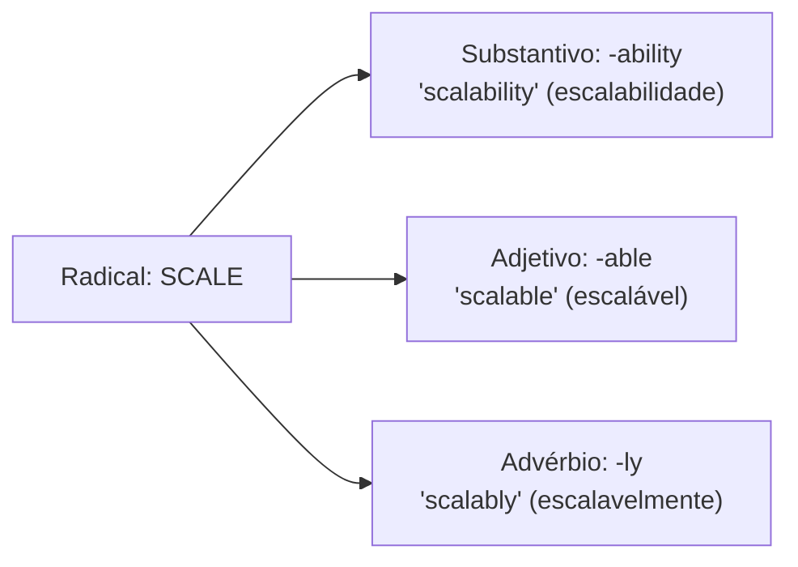
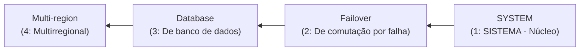

# 02 - Vocabulário Técnico de TI, Coesão e Conectivos

> **Matéria:** Língua Inglesa (Leitura Técnica)  
> **Cargo:** B02 – Técnico de Controle Externo – Especialidade: Tecnologia da Informação  
> **Arquivo:** `02_vocabulario_tecnico_de_ti_e_conjuncoes.md`  

---

## 📌 Ementa / Itens do Edital
- Vocabulário técnico especializado da área de Tecnologia da Informação
- Formação de palavras em inglês (Prefixos, Sufixos e Compostos)
- Marcadores discursivos e conectivos lógicos (Linking Words / Transition Words)
- Relações semânticas de causa, consequência, contraste, concessão, condição e adição

---

## 🧭 Sumário

1. [Conectivos Lógicos e Marcadores Discursivos (Linking Words)](#1-conectivos-logicos-e-marcadores-discursivos-linking-words)
    1. [Relações de Contraste e Adversidade](#11-relacoes-de-contraste-e-adversidade)
    2. [Relações de Concessão e a Regra do Despite](#12-relacoes-de-concessao-e-a-regra-do-despite)
    3. [Relações de Causa, Explicação e Motivo](#13-relacoes-de-causa-explicacao-e-motivo)
    4. [Relações de Consequência, Efeito e Conclusão](#14-relacoes-de-consequencia-efeito-e-conclusao)
    5. [Relações de Adição, Continuidade e Ênfase](#15-relacoes-de-adicao-continuidade-e-enfase)
    6. [Relações de Condição e a Lógica do Unless](#16-relacoes-de-condicao-e-a-logica-do-unless)
    7. [Tabela Canônica de Conectivos e Substituições Intercambiáveis](#17-tabela-canonica-de-conectivos-e-substituicoes-intercambiaveis)
    8. [Teste 575](#Teste-575)
    9. [Teste 576](#Teste-576)
    10. [Teste 577](#Teste-577)
    11. [Teste 578](#Teste-578)
    12. [Teste 579](#Teste-579)
2. [Morfologia e Formação de Palavras Técnicas (Word Formation)](#2-morfologia-e-formacao-de-palavras-tecnicas-word-formation)
    1. [Prefixos Técnicos Recorrentes em Computação](#21-prefixos-tecnicos-recorrentes-em-computacao)
    2. [Famílias de Palavras e Sufixos Gramaticais](#22-familias-de-palavras-e-sufixos-gramaticais)
    3. [Substantivos Compostos e Leitura Reversa (Noun Adjuncts)](#23-substantivos-compostos-e-leitura-reversa-noun-adjuncts)
    4. [Teste 580](#Teste-580)
    5. [Teste 581](#Teste-581)
3. [Glossário Técnico Essencial por Domínio de TI](#3-glossario-tecnico-essencial-por-dominio-de-ti)
    1. [Arquitetura e Engenharia de Software](#31-arquitetura-e-engenharia-de-software)
    2. [Concorrência e Sistemas Operacionais](#32-concorrencia-e-sistemas-operacionais)
    3. [Computação em Nuvem e Infraestrutura](#33-computacao-em-nuvem-e-infraestrutura)
    4. [Segurança Cibernética e Auditoria de Sistemas](#34-seguranca-cibernetica-e-auditoria-de-sistemas)
    5. [Teste 582](#Teste-582)
    6. [Teste 583](#Teste-583)
    7. [Teste 584](#Teste-584)
6. [Fontes Recomendadas na Internet](#6-fontes-recomendadas-na-internet)

---

## 1. Conectivos Lógicos e Marcadores Discursivos (Linking Words)

Os conectivos lógicos (também categorizados na literatura linguística como *Transition Words*, *Discourse Markers* ou *Connectors*) configuram os nós estruturais que asseguram a coesão referencial e a progressão lógica do pensamento em textos formais. 

Nas avaliações da Fundação Carlos Chagas (FCC) para cargos de Auditoria e Tecnologia da Informação, os testes acerca de conectivos concentram-se em dois formatos essenciais:

1. **Identificação da Relação Semântica Primária:** Exige classificar se a partícula expressa *contraste*, *concessão*, *causa*, *consequência/conclusão*, *condição* ou *adição*.
2. **Substituição sem Prejuízo de Sentido ou Gramática:** Demanda apontar o termo perfeitamente intercambiável (*synonymous transition*) respeitando rigorosamente as exigências de regência sintática (por exemplo, diferenciação entre conjunções seguidas de oração completa vs. preposições seguidas de sintagmas nominais).

### 1.1 Relações de Contraste e Adversidade

Os conectivos de contraste indicam oposição, contraposição direta ou divergência entre duas ideias, componentes ou sistemas concorrentes:

- **However, Nevertheless, Nonetheless (No entanto, todavia, contudo, não obstante):** Conectivos coordenados que introduzem ressalvas ou contra-argumentos à declaração precedente. São costumeiramente posicionados no início de uma oração independente seguidos de vírgula, ou após ponto e vírgula.
    - *Exemplo:* *"The microservices architecture offers superior scalability; **nevertheless**, it introduces non-trivial operational complexity."*
- **In contrast, On the contrary, Conversely (Em contrapartida, pelo contrário, inversamente):** Estabelecem um contraponto simétrico entre dois paradigmas tecnológicos distintos.
    - *Exemplo:* *"Relational databases enforce strict schemas. **In contrast**, document stores provide dynamic schemas."*
- **Whereas, While (Ao passo que, enquanto que):** Conjunções subordinativas que operam a comparação simultânea entre dois fatos ou entidades em paralelo.
    - *Exemplo:* *"SQL systems prioritize ACID transactions, **whereas** NoSQL systems emphasize eventual consistency and horizontal elasticity."*

### 1.2 Relações de Concessão e a Regra do Despite

A concessão introduz uma circunstância desfavorável, limitação técnica ou obstáculo que, embora real, **não impede a realização do fato principal** (quebra de expectativa):

- **Although, Even though, Though (Embora, ainda que, se bem que):** Conjunções subordinativas concessivas que exigem **oração completa com Sujeito e Verbo conjugado** (*Subject + Finite Verb*).
    - *Exemplo:* *"**Although** the cluster experienced hardware failures, no transaction was lost."*
- **Despite, In spite of (Apesar de, a despeito de, não obstante):** Locuções prepositivas que exigem **obrigatoriamente um Sintagma Nominal (*Noun Phrase*)** ou um verbo na forma nominal de **gerúndio (*-ing*)**.
    - *Exemplo:* *"**Despite** the heavy network traffic, the load balancer maintained sub-second response times."*

> 🚨 **ALERTA CRÍTICO DE PROVA FCC:**  
> A forma **"Despite of" NÃO EXISTE** na língua inglesa padrão! É uma armadilha sintática que a FCC insere deliberadamente nas alternativas de substituição. 
>
> - Correto: **Despite** + Substantivo (*despite the error*).  
> - Correto: **In spite of** + Substantivo (*in spite of the error*).  
> - Totalmente incorreto: *Despite of the error*. Descarte de imediato qualquer opção que use "despite of"!

### 1.3 Relações de Causa, Explicação e Motivo

Indicam o fundamento, premissa ou razão determinante para que determinado evento computacional ocorra:

- **Because, Since, As, For, Inasmuch as (Porque, já que, visto que, dado que):** Conjunções causais que introduzem orações subordinadas explicativas estruturadas com sujeito e predicado verbal.
    - *Exemplo:* *"The Kubernetes pod crashed **because** it exceeded its memory limit."*
- **Due to, Owing to, Because of, On account of (Devido a, em razão de, em virtude de):** Expressões prepositivas que introduzem diretamente sintagmas nominais causais.
    - *Exemplo:* *"The latency degradation occurred **due to** excessive garbage collection cycles."*

### 1.4 Relações de Consequência, Efeito e Conclusão

Indicam o resultado lógico derivado, a dedução ou a conclusão necessária a partir do que foi explanado:

- **Therefore, Thus, Hence, Consequently, Accordingly (Portanto, por conseguinte, logo, assim, desse modo):** Advérbios conectivos plenamente intercambiáveis que conectam a premissa à sua decorrência inevitável.
    - *Exemplo:* *"The primary node failed health checks; **therefore**, the orchestrator initiated an automated failover."*
- **As a result, For this reason (Como resultado, por este motivo):** Locuções conclusivas que fecham cadeias argumentativas de causa e efeito.

### 1.5 Relações de Adição, Continuidade e Ênfase

Acrescentam argumentos adicionais alinhados à mesma linha de raciocínio, sem introduzir restrições:

- **Furthermore, Moreover, In addition, Additionally, Besides (Além disso, ademais, outrossim):** Conectivos aditivos cumulativos que introduzem novos fatos reforçadores.
    - *Exemplo:* *"The firewall blocks unauthorized IP subnets; **furthermore**, it inspects deep application payloads."*
- **Not only.. but also.. (Não apenas.. mas também..):** Estrutura correlativa de soma e reforço enfático.

### 1.6 Relações de Condição e a Lógica do Unless

Estabelecem os pré-requisitos lógicos para que determinada asserção técnica se concretize:

- **If (Se):** Condição direta afirmativa.
- **Provided that, Providing that, As long as, On condition that (Contanto que, desde que):** Conectivos que introduzem condições necessárias ou restrições de conformidade.
    - *Exemplo:* *"The gateway accepts API requests **provided that** a valid JWT bearer token is supplied."*
- **Unless (A não ser que, a menos que):** Conjunção que embute semanticamente uma condição negativa, equivalendo estritamente a **"if.. not"** ou **"except if"**.
    - *Exemplo:* *"The transaction will not be committed **unless** all distributed replicas acknowledge receipt."*  
    $\equiv$ *"The transaction will not be committed **if** all distributed replicas **do not** acknowledge receipt."*

> ⚠️ **Ponto de Atenção FCC:**  
> A partícula *Unless* já é inerentemente negativa. Construções que associam *unless* a verbos no negativo (*unless you don't comply*) criam dupla negação confusa, explorada pela banca em itens interpretativos capciosos.

### 1.7 Tabela Canônica de Conectivos e Substituições Intercambiáveis

| Relação Semântica | Conectivos Canônicos | Estrutura Sintática Requerida | Substitutos Plenamente Equivalentes | Exemplo Prático de TI |
| :--- | :--- | :--- | :--- | :--- |
| **Contraste / Oposição** | *However, Nevertheless, Nonetheless* | Seguidos de vírgula ou entre pontuação forte; orações independentes | *However $\leftrightarrow$ Nevertheless $\leftrightarrow$ Nonetheless* | *"The query returned in 5ms; **however**, the cache failed."* |
| **Contraste Direto** | *Whereas, While, In contrast* | Paralelismo comparativo entre duas cláusulas | *Whereas $\leftrightarrow$ While* | *"C prioritizes speed, **whereas** Python emphasizes readability."* |
| **Concessão (Oração)** | *Although, Even though, Though* | Sujeito + Verbo finito conjugado | *Although $\leftrightarrow$ Even though $\leftrightarrow$ Though* | *"**Although** CPU usage was at 90%, throughput did not drop."* |
| **Concessão (Sintagma)** | *Despite, In spite of* | Apenas Substantivo ou Verbo em *-ing* (NUNCA *despite of*) | *Despite $\leftrightarrow$ In spite of* | *"**In spite of** the replication lag, data consistency held."* |
| **Causa (Oração)** | *Because, Since, As, Inasmuch as* | Oração com verbo conjugado | *Because $\leftrightarrow$ Since $\leftrightarrow$ As* | *"The build failed **since** unit tests did not pass."* |
| **Causa (Sintagma)** | *Due to, Owing to, Because of* | Seguidos de sintagma nominal | *Due to $\leftrightarrow$ Owing to $\leftrightarrow$ Because of* | *"Network slowdowns occurred **due to** routing packet loss."* |
| **Consequência / Conclusão** | *Therefore, Thus, Hence, Consequently* | Oração conclusiva decorrente | *Therefore $\leftrightarrow$ Thus $\leftrightarrow$ Consequently $\leftrightarrow$ Hence* | *"The token expired; **hence**, access was denied."* |
| **Adição / Continuidade** | *Furthermore, Moreover, In addition* | Adiciona proposição cumulativa | *Furthermore $\leftrightarrow$ Moreover $\leftrightarrow$ Additionally* | *"The tool scans code; **moreover**, it audits cloud IAM roles."* |
| **Condição Negativa** | *Unless* | Equivale logicamente a *if.. not* | *Unless $\equiv$ Except if $\equiv$ If not* | *"Data will be deleted **unless** archives are verified."* |
| **Condição Restritiva** | *Provided that, As long as* | Condição mandatória requerida | *Provided that $\leftrightarrow$ As long as* | *"Requests succeed **provided that** rate limits are respected."* |

---

### Teste 575
**(CEBRASPE – TRT-8 – Analista Judiciario Area Apoio Especializado Tecnologia da Informacao – 2022)**
It can be inferred from the third paragraph of text 15A13-I that

* **A)** consumers will have a hard time proving that the AI system caused harm to the product they had previously bought.
* **B)** claimants will be granted compensation for any reason.
* **C)** consumers will not be compensated unless they can prove that it was the AI system that caused the harm suffered.
* **D)** claimants will now have to prove both that there was an AI- related problem with their products and that the defendant failed to comply with the AI Act.
* **E)** the new rules will make it possible for claimants to get compensation even if they do not directly prove that the AI system caused the harm suffered.

---

> **Comentário Detalhado:**
>
> - **A)** **Incorreta.** A opção apresenta proposição em desacordo com os fundamentos teóricos e técnicos do tópico ao afirmar que "consumers will have a hard time proving that the AI system caused harm to the product they had previously bought". De acordo com a teoria estudada em *1.6 Relações de Condição e a Lógica do Unless*, \$\equiv\$ *"The transaction will not be committed if all distributed replicas do not acknowledge receipt."*.
> - **B)** **Incorreta.** A opção apresenta proposição em desacordo com os fundamentos teóricos e técnicos do tópico ao afirmar que "claimants will be granted compensation for any reason". De acordo com a teoria estudada em *1.6 Relações de Condição e a Lógica do Unless*, *Exemplo:* *"The gateway accepts API requests provided that a valid JWT bearer token is supplied."*.
> - **C)** **Incorreta.** A opção apresenta proposição em desacordo com os fundamentos teóricos e técnicos do tópico ao afirmar que "consumers will not be compensated unless they can prove that it was the AI system that caused the harm suffered". De acordo com a teoria estudada em *1.7 Tabela Canônica de Conectivos e Substituições Intercambiáveis*, concessão (Oração): *Although, Even though, Though* — Sujeito + Verbo finito conjugado — *Although \$\leftrightarrow\$ Even though \$\leftrightarrow\$ Though* — *"Although CPU usage was at 90%, throughput did not drop."*.
> - **D)** **Incorreta.** A opção apresenta proposição em desacordo com os fundamentos teóricos e técnicos do tópico ao afirmar que "claimants will now have to prove both that there was an AI- related problem with their products and that the...". De acordo com a teoria estudada em *1.7 Tabela Canônica de Conectivos e Substituições Intercambiáveis*, causa (Oração): *Because, Since, As, Inasmuch as* — Oração com verbo conjugado — *Because \$\leftrightarrow\$ Since \$\leftrightarrow\$ As* — *"The build failed since unit tests did not pass."*.
> - **E)** **Correta.** Conforme fundamentado na seção *1.6 Relações de Condição e a Lógica do Unless* deste guia, *Exemplo:* *"The transaction will not be committed unless all distributed replicas acknowledge receipt."*. Dessa forma, está plenamente correta a assertiva da banca (CEBRASPE – TRT-8/2022) ao estabelecer que "the new rules will make it possible for claimants to get compensation even if they do not directly prove that the...".
>
> **Gabarito: E**

---

### Teste 576
**(FCC – TRT-24 – Analista Judiciario Tecnologia da Informacao – 2017)**
Consider the following BPMN diagram. According to ITIL v3 2011 edition and business modeling principles, this diagram

* **A)** depicts the ITIL´s Release and Deployment Management process in which the account manager should try to handle that request on his own and explain the solution to the customer, then hand over the issue to a 2nd level support agent, who will hand over to upper level support, in a chain.
* **B)** shows the ITIL´s Service Portfolio Management process of a software manufacturer that is triggered by a customer requesting help from the account manager because of a well defined problem.
* **C)** isn’t useful to scope the process, get a basic understanding of the flow, and indicate the main steps, but it is relevant for discussing details of process improvements or even software driven support of the process.
* **D)** is simple because it assumes that a solution is always found to be explained to the customer. The model lacks all details of collaboration between the involved employees, that is important to the ITIL´s Incident Management process.
* **E)** shows the 2nd level support agent should figure out if the customer can fix the problem on her own, but if the agent is not sure about this he must deliver the responsability to a 3rd level agent or return to the 1st level, as recommended by ITIL.

---

> **Comentário Detalhado:**
>
> - **A)** **Correta.** Conforme fundamentado na seção *1.6 Relações de Condição e a Lógica do Unless* deste guia, *Exemplo:* *"The gateway accepts API requests provided that a valid JWT bearer token is supplied."*. Dessa forma, está plenamente correta a assertiva da banca (FCC – TRT-24/2017) ao estabelecer que "depicts the ITIL´s Release and Deployment Management process in which the account manager should try to handle...".
> - **B)** **Incorreta.** A opção apresenta proposição em desacordo com os fundamentos teóricos e técnicos do tópico ao afirmar que "shows the ITIL´s Service Portfolio Management process of a software manufacturer that is triggered by a customer...". De acordo com a teoria estudada em *1.3 Relações de Causa, Explicação e Motivo*, due to, Owing to, Because of, On account of (Devido a, em razão de, em virtude de): Expressões prepositivas que introduzem diretamente sintagmas nominais causais.
> - **C)** **Incorreta.** A opção apresenta proposição em desacordo com os fundamentos teóricos e técnicos do tópico ao afirmar que "isn’t useful to scope the process, get a basic understanding of the flow, and indicate the main steps, but it is...". De acordo com a teoria estudada em *6. Fontes Recomendadas na Internet*, gLENDINNING, Eric H.; MCEWAN, John. Oxford English for Information Technology. 2. ed. Oxford: Oxford University Press, 2006. (Units 10 to 15 - Software Engineering Vocabulary and Connectors).
> - **D)** **Incorreta.** A opção apresenta proposição em desacordo com os fundamentos teóricos e técnicos do tópico ao afirmar que "is simple because it assumes that a solution is always found to be explained to the customer. The model lacks all...". De acordo com a teoria estudada em *1.6 Relações de Condição e a Lógica do Unless*, *Exemplo:* *"The transaction will not be committed unless all distributed replicas acknowledge receipt."*.
> - **E)** **Incorreta.** A opção apresenta proposição em desacordo com os fundamentos teóricos e técnicos do tópico ao afirmar que "shows the 2nd level support agent should figure out if the customer can fix the problem on her own, but if the...". De acordo com a teoria estudada em *1.6 Relações de Condição e a Lógica do Unless*, \$\equiv\$ *"The transaction will not be committed if all distributed replicas do not acknowledge receipt."*.
>
> **Gabarito: A**

---

### Teste 577
**(CEBRASPE – TJ-RJ – Analista Judiciario Grupo Tecnologia da Informacao Analista de Gestao de Tic – 2021)**
Com relação aos aspectos linguísticos do primeiro período do texto CG1A1-I, é correto afirmar que o termo “se”,

* **A)** no trecho “se proteger”, remete ao termo “Prática”.
* **B)** no trecho “se mostrou”, tem como referente o termo “instrumento”.
* **C)** em ambas as ocorrências, pode, sem prejuízo da correção gramatical do texto, ser deslocado para imediatamente após a forma verbal, escrevendo-se, respectivamente, proteger-se e mostrou-se.
* **D)** em ambas as ocorrências, pode ser suprimido sem prejuízo dos sentidos e da correção gramatical do texto.
* **E)** em ambas as ocorrências, expressa a noção de reciprocidade.

---

> **Comentário Detalhado:**
>
> - **A)** **Incorreta.** A opção apresenta proposição em desacordo com os fundamentos teóricos e técnicos do tópico ao afirmar que "no trecho “se proteger”, remete ao termo “Prática”". De acordo com a teoria estudada em *1. Conectivos Lógicos e Marcadores Discursivos (Linking Words)*, substituição sem Prejuízo de Sentido ou Gramática: Demanda apontar o termo perfeitamente intercambiável (*synonymous transition*) respeitando rigorosamente as exigências de regência sintática (por exemplo, diferenciação entre conjunções seguidas de oração completa vs. preposições seguidas de sintagmas nominais).
> - **B)** **Incorreta.** A opção apresenta proposição em desacordo com os fundamentos teóricos e técnicos do tópico ao afirmar que "no trecho “se mostrou”, tem como referente o termo “instrumento”". De acordo com a teoria estudada em *2.2 Famílias de Palavras e Sufixos Gramaticais*, os sufixos definem a classe gramatical da palavra (*part of speech*). Saber identificar o sufixo impede que o candidato confunda uma propriedade abstrata (substantivo) com uma qualidade do componente (adjetivo) ou com a forma de execução (advérbio).
> - **C)** **Correta.** Conforme fundamentado na seção *3.4 Segurança Cibernética e Auditoria de Sistemas* deste guia, flaw / Vulnerability (Falha / Vulnerabilidade): Fragilidade lógica de design ou implementação que pode ser explorada por agentes hostis. Dessa forma, está plenamente correta a assertiva da banca (CEBRASPE – TJ-RJ/2021) ao estabelecer que "em ambas as ocorrências, pode, sem prejuízo da correção gramatical do texto, ser deslocado para imediatamente após...".
> - **D)** **Incorreta.** A opção apresenta proposição em desacordo com os fundamentos teóricos e técnicos do tópico ao afirmar que "em ambas as ocorrências, pode ser suprimido sem prejuízo dos sentidos e da correção gramatical do texto". De acordo com a teoria estudada em *1.3 Relações de Causa, Explicação e Motivo*, because, Since, As, For, Inasmuch as (Porque, já que, visto que, dado que): Conjunções causais que introduzem orações subordinadas explicativas estruturadas com sujeito e predicado verbal.
> - **E)** **Incorreta.** A opção apresenta proposição em desacordo com os fundamentos teóricos e técnicos do tópico ao afirmar que "em ambas as ocorrências, expressa a noção de reciprocidade". De acordo com a teoria estudada em *1. Conectivos Lógicos e Marcadores Discursivos (Linking Words)*, identificação da Relação Semântica Primária: Exige classificar se a partícula expressa *contraste*, *concessão*, *causa*, *consequência/conclusão*, *condição* ou *adição*.
>
> **Gabarito: C**

---

### Teste 578
**(CEBRASPE – TJ-RJ – Analista Judiciario Grupo Tecnologia da Informacao Analista de Gestao de Tic – 2021)**
The author of text 9A3-I mentions conference agendas and media coverage in order to

* **A)** demonstrate that their focus did not reflect the most impactful trend in the field of legal technology in 2018.
* **B)** show that they focused suficient attention on analytics in the field of legal technology in 2018.
* **C)** suggest that conferences related to legal technology should not be venues for discussions about analytics.
* **D)** demonstrate that these events and institutions establish priorities for the field of legal technology.
* **E)** advertise future events of interst in the field of legal technology.

---

> **Comentário Detalhado:**
>
> - **A)** **Correta.** Conforme fundamentado na seção *1.7 Tabela Canônica de Conectivos e Substituições Intercambiáveis* deste guia, causa (Oração): *Because, Since, As, Inasmuch as* — Oração com verbo conjugado — *Because \$\leftrightarrow\$ Since \$\leftrightarrow\$ As* — *"The build failed since unit tests did not pass."*. Dessa forma, está plenamente correta a assertiva da banca (CEBRASPE – TJ-RJ/2021) ao estabelecer que "demonstrate that their focus did not reflect the most impactful trend in the field of legal technology in 2018".
> - **B)** **Incorreta.** A opção apresenta proposição em desacordo com os fundamentos teóricos e técnicos do tópico ao afirmar que "show that they focused suficient attention on analytics in the field of legal technology in 2018". De acordo com a teoria estudada em *1.7 Tabela Canônica de Conectivos e Substituições Intercambiáveis*, concessão (Oração): *Although, Even though, Though* — Sujeito + Verbo finito conjugado — *Although \$\leftrightarrow\$ Even though \$\leftrightarrow\$ Though* — *"Although CPU usage was at 90%, throughput did not drop."*.
> - **C)** **Incorreta.** A opção apresenta proposição em desacordo com os fundamentos teóricos e técnicos do tópico ao afirmar que "suggest that conferences related to legal technology should not be venues for discussions about analytics". De acordo com a teoria estudada em *1.6 Relações de Condição e a Lógica do Unless*, *Exemplo:* *"The gateway accepts API requests provided that a valid JWT bearer token is supplied."*.
> - **D)** **Incorreta.** A opção apresenta proposição em desacordo com os fundamentos teóricos e técnicos do tópico ao afirmar que "demonstrate that these events and institutions establish priorities for the field of legal technology". De acordo com a teoria estudada em *6. Fontes Recomendadas na Internet*, gLENDINNING, Eric H.; MCEWAN, John. Oxford English for Information Technology. 2. ed. Oxford: Oxford University Press, 2006. (Units 10 to 15 - Software Engineering Vocabulary and Connectors).
> - **E)** **Incorreta.** A opção apresenta proposição em desacordo com os fundamentos teóricos e técnicos do tópico ao afirmar que "advertise future events of interst in the field of legal technology". De acordo com a teoria estudada em *1.6 Relações de Condição e a Lógica do Unless*, *Exemplo:* *"The transaction will not be committed unless all distributed replicas acknowledge receipt."*.
>
> **Gabarito: A**

---

### Teste 579
**(CEBRASPE – TRT-8 – Analista Judiciario Area Apoio Especializado Tecnologia da Informacao – 2022)**
According to text 15A13-I, it is correct to infer that

* **A)** it is the first time the European Commission has publicized liability rules on digital products and AI.
* **B)** the new liability rules also encompass products which are not digital or AI-related.
* **C)** the rules on the liability of manufacturers for faulty goods are possibly not lenient.
* **D)** the European Commission has come up with a proposal to compensate consumers who damaged their products themselves.
* **E)** the compensation proposed by the European Commission only applies to the products which came with a manufacturing defect.

---

> **Comentário Detalhado:**
>
> - **A)** **Incorreta.** A opção apresenta proposição em desacordo com os fundamentos teóricos e técnicos do tópico ao afirmar que "it is the first time the European Commission has publicized liability rules on digital products and AI". De acordo com a teoria estudada em *1.7 Tabela Canônica de Conectivos e Substituições Intercambiáveis*, condição Restritiva: *Provided that, As long as* — Condição mandatória requerida — *Provided that \$\leftrightarrow\$ As long as* — *"Requests succeed provided that rate limits are respected."*.
> - **B)** **Incorreta.** A opção apresenta proposição em desacordo com os fundamentos teóricos e técnicos do tópico ao afirmar que "the new liability rules also encompass products which are not digital or AI-related". De acordo com a teoria estudada em *1.5 Relações de Adição, Continuidade e Ênfase*, not only.. but also.. (Não apenas.. mas também..): Estrutura correlativa de soma e reforço enfático.
> - **C)** **Correta.** Conforme fundamentado na seção *1.7 Tabela Canônica de Conectivos e Substituições Intercambiáveis* deste guia, condição Negativa: *Unless* — Equivale logicamente a *if.. not* — *Unless \$\equiv\$ Except if \$\equiv\$ If not* — *"Data will be deleted unless archives are verified."*. Dessa forma, está plenamente correta a assertiva da banca (CEBRASPE – TRT-8/2022) ao estabelecer que "the rules on the liability of manufacturers for faulty goods are possibly not lenient".
> - **D)** **Incorreta.** A opção apresenta proposição em desacordo com os fundamentos teóricos e técnicos do tópico ao afirmar que "the European Commission has come up with a proposal to compensate consumers who damaged their products themselves". De acordo com a teoria estudada em *1.6 Relações de Condição e a Lógica do Unless*, *Exemplo:* *"The transaction will not be committed unless all distributed replicas acknowledge receipt."*.
> - **E)** **Incorreta.** A opção apresenta proposição em desacordo com os fundamentos teóricos e técnicos do tópico ao afirmar que "the compensation proposed by the European Commission only applies to the products which came with a manufacturing...". De acordo com a teoria estudada em *1.6 Relações de Condição e a Lógica do Unless*, \$\equiv\$ *"The transaction will not be committed if all distributed replicas do not acknowledge receipt."*.
>
> **Gabarito: C**

---

## 2. Morfologia e Formação de Palavras Técnicas (Word Formation)

A morfologia vocabular em língua inglesa fornece as ferramentas analíticas para decodificar neologismos, jargões técnicos e famílias de palavras sem a necessidade de memorização isolada.

### 2.1 Prefixos Técnicos Recorrentes em Computação

Os prefixos acoplam-se ao radical modificando sua polaridade, direção ou escala:

- **un- (Inversão / Negação / Privação):** *unauthorized* (não autorizado), *unpatched* (sem correção de segurança), *unresponsive* (sem resposta/travado), *untrusted* (não confiável).
- **in- / im- / il- / ir- (Negação Estrita):** *immutable* (imutável — propriedade de estruturas que não admitem alteração após a criação), *inaccessible* (inacessível), *invalid* (inválido).
- **dis- (Separação / Desativação / Ruptura):** *disabled* (desativado), *disrupt* (interromper/desestruturar), *disconnected* (desconectado).
- **mis- (Execução Errônea ou Inadequada):** *misconfiguration* (falha ou erro de configuração — causa primordial de vazamentos em nuvem), *misleading* (enganoso), *misuse* (uso indevido).
- **de- (Reversão / Desfazimento / Remoção):** *decouple* (desacoplar), *deprecate* (descontinuar/tornar obsoleto), *decommission* (descomissionar/desativar infraestrutura), *decrypt* (descriptografar).
- **inter- vs. intra-:** *interoperability* (interoperabilidade entre sistemas heterogêneos distintos) vs. *intranet* (rede interna privativa).
- **multi- vs. mono-:** *multitenant* (arquitetura multilocatária compartilhada) vs. *monolithic* (monolítico unificado).

### 2.2 Famílias de Palavras e Sufixos Gramaticais

Os sufixos definem a classe gramatical da palavra (*part of speech*). Saber identificar o sufixo impede que o candidato confunda uma propriedade abstrata (substantivo) com uma qualidade do componente (adjetivo) ou com a forma de execução (advérbio):

- **Sufixos Formadores de Substantivos:**
    - *-ity / -ty:* Qualidade, estado ou métrica formal (*availability, elasticity, scalability, integrity, latency*).
    - *-tion / -sion:* Ação, processo ou resultado (*authentication, serialization, compression, migration*).
    - *-ment:* Instrumento, estado ou resultado prático (*deployment, enhancement, containment*).
    - *-ance / -ence:* Condição ou propriedade contínua (*compliance, persistence, tolerance, resilience*).
    - *-er / -or:* Agente processador, software ou pessoa responsável (*scheduler, compiler, dispatcher, load balancer, auditor*).
- **Sufixos Formadores de Adjetivos:**
    - *-able / -ible:* Denota capacidade, passibilidade ou viabilidade técnica (*scalable* = capaz de escalar; *feasible* = viável; *reliable* = confiável; *accessible* = acessível).
    - *-ive:* Natureza dinâmica ou operacional (*predictive, recursive, preventive, defensive*).
    - *-al:* Pertinência conceitual (*transactional, architectural, operational, computational*).
- **Sufixos Formadores de Advérbios:**
    - *-ly:* Adicionado ao adjetivo para exprimir o modo de execução (*seamlessly* = perfeitamente, sem interrupção perceptível; *concurrently* = simultaneamente; *asynchronously* = de maneira assíncrona).

### 2.3 Substantivos Compostos e Leitura Reversa (Noun Adjuncts)

Na redação técnica de computação, sequências de três, quatro ou cinco palavras justapostas formam conceitos compostos complexos (*Noun Adjuncts / Compound Nouns*).

#### A Regra de Interpretação da Direita para a Esquerda:
O substantivo núcleo (*Head Noun*) situa-se **sempre na última posição**. Todas as palavras que o precedem funcionam como qualificadores adjetivos. O leitor brasileiro deve localizar o último vocábulo e interpretá-lo lendo de trás para frente:

- *Exemplo 1:* `Fault-tolerant high-availability cluster provisioning system`  
  $\rightarrow$ 1. *System* (Sistema) $\rightarrow$ 2. *provisioning* (de provisionamento) $\rightarrow$ 3. *cluster* (de cluster) $\rightarrow$ 4. *high-availability* (de alta disponibilidade) $\rightarrow$ 5. *fault-tolerant* (tolerante a falhas).  
  **Sentido:** *Sistema de provisionamento de cluster de alta disponibilidade tolerante a falhas*.
- *Exemplo 2:* `Automated source code security vulnerability scanner`  
  $\rightarrow$ *Scanner de vulnerabilidades de segurança em código-fonte automatizado*.
- *Exemplo 3:* `Zero-downtime database schema migration procedure`  
  $\rightarrow$ *Procedimento de migração de esquema de banco de dados sem tempo de inatividade*.

---

### Teste 580
**(FGV – TRF-1 – Analista Judiciario Area Apoio Especializado Especialidade Tecnologia da Informacao – 2024)**
Durante a análise de uma regra no Snort, um sistema de detecção de intrusões, foi identificada uma ação específica que permanece ociosa até ser ativada por uma regra de ativação, quando então age como uma regra de registro. A ação descrita é a:

* **A)** pass;
* **B)** drop;
* **C)** alert;
* **D)** activate;
* **E)** dynamic.

---

> **Comentário Detalhado:**
>
> - **A)** **Incorreta.** A opção apresenta proposição em desacordo com os fundamentos teóricos e técnicos do tópico ao afirmar que "pass". De acordo com a teoria estudada em *1.7 Tabela Canônica de Conectivos e Substituições Intercambiáveis*, causa (Oração): *Because, Since, As, Inasmuch as* — Oração com verbo conjugado — *Because \$\leftrightarrow\$ Since \$\leftrightarrow\$ As* — *"The build failed since unit tests did not pass."*.
> - **B)** **Incorreta.** A opção apresenta proposição em desacordo com os fundamentos teóricos e técnicos do tópico ao afirmar que "drop". De acordo com a teoria estudada em *1.7 Tabela Canônica de Conectivos e Substituições Intercambiáveis*, concessão (Oração): *Although, Even though, Though* — Sujeito + Verbo finito conjugado — *Although \$\leftrightarrow\$ Even though \$\leftrightarrow\$ Though* — *"Although CPU usage was at 90%, throughput did not drop."*.
> - **C)** **Incorreta.** A opção apresenta proposição em desacordo com os fundamentos teóricos e técnicos do tópico ao afirmar que "alert". De acordo com a teoria estudada em *A Regra de Interpretação da Direita para a Esquerda:*, \$\rightarrow\$ 1. *System* (Sistema) \$\rightarrow\$ 2. *provisioning* (de provisionamento) \$\rightarrow\$ 3. *cluster* (de cluster) \$\rightarrow\$ 4. *high-availability* (de alta disponibilidade) \$\rightarrow\$ 5. *fault-tolerant* (tolerante a falhas).
> - **D)** **Incorreta.** A opção apresenta proposição em desacordo com os fundamentos teóricos e técnicos do tópico ao afirmar que "activate". De acordo com a teoria estudada em *A Regra de Interpretação da Direita para a Esquerda:*, sentido: *Sistema de provisionamento de cluster de alta disponibilidade tolerante a falhas*.
> - **E)** **Correta.** Conforme fundamentado na seção *1.1 Relações de Contraste e Adversidade* deste guia, *Exemplo:* *"Relational databases enforce strict schemas. In contrast, document stores provide dynamic schemas."*. Dessa forma, está plenamente correta a assertiva da banca (FGV – TRF-1/2024) ao estabelecer que "dynamic".
>
> **Gabarito: E**

---

### Teste 581
**(CEBRASPE – TJ-RJ – Analista Judiciario Grupo Tecnologia da Informacao Analista de Gestao de Tic – 2021)**
In the first sentence of text 9A3-I, the word “it” refers to

* **A)** “media coverage”.
* **B)** “judge”.
* **C)** “artificial intelligence”.
* **D)** “2018’s most important legal technology”.
* **E)** “conference agendas”.

---

> **Comentário Detalhado:**
>
> - **A)** **Incorreta.** A opção apresenta proposição em desacordo com os fundamentos teóricos e técnicos do tópico ao afirmar que "“media coverage”". De acordo com a teoria estudada em *2. Morfologia e Formação de Palavras Técnicas (Word Formation)*, a morfologia vocabular em língua inglesa fornece as ferramentas analíticas para decodificar neologismos, jargões técnicos e famílias de palavras sem a necessidade de memorização isolada.
> - **B)** **Incorreta.** A opção apresenta proposição em desacordo com os fundamentos teóricos e técnicos do tópico ao afirmar que "“judge”". De acordo com a teoria estudada em *1.1 Relações de Contraste e Adversidade*, *Exemplo:* *"The microservices architecture offers superior scalability; nevertheless, it introduces non-trivial operational complexity."*.
> - **C)** **Incorreta.** A opção apresenta proposição em desacordo com os fundamentos teóricos e técnicos do tópico ao afirmar que "“artificial intelligence”". De acordo com a teoria estudada em *1.1 Relações de Contraste e Adversidade*, in contrast, On the contrary, Conversely (Em contrapartida, pelo contrário, inversamente): Estabelecem um contraponto simétrico entre dois paradigmas tecnológicos distintos.
> - **D)** **Correta.** Conforme fundamentado na seção *6. Fontes Recomendadas na Internet* deste guia, gLENDINNING, Eric H.; MCEWAN, John. Oxford English for Information Technology. 2. ed. Oxford: Oxford University Press, 2006. (Units 10 to 15 - Software Engineering Vocabulary and Connectors). Dessa forma, está plenamente correta a assertiva da banca (CEBRASPE – TJ-RJ/2021) ao estabelecer que "“2018’s most important legal technology”".
> - **E)** **Incorreta.** A opção apresenta proposição em desacordo com os fundamentos teóricos e técnicos do tópico ao afirmar que "“conference agendas”". De acordo com a teoria estudada em *1.2 Relações de Concessão e a Regra do Despite*, *Exemplo:* *"Although the cluster experienced hardware failures, no transaction was lost."*.
>
> **Gabarito: D**

---

## 3. Glossário Técnico Essencial por Domínio de TI

### 3.1 Arquitetura e Engenharia de Software

- **Throughput (Vazão / Taxa de Processamento):** Volume de unidades de trabalho ou requisições processadas com êxito por unidade de tempo (ex.: transações por segundo - TPS).
- **Latency (Latência):** Intervalo de tempo entre o envio de uma requisição e a recepção da resposta correspondente.
- **Bottleneck (Gargalo / Ponto de Estrangulamento):** Componente, recurso computacional ou enlace que restringe e dita a capacidade máxima de todo o ecossistema.
- **Overhead (Sobrecarga Computacional / Custo de Processamento Adicional):** Consumo extra de CPU, memória, ciclos de clock ou bytes de cabeçalho incorrido para prover abstrações, controle, criptografia ou orquestração.  
  > ⚠️ **Alerta FCC:** A banca costuma tentar fazer o candidato interpretar *overhead* como despesa monetária de licença. Em arquitetura de software, *overhead* é sobrecarga técnica de processamento!
- **Trade-off (Concessão Mútua / Relação de Compromisso):** Decisão de projeto em que uma vantagem obtida implica forçosamente a aceitação de uma contrapartida desfavorável.
- **Deprecate / Deprecated (Descontinuar / Obsoleto):** Recurso que permanece temporariamente disponível para fins de compatibilidade retroativa, mas cuja utilização é desaconselhada devido à descontinuação iminente.
- **Boilerplate (Código Padronizado / Repetitivo):** Seções de código repetitivo e verboso necessárias para compilação ou configuração inicial, sem valor funcional direto de negócio.

### 3.2 Concorrência e Sistemas Operacionais

- **Deadlock (Impasse Mútuo / Travamento Recíproco):** Condição anômala em que dois ou mais processos ou threads concorrentes ficam eternamente paralisados aguardando a liberação de recursos bloqueados entre si.
- **Race Condition (Condição de Corrida):** Defeito concorrencial em que a saída final do programa torna-se imprevisível ou corrompida em função da ordem temporal aleatória de execução das threads sobre dados compartilhados.
- **Thread-safe (Seguro para Execução Concorrente):** Propriedade de classes ou estruturas projetadas para suportar acessos simultâneos por múltiplas threads sem incorrer em corrupção de estado.
- **Polling (Sondagem Ativa / Consulta Periódica):** Mecanismo síncrono em que um cliente envia requisições repetidas ao servidor para verificar se houve atualização.
- **Payload (Carga Útil):** O conteúdo substantivo de dados de negócio transportado por um pacote ou mensagem, expurgados os metadados de protocolo.
- **Spawn (Gerar / Instanciar Processo Filho):** Ação pela qual um processo pai invoca o kernel do sistema operacional para criar uma nova linha de execução.

### 3.3 Computação em Nuvem e Infraestrutura

- **On-premises (Infraestrutura Local Própria):** Modelo de implantação em que servidores e equipamentos físicos operam fisicamente dentro das dependências prediais da entidade governamental.
- **Failover (Comutação Automática por Falha):** Mecanismo de contingência operacional que transfere a carga de processamento de um nó primário indisponível para um nó secundário em espera de forma autônoma e transparente.
- **Outage (Interrupção Geral de Serviço / Apagão):** Período crítico de inatividade em que serviços essenciais ficam completamente inacessíveis aos usuários.
- **Provisioning (Provisionamento de Recursos):** Ação de orquestrar, configurar e disponibilizar máquinas virtuais, balanceadores, IPs e discos na infraestrutura de nuvem.
- **Cold Start (Inicialização a Frio):** Latência adicional experimentada em arquiteturas *serverless* quando a plataforma precisa instanciar um novo contêiner de execução para atender a uma requisição inaugural.

### 3.4 Segurança Cibernética e Auditoria de Sistemas

- **Breach (Violação / Vazamento de Dados):** Incidente de segurança formalmente comprovado no qual informações confidenciais foram expostas, furtadas ou violadas.
- **Flaw / Vulnerability (Falha / Vulnerabilidade):** Fragilidade lógica de design ou implementação que pode ser explorada por agentes hostis.
- **Patch (Atualização / Correção de Segurança):** Pacote binário ou código corretivo liberado pelo mantenedor para sanar falhas reportadas.
- **Tamper / Tampering / Tamper-proof (Adulteração / À Prova de Adulteração):** Ação não autorizada de modificar dados ou trilhas de log. Registros *tamper-proof* garantem integridade imutável que impossibilita a alteração silenciosa.
- **Spoofing (Falsificação de Identidade / Mascaramento):** Técnica de usurpação de identidade digital (IP spoofing, DNS spoofing, e-mail spoofing).
- **Bypass (Burlar / Contornar):** Ato de contornar ou neutralizar controles e barreiras de segurança pré-existentes.
- **Mitigate / Mitigation (Mitigar / Atenuar):** Adoção de salvaguardas técnicas destinadas a minimizar a severidade, o impacto ou a probabilidade de exploração de um risco de segurança.

---

### Teste 582
**(CEBRASPE – TJ-RJ – Analista Judiciario Grupo Tecnologia da Informacao Analista de Gestao de Tic – 2021)**
In the first sentence of text 9A3-I, the word “judge” is synonymous with

* **A)** justice.
* **B)** court.
* **C)** consider.
* **D)** examiner.
* **E)** try.

---

> **Comentário Detalhado:**
>
> - **A)** **Incorreta.** A opção apresenta proposição em desacordo com os fundamentos teóricos e técnicos do tópico ao afirmar que "justice". De acordo com a teoria estudada em *2. Morfologia e Formação de Palavras Técnicas (Word Formation)*, a morfologia vocabular em língua inglesa fornece as ferramentas analíticas para decodificar neologismos, jargões técnicos e famílias de palavras sem a necessidade de memorização isolada.
> - **B)** **Incorreta.** A opção apresenta proposição em desacordo com os fundamentos teóricos e técnicos do tópico ao afirmar que "court". De acordo com a teoria estudada em *1.1 Relações de Contraste e Adversidade*, *Exemplo:* *"The microservices architecture offers superior scalability; nevertheless, it introduces non-trivial operational complexity."*.
> - **C)** **Correta.** Conforme fundamentado na seção *1. Conectivos Lógicos e Marcadores Discursivos (Linking Words)* deste guia, substituição sem Prejuízo de Sentido ou Gramática: Demanda apontar o termo perfeitamente intercambiável (*synonymous transition*) respeitando rigorosamente as exigências de regência sintática (por exemplo, diferenciação entre conjunções seguidas de oração completa vs. preposições seguidas de sintagmas nominais). Dessa forma, está plenamente correta a assertiva da banca (CEBRASPE – TJ-RJ/2021) ao estabelecer que "consider".
> - **D)** **Incorreta.** A opção apresenta proposição em desacordo com os fundamentos teóricos e técnicos do tópico ao afirmar que "examiner". De acordo com a teoria estudada em *1.1 Relações de Contraste e Adversidade*, in contrast, On the contrary, Conversely (Em contrapartida, pelo contrário, inversamente): Estabelecem um contraponto simétrico entre dois paradigmas tecnológicos distintos.
> - **E)** **Incorreta.** A opção apresenta proposição em desacordo com os fundamentos teóricos e técnicos do tópico ao afirmar que "try". De acordo com a teoria estudada em *1.2 Relações de Concessão e a Regra do Despite*, *Exemplo:* *"Although the cluster experienced hardware failures, no transaction was lost."*.
>
> **Gabarito: C**

---

### Teste 583
**(FCC – TRT-9 – Analista Judiciario Apoio Especializado Tecnologia da Informacao – 2015)**
The purpose of a Data Warehouse (DW) is to consolidate and organize data so it can be analyzed and used to support business decisions. Considering a DW platform, the true statement is:

* **A)** DW usually contains historical data, often collected from a variety of sources such as OLAP systems, legacy systems, data marts. A DW combines this data, cleanses it for accuracy and consistency, and organizes it for ease and efficiency of querying.
* **B)** In large data warehousing applications, data is often segmented into specialized components, called data mining cubes, that address individual components of the organization.
* **C)** Referential integrity must be maintained when DW data is added, or deleted. Loss of referential integrity can result in errors during cube processing, fact table records being bypassed, or inaccurate OLAP information.
* **D)** Cube information available online to client applications cannot be affected when data is added to the DW due to interaction between the data and cube partitions. Every DW defines partition filters that avoid this problem.
* **E)** ROLAP's multidimensional data model answers to a query into historical data and never leads to subsequent queries as the analyst searches for answers or explores possibilities. ROLAP systems provide the speed and flexibility to support the analyst in real time. Atenção: A tabela relativa a Débitos Trabalhistas a seguir deve ser utilizada para responder às questões de números 52 e 53. Considere que a tabela já está criada, os dados iniciais já foram inseridos e o banco de dados a ser utilizado está aberto e funcionando em condições ideais.

---

> **Comentário Detalhado:**
>
> - **A)** **Incorreta.** A opção apresenta proposição em desacordo com os fundamentos teóricos e técnicos do tópico ao afirmar que "DW usually contains historical data, often collected from a variety of sources such as OLAP systems, legacy...". De acordo com a teoria estudada em *1.1 Relações de Contraste e Adversidade*, *Exemplo:* *"SQL systems prioritize ACID transactions, whereas NoSQL systems emphasize eventual consistency and horizontal elasticity."*.
> - **B)** **Incorreta.** A opção apresenta proposição em desacordo com os fundamentos teóricos e técnicos do tópico ao afirmar que "In large data warehousing applications, data is often segmented into specialized components, called data mining...". De acordo com a teoria estudada em *1.7 Tabela Canônica de Conectivos e Substituições Intercambiáveis*, concessão (Sintagma): *Despite, In spite of* — Apenas Substantivo ou Verbo em *-ing* (NUNCA *despite of*) — *Despite \$\leftrightarrow\$ In spite of* — *"In spite of the replication lag, data consistency held."*.
> - **C)** **Correta.** Conforme fundamentado na seção *1.7 Tabela Canônica de Conectivos e Substituições Intercambiáveis* deste guia, condição Negativa: *Unless* — Equivale logicamente a *if.. not* — *Unless \$\equiv\$ Except if \$\equiv\$ If not* — *"Data will be deleted unless archives are verified."*. Dessa forma, está plenamente correta a assertiva da banca (FCC – TRT-9/2015) ao estabelecer que "Referential integrity must be maintained when DW data is added, or deleted. Loss of referential integrity can...".
> - **D)** **Incorreta.** A opção apresenta proposição em desacordo com os fundamentos teóricos e técnicos do tópico ao afirmar que "Cube information available online to client applications cannot be affected when data is added to the DW due to...". De acordo com a teoria estudada em *6. Fontes Recomendadas na Internet*, gLENDINNING, Eric H.; MCEWAN, John. Oxford English for Information Technology. 2. ed. Oxford: Oxford University Press, 2006. (Units 10 to 15 - Software Engineering Vocabulary and Connectors).
> - **E)** **Incorreta.** A opção apresenta proposição em desacordo com os fundamentos teóricos e técnicos do tópico ao afirmar que "ROLAP's multidimensional data model answers to a query into historical data and never leads to subsequent queries...". De acordo com a teoria estudada em *1.7 Tabela Canônica de Conectivos e Substituições Intercambiáveis*, contraste / Oposição: *However, Nevertheless, Nonetheless* — Seguidos de vírgula ou entre pontuação forte; orações independentes — *However \$\leftrightarrow\$ Nevertheless \$\leftrightarrow\$ Nonetheless* — *"The query returned in 5ms; however, the cache failed."*.
>
> **Gabarito: C**

---

### Teste 584
**(CEBRASPE – TRT-8 – Analista Judiciario Apoio Especializado Tecnologia da Informacao – 2016)**
According to the text, the data processing manager is

* **A)** the head of department and as such he can train and supervise staff.
* **B)** often asked to evaluate designs.
* **C)** asked to create the due budget.
* **D)** required to submit reports to be approved by the staff members.
* **E)** rarely called to administer the implementation of new or revised systems.

---

> **Comentário Detalhado:**
>
> - **A)** **Incorreta.** A opção apresenta proposição em desacordo com os fundamentos teóricos e técnicos do tópico ao afirmar que "the head of department and as such he can train and supervise staff". De acordo com a teoria estudada em *A Regra de Interpretação da Direita para a Esquerda:*, o substantivo núcleo (*Head Noun*) situa-se sempre na última posição. Todas as palavras que o precedem funcionam como qualificadores adjetivos. O leitor brasileiro deve localizar o último vocábulo e interpretá-lo lendo de trás para frente.
> - **B)** **Correta.** Conforme fundamentado na seção *1.7 Tabela Canônica de Conectivos e Substituições Intercambiáveis* deste guia, concessão (Sintagma): *Despite, In spite of* — Apenas Substantivo ou Verbo em *-ing* (NUNCA *despite of*) — *Despite \$\leftrightarrow\$ In spite of* — *"In spite of the replication lag, data consistency held."*. Dessa forma, está plenamente correta a assertiva da banca (CEBRASPE – TRT-8/2016) ao estabelecer que "often asked to evaluate designs".
> - **C)** **Incorreta.** A opção apresenta proposição em desacordo com os fundamentos teóricos e técnicos do tópico ao afirmar que "asked to create the due budget". De acordo com a teoria estudada em *1.3 Relações de Causa, Explicação e Motivo*, *Exemplo:* *"The latency degradation occurred due to excessive garbage collection cycles."*.
> - **D)** **Incorreta.** A opção apresenta proposição em desacordo com os fundamentos teóricos e técnicos do tópico ao afirmar que "required to submit reports to be approved by the staff members". De acordo com a teoria estudada em *1.1 Relações de Contraste e Adversidade*, *Exemplo:* *"The microservices architecture offers superior scalability; nevertheless, it introduces non-trivial operational complexity."*.
> - **E)** **Incorreta.** A opção apresenta proposição em desacordo com os fundamentos teóricos e técnicos do tópico ao afirmar que "rarely called to administer the implementation of new or revised systems". De acordo com a teoria estudada em *1.1 Relações de Contraste e Adversidade*, *Exemplo:* *"SQL systems prioritize ACID transactions, whereas NoSQL systems emphasize eventual consistency and horizontal elasticity."*.
>
> **Gabarito: B**

---

## 6. Fontes Recomendadas na Internet

* [IETF RFC 2119 - Requirement Levels Vocabulary](https://datatracker.ietf.org/doc/html/rfc2119) - Especificação padrão do vocabulário mandatório e condicional em especificações internacionais de tecnologia.
* [MDN Web Docs - Glossary of Web Terms](https://developer.mozilla.org/en-US/docs/Glossary) - Glossário oficial e terminologia primária de engenharia web, redes e desenvolvimento de software.
* [OpenAPI Specification 3.1.0 (English)](https://spec.openapis.org/oas/v3.1.0) - Especificação técnica formal em inglês ideal para identificação de conectivos, sufixos, prefixos e vocabulário técnico de APIs.
* [PostgreSQL 17 Official Documentation - Architecture Fundamentals](https://www.postgresql.org/docs/current/overview.html) - Manual técnico avançado em inglês com vocabulário de persistência, índices e concorrência.
* [Google Technical Writing Courses - Clarifying Ambiguities](https://developers.google.com/tech-writing/one/words) - Guia de precisão lexical, conectivos lógicos e eliminação de ambiguidades em documentação técnica.
* HEWINGS, Martin. **Advanced Grammar in Use**. 3. ed. Cambridge: Cambridge University Press, 2013. (Units 71 to 78 - Linking Words and Conjunctions: Reason, Purpose, Contrast and Condition).
* MURPHY, Raymond. **English Grammar in Use**. 5. ed. Cambridge: Cambridge University Press, 2019. (Units 113 to 120 - Conjunctions and Prepositions: Although, In Spite Of, Unless, As Long As).
* GLENDINNING, Eric H.; MCEWAN, John. **Oxford English for Information Technology**. 2. ed. Oxford: Oxford University Press, 2006. (Units 10 to 15 - Software Engineering Vocabulary and Connectors).
