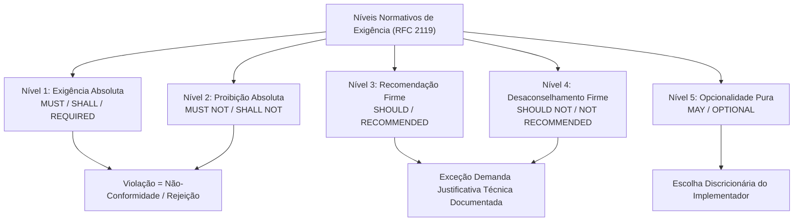
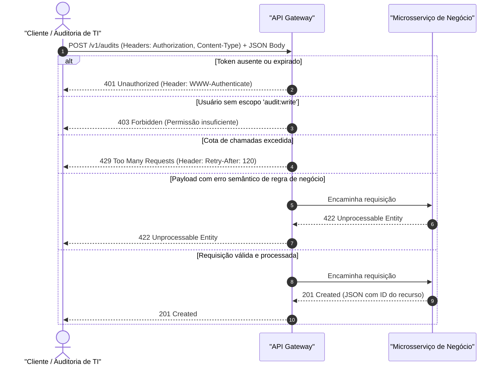
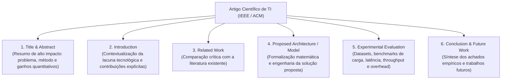

# 03 - Interpretação de Documentação de APIs, Manuais e Artigos

> **Matéria:** Língua Inglesa (Leitura Técnica)  
> **Cargo:** B02 – Técnico de Controle Externo – Especialidade: Tecnologia da Informação  
> **Arquivo:** `03_interpretacao_de_documentacao_de_apis_e_manuais.md`  

---

## 📌 Ementa / Itens do Edital
- Interpretação e leitura de documentações técnicas de APIs (REST, GraphQL)
- Interpretação de manuais de instalação, configuração e guias de software
- Leitura crítica de artigos científicos e papers de tecnologia da informação
- Linguagem prescritiva e advertências técnicas (RFC 2119: MUST, SHOULD, MAY)

---

## 🧭 Sumário

1. [Linguagem Normativa e Prescritiva de Engenharia (RFC 2119 / RFC 8174)](#1-linguagem-normativa-e-prescritiva-de-engenharia-rfc-2119-rfc-8174)
    1. [Os Níveis Normativos Canônicos](#11-os-niveis-normativos-canonicos)
    2. [Matriz de Conformidade Técnica da RFC 2119](#12-matriz-de-conformidade-tecnica-da-rfc-2119)
    3. [Teste 585](#Teste-585)
    4. [Teste 586](#Teste-586)
    5. [Teste 587](#Teste-587)
2. [Interpretação de Documentação de APIs (REST, OpenAPI, Swagger e GraphQL)](#2-interpretacao-de-documentacao-de-apis-rest-openapi-swagger-e-graphql)
    1. [Estrutura de Rotas, Métodos HTTP e Idempotência](#21-estrutura-de-rotas-metodos-http-e-idempotencia)
    2. [Parâmetros de Requisição e Schemas de Dados JSON](#22-parametros-de-requisicao-e-schemas-de-dados-json)
    3. [Códigos de Status HTTP Críticos e Cabeçalhos de Resposta](#23-codigos-de-status-http-criticos-e-cabecalhos-de-resposta)
    4. [Documentação de APIs GraphQL (Queries, Mutations e Types)](#24-documentacao-de-apis-graphql-queries-mutations-e-types)
    5. [Teste 588](#Teste-588)
    6. [Teste 589](#Teste-589)
    7. [Teste 590](#Teste-590)
    8. [Teste 591](#Teste-591)
3. [Interpretação de Manuais Técnicos e Guias de Configuração de Sistemas](#3-interpretacao-de-manuais-tecnicos-e-guias-de-configuracao-de-sistemas)
    1. [Verbos Operacionais no Modo Imperativo](#31-verbos-operacionais-no-modo-imperativo)
    2. [Seções Estruturantes de um Manual de Implantação](#32-secoes-estruturantes-de-um-manual-de-implantacao)
    3. [Categorização e Gravidade das Advertências Técnicas](#33-categorizacao-e-gravidade-das-advertencias-tecnicas)
    4. [Ciclo de Vida: Deprecated vs. Decommissioned](#34-ciclo-de-vida-deprecated-vs-decommissioned)
    5. [Teste 592](#Teste-592)
4. [Leitura Crítica de Artigos Científicos e Papers de TI (IEEE / ACM / ArXiv)](#4-leitura-critica-de-artigos-cientificos-e-papers-de-ti-ieee-acm-arxiv)
    1. [Anatomia Estrutural de um Artigo de Vanguarda](#41-anatomia-estrutural-de-um-artigo-de-vanguarda)
    2. [A Metodologia Three-Pass sob Pressão de Tempo de Prova](#42-a-metodologia-three-pass-sob-pressao-de-tempo-de-prova)
    3. [Léxico de Validação Experimental e Evidências Empíricas](#43-lexico-de-validacao-experimental-e-evidencias-empiricas)
    4. [Teste 593](#Teste-593)
    5. [Teste 594](#Teste-594)
6. [Fontes Recomendadas na Internet](#6-fontes-recomendadas-na-internet)

---

## 1. Linguagem Normativa e Prescritiva de Engenharia (RFC 2119 / RFC 8174)

Nas áreas de engenharia de software, redes de comunicação e governança de tecnologia avaliadas pela Fundação Carlos Chagas (FCC), a leitura de especificações técnicas formais (padrões da IETF, W3C, ISO/IEC e NIST) exige a compreensão rigorosa dos **termos normativos prescritivos grafados em letras maiúsculas**, disciplinados pela clássica **RFC 2119** (e reafirmados pela RFC 8174).

Esses vocábulos não exercem função decorativa ou meramente estilística; constituem **imposições contratuais e técnicas de conformidade estrita**.

### 1.1 Os Níveis Normativos Canônicos

1. **MUST / SHALL / REQUIRED (Obrigatório / Mandatório):** Designam uma exigência absoluta da especificação (*absolute requirement*). O sistema, serviço ou cliente que não implementar ou violar este item é classificado como em **não-conformidade** (*non-compliant*).
2. **MUST NOT / SHALL NOT (Terminantemente Proibido):** Expressam um veto categórico (*absolute prohibition*). A inclusão do comportamento vedado invalida a conformidade da solução perante o padrão internacional.
3. **SHOULD / RECOMMENDED (Fortemente Recomendado):** Indicam que o comportamento prescrito representa a boa prática recomendada. Podem existir razões válidas em circunstâncias particulares para ignorar a diretriz, mas as implicações técnicas de tal desvio devem ser plenamente compreendidas, avaliadas e formalmente documentadas.
4. **SHOULD NOT / NOT RECOMMENDED (Fortemente Desaconselhado):** Expressam que determinada conduta técnica deve ser evitada sob condições normais de operação. Desvios somente são tolerados em situações excepcionais de contorno devidamente motivadas.
5. **MAY / OPTIONAL (Opcional / Facultativo):** Indicam um recurso verdadeiramente opcional (*truly optional*). O implementador detém a faculdade discricionária de incluir ou omitir o atributo sem comprometer a interoperabilidade com outros sistemas que seguem o padrão.

### 1.2 Matriz de Conformidade Técnica da RFC 2119

| Termo em Maiúsculas | Definição Oficial IETF | Significado Prático em Auditoria e TI | O que NÃO Significa (Pegadinha FCC) |
| :--- | :--- | :--- | :--- |
| **MUST** / **SHALL** / **REQUIRED** | Exigência absoluta da especificação. | Mandatório. Ausência implica rejeição e não-conformidade estrita. | NÃO é sugestão, boa prática ou opcionalidade. |
| **MUST NOT** / **SHALL NOT** | Proibição absoluta da especificação. | Proibição expressa. Qualquer execução viola o padrão. | NÃO é mera ressalva dispensável. |
| **SHOULD** / **RECOMMENDED** | Fortemente recomendado com abertura para exceções fundamentadas. | Padrão ouro a ser seguido; desvios exigem justificativa técnica formal. | NÃO é uma imposição cega inegociável, e NÃO é uma opção arbitrária sem critérios. |
| **SHOULD NOT** / **NOT RECOMMENDED** | Desaconselhamento enfático em operação padrão. | Conduta indesejada; implementação aceitável apenas em exceções marginais. | NÃO é um veto absoluto em 100% dos casos marginais. |
| **MAY** / **OPTIONAL** | Funcionalidade totalmente discricionária. | Facultativo. Não gera penalidades de conformidade. | NÃO é uma recomendação preferencial e NÃO é obrigatório. |

> 🚨 **ALERTA DE PROVA / PEGADINHA FCC:**  
> A FCC adora afirmar que o termo **"SHOULD"** impõe um mandamento inegociável sob qualquer pretexto. Trata-se de erro recorrente. A RFC 2119 expressamente ressalva que podem existir cenários peculiares que justifiquem a não observância do *SHOULD*, cabendo ao engenheiro mensurar os impactos (*the full implications must be understood and carefully weighed*).

---

### Teste 585
**(FGV – TRT-13 – Analista Judiciario Tecnologia da Informacao – 2022)**
Analise o script abaixo from pandas import DataFrame import matplotlib.pyplot as plt from sklearn.cluster import KMeans Data = {'x': [36,35,23,28,34,32,30,23,36,34,66,55,56,44,51,56,52,51,64,48,4 9,50,36,34,43,46,40,42,52,47], 'y': [76,52,52,79,60,73,73,58,70,76,52,33,41,45,52,37,36,59,60,51,2 6,21,15,13,21,10,30,28,10,17] } df = DataFrame(Data,columns=['x','y']) m = KMeans(n_clusters=3).fit(df) d = m.cluster_centers_ plt.xlabel("X") plt.ylabel("Y") plt.scatter(df['x'], df['y'], c= m.labels_.astype(float), s=100, alpha=0.5) plt.scatter(d[:, 0], d[:, 1], c='red', s=250, marker='*') plt.grid() plt.show() O resultado da execução é As estrelas indicam

* **A)** componentes principais.
* **B)** centros de voronoi.
* **C)** covariâncias.
* **D)** centroides.
* **E)** clusteres.

---

> **Comentário Detalhado:**
>
> - **A)** **Incorreta.** A opção apresenta proposição em desacordo com os fundamentos teóricos e técnicos do tópico ao afirmar que "componentes principais". De acordo com a teoria estudada em *3.4 Ciclo de Vida: Deprecated vs. Decommissioned*, a correta interpretação do ciclo de vida de componentes de software é essencial para a gestão e auditoria de TI.
> - **B)** **Incorreta.** A opção apresenta proposição em desacordo com os fundamentos teóricos e técnicos do tópico ao afirmar que "centros de voronoi". De acordo com a teoria estudada em *1.1 Os Níveis Normativos Canônicos*, mAY / OPTIONAL (Opcional / Facultativo): Indicam um recurso verdadeiramente opcional (*truly optional*).
> - **C)** **Incorreta.** A opção apresenta proposição em desacordo com os fundamentos teóricos e técnicos do tópico ao afirmar que "covariâncias". De acordo com a teoria estudada em *1.2 Matriz de Conformidade Técnica da RFC 2119*, mUST NOT / SHALL NOT: Proibição absoluta da especificação. — Proibição expressa. Qualquer execução viola o padrão. — NÃO é mera ressalva dispensável.
> - **D)** **Correta.** Conforme fundamentado na seção *1.1 Os Níveis Normativos Canônicos* deste guia, sHOULD / RECOMMENDED (Fortemente Recomendado): Indicam que o comportamento prescrito representa a boa prática recomendada. Dessa forma, está plenamente correta a assertiva da banca (FGV – TRT-13/2022) ao estabelecer que "centroides".
> - **E)** **Incorreta.** A opção apresenta proposição em desacordo com os fundamentos teóricos e técnicos do tópico ao afirmar que "clusteres". De acordo com a teoria estudada em *1.2 Matriz de Conformidade Técnica da RFC 2119*, sHOULD NOT / NOT RECOMMENDED: Desaconselhamento enfático em operação padrão. — Conduta indesejada; implementação aceitável apenas em exceções marginais. — NÃO é um veto absoluto em 100% dos casos marginais.
>
> **Gabarito: D**

---

### Teste 586
**(FGV – TJ-DFT – Analista Judiciario Suporte Em Tecnologia da Informacao – 2022)**
The passage in which the verb phrase indicates a necessity is:

* **A)** “this incredible ability of the brain […] may be fundamental”;
* **B)** “some engineers can come up with something”;
* **C)** “computers don’t work this way”;
* **D)** “brains don’t store information”;
* **E)** “it must regulate a body”.

---

> **Comentário Detalhado:**
>
> - **A)** **Incorreta.** A opção apresenta proposição em desacordo com os fundamentos teóricos e técnicos do tópico ao afirmar que "“this incredible ability of the brain […] may be fundamental”". De acordo com a teoria estudada em *1.1 Os Níveis Normativos Canônicos*, mAY / OPTIONAL (Opcional / Facultativo): Indicam um recurso verdadeiramente opcional (*truly optional*).
> - **B)** **Incorreta.** A opção apresenta proposição em desacordo com os fundamentos teóricos e técnicos do tópico ao afirmar que "“some engineers can come up with something”". De acordo com a teoria estudada em *2.2 Parâmetros de Requisição e Schemas de Dados JSON*, request Body (Corpo da Requisição / Payload): Estrutura hierárquica contendo os campos de dados.
> - **C)** **Incorreta.** A opção apresenta proposição em desacordo com os fundamentos teóricos e técnicos do tópico ao afirmar que "“computers don’t work this way”". De acordo com a teoria estudada em *4.1 Anatomia Estrutural de um Artigo de Vanguarda*, introduction: Expõe a relevância do problema e lista textualmente as contribuições primárias do trabalho (*"In this paper, our main contributions are.."*).
> - **D)** **Incorreta.** A opção apresenta proposição em desacordo com os fundamentos teóricos e técnicos do tópico ao afirmar que "“brains don’t store information”". De acordo com a teoria estudada em *6. Fontes Recomendadas na Internet*, gLENDINNING, Eric H.; MCEWAN, John. Oxford English for Information Technology. 2. ed. Oxford: Oxford University Press, 2006. (Units 20 to 25 - Reading Technical Manuals and System Specifications).
> - **E)** **Correta.** Conforme fundamentado na seção *1.2 Matriz de Conformidade Técnica da RFC 2119* deste guia, a RFC 2119 expressamente ressalva que podem existir cenários peculiares que justifiquem a não observância do *SHOULD*, cabendo ao engenheiro mensurar os impactos (*the full implications must be understood and carefully weighed*). Dessa forma, está plenamente correta a assertiva da banca (FGV – TJ-DFT/2022) ao estabelecer que "“it must regulate a body”".
>
> **Gabarito: E**

---

### Teste 587
**(FCC – TRT-9 – Analista Judiciario Apoio Especializado Tecnologia da Informacao – 2015)**
When a developer team build an application with Oracle Form Builder, they work with individual application components called modules. The form module is a collection of objects and code routines. Some of the objects can be defined in a form module including windows, text items (fields), check boxes, buttons, alerts, lists of values, and blocks of PL/SQL code called

* **A)** joins.
* **B)** triggers.
* **C)** thin blocks.
* **D)** collections.
* **E)** queries.

---

> **Comentário Detalhado:**
>
> - **A)** **Incorreta.** A opção apresenta proposição em desacordo com os fundamentos teóricos e técnicos do tópico ao afirmar que "joins". De acordo com a teoria estudada em *3.1 Verbos Operacionais no Modo Imperativo*, purge / Prune: *"Prune unreferenced objects to recover disk blocks"* \$\rightarrow\$ *Expurgue / limpe* objetos não referenciados.
> - **B)** **Correta.** Conforme fundamentado na seção *1.2 Matriz de Conformidade Técnica da RFC 2119* deste guia, a RFC 2119 expressamente ressalva que podem existir cenários peculiares que justifiquem a não observância do *SHOULD*, cabendo ao engenheiro mensurar os impactos (*the full implications must be understood and carefully weighed*). Dessa forma, está plenamente correta a assertiva da banca (FCC – TRT-9/2015) ao estabelecer que "triggers".
> - **C)** **Incorreta.** A opção apresenta proposição em desacordo com os fundamentos teóricos e técnicos do tópico ao afirmar que "thin blocks". De acordo com a teoria estudada em *3.1 Verbos Operacionais no Modo Imperativo*, provision: *"Provision persistent storage classes with dynamic allocation"* \$\rightarrow\$ *Aloque / provisione* classes de armazenamento.
> - **D)** **Incorreta.** A opção apresenta proposição em desacordo com os fundamentos teóricos e técnicos do tópico ao afirmar que "collections". De acordo com a teoria estudada em *4.1 Anatomia Estrutural de um Artigo de Vanguarda*, related Work: Confronta a solução com trabalhos anteriores (*prior art*).
> - **E)** **Incorreta.** A opção apresenta proposição em desacordo com os fundamentos teóricos e técnicos do tópico ao afirmar que "queries". De acordo com a teoria estudada em *2.4 Documentação de APIs GraphQL (Queries, Mutations e Types)*, diferentemente do padrão REST, no qual cada recurso ocupa uma URI distinta, o padrão GraphQL opera via endpoint único (`POST /graphql`). A documentação orienta-se por esquemas de tipagem estrita (*Schema Definition Language - SDL*).
>
> **Gabarito: B**

---

## 2. Interpretação de Documentação de APIs (REST, OpenAPI, Swagger e GraphQL)

A análise de contratos de interface entre sistemas constitui atividade primordial tanto no desenvolvimento quanto na auditoria de dados fiscais e orçamentários.

### 2.1 Estrutura de Rotas, Métodos HTTP e Idempotência

O design RESTful organiza as interações por meio de URIs de recursos e verbos padronizados pelo protocolo HTTP:

- **GET:** Recupera a representação de um recurso. Operação **segura** (não altera o estado no servidor) e **idempotente** (múltiplas chamadas idênticas produzem o mesmo efeito de uma única chamada).
- **POST:** Submete dados para criação de novo recurso ou processamento interno. Operação **não-segura** e **não-idempotente** (cada envio gera uma nova entidade ou cobrança).
- **PUT:** Substitui integralmente o recurso existente na URI especificada. Operação **idempotente**.
- **PATCH:** Aplica modificações parciais a atributos pontuais do recurso.
- **DELETE:** Remove o recurso indicado. Operação **idempotente** (a exclusão de um recurso já excluído mantém o estado de recurso ausente).

### 2.2 Parâmetros de Requisição e Schemas de Dados JSON

Nas especificações OpenAPI 3.0 / Swagger, os parâmetros distribuem-se em quatro categorias fundamentais:

- **Path Parameters (`/taxpayers/{id}`):** Integram a hierarquia da URL e identificam instâncias unívocas de recursos. São invariavelmente obrigatórios.
- **Query Parameters (`?fiscal_year=2026&status=audited&limit=50&offset=100`):** Utilizados para filtragem, ordenação (*sorting*) e paginação de coleções.
- **Header Parameters:** Transportam metadados essenciais de rede e segurança:
    - `Authorization: Bearer <token_jwt>`: Credencial criptográfica de autenticação.
    - `Content-Type: application/json`: Informa a codificação do payload transmitido.
    - `Accept: application/json`: Comunica o formato que o cliente está apto a receber.
- **Request Body (Corpo da Requisição / Payload):** Estrutura hierárquica contendo os campos de dados:
    - `required: true`: Sinaliza que o bloco ou os campos listados no array `required:` são indispensáveis. A omissão acarreta rejeição da mensagem.
    - `properties`: Mapeia cada atributo com suas restrições de validação (`type: string`, `pattern: '^\d{14}$'`, `minimum: 0.0`).

### 2.3 Códigos de Status HTTP Críticos e Cabeçalhos de Resposta

A compreensão precisa das famílias de códigos de status HTTP é intensamente avaliada em provas:

- **Família 2xx (Success):**
    - `200 OK`: Requisição bem-sucedida com retorno de dados.
    - `201 Created`: Criação bem-sucedida de um novo recurso no servidor (resposta clássica a `POST`).
    - `204 No Content`: Ação processada com êxito, sem corpo textual de retorno (comum em `DELETE`).
- **Família 4xx (Client Error - Erros Originados no Cliente):**
    - `400 Bad Request`: Erro de sintaxe da requisição (JSON malformado, quebra de delimitadores, tipos primitivos ilegíveis).
    - `401 Unauthorized`: Falha de **autenticação**. O cliente não forneceu credenciais válidas ou o token expirou.
    - `403 Forbidden`: O cliente está autenticado com sucesso, mas suas permissões/papéis (*roles*) **não autorizam** o acesso à rota solicitada.
    - `404 Not Found`: A URI solicitada não corresponde a nenhum recurso existente.
    - `409 Conflict`: Conflito com o estado atual do recurso (ex.: tentativa de cadastrar registro com chave primária já existente).
    - `422 Unprocessable Entity`: A sintaxe do JSON está impecável, mas os dados contêm **erros semânticos ou violações de regras de negócio** (ex.: valor negativo em receita declarada, CPF com dígitos verificadores inválidos).
    - `429 Too Many Requests`: Limite de taxa de requisições excedido (*rate limiting / throttling*). Vem associado ao cabeçalho `Retry-After: <segundos>`, que estipula o tempo de espera obrigatório antes de nova tentativa.
- **Família 5xx (Server Error - Falhas Internas do Provedor):**
    - `500 Internal Server Error`: Exceção inesperada não tratada pela aplicação.
    - `502 Bad Gateway`: O proxy reverso ou gateway recebeu resposta corrompida do microsserviço de backend.
    - `503 Service Unavailable`: Servidor temporariamente incapacitado por sobrecarga ou manutenção programada.
    - `504 Gateway Timeout`: O gateway expirou aguardando a resposta do serviço interno.

> 💡 **Diferença Crítica FCC (401 vs. 403):**  
>
> - **401 Unauthorized** $\rightarrow$ *Quem é você?* (Problema de Identidade / Autenticação).  
> - **403 Forbidden** $\rightarrow$ *Eu sei quem você é, mas você não tem permissão para entrar aqui.* (Problema de Privilégio / Autorização).

### 2.4 Documentação de APIs GraphQL (Queries, Mutations e Types)

Diferentemente do padrão REST, no qual cada recurso ocupa uma URI distinta, o padrão GraphQL opera via endpoint único (`POST /graphql`). A documentação orienta-se por esquemas de tipagem estrita (*Schema Definition Language - SDL*):

- **Query:** Operação de consulta somente-leitura.
- **Mutation:** Operação de escrita que gera efeitos colaterais de criação, atualização ou remoção.
- **Modifiers de Obrigatoriedade:** O caractere de exclamação `!` ao final do tipo indica campo não-nulo e mandatório (ex.: `id: ID!`, `revenue: Float!`).

---

### Teste 588
**(IBFC – TJ-MG – Analista Judiciario Classe C Analista de Tecnologia da Informacao – 2022)**
As palavras denominadas de cognatas vêm do latim cognatus que significa referente a parente. Especificamente, refere-se a uma palavra que deriva da mesma família de línguas ou tronco linguístico (Dicio.com., 2020). As palavras cognatas ou os cognatos são muito importantes, pois, a proximidade morfológica com a língua portuguesa auxilia na compreensão do texto em língua inglesa e na aprendizagem de palavras, ainda, desconhecidas. A partir do acima explicado, assinale a sequência de palavras cognatas retiradas do texto Crimes.

* **A)** crime, types; understand
* **B)** courts, wrong, commit
* **C)** insane; crime, responsible
* **D)** children; age; cannot
* **E)** right, law, courts

---

> **Comentário Detalhado:**
>
> - **A)** **Incorreta.** A opção apresenta proposição em desacordo com os fundamentos teóricos e técnicos do tópico ao afirmar que "crime, types; understand". De acordo com a teoria estudada em *2.4 Documentação de APIs GraphQL (Queries, Mutations e Types)*, diferentemente do padrão REST, no qual cada recurso ocupa uma URI distinta, o padrão GraphQL opera via endpoint único (`POST /graphql`). A documentação orienta-se por esquemas de tipagem estrita (*Schema Definition Language - SDL*).
> - **B)** **Incorreta.** A opção apresenta proposição em desacordo com os fundamentos teóricos e técnicos do tópico ao afirmar que "courts, wrong, commit". De acordo com a teoria estudada em *2.3 Códigos de Status HTTP Críticos e Cabeçalhos de Resposta*, a compreensão precisa das famílias de códigos de status HTTP é intensamente avaliada em provas.
> - **C)** **Correta.** Conforme fundamentado na seção *2.3 Códigos de Status HTTP Críticos e Cabeçalhos de Resposta* deste guia, `429 Too Many Requests`: Limite de taxa de requisições excedido (*rate limiting / throttling*). Vem associado ao cabeçalho `Retry-After: <segundos>`, que estipula o tempo de espera obrigatório antes de nova tentativa. Dessa forma, está plenamente correta a assertiva da banca (IBFC – TJ-MG/2022) ao estabelecer que "insane; crime, responsible".
> - **D)** **Incorreta.** A opção apresenta proposição em desacordo com os fundamentos teóricos e técnicos do tópico ao afirmar que "children; age; cannot". De acordo com a teoria estudada em *2.3 Códigos de Status HTTP Críticos e Cabeçalhos de Resposta*, família 4xx (Client Error - Erros Originados no Cliente).
> - **E)** **Incorreta.** A opção apresenta proposição em desacordo com os fundamentos teóricos e técnicos do tópico ao afirmar que "right, law, courts". De acordo com a teoria estudada em *2.3 Códigos de Status HTTP Críticos e Cabeçalhos de Resposta*, família 5xx (Server Error - Falhas Internas do Provedor).
>
> **Gabarito: C**

---

### Teste 589
**(FCC – TRT-6 – Analista Judiciario Apoio Especializado Tecnologia da Informacao – 2012)**
A tecnologia conhecida como RAID,

* **A)** tem como principal vantagem o aumento na velocidade da operações de leitura e escrita, na comparação com discos convencionais.
* **B)** consiste numa tecnologia de armazenamento de dados que combina vários discos físicos num único "disco lógico".
* **C)** pode ser utilizada para implementar um sistema de backup uma vez que oferece toda a funcionalidade necessária a um sistema de backup.
* **D)** consiste numa tecnologia de armazenamento de dados que combina várias partições de um mesmo disco numa única "partição lógica".
* **E)** tem como desvantagem exigir o uso de discos e/ou controladores de disco especiais e, portanto, mais dispendiosos. Atenção: Considere o texto a seguir, para responder às questões de números 58 a 60. Microsoft touts Windows 8's ability to detect, fix hard disk problems The new operating system makes the process faster and less disruptive to the operation of the computer By Juan Carlos Perez May 10, 2012 04:46 PM ET IDG News Service − Microsoft has revamped the way Windows 8 monitors hard disk operations and detects problems in an effort to make the diagnostic and repair process less intrusive and disruptive, even as disk capacity continues to balloon.

---

> **Comentário Detalhado:**
>
> - **A)** **Incorreta.** A opção apresenta proposição em desacordo com os fundamentos teóricos e técnicos do tópico ao afirmar que "tem como principal vantagem o aumento na velocidade da operações de leitura e escrita, na comparação com discos...". De acordo com a teoria estudada em *1. Linguagem Normativa e Prescritiva de Engenharia (RFC 2119 / RFC 8174)*, nas áreas de engenharia de software, redes de comunicação e governança de tecnologia avaliadas pela Fundação Carlos Chagas (FCC), a leitura de especificações técnicas formais (padrões da IETF, W3C, ISO/IEC e NIST) exige a compreensão rigorosa dos termos normativos prescritivos grafados em letras maiúsculas, disciplinados pela clássica RFC 2119 (e reafirmados pela RFC 8174).
> - **B)** **Correta.** Conforme fundamentado na seção *3.3 Categorização e Gravidade das Advertências Técnicas* deste guia, danger / Fatal (Perigo / Fatalidade): Risco crítico de perda irreversível de dados, danos físicos ao hardware ou colapso total de segurança cibernética. Dessa forma, está plenamente correta a assertiva da banca (FCC – TRT-6/2012) ao estabelecer que "consiste numa tecnologia de armazenamento de dados que combina vários discos físicos num único "disco lógico"".
> - **C)** **Incorreta.** A opção apresenta proposição em desacordo com os fundamentos teóricos e técnicos do tópico ao afirmar que "pode ser utilizada para implementar um sistema de backup uma vez que oferece toda a funcionalidade necessária a um...". De acordo com a teoria estudada em *1.1 Os Níveis Normativos Canônicos*, mUST / SHALL / REQUIRED (Obrigatório / Mandatório): Designam uma exigência absoluta da especificação (*absolute requirement*). O sistema, serviço ou cliente que não implementar ou violar este item é classificado como em não-conformidade (*non-compliant*).
> - **D)** **Incorreta.** A opção apresenta proposição em desacordo com os fundamentos teóricos e técnicos do tópico ao afirmar que "consiste numa tecnologia de armazenamento de dados que combina várias partições de um mesmo disco numa única...". De acordo com a teoria estudada em *2.1 Estrutura de Rotas, Métodos HTTP e Idempotência*, gET: Recupera a representação de um recurso. Operação segura (não altera o estado no servidor) e idempotente (múltiplas chamadas idênticas produzem o mesmo efeito de uma única chamada).
> - **E)** **Incorreta.** A opção apresenta proposição em desacordo com os fundamentos teóricos e técnicos do tópico ao afirmar que "tem como desvantagem exigir o uso de discos e/ou controladores de disco especiais e, portanto, mais dispendiosos...". De acordo com a teoria estudada em *1.2 Matriz de Conformidade Técnica da RFC 2119*, a RFC 2119 expressamente ressalva que podem existir cenários peculiares que justifiquem a não observância do *SHOULD*, cabendo ao engenheiro mensurar os impactos (*the full implications must be understood and carefully weighed*).
>
> **Gabarito: B**

---

### Teste 590
**(FGV – TJ-BA – Analista Judiciario Tecnologia da Informacao – 2015)**
Em regra, dependem de preparo, consoante dispõe o egimento nterno do Tribunal de ustiça do stado da ahia:

* **A)** os reexames de sentença e os recursos interpostos pelo Ministério Público, pela efensoria Pública, pela azenda Pública e por entidades da administração indireta, assim como as aç es por eles intentadas;
* **B)** os processos e recursos previstos no statuto da riança e do Adolescente;
* **C)** os conflitos de compet ncia, as exceç es de impedimento, de suspeição e de incompet ncia;
* **D)** as aç es diretas de inconstitucionalidade, as reclamaç es e os pedidos de intervenção;
* **E)** os mandados de segurança, sendo que, quando indicados os litisconsortes, o preparo incluirá as cartas, inclusive as de ordem a serem expedidas.

---

> **Comentário Detalhado:**
>
> - **A)** **Incorreta.** A opção apresenta proposição em desacordo com os fundamentos teóricos e técnicos do tópico ao afirmar que "os reexames de sentença e os recursos interpostos pelo Ministério Público, pela efensoria Pública, pela azenda...". De acordo com a teoria estudada em *2.1 Estrutura de Rotas, Métodos HTTP e Idempotência*, o design RESTful organiza as interações por meio de URIs de recursos e verbos padronizados pelo protocolo HTTP.
> - **B)** **Incorreta.** A opção apresenta proposição em desacordo com os fundamentos teóricos e técnicos do tópico ao afirmar que "os processos e recursos previstos no statuto da riança e do Adolescente". De acordo com a teoria estudada em *2.2 Parâmetros de Requisição e Schemas de Dados JSON*, path Parameters (`/taxpayers/{id}`): Integram a hierarquia da URL e identificam instâncias unívocas de recursos. São invariavelmente obrigatórios.
> - **C)** **Incorreta.** A opção apresenta proposição em desacordo com os fundamentos teóricos e técnicos do tópico ao afirmar que "os conflitos de compet ncia, as exceç es de impedimento, de suspeição e de incompet ncia". De acordo com a teoria estudada em *3.3 Categorização e Gravidade das Advertências Técnicas*, danger / Fatal (Perigo / Fatalidade): Risco crítico de perda irreversível de dados, danos físicos ao hardware ou colapso total de segurança cibernética.
> - **D)** **Incorreta.** A opção apresenta proposição em desacordo com os fundamentos teóricos e técnicos do tópico ao afirmar que "as aç es diretas de inconstitucionalidade, as reclamaç es e os pedidos de intervenção". De acordo com a teoria estudada em *3.1 Verbos Operacionais no Modo Imperativo*, no manual técnico, instruções diretas abrem as sentenças com o verbo no infinitivo sem "to", expressando comando executivo.
> - **E)** **Correta.** Conforme fundamentado na seção *2.2 Parâmetros de Requisição e Schemas de Dados JSON* deste guia, header Parameters: Transportam metadados essenciais de rede e segurança. Dessa forma, está plenamente correta a assertiva da banca (FGV – TJ-BA/2015) ao estabelecer que "os mandados de segurança, sendo que, quando indicados os litisconsortes, o preparo incluirá as cartas, inclusive...".
>
> **Gabarito: E**

---

### Teste 591
**(IBFC – TJ-MG – Analista Judiciario Classe C Analista de Tecnologia da Informacao – 2022)**
A partir das técnicas de leitura instrumental, atenha-se à compreensão e à interpretação do texto “Crimes”, analise as afirmativas a seguir e dê valores de Verdadeiro (V) e Falso (F). ( ) O autor afirma que certos tipos de indivíduos não podem ser acusados de cometer um crime. ( ) O autor expõe que todos os indivíduos com comportamentos criminosos poderão ser julgados nos tribunais. ( ) Ainda segundo o autor, os indivíduos mentalmente insanos não podem ser acusados de cometer um crime. ( ) O autor reitera que embora insanos, os indivíduos conseguem entender e avaliar o seu próprio comportamento. Assinale a alternativa que apresenta a sequência correta de cima para baixo.

* **A)** F - V - F - V
* **B)** V - F - V - F
* **C)** F - F - V - V
* **D)** V - V - F - F
* **E)** V - V - V - V

---

> **Comentário Detalhado:**
>
> - **A)** **Incorreta.** A opção apresenta proposição em desacordo com os fundamentos teóricos e técnicos do tópico ao afirmar que "F - V - F - V". De acordo com a teoria estudada em *2. Interpretação de Documentação de APIs (REST, OpenAPI, Swagger e GraphQL)*, a análise de contratos de interface entre sistemas constitui atividade primordial tanto no desenvolvimento quanto na auditoria de dados fiscais e orçamentários.
> - **B)** **Correta.** Conforme fundamentado na seção *1. Linguagem Normativa e Prescritiva de Engenharia (RFC 2119 / RFC 8174)* deste guia, nas áreas de engenharia de software, redes de comunicação e governança de tecnologia avaliadas pela Fundação Carlos Chagas (FCC), a leitura de especificações técnicas formais (padrões da IETF, W3C, ISO/IEC e NIST) exige a compreensão rigorosa dos termos normativos prescritivos grafados em letras maiúsculas, disciplinados pela clássica RFC 2119 (e reafirmados pela RFC 8174). Dessa forma, está plenamente correta a assertiva da banca (IBFC – TJ-MG/2022) ao estabelecer que "V - F - V - F".
> - **C)** **Incorreta.** A opção apresenta proposição em desacordo com os fundamentos teóricos e técnicos do tópico ao afirmar que "F - F - V - V". De acordo com a teoria estudada em *1.1 Os Níveis Normativos Canônicos*, podem existir razões válidas em circunstâncias particulares para ignorar a diretriz, mas as implicações técnicas de tal desvio devem ser plenamente compreendidas, avaliadas e formalmente documentadas.
> - **D)** **Incorreta.** A opção apresenta proposição em desacordo com os fundamentos teóricos e técnicos do tópico ao afirmar que "V - V - F - F". De acordo com a teoria estudada em *2.3 Códigos de Status HTTP Críticos e Cabeçalhos de Resposta*, `400 Bad Request`: Erro de sintaxe da requisição (JSON malformado, quebra de delimitadores, tipos primitivos ilegíveis).
> - **E)** **Incorreta.** A opção apresenta proposição em desacordo com os fundamentos teóricos e técnicos do tópico ao afirmar que "V - V - V - V". De acordo com a teoria estudada em *3.3 Categorização e Gravidade das Advertências Técnicas*, caution (Cuidado): Risco de comportamento inesperado, degradação severa de desempenho ou instabilidade na topologia (ex.: formar clusters com número par de nós, arriscando *split-brain*).
>
> **Gabarito: B**

---

## 3. Interpretação de Manuais Técnicos e Guias de Configuração de Sistemas

Manuais operacionais de infraestrutura (Linux manpages, guias do Kubernetes, PostgreSQL, Docker) empregam linguagem estritamente procedimental e estruturada.

### 3.1 Verbos Operacionais no Modo Imperativo

No manual técnico, instruções diretas abrem as sentenças com o verbo no infinitivo sem "to", expressando comando executivo:

- **Ensure:** *"Ensure that NTP synchronization is active before joining nodes"* $\rightarrow$ *Garanta que* a sincronização de relógio esteja ativa.
- **Provision:** *"Provision persistent storage classes with dynamic allocation"* $\rightarrow$ *Aloque / provisione* classes de armazenamento.
- **Purge / Prune:** *"Prune unreferenced objects to recover disk blocks"* $\rightarrow$ *Expurgue / limpe* objetos não referenciados.
- **Enforce:** *"Enforce least-privilege IAM policies"* $\rightarrow$ *Imponha / faça cumprir* políticas de menor privilégio.
- **Bypass:** *"Do not attempt to bypass input sanitation filters"* $\rightarrow$ *Não tente burlar / contornar* filtros de sanitização.

### 3.2 Seções Estruturantes de um Manual de Implantação

1. **Overview / Architecture:** Visão conceitual e topologia do sistema.
2. **Prerequisites (Pré-requisitos):** Condições mandatórias que devem ser atendidas antes da instalação (versão de kernel, bibliotecas, portas de firewall abertas). O descumprimento impede a instalação.
3. **Installation & Configuration:** Procedimentos passo a passo de implantação.
4. **Troubleshooting (Resolução de Problemas):** Procedimentos de diagnóstico e mitigação de erros comuns.

### 3.3 Categorização e Gravidade das Advertências Técnicas

As caixas de alerta dos manuais de engenharia são padronizadas por nível de risco:

- **Note / Tip (Nota / Dica):** Informação complementar útil ou sugestão de atalho operacional.
- **Important (Importante):** Diretriz de conformidade essencial; sua inobservância causa mau funcionamento do serviço.
- **Caution (Cuidado):** Risco de comportamento inesperado, degradação severa de desempenho ou instabilidade na topologia (ex.: formar clusters com número par de nós, arriscando *split-brain*).
- **Warning (Advertência):** Alerta formal de perda iminente de compatibilidade ou quebra de fluxo operacional.
- **Danger / Fatal (Perigo / Fatalidade):** Risco crítico de perda irreversível de dados, danos físicos ao hardware ou colapso total de segurança cibernética.

### 3.4 Ciclo de Vida: Deprecated vs. Decommissioned

A correta interpretação do ciclo de vida de componentes de software é essencial para a gestão e auditoria de TI:

- **Deprecated (Descontinuado / Tornado Obsoleto):** O método, protocolo ou versão **continua plenamente funcional** na versão em execução do software. Contudo, o fabricante adverte formalmente que o recurso não receberá novas funcionalidades nem suporte futuro, estando com remoção agendada. Não deve ser empregado em novos projetos.
- **Decommissioned / Removed (Descomissionado / Removido):** O recurso foi definitivamente excluído da base de código. Qualquer invocação resultará em erro imediato de método inexistente (`404` ou `410 Gone`).

---

### Teste 592
**(FGV – TRF-1 – Analista Judiciario Area Apoio Especializado Especialidade Tecnologia da Informacao – 2024)**
O analista Micael precisa instalar o pacote nodejs em um servidor Red Hat Enterpise Linux (RHEL). Ele deve instalar especificamente a versão 18, uma versão anterior, do nodejs. Sabendo que a versão 18 do nodejs está disponível no repositório AppStream do RHEL, como o stream 18 do módulo nodejs, Micael deve simplificar a instalação utilizando os recursos de modularidade do Dandified YUM. Micael deve instalar a versão 18 do módulo nodejs por meio do seguinte comando do Dandified YUM:

* **A)** install nodejs:18
* **B)** module -i nodejs:18
* **C)** install -m nodejs -s 18
* **D)** install -p nodejs -s 18
* **E)** module install nodejs:18

---

> **Comentário Detalhado:**
>
> - **A)** **Incorreta.** A opção apresenta proposição em desacordo com os fundamentos teóricos e técnicos do tópico ao afirmar que "install nodejs:18". De acordo com a teoria estudada em *2.1 Estrutura de Rotas, Métodos HTTP e Idempotência*, o design RESTful organiza as interações por meio de URIs de recursos e verbos padronizados pelo protocolo HTTP.
> - **B)** **Correta.** Conforme fundamentado na seção *3.2 Seções Estruturantes de um Manual de Implantação* deste guia, prerequisites (Pré-requisitos): Condições mandatórias que devem ser atendidas antes da instalação (versão de kernel, bibliotecas, portas de firewall abertas). O descumprimento impede a instalação. Dessa forma, está plenamente correta a assertiva da banca (FGV – TRF-1/2024) ao estabelecer que "module -i nodejs:18".
> - **C)** **Incorreta.** A opção apresenta proposição em desacordo com os fundamentos teóricos e técnicos do tópico ao afirmar que "install -m nodejs -s 18". De acordo com a teoria estudada em *3. Interpretação de Manuais Técnicos e Guias de Configuração de Sistemas*, manuais operacionais de infraestrutura (Linux manpages, guias do Kubernetes, PostgreSQL, Docker) empregam linguagem estritamente procedimental e estruturada.
> - **D)** **Incorreta.** A opção apresenta proposição em desacordo com os fundamentos teóricos e técnicos do tópico ao afirmar que "install -p nodejs -s 18". De acordo com a teoria estudada em *3.1 Verbos Operacionais no Modo Imperativo*, no manual técnico, instruções diretas abrem as sentenças com o verbo no infinitivo sem "to", expressando comando executivo.
> - **E)** **Incorreta.** A opção apresenta proposição em desacordo com os fundamentos teóricos e técnicos do tópico ao afirmar que "module install nodejs:18". De acordo com a teoria estudada em *3.4 Ciclo de Vida: Deprecated vs. Decommissioned*, deprecated (Descontinuado / Tornado Obsoleto): O método, protocolo ou versão continua plenamente funcional na versão em execução do software.
>
> **Gabarito: B**

---

## 4. Leitura Crítica de Artigos Científicos e Papers de TI (IEEE / ACM / ArXiv)

Em certames da FCC para cargos de alta remuneração de Tecnologia da Informação, os textos de prova costumam ser extraídos de publicações acadêmicas e anais de conferências de renome mundial (como *IEEE Transactions on Software Engineering, ACM SIGMOD, USENIX OSDI*).

### 4.1 Anatomia Estrutural de um Artigo de Vanguarda

1. **Title & Abstract:** O núcleo de maior densidade do paper. Sintetiza a motivação central, a fraqueza das abordagens tradicionais, a solução inovadora formulada e os ganhos numéricos consolidados (ex.: redução de latência em 42%).
2. **Introduction:** Expõe a relevância do problema e lista textualmente as contribuições primárias do trabalho (*"In this paper, our main contributions are.."*).
3. **Related Work:** Confronta a solução com trabalhos anteriores (*prior art*).
4. **Proposed Architecture / Algorithm:** Detalhamento da arquitetura técnica ou algoritmo implementado.
5. **Experimental Evaluation & Discussion:** Apresentação rigorosa das métricas de desempenho sob carga de trabalho corporativa real (*enterprise workloads*).
6. **Threats to Validity:** Reconhecimento das premissas e limitações do estudo.
7. **Conclusion:** Recapitulação das deduções finais.

### 4.2 A Metodologia Three-Pass sob Pressão de Tempo de Prova

Conforme preconizado pelo Prof. S. Keshav, a leitura de papers em ambientes de prova deve ser estratificada em camadas:

- **Passada 1 (Abordagem Panorâmica - 3 a 5 minutos):** Leitura concentrada do título, do *Abstract*, da introdução preliminar e da conclusão final. Essa varredura inicial responde com clareza:
    - Qual o problema central atacado pelo autor?
    - A tecnologia proposta substitui ou aprimora os modelos vigentes?
    - O tom é de refutação ou de proposição de nova técnica?
- **Passada 2 (Varredura Analítica para Itens Específicos):** Inspeção de figuras de arquitetura, gráficos de desempenho e tabelas comparativas.

### 4.3 Léxico de Validação Experimental e Evidências Empíricas

- **Benchmark / Workload:** Carga de trabalho de teste executada para aferir limites operacionais de um sistema.
- **Tail Latency (Latência de Cauda - P99 / P99.9):** O tempo de resposta experimentado pelos percentis mais lentos das requisições; indicador crítico em sistemas de tempo real.
- **Overhead:** Custo operacional computacional marginal incorrido em ciclos de CPU, memória RAM ou rede para suportar a nova ferramenta (ex.: menos de 3% de consumo extra de CPU).
- **Outperform:** Superar o desempenho de uma solução concorrente (*"Our model outperforms traditional heuristics"*).

---

### Teste 593
**(FCC – TRT-14 – Analista Judiciario Apoio Especializado Tecnologia da Informacao – 2016)**
Na área de trabalho do Oracle Reports Builder 11g, após a criação de um novo relatório de forma manual, para selecionar os dados que se deseja utilizar no relatório, no Object Navigator, deve-se dar um duplo clique no nó

* **A)** Paper Layout.
* **B)** Data Wizard.
* **C)** Data Model.
* **D)** Report Source.
* **E)** PL/SQL Queries.

---

> **Comentário Detalhado:**
>
> - **A)** **Incorreta.** A opção apresenta proposição em desacordo com os fundamentos teóricos e técnicos do tópico ao afirmar que "Paper Layout". De acordo com a teoria estudada em *4.1 Anatomia Estrutural de um Artigo de Vanguarda*, introduction: Expõe a relevância do problema e lista textualmente as contribuições primárias do trabalho (*"In this paper, our main contributions are.."*).
> - **B)** **Incorreta.** A opção apresenta proposição em desacordo com os fundamentos teóricos e técnicos do tópico ao afirmar que "Data Wizard". De acordo com a teoria estudada em *2.1 Estrutura de Rotas, Métodos HTTP e Idempotência*, pOST: Submete dados para criação de novo recurso ou processamento interno. Operação não-segura e não-idempotente (cada envio gera uma nova entidade ou cobrança).
> - **C)** **Correta.** Conforme fundamentado na seção *4.3 Léxico de Validação Experimental e Evidências Empíricas* deste guia, outperform: Superar o desempenho de uma solução concorrente (*"Our model outperforms traditional heuristics"*). Dessa forma, está plenamente correta a assertiva da banca (FCC – TRT-14/2016) ao estabelecer que "Data Model".
> - **D)** **Incorreta.** A opção apresenta proposição em desacordo com os fundamentos teóricos e técnicos do tópico ao afirmar que "Report Source". De acordo com a teoria estudada em *2.3 Códigos de Status HTTP Críticos e Cabeçalhos de Resposta*, `201 Created`: Criação bem-sucedida de um novo recurso no servidor (resposta clássica a `POST`).
> - **E)** **Incorreta.** A opção apresenta proposição em desacordo com os fundamentos teóricos e técnicos do tópico ao afirmar que "PL/SQL Queries". De acordo com a teoria estudada em *2.4 Documentação de APIs GraphQL (Queries, Mutations e Types)*, mutation: Operação de escrita que gera efeitos colaterais de criação, atualização ou remoção.
>
> **Gabarito: C**

---

### Teste 594
**(FGV – TJ-DFT – Analista Judiciario Suporte Em Tecnologia da Informacao – 2022)**
“Whereas” in “A computer is built from static parts, whereas your brain constantly rewires itself as you age and learn” introduces a(n):

* **A)** cause;
* **B)** contrast;
* **C)** condition;
* **D)** illustration;
* **E)** explanation.

---

> **Comentário Detalhado:**
>
> - **A)** **Incorreta.** A opção apresenta proposição em desacordo com os fundamentos teóricos e técnicos do tópico ao afirmar que "cause". De acordo com a teoria estudada em *1.2 Matriz de Conformidade Técnica da RFC 2119*, a RFC 2119 expressamente ressalva que podem existir cenários peculiares que justifiquem a não observância do *SHOULD*, cabendo ao engenheiro mensurar os impactos (*the full implications must be understood and carefully weighed*).
> - **B)** **Correta.** Conforme fundamentado na seção *3.3 Categorização e Gravidade das Advertências Técnicas* deste guia, caution (Cuidado): Risco de comportamento inesperado, degradação severa de desempenho ou instabilidade na topologia (ex.: formar clusters com número par de nós, arriscando *split-brain*). Dessa forma, está plenamente correta a assertiva da banca (FGV – TJ-DFT/2022) ao estabelecer que "contrast".
> - **C)** **Incorreta.** A opção apresenta proposição em desacordo com os fundamentos teóricos e técnicos do tópico ao afirmar que "condition". De acordo com a teoria estudada em *6. Fontes Recomendadas na Internet*, iETF RFC 9110 - HTTP Semantics and Status Codes - Norma de referência global em inglês para semântica de métodos, cabeçalhos e respostas de APIs na Web.
> - **D)** **Incorreta.** A opção apresenta proposição em desacordo com os fundamentos teóricos e técnicos do tópico ao afirmar que "illustration". De acordo com a teoria estudada em *6. Fontes Recomendadas na Internet*, kubernetes Official Concepts - Pods and Workloads (English) - Documentação técnica primária em inglês para interpretação de especificações YAML e orquestração de microsserviços.
> - **E)** **Incorreta.** A opção apresenta proposição em desacordo com os fundamentos teóricos e técnicos do tópico ao afirmar que "explanation". De acordo com a teoria estudada em *6. Fontes Recomendadas na Internet*, sWALES, John M.; FEAK, Christine B. Academic Writing for Graduate Students: Essential Tasks and Skills. 3. ed. Ann Arbor: University of Michigan Press, 2012. (Unit 3 - Reading and Writing Technical Instructions).
>
> **Gabarito: B**

---

## 6. Fontes Recomendadas na Internet

* [OpenAPI Specification 3.1.0 Official Documentation](https://spec.openapis.org/oas/v3.1.0) - Padrão de especificação formal em inglês para modelagem e consumo de interfaces RESTful.
* [IETF RFC 9110 - HTTP Semantics and Status Codes](https://datatracker.ietf.org/doc/html/rfc9110) - Norma de referência global em inglês para semântica de métodos, cabeçalhos e respostas de APIs na Web.
* [Docker Official Documentation - Dockerfile Reference (English)](https://docs.docker.com/reference/dockerfile/) - Manual técnico oficial para interpretação de comandos, sintaxe declarativa e boas práticas de containers.
* [Kubernetes Official Concepts - Pods and Workloads (English)](https://kubernetes.io/docs/concepts/workloads/pods/) - Documentação técnica primária em inglês para interpretação de especificações YAML e orquestração de microsserviços.
* [Google Technical Writing Courses - Organizing Complex Documents](https://developers.google.com/tech-writing/two) - Melhores práticas para leitura crítica e estruturação de manuais técnicos de arquitetura e APIs.
* SWALES, John M.; FEAK, Christine B. **Academic Writing for Graduate Students: Essential Tasks and Skills**. 3. ed. Ann Arbor: University of Michigan Press, 2012. (Unit 3 - Reading and Writing Technical Instructions).
* GLENDINNING, Eric H.; MCEWAN, John. **Oxford English for Information Technology**. 2. ed. Oxford: Oxford University Press, 2006. (Units 20 to 25 - Reading Technical Manuals and System Specifications).
* HEWINGS, Martin. **Advanced Grammar in Use**. 3. ed. Cambridge: Cambridge University Press, 2013. (Units 80 to 85 - Complex Sentences and Technical Documentation Structures).
