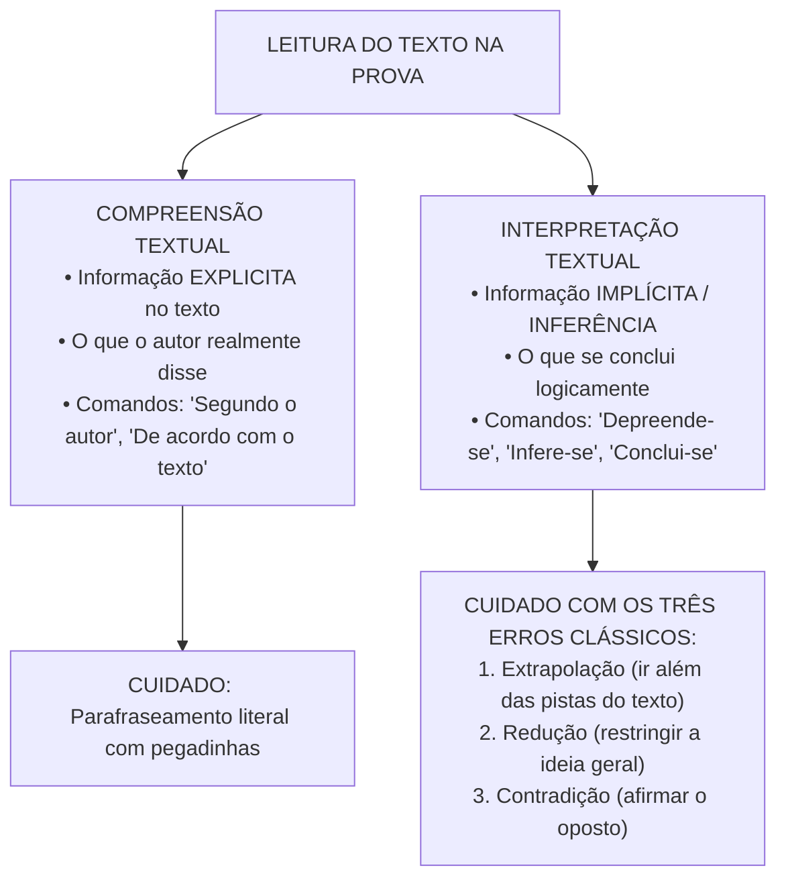
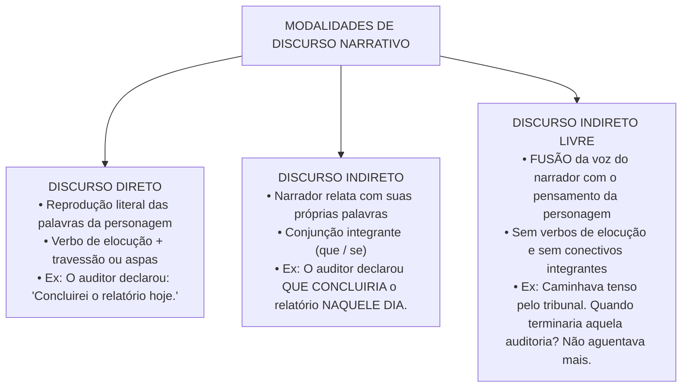

# 01 - Compreensão, Interpretação e Tipologia Textual

> **Matéria:** Língua Portuguesa  
> **Cargos:** A01 – Técnico de Controle Externo (Adm) / B02 – Técnico de Controle Externo (TI)  
> **Arquivo:** `01_compreensao_e_interpretacao_de_texto.md`  
> **Referência Temática:** Teoria do Texto, Tipologias, Discurso Narrativo e Estilística na Banca FCC

---

## 📌 Ementa / Itens do Edital

- Compreensão e interpretação de textos de gêneros variados (ensaios filosóficos, editoriais, crônicas e artigos de opinião);
- Relação do texto com seu contexto histórico, cultural e ideológico;
- Níveis de linguagem: Denotação (sentido literal/dicionarizado) e Conotação (sentido figurado/plurissignificativo);
- Modalidades de discurso: Discurso Direto, Discurso Indireto e Discurso Indireto Livre;
- Regras de transposição de tempos e modos verbais, pronomes e advérbios na passagem de discursos;
- Relações intertextuais: Paráfrase, Paródia, Citação, Epígrafe e Alusão;
- Figuras de linguagem e recursos expressivos (Semânticas, Sintáticas/de Construção e Fonéticas);
- Identificação de tese, estratégias argumentativas, pressupostos e subentendidos na tipologia dissertativa.

---

## 🧭 Sumário

1. [Compreensão vs. Interpretação na Tradição da FCC](#1-compreensao-vs-interpretacao-na-tradicao-da-fcc)
    1. [Compreensão Textual e Informação Explícita](#11-compreensao-textual-e-informacao-explicita)
    2. [Interpretação Textual e Inferência Autorizada](#12-interpretacao-textual-e-inferencia-autorizada)
    3. [Os Três Erros Clássicos de Leitura](#13-os-tres-erros-classicos-de-leitura)
    4. [Método Prático de Resolução](#14-metodo-pratico-de-resolucao)
    5. [Teste 001](#Teste-001)
2. [Gêneros Textuais e Contexto de Produção](#2-generos-textuais-e-contexto-de-producao)
    1. [Tipo Textual vs. Gênero Textual](#21-tipo-textual-vs-genero-textual)
    2. [Ensaio, Editorial, Crônica e Artigo de Opinião](#22-ensaio-editorial-cronica-e-artigo-de-opiniao)
    3. [Contexto Histórico, Cultural e Ideológico](#23-contexto-historico-cultural-e-ideologico)
    4. [Teste 002](#Teste-002)
3. [Tipologias Textuais](#3-tipologias-textuais)
    1. [Quadro Comparativo das Tipologias](#31-quadro-comparativo-das-tipologias)
    2. [Narração e Descrição](#32-narracao-e-descricao)
    3. [Exposição e Injunção](#33-exposicao-e-injuncao)
    4. [Teste 003](#Teste-003)
4. [Argumentação na Tipologia Dissertativa](#4-argumentacao-na-tipologia-dissertativa)
    1. [Tese e Estrutura do Texto Argumentativo](#41-tese-e-estrutura-do-texto-argumentativo)
    2. [Estratégias Argumentativas](#42-estrategias-argumentativas)
    3. [Operadores Argumentativos](#43-operadores-argumentativos)
    4. [Pressupostos e Subentendidos](#44-pressupostos-e-subentendidos)
    5. [Teste 004](#Teste-004)
    6. [Teste 005](#Teste-005)
5. [Níveis de Linguagem e Denotação e Conotação](#5-niveis-de-linguagem-e-denotacao-e-conotacao)
    1. [Linguagem Denotativa](#51-linguagem-denotativa)
    2. [Linguagem Conotativa](#52-linguagem-conotativa)
    3. [Teste 006](#Teste-006)
6. [Modalidades de Discurso](#6-modalidades-de-discurso)
    1. [Discurso Direto](#61-discurso-direto)
    2. [Discurso Indireto](#62-discurso-indireto)
    3. [Discurso Indireto Livre](#63-discurso-indireto-livre)
    4. [Teste 007](#Teste-007)
7. [Transposição de Discursos](#7-transposicao-de-discursos)
    1. [Tabela de Transposição do Direto para o Indireto](#71-tabela-de-transposicao-do-direto-para-o-indireto)
    2. [Correlação Verbal e Armadilhas na Transposição](#72-correlacao-verbal-e-armadilhas-na-transposicao)
    3. [Teste 008](#Teste-008)
8. [Intertextualidade](#8-intertextualidade)
    1. [Paráfrase](#81-parafrase)
    2. [Paródia](#82-parodia)
    3. [Citação, Epígrafe e Alusão](#83-citacao-epigrafe-e-alusao)
    4. [Teste 009](#Teste-009)
9. [Figuras de Linguagem](#9-figuras-de-linguagem)
    1. [Figuras Semânticas ou de Palavra](#91-figuras-semanticas-ou-de-palavra)
    2. [Figuras de Pensamento](#92-figuras-de-pensamento)
    3. [Figuras de Construção ou de Sintaxe](#93-figuras-de-construcao-ou-de-sintaxe)
    4. [Figuras Sonoras ou Fonéticas](#94-figuras-sonoras-ou-foneticas)
    5. [Teste 010](#Teste-010)
    6. [Teste 011](#Teste-011)
10. [Fontes Oficiais e Referências Bibliográficas](#fontes-oficiais-e-referencias-bibliograficas)

---

## 1. Compreensão vs. Interpretação na Tradição da FCC

A Fundação Carlos Chagas (FCC) constrói enunciados rigorosos em que a distinção entre **compreensão** e **interpretação** define o método de resolução. Ler bem, para a banca, não é "achar a resposta que parece bonita", mas verificar, palavra por palavra, se a alternativa encontra **autorização no texto**. Toda questão de leitura é, no fundo, um teste de fidelidade: o candidato deve demonstrar que sabe distinguir o que o autor disse, o que o autor permite concluir e o que o autor jamais afirmou.

### 1.1 Compreensão Textual e Informação Explícita

**Compreender** é decodificar aquilo que está **explicitamente** escrito. A pergunta implícita é: *o que o texto diz?* Os comandos típicos são "segundo o texto", "de acordo com o autor", "o texto afirma que", "conforme o 2º parágrafo". Nessas questões, a resposta correta costuma ser uma **paráfrase** de um trecho do texto — isto é, a mesma ideia dita com outras palavras (ver item 8.1).

O perigo da compreensão é justamente a paráfrase "envenenada": a banca copia quase todas as palavras do texto, mas troca um único elemento — um quantificador ("alguns" vira "todos"), um tempo verbal (algo que "pode ocorrer" vira algo que "ocorreu"), uma relação de causa (o efeito vira causa) ou um sujeito (o que foi dito de um grupo passa a ser dito de outro). Por isso, ao comparar alternativa e texto, o candidato deve conferir: **quem** fez, **o quê**, **em que grau** (certeza ou possibilidade), **em que extensão** (todos ou alguns) e **por qual motivo**.

Um exemplo simples: se o texto diz que "os sistemas algorítmicos *podem* reproduzir desigualdades", a alternativa que afirma que eles "*necessariamente* reproduzem desigualdades" troca possibilidade por certeza e, portanto, deixa de ser fiel ao texto, ainda que use praticamente as mesmas palavras.

### 1.2 Interpretação Textual e Inferência Autorizada

**Interpretar** é extrair do texto informações **implícitas**, isto é, conclusões que o autor não escreveu literalmente, mas que decorrem logicamente do que escreveu. A pergunta implícita é: *o que se pode concluir a partir do texto?* Os comandos típicos são "depreende-se", "infere-se", "conclui-se", "o autor sugere", "o texto permite entender que".

A palavra-chave é **inferência autorizada**: a conclusão precisa estar amparada em pistas do próprio texto (vocabulário valorativo, conectivos, exemplos, ironias, contrastes). Por exemplo, se um autor chama certa promessa de "aparente panaceia" (panaceia = remédio para todos os males), ele não precisa dizer "discordo dessa promessa": o adjetivo *aparente* já autoriza a inferência de que o autor a vê com ceticismo. Já concluir que o autor "defende a proibição" daquilo que critica seria ir além do que as pistas permitem.

A interpretação também envolve reconhecer a **postura do autor** (crítica, irônica, neutra, entusiasmada), a **intenção comunicativa** (convencer, informar, denunciar, divertir) e o **sentido global** do texto. Um texto que começa apresentando uma visão otimista e, em seguida, usa um conectivo adversativo ("contudo", "entretanto") para desconstruí-la tem sua tese **depois** do conectivo: a visão inicial é a posição que o autor pretende refutar.

> ⭐ **IMPORTANTE:** Na FCC, "depreende-se" e "infere-se" **não** autorizam opinião pessoal do candidato. A inferência deve ser aquela que **qualquer leitor atento** extrairia das pistas do texto. Se você precisou usar conhecimento externo para justificar a alternativa, desconfie.

### 1.3 Os Três Erros Clássicos de Leitura

A maioria das alternativas erradas em questões de leitura da FCC cai em uma de três categorias. Saber nomeá-las acelera a eliminação.

1. **Extrapolação:** O candidato introduz conhecimentos prévios ou juízos de valor que podem até ser verdadeiros no mundo real, mas **não encontram respaldo ou autorização nas linhas do texto**. A extrapolação costuma aparecer como:
    - **a)** uma **proposta de solução** que o autor não fez (ex.: "a tecnologia deve ser suspensa")
    - **b)** uma **atribuição de culpa ou intenção** não mencionada (ex.: "os engenheiros agem de má-fé")
    - **c)** uma **comparação quantitativa** inexistente (ex.: "as máquinas erram tanto quanto os humanos")
    - **d)** uma **generalização** indevida.

2. **Redução:** A alternativa pinça um detalhe secundário ou aspecto particular do texto e o apresenta como se fosse a tese central ou a conclusão definitiva do autor. A alternativa reduzida até contém algo verdadeiro, mas é **parcial**: responde a uma pergunta diferente da feita (ex.: a questão pede a ideia central e a alternativa traz um exemplo usado em um parágrafo).
3. **Contradição:** A alternativa inverte as relações lógicas de causa e efeito ou assevera o exato oposto daquilo que o texto defendeu. Um caso muito frequente é tratar como **fato consumado** aquilo que o texto apresentou como mera **promessa, hipótese ou ilusão** (ex.: o texto fala em "promessa de erradicação do erro" e a alternativa diz que "a erradicação do erro já foi alcançada").

> 🚨 **ALERTA DE PROVA / PEGADINHA FCC:** Ao responder questões que indagam o que se *"depreende"* ou *"infere"* do texto, elimine sumariamente alternativas que contenham palavras de valor absoluto e generalizante, tais como **"sempre"**, **"nunca"**, **"exclusivamente"**, **"todos"**, **"necessariamente"**, **"rigorosamente"** e **"somente"**, salvo se o próprio texto original tiver utilizado expressamente essa mesma restrição categórica!

---

### 1.4 Método Prático de Resolução

Um roteiro eficiente para questões de leitura é:

1. ler o **enunciado antes** do texto, para saber se a questão é de compreensão (explícito) ou interpretação (implícito)
2. ler o texto identificando a **tese** e os **conectivos** que organizam a argumentação
3. para cada alternativa, localizar o **trecho correspondente** no texto
4. classificar o erro de cada alternativa descartada (extrapolação, redução ou contradição)
5. desconfiar de alternativas com linguagem extremada ou que tragam soluções, culpados e números ausentes do texto.

Outro ponto importante é o **vocabulário em contexto**: a FCC frequentemente pergunta o sentido de uma palavra "no contexto". A resposta não é necessariamente o primeiro sentido do dicionário, mas aquele que a frase ativa. "Panaceia", "asséptica", "miopia ética", por exemplo, são usados em sentido figurado em textos ensaísticos (ver item 5.2).

> 💡 **DICA DE RESOLUÇÃO / RECONHECIMENTO DE TESE:** O primeiro parágrafo de um texto dissertativo da FCC normalmente contextualiza o tema e apresenta a tese. O último parágrafo sintetiza a conclusão. Se a questão indagar a ideia central, releia atentamente o início e o fim do texto antes de analisar as alternativas intermediárias.

---

### Teste 001
**(CEBRASPE – STJ – 2015 – Analista Judiciario Suporte Em Tecnologia Da Informacao)**
A correção gramatical e o sentido original do texto seriam 7 semelhantes. Não pode renunciar à sua condição inata de preservados se a oração “A solidariedade, desse modo, exorta membro do corpo social, porque apenas os animais e os deuses atitudes de apoio e cuidados de uns com os outros” (R. 21 e 22) podem prescindir da sociedade e da companhia de todos os fosse reescrita da seguinte forma: Atitudes de apoio e cuidados 10 demais. de uns com os outros são exigidas para o exercício da O primeiro contato com a noção de solidariedade solidariedade. mostra uma relação de pertinência: as nossas ações sociais incidem, positiva ou negativamente, sobre todos os demais 7 A correção gramatical e o sentido original do texto seriam 13 membros da comunidade. A solidariedade implica, por outro preservados caso se inserisse o pronome se imediatamente lado, a corresponsabilidade, a compreensão da transcendência antes da forma verbal “pode” (R.7). 16 social das ações humanas, do coexistir e do conviver 8 Nas linhas 17 e 18, a expressão “a sua inegável dimensão comunitário. Percebe-se, aqui, igualmente, a sua inegável ética” constitui o sujeito da forma verbal “Percebe-se”. dimensão ética, em virtude do necessário reconhecimento 19 mútuo de todos como pessoas, iguais em direitos e obrigações, o que dá suporte a exigências recíprocas de ajuda ou sustento. A solidariedade, desse modo, exorta atitudes de apoio 22 e cuidados de uns com os outros. Pede diálogo e tolerância. Pressupõe um reconhecimento ético e, portanto, corresponsabilidade. Entretanto, para que não fique estagnada 25 em gestos tópicos ou se esgote em atitudes episódicas, a modernidade política impõe a necessidade dialética de um passo maior em direção à justiça social: o compromisso 28 constante com o bem comum e a promoção de causas ou objetivos comuns aos membros de toda a comunidade. Marcio Augusto de Vasconcelos Diniz. Estado social e princípio da solidariedade. In: Revista de Direitos e Garantias Fundamentais, Vitória, n.o 3, p. 31-48, jul.-dez./2008. Internet: <www.fdv.br> (com adaptações). !FimDoTexto! De acordo com as ideias do texto Estado social e princípio da solidariedade, 1 o compromisso constante com o bem comum e a promoção de causas ou objetivos comuns aos membros de toda a comunidade contribuem para que a solidariedade não fique restrita a ações locais e(ou) eventuais. 2 a solidariedade é uma característica inata dos seres humanos. 3 os animais e os deuses podem viver isoladamente, sem participação em uma comunidade, mas não os seres humanos. 4 o fato de as ações sociais de cada indivíduo incidirem sobre todos os demais membros da comunidade ratifica a dimensão ética da solidariedade, conquanto o reconhecimento mútuo de todos como pessoas iguais em direitos e obrigações configure-se como uma necessidade.

* **C)** Certo
* **E)** Errado

---

> **Comentário Detalhado:**
>
> - **C)** **Incorreta.** A marcação como **Certo** não procede, pois o enunciado incorre em restrição indevida ao limitar o escopo conceitual ao afirmar que "A correção gramatical e o sentido original do texto seriam 7 semelhantes. Não pode renunciar à sua condição...". De acordo com a teoria estudada em *7.2 Correlação Verbal e Armadilhas na Transposição*, na língua corrente, essa forma pode aparecer quando o fato ainda é futuro em relação ao momento em que se narra, mas, nas questões de transposição da FCC, o gabarito segue a correlação canônica: pretérito no verbo principal → futuro do pretérito na subordinada.
> - **E)** **Correta.** O item está **Errado** (gabarito oficial: **E**). Conforme fundamentado na seção *1.1 Compreensão Textual e Informação Explícita* deste guia, o perigo da compreensão é justamente a paráfrase "envenenada": a banca copia quase todas as palavras do texto, mas troca um único elemento — um quantificador ("alguns" vira "todos"), um tempo verbal (algo que "pode ocorrer" vira algo que "ocorreu"), uma relação de causa (o efeito vira causa) ou um sujeito (o que foi dito de um grupo passa a ser dito de outro). Portanto, a assertiva examinada pela banca (CEBRASPE – STJ/2015) viola os preceitos técnicos do tópico.
>
> **Gabarito: E**

---

## 2. Gêneros Textuais e Contexto de Produção

### 2.1 Tipo Textual vs. Gênero Textual

É essencial não confundir **tipo** (ou tipologia) com **gênero** textual. O **tipo textual** é uma categoria abstrata, definida por traços linguísticos internos: tempos verbais predominantes, relações lógicas, presença de sequência temporal etc. Os tipos são poucos e fixos — narração, descrição, dissertação (expositiva e argumentativa) e injunção (alguns autores acrescentam o tipo dialogal). O **gênero textual**, por sua vez, é a forma concreta e socialmente reconhecida que o texto assume no dia a dia: notícia, editorial, crônica, receita, edital, ofício, sentença, ensaio, carta de leitor. Os gêneros são praticamente infinitos e mudam com a sociedade (o *e-mail* e o *post* são gêneros recentes).

Um mesmo gênero pode combinar vários tipos. Uma crônica pode narrar um episódio cotidiano (tipo narrativo), descrever o ambiente (tipo descritivo) e terminar com uma reflexão (tipo dissertativo). Quando a banca pergunta sobre a **tipologia predominante**, o candidato deve observar qual sequência estrutura o texto como um todo, e não apenas um trecho isolado.

### 2.2 Ensaio, Editorial, Crônica e Artigo de Opinião

A ementa destaca quatro gêneros, todos muito explorados pela FCC:

- **Ensaio (inclusive o filosófico):** texto reflexivo, de extensão variável, em que o autor examina um tema (ética, tecnologia, linguagem, cultura) de forma pessoal, mas fundamentada. Caracteriza-se por vocabulário abstrato e elaborado, períodos longos, uso frequente de citações e referências a outros pensadores, e por uma argumentação que muitas vezes avança por **contraste** de ideias ("pode-se pensar que... contudo..."). É o gênero que mais exige atenção a nuances de sentido e ao vocabulário em contexto.
- **Editorial:** texto opinativo que expressa a **posição oficial do veículo de comunicação** (jornal, revista), e não a de um autor individual. Por isso, normalmente não é assinado e evita marcas de primeira pessoa do singular; usa a terceira pessoa ou o "nós" institucional. Trata de temas da atualidade (economia, política, administração pública) com tom sóbrio e argumentativo.
- **Artigo de opinião:** texto argumentativo **assinado**, em que um autor identificado (jornalista, especialista, colunista) defende seu ponto de vista sobre um tema. Diferentemente do editorial, admite marcas de subjetividade e primeira pessoa, e a responsabilidade pela opinião é do autor, não do veículo.
- **Crônica:** texto curto, geralmente publicado em jornal ou revista, que parte de um **fato cotidiano** aparentemente banal para extrair dele uma reflexão, uma emoção ou um humor. Mistura narração, descrição e comentário; tem linguagem mais leve, próxima da oralidade, e frequentemente emprega ironia, humor e lirismo. Na FCC são comuns crônicas de autores como Rubem Braga, Carlos Drummond de Andrade, Machado de Assis e Lima Barreto.

> 📌 **NOTA EXPLICATIVA / EDITORIAL X ARTIGO DE OPINIÃO:** Ambos são argumentativos. A diferença está na **autoria**: o editorial fala em nome da instituição (não assinado); o artigo de opinião fala em nome de um autor (assinado). A FCC pode explorar essa distinção ao perguntar "quem" sustenta a opinião no texto.

### 2.3 Contexto Histórico, Cultural e Ideológico

Nenhum texto surge do nada: ele é produzido por alguém, em determinada época, para determinado público, sob certos valores. Relacionar o texto ao seu **contexto** significa perceber como esses fatores condicionam o sentido. O **contexto histórico** diz respeito ao momento em que o texto foi escrito (uma crônica de Machado de Assis sobre a escravidão no século XIX deve ser lida à luz daquela sociedade). O **contexto cultural** envolve os costumes, crenças e referências partilhadas por autor e leitores (uma alusão bíblica ou a um poema canônico só é percebida por quem conhece a referência). O **contexto ideológico** refere-se ao conjunto de valores e visões de mundo que o texto assume, defende ou critica — por exemplo, um texto que denuncia a "neutralidade" da tecnologia adota uma posição crítica em relação à ideologia tecnicista.

Na prova, isso aparece em perguntas sobre o **ponto de vista** do autor, sobre o **efeito de sentido** de uma referência histórica ou sobre a **crítica social** implícita em uma narrativa. Atenção, porém: a relação com o contexto deve ser **sugerida pelo próprio texto** (datas, nomes, vocabulário de época, referências explícitas); usar o contexto para atribuir ao autor ideias que ele não expressou é extrapolação (ver item 1.3).

> 🚨 **ALERTA DE PROVA / PEGADINHA FCC:** Em textos antigos (Machado, Lima Barreto), a banca pode testar se o candidato reconhece a **ironia** do narrador diante dos valores da época. Ler literalmente um elogio irônico à elite do século XIX é um erro de contradição.

--- 

### Teste 002
**(FCC – TRT 16ª – 2014 – Analista Judiciário - Tecnologia da Informação)**
Considerando-se o contexto, traduz-se adequadamente o sentido de um segmento em:

* **A)** Ao contrário dos que consideram os prefácios tão inúteis quanto inconvenientes, o autor julga que muitas dessas apresentações são mais atraentes e substanciosas do que o texto principal.
* **B)** Embora hajam apresentações bem realizadas de livros, é indiscutível que boa parte delas primem pela inutilidade, inconveniência ou mesmo assumam o caráter de um estraga-prazeres.
* **C)** Há discordâncias quanto ao valor ou não dos prefácios, uma vez que alguns concordam com seu intento esclarecedor, ao passo que outros o negam, em razão de argumentos não valorativos.
* **D)** O autor acredita de que a maioria dos prefácios pode mesmo carecer de valor, ainda que em muitos casos, ao contrário, se estabelece uma utilidade insuspeita que chega a valorizá-lo mais que à obra.
* **E)** Não seria bom para um escritor, que viesse a ter como autor de seu prefácio um colega mais talentoso, tanto que isso poderia acarretar, nas bibliografias, uma importância exclusiva para o texto introdutório. _________________________________________________________

---

> **Comentário Detalhado:**
>
> - **A)** **Incorreta.** A opção apresenta proposição em desacordo com os fundamentos teóricos e técnicos do tópico ao afirmar que "Ao contrário dos que consideram os prefácios tão inúteis quanto inconvenientes, o autor julga que muitas dessas...". De acordo com a teoria estudada em *2.2 Ensaio, Editorial, Crônica e Artigo de Opinião*, caracteriza-se por vocabulário abstrato e elaborado, períodos longos, uso frequente de citações e referências a outros pensadores, e por uma argumentação que muitas vezes avança por contraste de ideias ("pode-se pensar que... contudo...").
> - **B)** **Incorreta.** A opção apresenta proposição em desacordo com os fundamentos teóricos e técnicos do tópico ao afirmar que "Embora hajam apresentações bem realizadas de livros, é indiscutível que boa parte delas primem pela inutilidade...". De acordo com a teoria estudada em *2.2 Ensaio, Editorial, Crônica e Artigo de Opinião*, crônica: texto curto, geralmente publicado em jornal ou revista, que parte de um fato cotidiano aparentemente banal para extrair dele uma reflexão, uma emoção ou um humor.
> - **C)** **Correta.** Conforme fundamentado na seção *3.1 Quadro Comparativo das Tipologias* deste guia, dissertativo-Argumentativo: Defender um ponto de vista (tese) e persuadir o leitor mediante argumentos lógicos. — Presença de operadores argumentativos (*portanto, contudo, por conseguinte*), juízos de valor, dados estatísticos e citações. — É a tipologia campeã da FCC. Dessa forma, está plenamente correta a assertiva da banca (FCC – TRT 16ª/2014) ao estabelecer que "Há discordâncias quanto ao valor ou não dos prefácios, uma vez que alguns concordam com seu intento esclarecedor...".
> - **D)** **Incorreta.** A opção apresenta proposição em desacordo com os fundamentos teóricos e técnicos do tópico ao afirmar que "O autor acredita de que a maioria dos prefácios pode mesmo carecer de valor, ainda que em muitos casos, ao...". De acordo com a teoria estudada em *9.1 Figuras Semânticas ou de Palavra*, casos típicos: o autor pela obra (*"Li Machado de Assis"*), a parte pelo todo (*"Várias cabeças pensavam na solução"* — esta modalidade é também chamada sinédoque), o continente pelo conteúdo (*"Bebeu dois copos"*), a marca pelo produto (*"Comprou uma gilete"*), o símbolo pela coisa (*"A coroa decidiu"* = o rei), o lugar pela instituição (*"O Planalto vetou o projeto"*).
> - **E)** **Incorreta.** A opção apresenta proposição em desacordo com os fundamentos teóricos e técnicos do tópico ao afirmar que "Não seria bom para um escritor, que viesse a ter como autor de seu prefácio um colega mais talentoso, tanto que...". De acordo com a teoria estudada em *1.3 Os Três Erros Clássicos de Leitura*, c) uma comparação quantitativa inexistente (ex.: "as máquinas erram tanto quanto os humanos").
>
> **Gabarito: C**

---

## 3. Tipologias Textuais

### 3.1 Quadro Comparativo das Tipologias

| Tipologia | Objetivo Comunicativo | Marcas Linguísticas Caracterizadoras | Foco na FCC |
| :--- | :--- | :--- | :--- |
| **Dissertativo-Argumentativo** | Defender um ponto de vista (tese) e persuadir o leitor mediante argumentos lógicos. | Presença de operadores argumentativos (*portanto, contudo, por conseguinte*), juízos de valor, dados estatísticos e citações. | É a tipologia **campeã da FCC**. Textos de reflexão filosófica, sociológica e política. |
| **Dissertativo-Expositivo** | Apresentar ideias, conceitos ou teorias de forma estritamente informativa e impessoal. | Verbos na 3ª pessoa, linguagem técnica/denotativa, ausência de juízos morais subjetivos. | Textos científicos ou técnicos sobre administração, finanças públicas e tecnologia. |
| **Narrativo** | Relatar uma sequência temporal de acontecimentos reais ou ficcionais envolvendo personagens. | Verbos de ação no pretérito perfeito/imperfeito, marcadores temporais (*então, depois, subitamente*), progressão de tempo. | Trechos de romances clássicos (Machado de Assis, Lima Barreto, Clarice Lispector). |
| **Descritivo** | Caracterizar seres, objetos, ambientes ou estados com riqueza de detalhes sensoriais. | Predomínio de adjetivos, orações sem verbos de ação dinâmica, retrato estático no tempo. | Surge acoplado à narrativa ou à crônica reflexiva. |
| **Injuntivo / Instrucional** | Indicar ordens, orientações ou procedimentos que o leitor deve seguir. | Verbos no imperativo (*faça, siga, clique*), orações no infinitivo impessoal, enumerações ordenadas. | Editais, manuais de auditoria, regulamentos e leis. |

A tipologia dissertativo-argumentativa, por sua importância, é tratada em seção própria (item 4).

### 3.2 Narração e Descrição

A **narração** relata fatos que se sucedem no tempo, envolvendo personagens em determinado espaço. Seus elementos são: **narrador** (quem conta), **personagens** (quem vive os fatos), **enredo** (a sequência de acontecimentos, geralmente com situação inicial, conflito, clímax e desfecho), **tempo** (cronológico, marcado pelo relógio e pelo calendário, ou psicológico, que acompanha as emoções da personagem) e **espaço** (onde a ação ocorre). O **foco narrativo** pode ser em **1ª pessoa** (narrador-personagem, que participa da história e tem visão limitada) ou em **3ª pessoa** (narrador-observador, que apenas relata, ou narrador onisciente, que conhece pensamentos e sentimentos das personagens). O narrador onisciente é justamente o que abre espaço para o **discurso indireto livre** (item 6.3).

A **descrição** constrói um "retrato verbal" de um ser, objeto, ambiente ou estado de espírito, como se o tempo estivesse suspenso. Predominam adjetivos, locuções adjetivas, verbos de estado (*ser, estar, parecer*) e o pretérito imperfeito ("A sala era ampla; as janelas davam para o pátio"). A descrição pode ser **objetiva** (precisa, denotativa, como em um laudo técnico) ou **subjetiva** (impregnada das impressões de quem descreve, com linguagem conotativa).

### 3.3 Exposição e Injunção

A **exposição** (dissertação expositiva) tem por finalidade **informar e explicar** um assunto, sem pretender convencer o leitor de uma tese polêmica. Usa linguagem predominantemente denotativa, terceira pessoa, presente atemporal ("O Tribunal de Contas *é* órgão de controle externo") e recursos como definição, classificação, enumeração e exemplificação. Textos didáticos, verbetes e relatórios técnicos são predominantemente expositivos.

A **injunção** orienta o comportamento do leitor: diz o que fazer e como fazer. Caracteriza-se pelo imperativo ("preencha", "anexe"), pelo infinitivo com valor de ordem ("Encaminhar o processo ao setor competente") e por enumerações sequenciais. Manuais, editais, receitas e normas procedimentais são exemplos típicos.

> 🚨 **ALERTA DE PROVA / PEGADINHA FCC:** A presença de um **trecho** narrativo dentro de um texto não o torna narrativo. Um ensaio que conta uma pequena anedota para ilustrar sua tese continua sendo **predominantemente dissertativo-argumentativo**: a narrativa ali é apenas uma estratégia de argumentação (argumento por exemplificação).

--- 

### Teste 003
**(FGV – TJ/AP – 2023 – Analista Judiciario Apoio Especializado Tecnologia Da Informacao Banco De Dados)**
Um romance mostra o seguinte segmento: “Eu pergunto que tipo de história a menina deseja. Ela responde categoricamente que quer uma história de amor e de ficção científica. Então, comecei: ‘Um robô encontra uma jovem...’ Mas ela não me deixa prosseguir. ‘Você não sabe contar histórias’, disse ela. Uma verdadeira história é obrigatoriamente no passado. - Tá bom, se você quer: “Um robô encontrou uma jovem...” - Não, tem que ser no passado histórico... - Bom, lá vai: “Outrora, há muito tempo, um robô muito inteligente, ainda que totalmente metálico, encontrou num baile uma jovem da nobreza. Eles dançaram e ele lhe disse coisas gentis. Ela ficou corada. Ele se desculpou e recomeçaram a dançar. Ela o achou um pouco ousado, mas encantador... Eles se casaram pouco tempo depois, receberam muitos presentes e partiram em viagem de lua de mel.” Sobre esse fragmento narrativo, é correto afirmar que:

* **A)** o aspecto de ficção científica da história narrada se restringe ao personagem robô e a suas ações mecânicas;
* **B)** a observação de que uma história deve obrigatoriamente ser narrada no passado é verdadeira, mostrando o conhecimento textual da menina;
* **C)** o passado histórico solicitado pela menina foi realizado por meio de expressões de tempo distante e de ambientes literariamente idealizados;
* **D)** o texto narrativo produzido pelo narrador mostra a preocupação de limitar-se ao absolutamente essencial do enredo;
* **E)** o narrador da versão final da história mostra preocupações de usar a linguagem informal, adequada à pouca idade da leitora.

---

> **Comentário Detalhado:**
>
> - **A)** **Incorreta.** A opção apresenta proposição em desacordo com os fundamentos teóricos e técnicos do tópico ao afirmar que "o aspecto de ficção científica da história narrada se restringe ao personagem robô e a suas ações mecânicas". De acordo com a teoria estudada em *7.1 Tabela de Transposição do Direto para o Indireto*, por isso, tudo o que se ancorava no "agora" da personagem precisa ser deslocado para o passado e para a distância: pessoas (1ª → 3ª), tempos verbais (recuam um grau), advérbios de tempo e lugar e pronomes demonstrativos.
> - **B)** **Incorreta.** A opção apresenta proposição em desacordo com os fundamentos teóricos e técnicos do tópico ao afirmar que "a observação de que uma história deve obrigatoriamente ser narrada no passado é verdadeira, mostrando o...". De acordo com a teoria estudada em *1.2 Interpretação Textual e Inferência Autorizada*, na FCC, "depreende-se" e "infere-se" não autorizam opinião pessoal do candidato. A inferência deve ser aquela que qualquer leitor atento extrairia das pistas do texto. Se você precisou usar conhecimento externo para justificar a alternativa, desconfie.
> - **C)** **Correta.** Conforme fundamentado na seção *7.1 Tabela de Transposição do Direto para o Indireto* deste guia, tempo Verbal (Passado): Pretérito Perfeito — Pretérito Mais-Que-Perfeito — *"Estudei ontem"* → Disse que *estudara* (ou *tinha estudado*) na véspera. Dessa forma, está plenamente correta a assertiva da banca (FGV – TJ/AP/2023) ao estabelecer que "o passado histórico solicitado pela menina foi realizado por meio de expressões de tempo distante e de ambientes...".
> - **D)** **Incorreta.** A opção apresenta proposição em desacordo com os fundamentos teóricos e técnicos do tópico ao afirmar que "o texto narrativo produzido pelo narrador mostra a preocupação de limitar-se ao absolutamente essencial do enredo". De acordo com a teoria estudada em *3.2 Narração e Descrição*, seus elementos são: narrador (quem conta), personagens (quem vive os fatos), enredo (a sequência de acontecimentos, geralmente com situação inicial, conflito, clímax e desfecho), tempo (cronológico, marcado pelo relógio e pelo calendário, ou psicológico, que acompanha as emoções da personagem) e espaço (onde a ação ocorre).
> - **E)** **Incorreta.** A opção apresenta proposição em desacordo com os fundamentos teóricos e técnicos do tópico ao afirmar que "o narrador da versão final da história mostra preocupações de usar a linguagem informal, adequada à pouca idade da...". De acordo com a teoria estudada em *3.2 Narração e Descrição*, o foco narrativo pode ser em 1ª pessoa (narrador-personagem, que participa da história e tem visão limitada) ou em 3ª pessoa (narrador-observador, que apenas relata, ou narrador onisciente, que conhece pensamentos e sentimentos das personagens).
>
> **Gabarito: C**

---

## 4. Argumentação na Tipologia Dissertativa

### 4.1 Tese e Estrutura do Texto Argumentativo

A **tese** é a ideia central que o autor defende — o ponto de vista que ele quer que o leitor aceite. Ela é diferente do **tema** (o assunto genérico tratado). Exemplo: o tema pode ser "inteligência artificial na administração pública"; a tese pode ser "a pretensa neutralidade dos algoritmos oculta a reprodução de desigualdades sociais". Toda questão sobre "ideia central", "ponto de vista defendido" ou "propósito do autor" está, na verdade, perguntando pela tese.

A estrutura clássica do texto argumentativo tem três partes: **introdução** (apresenta o tema e, geralmente, a tese), **desenvolvimento** (expõe os argumentos que sustentam a tese e, por vezes, refuta posições contrárias) e **conclusão** (retoma a tese, sintetiza a argumentação ou propõe soluções). Na FCC, é muito comum a **estrutura concessivo-adversativa**: o autor primeiro apresenta a opinião corrente ou o senso comum ("Muitos acreditam que...", "As novas tecnologias prometem...") e, em seguida, introduz sua própria posição com um conectivo adversativo ("Contudo", "No entanto", "Todavia"). Nesse caso, a **tese está depois do conectivo**, e a visão inicial é aquela que o autor critica.

### 4.2 Estratégias Argumentativas

Estratégias (ou tipos de argumento) são os recursos usados para sustentar a tese. Os mais cobrados são:

- **Argumento de autoridade:** apoia-se na fala de especialista, instituição reconhecida ou pensador consagrado ("Segundo o filósofo X..."). Vale pela credibilidade da fonte.
- **Argumento por exemplificação ou ilustração:** usa casos concretos, episódios ou pequenas narrativas para tornar a tese palpável.
- **Argumento por evidência ou provas concretas:** recorre a dados estatísticos, números, fatos verificáveis.
- **Argumento por causa e consequência:** demonstra que determinado fenômeno produz certos efeitos (ou decorre de certas causas). Atenção às relações causais na prova: inverter causa e efeito é erro de contradição.
- **Argumento por analogia ou comparação:** aproxima a situação analisada de outra semelhante para transferir conclusões (ex.: comparar algoritmos a "espelhos" que refletem a sociedade).
- **Contra-argumentação ou refutação:** o autor antecipa a objeção contrária e a desmonta, fortalecendo sua posição.
- **Argumento por senso comum ou consenso:** apoia-se em ideias amplamente aceitas ("É sabido que a educação transforma vidas").
- **Recursos retóricos:** perguntas retóricas (que não esperam resposta, mas conduzem o leitor), ironia, metáforas argumentativas e escolha de vocabulário valorativo ("pretensa", "aparente", "sedutora").

> 💡 **DICA DE RESOLUÇÃO:** Adjetivos e advérbios como *pretenso, suposto, aparente, ilusório, alegado* indicam que o autor **não endossa** a ideia a que se referem. São pistas valiosas para identificar postura crítica e para eliminar alternativas que tratam como fato o que o autor tratou como ilusão.

### 4.3 Operadores Argumentativos

Os **operadores argumentativos** (conectivos e expressões de articulação) revelam a orientação do raciocínio e são a principal ferramenta de leitura da FCC:

| Relação | Operadores típicos | Efeito na leitura |
| :--- | :--- | :--- |
| **Oposição / Adversidade** | *mas, porém, contudo, todavia, entretanto, no entanto* | Introduz o argumento mais forte; geralmente a posição do autor vem depois. |
| **Concessão** | *embora, ainda que, mesmo que, conquanto, apesar de* | Admite um argumento contrário para, em seguida, superá-lo. |
| **Conclusão** | *portanto, logo, por conseguinte, assim, pois (posposto ao verbo)* | Introduz a conclusão (frequentemente a tese ou sua retomada). |
| **Causa / Explicação** | *porque, pois, visto que, uma vez que, já que* | Justifica uma afirmação anterior. |
| **Adição / Gradação** | *e, além disso, ademais, não só... mas também, até, inclusive* | Soma argumentos na mesma direção; *até* e *inclusive* marcam o argumento mais forte. |
| **Restrição / Retificação** | *longe de, ao contrário, em vez de, aliás, ou melhor* | Nega uma visão para afirmar outra ("Longe de serem neutros, os algoritmos..."). |

---

### 4.4 Pressupostos e Subentendidos

Nem tudo o que o texto comunica está dito diretamente. A linguística distingue dois tipos de informação implícita:

O **pressuposto** é uma informação implícita **marcada linguisticamente** na frase, ou seja, decorre necessariamente de certas palavras ou construções e não pode ser negada sem contradição. Em "O auditor **voltou a** atrasar o relatório", pressupõe-se que ele já atrasou antes (marcador: *voltar a*). Em "O gestor **deixou de** fraudar licitações", pressupõe-se que antes fraudava. Outros marcadores de pressuposição são: verbos que indicam mudança ou permanência (*continuar, passar a, tornar-se, ainda, já*), advérbios (*novamente, ainda, também*), adjetivos ("o **novo** sistema" pressupõe um antigo), orações adjetivas e verbos factivos (*lamentar, saber, perceber* pressupõem a verdade do complemento: "Lamento que o prazo tenha expirado" pressupõe que expirou). Um teste prático: o pressuposto **permanece verdadeiro** mesmo quando a frase é negada ou transformada em pergunta ("O auditor não voltou a atrasar?" — continua pressuposto que atrasou antes).

O **subentendido** é uma insinuação que **depende do contexto** e da interpretação do ouvinte; não está preso a marcas linguísticas e o falante pode negá-lo ("Eu não quis dizer isso"). Se alguém diz, em uma sala abafada, "Está calor aqui, não?", pode estar subentendendo um pedido para abrir a janela. A responsabilidade pelo subentendido é partilhada com o ouvinte.

> 🚨 **ALERTA DE PROVA / PEGADINHA FCC:** A FCC pergunta frequentemente "a palavra X pressupõe que..." ou "o emprego de 'ainda' permite inferir que...". Procure o **marcador linguístico** (*ainda, já, voltar a, deixar de, também, até*). Se a alternativa propõe uma insinuação que depende de contexto externo, trata-se de subentendido — ou de extrapolação.

---

### Teste 004
**(FGV – TJ/BA – 2015 – Analista Judiciario Tecnologia Da Informacao)**
“julgando-se ofendidos em sua honra”; essa frase do texto 3 poderia estar corretamente expressa numa oração desenvolvida por:

* **A)** após se julgarem ofendidos em sua honra;
* **B)** quando se julgaram ofendidos em sua honra;
* **C)** caso se tenham julgado ofendidos em sua honra;
* **D)** dado que se julgaram ofendidos em sua honra;
* **E)** por se julgarem ofendidos em sua honra. Texto 4 – “O caminho para baixo era estreito e íngreme, e tanto os homens quanto os animais não sabiam onde estavam pisando, por causa da neve; todos os que saíam da trilha ou tropeçavam em algo perdiam o equilíbrio e despencavam no precipício. A esses perigos eles resistiam, pois àquela altura já se haviam acostumado a tais infortúnios, mas, por fim, chegaram a um lugar onde o caminho era estreito demais para os elefantes e até para os animais de carga. Uma avalanche anterior já havia arrastado cerca de trezentos metros da encosta, ao passo que outra, mais recente, agravara ainda mais a situação. A essa altura, os soldados mais uma vez perderam a calma e quase caíram em desespero.” (Políbio, Histórias).

---

> **Comentário Detalhado:**
>
> - **A)** **Incorreta.** A opção apresenta proposição em desacordo com os fundamentos teóricos e técnicos do tópico ao afirmar que "após se julgarem ofendidos em sua honra". De acordo com a teoria estudada em *4.4 Pressupostos e Subentendidos*, se alguém diz, em uma sala abafada, "Está calor aqui, não?", pode estar subentendendo um pedido para abrir a janela. A responsabilidade pelo subentendido é partilhada com o ouvinte.
> - **B)** **Incorreta.** A opção apresenta proposição em desacordo com os fundamentos teóricos e técnicos do tópico ao afirmar que "quando se julgaram ofendidos em sua honra". De acordo com a teoria estudada em *1.2 Interpretação Textual e Inferência Autorizada*, a palavra-chave é inferência autorizada: a conclusão precisa estar amparada em pistas do próprio texto (vocabulário valorativo, conectivos, exemplos, ironias, contrastes).
> - **C)** **Incorreta.** A opção apresenta proposição em desacordo com os fundamentos teóricos e técnicos do tópico ao afirmar que "caso se tenham julgado ofendidos em sua honra". De acordo com a teoria estudada em *4.1 Tese e Estrutura do Texto Argumentativo*, nesse caso, a tese está depois do conectivo, e a visão inicial é aquela que o autor critica.
> - **D)** **Correta.** Conforme fundamentado na seção *2.2 Ensaio, Editorial, Crônica e Artigo de Opinião* deste guia, editorial: texto opinativo que expressa a posição oficial do veículo de comunicação (jornal, revista), e não a de um autor individual. Dessa forma, está plenamente correta a assertiva da banca (FGV – TJ/BA/2015) ao estabelecer que "dado que se julgaram ofendidos em sua honra".
> - **E)** **Incorreta.** A opção apresenta proposição em desacordo com os fundamentos teóricos e técnicos do tópico ao afirmar que "por se julgarem ofendidos em sua honra. Texto 4 – “O caminho para baixo era estreito e íngreme, e tanto os homens...". De acordo com a teoria estudada em *1.1 Compreensão Textual e Informação Explícita*, o perigo da compreensão é justamente a paráfrase "envenenada": a banca copia quase todas as palavras do texto, mas troca um único elemento — um quantificador ("alguns" vira "todos"), um tempo verbal (algo que "pode ocorrer" vira algo que "ocorreu"), uma relação de causa (o efeito vira causa) ou um sujeito (o que foi dito de um grupo passa a ser dito de outro).
>
> **Gabarito: D**

---

### Teste 005
**(FCC – TRT 1ª – 2014 – Analista Judiciário - Tecnologia da Informação)**
Considerando-se o contexto, traduz-se adequadamente o que diante do dilema de uma escolha nossa conduta subse- sentido de um segmento do texto em: quente deve se reger pela avaliação objetiva das circunstâncias para então responder à seguinte pergunta: “Quem sofre?” Para

* **A)** costumaocorreressadiscrepância(1o parágrafo) = é Gramsci, o sofrimento humano é um parâmetro que não se po- notória essa altercação. de perder de vista na avaliação das decisões pessoais ou polí-
* **B)** despertandotremendapolêmica(2o parágrafo) = sus- ticas. citando muitos paradoxos. (Abelardo Trancoso, inédito)
* **C)** acabam por demonizar (3o parágrafo) = resultam em atribuir malignidade. 1. Deve-se considerar que, na estruturação desse texto,
* **D)** por conta de suas ideias socialistas (4o parágra- I. o primeiro parágrafo apresenta uma tese com base fo) = a despeito do ideário social. numa discrepância de valores, que será ilustrada com o fato polêmico exposto no parágrafo seguinte.
* **E)** o sofrimento humano é um parâmetro (4o parágra- II. as controvérsias despertadas pela frase proferida fo) = a dor humana é pretexto. por Luís Gama podem ser explicadas pela contun- _________________________________________________________ dência de um argumento radicalmente abolicionista

---

> **Comentário Detalhado:**
>
> - **A)** **Incorreta.** A opção apresenta proposição em desacordo com os fundamentos teóricos e técnicos do tópico ao afirmar que "costumaocorreressadiscrepância(1o parágrafo) = é Gramsci, o sofrimento humano é um parâmetro que não se po-...". De acordo com a teoria estudada em *1.1 Compreensão Textual e Informação Explícita*, compreender é decodificar aquilo que está explicitamente escrito. A pergunta implícita é: *o que o texto diz?* Os comandos típicos são "segundo o texto", "de acordo com o autor", "o texto afirma que", "conforme o 2º parágrafo".
> - **B)** **Incorreta.** A opção apresenta proposição em desacordo com os fundamentos teóricos e técnicos do tópico ao afirmar que "despertandotremendapolêmica(2o parágrafo) = sus- ticas. citando muitos paradoxos. (Abelardo Trancoso, inédito)". De acordo com a teoria estudada em *4.1 Tese e Estrutura do Texto Argumentativo*, na FCC, é muito comum a estrutura concessivo-adversativa: o autor primeiro apresenta a opinião corrente ou o senso comum ("Muitos acreditam que...", "As novas tecnologias prometem...") e, em seguida, introduz sua própria posição com um conectivo adversativo ("Contudo", "No entanto", "Todavia").
> - **C)** **Correta.** Conforme fundamentado na seção *2.3 Contexto Histórico, Cultural e Ideológico* deste guia, atenção, porém: a relação com o contexto deve ser sugerida pelo próprio texto (datas, nomes, vocabulário de época, referências explícitas); usar o contexto para atribuir ao autor ideias que ele não expressou é extrapolação (ver item 1.3). Dessa forma, está plenamente correta a assertiva da banca (FCC – TRT 1ª/2014) ao estabelecer que "acabam por demonizar (3o parágrafo) = resultam em atribuir malignidade. 1. Deve-se considerar que, na estruturação...".
> - **D)** **Incorreta.** A opção apresenta proposição em desacordo com os fundamentos teóricos e técnicos do tópico ao afirmar que "por conta de suas ideias socialistas (4o parágra- I. o primeiro parágrafo apresenta uma tese com base fo) = a...". De acordo com a teoria estudada em *1.4 Método Prático de Resolução*, o primeiro parágrafo de um texto dissertativo da FCC normalmente contextualiza o tema e apresenta a tese. O último parágrafo sintetiza a conclusão.
> - **E)** **Incorreta.** A opção apresenta proposição em desacordo com os fundamentos teóricos e técnicos do tópico ao afirmar que "o sofrimento humano é um parâmetro (4o parágra- II. as controvérsias despertadas pela frase proferida fo) = a dor...". De acordo com a teoria estudada em *2.3 Contexto Histórico, Cultural e Ideológico*, o contexto histórico diz respeito ao momento em que o texto foi escrito (uma crônica de Machado de Assis sobre a escravidão no século XIX deve ser lida à luz daquela sociedade).
>
> **Gabarito: C**

---

## 5. Níveis de Linguagem e Denotação e Conotação

### 5.1 Linguagem Denotativa

A **denotação** é o uso da palavra em seu **sentido literal, objetivo e dicionarizado**, aquele que é compartilhado por todos os falantes independentemente do contexto. A linguagem denotativa busca **precisão** e **unissignificação** (cada termo tem um só sentido possível no contexto), evitando ambiguidades e cargas emocionais. Por isso é a linguagem própria de textos técnicos, científicos, jurídicos, normativos, jornalísticos informativos e relatórios de auditoria.

Exemplos típicos de enunciados denotativos são as frases técnico-jurídicas: "O contrato foi rescindido unilateralmente pela administração", "A receita registrou crescimento de quatro por cento no trimestre", "O Tribunal de Contas é composto por sete Conselheiros", "O prazo prescricional é de cinco anos". Repare que nelas não há imagens, comparações ou juízos emotivos: cada palavra designa exatamente o que diz o dicionário ou a terminologia técnica. A presença de **termos técnicos**, **números** e **referências normativas** é um indício forte de linguagem denotativa — embora não seja uma garantia absoluta, pois um texto técnico pode conter uma metáfora isolada.

### 5.2 Linguagem Conotativa

A **conotação** é o uso da palavra em **sentido figurado**, ampliado ou associativo, que depende do contexto e carrega valores afetivos, críticos ou estéticos. A linguagem conotativa é **plurissignificativa** (admite mais de uma leitura) e **expressiva**: ela não apenas informa, mas também emociona, critica, ironiza. Em "A burocracia estatal **engoliu** os anseios da população em um **pântano** de formulários", nenhuma palavra destacada está em sentido literal: a burocracia não tem boca (*engolir* é figurado, atribuindo ação de ser vivo a um ente abstrato) e não há pântano real (a palavra sugere lentidão, atoleiro, imobilidade).

A conotação está na base das **figuras de linguagem** (item 9), especialmente da metáfora e da prosopopeia, e é predominante em textos literários, crônicas, ensaios e publicidade. A mesma palavra pode ser denotativa ou conotativa conforme o contexto: "O pântano fica ao sul da cidade" (denotação) × "O processo afundou num pântano de exigências" (conotação).

> ⭐ **IMPORTANTE:** Para decidir se há conotação, faça o **teste da literalidade**: "isso pode acontecer, ao pé da letra, no mundo real?" Uma burocracia não engole; um coração não chora lágrimas de ferro; dados de planilha não gritam. Se a resposta é "não", há sentido figurado.

---

### Teste 006
**(FGV – TCE/PI – 2025 – Auditor de Controle Externo - Controle Externo - Específica de Área Comum)**
Assinale a frase que está inteiramente em linguagem lógica, sem conotação (linguagem figurada).

* **A)** Dinheiro fala.
* **B)** Êxtase: descobrir uma nova camada de bombons sob a primeira.
* **C)** Se você ficar com medo da guerra, coma uma bomba de chocolate.
* **D)** Se você tem alguma coisa importante a dizer, embrulhe-a em chocolate.
* **E)** Lavo muita roupa no tanque e só ando de bicicleta. Acho que isso faz o corpo ficar em forma.

---

> **Comentário Detalhado:**
>
> - **A)** **Incorreta.** A opção apresenta proposição em desacordo com os fundamentos teóricos e técnicos do tópico ao afirmar que "Dinheiro fala". De acordo com a teoria estudada em *2.2 Ensaio, Editorial, Crônica e Artigo de Opinião*, ensaio (inclusive o filosófico): texto reflexivo, de extensão variável, em que o autor examina um tema (ética, tecnologia, linguagem, cultura) de forma pessoal, mas fundamentada.
> - **B)** **Incorreta.** A opção apresenta proposição em desacordo com os fundamentos teóricos e técnicos do tópico ao afirmar que "Êxtase: descobrir uma nova camada de bombons sob a primeira". De acordo com a teoria estudada em *9. Figuras de Linguagem*, para fins didáticos, dividem-se em quatro grupos: figuras semânticas ou de palavra, figuras de pensamento, figuras de construção ou sintaxe e figuras sonoras ou fonéticas. (Algumas gramáticas reúnem as de palavra e de pensamento sob o rótulo "semânticas"; a ementa adota essa divisão tripartida.).
> - **C)** **Incorreta.** A opção apresenta proposição em desacordo com os fundamentos teóricos e técnicos do tópico ao afirmar que "Se você ficar com medo da guerra, coma uma bomba de chocolate". De acordo com a teoria estudada em *3.1 Quadro Comparativo das Tipologias*, dissertativo-Expositivo: Apresentar ideias, conceitos ou teorias de forma estritamente informativa e impessoal. — Verbos na 3ª pessoa, linguagem técnica/denotativa, ausência de juízos morais subjetivos. — Textos científicos ou técnicos sobre administração, finanças públicas e tecnologia.
> - **D)** **Incorreta.** A opção apresenta proposição em desacordo com os fundamentos teóricos e técnicos do tópico ao afirmar que "Se você tem alguma coisa importante a dizer, embrulhe-a em chocolate". De acordo com a teoria estudada em *1.4 Método Prático de Resolução*, outro ponto importante é o vocabulário em contexto: a FCC frequentemente pergunta o sentido de uma palavra "no contexto".
> - **E)** **Correta.** Conforme fundamentado na seção *7.2 Correlação Verbal e Armadilhas na Transposição* deste guia, na transposição inversa (indireto → direto), faz-se o caminho contrário: restaura-se a 1ª pessoa, o presente/futuro do presente, os dêiticos de proximidade (*este, aqui, hoje, amanhã*) e a pontuação própria (dois-pontos, travessão ou aspas). Dessa forma, está plenamente correta a assertiva da banca (FGV – TCE/PI/2025) ao estabelecer que "Lavo muita roupa no tanque e só ando de bicicleta. Acho que isso faz o corpo ficar em forma".
>
> **Gabarito: E**

---

## 6. Modalidades de Discurso

Quando um narrador precisa apresentar a fala ou o pensamento de uma personagem, pode fazê-lo de três maneiras, chamadas **modalidades de discurso** (ou tipos de discurso relatado):

### 6.1 Discurso Direto

No **discurso direto**, o narrador reproduz **literalmente** as palavras da personagem, como se lhe passasse a palavra. Suas marcas são: **verbo de elocução** (ou *dicendi*: *dizer, afirmar, perguntar, responder, declarar, exclamar, retrucar, murmurar*), que pode vir antes, no meio ou depois da fala; **pontuação específica** — dois-pontos seguidos de travessão ou de aspas; e a manutenção da perspectiva da personagem (1ª pessoa, presente, dêiticos como *este, aqui, hoje, amanhã*). Exemplo: *O auditor afirmou aos gestores: "Concluirei a fiscalização amanhã."* O discurso direto confere vivacidade, autenticidade e dramaticidade ao texto.

### 6.2 Discurso Indireto

No **discurso indireto**, o narrador **reformula com suas próprias palavras** o que a personagem disse. A fala passa a ser uma **oração subordinada substantiva** (geralmente objetiva direta) do verbo de elocução, introduzida por **conjunção integrante** (*que*, para afirmações; *se*, para perguntas totais) ou por pronome/advérbio interrogativo (*como, quando, onde, por que, quem*, para perguntas parciais). Desaparecem os travessões e as aspas, e ajustam-se pessoas, tempos verbais e dêiticos (item 7). Exemplo: *O relator perguntou a si mesmo **como** solucionaria aquele impasse.* O discurso indireto é mais sóbrio e permite ao narrador resumir ou filtrar a fala.

Observe que o discurso indireto **não** é introduzido por conectivo causal (*porque, pois*): a relação entre o verbo de elocução e a fala relatada é de **complementação** (o conteúdo dito é o objeto do verbo *dizer*), e não de causa.

### 6.3 Discurso Indireto Livre

O **discurso indireto livre** é uma modalidade **híbrida**: a fala ou o pensamento da personagem é inserido **diretamente na narração em 3ª pessoa**, **sem verbo de elocução, sem conjunção integrante e sem travessão ou aspas**. A voz do narrador e a da personagem se **fundem**, de modo que o leitor "ouve" o fluxo de consciência da personagem por dentro do relato. É recurso típico do narrador onisciente e da prosa moderna (Graciliano Ramos, Clarice Lispector, Machado de Assis em alguns trechos).

Como reconhecer:

- **a)** a narração está em 3ª pessoa
- **b)** de repente surgem **perguntas, exclamações, reticências ou expressões coloquiais** que claramente pertencem à mente da personagem, e não ao narrador
- **c)** não há marca formal de introdução dessas falas.

Exemplo: *"O relator permaneceu em silêncio. **Como solucionar aquele impasse sem ferir a jurisprudência?** Era preciso decidir."* A pergunta não é feita pelo narrador ao leitor; é a hesitação íntima do relator, inserida livremente no relato.

> ⭐ **IMPORTANTE / DISCURSO INDIRETO LIVRE:** O sinal característico do Discurso Indireto Livre em provas de Língua Portuguesa da FCC é a presença de frases interrogativas ou exclamativas súbitas inseridas na terceira pessoa do singular, expressando a hesitação interna da personagem sem que haja travessão ou oração subordinada integrante (*"Estava diante do tribunal. Entraria ou fugiria? Já não restava alternativa"*).

> 🚨 **ALERTA DE PROVA / PEGADINHA FCC:** Discurso indireto livre **não é figura de linguagem** (não é metáfora, metonímia nem prosopopeia) e **não é tipologia textual** (não é dissertação). É um recurso de **foco narrativo**, ou seja, de organização da voz no texto narrativo. Alternativas que o classificam como figura de estilo ou como "discurso dissertativo" estão erradas.

---

### Teste 007
**(FCC – TRT 3ª – 2015 – Analista Judiciário - Tecnologia da Informação)**
Sobre o que se tem acima, afirma-se corretamente, levando em conta a norma-padrão:

* **A)** A forma tinha de ouvir situa a ação no mesmo tempo expresso pela forma verbal "ouvia", mas agrega a ideia de obrigatoriedade à ação praticada.
* **B)** A forma verbal chegara indica que a ação se dá em simultaneidade com a ação expressa por tinha de ouvir.
* **C)** Transpondo o discurso direto acima para o indireto, a formulação obtida deve ser "A vizinha disse que, então, sabia que Antônio rompeu o noivado".
* **D)** A palavra fofoca, de uso informal, deve ser evitada em textos escritos, mesmo que se trate de uma narrativa, como se tem nesse trecho.
* **E)** Se, em vez de A primeira, houvesse "Uma das primeiras", o verbo deveria obrigatoriamente ir para o plural − "anunciarem".

---

> **Comentário Detalhado:**
>
> - **A)** **Correta.** Conforme fundamentado na seção *3.2 Narração e Descrição* deste guia, seus elementos são: narrador (quem conta), personagens (quem vive os fatos), enredo (a sequência de acontecimentos, geralmente com situação inicial, conflito, clímax e desfecho), tempo (cronológico, marcado pelo relógio e pelo calendário, ou psicológico, que acompanha as emoções da personagem) e espaço (onde a ação ocorre). Dessa forma, está plenamente correta a assertiva da banca (FCC – TRT 3ª/2015) ao estabelecer que "A forma tinha de ouvir situa a ação no mesmo tempo expresso pela forma verbal "ouvia", mas agrega a ideia de...".
> - **B)** **Incorreta.** A opção apresenta proposição em desacordo com os fundamentos teóricos e técnicos do tópico ao afirmar que "A forma verbal chegara indica que a ação se dá em simultaneidade com a ação expressa por tinha de ouvir". De acordo com a teoria estudada em *9.3 Figuras de Construção ou de Sintaxe*, pleonasmo: repetição de uma ideia já expressa, com finalidade de ênfase (*"Vi com meus próprios olhos"*; *"Ao gestor, nada lhe foi informado"* — pleonasmo de objeto).
> - **C)** **Incorreta.** A opção apresenta proposição em desacordo com os fundamentos teóricos e técnicos do tópico ao afirmar que "Transpondo o discurso direto acima para o indireto, a formulação obtida deve ser "A vizinha disse que, então...". De acordo com a teoria estudada em *7.1 Tabela de Transposição do Direto para o Indireto*, tempo Verbal (Presente): Presente do Indicativo — Pretérito Imperfeito do Indicativo — *"Estudo agora"* → Disse que *estudava* então.
> - **D)** **Incorreta.** A opção apresenta proposição em desacordo com os fundamentos teóricos e técnicos do tópico ao afirmar que "A palavra fofoca, de uso informal, deve ser evitada em textos escritos, mesmo que se trate de uma narrativa, como...". De acordo com a teoria estudada em *3.1 Quadro Comparativo das Tipologias*, descritivo: Caracterizar seres, objetos, ambientes ou estados com riqueza de detalhes sensoriais. — Predomínio de adjetivos, orações sem verbos de ação dinâmica, retrato estático no tempo. — Surge acoplado à narrativa ou à crônica reflexiva.
> - **E)** **Incorreta.** A opção apresenta proposição em desacordo com os fundamentos teóricos e técnicos do tópico ao afirmar que "Se, em vez de A primeira, houvesse "Uma das primeiras", o verbo deveria obrigatoriamente ir para o plural −...". De acordo com a teoria estudada em *7.2 Correlação Verbal e Armadilhas na Transposição*, na língua corrente, essa forma pode aparecer quando o fato ainda é futuro em relação ao momento em que se narra, mas, nas questões de transposição da FCC, o gabarito segue a correlação canônica: pretérito no verbo principal → futuro do pretérito na subordinada.
>
> **Gabarito: A**

---

## 7. Transposição de Discursos

### 7.1 Tabela de Transposição do Direto para o Indireto

Ao passar uma fala do discurso direto para o indireto, o ponto de referência deixa de ser o **momento e o lugar da fala da personagem** e passa a ser o **momento e o lugar da narração**, que é posterior. Por isso, tudo o que se ancorava no "agora" da personagem precisa ser deslocado para o passado e para a distância: pessoas (1ª → 3ª), tempos verbais (recuam um grau), advérbios de tempo e lugar e pronomes demonstrativos.

| Elemento Gramatical | No Discurso Direto | No Discurso Indireto | Exemplo Prático |
| :--- | :--- | :--- | :--- |
| **Tempo Verbal (Presente)** | Presente do Indicativo | **Pretérito Imperfeito do Indicativo** | *"Estudo agora"* → Disse que *estudava* então. |
| **Tempo Verbal (Passado)** | Pretérito Perfeito | **Pretérito Mais-Que-Perfeito** | *"Estudei ontem"* → Disse que *estudara* (ou *tinha estudado*) na véspera. |
| **Tempo Verbal (Futuro)** | Futuro do Presente | **Futuro do Pretérito** | *"Estudarei amanhã"* → Disse que *estudaria* no dia seguinte. |
| **Modo Verbal (Imperativo)** | Imperativo / Presente do Subjuntivo | **Pretérito Imperfeito do Subjuntivo** | *"Faça a análise!"* → Mandou que ele *fizesse* a análise. |
| **Pessoa** | 1ª e 2ª pessoas (*eu, nós, você*) | 3ª pessoa (*ele, eles*) | *"Eu concluirei"* → Disse que *ele* concluiria. |
| **Advérbios de Tempo** | *Hoje*, *ontem*, *amanhã*, *agora* | *Naquele dia*, *na véspera*, *no dia seguinte*, *então* | Ajuste ao ponto de vista do narrador. |
| **Advérbios de Lugar** | *Aqui*, *cá* | *Ali*, *lá* | *"Fico aqui"* → Disse que ficava *ali*. |
| **Pronomes Demonstrativos** | *Este*, *esta*, *isto* / *esse*, *essa*, *isso* | *Aquele*, *aquela*, *aquilo* | Afastamento espacial e temporal. |
| **Pronomes Possessivos** | *Meu*, *nosso* | *Seu*, *dele* | *"Meu relatório"* → Disse que *seu* relatório... |

### 7.2 Correlação Verbal e Armadilhas na Transposição

A regra dos tempos decorre da **correlação verbal** (ou *consecutio temporum*): quando o verbo de elocução está no **pretérito** (*afirmou, disse, perguntou*), os verbos da oração subordinada devem acompanhá-lo no plano do passado. Assim, o futuro do presente (*concluirei*), que indica um fato posterior ao momento da fala, converte-se em **futuro do pretérito** (*concluiria*), que indica um fato posterior a um momento passado. Manter o futuro do presente (*afirmou que concluirá*) quebra essa correlação. Na língua corrente, essa forma pode aparecer quando o fato ainda é futuro em relação ao momento em que se narra, mas, nas questões de transposição da FCC, o gabarito segue a correlação canônica: **pretérito no verbo principal → futuro do pretérito na subordinada**.

Também é preciso respeitar o **sentido temporal** original: o futuro (algo que *ainda vai* acontecer) não pode virar pretérito mais-que-perfeito (*concluíra* = algo que já tinha acontecido), e *amanhã* não pode virar *na véspera* (que equivale a *ontem*). Do mesmo modo, o **modo** verbal deve ser preservado: uma afirmação no indicativo não se converte em subjuntivo (*que tenha concluído*), que exprime hipótese, desejo ou dúvida, salvo quando o original já era uma ordem (imperativo → imperfeito do subjuntivo: "Faça!" → que fizesse).

A transposição exige **ajuste simultâneo** de todos os elementos: uma alternativa que corrige o tempo verbal, mas mantém *amanhã* ou *este*, está errada. Na transposição inversa (indireto → direto), faz-se o caminho contrário: restaura-se a 1ª pessoa, o presente/futuro do presente, os dêiticos de proximidade (*este, aqui, hoje, amanhã*) e a pontuação própria (dois-pontos, travessão ou aspas).

> 🚨 **ALERTA DE PROVA / PEGADINHA FCC:** Nas questões de transposição, confira **três itens** em cada alternativa:
>
> 1. o tempo verbal (futuro do presente → futuro do pretérito)
> 2. os advérbios (*amanhã* → *no dia seguinte*; *hoje* → *naquele dia*; *ontem* → *na véspera*)
> 3. os demonstrativos (*este/esse* → *aquele*).
>
> Basta um elemento não ajustado para a alternativa ser incorreta.

---

### Teste 008
**(FGV – TCE/PI – 2025 – Auditor de Controle Externo - Controle Externo - Específica de Área Comum)**
Leia a frase em discurso direto a seguir. — Amanhã estarei saindo daqui com minha irmã. Assinale a opção que apresenta essa frase em discurso indireto. (Começando por Ele disse que...)

* **A)** amanhã estará saindo de lá com sua irmã.
* **B)** amanhã estaria saindo de lá com a irmã dele.
* **C)** amanhã estava saindo de lá com a irmã dele.
* **D)** no dia seguinte estaria saindo de lá com sua irmã.
* **E)** no dia seguinte ele estaria saindo de lá com a irmã dele.

---

> **Comentário Detalhado:**
>
> - **A)** **Incorreta.** A opção apresenta proposição em desacordo com os fundamentos teóricos e técnicos do tópico ao afirmar que "amanhã estará saindo de lá com sua irmã". De acordo com a teoria estudada em *7.1 Tabela de Transposição do Direto para o Indireto*, advérbios de Tempo: *Hoje*, *ontem*, *amanhã*, *agora* — *Naquele dia*, *na véspera*, *no dia seguinte*, *então* — Ajuste ao ponto de vista do narrador.
> - **B)** **Incorreta.** A opção apresenta proposição em desacordo com os fundamentos teóricos e técnicos do tópico ao afirmar que "amanhã estaria saindo de lá com a irmã dele". De acordo com a teoria estudada em *7.2 Correlação Verbal e Armadilhas na Transposição*, na transposição inversa (indireto → direto), faz-se o caminho contrário: restaura-se a 1ª pessoa, o presente/futuro do presente, os dêiticos de proximidade (*este, aqui, hoje, amanhã*) e a pontuação própria (dois-pontos, travessão ou aspas).
> - **C)** **Incorreta.** A opção apresenta proposição em desacordo com os fundamentos teóricos e técnicos do tópico ao afirmar que "amanhã estava saindo de lá com a irmã dele". De acordo com a teoria estudada em *6.3 Discurso Indireto Livre*, o sinal característico do Discurso Indireto Livre em provas de Língua Portuguesa da FCC é a presença de frases interrogativas ou exclamativas súbitas inseridas na terceira pessoa do singular, expressando a hesitação interna da personagem sem que haja travessão ou oração subordinada integrante (*"Estava diante do tribunal.
> - **D)** **Correta.** Conforme fundamentado na seção *7.1 Tabela de Transposição do Direto para o Indireto* deste guia, tempo Verbal (Futuro): Futuro do Presente — Futuro do Pretérito — *"Estudarei amanhã"* → Disse que *estudaria* no dia seguinte. Dessa forma, está plenamente correta a assertiva da banca (FGV – TCE/PI/2025) ao estabelecer que "no dia seguinte estaria saindo de lá com sua irmã".
> - **E)** **Incorreta.** A opção apresenta proposição em desacordo com os fundamentos teóricos e técnicos do tópico ao afirmar que "no dia seguinte ele estaria saindo de lá com a irmã dele". De acordo com a teoria estudada em *7.1 Tabela de Transposição do Direto para o Indireto*, tempo Verbal (Presente): Presente do Indicativo — Pretérito Imperfeito do Indicativo — *"Estudo agora"* → Disse que *estudava* então.
>
> **Gabarito: D**

---

## 8. Intertextualidade

A **intertextualidade** é o diálogo entre textos: um texto retoma, cita, imita ou subverte outro texto anterior (chamado *texto-fonte*). Ela pode ser **explícita** (quando a fonte é indicada, como na citação com autor) ou **implícita** (quando o leitor precisa reconhecer a referência por conta própria, como na alusão e na paródia). Também se distingue a intertextualidade **por semelhança** (o novo texto concorda com a fonte, como na paráfrase) da intertextualidade **por diferença** (o novo texto contesta ou ridiculariza a fonte, como na paródia).

### 8.1 Paráfrase

A **paráfrase** é a reescrita de um texto com **outras palavras**, mas **mantendo o sentido original**. É intertextualidade de **adesão** ou endosso: o novo texto concorda com o texto-fonte. Em provas, a paráfrase está no coração das questões de reescrita ("a frase X pode ser reescrita, sem prejuízo do sentido, por...") e de compreensão (a alternativa correta é frequentemente uma paráfrase do trecho do texto). Uma boa paráfrase preserva os **mesmos agentes, as mesmas relações lógicas e o mesmo grau de certeza** do original. Na literatura, exemplo clássico é a retomada respeitosa da "Canção do Exílio" de Gonçalves Dias por outros poetas que mantêm seu tom saudosista.

### 8.2 Paródia

A **paródia** retoma um texto conhecido para **subvertê-lo**, invertendo ou deslocando seu sentido com intenção **crítica, cômica ou irônica**. É intertextualidade de **ruptura**. Para funcionar, a paródia precisa ser reconhecida: ela imita a forma (ritmo, estrutura, palavras-chave) do original, mas altera o conteúdo. Exemplo célebre é o "Canto de regresso à pátria", de Oswald de Andrade, que parodia a "Canção do Exílio" ("Minha terra tem palmares / onde gorjeia o mar"), substituindo o ufanismo romântico por uma visão crítica. Alguns autores distinguem ainda o **pastiche**, que imita o estilo de um autor ou escola sem intenção necessariamente crítica.

### 8.3 Citação, Epígrafe e Alusão

A **citação** é a transcrição de um trecho de outro texto, com indicação da fonte. Pode ser **direta** (literal, entre aspas) ou **indireta** (a ideia do autor reformulada, sem aspas, mas com referência à autoria). No texto argumentativo, a citação é a base do **argumento de autoridade** (item 4.2).

A **epígrafe** é uma citação curta colocada **no início** de um livro, capítulo, poema ou artigo, antes do texto propriamente dito, para antecipar o tema, sugerir uma chave de leitura ou homenagear um autor. Ela dialoga com o conteúdo que virá a seguir.

A **alusão** é uma **referência indireta**, breve e sem citação literal, a uma obra, personagem, fato histórico ou texto conhecido, cabendo ao leitor reconhecê-la. Dizer que um processo "é um verdadeiro *calcanhar de Aquiles* da gestão" ou que alguém "abriu a *caixa de Pandora*" são alusões mitológicas; dizer que uma reforma "foi um *presente de grego*" alude ao cavalo de Troia.

> 📌 **NOTA EXPLICATIVA:** Paráfrase = mesmas ideias, outras palavras (concorda). Paródia = mesma forma, ideias subvertidas (contesta). Citação = palavras do outro com fonte. Epígrafe = citação no início do texto. Alusão = referência indireta que o leitor deve reconhecer.

### Teste 009
**(FCC – TRT 24ª – 2017 – Analista Judiciário - Tecnologia da Informação)**
Percebe-se uma relação de causa e efeito, nessa ordem, entre as orações na seguinte passagem do texto:

* **A)** ... não precisava contar nada para ninguém. (1o parágrafo) / ... não era impelido de me reportar à quem quer que fosse.
* **B)** ... ainda sinto desconforto em ver... (4o parágrafo) / ... continuo a sentir-me incomodado ao testemunhar...
* **C)** ... fotografar pratos envolvia um dilema... (3o parágrafo) / ... fotografar pratos abrangia-se de uma controvérsia...
* **D)** Contudo, presumo que... (2o parágrafo) / Porquanto, afirmo por conjectura que...
* **E)** ... acho que já estamos nos acostumando. (4o parágrafo) / ... tenho a impressão que já tornamo-nos resignados.

---

> **Comentário Detalhado:**
>
> - **A)** **Incorreta.** A opção apresenta proposição em desacordo com os fundamentos teóricos e técnicos do tópico ao afirmar que "... não precisava contar nada para ninguém. (1o parágrafo) / ... não era impelido de me reportar à quem quer que...". De acordo com a teoria estudada em *1.3 Os Três Erros Clássicos de Leitura*, redução: A alternativa pinça um detalhe secundário ou aspecto particular do texto e o apresenta como se fosse a tese central ou a conclusão definitiva do autor.
> - **B)** **Incorreta.** A opção apresenta proposição em desacordo com os fundamentos teóricos e técnicos do tópico ao afirmar que "... ainda sinto desconforto em ver... (4o parágrafo) / ... continuo a sentir-me incomodado ao testemunhar". De acordo com a teoria estudada em *2.3 Contexto Histórico, Cultural e Ideológico*, atenção, porém: a relação com o contexto deve ser sugerida pelo próprio texto (datas, nomes, vocabulário de época, referências explícitas); usar o contexto para atribuir ao autor ideias que ele não expressou é extrapolação (ver item 1.3).
> - **C)** **Incorreta.** A opção apresenta proposição em desacordo com os fundamentos teóricos e técnicos do tópico ao afirmar que "... fotografar pratos envolvia um dilema... (3o parágrafo) / ... fotografar pratos abrangia-se de uma controvérsia". De acordo com a teoria estudada em *1.4 Método Prático de Resolução*, o primeiro parágrafo de um texto dissertativo da FCC normalmente contextualiza o tema e apresenta a tese. O último parágrafo sintetiza a conclusão.
> - **D)** **Correta.** Conforme fundamentado na seção *1.1 Compreensão Textual e Informação Explícita* deste guia, compreender é decodificar aquilo que está explicitamente escrito. A pergunta implícita é: *o que o texto diz?* Os comandos típicos são "segundo o texto", "de acordo com o autor", "o texto afirma que", "conforme o 2º parágrafo". Dessa forma, está plenamente correta a assertiva da banca (FCC – TRT 24ª/2017) ao estabelecer que "Contudo, presumo que... (2o parágrafo) / Porquanto, afirmo por conjectura que".
> - **E)** **Incorreta.** A opção apresenta proposição em desacordo com os fundamentos teóricos e técnicos do tópico ao afirmar que "... acho que já estamos nos acostumando. (4o parágrafo) / ... tenho a impressão que já tornamo-nos resignados". De acordo com a teoria estudada em *1.2 Interpretação Textual e Inferência Autorizada*, um texto que começa apresentando uma visão otimista e, em seguida, usa um conectivo adversativo ("contudo", "entretanto") para desconstruí-la tem sua tese depois do conectivo: a visão inicial é a posição que o autor pretende refutar.
>
> **Gabarito: D**

---

## 9. Figuras de Linguagem

As **figuras de linguagem** (ou figuras de estilo) são recursos que afastam a expressão do uso literal e comum para obter maior expressividade, ênfase, beleza ou efeito crítico. A FCC explora intensamente figuras de linguagem em textos poéticos e ensaísticos, geralmente pedindo que o candidato as identifique ou explique seu **efeito de sentido**. Para fins didáticos, dividem-se em quatro grupos: figuras **semânticas ou de palavra**, figuras **de pensamento**, figuras **de construção ou sintaxe** e figuras **sonoras ou fonéticas**. (Algumas gramáticas reúnem as de palavra e de pensamento sob o rótulo "semânticas"; a ementa adota essa divisão tripartida.)

### 9.1 Figuras Semânticas ou de Palavra

Atuam sobre o **significado** das palavras, transferindo-as para um sentido diferente do habitual.

- **Metáfora:** comparação **implícita**, sem conectivo comparativo expresso, baseada em uma semelhança percebida entre dois elementos (*"A mente humana é um labirinto escuro"*; *"um pântano de formulários"*; *"o manto pesado do silêncio"*). É a figura mais frequente e base da linguagem conotativa.
- **Comparação ou Símile:** confronto analógico **explícito**, mediado por conectivo (*como, tal qual, feito, assim como, parecer*): *"A mente humana é como um labirinto"*. Diferença essencial em relação à metáfora: o conectivo.
- **Metonímia:** substituição de um termo por outro com o qual mantém relação lógica de **contiguidade** (proximidade, pertença, causa), e não de semelhança. Casos típicos: o autor pela obra (*"Li Machado de Assis"*), a parte pelo todo (*"Várias cabeças pensavam na solução"* — esta modalidade é também chamada **sinédoque**), o continente pelo conteúdo (*"Bebeu dois copos"*), a marca pelo produto (*"Comprou uma gilete"*), o símbolo pela coisa (*"A coroa decidiu"* = o rei), o lugar pela instituição (*"O Planalto vetou o projeto"*).
- **Catacrese:** metáfora **desgastada pelo uso**, que se incorporou à língua para nomear algo que não tinha nome próprio, a ponto de não ser mais percebida como figura (*"pé da mesa"*, *"braço da cadeira"*, *"céu da boca"*, *"embarcar no ônibus"*). Por ser automática e sem efeito expressivo, a catacrese não se confunde com metáforas criativas como *"lágrimas de ferro"*.
- **Sinestesia:** fusão de sensações percebidas por **órgãos sensoriais distintos** (*"Sua voz áspera e fria ecoou na sala"* — tato aplicado à audição; *"um perfume doce"* — paladar aplicado ao olfato; *"cor gritante"* — audição aplicada à visão).
- **Antonomásia:** substituição de um nome próprio por uma característica ou epíteto conhecido (*"o Águia de Haia"* = Rui Barbosa; *"o Poeta dos Escravos"* = Castro Alves).

### 9.2 Figuras de Pensamento

Atuam sobre o **sentido global** do enunciado, combinando ideias de forma expressiva.

- **Antítese:** aproximação de palavras ou ideias de **sentidos opostos**, sem contradição lógica, pois cada termo se refere a um aspecto ou momento distinto (*"O amor é riso e choro, luz e sombra"*; *"Nasce o sol e não dura mais que um dia"*).
- **Paradoxo ou Oximoro:** reunião, **no mesmo ser ou na mesma ideia**, de termos que se excluem logicamente, criando uma aparente contradição que provoca reflexão (*"O amor é fogo que arde sem se ver; é ferida que dói e não se sente"*; *"silêncio ensurdecedor"*; *"lúcida loucura"*). O oximoro é, mais precisamente, o paradoxo condensado em um par de palavras (geralmente substantivo + adjetivo).
- **Ironia:** afirmação do **oposto** daquilo que se pensa, com intenção crítica, humorística ou sarcástica, reconhecível pelo contexto (*"Excelente trabalho! O sistema caiu três vezes em dez minutos"*).
- **Hipérbole:** **exagero** intencional e expressivo da realidade (*"Esperei um século pela homologação"*; *"Chorou rios de lágrimas"*).
- **Eufemismo:** **suavização** de uma ideia desagradável, dolorosa, rude ou chocante (*"Ele partiu desta para uma melhor"* = morreu; *"faltou com a verdade"* = mentiu). Uma forma especial de eufemismo é a **litotes**, que afirma algo **pela negação do contrário** (*"Ele não era exatamente uma fonte de sabedoria"* = era pouco sábio; *"Não é feio"* = é bonito), atenuando a crítica.
- **Prosopopeia ou Personificação:** atribuição de qualidades, sentimentos ou ações **humanas** (ou de seres vivos) a seres inanimados, abstratos ou irracionais (*"Os dados da planilha gritavam a fraude"*; *"A burocracia engoliu os anseios da população"*; *"O coração chorava"* — o órgão, tomado como ente, realiza a ação humana de chorar). Frequentemente aparece combinada com a metáfora.
- **Gradação ou Clímax:** sequência de ideias em progressão crescente (clímax) ou decrescente (anticlímax) de intensidade (*"Cheguei, vi, venci"*; *"uma palavra, uma frase, um discurso inteiro"*).
- **Apóstrofe:** invocação ou interpelação enfática de um ser, real ou imaginário, presente ou ausente (*"Deus! ó Deus! onde estás que não respondes?"*).

> 📌 **NOTA EXPLICATIVA / ANTÍTESE X PARADOXO:** Na antítese, os opostos coexistem no mundo real (dia e noite, amor e ódio). No paradoxo, os termos opostos fundem-se na mesma entidade de modo a desafiar o princípio da não contradição (*"uma lúcida loucura"*, *"um silêncio ensurdecedor"*).

> 🚨 **ALERTA DE PROVA / PEGADINHA FCC:** **Eufemismo × Ironia:** o eufemismo **atenua** uma verdade incômoda sem inverter seu sentido ("não era exatamente sábio" continua dizendo que ele não era sábio, apenas de forma branda); a ironia **inverte** o sentido ("Que gênio!", dito de quem errou). **Metáfora × Catacrese:** se a imagem é criativa e expressiva, é metáfora; se é a forma corriqueira de nomear algo (pé da mesa), é catacrese.

### 9.3 Figuras de Construção ou de Sintaxe

Atuam sobre a **estrutura da frase**: omissões, repetições e inversões.

- **Elipse:** omissão de um termo **facilmente subentendido** pelo contexto, que **não** foi mencionado antes (*"Na sala, muito silêncio"* — omissão do verbo *havia*).
- **Zeugma:** omissão de um termo **já mencionado anteriormente** na frase; é uma elipse de termo expresso (*"Eu comprei o livro de controle; ele, o de informática"* — omissão de *comprou*). A vírgula costuma marcar o lugar do termo omitido.
- **Pleonasmo:** repetição de uma ideia já expressa, com finalidade de **ênfase** (*"Vi com meus próprios olhos"*; *"Ao gestor, nada lhe foi informado"* — pleonasmo de objeto). Quando não tem valor expressivo e decorre de descuido, é vício de linguagem (pleonasmo vicioso: *"subir para cima"*, *"elo de ligação"*). Atenção: pleonasmo é **repetição de sentido**, não contradição — por isso "silêncio ensurdecedor" jamais é pleonasmo.
- **Hipérbato:** inversão da ordem direta dos termos da oração (sujeito–verbo–complemento) (*"Ouviram do Ipiranga as margens plácidas de um povo heroico o brado retumbante"*). Quando a inversão é tão violenta que dificulta a compreensão, chama-se **sínquise**.
- **Anáfora:** repetição da mesma palavra ou expressão no **início** de versos, frases ou orações sucessivas (*"É preciso fiscalizar. É preciso punir. É preciso prevenir."*).
- **Polissíndeto:** repetição enfática de **conjunções** (geralmente *e*), sugerindo acúmulo ou movimento contínuo (*"E chora, e grita, e geme, e implora"*).
- **Assíndeto:** ausência de conjunções entre termos ou orações coordenadas, separados apenas por vírgulas, gerando ritmo rápido (*"Cheguei, vi, venci"*).
- **Anacoluto:** quebra da estrutura sintática da frase, deixando um termo "solto", sem função sintática, típico da oralidade (*"O auditor, ninguém lhe deu ouvidos"*).
- **Silepse:** concordância feita com a **ideia**, e não com a forma gramatical do termo; pode ser de **gênero** (*"Vossa Excelência está preocupado"*), de **número** (*"A multidão chegou; gritavam palavras de ordem"*) ou de **pessoa** (*"Os brasileiros somos otimistas"*).

> 🚨 **ALERTA DE PROVA / PEGADINHA FCC:** **Elipse × Zeugma:** pergunte-se se o termo omitido **apareceu antes** na frase. Se sim, zeugma; se não (é apenas subentendido pelo contexto), elipse. Uma frase sem nenhuma omissão de termo (ex.: "o coração chorava lágrimas de ferro") não pode conter zeugma.

### 9.4 Figuras Sonoras ou Fonéticas

Exploram a **sonoridade** das palavras, sendo frequentes em poesia, publicidade e títulos.

- **Aliteração:** repetição de **sons consonantais** (*"Vozes veladas, veludosas vozes"* — repetição do /v/).
- **Assonância:** repetição de **sons vocálicos** (*"Sou Ana, da cama, da cana, fulana, bacana"* — repetição do /a/).
- **Onomatopeia:** palavra que **imita um som** ou ruído (*tique-taque, zum-zum, cocoricó*).
- **Paronomásia:** aproximação de palavras de **sons semelhantes** e sentidos diferentes, criando jogo sonoro (*"Quem casa quer casa"*; *"tradutor, traidor"*).

---

### Teste 010
**(FGV – TJ/DFT – 2022 – Analista Judiciario Suporte Em Tecnologia Da Informacao)**
“A liberdade, como a vida, só a merece quem deve conquistá-la a cada dia!” Essa frase exemplifica um caso de linguagem figurada que é um(a):

* **A)** pleonasmo, com a repetição da palavra “liberdade” por meio do pronome pessoal em “a merece”;
* **B)** hipérbole, com a expressão “deve conquistá-la a cada dia”, já que indica um exagero;
* **C)** elipse do termo “liberdade” no segmento “só a merece quem deve conquistá-la”;
* **D)** ironia na comparação “como a vida”, igualando duas realidades muito diferentes: a liberdade e a vida;
* **E)** anacoluto com o termo inicial “liberdade”, já que ele não mostra continuidade sintática na frase.

---

> **Comentário Detalhado:**
>
> - **A)** **Correta.** Conforme fundamentado na seção *9.3 Figuras de Construção ou de Sintaxe* deste guia, pleonasmo: repetição de uma ideia já expressa, com finalidade de ênfase (*"Vi com meus próprios olhos"*; *"Ao gestor, nada lhe foi informado"* — pleonasmo de objeto). Dessa forma, está plenamente correta a assertiva da banca (FGV – TJ/DFT/2022) ao estabelecer que "pleonasmo, com a repetição da palavra “liberdade” por meio do pronome pessoal em “a merece”".
> - **B)** **Incorreta.** A opção apresenta proposição em desacordo com os fundamentos teóricos e técnicos do tópico ao afirmar que "hipérbole, com a expressão “deve conquistá-la a cada dia”, já que indica um exagero". De acordo com a teoria estudada em *9.3 Figuras de Construção ou de Sintaxe*, anáfora: repetição da mesma palavra ou expressão no início de versos, frases ou orações sucessivas (*"É preciso fiscalizar. É preciso punir. É preciso prevenir."*).
> - **C)** **Incorreta.** A opção apresenta proposição em desacordo com os fundamentos teóricos e técnicos do tópico ao afirmar que "elipse do termo “liberdade” no segmento “só a merece quem deve conquistá-la”". De acordo com a teoria estudada em *9.3 Figuras de Construção ou de Sintaxe*, zeugma: omissão de um termo já mencionado anteriormente na frase; é uma elipse de termo expresso (*"Eu comprei o livro de controle; ele, o de informática"* — omissão de *comprou*). A vírgula costuma marcar o lugar do termo omitido.
> - **D)** **Incorreta.** A opção apresenta proposição em desacordo com os fundamentos teóricos e técnicos do tópico ao afirmar que "ironia na comparação “como a vida”, igualando duas realidades muito diferentes: a liberdade e a vida". De acordo com a teoria estudada em *9.3 Figuras de Construção ou de Sintaxe*, atenção: pleonasmo é repetição de sentido, não contradição — por isso "silêncio ensurdecedor" jamais é pleonasmo.
> - **E)** **Incorreta.** A opção apresenta proposição em desacordo com os fundamentos teóricos e técnicos do tópico ao afirmar que "anacoluto com o termo inicial “liberdade”, já que ele não mostra continuidade sintática na frase". De acordo com a teoria estudada em *9.3 Figuras de Construção ou de Sintaxe*, anacoluto: quebra da estrutura sintática da frase, deixando um termo "solto", sem função sintática, típico da oralidade (*"O auditor, ninguém lhe deu ouvidos"*).
>
> **Gabarito: A**

---

### Teste 011
**(FGV – TCE/GO – 2024 – Analista de Controle Externo - Engenharia)**
Relacione os tipos de precipitação a seguir com as respectivas definições. 1 Orográfica. 2 Convectiva. 3 Frontal. ( ) Ocorre ao longo da linha de descontinuidade, separando duas massas de ar de características diferentes. ( ) Provocadas pela ascensão de ar devido às diferenças de temperatura na camada vizinha da atmosfera. ( ) Ocorrem quando o ar é forçado a transpor barreiras de montanhas. Assinale a opção que indica a relação correta na ordem apresentada.

* **A)** 1 – 2 – 3
* **B)** 2 – 1 – 3
* **C)** 2 – 3 – 1
* **D)** 3 – 1 – 2
* **E)** 3 – 2 – 1 Realização T RIBUNAL ANALISTA SUA PROVA • Além deste caderno contendo 2 (duas) discursivas você receberá do fiscal de sala a folha de texto definitivo; • As questões discursivas deverão ser redigidas em até 20 (vinte) linhas. • TEMPO • Você dispõe de 2 (duas) horas para a realização da prova, já incluído o tempo para o preenchimento das folhas de textos definitivos; • 1 (uma) hora após o início da prova, é possível retirar-se da sala, sem levar o caderno de questões; • A partir dos 30 (trinta) minutos anteriores ao término da prova é possível retirar-se da sala levando o caderno de questões. NÃO SERÁ PERMITIDO • Qualquer tipo de comunicação entre os candidatos durante a aplicação da prova; • Anotar informações relativas às respostas em qualquer outro meio que não seja o caderno de questões; • Levantar da cadeira sem autorização do fiscal de sala; • Usar o sanitário ao término da prova, após deixar a sala. C E DE ONTAS DO STADO G DE OIÁS CONCURSO PÚBLICO – EDITAL 01/2024 TARDE DE CONTROLE EXTERNO ENGENHARIA NÍVEL SUPERIOR TIPO 1 – BRANCA INFORMAÇÕES GERAIS • Verifique se seu caderno de questões está completo, sem repetição de questões ou falhas. Caso contrário, notifique imediatamente o fiscal da sala, para que sejam tomadas as devidas providências; • Confira seus dados pessoais, especialmente nome, número de inscrição e documento de identidade e leia atentamente as instruções para preencher a folha de texto definitivo; • Para o preenchimento das folhas de textos definitivos, use somente caneta esferográfica, fabricada em material transparente, com tinta preta ou azul; • Assine seu nome apenas nos espaços reservados nas folhas de textos definitivos; • Confira seu cargo, cor e tipo do caderno de questões. Caso tenha recebido caderno de cargo ou cor ou tipo diferente do impresso em suas folhas de textos definitivos, o fiscal de sala deve ser obrigatoriamente informado para o devido registro na ata da sala; • Reserve tempo suficiente para o preenchimento das suas folhas de textos definitivos. O preenchimento é de sua responsabilidade e não será permitida a troca das folhas de textos definitivos em caso de erro cometido pelo candidato; • Para fins de avaliação, serão levadas em consideração apenas as marcações realizadas nas folhas de textos definitivos; • A FGV coletará as impressões digitais dos candidatos na lista de presença; • Os candidatos serão submetidos ao sistema de detecção de metais quando do ingresso e da saída de sanitários durante a realização das provas. • Boa prova! Engenharia - Discursiva

---

> **Comentário Detalhado:**
>
> - **A)** **Incorreta.** A opção apresenta proposição em desacordo com os fundamentos teóricos e técnicos do tópico ao afirmar que "1 – 2 – 3". De acordo com a teoria estudada em *1.3 Os Três Erros Clássicos de Leitura*, extrapolação: O candidato introduz conhecimentos prévios ou juízos de valor que podem até ser verdadeiros no mundo real, mas não encontram respaldo ou autorização nas linhas do texto. A extrapolação costuma aparecer como.
> - **B)** **Incorreta.** A opção apresenta proposição em desacordo com os fundamentos teóricos e técnicos do tópico ao afirmar que "2 – 1 – 3". De acordo com a teoria estudada em *1.1 Compreensão Textual e Informação Explícita*, o perigo da compreensão é justamente a paráfrase "envenenada": a banca copia quase todas as palavras do texto, mas troca um único elemento — um quantificador ("alguns" vira "todos"), um tempo verbal (algo que "pode ocorrer" vira algo que "ocorreu"), uma relação de causa (o efeito vira causa) ou um sujeito (o que foi dito de um grupo passa a ser dito de outro).
> - **C)** **Incorreta.** A opção apresenta proposição em desacordo com os fundamentos teóricos e técnicos do tópico ao afirmar que "2 – 3 – 1". De acordo com a teoria estudada em *1.1 Compreensão Textual e Informação Explícita*, um exemplo simples: se o texto diz que "os sistemas algorítmicos *podem* reproduzir desigualdades", a alternativa que afirma que eles "*necessariamente* reproduzem desigualdades" troca possibilidade por certeza e, portanto, deixa de ser fiel ao texto, ainda que use praticamente as mesmas palavras.
> - **D)** **Incorreta.** A opção apresenta proposição em desacordo com os fundamentos teóricos e técnicos do tópico ao afirmar que "3 – 1 – 2". De acordo com a teoria estudada em *2.3 Contexto Histórico, Cultural e Ideológico*, atenção, porém: a relação com o contexto deve ser sugerida pelo próprio texto (datas, nomes, vocabulário de época, referências explícitas); usar o contexto para atribuir ao autor ideias que ele não expressou é extrapolação (ver item 1.3).
> - **E)** **Correta.** Conforme fundamentado na seção *1.2 Interpretação Textual e Inferência Autorizada* deste guia, na FCC, "depreende-se" e "infere-se" não autorizam opinião pessoal do candidato. A inferência deve ser aquela que qualquer leitor atento extrairia das pistas do texto. Se você precisou usar conhecimento externo para justificar a alternativa, desconfie. Dessa forma, está plenamente correta a assertiva da banca (FGV – TCE/GO/2024) ao estabelecer que "3 – 2 – 1 Realização T RIBUNAL ANALISTA SUA PROVA • Além deste caderno contendo 2 (duas) discursivas você receberá...".
>
> **Gabarito: E**

---

