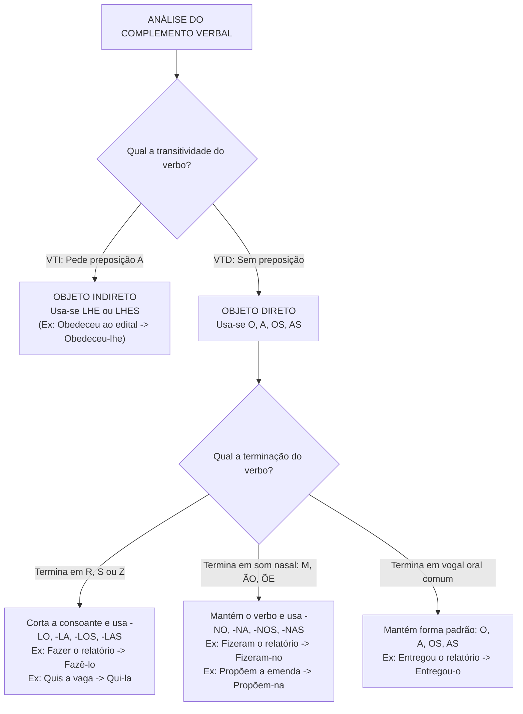
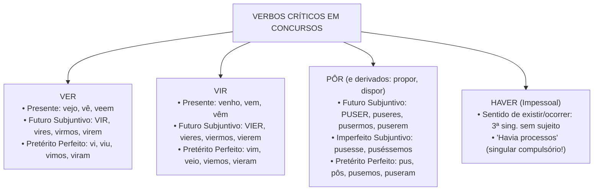
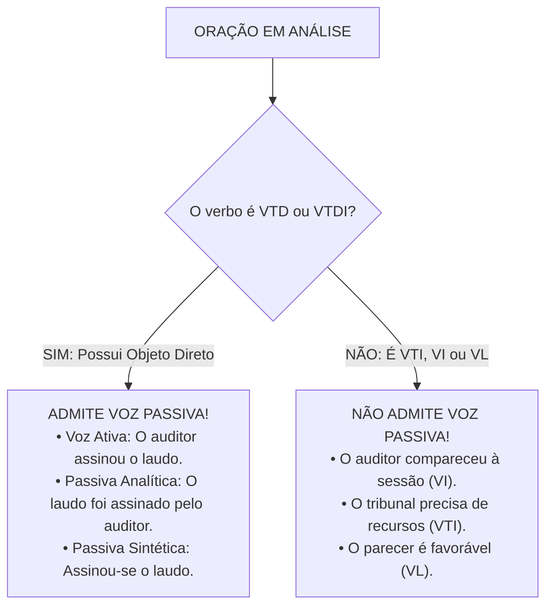

# 03 - Morfossintaxe, Pronomes e Sistema Verbal

> **Matéria:** Língua Portuguesa  
> **Cargos:** A01 – Técnico de Controle Externo (Adm) / B02 – Técnico de Controle Externo (TI)  
> **Arquivo:** `03_morfossintaxe_pronomes_e_verbos.md`  
> **Referência Temática:** Morfossintaxe, Substituição Pronominal, Vozes Verbais e Correlação na Banca FCC

---

## 📌 Ementa / Itens do Edital
- Morfossintaxe: correlação entre classe de palavras (morfologia) e função sintática na oração;
- Pronomes: classificação, valores semânticos, relações anafóricas e catafóricas;
- Pronomes pessoais retos e oblíquos átonos/tônicos: funções sintáticas de sujeito vs. complementos verbais;
- Regras de substituição pronominal com formas variantes (-lo, -la, -no, -na) e emprego de *lhe/lhes*;
- Pronome relativo *cujo* e regência com preposições antepostas;
- Colocação pronominal: Próclise (fatores atrativos obrigatórios), Ênclise e Mesóclise;
- Flexão verbal: conjugação de verbos regulares, irregulares, defectivos e anômalos de alta incidência;
- Vozes do verbo: ativa, passiva analítica, passiva sintética (pronominal), reflexiva e recíproca;
- Condições gramaticais para transposição entre voz ativa e voz passiva;
- Distinção funcional da partícula `SE`: Pronome Apassivador vs. Índice de Indeterminação do Sujeito;
- Correlação de tempos e modos verbais (*consecutio temporum*).

---

## 🧭 Sumário

1. [Fundamentos de Morfossintaxe e Estrutura Oracional](#1-fundamentos-de-morfossintaxe-e-estrutura-oracional)
    1. [Correlação entre Classes Morfológicas e Funções Sintáticas](#11-correlacao-entre-classes-morfologicas-e-funcoes-sintaticas)
    2. [Termos Essenciais, Integrantes e Acessórios da Oração](#12-termos-essenciais-integrantes-e-acessorios-da-oracao)
    3. [O Papel Central do Verbo na Predicação e Transitividade](#13-o-papel-central-do-verbo-na-predicacao-e-transitividade)
    4. [Teste 022](#Teste-022)
2. [Teoria dos Pronomes e Relações Discursivas](#2-teoria-dos-pronomes-e-relacoes-discursivas)
    1. [Classificação Geral e Funções Referenciais: Anáfora, Catáfora e Dêixis](#21-classificacao-geral-e-funcoes-referenciais-anafora-catafora-e-deixis)
    2. [Pronomes Demonstrativos e a Articulação Espaço-Temporal](#22-pronomes-demonstrativos-e-a-articulacao-espaco-temporal)
    3. [Pronome Relativo Cujo e Regência com Preposições Antepostas](#23-pronome-relativo-cujo-e-regencia-com-preposicoes-antepostas)
    4. [Teste 023](#Teste-023)
3. [Pronomes Pessoais e Substituição Pronominal](#3-pronomes-pessoais-e-substituicao-pronominal)
    1. [Pronomes Pessoais Retos vs. Oblíquos Átonos e Tônicos](#31-pronomes-pessoais-retos-vs-obliquos-atonos-e-tonicos)
    2. [Complementos de VTD e VTI: Emprego de O/A vs. Lhe/Lhes](#32-complementos-de-vtd-e-vti-emprego-de-oa-vs-lhelhes)
    3. [Variações Fonéticas dos Pronomes Diretos: Formas em -Lo e -No](#33-variacoes-foneticas-dos-pronomes-diretos-formas-em-lo-e-no)
    4. [Teste 024](#Teste-024)
4. [Sintaxe de Colocação Pronominal](#4-sintaxe-de-colocacao-pronominal)
    1. [Próclise e os Fatores Atrativos Obrigatórios](#41-proclise-e-os-fatores-atrativos-obrigatorios)
    2. [Mesóclise e Suas Condições de Aplicação](#42-mesoclise-e-suas-condicoes-de-aplicacao)
    3. [Ênclise e Vedações Gramaticais Absolutas](#43-enclise-e-vedacoes-gramaticais-absolutas)
    4. [Colocação Pronominal em Locuções Verbais](#44-colocacao-pronominal-em-locucoes-verbais)
    5. [Teste 025](#Teste-025)
5. [Sistema Verbal: Paradigmas de Flexão e Formas Críticas](#5-sistema-verbal-paradigmas-de-flexao-e-formas-criticas)
    1. [Verbos Regulares, Irregulares, Anômalos e Defectivos](#51-verbos-regulares-irregulares-anomalos-e-defectivos)
    2. [Verbos Notáveis de Alta Incidência: Ter, Vir, Ver, Pôr e Haver](#52-verbos-notaveis-de-alta-incidencia-ter-vir-ver-por-e-haver)
    3. [Teste 026](#Teste-026)
    4. [Teste 027](#Teste-027)
6. [Vozes Verbais e Regras de Transposição](#6-vozes-verbais-e-regras-de-transposicao)
    1. [Voz Ativa, Voz Passiva, Voz Reflexiva e Recíproca](#61-voz-ativa-voz-passiva-voz-reflexiva-e-reciproca)
    2. [Voz Passiva Analítica e Regras Estritas de Transposição](#62-voz-passiva-analitica-e-regras-estritas-de-transposicao)
    3. [Voz Passiva Sintética ou Pronominal](#63-voz-passiva-sintetica-ou-pronominal)
    4. [Distinção entre Pronome Apassivador e Índice de Indeterminação do Sujeito](#64-distincao-entre-pronome-apassivador-e-indice-de-indeterminacao-do-sujeito)
    5. [Teste 028](#Teste-028)
    6. [Teste 029](#Teste-029)
    7. [Teste 030](#Teste-030)
7. [Correlação de Tempos e Modos Verbais](#7-correlacao-de-tempos-e-modos-verbais)
    1. [Princípios da Consecutio Temporum no Período Composto](#71-principios-da-consecutio-temporum-no-periodo-composto)
    2. [Estruturas Hipotéticas e Condicionais Padronizadas](#72-estruturas-hipoteticas-e-condicionais-padronizadas)
    3. [Correlações em Orações Subjetivas e Integrantes](#73-correlacoes-em-oracoes-subjetivas-e-integrantes)
    4. [Teste 031](#Teste-031)
8. [🌐 Fontes Oficiais e Referências Bibliográficas](#fontes-oficiais-e-referencias-bibliograficas)

---

## 1. Fundamentos de Morfossintaxe e Estrutura Oracional

A morfossintaxe constitui a área integrada da gramática que estuda simultaneamente a natureza morfológica das palavras (sua classificação em uma das dez classes gramaticais) e a função sintática que essas mesmas palavras desempenham no interior da oração. Uma mesma classe gramatical pode assumir funções sintáticas distintas a depender do contexto relacional estabelecido com o núcleo do predicado e com os demais termos oracionais.

### 1.1 Correlação entre Classes Morfológicas e Funções Sintáticas

Na língua portuguesa, as classes morfológicas agrupam-se em variáveis (substantivo, adjetivo, artigo, pronome, numeral e verbo) e invariáveis (advérbio, preposição, conjunção e interjeição). A cada classe associa-se uma vocação sintática preferencial:

| Classe Morfológica | Funções Sintáticas Primárias | Exemplos Típicos em Concursos |
| :--- | :--- | :--- |
| **Substantivo** (ou termo substantivado) | Núcleo do Sujeito, Núcleo do Objeto Direto/Indireto, Agente da Passiva, Núcleo do Aposto | *"O <ins>conselheiro</ins> julgou o <ins>recurso</ins>"* |
| **Adjetivo** | Adjunto Adnominal, Predicativo do Sujeito, Predicativo do Objeto | *"A decisão foi <ins>técnica</ins>"* (Predicativo) |
| **Pronome Substantivo** | Sujeito, Objeto Direto, Objeto Indireto, Complemento Nominal | *"Ele <ins>o</ins> advertiu formalmente"* |
| **Pronome Adjetivo** | Adjunto Adnominal | *"Acompanhou <ins>este</ins> processo"* |
| **Verbo** | Núcleo do Predicado (Verbo Nocional) ou Elo de Ligação (Verbo de Ligação) | *"O auditor <ins>inspecionou</ins> a obra"* |
| **Advérbio** | Adjunto Adverbial (modifica verbo, adjetivo ou outro advérbio) | *"Julgou <ins>celeremente</ins> a lide"* |
| **Preposição** | Conectivo relacional sem função de termo isolado (introduz termos preposicionados) | *"Necessita <ins>de</ins> recursos"* |
| **Conjunção** | Conectivo oracional de coordenação ou subordinação | *"Estudou <ins>porque</ins> almejava a posse"* |

### 1.2 Termos Essenciais, Integrantes e Acessórios da Oração

A sintaxe clássica divide a estrutura oracional em três ordens hierárquicas de termos:

1. **Termos Essenciais:**
    * **Sujeito:** Elemento sobre o qual se faz uma declaração, com o qual o verbo concorda em número e pessoa. Pode ser determinado (simples, composto ou elíptico/oculto), indeterminado (com verbo na 3ª pessoa do plural sem referência ou com VTI/VI + partícula SE) ou inexistente (em orações sem sujeito com verbos impessoais como *haver* no sentido de existir ou verbos de fenômenos climáticos).
    * **Predicado:** Tudo o que se declara acerca do sujeito ou, nas orações sem sujeito, o próprio teor do processo verbal. Divide-se em predicado verbal (núcleo é um verbo nocional), predicado nominal (núcleo é um nome predicativo ligado por verbo de ligação) e predicado verbo-nominal (possui verbo nocional associado a um predicativo).

2. **Termos Integrantes:**
    * **Objeto Direto:** Complemento verbal não regido obrigatoriamente por preposição exigida pelo verbo.
    * **Objeto Indireto:** Complemento verbal regido obrigatoriamente por preposição exigida pelo verbo transitivo indireto.
    * **Complemento Nominal:** Termo preposicionado que completa o sentido abstrato e passivo de um substantivo abstrato, de um adjetivo ou de um advérbio.
    * **Agente da Passiva:** Termo preposicionado (com *por/pelo* ou raramente *de*) que pratica a ação expressa pelo verbo na voz passiva analítica.

3. **Termos Acessórios e Vocativo:**
    * **Adjunto Adnominal:** Termo de valor adjetivo que determina, especifica ou restringe o substantivo núcleo de qualquer função sintática.
    * **Adjunto Adverbial:** Termo de valor adverbial que expressa circunstâncias de tempo, lugar, modo, causa, finalidade, instrumento, entre outras.
    * **Aposto:** Termo de natureza substantiva que explica, resume, especifica ou enumera outro termo substantivo antecedente.
    * **Vocativo:** Termo independente de invocação ou chamamento, sem ligação sintática com o sujeito ou o predicado.

### 1.3 O Papel Central do Verbo na Predicação e Transitividade

A predicação verbal analisa a exigência de complementos pelos verbos no contexto específico da frase:

* **Verbo Intransitivo (VI):** Possui sentido completo em si mesmo no contexto, prescindindo de objeto direto ou indireto (*"O conselheiro faleceu"*, *"O processo caminhou rapidamente"* — onde *rapidamente* é mero adjunto adverbial de modo).
* **Verbo Transitivo Direto (VTD):** Requer complemento sem preposição obrigatória (*"O auditor apurou a fraude"*).
* **Verbo Transitivo Indireto (VTI):** Requer complemento introduzido por preposição exigida pela regência verbal (*"O fiscal deparou com impropriedades"*, *"O relator anuiu aos termos"*).
* **Verbo Transitivo Direto e Indireto (VTDI ou Bitransitivo):** Reclama dois complementos simultâneos, um direto e outro indireto (*"O presidente remeteu o relatório ao tribunal"*).
* **Verbo de Ligação (VL):** Não expressa ação, servindo de elo entre o sujeito e seu predicativo (*ser, estar, parecer, permanecer, ficar, continuar, andar* em sentido de estado).

---

### Teste 022
**(CEBRASPE – STF – 2008 – Analista Judiciario Suporte Em Tecnologia Da Informacao)**
Como o último período sintático do texto se inicia pela idéia recuperar a idéia de “heteronomia” ((cid:53).13). de possibilidade, a substituição do verbo “tem” ((cid:53).18) por 13 A organização das idéias no texto mostra que, em suas duas tenha, além de preservar a correção gramatical do texto, ocorrências, o pronome “ele”, na linha 17, refere-se ressaltaria o caráter hipotético do argumento. textualmente a “agente” ((cid:53).15). que seremos lapidados pela educação e pela cultura, que disso decorrem diferenças relevantes e irredutíveis aos genes é muito difícil. Significa aceitarmos que há algo muito 4 precário na condição humana. Parte pelo menos dessa precariedade ou indeterminação alguns chamarão liberdade. Porém nem mesmo a liberdade é tão valorizada quanto se 7 imagina. Ela implica responsabilidades. Parece que se busca conforto na condição de coisa. Se eu for objeto, isto é, se eu for natureza, meus males 10 independem de minha vontade. Aliás, o que está em discussão não é tanto o que os causou, mas como resolvê-los: se eu puder solucioná-los com um remédio ou uma cirurgia, 13 não preciso responsabilizar-me, a fundo, por eles. Tratarei a mim mesmo como um objeto. A postura das ciências humanas e da psicanálise é 16 outra, porém. Muito da experiência humana vem justamente de nos constituirmos como sujeitos. Esse papel é pesado. Por isso, quando entra ele em crise — quando minha liberdade 19 de escolher amorosa ou política ou profissionalmente resulta em sofrimento —, posso aliviar-me procurando uma solução que substitua meu papel de sujeito pelo de objeto. 22 Roberto Janine Ribeiro. A cultura ameaçada pela natureza. Pesquisa Fapesp Especial, p. 40 (com adaptações).

* **C)** Certo
* **E)** Errado

---

> **Comentário Detalhado:**
>
> - **C)** **Correta.** O item está **Certo**. Conforme fundamentado na seção *4.3 Ênclise e Vedações Gramaticais Absolutas* deste guia, verbo no início de período sintático: *"Fez-se o levantamento de custos"* (é erro gramatical crasso iniciar frase com pronome oblíquo: *"Se fez o levantamento"*). Dessa forma, está plenamente correta a proposição da banca (CEBRASPE – STF/2008) ao afirmar que "Como o último período sintático do texto se inicia pela idéia recuperar a idéia de “heteronomia”...".
> - **E)** **Incorreta.** A marcação como **Errado** não procede, visto que a assertiva guarda integral conformidade com a teoria estudada em *2.2 Pronomes Demonstrativos e a Articulação Espaço-Temporal*, segundo a qual ao citar dois elementos no texto e retomá-los comparativamente, emprega-se este para referir-se ao elemento mencionado por último (mais próximo fisicamente na escrita) e aquele para remeter ao primeiro elemento mencionado (mais afastado no texto): *"O Diretor e o Auditor chegaram; `<ins>`este`</ins>` (o auditor) trazia as planilhas, `<ins>`aquele`</ins>` (o diretor) presidiu a conferência"*.
>
> **Gabarito: C**

---

## 2. Teoria dos Pronomes e Relações Discursivas

Os pronomes formam a classe gramatical responsável por representar ou acompanhar os nomes (substantivos), exercendo papel insubstituível na coesão textual, na distribuição de turnos de fala e no estabelecimento de referências espaciais e temporais.

### 2.1 Classificação Geral e Funções Referenciais: Anáfora, Catáfora e Dêixis

Do ponto de vista discursivo, os pronomes operam três mecanismos de remissão:

1. **Função Anafórica:** O pronome remete a um termo, fato ou conceito já mencionado anteriormente no texto, retomando-o e garantindo a progressão temática sem repetições deselegantes (*"O Tribunal proferiu a decisão; <ins>esta</ins> gerou ampla repercussão"*).
2. **Função Catafórica:** O pronome antecipa um elemento que ainda será explicitado nas linhas subsequentes (*"O conselheiro reiterou apenas <ins>isto</ins>: a legalidade é inegociável"*).
3. **Função Dêitica (Exofórica):** O pronome aponta diretamente para elementos exteriores ao texto, presentes na situação concreta de enunciação no mundo real (quem fala, onde fala e quando fala): *"Por favor, assine <ins>este</ins> documento aqui agora"*.

### 2.2 Pronomes Demonstrativos e a Articulação Espaço-Temporal

O emprego correto dos demonstrativos apoia-se em parâmetros espaciais, temporais e textuais rigorosos:

| Pronome | Relação Espacial | Relação Temporal | Relação Textual |
| :--- | :--- | :--- | :--- |
| **Este, esta, isto** | Próximo do emissor (1ª pessoa) | Tempo presente ou futuro imediato (*"neste ano de 2026"*) | Catáfora (antecipa o que virá) ou retoma o termo imediatamente mais próximo |
| **Esse, essa, isso** | Próximo do receptor (2ª pessoa) | Passado ou futuro próximo (*"esse mês que passou"*) | Anáfora simples (retoma termo recém-mencionado) |
| **Aquele, aquela, aquilo** | Distante de ambos (3ª pessoa) | Passado remoto ou época distante (*"naquele século"*) | Retoma o termo mais distante em contraste com *este* |

> 📌 **NOTA EXPLICATIVA / DISTRIBUIÇÃO EM PARALELO (ESTE VS. AQUELE):** Ao citar dois elementos no texto e retomá-los comparativamente, emprega-se **este** para referir-se ao elemento mencionado por último (mais próximo fisicamente na escrita) e **aquele** para remeter ao primeiro elemento mencionado (mais afastado no texto): *"O Diretor e o Auditor chegaram; <ins>este</ins> (o auditor) trazia as planilhas, <ins>aquele</ins> (o diretor) presidiu a conferência"*.

### 2.3 Pronome Relativo Cujo e Regência com Preposições Antepostas

O pronome relativo *cujo* (e suas flexões *cuja, cujos, cujas*) é um dos pontos de maior incidência em provas de concurso da Fundação Carlos Chagas. O seu emprego correto exige a observância cumulativa de quatro regras pétreas:

1. **Sentido intrínseco de posse:** Liga dois substantivos, estabelecendo uma relação em que o segundo termo pertence ao primeiro (*"O órgão <ins>cujos</ins> servidores foram premiados..."* $\rightarrow$ os servidores do órgão).
2. **Concordância obrigatória com o consequente:** O pronome concorda rigorosamente em gênero e número com o substantivo que vem **depois** dele (*cujo parecer*, *cuja decisão*, *cujos autos*, *cujas certidões*).
3. **Vedação absoluta ao uso de artigo:** É erro gramatical gravíssimo fazer suceder qualquer artigo ao pronome (*cujo o*, *cuja a*, *cujos os*, *cujas as* são formas inexistentes e eliminatórias).
4. **Anteposição da preposição exigida pelo verbo:** Se o verbo da oração adjetiva introduzida por *cujo* exigir preposição em razão de sua regência, essa preposição **deve ser obrigatoriamente colocada antes de cujo**:
    * *"A diretriz orçamentária <ins>a cujas</ins> determinações devemos obedecer..."* (quem obedece, obedece **a** algo);
    * *"O tribunal <ins>em cujas</ins> salas tramitam os processos..."* (quem tramita, tramita **em** algum lugar);
    * *"O auditor <ins>de cuja</ins> integridade todos desconfiavam..."* (quem desconfia, desconfia **de** alguém).

> 🚨 **ALERTA DE PROVA / PEGADINHA DO PRONOME CUJO:** A FCC cria enunciados que tentam substituir o pronome relativo *cujo* por locuções prepositivas ou misturá-lo com conjunções, como em *"O órgão do qual seus servidores foram promovidos"* (errado, redundante) ou inserindo artigos (*"O relatório cujo o teor..."*). Lembre-se: *cujo* jamais aceita artigo posterior e sempre concorda com o termo da frente.

---

### Teste 023
**(FGV – TJ/RR – 2024 – Analista Judiciario Gestao E Governanca De Tecnologia Da Informacao)**
Um jornal português trazia o seguinte texto: Aterrar nas lojas antes de levantar voo. A nova zona comercial do aeroporto de Lisboa está maior e mais bonita. Ana Garcia Martins não foi de viagem, mas foi visitá-la. Ir de viagem e não comprar perfumes e chocolates ne aeroporto é mais ou menos a mesma coisa que ir a Roma e não ver o Papa. Assinale a afirmação inadequada sobre esse texto.

* **A)** A utilização do verbo “aterrar” em lugar de “aterrissar” indica uma preferência vocabular dos portugueses.
* **B)** O texto deve ser enquadrado como publicitário, tendo por objeto o comércio nas lojas do aeroporto de Lisboa.
* **C)** A pessoa citada, no texto, mostra uma atitude que deveria ser copiada por outras pessoas.
* **D)** O pronome “la” se refere à zona comercial do aeroporto.
* **E)** A comparação final do texto é feita para mostrar o absurdo que é ir a Roma e não ver o Papa.

---

> **Comentário Detalhado:**
>
> - **A)** **Incorreta.** A opção apresenta proposição em desacordo com os fundamentos teóricos e técnicos do tópico ao afirmar que "A utilização do verbo “aterrar” em lugar de “aterrissar” indica uma preferência vocabular dos portugueses". De acordo com a teoria estudada em *2.1 Classificação Geral e Funções Referenciais: Anáfora, Catáfora e Dêixis*, função Anafórica: O pronome remete a um termo, fato ou conceito já mencionado anteriormente no texto, retomando-o e garantindo a progressão temática sem repetições deselegantes (*"O Tribunal proferiu a decisão; `<ins>`esta`</ins>` gerou ampla repercussão"*).
> - **B)** **Incorreta.** A opção apresenta proposição em desacordo com os fundamentos teóricos e técnicos do tópico ao afirmar que "O texto deve ser enquadrado como publicitário, tendo por objeto o comércio nas lojas do aeroporto de Lisboa". De acordo com a teoria estudada em *2.3 Pronome Relativo Cujo e Regência com Preposições Antepostas*, anteposição da preposição exigida pelo verbo: Se o verbo da oração adjetiva introduzida por *cujo* exigir preposição em razão de sua regência, essa preposição deve ser obrigatoriamente colocada antes de cujo.
> - **C)** **Incorreta.** A opção apresenta proposição em desacordo com os fundamentos teóricos e técnicos do tópico ao afirmar que "A pessoa citada, no texto, mostra uma atitude que deveria ser copiada por outras pessoas". De acordo com a teoria estudada em *5.2 Verbos Notáveis de Alta Incidência: Ter, Vir, Ver, Pôr e Haver*, no sentido de existir, ocorrer ou expressar decurso de tempo, é impessoal: não tem sujeito e fica obrigatoriamente na 3ª pessoa do singular (*"Havia muitas dúvidas"*, *"Houve falhas formais"*, *"Pode haver impugnações"*).
> - **D)** **Incorreta.** A opção apresenta proposição em desacordo com os fundamentos teóricos e técnicos do tópico ao afirmar que "O pronome “la” se refere à zona comercial do aeroporto". De acordo com a teoria estudada em *2.1 Classificação Geral e Funções Referenciais: Anáfora, Catáfora e Dêixis*, função Dêitica (Exofórica): O pronome aponta diretamente para elementos exteriores ao texto, presentes na situação concreta de enunciação no mundo real (quem fala, onde fala e quando fala): *"Por favor, assine `<ins>`este`</ins>` documento aqui agora"*.
> - **E)** **Correta.** Conforme fundamentado na seção *2.2 Pronomes Demonstrativos e a Articulação Espaço-Temporal* deste guia, ao citar dois elementos no texto e retomá-los comparativamente, emprega-se este para referir-se ao elemento mencionado por último (mais próximo fisicamente na escrita) e aquele para remeter ao primeiro elemento mencionado (mais afastado no texto): *"O Diretor e o Auditor chegaram; `<ins>`este`</ins>` (o auditor) trazia as planilhas, `<ins>`aquele`</ins>` (o diretor) presidiu a conferência"*. Dessa forma, está plenamente correta a assertiva da banca (FGV – TJ/RR/2024) ao estabelecer que "A comparação final do texto é feita para mostrar o absurdo que é ir a Roma e não ver o Papa".
>
> **Gabarito: E**

---

## 3. Pronomes Pessoais e Substituição Pronominal

A substituição de sintagmas nominais por pronomes oblíquos átonos em complementação verbal é uma das marcas registradas da banca FCC. A operação envolve a identificação da transitividade do verbo e o ajuste morfofonético da terminação verbal.

### 3.1 Pronomes Pessoais Retos vs. Oblíquos Átonos e Tônicos

Os pronomes pessoais exercem papéis sintáticos estritos de acordo com a sua forma:

* **Pronomes Retos (eu, tu, ele/ela, nós, vós, eles/elas):** Exercem primordialmente a função de **sujeito** da oração. Não atuam como complementos verbais diretos na norma culta (dizer *"vi ele"* ou *"chamei ela"* constitui desvio sintático primário; o correto é *vi-o*, *chamei-a*).
* **Pronomes Oblíquos Átonos (me, te, se, o, a, lhe, nos, vos, se, os, as, lhes):** São pronunciados com fraca intensidade e não são precedidos de preposição própria, atuando como complementos verbais imediatos (objeto direto ou indireto).
* **Pronomes Oblíquos Tônicos (mim, ti, si, ele, ela, nós, vós, si, eles, elas):** São dotados de tonicidade própria e surgem sempre precedidos de preposição essencial (*a mim, de ti, para nós, com ele*).
    * Distinção clássica: *"Entregue o relatório para mim"* (término da frase, *mim* não conjuga verbo) vs. *"Traga o documento para <ins>eu</ins> assinar"* (caso reto, pois *eu* atua como sujeito do verbo no infinitivo *assinar*).

### 3.2 Complementos de VTD e VTI: Emprego de O/A vs. Lhe/Lhes

A distribuição dos pronomes oblíquos como complementos verbais segue uma regra sem exceções:

1. **Verbos Transitivos Diretos (VTD):** Complementam-se exclusivamente pelos pronomes **o, a, os, as** (e suas variantes alomórficas). Jamais admitem o pronome *lhe* como objeto direto (*"Conheço-o"*, e nunca *"Conheço-lhe"*).
2. **Verbos Transitivos Indiretos (VTI regidos pela preposição A):** Complementam-se pelos pronomes **lhe, lhes** (*"Obedeceu ao regulamento"* $\rightarrow$ *"Obedeceu-lhe"*).
3. **Verbos Transitivos Indiretos com outras preposições (de, em, com, por):** Não admitem *lhe*; exigem pronome oblíquo tônico preposicionado (*"Precisou dele"*, *"Confiou nele"*, *"Simpatizou com ela"*).

### 3.3 Variações Fonéticas dos Pronomes Diretos: Formas em -Lo e -No

Ao associar os pronomes diretos *o, a, os, as* à forma verbal enclítica, ocorrem transformações fonéticas compulsórias:

1. **Verbos terminados em -R, -S ou -Z:**
    * A consoante final é eliminada e o pronome assume as formas **-lo, -la, -los, -las**.
    * Ao retirar a consoante final, a forma verbal residual submete-se às regras normais de acentuação gráfica:
    * *fiscalizar + as* $\rightarrow$ *fiscalizá-las* (oxítona terminada em A);
    * *fazer + o* $\rightarrow$ *fazê-lo* (oxítona terminada em E);
    * *pôr + as* $\rightarrow$ *pô-las* (monossílabo terminado em O);
    * *conduzir + o* $\rightarrow$ *conduzi-lo* (oxítona em I, sem acento);
    * *fizemos + o* $\rightarrow$ *fizemo-lo* (corta o -s, sem acento);
    * *quis + a* $\rightarrow$ *qui-la* (corta o -s, sem acento).

2. **Verbos terminados em terminação nasal (-M, -ÃO, -ÕE):**
    * O verbo permanece absolutamente intacto e o pronome recebe o acréscimo eufônico da consoante nasal, assumindo as formas **-no, -na, -nos, -nas**:
    * *analisaram + o* $\rightarrow$ *analisaram-no*;
    * *compõem + a* $\rightarrow$ *compõem-na*;
    * *dão + os* $\rightarrow$ *dão-nos*.

3. **Verbos terminados em vogal oral comum:**
    * Não sofrem nenhuma mutação, recebendo as formas puras **-o, -a, -os, -as**:
    * *apresentou + as* $\rightarrow$ *apresentou-as*;
    * *remeteu + o* $\rightarrow$ *remeteu-o*;
    * *viu + o* $\rightarrow$ *viu-o*.

> 💡 **DICA DE SUBSTITUIÇÃO PRONOMINAL:** Quando se deparar com uma questão de substituição pronominal da FCC, separe a análise em dois passos: 1) determine a regência do verbo (se pede objeto direto ou indireto); 2) observe a terminação da palavra verbal para aplicar a transformação em L, N ou pura. Nunca misture as regras.

---

### Teste 024
**(FCC – TCE/GO – 2009 – Analista de Controle Externo - Gestão de Conhecimento)**
O verbo indicado entre parênteses deverá flexionar-se configurar diferenciações raciais. numa forma do singular para preencher corretamente a Os homens agrupam-se socialmente, e as semelhanças lacuna da frase: e diferenças que estabelecem entre si decorrem de processos

* **A)** Aquele a quem ...... (sensibilizar) os fatos do noticiá- históricos, sempre culturais, jamais naturais. Fundamentalmen- rio deve poupar-se de acompanhá-los todos os dias. te, um indivíduo pertence a determinada etnia porque acredita
* **B)** Não ...... (dever) mover a ninguém as esperanças ou a crença em que o mundo se torne mais discreto e nisso, e tal crença é compartilhada pelos demais indivíduos que silencioso. compõem o mesmo grupo.
* **C)** Em qualquer notícia que provenha do nosso íntimo A existência de vários grupos étnicos no interior das não mais ...... (haver) de se ocultar as verdades que fingimos desconhecer. mesmas fronteiras nacionais é uma situação comum, pois as populações humanas não são homogêneas, em razão das mi-
* **D)** As pessoas a quem ...... (impor) a TV, diuturnamen- te, notícias de toda espécie perdem a capacidade de grações no decorrer da história. Mas as diferenças étnicas, em discriminar o que é ou não importante. diversos casos, são manipuladas para acirrar conflitos de fundo
* **E)** As novidades que dentro de mim se ...... (mascarar) político ou econômico. O próprio conceito de raça humana, há só se revelarão mediante uma análise introspectiva. _________________________________________________________ muito não admitido pela antropologia moderna, serviu (e por

---

> **Comentário Detalhado:**
>
> - **A)** **Incorreta.** A opção apresenta vedação ou negativa absoluta incompatível com a regra aplicável ao afirmar que "Aquele a quem ...... (sensibilizar) os fatos do noticiá- históricos, sempre culturais, jamais naturais...". De acordo com a teoria estudada em *6.3 Voz Passiva Sintética ou Pronominal*, o elemento nominal sem preposição que acompanha a construção passiva sintética é o sujeito paciente, razão pela qual o verbo deve concordar obrigatoriamente com ele em número e pessoa.
> - **B)** **Incorreta.** A opção apresenta proposição em desacordo com os fundamentos teóricos e técnicos do tópico ao afirmar que "Não ...... (dever) mover a ninguém as esperanças ou a crença em que o mundo se torne mais discreto e nisso, e tal...". De acordo com a teoria estudada em *3.3 Variações Fonéticas dos Pronomes Diretos: Formas em -Lo e -No*, *compõem + a* $\rightarrow$ *compõem-na*.
> - **C)** **Incorreta.** A opção promove generalização excessiva que desconsidera as condições técnicas e normativas ao afirmar que "Em qualquer notícia que provenha do nosso íntimo A existência de vários grupos étnicos no interior das não mais...". De acordo com a teoria estudada em *1. Fundamentos de Morfossintaxe e Estrutura Oracional*, a morfossintaxe constitui a área integrada da gramática que estuda simultaneamente a natureza morfológica das palavras (sua classificação em uma das dez classes gramaticais) e a função sintática que essas mesmas palavras desempenham no interior da oração.
> - **D)** **Correta.** Conforme fundamentado na seção *5.1 Verbos Regulares, Irregulares, Anômalos e Defectivos* deste guia, defectivos: Não possuem a conjugação completa em certas pessoas, tempos ou modos. Dessa forma, está plenamente correta a assertiva da banca (FCC – TCE/GO/2009) ao estabelecer que "As pessoas a quem ...... (impor) a TV, diuturnamen- te, notícias de toda espécie perdem a capacidade de grações no...".
> - **E)** **Incorreta.** A opção apresenta proposição em desacordo com os fundamentos teóricos e técnicos do tópico ao afirmar que "As novidades que dentro de mim se ...... (mascarar) político ou econômico. O próprio conceito de raça humana, há...". De acordo com a teoria estudada em *3.1 Pronomes Pessoais Retos vs. Oblíquos Átonos e Tônicos*, distinção clássica: *"Entregue o relatório para mim"* (término da frase, *mim* não conjuga verbo) vs. *"Traga o documento para `<ins>`eu`</ins>` assinar"* (caso reto, pois *eu* atua como sujeito do verbo no infinitivo *assinar*).
>
> **Gabarito: D**

---

## 4. Sintaxe de Colocação Pronominal

A colocação pronominal estuda a posição ocupada pelos pronomes oblíquos átonos em relação ao verbo: antes do verbo (**próclise**), no meio do verbo (**mesóclise**) ou depois do verbo (**ênclise**).

### 4.1 Próclise e os Fatores Atrativos Obrigatórios

Na norma culta brasileira, a próclise é obrigatória sempre que houver, antes do verbo, uma **palavra atrativa** pertencente a uma das seguintes categorias:

1. **Palavras de sentido negativo:** *não, nunca, jamais, nada, ninguém, nenhum, tampouco* (*"Não <ins>se</ins> apurou a falha"*).
2. **Conjunções subordinativas (integrantes e adverbiais):** *que, se, como, embora, quando, porque, caso, conforme* (*"O relator determinou que <ins>se</ins> fizesse a diligência"*).
3. **Pronomes relativos:** *que, quem, cujo, qual, onde, quanto* (*"Os termos que <ins>lhe</ins> foram apresentados"*).
4. **Pronomes indefinidos:** *tudo, nada, alguém, todos, muitos, qualquer, vários* (*"Alguém <ins>o</ins> advertiu"*).
5. **Pronomes demonstrativos:** *isso, isto, aquilo, este, aquele* (*"Isto <ins>me</ins> comoveu"*).
6. **Advérbios sem vírgula:** *aqui, sempre, talvez, já, logo, ontem* (*"Talvez <ins>o</ins> encontremos na corte"*). Se o advérbio estiver isolado por vírgula, passa a haver ênclise: *"Aqui, encontramo-lo"*.
7. **Orações exclamativas, optativas (que exprimem desejo) ou interrogativas:** *"Deus <ins>te</ins> guarde!"*, *"Quem <ins>te</ins> chamou para a conferência?"*.
8. **Preposição 'EM' seguida de verbo no Gerúndio:** *"Em <ins>se</ins> tratando de auditoria ambiental..."*.

### 4.2 Mesóclise e Suas Condições de Aplicação

A mesóclise (pronome inserido no interior do verbo) é privativa de duas conjugações verbais, desde que o verbo inicie a frase ou não haja palavra atrativa que imponha a próclise:

1. **Futuro do Presente do Indicativo:** *"Apresentar-se-á novo recurso pelo réu"* (*apresentará* + *se*).
2. **Futuro do Pretérito do Indicativo:** *"Dir-se-ia que houve condescendência da fiscalização"* (*diria* + *se*).

> ⭐ **IMPORTANTE / PREVALÊNCIA DA PRÓCLISE SOBRE A MESÓCLISE:** A presença de qualquer palavra atrativa anula a mesóclise e obriga a próclise: *"Não se apresentará novo recurso"* (e nunca *"Não apresentar-se-á"*).

### 4.3 Ênclise e Vedações Gramaticais Absolutas

A ênclise é o padrão genérico de posicionamento nos seguintes contextos:

* Verbo no início de período sintático: *"Fez-se o levantamento de custos"* (é erro gramatical crasso iniciar frase com pronome oblíquo: *"Se fez o levantamento"*);
* Verbo no Imperativo Afirmativo: *"Senhor auditor, instrua-o com as cópias necessárias"*;
* Verbo no Infinitivo Impessoal: *"Era urgente apresentar-lhe o relatório"*;
* Verbo no Gerúndio (sem preposição EM antecedente): *"O tribunal deliberou, acolhendo-o de imediato"*.

#### Vedações Absolutas à Ênclise:
* **Nunca se usa ênclise com verbo conjugado no Futuro do Presente ou no Futuro do Pretérito** (*"Apresentará-se"* é erro grave; deve-se usar mesóclise *apresentar-se-á* ou próclise se houver atrativo).
* **Nunca se usa ênclise com verbo no Particípio isolado** (*"Tinha advertido-o"* é incorreto; deve-se usar *havia-o advertido* ou *o havia advertido*).

### 4.4 Colocação Pronominal em Locuções Verbais

Em locuções compostas por verbo auxiliar mais verbo principal no infinitivo, gerúndio ou particípio:

* **Com Verbo Principal no Infinitivo ou Gerúndio:**
    * Sem palavra atrativa: o pronome pode ficar em ênclise ao auxiliar ou em ênclise ao principal (*"Quero-lhe dizer"* ou *"Quero dizer-lhe"*).
    * Com palavra atrativa: o pronome pode ir para antes do auxiliar (próclise ao auxiliar) ou em ênclise ao verbo principal (*"Não lhe quero dizer"* ou *"Não quero dizer-lhe"*).
* **Com Verbo Principal no Particípio:**
    * O pronome jamais pode vir posposto ao particípio (*"Tinha comunicado-lhe"* é inaceitável).
    * Pode ficar enclítico ao verbo auxiliar (*"Tinha-lhe comunicado"*) ou próclito ao auxiliar se houver palavra atrativa (*"Não lhe tinha comunicado"*).

---

### Teste 025
**(FCC – TRT 11ª – 2017 – Analista Judiciário - Tecnologia da Informação)**
Considere o enunciado que segue. Acredito que os interessados se mostram aptos à função para a qual estão se candidatando quando agem com ponderação diante de cada desafio que lhes é proposto, ou seja, reflete-se sobre o caso a ser analisado e procura-se avaliar de forma imparcial os possíveis aspectos divergentes que nele estejam em jogo. Na frase,

* **A)** o segmento introduzido por ou seja poderia ser eliminado, pois seu conteúdo é pleonástico, nada acrescentando ao já dito: “ponderar” implica, por si só, a ideia de “refletir” e “avaliar de forma imparcial”.
* **B)** com o intuito de obter a adequada correlação entre as formas verbais empregadas, e notando-se o emprego, na linha inicial, de se mostram e estão, teria de haver obrigatoriamente a substituição de estejam por “estão”.
* **C)** nenhuma alteração deve ser feita, pois o conjunto está organizado de maneira clara, mantendo a mesma perspectiva de tratamento do tema e em conformidade com a norma-padrão da língua.
* **D)** há um equívoco de construção, pois temos dois segmentos preposicionados – à função e para a qual está se candidatando – em relação de dependência direta com a mesma palavra – aptos.
* **E)** com o intuito de observar-se o paralelismo de construção, seria adequada a substituição de reflete-se e procura-se avaliar por, respectivamente, “quando refletem” e “quando procuram avaliar”.

---

> **Comentário Detalhado:**
>
> - **A)** **Incorreta.** A opção apresenta proposição em desacordo com os fundamentos teóricos e técnicos do tópico ao afirmar que "o segmento introduzido por ou seja poderia ser eliminado, pois seu conteúdo é pleonástico, nada acrescentando ao...". De acordo com a teoria estudada em *3.1 Pronomes Pessoais Retos vs. Oblíquos Átonos e Tônicos*, distinção clássica: *"Entregue o relatório para mim"* (término da frase, *mim* não conjuga verbo) vs. *"Traga o documento para `<ins>`eu`</ins>` assinar"* (caso reto, pois *eu* atua como sujeito do verbo no infinitivo *assinar*).
> - **B)** **Incorreta.** A opção apresenta proposição em desacordo com os fundamentos teóricos e técnicos do tópico ao afirmar que "com o intuito de obter a adequada correlação entre as formas verbais empregadas, e notando-se o emprego, na linha...". De acordo com a teoria estudada em *3.2 Complementos de VTD e VTI: Emprego de O/A vs. Lhe/Lhes*, a distribuição dos pronomes oblíquos como complementos verbais segue uma regra sem exceções.
> - **C)** **Incorreta.** A opção apresenta proposição em desacordo com os fundamentos teóricos e técnicos do tópico ao afirmar que "nenhuma alteração deve ser feita, pois o conjunto está organizado de maneira clara, mantendo a mesma perspectiva...". De acordo com a teoria estudada em *5.1 Verbos Regulares, Irregulares, Anômalos e Defectivos*, anômalos: Apresentam alterações tão profundas no radical que utilizam bases etimológicas inteiramente distintas na mesma conjugação. No português, são anômalos os verbos ser (*sou, fui, era*) e ir (*vou, fui, ia*).
> - **D)** **Incorreta.** A opção apresenta proposição em desacordo com os fundamentos teóricos e técnicos do tópico ao afirmar que "há um equívoco de construção, pois temos dois segmentos preposicionados – à função e para a qual está se...". De acordo com a teoria estudada em *3.3 Variações Fonéticas dos Pronomes Diretos: Formas em -Lo e -No*, quando se deparar com uma questão de substituição pronominal da FCC, separe a análise em dois passos: 1) determine a regência do verbo (se pede objeto direto ou indireto); 2) observe a terminação da palavra verbal para aplicar a transformação em L, N ou pura.
> - **E)** **Correta.** Conforme fundamentado na seção *6.3 Voz Passiva Sintética ou Pronominal* deste guia, o elemento nominal sem preposição que acompanha a construção passiva sintética é o sujeito paciente, razão pela qual o verbo deve concordar obrigatoriamente com ele em número e pessoa. Dessa forma, está plenamente correta a assertiva da banca (FCC – TRT 11ª/2017) ao estabelecer que "com o intuito de observar-se o paralelismo de construção, seria adequada a substituição de reflete-se e procura-se...".
>
> **Gabarito: E**

---

## 5. Sistema Verbal: Paradigmas de Flexão e Formas Críticas

O verbo é a classe de palavras dotada do sistema flexional mais rico e complexo do idioma, conjugando-se em número, pessoa, tempo, modo e voz.

### 5.1 Verbos Regulares, Irregulares, Anômalos e Defectivos

* **Regulares:** Conservam o radical inalterado ao longo de todo o paradigma de conjugação e acolhem as desinências padrão da sua conjugação (*cantar, vender, partir*).
* **Irregulares:** Sofrem alterações no radical ou assumem desinências que se afastam do paradigma comum (*fazer / fiz; caber / caibo; ouvir / ouço*).
* **Anômalos:** Apresentam alterações tão profundas no radical que utilizam bases etimológicas inteiramente distintas na mesma conjugação. No português, são anômalos os verbos **ser** (*sou, fui, era*) e **ir** (*vou, fui, ia*).
* **Defectivos:** Não possuem a conjugação completa em certas pessoas, tempos ou modos:
    * Exemplo: *reaver* (deriva de *haver*, mas conjuga-se apenas nas formas em que o verbo primitivo *haver* possui a letra **v**: *reaver, reavemos, reaveis, reouve, reouvera*; não existem formas como *"eu reavenho"* ou *"que ele reavenha"*);
    * Outros defectivos: *falir, colorir, abolir, banir, computar* (não possuem a 1ª pessoa do presente do indicativo).

### 5.2 Verbos Notáveis de Alta Incidência: Ter, Vir, Ver, Pôr e Haver

A banca FCC explora sistematicamente formas flexionais desses cinco verbos e de seus derivados:

1. **O Verbo VER no Futuro do Subjuntivo:**
    * Faz **vir, vires, vir, virmos, virdes, virem** (*"Quando o conselheiro <ins>vir</ins> as irregularidades, determinará a anulação"*, e nunca *"quando o conselheiro ver"*).

2. **O Verbo VIR no Futuro do Subjuntivo:**
    * Faz **vier, vieres, vier, viermos, vierdes, vierem** (*"Quando a equipe de fiscalização <ins>vier</ins> ao município..."*).

3. **O Verbo PÔR (e derivados como propor, dispor, compor):**
    * Futuro do Subjuntivo: **puser, puseres, puser, pusermos, puserdes, puserem** (*"Se o gestor <ins>propuser</ins> a repactuação"*, e nunca *"se o gestor propor"*).
    * Pretérito Imperfeito do Subjuntivo: **pusesse, pusesses, pusesse, puséssemos, pusésseis, pusessem** (*"Se o fiscal <ins>propusesse</ins>..."*).

4. **O Verbo HAVER Impessoal:**
    * No sentido de existir, ocorrer ou expressar decurso de tempo, é **impessoal**: não tem sujeito e fica obrigatoriamente na **3ª pessoa do singular** (*"Havia muitas dúvidas"*, *"Houve falhas formais"*, *"Pode haver impugnações"*). Se for substituído por *existir*, o verbo *existir* é pessoal e concorda normalmente (*"Existiam muitas dúvidas"*, *"Existiram falhas"*).

---

### Teste 026
**(FGV – TRT/13 – 2022 – Analista Judiciario Tecnologia Da Informacao)**
Em todas as frases abaixo está presente o verbo “ver”. A substituição desse verbo por outro, adequada ao contexto, é:

* **A)** Ficamos paralisados, vendo a paisagem maravilhosa / contemplando.
* **B)** É difícil ver a diferença de cores neste quadro / apreciar.
* **C)** O diretor verá hoje os requerimentos dos alunos / notará.
* **D)** Os médicos veem muitos pacientes por dia / percebem.
* **E)** Não conseguiram ver a grandeza das ações / destacar.

---

> **Comentário Detalhado:**
>
> - **A)** **Correta.** Conforme fundamentado na seção *5.2 Verbos Notáveis de Alta Incidência: Ter, Vir, Ver, Pôr e Haver* deste guia, o Verbo PÔR (e derivados como propor, dispor, compor). Dessa forma, está plenamente correta a assertiva da banca (FGV – TRT/13/2022) ao estabelecer que "Ficamos paralisados, vendo a paisagem maravilhosa / contemplando".
> - **B)** **Incorreta.** A opção apresenta proposição em desacordo com os fundamentos teóricos e técnicos do tópico ao afirmar que "É difícil ver a diferença de cores neste quadro / apreciar". De acordo com a teoria estudada em *2.2 Pronomes Demonstrativos e a Articulação Espaço-Temporal*, este, esta, isto: Próximo do emissor (1ª pessoa) — Tempo presente ou futuro imediato (*"neste ano de 2026"*) — Catáfora (antecipa o que virá) ou retoma o termo imediatamente mais próximo.
> - **C)** **Incorreta.** A opção apresenta proposição em desacordo com os fundamentos teóricos e técnicos do tópico ao afirmar que "O diretor verá hoje os requerimentos dos alunos / notará". De acordo com a teoria estudada em *2.2 Pronomes Demonstrativos e a Articulação Espaço-Temporal*, ao citar dois elementos no texto e retomá-los comparativamente, emprega-se este para referir-se ao elemento mencionado por último (mais próximo fisicamente na escrita) e aquele para remeter ao primeiro elemento mencionado (mais afastado no texto): *"O Diretor e o Auditor chegaram; `<ins>`este`</ins>` (o auditor) trazia as planilhas, `<ins>`aquele`</ins>` (o diretor) presidiu a conferência"*.
> - **D)** **Incorreta.** A opção apresenta proposição em desacordo com os fundamentos teóricos e técnicos do tópico ao afirmar que "Os médicos veem muitos pacientes por dia / percebem". De acordo com a teoria estudada em *4.1 Próclise e os Fatores Atrativos Obrigatórios*, pronomes indefinidos: *tudo, nada, alguém, todos, muitos, qualquer, vários* (*"Alguém `<ins>`o`</ins>` advertiu"*).
> - **E)** **Incorreta.** A opção apresenta proposição em desacordo com os fundamentos teóricos e técnicos do tópico ao afirmar que "Não conseguiram ver a grandeza das ações / destacar". De acordo com a teoria estudada em *5.2 Verbos Notáveis de Alta Incidência: Ter, Vir, Ver, Pôr e Haver*, se for substituído por *existir*, o verbo *existir* é pessoal e concorda normalmente (*"Existiam muitas dúvidas"*, *"Existiram falhas"*).
>
> **Gabarito: A**

---

### Teste 027
**(FCC – TRT 1ª – 2014 – Analista Judiciário - Tecnologia da Informação)**
Na frase Dissesse alguém isso hoje, seria aplaudido acionado em pleno regime escravocrata. por muitos, ao passo que uns poucos o condenariam III. a referência ao militante Antonio Gramsci, no pará- com veemência, a correlação entre tempos e modos ver- grafo final, propicia um argumento poderoso a favor bais continuará adequada caso se substituam as formas de quem se pauta pelo cumprimento rigoroso da lei, sublinhadas, na ordem dada, por não importando as circunstâncias.

* **A)** ...... (ser) de se lamentar que tais ocorrências ainda Na música popular, a Bossa Nova, lançada em 1959 por ...... (ter) havido. Tom Jobim e João Gilberto, entre outros, inspirava-se no jazz,
* **B)** Caso ...... (continuar) a ocorrer tais fatos, ...... rejeitando a música passional e a interpretação dramática que (haver) que se tomar providências. se dava aos sambas-canções e aos boleros que dominavam as
* **C)** ...... (ocorrer) a Luís Gama argumentos que jamais rádios brasileiras. A Bossa Nova apontava para o despojamento se ...... (ver) antes. das letras das canções, dos arranjos instrumentais e da voca- lização, para melhor expressar o “Brasil moderno”.
* **D)** Ao tempo de Luís Gama, a um proprietário jamais se ...... (aplicar) quaisquer penas por atos que ...... Já a primeira metade da década de 1960 foi marcada (haver) representado uma tortura a um escravo. pelo encontro entre a vida cultural e a luta pelas Reformas de
* **E)** Para Gramsci, os sofrimentos que para alguém ...... Base. Já não se tratava mais de buscar apenas uma expressão (advir) de uma decisão ...... (dever) ser levados em moderna, mas de pontuar os dilemas brasileiros e denunciar o conta por quem viesse a tomá-la. subdesenvolvimento do país. Organizava-se, assim, a cultura _________________________________________________________ engajada de esquerda, em torno do Movimento de Cultura Po-

---

> **Comentário Detalhado:**
>
> - **A)** **Incorreta.** A opção apresenta proposição em desacordo com os fundamentos teóricos e técnicos do tópico ao afirmar que "...... (ser) de se lamentar que tais ocorrências ainda Na música popular, a Bossa Nova, lançada em 1959 por ...". De acordo com a teoria estudada em *2.3 Pronome Relativo Cujo e Regência com Preposições Antepostas*, *"O auditor `<ins>`de cuja`</ins>` integridade todos desconfiavam..."* (quem desconfia, desconfia de alguém).
> - **B)** **Incorreta.** A opção apresenta proposição em desacordo com os fundamentos teóricos e técnicos do tópico ao afirmar que "Caso ...... (continuar) a ocorrer tais fatos, ...... rejeitando a música passional e a interpretação dramática que...". De acordo com a teoria estudada em *5.2 Verbos Notáveis de Alta Incidência: Ter, Vir, Ver, Pôr e Haver*, no sentido de existir, ocorrer ou expressar decurso de tempo, é impessoal: não tem sujeito e fica obrigatoriamente na 3ª pessoa do singular (*"Havia muitas dúvidas"*, *"Houve falhas formais"*, *"Pode haver impugnações"*).
> - **C)** **Incorreta.** A opção apresenta vedação ou negativa absoluta incompatível com a regra aplicável ao afirmar que "...... (ocorrer) a Luís Gama argumentos que jamais rádios brasileiras. A Bossa Nova apontava para o despojamento...". De acordo com a teoria estudada em *2.3 Pronome Relativo Cujo e Regência com Preposições Antepostas*, anteposição da preposição exigida pelo verbo: Se o verbo da oração adjetiva introduzida por *cujo* exigir preposição em razão de sua regência, essa preposição deve ser obrigatoriamente colocada antes de cujo.
> - **D)** **Incorreta.** A opção apresenta vedação ou negativa absoluta incompatível com a regra aplicável ao afirmar que "Ao tempo de Luís Gama, a um proprietário jamais se ...... (aplicar) quaisquer penas por atos que ...... Já a...". De acordo com a teoria estudada em *5. Sistema Verbal: Paradigmas de Flexão e Formas Críticas*, o verbo é a classe de palavras dotada do sistema flexional mais rico e complexo do idioma, conjugando-se em número, pessoa, tempo, modo e voz.
> - **E)** **Correta.** Conforme fundamentado na seção *4.1 Próclise e os Fatores Atrativos Obrigatórios* deste guia, pronomes indefinidos: *tudo, nada, alguém, todos, muitos, qualquer, vários* (*"Alguém `<ins>`o`</ins>` advertiu"*). Dessa forma, está plenamente correta a assertiva da banca (FCC – TRT 1ª/2014) ao estabelecer que "Para Gramsci, os sofrimentos que para alguém ...... Base. Já não se tratava mais de buscar apenas uma expressão...".
>
> **Gabarito: E**

---

## 6. Vozes Verbais e Regras de Transposição

A voz verbal traduz a relação sintático-semântica entre o verbo e o sujeito da oração, explicitando se o sujeito pratica a ação (sujeito agente), sofre a ação (sujeito paciente) ou desempenha ambos os papéis cumulativamente.

### 6.1 Voz Ativa, Voz Passiva, Voz Reflexiva e Recíproca

* **Voz Ativa:** O sujeito gramatical é o agente direto ou causador da ação verbal: *"O auditor concluiu o laudo pericial"*.
* **Voz Passiva:** O sujeito gramatical é paciente, recebendo ou sofrendo os efeitos da ação praticada por outrem: *"O laudo pericial foi concluído pelo auditor"*.
* **Voz Reflexiva:** O sujeito é simultaneamente agente e paciente da ação, praticando-a sobre si mesmo: *"O acusado feriu-se com as próprias declarações"*.
* **Voz Recíproca:** Há mais de um sujeito que praticam e recebem mutuamente a mesma ação: *"Os procuradores cumprimentaram-se na tribuna"*.

### 6.2 Voz Passiva Analítica e Regras Estritas de Transposição

A voz passiva analítica é estruturada pela combinação de um verbo auxiliar (quase sempre o verbo **ser**, raramente *estar* ou *ficar*) conjugado com o **particípio** do verbo principal:
$$\text{Sujeito Paciente} + \text{Verbo Auxiliar SER (no mesmo tempo da ativa)} + \text{Particípio} + \text{Agente da Passiva}$$

#### Requisitos Intransponíveis para a Conversão Passiva:
1. **Transitividade Verbal:** Apenas orações cujo verbo principal seja **Transitivo Direto (VTD)** ou **Transitivo Direto e Indireto (VTDI)** admitem passagem para a voz passiva. Verbos Transitivos Indiretos (VTI), Intransitivos (VI) e de Ligação (VL) **jamais admitem voz passiva**, porque não possuem objeto direto suscetível de converter-se em sujeito paciente.
2. **Equivalência Temporal Estrita:** O verbo auxiliar *ser* deve ser conjugado rigorosamente no mesmo tempo e modo em que se encontrava o verbo simples da voz ativa:
    * *O auditor analisa as contas* (Presente do Indicativo) $\rightarrow$ *As contas* **são analisadas**;
    * *O auditor analisou as contas* (Pretérito Perfeito) $\rightarrow$ *As contas* **foram analisadas**;
    * *O auditor analisava as contas* (Pretérito Imperfeito) $\rightarrow$ *As contas* **eram analisadas**;
    * *O auditor analisara as contas* (Pretérito Mais-Que-Perfeito) $\rightarrow$ *As contas* **tinham sido / foram analisadas**;
    * *O auditor analisará as contas* (Futuro do Presente) $\rightarrow$ *As contas* **serão analisadas**;
    * *O auditor analisaria as contas* (Futuro do Pretérito) $\rightarrow$ *As contas* **seriam analisadas**.

### 6.3 Voz Passiva Sintética ou Pronominal

A voz passiva sintética compõe-se de um verbo Transitivo Direto conjugado na 3ª pessoa (singular ou plural) associado ao pronome apassivador **SE**:
$$\text{VTD / VTDI} + \text{SE (Pronome Apassivador)} + \text{Sujeito Paciente}$$

* Exemplo no singular: *"Apurou-se a irregularidade"* (= *A irregularidade foi apurada*);
* Exemplo no plural: *"Apuraram-se as irregularidades"* (= *As irregularidades foram apuradas*).

O elemento nominal sem preposição que acompanha a construção passiva sintética é o **sujeito paciente**, razão pela qual o verbo deve concordar obrigatoriamente com ele em número e pessoa.

### 6.4 Distinção entre Pronome Apassivador e Índice de Indeterminação do Sujeito

Essa distinção é um dos temas fundamentais de cobrança da FCC em morfossintaxe e concordância:

| Critério | Pronome Apassivador (Partícula Apassivadora) | Índice de Indeterminação do Sujeito (IIS) |
| :--- | :--- | :--- |
| **Transitividade do Verbo** | Verbo Transitivo Direto (VTD) ou VTDI | Verbo Transitivo Indireto (VTI), Intransitivo (VI) ou de Ligação (VL) |
| **Presença de Preposição** | O elemento subsequente **não tem preposição obrigatória** | O elemento subsequente vem **restringido por preposição** |
| **Existência de Sujeito** | Há Sujeito Paciente expresso na oração | Não há sujeito expresso; o sujeito é indeterminado |
| **Concordância Verbal** | O verbo **flexiona obrigatoriamente** (vai ao plural se o sujeito for plural) | O verbo fica **obrigatoriamente na 3ª pessoa do singular** |
| **Exemplo Correto** | *"Identificaram-se novas falhas"* | *"Trata-se de novas falhas"* |
| **Erro Clássico em Prova** | *"Identificou-se novas falhas"* (verbo não concordou) | *"Tratam-se de novas falhas"* (verbo pluralizou indevidamente com VTI) |

> 🚨 **ALERTA DE PROVA / PEGADINHA DO VERBO TRATAR-SE:** A FCC frequentemente introduz a forma verbal pluralizada *"Tratam-se de..."*, *"Precisam-se de..."* ou *"Obedeceram-se aos ditames..."*. Como os verbos *tratar (de)*, *precisar (de)* e *obedecer (a)* são Transitivos Indiretos e regem preposição, a partícula *se* atua como Índice de Indeterminação do Sujeito. É **proibido flexionar o verbo no plural**; o correto é invariavelmente: *"Trata-se de..."*, *"Precisa-se de..."*, *"Obedeceu-se aos ditames..."*.

---

### Teste 028
**(FCC – TRT 15ª – 2015 – Analista Judiciário - Tecnologia da Informação)**
No contexto dado, possui a mesma regência do verbo presente no segmento A escravidão que denunciava com dureza, o que se encontra sublinhado em:

* **A)** Quem fala, hoje, dos 30 milhões de escravos... (8o parágrafo)
* **B)** ... número que hoje oscila entre os 13 milhões e os 14 milhões... (5o parágrafo)
* **C)** ... antes de portugueses ou espanhóis comprarem negros na África rumo ao Novo Mundo. (7o parágrafo)
* **D)** ... o Global Slavery Index é um belo retrato da nossa miséria... (4o parágrafo)
* **E)** Não é preciso assistir a 12 Anos de Escravidão... (1o parágrafo)

---

> **Comentário Detalhado:**
>
> - **A)** **Incorreta.** A opção apresenta proposição em desacordo com os fundamentos teóricos e técnicos do tópico ao afirmar que "Quem fala, hoje, dos 30 milhões de escravos... (8o parágrafo)". De acordo com a teoria estudada em *2. Teoria dos Pronomes e Relações Discursivas*, os pronomes formam a classe gramatical responsável por representar ou acompanhar os nomes (substantivos), exercendo papel insubstituível na coesão textual, na distribuição de turnos de fala e no estabelecimento de referências espaciais e temporais.
> - **B)** **Incorreta.** A opção apresenta proposição em desacordo com os fundamentos teóricos e técnicos do tópico ao afirmar que "... número que hoje oscila entre os 13 milhões e os 14 milhões... (5o parágrafo)". De acordo com a teoria estudada em *6.3 Voz Passiva Sintética ou Pronominal*, o elemento nominal sem preposição que acompanha a construção passiva sintética é o sujeito paciente, razão pela qual o verbo deve concordar obrigatoriamente com ele em número e pessoa.
> - **C)** **Incorreta.** A opção apresenta proposição em desacordo com os fundamentos teóricos e técnicos do tópico ao afirmar que "... antes de portugueses ou espanhóis comprarem negros na África rumo ao Novo Mundo. (7o parágrafo)". De acordo com a teoria estudada em *4.2 Mesóclise e Suas Condições de Aplicação*, futuro do Presente do Indicativo: *"Apresentar-se-á novo recurso pelo réu"* (*apresentará* + *se*).
> - **D)** **Incorreta.** A opção apresenta proposição em desacordo com os fundamentos teóricos e técnicos do tópico ao afirmar que "... o Global Slavery Index é um belo retrato da nossa miséria... (4o parágrafo)". De acordo com a teoria estudada em *1. Fundamentos de Morfossintaxe e Estrutura Oracional*, uma mesma classe gramatical pode assumir funções sintáticas distintas a depender do contexto relacional estabelecido com o núcleo do predicado e com os demais termos oracionais.
> - **E)** **Correta.** Conforme fundamentado na seção *1.3 O Papel Central do Verbo na Predicação e Transitividade* deste guia, verbo Intransitivo (VI): Possui sentido completo em si mesmo no contexto, prescindindo de objeto direto ou indireto (*"O conselheiro faleceu"*, *"O processo caminhou rapidamente"* — onde *rapidamente* é mero adjunto adverbial de modo). Dessa forma, está plenamente correta a assertiva da banca (FCC – TRT 15ª/2015) ao estabelecer que "Não é preciso assistir a 12 Anos de Escravidão... (1o parágrafo)".
>
> **Gabarito: E**

---

### Teste 029
**(FCC – TRT 23ª – 2016 – Analista Judiciário - Apoio Especializado - Tecnologia da Informação)**
O verbo que pode ser flexionado em uma forma do plural, sem prejuízo da correção e sem que nenhuma outra modi- ficação seja feita na frase, está em:

* **A)** ... existe pouco espaço para as velhas bibliotecas...
* **B)** ... a biblioteca recebe 2.000 usuários por dia...
* **C)** ... que jamais se pensaria...
* **D)** A metade de seus usuários tem entre 25 e 35 anos.
* **E)** ... que observa como os grandes leitores das Aos 45 anos, o chinês Jia Zhang-Ke pode ser considera- do um dos principais cineastas do mundo. Sua idade permitiu a ele testemunhar a transição histórica pela qual a China passou depois de 1976, com a morte de Mao Tse-Tung, o fim da Revolução Cultural e a subida ao poder de Deng Xiaoping, que em poucos anos abriu o país à economia de mercado. Os filmes de Jia são cada vez mais vistos no exterior, uma vez que exibem importância estética e oferecem um olhar sobre uma realidade pouco conhecida aos olhos do mundo. “Vemos cidades que estão sendo demolidas, memórias que estão sendo apagadas, uma população flutuante que viaja ao sabor das oportunidades econômicas, e Jia quer investigar qual é o efeito dessa transformação no indivíduo”, descreve a pesquisadora Cecília Mello. “Na história do cinema, em geral os momentos de pico de criatividade vêm junto com as transforma- ções histórico-sociais. No mundo todo, hoje, o diretor em que isso aparece de modo mais forte e relevante é Jia.” (Adaptado de: revistapesquisa.fapesp.br/2015/10/14/05- olhos-da-china)

---

> **Comentário Detalhado:**
>
> - **A)** **Incorreta.** A opção apresenta proposição em desacordo com os fundamentos teóricos e técnicos do tópico ao afirmar que "... existe pouco espaço para as velhas bibliotecas". De acordo com a teoria estudada em *2.2 Pronomes Demonstrativos e a Articulação Espaço-Temporal*, o emprego correto dos demonstrativos apoia-se em parâmetros espaciais, temporais e textuais rigorosos.
> - **B)** **Incorreta.** A opção apresenta proposição em desacordo com os fundamentos teóricos e técnicos do tópico ao afirmar que "... a biblioteca recebe 2.000 usuários por dia". De acordo com a teoria estudada em *3.3 Variações Fonéticas dos Pronomes Diretos: Formas em -Lo e -No*, o verbo permanece absolutamente intacto e o pronome recebe o acréscimo eufônico da consoante nasal, assumindo as formas -no, -na, -nos, -nas.
> - **C)** **Incorreta.** A opção apresenta vedação ou negativa absoluta incompatível com a regra aplicável ao afirmar que "... que jamais se pensaria". De acordo com a teoria estudada em *4.4 Colocação Pronominal em Locuções Verbais*, o pronome jamais pode vir posposto ao particípio (*"Tinha comunicado-lhe"* é inaceitável).
> - **D)** **Correta.** Conforme fundamentado na seção *1.2 Termos Essenciais, Integrantes e Acessórios da Oração* deste guia, pode ser determinado (simples, composto ou elíptico/oculto), indeterminado (com verbo na 3ª pessoa do plural sem referência ou com VTI/VI + partícula SE) ou inexistente (em orações sem sujeito com verbos impessoais como *haver* no sentido de existir ou verbos de fenômenos climáticos). Dessa forma, está plenamente correta a assertiva da banca (FCC – TRT 23ª/2016) ao estabelecer que "A metade de seus usuários tem entre 25 e 35 anos".
> - **E)** **Incorreta.** A opção apresenta proposição em desacordo com os fundamentos teóricos e técnicos do tópico ao afirmar que "... que observa como os grandes leitores das Aos 45 anos, o chinês Jia Zhang-Ke pode ser considera- do um dos...". De acordo com a teoria estudada em *Requisitos Intransponíveis para a Conversão Passiva:*, equivalência Temporal Estrita: O verbo auxiliar *ser* deve ser conjugado rigorosamente no mesmo tempo e modo em que se encontrava o verbo simples da voz ativa.
>
> **Gabarito: D**

---

### Teste 030
**(FCC – TRT 24ª – 2017 – Analista Judiciário - Tecnologia da Informação)**
A construção que pode ser reescrita com o verbo na voz passiva é:

* **A)** ... publico ativamente fotos de minhas fornadas... (2o parágrafo)
* **B)** Não está na rede? (1o parágrafo)
* **C)** ... a foto chega tinindo aos amigos... (4o parágrafo)
* **D)** A criação saía da cozinha... (3o parágrafo)
* **E)** ... interajo com muita gente... (2o parágrafo)

---

> **Comentário Detalhado:**
>
> - **A)** **Incorreta.** A opção apresenta proposição em desacordo com os fundamentos teóricos e técnicos do tópico ao afirmar que "... publico ativamente fotos de minhas fornadas... (2o parágrafo)". De acordo com a teoria estudada em *6.2 Voz Passiva Analítica e Regras Estritas de Transposição*, a voz passiva analítica é estruturada pela combinação de um verbo auxiliar (quase sempre o verbo ser, raramente *estar* ou *ficar*) conjugado com o particípio do verbo principal.
> - **B)** **Incorreta.** A opção apresenta proposição em desacordo com os fundamentos teóricos e técnicos do tópico ao afirmar que "Não está na rede? (1o parágrafo)". De acordo com a teoria estudada em *6.2 Voz Passiva Analítica e Regras Estritas de Transposição*, $$\text{Sujeito Paciente} + \text{Verbo Auxiliar SER (no mesmo tempo da ativa)} + \text{Particípio} + \text{Agente da Passiva}$$.
> - **C)** **Incorreta.** A opção apresenta proposição em desacordo com os fundamentos teóricos e técnicos do tópico ao afirmar que "... a foto chega tinindo aos amigos... (4o parágrafo)". De acordo com a teoria estudada em *Requisitos Intransponíveis para a Conversão Passiva:*, equivalência Temporal Estrita: O verbo auxiliar *ser* deve ser conjugado rigorosamente no mesmo tempo e modo em que se encontrava o verbo simples da voz ativa.
> - **D)** **Incorreta.** A opção apresenta proposição em desacordo com os fundamentos teóricos e técnicos do tópico ao afirmar que "A criação saía da cozinha... (3o parágrafo)". De acordo com a teoria estudada em *1.2 Termos Essenciais, Integrantes e Acessórios da Oração*, pode ser determinado (simples, composto ou elíptico/oculto), indeterminado (com verbo na 3ª pessoa do plural sem referência ou com VTI/VI + partícula SE) ou inexistente (em orações sem sujeito com verbos impessoais como *haver* no sentido de existir ou verbos de fenômenos climáticos).
> - **E)** **Correta.** Conforme fundamentado na seção *6.3 Voz Passiva Sintética ou Pronominal* deste guia, o elemento nominal sem preposição que acompanha a construção passiva sintética é o sujeito paciente, razão pela qual o verbo deve concordar obrigatoriamente com ele em número e pessoa. Dessa forma, está plenamente correta a assertiva da banca (FCC – TRT 24ª/2017) ao estabelecer que "... interajo com muita gente... (2o parágrafo)".
>
> **Gabarito: E**

---

## 7. Correlação de Tempos e Modos Verbais

A correlação verbal (*consecutio temporum*) refere-se ao encadeamento harmônico e semanticamente lógico entre as formas verbais presentes nas orações coordenadas e subordinadas de um período composto.

### 7.1 Princípios da Consecutio Temporum no Período Composto

A escolha do tempo e do modo na oração subordinada não é arbitrária: ela decorre do momento cronológico expresso pela oração principal e da atitude psicológica do enunciador (certeza no indicativo, hipótese/dúvida no subjuntivo, ordem no imperativo).

### 7.2 Estruturas Hipotéticas e Condicionais Padronizadas

As estruturas de condição constituem o núcleo dos itens de prova da FCC, dividindo-se em três modelos irredutíveis:

1. **Hipótese Incerta / Irreal no Passado ou Presente:**
    * **Pretérito Imperfeito do Subjuntivo (-sse)** correlaciona-se com o **Futuro do Pretérito do Indicativo (-ria)**:
    * *"Se o auditor **encontrasse** vícios, **elaboraria** o relatório cautelar."*
    * Incorreções clássicas eliminatórias: *"Se o auditor encontraria, elaborava"* ou *"Se o auditor propôs, elaboraria"*.

2. **Hipótese Provável / Possível no Futuro:**
    * **Futuro do Subjuntivo (-r)** correlaciona-se com o **Futuro do Presente do Indicativo (-rá)** ou com o **Presente do Indicativo**:
    * *"Se o conselheiro **propuser** a reabertura, a sessão **será** suspensa."*
    * *"Quando nós **virmos** o teor dos autos, **tomaremos** as providências."*

3. **Condição Factível no Presente:**
    * **Presente do Subjuntivo** correlaciona-se com o **Presente do Indicativo** ou **Futuro do Presente**:
    * *"Caso o gestor **apresente** os comprovantes, o tribunal **homologa / homologará** as contas."*

### 7.3 Correlações em Orações Subjetivas e Integrantes

Nas orações subordinadas substantivas integrantes (introduzidas por *que* ou *se*):

* Se a oração principal estiver no **Presente do Indicativo**, a subordinada vai para o **Presente do Subjuntivo**: *"O Ministério Público de Contas exige que o gestor **esclareça** o déficit"*.
* Se a oração principal estiver no **Pretérito**, a subordinada vai para o **Pretérito Imperfeito do Subjuntivo**: *"O Ministério Público de Contas exigiu que o gestor **esclarecesse** o déficit"*.

---

### Teste 031
**(FCC – TRT 2ª – 2014 – Analista Judiciário - Tecnologia da Informação)**
Está plenamente adequada a correlação entre tempos e modos verbais em:

* **A)** Caso um de nós a tome em sentido absoluto, a questão de gosto acabará por impedir que debata- mos com alguma seriedade.
* **B)** Caso sejam levadas a sério, suas ponderações te- riam soterrado as tais razões de gosto que ale- gassem os seus interlocutores.
* **C)** Somente nos restaria engolir em seco, se admitir- mos que a tal da questão de gosto tivesse alguma relevância.
* **D)** Se alguém apelasse para a tal “questão de gosto”, dificilmente nós, reputados polemistas, haveremos de concordar.
* **E)** Seria necessário que todos gostassem das fórmulas ditatoriais do gosto para que se impeça um debate calcado em princípios argumentativos. _________________________________________________________

---

> **Comentário Detalhado:**
>
> - **A)** **Correta.** Conforme fundamentado na seção *7. Correlação de Tempos e Modos Verbais* deste guia, a correlação verbal (*consecutio temporum*) refere-se ao encadeamento harmônico e semanticamente lógico entre as formas verbais presentes nas orações coordenadas e subordinadas de um período composto. Dessa forma, está plenamente correta a assertiva da banca (FCC – TRT 2ª/2014) ao estabelecer que "Caso um de nós a tome em sentido absoluto, a questão de gosto acabará por impedir que debata- mos com alguma...".
> - **B)** **Incorreta.** A opção apresenta proposição em desacordo com os fundamentos teóricos e técnicos do tópico ao afirmar que "Caso sejam levadas a sério, suas ponderações te- riam soterrado as tais razões de gosto que ale- gassem os seus...". De acordo com a teoria estudada em *7.2 Estruturas Hipotéticas e Condicionais Padronizadas*, *"Caso o gestor apresente os comprovantes, o tribunal homologa / homologará as contas."*.
> - **C)** **Incorreta.** A opção incorre em restrição indevida ao limitar o escopo conceitual ao afirmar que "Somente nos restaria engolir em seco, se admitir- mos que a tal da questão de gosto tivesse alguma relevância". De acordo com a teoria estudada em *3.1 Pronomes Pessoais Retos vs. Oblíquos Átonos e Tônicos*, distinção clássica: *"Entregue o relatório para mim"* (término da frase, *mim* não conjuga verbo) vs. *"Traga o documento para `<ins>`eu`</ins>` assinar"* (caso reto, pois *eu* atua como sujeito do verbo no infinitivo *assinar*).
> - **D)** **Incorreta.** A opção apresenta proposição em desacordo com os fundamentos teóricos e técnicos do tópico ao afirmar que "Se alguém apelasse para a tal “questão de gosto”, dificilmente nós, reputados polemistas, haveremos de concordar". De acordo com a teoria estudada em *6.3 Voz Passiva Sintética ou Pronominal*, o elemento nominal sem preposição que acompanha a construção passiva sintética é o sujeito paciente, razão pela qual o verbo deve concordar obrigatoriamente com ele em número e pessoa.
> - **E)** **Incorreta.** A opção apresenta proposição em desacordo com os fundamentos teóricos e técnicos do tópico ao afirmar que "Seria necessário que todos gostassem das fórmulas ditatoriais do gosto para que se impeça um debate calcado em...". De acordo com a teoria estudada em *7.1 Princípios da Consecutio Temporum no Período Composto*, a escolha do tempo e do modo na oração subordinada não é arbitrária: ela decorre do momento cronológico expresso pela oração principal e da atitude psicológica do enunciador (certeza no indicativo, hipótese/dúvida no subjuntivo, ordem no imperativo).
>
> **Gabarito: A**

---

