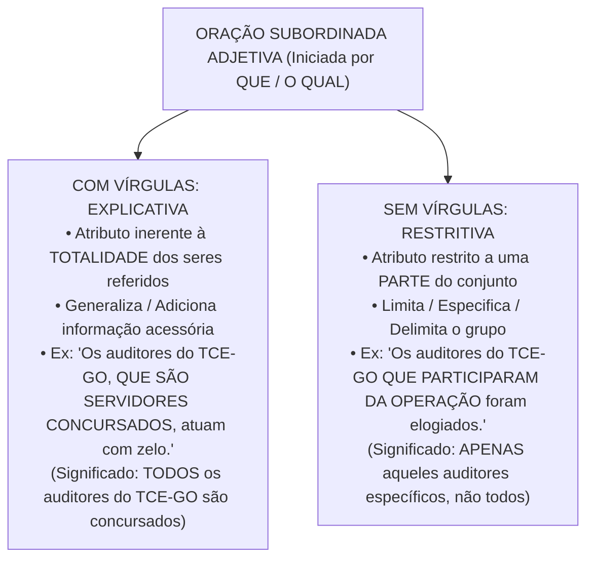
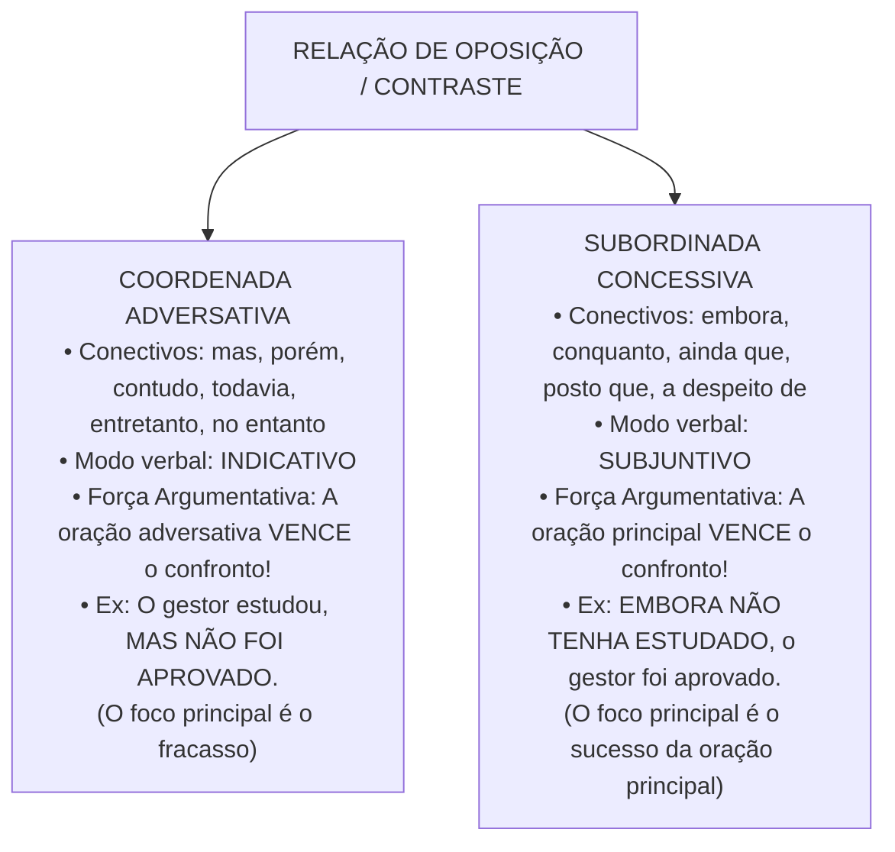

# 04 - Sintaxe do Período, Conectivos e Pontuação

> **Matéria:** Língua Portuguesa  
> **Cargos:** A01 – Técnico de Controle Externo (Adm) / B02 – Técnico de Controle Externo (TI)  
> **Arquivo:** `04_sintaxe_coordenacao_subordinacao_conectivos_pontuacao.md`  
> **Referência Temática:** Período Composto, Relações Lógicas Interoracionais, Valores de Conectivos e Pontuação na Banca FCC

---

## 📌 Ementa / Itens do Edital
- Coordenação e subordinação: processos sintáticos de articulação oracional no período composto;
- Conectivos coordenativos: conjunções aditivas, adversativas, alternativas, conclusivas e explicativas;
- Conectivos subordinativos: conjunções integrantes, causais, consecutivas, condicionais, concessivas, conformativas, comparativas, finais, proporcionais e temporais;
- Distinção semântica e modal entre orações adversativas (modo indicativo) e concessivas (modo subjuntivo);
- O trio clássico da FCC: *Porquanto* (causal), *Portanto* (conclusivo) e *Conquanto* (concessivo);
- Orações subordinadas substantivas (método de substituição pelo pronome *ISSO*);
- Orações subordinadas adjetivas explicativas (com vírgulas) vs. restritivas (sem vírgulas) e alteração de sentido pela pontuação;
- Emprego dos sinais de pontuação (vírgula, ponto e vírgula, dois-pontos, travessão e parênteses);
- Proibições sintáticas absolutas do emprego da vírgula (quebra da ordem direta Sujeito - Verbo - Complemento);
- Adjuntos adverbiais e orações adverbiais deslocadas ou intercaladas.

---

## 🧭 Sumário

1. [Fundamentos do Período Composto: Coordenação e Subordinação](#1-fundamentos-do-periodo-composto-coordenacao-e-subordinacao)
    1. [Conceito de Período Composto e Mecanismos de Junção Oracional](#11-conceito-de-periodo-composto-e-mecanismos-de-juncao-oracional)
    2. [Processo de Coordenação e Autonomia Sintática](#12-processo-de-coordenacao-e-autonomia-sintatica)
    3. [Processo de Subordinação e Encaixamento Hierárquico](#13-processo-de-subordinacao-e-encaixamento-hierarquico)
    4. [Teste 032](#Teste-032)
2. [Orações Coordenadas e Conectivos Coordenativos](#2-oracoes-coordenadas-e-conectivos-coordenativos)
    1. [Coordenadas Assindéticas e Sindéticas](#21-coordenadas-assindeticas-e-sindeticas)
    2. [Valores Semânticos das Conjunções Coordenativas](#22-valores-semanticos-das-conjuncoes-coordenativas)
    3. [Posição e Valores Polissêmicos da Conjunção Pois](#23-posicao-e-valores-polissemicos-da-conjuncao-pois)
    4. [Teste 033](#Teste-033)
3. [Orações Subordinadas Substantivas e Adjetivas](#3-oracoes-subordinadas-substantivas-e-adjetivas)
    1. [Orações Substantivas e o Método do Pronome ISSO](#31-oracoes-substantivas-e-o-metodo-do-pronome-isso)
    2. [Classificação Sintática das Orações Subordinadas Substantivas](#32-classificacao-sintatica-das-oracoes-subordinadas-substantivas)
    3. [Orações Subordinadas Adjetivas: Explicativas vs. Restritivas](#33-oracoes-subordinadas-adjetivas-explicativas-vs-restritivas)
    4. [Teste 034](#Teste-034)
    5. [Teste 035](#Teste-035)
4. [Orações Subordinadas Adverbiais e Conectivos Críticos](#4-oracoes-subordinadas-adverbiais-e-conectivos-criticos)
    1. [Quadro Completo das Conjunções Subordinativas Adverbiais](#41-quadro-completo-das-conjuncoes-subordinativas-adverbiais)
    2. [Adversativas vs. Concessivas: Conflito Sintático, Semântico e Modal](#42-adversativas-vs-concessivas-conflito-sintatico-semantico-e-modal)
    3. [O Trio Crítico da FCC: Porquanto, Portanto e Conquanto](#43-o-trio-critico-da-fcc-porquanto-portanto-e-conquanto)
    4. [A Polissemia do Conectivo Como](#44-a-polissemia-do-conectivo-como)
    5. [Teste 036](#Teste-036)
    6. [Teste 037](#Teste-037)
    7. [Teste 038](#Teste-038)
5. [Sintaxe da Pontuação e Efeitos Semânticos](#5-sintaxe-da-pontuacao-e-efeitos-semanticos)
    1. [A Proibição Inegociável da Quebra SVC](#51-a-proibicao-inegociavel-da-quebra-svc)
    2. [Regras do Uso da Vírgula no Período Simples](#52-regras-do-uso-da-virgula-no-periodo-simples)
    3. [Regras do Uso da Vírgula no Período Composto](#53-regras-do-uso-da-virgula-no-periodo-composto)
    4. [Emprego de Ponto e Vírgula, Dois-Pontos, Travessões e Parênteses](#54-emprego-de-ponto-e-virgula-dois-pontos-travessoes-e-parenteses)
    5. [Alterações de Sentido Provocadas pela Supressão ou Deslocamento de Pontuação](#55-alteracoes-de-sentido-provocadas-pela-supressao-ou-deslocamento-de-pontuacao)
    6. [Teste 039](#Teste-039)
    7. [Teste 040](#Teste-040)
    8. [Teste 041](#Teste-041)
6. [🌐 Fontes Oficiais e Referências Bibliográficas](#fontes-oficiais-e-referencias-bibliograficas)

---

## 1. Fundamentos do Período Composto: Coordenação e Subordinação

O período composto é aquele constituído por duas ou mais orações que se articulam para veicular um pensamento complexo. No texto formal, técnico e legislativo, o encadeamento das proposições obedece a dois processos estruturais básicos: a coordenação e a subordinação.

### 1.1 Conceito de Período Composto e Mecanismos de Junção Oracional

O reconhecimento do número de orações em um período faz-se pela identificação da quantidade de verbos ou locuções verbais presentes. A ligação entre essas orações processa-se ou por meio de conectivos expressos (conjunções coordenativas ou subordinativas, locuções conjuntivas e pronomes relativos) ou por simples justaposição assindética mediada por sinais de pontuação (vírgulas, ponto e vírgula ou dois-pontos).

### 1.2 Processo de Coordenação e Autonomia Sintática

Na coordenação, as orações encontram-se dispostas lado a lado no período sem que nenhuma delas exerça função sintática imediata em relação à outra. Cada oração coordenada possui estrutura interna própria (sujeito, predicado e complementos), mantendo equivalência hierárquica e autonomia gramatical:

* *"O auditor elaborou o relatório [1ª oração coordenada] e o conselheiro assinou o voto [2ª oração coordenada]."*

Embora sintaticamente autônomas, as orações coordenadas articulam-se logicamente no plano do discurso, expressando relações semânticas de soma, oposição, alternância, conclusão ou justificativa.

### 1.3 Processo de Subordinação e Encaixamento Hierárquico

Na subordinação, verifica-se uma relação de dependência hierárquica e encaixamento funcional: a oração subordinada desempenha uma função sintática essencial, integrante ou acessória em benefício da oração principal (atuando como se fosse um substantivo, um adjetivo ou um advérbio desta).

* *"O tribunal determinou [oração principal] <ins>que o contrato fosse suspenso</ins> [oração subordinada substantiva com função de objeto direto da principal]."*

Se a oração subordinada for retirada, a oração principal torna-se sintaticamente mutilada ou incompleta (no exemplo, o verbo *determinou* ficaria desprovido de seu complemento direto).

---

### Teste 032
**(FGV – TCE/SC – 2026 – Auditor Fiscal de Controle Externo - Economia)**
Sobre política fiscal, suas diferentes visões teóricas, seus objetivos, seus instrumentos e sua coordenação com a política monetária, assinale a afirmativa correta.

* **A)** Na tradição keynesiana, a política fiscal restringe-se a mudanças tributárias, não envolvendo gastos públicos, e seu objetivo central é apenas conter a inflação.
* **B)** Para os keynesianos, a política fiscal é anticíclica, opera via gastos e tributos e não sustenta o produto no longo prazo.
* **C)** Na teoria dos ciclos reais, a política fiscal é irrelevante, pois não afeta incentivos, preços relativos nem a oferta agregada.
* **D)** Sob câmbio fixo e perfeita mobilidade de capitais, a coordenação entre política fiscal e monetária exige esterilização monetária da expansão fiscal, tornando-a ineficaz sobre o produto.
* **E)** Em situação de armadilha da liquidez, a política fiscal perde eficácia, ao passo que a política monetária se torna plenamente eficaz para elevar o produto.

---

> **Comentário Detalhado:**
>
> - **A)** **Incorreta.** A opção incorre em restrição indevida ao limitar o escopo conceitual ao afirmar que "Na tradição keynesiana, a política fiscal restringe-se a mudanças tributárias, não envolvendo gastos públicos, e...". De acordo com a teoria estudada em *Distinção Semântica e Sintática Crucial:*, adjetiva Restritiva (sem vírgulas): É grafada sem vírgulas. Restringe, individualiza e delimita o sentido do substantivo antecedente a um subconjunto restrito, excluindo os demais membros da classe.
> - **B)** **Incorreta.** A opção apresenta proposição em desacordo com os fundamentos teóricos e técnicos do tópico ao afirmar que "Para os keynesianos, a política fiscal é anticíclica, opera via gastos e tributos e não sustenta o produto no...". De acordo com a teoria estudada em *5.5 Alterações de Sentido Provocadas pela Supressão ou Deslocamento de Pontuação*, *Supressão de vírgulas em orações adjetivas:* Passa de explicativa (generalizadora, afeta todos os indivíduos) para restritiva (limitadora, afeta apenas um grupo).
> - **C)** **Correta.** Conforme fundamentado na seção *1.1 Conceito de Período Composto e Mecanismos de Junção Oracional* deste guia, a ligação entre essas orações processa-se ou por meio de conectivos expressos (conjunções coordenativas ou subordinativas, locuções conjuntivas e pronomes relativos) ou por simples justaposição assindética mediada por sinais de pontuação (vírgulas, ponto e vírgula ou dois-pontos). Dessa forma, está plenamente correta a assertiva da banca (FGV – TCE/SC/2026) ao estabelecer que "Na teoria dos ciclos reais, a política fiscal é irrelevante, pois não afeta incentivos, preços relativos nem a...".
> - **D)** **Incorreta.** A opção apresenta proposição em desacordo com os fundamentos teóricos e técnicos do tópico ao afirmar que "Sob câmbio fixo e perfeita mobilidade de capitais, a coordenação entre política fiscal e monetária exige...". De acordo com a teoria estudada em *4. Orações Subordinadas Adverbiais e Conectivos Críticos*, as orações subordinadas adverbiais exercem a função de adjunto adverbial da oração principal, explicitando as circunstâncias temporais, lógicas e modais sob as quais se consuma o processo verbal.
> - **E)** **Incorreta.** A opção apresenta proposição em desacordo com os fundamentos teóricos e técnicos do tópico ao afirmar que "Em situação de armadilha da liquidez, a política fiscal perde eficácia, ao passo que a política monetária se torna...". De acordo com a teoria estudada em *5.3 Regras do Uso da Vírgula no Período Composto*, conjunção "E" com Sujeitos Distintos: Quando as orações coordenadas aditivas possuem sujeitos gramaticais diferentes, a vírgula antes da conjunção *e* é plenamente admitida e recomendada para evitar anfibologia: *"O tribunal acolheu o recurso, e o Ministério Público de Contas concordou com o relator"* (Sujeitos: *o tribunal* / *o MP de Contas*).
>
> **Gabarito: C**

---

## 2. Orações Coordenadas e Conectivos Coordenativos

As orações coordenadas dividem-se em dois grandes grupos: assindéticas (desprovidas de conectivo) e sindéticas (introduzidas por conjunção coordenativa).

### 2.1 Coordenadas Assindéticas e Sindéticas

* **Coordenadas Assindéticas:** São orações justapostas, separadas por vírgula ou ponto e vírgula, sem qualquer conjunção expressa: *"Chegou ao tribunal, conferiu a pauta, dirigiu-se ao plenário"*.
* **Coordenadas Sindéticas:** Vêm encabeçadas por uma conjunção coordenativa que explicita o vínculo lógico estabelecido com a oração precedente. Classificam-se conforme o valor semântico desse conectivo.

### 2.2 Valores Semânticos das Conjunções Coordenativas

A gramática normativa e os exames da Fundação Carlos Chagas reconhecem cinco modalidades de orações coordenadas sindéticas:

1. **Aditivas:** Expressam ideia de soma, acréscimo ou adição de pensamentos:
    * Conectivos: *e, nem* (= e não), *não só.. mas também, não só.. como também, bem como, tanto.. quanto*.
    * Exemplo: *"A fiscalização não apenas apontou o sobrepreço, como também recomendou a aplicação de multa."*

2. **Adversativas:** Indicam oposição, contraste, compensação ou quebra de expectativa entre proposições:
    * Conectivos: *mas, porém, contudo, todavia, entretanto, no entanto, não obstante* (quando seguido de indicativo).
    * Exemplo: *"O gestor apresentou os balancetes, porém não comprovou a liquidação das despesas."*

3. **Alternativas:** Exprimem ideia de escolha, exclusão mútua ou alternância de situações:
    * Conectivos: *ou, ou.. ou, ora.. ora, quer.. quer, seja.. seja, já.. já*.
    * Exemplo: *"Ou o município regulariza o portal da transparência, ou sofrerá sanções administrativas."*

4. **Conclusivas:** Expressam dedução lógica, resultado ou consequência direta da proposição anterior:
    * Conectivos: *logo, portanto, por conseguinte, por isso, assim, de modo que, pois* (posposto ao verbo e isolado entre vírgulas).
    * Exemplo: *"As despesas com pessoal ultrapassaram os limites da LRF; portanto, fica vedada a contratação de novos servidores."*

5. **Explicativas:** Apresentam a razão, justificativa ou motivo do enunciado ou comando anterior:
    * Conectivos: *que, porque, porquanto, pois* (anteposto ao verbo).
    * Exemplo: *"Revisem as planilhas de cálculo, porque a sessão de julgamento terá início em instantes."*

### 2.3 Posição e Valores Polissêmicos da Conjunção Pois

A conjunção *pois* assume comportamentos sintáticos diametralmente opostos em razão estrita da sua posição física na oração coordenada:

* **Pois Explicativo (Anteposto ao Verbo):** Posiciona-se no início da oração coordenada, antes do verbo conjugado, assumindo valor explicativo ou causal (= *porque, porquanto, já que*):
    * *"Não atrase a entrega dos autos, **pois** os prazos regimentais são preclusivos."*
* **Pois Conclusivo (Posposto ao Verbo e entre Vírgulas):** Surge deslocado para o interior da oração coordenada, posposto ao verbo conjugado e compulsoriamente isolado por vírgulas, assumindo valor estritamente conclusivo (= *portanto, por conseguinte, logo*):
    * *"As provas da materialidade da fraude eram robustas; o pleno julgou, **pois**, pela irregularidade das contas."*

> 📌 **NOTA EXPLICATIVA / IDENTIFICAÇÃO DO POIS CONCLUSIVO:** Se a questão da FCC sublinhar o vocábulo *pois* e ele estiver posicionado após o verbo e cercado de vírgulas (*"aprovou, pois, as contas"*), a sua equivalência semântica é **conclusiva** e o conectivo substituto cabível é **portanto** ou **por conseguinte**. Nunca o classifique como explicativo nessa posição.

---

### Teste 033
**(CEBRASPE – STF – 2008 – Analista Judiciario Suporte Em Tecnologia Da Informacao)**
A comissão permanente de coordenação tem por atribuição sugerir aos presidentes do tribunal e das turmas, bem como aos ministros, medidas destinadas a prevenir decisões discrepantes, aumentar o rendimento das sessões, abreviar a publicação dos acórdãos e facilitar a tarefa dos advogados.

* **C)** Certo
* **E)** Errado

---

> **Comentário Detalhado:**
>
> - **C)** **Correta.** O item está **Certo**. Conforme fundamentado na seção *2.2 Valores Semânticos das Conjunções Coordenativas* deste guia, conectivos: *e, nem* (= e não), *não só.. mas também, não só.. como também, bem como, tanto.. quanto*. Dessa forma, está plenamente correta a proposição da banca (CEBRASPE – STF/2008) ao afirmar que "A comissão permanente de coordenação tem por atribuição sugerir aos presidentes do tribunal e das turmas, bem...".
> - **E)** **Incorreta.** A marcação como **Errado** não procede, visto que a assertiva guarda integral conformidade com a teoria estudada em *4.1 Quadro Completo das Conjunções Subordinativas Adverbiais*, segundo a qual concessiva: Fato que se opõe à principal sem impedi-la — *embora, conquanto, ainda que, mesmo que, a despeito de, posto que, se bem que* — *"Conquanto houvesse pressão, o relator manteve o voto."*.
>
> **Gabarito: C**

---

## 3. Orações Subordinadas Substantivas e Adjetivas

As orações subordinadas dividem-se em substantivas, adjetivas e adverbiais, dependendo do valor gramatical que exercem em relação à oração principal.

### 3.1 Orações Substantivas e o Método do Pronome ISSO

As orações subordinadas substantivas exercem papéis privativos de substantivos em relação à oração principal. São introduzidas quase invariavelmente pelas **conjunções integrantes "QUE" ou "SE"** (que não exercem função sintática própria, sendo meros conectivos de ligação).

> 💡 **DICA DO "ISSO" PARA ORAÇÕES SUBSTANTIVAS:** Para comprovar que uma oração é subordinada substantiva e que a palavra *que* ou *se* atua como conjunção integrante, substitua mentalmente toda a oração a partir do conectivo pelo pronome demonstrativo neutro **"ISSO"** (ou *a isso, de isso/disso, com isso*):
>
> * *"O presidente declarou [que a sessão estava suspensa]"* $\rightarrow$ *"O presidente declarou [ISSO]"* (Oração Substantiva Objetiva Direta).
> * *"É necessário [que se apresentem os documentos]"* $\rightarrow$ *"É necessário [ISSO]"* $\rightarrow$ *"ISSO é necessário"* (Oração Substantiva Subjetiva).

### 3.2 Classificação Sintática das Orações Subordinadas Substantivas

Identificada a oração substantiva pelo teste do *ISSO*, classifica-se a sua função sintática analisando o papel do pronome *ISSO* em relação à oração principal:

1. **Subjetiva:** Exerce a função de sujeito da oração principal. Ocorre quando a oração principal possui verbo de ligação + predicativo (*"É evidente que o prazo expirou"* $\rightarrow$ *ISSO é evidente*), verbo na voz passiva analítica ou sintética (*"Sabe-se que haverá concurso"*) ou verbos unipessoais (*convém, cumpre, importa, parece, urge*): *"Convém que todos estudem"*.
2. **Objetiva Direta:** Atua como objeto direto de verbo transitivo direto da oração principal (*"O relator constatou que havia sobrepreço"* $\rightarrow$ *constatou ISSO*).
3. **Objetiva Indireta:** Atua como objeto indireto, sendo precedida de preposição exigida por verbo transitivo indireto (*"O conselheiro insistiu em que se realizasse a perícia"* $\rightarrow$ *insistiu NISSO*).
4. **Completiva Nominal:** Atua como complemento nominal, integrando o sentido de um substantivo abstrato, adjetivo ou advérbio da principal (*"Tínhamos a certeza de que a fiscalização seria rigorosa"* $\rightarrow$ *certeza DISSO*).
5. **Predicativa:** Exerce a função de predicativo do sujeito após verbo de ligação (*"Nosso objetivo é que a administração pública seja eficiente"* $\rightarrow$ *o objetivo é ISSO*).
6. **Apositiva:** Exerce o papel de aposto explicativo, esclarecendo um termo antecedente, comumente posposta a dois-pontos (*"Desejo apenas uma coisa: que a verdade prevaleça"*).

### 3.3 Orações Subordinadas Adjetivas: Explicativas vs. Restritivas

As orações subordinadas adjetivas desempenham papel equivalente ao de um adjetivo (adjunto adnominal) em relação a um substantivo antecedente, sendo invariavelmente introduzidas por um **pronome relativo** (*que, quem, cujo, o qual, onde*).

#### Distinção Semântica e Sintática Crucial:
* **Adjetiva Explicativa (com vírgulas):** Vem isolada por vírgulas (ou travessões/parênteses). Atribui uma qualidade própria que abrange a **totalidade** dos elementos do termo antecedente. Não delimita o grupo, operando de forma generalizadora.
    * *"Os cidadãos brasileiros, que têm direito ao voto, participam das eleições."* (Significado: todos os cidadãos brasileiros têm direito ao voto).
* **Adjetiva Restritiva (sem vírgulas):** É grafada sem vírgulas. Restringe, individualiza e delimita o sentido do substantivo antecedente a um **subconjunto restrito**, excluindo os demais membros da classe.
    * *"Os cidadãos brasileiros que têm mais de setenta anos possuem voto facultativo."* (Significado: apenas aquela parcela que tem mais de 70 anos, e não a totalidade dos brasileiros).

> 🚨 **ALERTA DE PROVA / SUPRESSÃO DE VÍRGULAS EM ORAÇÃO ADJETIVA:** A FCC explora intensamente assertivas que indagam: *"A retirada das vírgulas da oração adjetiva mantém a correção gramatical e o sentido original do período?"*. Resposta técnica obrigatória: a retirada das vírgulas **mantém a correção gramatical**, mas **SEMPRE ALTERA O SENTIDO DO TEXTO**, transformando uma explicação genérica sobre a totalidade em uma restrição delimitadora sobre uma fração.

---

### Teste 034
**(FCC – TRT 2ª – 2014 – Analista Judiciário - Tecnologia da Informação)**
Atente para as seguintes afirmações: I. No 1o parágrafo, a menção a Beethoven e a fan- farra de colégio ilustra bem a disposição do autor em colocar lado a lado manifestações artísticas de valor equivalente. II. No 2o parágrafo, o termo despoticamente qualifica o modo pelo qual alguns interlocutores dispõem-se a desenvolver uma polêmica. III. No 3o parágrafo, a expressão servidão ao capricho realça a acomodação de quem não se dispõe a enfrentar a argumentação crítica. Em relação ao texto está correto o que se afirma APENAS em

* **A)** encerrar uma discussão e nenhuma polêmica.
* **B)** engolir em seco e impedido de argumentar.
* **C)** desafio de ponderar e estanca o discurso crítico.
* **D)** tudo é questão de gosto e tudo se relativiza.
* **E)** servidão ao capricho e fórmulas ditatoriais. _________________________________________________________

---

> **Comentário Detalhado:**
>
> - **A)** **Incorreta.** A opção apresenta proposição em desacordo com os fundamentos teóricos e técnicos do tópico ao afirmar que "encerrar uma discussão e nenhuma polêmica". De acordo com a teoria estudada em *1.2 Processo de Coordenação e Autonomia Sintática*, na coordenação, as orações encontram-se dispostas lado a lado no período sem que nenhuma delas exerça função sintática imediata em relação à outra.
> - **B)** **Incorreta.** A opção apresenta proposição em desacordo com os fundamentos teóricos e técnicos do tópico ao afirmar que "engolir em seco e impedido de argumentar". De acordo com a teoria estudada em *3. Orações Subordinadas Substantivas e Adjetivas*, as orações subordinadas dividem-se em substantivas, adjetivas e adverbiais, dependendo do valor gramatical que exercem em relação à oração principal.
> - **C)** **Incorreta.** A opção apresenta proposição em desacordo com os fundamentos teóricos e técnicos do tópico ao afirmar que "desafio de ponderar e estanca o discurso crítico". De acordo com a teoria estudada em *1.2 Processo de Coordenação e Autonomia Sintática*, embora sintaticamente autônomas, as orações coordenadas articulam-se logicamente no plano do discurso, expressando relações semânticas de soma, oposição, alternância, conclusão ou justificativa.
> - **D)** **Incorreta.** A opção apresenta proposição em desacordo com os fundamentos teóricos e técnicos do tópico ao afirmar que "tudo é questão de gosto e tudo se relativiza". De acordo com a teoria estudada em *3.2 Classificação Sintática das Orações Subordinadas Substantivas*, apositiva: Exerce o papel de aposto explicativo, esclarecendo um termo antecedente, comumente posposta a dois-pontos (*"Desejo apenas uma coisa: que a verdade prevaleça"*).
> - **E)** **Correta.** Conforme fundamentado na seção *3.3 Orações Subordinadas Adjetivas: Explicativas vs. Restritivas* deste guia, as orações subordinadas adjetivas desempenham papel equivalente ao de um adjetivo (adjunto adnominal) em relação a um substantivo antecedente, sendo invariavelmente introduzidas por um pronome relativo (*que, quem, cujo, o qual, onde*). Dessa forma, está plenamente correta a assertiva da banca (FCC – TRT 2ª/2014) ao estabelecer que "servidão ao capricho e fórmulas ditatoriais. _________________________________________________________".
>
> **Gabarito: E**

---

### Teste 035
**(CEBRASPE – TJ/DFT – 2015 – Analista Judiciario Suporte Em Tecnologia Da Informacao)**
A correção gramatical e o sentido original do texto seriam 12 O termo “ambientalmente correto, socialmente justo e preservados caso a oração “que se lhe contrapôs” (R. 7 e 8) economicamente viável” (R. 14 e 15) exerce a função de fosse reescrita como que foi contraposto a ele. predicativo. Texto para os itens de 13 a 21

* **C)** Certo
* **E)** Errado

---

> **Comentário Detalhado:**
>
> - **C)** **Incorreta.** A marcação como **Certo** não procede, pois o enunciado apresenta proposição em desacordo com os fundamentos teóricos e técnicos do tópico ao afirmar que "A correção gramatical e o sentido original do texto seriam 12 O termo “ambientalmente correto, socialmente...". De acordo com a teoria estudada em *Distinção Semântica e Sintática Crucial:*, resposta técnica obrigatória: a retirada das vírgulas mantém a correção gramatical, mas SEMPRE ALTERA O SENTIDO DO TEXTO, transformando uma explicação genérica sobre a totalidade em uma restrição delimitadora sobre uma fração.
> - **E)** **Correta.** O item está **Errado** (gabarito oficial: **E**). Conforme fundamentado na seção *Distinção Semântica e Sintática Crucial:* deste guia, a FCC explora intensamente assertivas que indagam: *"A retirada das vírgulas da oração adjetiva mantém a correção gramatical e o sentido original do período?"*. Portanto, a assertiva examinada pela banca (CEBRASPE – TJ/DFT/2015) viola os preceitos técnicos do tópico.
>
> **Gabarito: E**

---

## 4. Orações Subordinadas Adverbiais e Conectivos Críticos

As orações subordinadas adverbiais exercem a função de adjunto adverbial da oração principal, explicitando as circunstâncias temporais, lógicas e modais sob as quais se consuma o processo verbal.

### 4.1 Quadro Completo das Conjunções Subordinativas Adverbiais

A gramática normativa classifica as orações subordinadas adverbiais em nove categorias semânticas:

| Categoria | Ideia Central | Conjunções e Locuções Principais | Exemplo de Aplicação |
| :--- | :--- | :--- | :--- |
| **Causal** | Motivo, razão ou causa da oração principal | *porque, visto que, já que, uma vez que, como* (no início), *porquanto, dado que* | *"Como chovia torrencialmente, o fiscal adiou a vistoria."* |
| **Consecutiva** | Consequência, resultado ou efeito decorrente | *tal.. que, tanto.. que, tão.. que, tamanho.. que, de forma que, de modo que* | *"A fraude foi tamanha que chocou os auditores."* |
| **Condicional** | Condição indispensável ou hipótese | *se, caso, contanto que, desde que, a não ser que, a menos que* | *"Caso o plenário autorize, iniciaremos a inspeção."* |
| **Concessiva** | Fato que se opõe à principal sem impedi-la | *embora, conquanto, ainda que, mesmo que, a despeito de, posto que, se bem que* | *"Conquanto houvesse pressão, o relator manteve o voto."* |
| **Conformativa** | Conformidade, acordo ou modelo seguido | *conforme, consoante, segundo, como* (= conforme) | *"O edital foi publicado, como prescreve a lei."* |
| **Comparativa** | Confronto analógico entre dois elementos | *como, assim como, tal qual, mais.. do que, menos.. do que* | *"O técnico procedeu com rigor como um perito criminal."* |
| **Final** | Objetivo, desígnio ou finalidade | *a fim de que, para que, com o fito de, com o intuito de* | *"O tribunal aprovou novas resoluções para que haja transparência."* |
| **Proporcional** | Proporcionalidade ou simultaneidade progressiva | *à medida que, à proporção que, ao passo que, quanto mais.. mais* | *"À medida que os autos avançavam, surgiam novas provas."* |
| **Temporal** | Momento cronológico em que ocorre a ação | *quando, enquanto, logo que, assim que, desde que, todas as vezes que* | *"Assim que a sessão terminou, a ata foi lavrada."* |

### 4.2 Adversativas vs. Concessivas: Conflito Sintático, Semântico e Modal

A oposição de ideias pode ser expressa por meio de coordenadas adversativas ou subordinadas concessivas. Embora ambas expressem contraste, seu funcionamento linguístico é radicalmente diverso:

#### Distinções Gramaticais Determinantes:
1. **Regência do Modo Verbal:**
    * A oração coordenada adversativa rege o verbo no **modo indicativo** (*"Ele agiu, contudo **errou**"*).
    * A oração subordinada concessiva rege compulsoriamente o verbo no **modo subjuntivo** (*"Embora ele **tenha agido**, não alcançou êxito"*).

2. **Hierarquia Argumentativa (Peso Discursivo):**
    * Na oração coordenada adversativa, o argumento mais forte, que orienta a conclusão final do autor, situa-se **dentro da própria oração adversativa** (*"O projeto é dispendioso, mas trará enormes benefícios à coletividade"* $\rightarrow$ prevalece a ideia de aprovação do projeto).
    * Na oração subordinada concessiva, a oração concessiva traz um argumento fraco que é superado pela oração principal; logo, o argumento determinante repousa **na oração principal** (*"Embora o projeto seja dispendioso, trará benefícios"* $\rightarrow$ a força do benefício prevalece sobre o custo).

> ⭐ **IMPORTANTE / SUBSTITUIÇÃO ADVERSATIVA POR CONCESSIVA:** Ao trocar uma conjunção adversativa (*mas, contudo, porém*) por uma concessiva (*embora, conquanto*), a gramática exige duas alterações simultâneas: 1) inversão da oração principal com a subordinada ou realocação do conectivo; 2) **mudança obrigatória do modo verbal do indicativo para o subjuntivo**.

### 4.3 O Trio Crítico da FCC: Porquanto, Portanto e Conquanto

Poucas pegadinhas são tão reiteradas pela Fundação Carlos Chagas quanto a semelhança gráfica entre os conectivos do trio:

* **PORQUANTO (Causal / Explicativo):** Equivale a *porque*, *já que*, *visto que*, *dado que*. Introduz a causa do fato ou a justificativa de uma ordem.
    * *"O TCE-GO rejeitou as contas, **porquanto** restou comprovado o superfaturamento."*
* **PORTANTO (Conclusivo):** Equivale a *logo*, *por conseguinte*, *assim*, *dessa forma*. Introduz a consequência lógica ou o arremate dedutivo.
    * *"Os autos comprovam a boa-fé do gestor; **portanto**, o processo deve ser arquivado."*
* **CONQUANTO (Concessivo):** Equivale a *embora*, *ainda que*, *a despeito de que*, *posto que*. Introduz uma ressalva concessiva que não anula a oração principal e **rege o modo subjuntivo**.
    * *"**Conquanto** houvesse fortes pressões políticas, o conselheiro proferiu voto técnico."*

### 4.4 A Polissemia do Conectivo Como

O conectivo *como* assume múltiplos papéis dependendo da sua posição na frase e da intenção discursiva:

1. **Como Causal:** Ocorre tipicamente anteposto ao período (no início da frase), equivalendo a *já que, visto que, dado que*: *"**Como** o prazo de apresentação de defesa havia expirado na véspera, o gestor foi declarado revel"*.
2. **Como Conformativo:** Equivale a *conforme, segundo, consoante*, indicando adequação a uma norma ou modelo: *"O concurso público realizou-se, **como** determina a Constituição Estadual"*.
3. **Como Comparativo:** Estabelece confronto de semelhança analógica (= *tal qual, assim como*): *"O fiscal examinou as planilhas **como** um analista forense minucioso"*.
4. **Como Aditivo (Correlativo):** Integra a estrutura aditiva correlata *não só.. como também*: *"O parecer apontou **não só** desídia administrativa, **como também** dano patrimonial"*.

---

### Teste 036
**(FCC – TRT 4ª – 2015 – Analista Judiciário - Tecnologia Da Informação)**
Tem sustentação no texto a ideia de que

* **A)** a efemeridade é um traço característico de todo objeto, fato, ou acontecimento cultural, que merece reprovação.
* **B)** obras eruditas têm, como sempre tiveram, público cativo, mas, em vista das atuais tendências musicais, ele está prestes a se esgotar.
* **C)** as formas de arte que mais se eternizam são as que têm raízes na tradição popular, sustentáculo das legítimas expressões culturais.
* **D)** obras de arte concebidas em certa cultura podem ter seu valor depreciado quando o eventual fruidor fizer parte de outro contexto cultural.
* **E)** as questões fundamentais sobre a ópera são passíveis de ser postas e respondidas somente no contexto do século XXI, depois de uma jornada de quatrocentos anos até a contemporaneidade.

---

> **Comentário Detalhado:**
>
> - **A)** **Incorreta.** A opção apresenta proposição em desacordo com os fundamentos teóricos e técnicos do tópico ao afirmar que "a efemeridade é um traço característico de todo objeto, fato, ou acontecimento cultural, que merece reprovação". De acordo com a teoria estudada em *4.1 Quadro Completo das Conjunções Subordinativas Adverbiais*, concessiva: Fato que se opõe à principal sem impedi-la — *embora, conquanto, ainda que, mesmo que, a despeito de, posto que, se bem que* — *"Conquanto houvesse pressão, o relator manteve o voto."*.
> - **B)** **Incorreta.** A opção promove generalização excessiva que desconsidera as condições técnicas e normativas ao afirmar que "obras eruditas têm, como sempre tiveram, público cativo, mas, em vista das atuais tendências musicais, ele está...". De acordo com a teoria estudada em *Distinção Semântica e Sintática Crucial:*, resposta técnica obrigatória: a retirada das vírgulas mantém a correção gramatical, mas SEMPRE ALTERA O SENTIDO DO TEXTO, transformando uma explicação genérica sobre a totalidade em uma restrição delimitadora sobre uma fração.
> - **C)** **Incorreta.** A opção apresenta proposição em desacordo com os fundamentos teóricos e técnicos do tópico ao afirmar que "as formas de arte que mais se eternizam são as que têm raízes na tradição popular, sustentáculo das legítimas...". De acordo com a teoria estudada em *Distinções Gramaticais Determinantes:*, na oração coordenada adversativa, o argumento mais forte, que orienta a conclusão final do autor, situa-se dentro da própria oração adversativa (*"O projeto é dispendioso, mas trará enormes benefícios à coletividade"* $\rightarrow$ prevalece a ideia de aprovação do projeto).
> - **D)** **Correta.** Conforme fundamentado na seção *5.4 Emprego de Ponto e Vírgula, Dois-Pontos, Travessões e Parênteses* deste guia, separa orações coordenadas de certa extensão que já contenham vírgulas internas: *"O relatório inicial apontou desvios de combustível; o parecer conclusivo, elaborado pela auditoria de engenharia, recomendou a instauração de tomada de contas especial."*. Dessa forma, está plenamente correta a assertiva da banca (FCC – TRT 4ª/2015) ao estabelecer que "obras de arte concebidas em certa cultura podem ter seu valor depreciado quando o eventual fruidor fizer parte de...".
> - **E)** **Incorreta.** A opção incorre em restrição indevida ao limitar o escopo conceitual ao afirmar que "as questões fundamentais sobre a ópera são passíveis de ser postas e respondidas somente no contexto do século...". De acordo com a teoria estudada em *4.1 Quadro Completo das Conjunções Subordinativas Adverbiais*, condicional: Condição indispensável ou hipótese — *se, caso, contanto que, desde que, a não ser que, a menos que* — *"Caso o plenário autorize, iniciaremos a inspeção."*.
>
> **Gabarito: D**

---

### Teste 037
**(FGV – TCE/SC – 2026 – Auditor Fiscal De Controle Externo Engenharia Sanitaria)**
O Plano Nacional de Resíduos Sólidos é elaborado pela União, sob a coordenação do Ministério do Meio Ambiente. As durações do horizonte e do intervalo de aplicação desse plano são, respectivamente, de

* **A)** 10 anos e 2 anos.
* **B)** 10 anos e 4 anos.
* **C)** 15 anos e 5 anos.
* **D)** 20 anos e 2 anos.
* **E)** 20 anos e 4 anos.

---

> **Comentário Detalhado:**
>
> - **A)** **Incorreta.** A opção apresenta proposição em desacordo com os fundamentos teóricos e técnicos do tópico ao afirmar que "10 anos e 2 anos". De acordo com a teoria estudada em *4. Orações Subordinadas Adverbiais e Conectivos Críticos*, as orações subordinadas adverbiais exercem a função de adjunto adverbial da oração principal, explicitando as circunstâncias temporais, lógicas e modais sob as quais se consuma o processo verbal.
> - **B)** **Incorreta.** A opção apresenta proposição em desacordo com os fundamentos teóricos e técnicos do tópico ao afirmar que "10 anos e 4 anos". De acordo com a teoria estudada em *4.1 Quadro Completo das Conjunções Subordinativas Adverbiais*, categoria: Ideia Central — Conjunções e Locuções Principais — Exemplo de Aplicação.
> - **C)** **Incorreta.** A opção apresenta proposição em desacordo com os fundamentos teóricos e técnicos do tópico ao afirmar que "15 anos e 5 anos". De acordo com a teoria estudada em *4.2 Adversativas vs. Concessivas: Conflito Sintático, Semântico e Modal*, a oposição de ideias pode ser expressa por meio de coordenadas adversativas ou subordinadas concessivas. Embora ambas expressem contraste, seu funcionamento linguístico é radicalmente diverso.
> - **D)** **Incorreta.** A opção apresenta proposição em desacordo com os fundamentos teóricos e técnicos do tópico ao afirmar que "20 anos e 2 anos". De acordo com a teoria estudada em *2.1 Coordenadas Assindéticas e Sindéticas*, coordenadas Sindéticas: Vêm encabeçadas por uma conjunção coordenativa que explicita o vínculo lógico estabelecido com a oração precedente. Classificam-se conforme o valor semântico desse conectivo.
> - **E)** **Correta.** Conforme fundamentado na seção *1.2 Processo de Coordenação e Autonomia Sintática* deste guia, embora sintaticamente autônomas, as orações coordenadas articulam-se logicamente no plano do discurso, expressando relações semânticas de soma, oposição, alternância, conclusão ou justificativa. Dessa forma, está plenamente correta a assertiva da banca (FGV – TCE/SC/2026) ao estabelecer que "20 anos e 4 anos".
>
> **Gabarito: E**

---

### Teste 038
**(FGV – TCE/PA – 2024 – Auditor de Controle Externo - Administrativa - Ciência de Dados)**
Com relação aos conceitos de dado, informação e conhecimento, avalie as afirmativas a seguir. I. Os dados são itens elementares, são cadeias de símbolos e não possuem significado. II. São exemplos de conhecimento: tendência de vendas de um produto A em uma região B; relação entre o aumento ou queda do preço de uma ação X, na bolsa de valores, e a variação do câmbio. III. As informações correspondem ao dado processado, com significado e um contexto indefinido. Está correto o que se afirma em

* **A)** I, apenas.
* **B)** I e III, apenas.
* **C)** I e II, apenas.
* **D)** II, apenas.
* **E)** I, II e III.

---

> **Comentário Detalhado:**
>
> - **A)** **Incorreta.** A opção incorre em restrição indevida ao limitar o escopo conceitual ao afirmar que "I, apenas". De acordo com a teoria estudada em *4.1 Quadro Completo das Conjunções Subordinativas Adverbiais*, temporal: Momento cronológico em que ocorre a ação — *quando, enquanto, logo que, assim que, desde que, todas as vezes que* — *"Assim que a sessão terminou, a ata foi lavrada."*.
> - **B)** **Incorreta.** A opção incorre em restrição indevida ao limitar o escopo conceitual ao afirmar que "I e III, apenas". De acordo com a teoria estudada em *4.1 Quadro Completo das Conjunções Subordinativas Adverbiais*, causal: Motivo, razão ou causa da oração principal — *porque, visto que, já que, uma vez que, como* (no início), *porquanto, dado que* — *"Como chovia torrencialmente, o fiscal adiou a vistoria."*.
> - **C)** **Correta.** Conforme fundamentado na seção *Distinção Semântica e Sintática Crucial:* deste guia, *"Os cidadãos brasileiros que têm mais de setenta anos possuem voto facultativo."* (Significado: apenas aquela parcela que tem mais de 70 anos, e não a totalidade dos brasileiros). Dessa forma, está plenamente correta a assertiva da banca (FGV – TCE/PA/2024) ao estabelecer que "I e II, apenas".
> - **D)** **Incorreta.** A opção incorre em restrição indevida ao limitar o escopo conceitual ao afirmar que "II, apenas". De acordo com a teoria estudada em *4.3 O Trio Crítico da FCC: Porquanto, Portanto e Conquanto*, pORQUANTO (Causal / Explicativo): Equivale a *porque*, *já que*, *visto que*, *dado que*. Introduz a causa do fato ou a justificativa de uma ordem.
> - **E)** **Incorreta.** A opção apresenta proposição em desacordo com os fundamentos teóricos e técnicos do tópico ao afirmar que "I, II e III". De acordo com a teoria estudada em *4.4 A Polissemia do Conectivo Como*, como Causal: Ocorre tipicamente anteposto ao período (no início da frase), equivalendo a *já que, visto que, dado que*: *"Como o prazo de apresentação de defesa havia expirado na véspera, o gestor foi declarado revel"*.
>
> **Gabarito: C**

---

## 5. Sintaxe da Pontuação e Efeitos Semânticos

A pontuação não se destina a marcar pausas de respiração na leitura oral, mas a tornar visível a arquitetura sintática do período, demarcando unidades funcionais e impedindo ambiguidades.

### 5.1 A Proibição Inegociável da Quebra SVC

A regra número um da sintaxe de pontuação na língua culta proíbe o emprego de **uma vírgula simples** que separe os elementos constitutivos da ordem direta da oração:
$$\text{Sujeito} \not\longleftrightarrow [\text{Vírgula Proibida}] \not\longleftrightarrow \text{Verbo} \not\longleftrightarrow [\text{Vírgula Proibida}] \not\longleftrightarrow \text{Complementos (OD/OI)}$$

* É proibido separar por vírgula o Sujeito do seu Verbo (*"O conselheiro presidente da corte de contas [X], abriu a sessão extraordinária"* $\rightarrow$ **ERRO**).
* É proibido separar por vírgula o Verbo dos seus Complementos Diretos ou Indiretos (*"O auditor apurou [X], as irregularidades fiscais"* $\rightarrow$ **ERRO**; *"O presidente votou [X], pela procedência do pedido"* $\rightarrow$ **ERRO**).
* É proibido separar por vírgula o Nome do seu Complemento Nominal ou Adjunto Adnominal.

> 🚨 **ALERTA DE PROVA / TERMOS INTERCALADOS ENTRE SUJEITO E VERBO:** É lícito inserir termos entre o sujeito e o verbo, desde que esses termos estejam rigorosamente isolados por **DUAS VÍRGULAS** (ou dois travessões/parênteses):
>
> - Incorreto (apenas uma vírgula): *"O pleno do tribunal, após examinar os laudos votou pela anulação"* $\rightarrow$ Erro!
> - Incorreto (apenas uma vírgula): *"O pleno do tribunal após examinar os laudos, votou pela anulação"* $\rightarrow$ Erro!
> - **Correto (duas vírgulas):** *"O pleno do tribunal**, após examinar os laudos,** votou pela anulação."*

### 5.2 Regras do Uso da Vírgula no Período Simples

No interior da oração simples, a vírgula é de emprego compulsório nas seguintes situações:

1. **Separação de termos de mesma função sintática em enumeração:** *"O tribunal adquiriu computadores, servidores, licenças de software e impressoras."*
2. **Isolamento de Vocativo:** O vocativo deve vir sempre isolado por vírgula(s), em qualquer posição que ocupe: *"Senhor Conselheiro, apresento o recurso"*; *"Apresento, Senhor Conselheiro, o recurso"*.
3. **Isolamento de Aposto Explicativo:** *"Goiânia, capital do Estado de Goiás, sediou a conferência internacional de tribunais."*
4. **Isolamento de Adjunto Adverbial Deslocado:**
    * Se for de **longa extensão** (três ou mais palavras): o uso da vírgula é **obrigatório** (*"No primeiro semestre do exercício financeiro de 2026, concluíram-se as auditorias"*).
    * Se for de **curta extensão** (uma ou duas palavras: *hoje, ontem, aqui, em Goiânia*): o emprego da vírgula é **facultativo** (*"Ontem, o relator julgou"* ou *"Ontem o relator julgou"*).

5. **Expressões explicativas, retificativas ou continuativas:** *isto é, ou seja, por exemplo, a saber, aliás, digo*: *"O prazo era de dez dias, ou seja, improrrogável"*.

### 5.3 Regras do Uso da Vírgula no Período Composto

No período composto por coordenação e subordinação:

1. **Orações Coordenadas Assindéticas:** São separadas compulsoriamente por vírgula (*"Instruiu o processo, ouviu as testemunhas, redigiu a proposta de voto"*).
2. **Orações Coordenadas Sindéticas:** Usa-se vírgula antes de conjunções adversativas (*mas, porém, contudo*), conclusivas (*portanto, logo*) e explicativas (*porque, que*).
    * **Conjunção "E" com Sujeitos Iguais:** Em regra, não se usa vírgula antes do *e* quando as orações possuem o mesmo sujeito (*"O fiscal viajou e inspecionou as escolas"*).
    * **Conjunção "E" com Sujeitos Distintos:** Quando as orações coordenadas aditivas possuem **sujeitos gramaticais diferentes**, a vírgula antes da conjunção *e* é **plenamente admitida e recomendada** para evitar anfibologia: *"O tribunal acolheu o recurso, e o Ministério Público de Contas concordou com o relator"* (Sujeitos: *o tribunal* / *o MP de Contas*).

3. **Orações Adverbiais Deslocadas:**
    * Se a oração subordinada adverbial vier **anteposta à oração principal** ou **intercalada** nela: a vírgula é **obrigatória** (*"Embora chovesse torrencialmente, o fiscal compareceu à obra"*).
    * Se a oração adverbial vier **posposta à oração principal** (ordem direta): a vírgula é **facultativa** (*"O fiscal compareceu à obra[,] embora chovesse torrencialmente"*).

4. **Orações Subordinadas Adjetivas:** Explicativas vêm sempre isoladas por vírgulas; restritivas não admitem vírgulas.

### 5.4 Emprego de Ponto e Vírgula, Dois-Pontos, Travessões e Parênteses

* **Ponto e Vírgula (;):**
    * Separa orações coordenadas de certa extensão que já contenham vírgulas internas: *"O relatório inicial apontou desvios de combustível; o parecer conclusivo, elaborado pela auditoria de engenharia, recomendou a instauração de tomada de contas especial."*
    * Separa itens enumerados em disposições normativas, editais, relatórios e leis (como alíneas e incisos).
* **Dois-Pontos (:):**
    * Anunciam uma citação textual, uma enumeração explicativa ou uma oração subordinada substantiva apositiva: *"O conselheiro concluiu com a máxima de Rui Barbosa: 'A justiça atrasada não é justiça'."*
* **Travessão Simples ou Duplo (—):**
    * O travessão duplo atua como recurso expressivo para isolar termos intercalados, comentários enfáticos ou orações adjetivas explicativas, substituindo com elegância as vírgulas duplas ou os parênteses (*"O processo de auditoria — cuja complexidade assustava os neófitos — transcorreu dentro da mais estrita normalidade"*).
* **Parênteses ( ):**
    * Isolam notas explicativas acessórias, datas, referências bibliográficas ou reflexões secundárias do autor.

### 5.5 Alterações de Sentido Provocadas pela Supressão ou Deslocamento de Pontuação

A pontuação é ferramenta de arquitetura do sentido discursivo. O deslocamento ou a eliminação de um sinal de pontuação pode transformar completamente o sentido da mensagem:

* *Supressão de vírgulas em orações adjetivas:* Passa de explicativa (generalizadora, afeta todos os indivíduos) para restritiva (limitadora, afeta apenas um grupo).
* *Deslocamento da vírgula antes ou depois da conjunção:* Muda a regência das orações coordenadas.
* *Supressão da vírgula de vocativo:* Transforma o chamamento em sujeito da oração (*"Auditor, assine o documento"* [ordem a um interlocutor] vs. *"Auditor assine o documento"* [frase defeituosa ou ambígua]).

---

### Teste 039
**(FGV – TJ/AP – 2023 – Analista Judiciario Apoio Especializado Tecnologia Da Informacao Banco De Dados)**
Um conto moderno do escritor paranaense Dalton Trevisan começa com a seguinte frase: “Primeira noite ele conheceu que Santina não era moça.” A marca essencial desse segmento que o insere no conjunto dos textos literários de ficção e não entre os textos informativos, é:

* **A)** a seleção vocabular de linguagem erudita;
* **B)** a absoluta correção gramatical na estruturação das frases;
* **C)** o emprego da linguagem popular como sinal de inclusão;
* **D)** a presença inicial de termos sem referentes na realidade;
* **E)** a necessidade de situar no tempo e no espaço o fato referido.

---

> **Comentário Detalhado:**
>
> - **A)** **Incorreta.** A opção apresenta proposição em desacordo com os fundamentos teóricos e técnicos do tópico ao afirmar que "a seleção vocabular de linguagem erudita". De acordo com a teoria estudada em *5.1 A Proibição Inegociável da Quebra SVC*, é lícito inserir termos entre o sujeito e o verbo, desde que esses termos estejam rigorosamente isolados por DUAS VÍRGULAS (ou dois travessões/parênteses).
> - **B)** **Incorreta.** A opção apresenta proposição em desacordo com os fundamentos teóricos e técnicos do tópico ao afirmar que "a absoluta correção gramatical na estruturação das frases". De acordo com a teoria estudada em *Distinção Semântica e Sintática Crucial:*, a FCC explora intensamente assertivas que indagam: *"A retirada das vírgulas da oração adjetiva mantém a correção gramatical e o sentido original do período?"*.
> - **C)** **Incorreta.** A opção apresenta proposição em desacordo com os fundamentos teóricos e técnicos do tópico ao afirmar que "o emprego da linguagem popular como sinal de inclusão". De acordo com a teoria estudada em *5.4 Emprego de Ponto e Vírgula, Dois-Pontos, Travessões e Parênteses*, o travessão duplo atua como recurso expressivo para isolar termos intercalados, comentários enfáticos ou orações adjetivas explicativas, substituindo com elegância as vírgulas duplas ou os parênteses (*"O processo de auditoria — cuja complexidade assustava os neófitos — transcorreu dentro da mais estrita normalidade"*).
> - **D)** **Correta.** Conforme fundamentado na seção *5.4 Emprego de Ponto e Vírgula, Dois-Pontos, Travessões e Parênteses* deste guia, separa orações coordenadas de certa extensão que já contenham vírgulas internas: *"O relatório inicial apontou desvios de combustível; o parecer conclusivo, elaborado pela auditoria de engenharia, recomendou a instauração de tomada de contas especial."*. Dessa forma, está plenamente correta a assertiva da banca (FGV – TJ/AP/2023) ao estabelecer que "a presença inicial de termos sem referentes na realidade".
> - **E)** **Incorreta.** A opção apresenta proposição em desacordo com os fundamentos teóricos e técnicos do tópico ao afirmar que "a necessidade de situar no tempo e no espaço o fato referido". De acordo com a teoria estudada em *5.2 Regras do Uso da Vírgula no Período Simples*, separação de termos de mesma função sintática em enumeração: *"O tribunal adquiriu computadores, servidores, licenças de software e impressoras."*.
>
> **Gabarito: D**

---

### Teste 040
**(FCC – TRT 14ª – 2016 – Analista Judiciário - Apoio Especializado - Tecnologia da Informação)**
Atente para as seguintes construções: I. Haveria ainda mais hipocrisia, nas relações entre o homem e a mulher americanos, caso não venham a se organizar os atuais protestos contra o assédio sexual. II. Não fossem as iniciativas das mulheres americanas, que não hesitam em processar os desrespeitadores machistas, não se demoveriam práticas detestáveis de discriminação e desrespeito. III. Havendo ameaça de um processo, é natural que os homens americanos passem a acautelar-se quanto às atitudes que venham a tomar em suas relações com as mulheres. A correlação entre tempos e modos verbais está plenamente respeitada APENAS em

* **A)** I.
* **B)** II.
* **C)** III.
* **D)** I e II.
* **E)** II e III.

---

> **Comentário Detalhado:**
>
> - **A)** **Incorreta.** A opção apresenta proposição em desacordo com os fundamentos teóricos e técnicos do tópico ao afirmar que "I". De acordo com a teoria estudada em *1.2 Processo de Coordenação e Autonomia Sintática*, embora sintaticamente autônomas, as orações coordenadas articulam-se logicamente no plano do discurso, expressando relações semânticas de soma, oposição, alternância, conclusão ou justificativa.
> - **B)** **Incorreta.** A opção apresenta proposição em desacordo com os fundamentos teóricos e técnicos do tópico ao afirmar que "II". De acordo com a teoria estudada em *4.1 Quadro Completo das Conjunções Subordinativas Adverbiais*, proporcional: Proporcionalidade ou simultaneidade progressiva — *à medida que, à proporção que, ao passo que, quanto mais.. mais* — *"À medida que os autos avançavam, surgiam novas provas."*.
> - **C)** **Incorreta.** A opção apresenta proposição em desacordo com os fundamentos teóricos e técnicos do tópico ao afirmar que "III". De acordo com a teoria estudada em *5.3 Regras do Uso da Vírgula no Período Composto*, conjunção "E" com Sujeitos Distintos: Quando as orações coordenadas aditivas possuem sujeitos gramaticais diferentes, a vírgula antes da conjunção *e* é plenamente admitida e recomendada para evitar anfibologia: *"O tribunal acolheu o recurso, e o Ministério Público de Contas concordou com o relator"* (Sujeitos: *o tribunal* / *o MP de Contas*).
> - **D)** **Incorreta.** A opção apresenta proposição em desacordo com os fundamentos teóricos e técnicos do tópico ao afirmar que "I e II". De acordo com a teoria estudada em *5.2 Regras do Uso da Vírgula no Período Simples*, se for de longa extensão (três ou mais palavras): o uso da vírgula é obrigatório (*"No primeiro semestre do exercício financeiro de 2026, concluíram-se as auditorias"*).
> - **E)** **Correta.** Conforme fundamentado na seção *5.4 Emprego de Ponto e Vírgula, Dois-Pontos, Travessões e Parênteses* deste guia, o travessão duplo atua como recurso expressivo para isolar termos intercalados, comentários enfáticos ou orações adjetivas explicativas, substituindo com elegância as vírgulas duplas ou os parênteses (*"O processo de auditoria — cuja complexidade assustava os neófitos — transcorreu dentro da mais estrita normalidade"*). Dessa forma, está plenamente correta a assertiva da banca (FCC – TRT 14ª/2016) ao estabelecer que "II e III".
>
> **Gabarito: E**

---

### Teste 041
**(FGV – TJ/AP – 2023 – Analista Judiciario Apoio Especializado Tecnologia Da Informacao Desenvolvimento De Sistemas)**
O paradigma funcional, evidenciado na linguagem LISP, criada em 1958, voltou com muita força atualmente, sendo incluído em diversas linguagens, como o Java. Considere o trecho de código apresentado a seguir. List<String> lista = Arrays.asList("UM","DOIS","TRES"); for(int i=0; i<lista.size(); i++){ System.out.println(lista.get(i)); } Para utilizar o paradigma funcional, o loop para apresentação dos valores deve ser reescrito da seguinte forma:

* **A)** for(String s: lista){ System.out.println(s); }
* **B)** for (Iterator<String> it = lista.iterator(); it.hasNext();) { System.out.println(it.next()); }
* **C)** lista.forEach(s -> { System.out.println(s); });
* **D)** Iterator<String> it = lista.iterator(); while(it.hasNext()) { System.out.println(it.next()); }
* **E)** for(var s: lista){ System.out.println(s); }

---

> **Comentário Detalhado:**
>
> - **A)** **Incorreta.** A opção apresenta proposição em desacordo com os fundamentos teóricos e técnicos do tópico ao afirmar que "for(String s: lista){ System.out.println(s); }". De acordo com a teoria estudada em *5.2 Regras do Uso da Vírgula no Período Simples*, se for de longa extensão (três ou mais palavras): o uso da vírgula é obrigatório (*"No primeiro semestre do exercício financeiro de 2026, concluíram-se as auditorias"*).
> - **B)** **Incorreta.** A opção apresenta proposição em desacordo com os fundamentos teóricos e técnicos do tópico ao afirmar que "for (Iterator`<String>` it = lista.iterator(); it.hasNext();) { System.out.println(it.next()); }". De acordo com a teoria estudada em *5.2 Regras do Uso da Vírgula no Período Simples*, isolamento de Vocativo: O vocativo deve vir sempre isolado por vírgula(s), em qualquer posição que ocupe: *"Senhor Conselheiro, apresento o recurso"*; *"Apresento, Senhor Conselheiro, o recurso"*.
> - **C)** **Correta.** Conforme fundamentado na seção *4.3 O Trio Crítico da FCC: Porquanto, Portanto e Conquanto* deste guia, *"Os autos comprovam a boa-fé do gestor; portanto, o processo deve ser arquivado."*. Dessa forma, está plenamente correta a assertiva da banca (FGV – TJ/AP/2023) ao estabelecer que "lista.forEach(s -> { System.out.println(s); })".
> - **D)** **Incorreta.** A opção apresenta proposição em desacordo com os fundamentos teóricos e técnicos do tópico ao afirmar que "Iterator`<String>` it = lista.iterator(); while(it.hasNext()) { System.out.println(it.next()); }". De acordo com a teoria estudada em *1.3 Processo de Subordinação e Encaixamento Hierárquico*, na subordinação, verifica-se uma relação de dependência hierárquica e encaixamento funcional: a oração subordinada desempenha uma função sintática essencial, integrante ou acessória em benefício da oração principal (atuando como se fosse um substantivo, um adjetivo ou um advérbio desta).
> - **E)** **Incorreta.** A opção apresenta proposição em desacordo com os fundamentos teóricos e técnicos do tópico ao afirmar que "for(var s: lista){ System.out.println(s); }". De acordo com a teoria estudada em *Distinções Gramaticais Determinantes:*, na oração subordinada concessiva, a oração concessiva traz um argumento fraco que é superado pela oração principal; logo, o argumento determinante repousa na oração principal (*"Embora o projeto seja dispendioso, trará benefícios"* $\rightarrow$ a força do benefício prevalece sobre o custo).
>
> **Gabarito: C**

---

