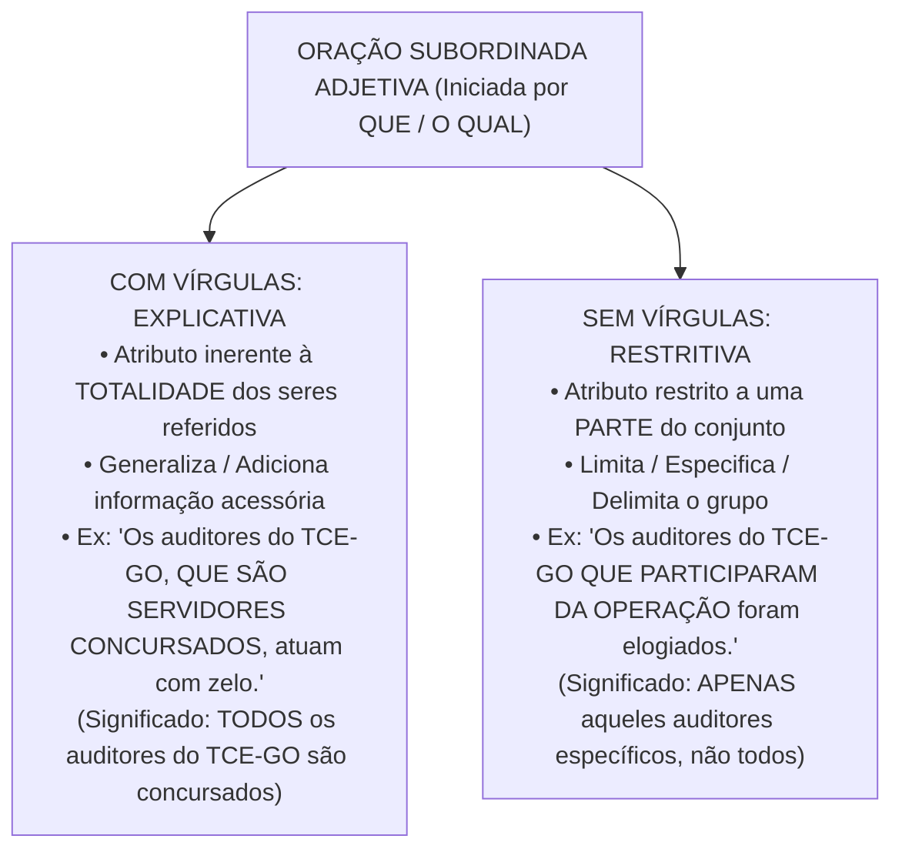
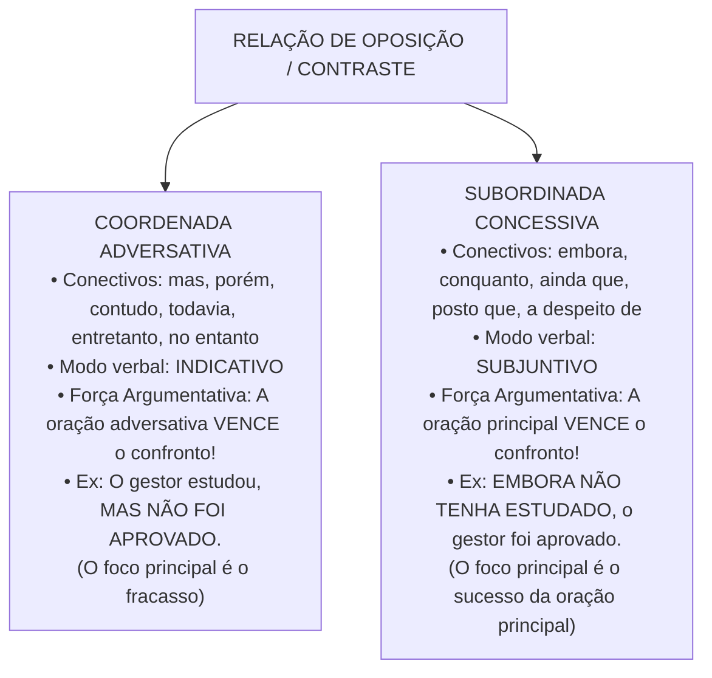

# 04 - Sintaxe do Período, Conectivos e Pontuação

> **Matéria:** Língua Portuguesa  
> **Cargos:** A01 – Técnico de Controle Externo (Adm) / B02 – Técnico de Controle Externo (TI)  
> **Arquivo:** `04_sintaxe_coordenacao_subordinacao_conectivos_pontuacao.md`  
> **Referência Temática:** Período Composto, Relações Lógicas Interoracionais, Valores de Conectivos e Pontuação na Banca FCC

---

## 📌 Ementa / Itens do Edital
- Coordenação e subordinação: processos sintáticos de articulação oracional no período composto;
- Conectivos coordenativos: conjunções aditivas, adversativas, alternativas, conclusivas e explicativas;
- Conectivos subordinativos: conjunções integrantes, causais, consecutivas, condicionais, concessivas, conformativas, comparativas, finais, proporcionais e temporais;
- Distinção semântica e modal entre orações adversativas (modo indicativo) e concessivas (modo subjuntivo);
- O trio clássico da FCC: *Porquanto* (causal), *Portanto* (conclusivo) e *Conquanto* (concessivo);
- Orações subordinadas substantivas (método de substituição pelo pronome *ISSO*);
- Orações subordinadas adjetivas explicativas (com vírgulas) vs. restritivas (sem vírgulas) e alteração de sentido pela pontuação;
- Emprego dos sinais de pontuação (vírgula, ponto e vírgula, dois-pontos, travessão e parênteses);
- Proibições sintáticas absolutas do emprego da vírgula (quebra da ordem direta Sujeito - Verbo - Complemento);
- Adjuntos adverbiais e orações adverbiais deslocadas ou intercaladas.

---

## 🧭 Sumário

1. [Fundamentos do Período Composto: Coordenação e Subordinação](#1-fundamentos-do-periodo-composto-coordenacao-e-subordinacao)
    1. [Conceito de Período Composto e Mecanismos de Junção Oracional](#11-conceito-de-periodo-composto-e-mecanismos-de-juncao-oracional)
    2. [Processo de Coordenação e Autonomia Sintática](#12-processo-de-coordenacao-e-autonomia-sintatica)
    3. [Processo de Subordinação e Encaixamento Hierárquico](#13-processo-de-subordinacao-e-encaixamento-hierarquico)
2. [Orações Coordenadas e Conectivos Coordenativos](#2-oracoes-coordenadas-e-conectivos-coordenativos)
    1. [Coordenadas Assindéticas e Sindéticas](#21-coordenadas-assindeticas-e-sindeticas)
    2. [Valores Semânticos das Conjunções Coordenativas](#22-valores-semanticos-das-conjuncoes-coordenativas)
    3. [Posição e Valores Polissêmicos da Conjunção Pois](#23-posicao-e-valores-polissemicos-da-conjuncao-pois)
3. [Orações Subordinadas Substantivas e Adjetivas](#3-oracoes-subordinadas-substantivas-e-adjetivas)
    1. [Orações Substantivas e o Método do Pronome ISSO](#31-oracoes-substantivas-e-o-metodo-do-pronome-isso)
    2. [Classificação Sintática das Orações Subordinadas Substantivas](#32-classificacao-sintatica-das-oracoes-subordinadas-substantivas)
    3. [Orações Subordinadas Adjetivas: Explicativas vs. Restritivas](#33-oracoes-subordinadas-adjetivas-explicativas-vs-restritivas)
4. [Orações Subordinadas Adverbiais e Conectivos Críticos](#4-oracoes-subordinadas-adverbiais-e-conectivos-criticos)
    1. [Quadro Completo das Conjunções Subordinativas Adverbiais](#41-quadro-completo-das-conjuncoes-subordinativas-adverbiais)
    2. [Adversativas vs. Concessivas: Conflito Sintático, Semântico e Modal](#42-adversativas-vs-concessivas-conflito-sintatico-semantico-e-modal)
    3. [O Trio Crítico da FCC: Porquanto, Portanto e Conquanto](#43-o-trio-critico-da-fcc-porquanto-portanto-e-conquanto)
    4. [A Polissemia do Conectivo Como](#44-a-polissemia-do-conectivo-como)
5. [Sintaxe da Pontuação e Efeitos Semânticos](#5-sintaxe-da-pontuacao-e-efeitos-semanticos)
    1. [A Proibição Inegociável da Quebra SVC](#51-a-proibicao-inegociavel-da-quebra-svc)
    2. [Regras do Uso da Vírgula no Período Simples](#52-regras-do-uso-da-virgula-no-periodo-simples)
    3. [Regras do Uso da Vírgula no Período Composto](#53-regras-do-uso-da-virgula-no-periodo-composto)
    4. [Emprego de Ponto e Vírgula, Dois-Pontos, Travessões e Parênteses](#54-emprego-de-ponto-e-virgula-dois-pontos-travessoes-e-parenteses)
    5. [Alterações de Sentido Provocadas pela Supressão ou Deslocamento de Pontuação](#55-alteracoes-de-sentido-provocadas-pela-supressao-ou-deslocamento-de-pontuacao)
6. [🌐 Fontes Oficiais e Referências Bibliográficas](#fontes-oficiais-e-referencias-bibliograficas)

---

## 1. Fundamentos do Período Composto: Coordenação e Subordinação

O período composto é aquele constituído por duas ou mais orações que se articulam para veicular um pensamento complexo. No texto formal, técnico e legislativo, o encadeamento das proposições obedece a dois processos estruturais básicos: a coordenação e a subordinação.

### 1.1 Conceito de Período Composto e Mecanismos de Junção Oracional

O reconhecimento do número de orações em um período faz-se pela identificação da quantidade de verbos ou locuções verbais presentes. A ligação entre essas orações processa-se ou por meio de conectivos expressos (conjunções coordenativas ou subordinativas, locuções conjuntivas e pronomes relativos) ou por simples justaposição assindética mediada por sinais de pontuação (vírgulas, ponto e vírgula ou dois-pontos).

### 1.2 Processo de Coordenação e Autonomia Sintática

Na coordenação, as orações encontram-se dispostas lado a lado no período sem que nenhuma delas exerça função sintática imediata em relação à outra. Cada oração coordenada possui estrutura interna própria (sujeito, predicado e complementos), mantendo equivalência hierárquica e autonomia gramatical:

* *"O auditor elaborou o relatório [1ª oração coordenada] e o conselheiro assinou o voto [2ª oração coordenada]."*

Embora sintaticamente autônomas, as orações coordenadas articulam-se logicamente no plano do discurso, expressando relações semânticas de soma, oposição, alternância, conclusão ou justificativa.

### 1.3 Processo de Subordinação e Encaixamento Hierárquico

Na subordinação, verifica-se uma relação de dependência hierárquica e encaixamento funcional: a oração subordinada desempenha uma função sintática essencial, integrante ou acessória em benefício da oração principal (atuando como se fosse um substantivo, um adjetivo ou um advérbio desta).

* *"O tribunal determinou [oração principal] <ins>que o contrato fosse suspenso</ins> [oração subordinada substantiva com função de objeto direto da principal]."*

Se a oração subordinada for retirada, a oração principal torna-se sintaticamente mutilada ou incompleta (no exemplo, o verbo *determinou* ficaria desprovido de seu complemento direto).

---

## 2. Orações Coordenadas e Conectivos Coordenativos

As orações coordenadas dividem-se em dois grandes grupos: assindéticas (desprovidas de conectivo) e sindéticas (introduzidas por conjunção coordenativa).

### 2.1 Coordenadas Assindéticas e Sindéticas

* **Coordenadas Assindéticas:** São orações justapostas, separadas por vírgula ou ponto e vírgula, sem qualquer conjunção expressa: *"Chegou ao tribunal, conferiu a pauta, dirigiu-se ao plenário"*.
* **Coordenadas Sindéticas:** Vêm encabeçadas por uma conjunção coordenativa que explicita o vínculo lógico estabelecido com a oração precedente. Classificam-se conforme o valor semântico desse conectivo.

### 2.2 Valores Semânticos das Conjunções Coordenativas

A gramática normativa e os exames da Fundação Carlos Chagas reconhecem cinco modalidades de orações coordenadas sindéticas:

1. **Aditivas:** Expressam ideia de soma, acréscimo ou adição de pensamentos:
    * Conectivos: *e, nem* (= e não), *não só.. mas também, não só.. como também, bem como, tanto.. quanto*.
    * Exemplo: *"A fiscalização não apenas apontou o sobrepreço, como também recomendou a aplicação de multa."*

2. **Adversativas:** Indicam oposição, contraste, compensação ou quebra de expectativa entre proposições:
    * Conectivos: *mas, porém, contudo, todavia, entretanto, no entanto, não obstante* (quando seguido de indicativo).
    * Exemplo: *"O gestor apresentou os balancetes, porém não comprovou a liquidação das despesas."*

3. **Alternativas:** Exprimem ideia de escolha, exclusão mútua ou alternância de situações:
    * Conectivos: *ou, ou.. ou, ora.. ora, quer.. quer, seja.. seja, já.. já*.
    * Exemplo: *"Ou o município regulariza o portal da transparência, ou sofrerá sanções administrativas."*

4. **Conclusivas:** Expressam dedução lógica, resultado ou consequência direta da proposição anterior:
    * Conectivos: *logo, portanto, por conseguinte, por isso, assim, de modo que, pois* (posposto ao verbo e isolado entre vírgulas).
    * Exemplo: *"As despesas com pessoal ultrapassaram os limites da LRF; portanto, fica vedada a contratação de novos servidores."*

5. **Explicativas:** Apresentam a razão, justificativa ou motivo do enunciado ou comando anterior:
    * Conectivos: *que, porque, porquanto, pois* (anteposto ao verbo).
    * Exemplo: *"Revisem as planilhas de cálculo, porque a sessão de julgamento terá início em instantes."*

### 2.3 Posição e Valores Polissêmicos da Conjunção Pois

A conjunção *pois* assume comportamentos sintáticos diametralmente opostos em razão estrita da sua posição física na oração coordenada:

* **Pois Explicativo (Anteposto ao Verbo):** Posiciona-se no início da oração coordenada, antes do verbo conjugado, assumindo valor explicativo ou causal (= *porque, porquanto, já que*):
    * *"Não atrase a entrega dos autos, **pois** os prazos regimentais são preclusivos."*
* **Pois Conclusivo (Posposto ao Verbo e entre Vírgulas):** Surge deslocado para o interior da oração coordenada, posposto ao verbo conjugado e compulsoriamente isolado por vírgulas, assumindo valor estritamente conclusivo (= *portanto, por conseguinte, logo*):
    * *"As provas da materialidade da fraude eram robustas; o pleno julgou, **pois**, pela irregularidade das contas."*

> 📌 **NOTA EXPLICATIVA / IDENTIFICAÇÃO DO POIS CONCLUSIVO:** Se a questão da FCC sublinhar o vocábulo *pois* e ele estiver posicionado após o verbo e cercado de vírgulas (*"aprovou, pois, as contas"*), a sua equivalência semântica é **conclusiva** e o conectivo substituto cabível é **portanto** ou **por conseguinte**. Nunca o classifique como explicativo nessa posição.

---

## 3. Orações Subordinadas Substantivas e Adjetivas

As orações subordinadas dividem-se em substantivas, adjetivas e adverbiais, dependendo do valor gramatical que exercem em relação à oração principal.

### 3.1 Orações Substantivas e o Método do Pronome ISSO

As orações subordinadas substantivas exercem papéis privativos de substantivos em relação à oração principal. São introduzidas quase invariavelmente pelas **conjunções integrantes "QUE" ou "SE"** (que não exercem função sintática própria, sendo meros conectivos de ligação).

> 💡 **DICA DO "ISSO" PARA ORAÇÕES SUBSTANTIVAS:** Para comprovar que uma oração é subordinada substantiva e que a palavra *que* ou *se* atua como conjunção integrante, substitua mentalmente toda a oração a partir do conectivo pelo pronome demonstrativo neutro **"ISSO"** (ou *a isso, de isso/disso, com isso*):
>
> * *"O presidente declarou [que a sessão estava suspensa]"* $\rightarrow$ *"O presidente declarou [ISSO]"* (Oração Substantiva Objetiva Direta).
> * *"É necessário [que se apresentem os documentos]"* $\rightarrow$ *"É necessário [ISSO]"* $\rightarrow$ *"ISSO é necessário"* (Oração Substantiva Subjetiva).

### 3.2 Classificação Sintática das Orações Subordinadas Substantivas

Identificada a oração substantiva pelo teste do *ISSO*, classifica-se a sua função sintática analisando o papel do pronome *ISSO* em relação à oração principal:

1. **Subjetiva:** Exerce a função de sujeito da oração principal. Ocorre quando a oração principal possui verbo de ligação + predicativo (*"É evidente que o prazo expirou"* $\rightarrow$ *ISSO é evidente*), verbo na voz passiva analítica ou sintética (*"Sabe-se que haverá concurso"*) ou verbos unipessoais (*convém, cumpre, importa, parece, urge*): *"Convém que todos estudem"*.
2. **Objetiva Direta:** Atua como objeto direto de verbo transitivo direto da oração principal (*"O relator constatou que havia sobrepreço"* $\rightarrow$ *constatou ISSO*).
3. **Objetiva Indireta:** Atua como objeto indireto, sendo precedida de preposição exigida por verbo transitivo indireto (*"O conselheiro insistiu em que se realizasse a perícia"* $\rightarrow$ *insistiu NISSO*).
4. **Completiva Nominal:** Atua como complemento nominal, integrando o sentido de um substantivo abstrato, adjetivo ou advérbio da principal (*"Tínhamos a certeza de que a fiscalização seria rigorosa"* $\rightarrow$ *certeza DISSO*).
5. **Predicativa:** Exerce a função de predicativo do sujeito após verbo de ligação (*"Nosso objetivo é que a administração pública seja eficiente"* $\rightarrow$ *o objetivo é ISSO*).
6. **Apositiva:** Exerce o papel de aposto explicativo, esclarecendo um termo antecedente, comumente posposta a dois-pontos (*"Desejo apenas uma coisa: que a verdade prevaleça"*).

### 3.3 Orações Subordinadas Adjetivas: Explicativas vs. Restritivas

As orações subordinadas adjetivas desempenham papel equivalente ao de um adjetivo (adjunto adnominal) em relação a um substantivo antecedente, sendo invariavelmente introduzidas por um **pronome relativo** (*que, quem, cujo, o qual, onde*).

#### Distinção Semântica e Sintática Crucial:
* **Adjetiva Explicativa (com vírgulas):** Vem isolada por vírgulas (ou travessões/parênteses). Atribui uma qualidade própria que abrange a **totalidade** dos elementos do termo antecedente. Não delimita o grupo, operando de forma generalizadora.
    * *"Os cidadãos brasileiros, que têm direito ao voto, participam das eleições."* (Significado: todos os cidadãos brasileiros têm direito ao voto).
* **Adjetiva Restritiva (sem vírgulas):** É grafada sem vírgulas. Restringe, individualiza e delimita o sentido do substantivo antecedente a um **subconjunto restrito**, excluindo os demais membros da classe.
    * *"Os cidadãos brasileiros que têm mais de setenta anos possuem voto facultativo."* (Significado: apenas aquela parcela que tem mais de 70 anos, e não a totalidade dos brasileiros).

> 🚨 **ALERTA DE PROVA / SUPRESSÃO DE VÍRGULAS EM ORAÇÃO ADJETIVA:** A FCC explora intensamente assertivas que indagam: *"A retirada das vírgulas da oração adjetiva mantém a correção gramatical e o sentido original do período?"*. Resposta técnica obrigatória: a retirada das vírgulas **mantém a correção gramatical**, mas **SEMPRE ALTERA O SENTIDO DO TEXTO**, transformando uma explicação genérica sobre a totalidade em uma restrição delimitadora sobre uma fração.

---

## 4. Orações Subordinadas Adverbiais e Conectivos Críticos

As orações subordinadas adverbiais exercem a função de adjunto adverbial da oração principal, explicitando as circunstâncias temporais, lógicas e modais sob as quais se consuma o processo verbal.

### 4.1 Quadro Completo das Conjunções Subordinativas Adverbiais

A gramática normativa classifica as orações subordinadas adverbiais em nove categorias semânticas:

| Categoria | Ideia Central | Conjunções e Locuções Principais | Exemplo de Aplicação |
| :--- | :--- | :--- | :--- |
| **Causal** | Motivo, razão ou causa da oração principal | *porque, visto que, já que, uma vez que, como* (no início), *porquanto, dado que* | *"Como chovia torrencialmente, o fiscal adiou a vistoria."* |
| **Consecutiva** | Consequência, resultado ou efeito decorrente | *tal.. que, tanto.. que, tão.. que, tamanho.. que, de forma que, de modo que* | *"A fraude foi tamanha que chocou os auditores."* |
| **Condicional** | Condição indispensável ou hipótese | *se, caso, contanto que, desde que, a não ser que, a menos que* | *"Caso o plenário autorize, iniciaremos a inspeção."* |
| **Concessiva** | Fato que se opõe à principal sem impedi-la | *embora, conquanto, ainda que, mesmo que, a despeito de, posto que, se bem que* | *"Conquanto houvesse pressão, o relator manteve o voto."* |
| **Conformativa** | Conformidade, acordo ou modelo seguido | *conforme, consoante, segundo, como* (= conforme) | *"O edital foi publicado, como prescreve a lei."* |
| **Comparativa** | Confronto analógico entre dois elementos | *como, assim como, tal qual, mais.. do que, menos.. do que* | *"O técnico procedeu com rigor como um perito criminal."* |
| **Final** | Objetivo, desígnio ou finalidade | *a fim de que, para que, com o fito de, com o intuito de* | *"O tribunal aprovou novas resoluções para que haja transparência."* |
| **Proporcional** | Proporcionalidade ou simultaneidade progressiva | *à medida que, à proporção que, ao passo que, quanto mais.. mais* | *"À medida que os autos avançavam, surgiam novas provas."* |
| **Temporal** | Momento cronológico em que ocorre a ação | *quando, enquanto, logo que, assim que, desde que, todas as vezes que* | *"Assim que a sessão terminou, a ata foi lavrada."* |

### 4.2 Adversativas vs. Concessivas: Conflito Sintático, Semântico e Modal

A oposição de ideias pode ser expressa por meio de coordenadas adversativas ou subordinadas concessivas. Embora ambas expressem contraste, seu funcionamento linguístico é radicalmente diverso:

#### Distinções Gramaticais Determinantes:
1. **Regência do Modo Verbal:**
    * A oração coordenada adversativa rege o verbo no **modo indicativo** (*"Ele agiu, contudo **errou**"*).
    * A oração subordinada concessiva rege compulsoriamente o verbo no **modo subjuntivo** (*"Embora ele **tenha agido**, não alcançou êxito"*).

2. **Hierarquia Argumentativa (Peso Discursivo):**
    * Na oração coordenada adversativa, o argumento mais forte, que orienta a conclusão final do autor, situa-se **dentro da própria oração adversativa** (*"O projeto é dispendioso, mas trará enormes benefícios à coletividade"* $\rightarrow$ prevalece a ideia de aprovação do projeto).
    * Na oração subordinada concessiva, a oração concessiva traz um argumento fraco que é superado pela oração principal; logo, o argumento determinante repousa **na oração principal** (*"Embora o projeto seja dispendioso, trará benefícios"* $\rightarrow$ a força do benefício prevalece sobre o custo).

> ⭐ **IMPORTANTE / SUBSTITUIÇÃO ADVERSATIVA POR CONCESSIVA:** Ao trocar uma conjunção adversativa (*mas, contudo, porém*) por uma concessiva (*embora, conquanto*), a gramática exige duas alterações simultâneas: 1) inversão da oração principal com a subordinada ou realocação do conectivo; 2) **mudança obrigatória do modo verbal do indicativo para o subjuntivo**.

### 4.3 O Trio Crítico da FCC: Porquanto, Portanto e Conquanto

Poucas pegadinhas são tão reiteradas pela Fundação Carlos Chagas quanto a semelhança gráfica entre os conectivos do trio:

* **PORQUANTO (Causal / Explicativo):** Equivale a *porque*, *já que*, *visto que*, *dado que*. Introduz a causa do fato ou a justificativa de uma ordem.
    * *"O TCE-GO rejeitou as contas, **porquanto** restou comprovado o superfaturamento."*
* **PORTANTO (Conclusivo):** Equivale a *logo*, *por conseguinte*, *assim*, *dessa forma*. Introduz a consequência lógica ou o arremate dedutivo.
    * *"Os autos comprovam a boa-fé do gestor; **portanto**, o processo deve ser arquivado."*
* **CONQUANTO (Concessivo):** Equivale a *embora*, *ainda que*, *a despeito de que*, *posto que*. Introduz uma ressalva concessiva que não anula a oração principal e **rege o modo subjuntivo**.
    * *"**Conquanto** houvesse fortes pressões políticas, o conselheiro proferiu voto técnico."*

### 4.4 A Polissemia do Conectivo Como

O conectivo *como* assume múltiplos papéis dependendo da sua posição na frase e da intenção discursiva:

1. **Como Causal:** Ocorre tipicamente anteposto ao período (no início da frase), equivalendo a *já que, visto que, dado que*: *"**Como** o prazo de apresentação de defesa havia expirado na véspera, o gestor foi declarado revel"*.
2. **Como Conformativo:** Equivale a *conforme, segundo, consoante*, indicando adequação a uma norma ou modelo: *"O concurso público realizou-se, **como** determina a Constituição Estadual"*.
3. **Como Comparativo:** Estabelece confronto de semelhança analógica (= *tal qual, assim como*): *"O fiscal examinou as planilhas **como** um analista forense minucioso"*.
4. **Como Aditivo (Correlativo):** Integra a estrutura aditiva correlata *não só.. como também*: *"O parecer apontou **não só** desídia administrativa, **como também** dano patrimonial"*.

---

## 5. Sintaxe da Pontuação e Efeitos Semânticos

A pontuação não se destina a marcar pausas de respiração na leitura oral, mas a tornar visível a arquitetura sintática do período, demarcando unidades funcionais e impedindo ambiguidades.

### 5.1 A Proibição Inegociável da Quebra SVC

A regra número um da sintaxe de pontuação na língua culta proíbe o emprego de **uma vírgula simples** que separe os elementos constitutivos da ordem direta da oração:
$$\text{Sujeito} \not\longleftrightarrow [\text{Vírgula Proibida}] \not\longleftrightarrow \text{Verbo} \not\longleftrightarrow [\text{Vírgula Proibida}] \not\longleftrightarrow \text{Complementos (OD/OI)}$$

* É proibido separar por vírgula o Sujeito do seu Verbo (*"O conselheiro presidente da corte de contas [X], abriu a sessão extraordinária"* $\rightarrow$ **ERRO**).
* É proibido separar por vírgula o Verbo dos seus Complementos Diretos ou Indiretos (*"O auditor apurou [X], as irregularidades fiscais"* $\rightarrow$ **ERRO**; *"O presidente votou [X], pela procedência do pedido"* $\rightarrow$ **ERRO**).
* É proibido separar por vírgula o Nome do seu Complemento Nominal ou Adjunto Adnominal.

> 🚨 **ALERTA DE PROVA / TERMOS INTERCALADOS ENTRE SUJEITO E VERBO:** É lícito inserir termos entre o sujeito e o verbo, desde que esses termos estejam rigorosamente isolados por **DUAS VÍRGULAS** (ou dois travessões/parênteses):
>
> - Incorreto (apenas uma vírgula): *"O pleno do tribunal, após examinar os laudos votou pela anulação"* $\rightarrow$ Erro!
> - Incorreto (apenas uma vírgula): *"O pleno do tribunal após examinar os laudos, votou pela anulação"* $\rightarrow$ Erro!
> - **Correto (duas vírgulas):** *"O pleno do tribunal**, após examinar os laudos,** votou pela anulação."*

### 5.2 Regras do Uso da Vírgula no Período Simples

No interior da oração simples, a vírgula é de emprego compulsório nas seguintes situações:

1. **Separação de termos de mesma função sintática em enumeração:** *"O tribunal adquiriu computadores, servidores, licenças de software e impressoras."*
2. **Isolamento de Vocativo:** O vocativo deve vir sempre isolado por vírgula(s), em qualquer posição que ocupe: *"Senhor Conselheiro, apresento o recurso"*; *"Apresento, Senhor Conselheiro, o recurso"*.
3. **Isolamento de Aposto Explicativo:** *"Goiânia, capital do Estado de Goiás, sediou a conferência internacional de tribunais."*
4. **Isolamento de Adjunto Adverbial Deslocado:**
    * Se for de **longa extensão** (três ou mais palavras): o uso da vírgula é **obrigatório** (*"No primeiro semestre do exercício financeiro de 2026, concluíram-se as auditorias"*).
    * Se for de **curta extensão** (uma ou duas palavras: *hoje, ontem, aqui, em Goiânia*): o emprego da vírgula é **facultativo** (*"Ontem, o relator julgou"* ou *"Ontem o relator julgou"*).

5. **Expressões explicativas, retificativas ou continuativas:** *isto é, ou seja, por exemplo, a saber, aliás, digo*: *"O prazo era de dez dias, ou seja, improrrogável"*.

### 5.3 Regras do Uso da Vírgula no Período Composto

No período composto por coordenação e subordinação:

1. **Orações Coordenadas Assindéticas:** São separadas compulsoriamente por vírgula (*"Instruiu o processo, ouviu as testemunhas, redigiu a proposta de voto"*).
2. **Orações Coordenadas Sindéticas:** Usa-se vírgula antes de conjunções adversativas (*mas, porém, contudo*), conclusivas (*portanto, logo*) e explicativas (*porque, que*).
    * **Conjunção "E" com Sujeitos Iguais:** Em regra, não se usa vírgula antes do *e* quando as orações possuem o mesmo sujeito (*"O fiscal viajou e inspecionou as escolas"*).
    * **Conjunção "E" com Sujeitos Distintos:** Quando as orações coordenadas aditivas possuem **sujeitos gramaticais diferentes**, a vírgula antes da conjunção *e* é **plenamente admitida e recomendada** para evitar anfibologia: *"O tribunal acolheu o recurso, e o Ministério Público de Contas concordou com o relator"* (Sujeitos: *o tribunal* / *o MP de Contas*).

3. **Orações Adverbiais Deslocadas:**
    * Se a oração subordinada adverbial vier **anteposta à oração principal** ou **intercalada** nela: a vírgula é **obrigatória** (*"Embora chovesse torrencialmente, o fiscal compareceu à obra"*).
    * Se a oração adverbial vier **posposta à oração principal** (ordem direta): a vírgula é **facultativa** (*"O fiscal compareceu à obra[,] embora chovesse torrencialmente"*).

4. **Orações Subordinadas Adjetivas:** Explicativas vêm sempre isoladas por vírgulas; restritivas não admitem vírgulas.

### 5.4 Emprego de Ponto e Vírgula, Dois-Pontos, Travessões e Parênteses

* **Ponto e Vírgula (;):**
    * Separa orações coordenadas de certa extensão que já contenham vírgulas internas: *"O relatório inicial apontou desvios de combustível; o parecer conclusivo, elaborado pela auditoria de engenharia, recomendou a instauração de tomada de contas especial."*
    * Separa itens enumerados em disposições normativas, editais, relatórios e leis (como alíneas e incisos).
* **Dois-Pontos (:):**
    * Anunciam uma citação textual, uma enumeração explicativa ou uma oração subordinada substantiva apositiva: *"O conselheiro concluiu com a máxima de Rui Barbosa: 'A justiça atrasada não é justiça'."*
* **Travessão Simples ou Duplo (—):**
    * O travessão duplo atua como recurso expressivo para isolar termos intercalados, comentários enfáticos ou orações adjetivas explicativas, substituindo com elegância as vírgulas duplas ou os parênteses (*"O processo de auditoria — cuja complexidade assustava os neófitos — transcorreu dentro da mais estrita normalidade"*).
* **Parênteses ( ):**
    * Isolam notas explicativas acessórias, datas, referências bibliográficas ou reflexões secundárias do autor.

### 5.5 Alterações de Sentido Provocadas pela Supressão ou Deslocamento de Pontuação

A pontuação é ferramenta de arquitetura do sentido discursivo. O deslocamento ou a eliminação de um sinal de pontuação pode transformar completamente o sentido da mensagem:

* *Supressão de vírgulas em orações adjetivas:* Passa de explicativa (generalizadora, afeta todos os indivíduos) para restritiva (limitadora, afeta apenas um grupo).
* *Deslocamento da vírgula antes ou depois da conjunção:* Muda a regência das orações coordenadas.
* *Supressão da vírgula de vocativo:* Transforma o chamamento em sujeito da oração (*"Auditor, assine o documento"* [ordem a um interlocutor] vs. *"Auditor assine o documento"* [frase defeituosa ou ambígua]).

---

### Teste 001
**(FGV – TJ/SC – 2026 – Analista Administrativo)**
Leia o fragmento de texto a seguir. Sentimento que não espairo; pois eu mesmo nem acerto com o mote disso ― o que queria e o que não queria, estória sem final. O correr da vida embrulha tudo, a vida é assim: esquenta e esfria, aperta e daí afrouxa, sossega e depois desinquieta. O que ela quer da gente é coragem. O que Deus quer é ver a gente aprendendo a ser capaz de ficar alegre a mais, no meio da alegria, e inda mais alegre no meio da tristeza! Só assim de repente, na horinha em que se quer, de propósito ― por coragem. Será? Era o que eu às vezes achava. Ao clarear do dia. ROSA, João Guimarães. Grande Sertão: Veredas. São Paulo: Cia das Letras. 2019. p. 293. No fragmento apresentado, o uso de diferentes sinais de pontuação contribui para a construção de sentidos e para a expressão da subjetividade do narrador. Considerando esse aspecto, assinale a afirmativa que analisa corretamente o papel desses recursos no texto.

* **A)** O uso do ponto e vírgula estabelece relações de subordinação entre as orações, organizando o texto de forma hierarquizada.
* **B)** Os dois-pontos introduzem explicações e enumerações, contribuindo para o encadeamento reflexivo das ideias do narrador.
* **C)** O travessão é empregado para indicar mudança de interlocutor, caracterizando o texto como diálogo direto.
* **D)** Os pontos finais fragmentam o texto em períodos independentes, sem relação com o ritmo ou com a construção de sentido.
* **E)** O ponto de interrogação é utilizado para organizar sintaticamente o texto, sem interferir na expressividade da linguagem.

---

> **Comentário Detalhado:**
>
> - **A)** **Incorreta.** A opção apresenta proposição em desacordo com os fundamentos teóricos e técnicos do tópico ao afirmar que "O uso do ponto e vírgula estabelece relações de subordinação entre as orações, organizando o texto de forma...". De acordo com a teoria estudada em *1.1 Conceito de Período Composto e Mecanismos de Junção Oracional*, o reconhecimento do número de orações em um período faz se pela identificação da quantidade de verbos ou locuções verbais presentes. A ligação entre essas orações processa se ou por meio de conectivos expressos (conjunções coordenativas ou subordinativas, locuções conjuntivas e pronomes relativos) ou por simples justaposição assindética mediada por sinais de pontuação (vírgulas, ponto e vírgula ou dois pontos).
> - **B)** **Correta.** Conforme fundamentado na seção *1. Fundamentos do Período Composto: Coordenação e Subordinação* deste guia, o período composto é aquele constituído por duas ou mais orações que se articulam para veicular um pensamento complexo. No texto formal, técnico e legislativo, o encadeamento das proposições obedece a dois processos estruturais básicos: a coordenação e a subordinação. Dessa forma, está plenamente correta a assertiva da banca (FGV – TJ/SC/2026) ao estabelecer que "Os dois pontos introduzem explicações e enumerações, contribuindo para o encadeamento reflexivo das ideias do...".
> - **C)** **Incorreta.** A opção apresenta proposição em desacordo com os fundamentos teóricos e técnicos do tópico ao afirmar que "O travessão é empregado para indicar mudança de interlocutor, caracterizando o texto como diálogo direto". De acordo com a teoria estudada em *5.4 Emprego de Ponto e Vírgula, Dois-Pontos, Travessões e Parênteses*, o travessão duplo atua como recurso expressivo para isolar termos intercalados, comentários enfáticos ou orações adjetivas explicativas, substituindo com elegância as vírgulas duplas ou os parênteses ( "O processo de auditoria — cuja complexidade assustava os neófitos — transcorreu dentro da mais estrita normalidade" ).
> - **D)** **Incorreta.** A opção apresenta proposição em desacordo com os fundamentos teóricos e técnicos do tópico ao afirmar que "Os pontos finais fragmentam o texto em períodos independentes, sem relação com o ritmo ou com a construção de...". De acordo com a teoria estudada em *Distinção Semântica e Sintática Crucial:*, a FCC explora intensamente assertivas que indagam: "A retirada das vírgulas da oração adjetiva mantém a correção gramatical e o sentido original do período?" . Resposta técnica obrigatória: a retirada das vírgulas mantém a correção gramatical, mas SEMPRE ALTERA O SENTIDO DO TEXTO, transformando uma explicação genérica sobre a totalidade em uma restrição delimitadora sobre uma fração.
> - **E)** **Incorreta.** A opção apresenta proposição em desacordo com os fundamentos teóricos e técnicos do tópico ao afirmar que "O ponto de interrogação é utilizado para organizar sintaticamente o texto, sem interferir na expressividade da...". De acordo com a teoria estudada em *5.4 Emprego de Ponto e Vírgula, Dois-Pontos, Travessões e Parênteses*, separa orações coordenadas de certa extensão que já contenham vírgulas internas: "O relatório inicial apontou desvios de combustível; o parecer conclusivo, elaborado pela auditoria de engenharia, recomendou a instauração de tomada de contas especial.".
>
> **Gabarito: B**

---

### Teste 002
**(CEBRASPE – TRT/10 – 2013 – Analista Judiciario Tecnologia Da Informacao)**
Infere-se da leitura do texto que a eliminação de todas as formas de discriminação, que abrange a promoção da igualdade de oportunidades, constitui o fundamento da Declaração dos Direitos e Princípios Fundamentais do Trabalho e da Agenda do Trabalho Decente da OIT. com o código E, caso julgue o item ERRADO. A ausência de seja, não receberão pontuação negativa. Para as devidas marcações, suas provas objetivas. BÁSICOS

* **C)** Certo
* **E)** Errado

---

> **Comentário Detalhado:**
>
> - **C)** **Incorreta.** A proposição apresenta proposição em desacordo com os fundamentos teóricos e técnicos do tópico ao afirmar que "Infere se da leitura do texto que a eliminação de todas as formas de discriminação, que abrange a promoção da...". De acordo com a teoria em *1. Fundamentos do Período Composto: Coordenação e Subordinação*, o período composto é aquele constituído por duas ou mais orações que se articulam para veicular um pensamento complexo. No texto formal, técnico e legislativo, o encadeamento das proposições obedece a dois processos estruturais básicos: a coordenação e a subordinação.
> - **E)** **Correta.** O item está **Errado** (gabarito oficial: **E**), pois contraria a disciplina teórica aplicável.
>
> **Gabarito: E**

---

### Teste 003
**(FCC – TRT 11ª – 2017 – Analista Judiciário - Tecnologia da Informação)**
É legítimo afirmar: no texto,

* **A)** Transpondo a voz passiva presente na frase para a voz ativa, a forma correta a ser grafada é “têm acompanhado”.
* **B)** A retirada da vírgula após a palavra reiteradamente prejudica o sentido original da frase.
* **C)** A expressão Visível a olho nu, que constitui caracterização da palavra que a antecede, dá oportunidade para que se introduza outro argumento a favor da ideia expressa por notório.
* **D)** Se o assunto fosse não um processo, mas “processos”, a correção exigiria a forma “se tratam de processos”.
* **E)** O verbo “haver”, na frase, está empregado como indica o seguinte verbete do Dicionário eletrônico Houaiss: transitivo direto [impessoal] ter transcorrido ou ser decorrido (tempo).

---

> **Comentário Detalhado:**
>
> - **A)** **Incorreta.** A opção apresenta proposição em desacordo com os fundamentos teóricos e técnicos do tópico ao afirmar que "Transpondo a voz passiva presente na frase para a voz ativa, a forma correta a ser grafada é “têm acompanhado”". De acordo com a teoria estudada em *3.2 Classificação Sintática das Orações Subordinadas Substantivas*, subjetiva: Exerce a função de sujeito da oração principal. Ocorre quando a oração principal possui verbo de ligação + predicativo ( "É evidente que o prazo expirou" $\rightarrow$ ISSO é evidente ), verbo na voz passiva analítica ou sintética ( "Sabe se que haverá concurso" ) ou verbos unipessoais ( convém, cumpre, importa, parece, urge ): "Convém que todos estudem".
> - **B)** **Incorreta.** A opção apresenta proposição em desacordo com os fundamentos teóricos e técnicos do tópico ao afirmar que "A retirada da vírgula após a palavra reiteradamente prejudica o sentido original da frase". De acordo com a teoria estudada em *Distinção Semântica e Sintática Crucial:*, a FCC explora intensamente assertivas que indagam: "A retirada das vírgulas da oração adjetiva mantém a correção gramatical e o sentido original do período?" . Resposta técnica obrigatória: a retirada das vírgulas mantém a correção gramatical, mas SEMPRE ALTERA O SENTIDO DO TEXTO, transformando uma explicação genérica sobre a totalidade em uma restrição delimitadora sobre uma fração.
> - **C)** **Incorreta.** A opção apresenta proposição em desacordo com os fundamentos teóricos e técnicos do tópico ao afirmar que "A expressão Visível a olho nu, que constitui caracterização da palavra que a antecede, dá oportunidade para que se...". De acordo com a teoria estudada em *Distinções Gramaticais Determinantes:*, na oração coordenada adversativa, o argumento mais forte, que orienta a conclusão final do autor, situa se dentro da própria oração adversativa ( "O projeto é dispendioso, mas trará enormes benefícios à coletividade" $\rightarrow$ prevalece a ideia de aprovação do projeto).
> - **D)** **Correta.** Conforme fundamentado na seção *1.3 Processo de Subordinação e Encaixamento Hierárquico* deste guia, na subordinação, verifica se uma relação de dependência hierárquica e encaixamento funcional: a oração subordinada desempenha uma função sintática essencial, integrante ou acessória em benefício da oração principal (atuando como se fosse um substantivo, um adjetivo ou um advérbio desta). Dessa forma, está plenamente correta a assertiva da banca (FCC – TRT 11ª/2017) ao estabelecer que "Se o assunto fosse não um processo, mas “processos”, a correção exigiria a forma “se tratam de processos”".
> - **E)** **Incorreta.** A opção apresenta proposição em desacordo com os fundamentos teóricos e técnicos do tópico ao afirmar que "O verbo “haver”, na frase, está empregado como indica o seguinte verbete do Dicionário eletrônico Houaiss...". De acordo com a teoria estudada em *1.3 Processo de Subordinação e Encaixamento Hierárquico*, "O tribunal determinou [oração principal] <ins que o contrato fosse suspenso</ins [oração subordinada substantiva com função de objeto direto da principal].".
>
> **Gabarito: D**

---

### Teste 004
**(FCC – TRT 11ª – 2017 – Analista Judiciário - Tecnologia da Informação)**
(3o parágrafo) Não obstante a permanência ininterrupta da enorme desigualdade em tamanho e estatura das religiões no Brasil, não é mais possível, nos dias que correm, desconhecer que a sociedade brasileira está passando por um processo de transição religiosa que é notório. Visível a olho nu. Considerado o trecho acima, no contexto em que está inserido, é apropriado afirmar:

* **A)** A expressão nos dias que correm expressa um fator condicionante.
* **B)** A locução verbal em que está presente o gerúndio indica uma ação durativa em tempo não marcado.
* **C)** As incontestes desigualdades estruturais do Brasil impossibilitam leituras mais pontuais e consistentes acerca da vida dos brasileiros, principalmente no que se refere a seus hábitos religiosos.
* **D)** A inclusão de uma vírgula depois de Não obstante mantém a correção e a clareza da frase, visto que o emprego desse sinal de pontuação, nessa específica formulação, é facultativo.
* **E)** Em a permanência ininterrupta da enorme desigualdade em tamanho e estatura das religiões no Brasil, a substituição de ininterrupta por “intermitente” mantém o sentido original da frase.

---

> **Comentário Detalhado:**
>
> - **A)** **Correta.** Conforme fundamentado na seção *2.1 Coordenadas Assindéticas e Sindéticas* deste guia, coordenadas Assindéticas: São orações justapostas, separadas por vírgula ou ponto e vírgula, sem qualquer conjunção expressa: "Chegou ao tribunal, conferiu a pauta, dirigiu se ao plenário". Dessa forma, está plenamente correta a assertiva da banca (FCC – TRT 11ª/2017) ao estabelecer que "A expressão nos dias que correm expressa um fator condicionante".
> - **B)** **Incorreta.** A opção apresenta proposição em desacordo com os fundamentos teóricos e técnicos do tópico ao afirmar que "A locução verbal em que está presente o gerúndio indica uma ação durativa em tempo não marcado". De acordo com a teoria estudada em *4.1 Quadro Completo das Conjunções Subordinativas Adverbiais*, temporal: Momento cronológico em que ocorre a ação — quando, enquanto, logo que, assim que, desde que, todas as vezes que — "Assim que a sessão terminou, a ata foi lavrada.".
> - **C)** **Incorreta.** A opção apresenta proposição em desacordo com os fundamentos teóricos e técnicos do tópico ao afirmar que "As incontestes desigualdades estruturais do Brasil impossibilitam leituras mais pontuais e consistentes acerca da...". De acordo com a teoria estudada em *1. Fundamentos do Período Composto: Coordenação e Subordinação*, o período composto é aquele constituído por duas ou mais orações que se articulam para veicular um pensamento complexo. No texto formal, técnico e legislativo, o encadeamento das proposições obedece a dois processos estruturais básicos: a coordenação e a subordinação.
> - **D)** **Incorreta.** A opção afasta requisito ou relação estrutural exigida pela matéria ao afirmar que "A inclusão de uma vírgula depois de Não obstante mantém a correção e a clareza da frase, visto que o emprego desse...". De acordo com a teoria estudada em *Distinção Semântica e Sintática Crucial:*, a FCC explora intensamente assertivas que indagam: "A retirada das vírgulas da oração adjetiva mantém a correção gramatical e o sentido original do período?" . Resposta técnica obrigatória: a retirada das vírgulas mantém a correção gramatical, mas SEMPRE ALTERA O SENTIDO DO TEXTO, transformando uma explicação genérica sobre a totalidade em uma restrição delimitadora sobre uma fração.
> - **E)** **Incorreta.** A opção apresenta proposição em desacordo com os fundamentos teóricos e técnicos do tópico ao afirmar que "Em a permanência ininterrupta da enorme desigualdade em tamanho e estatura das religiões no Brasil, a substituição...". De acordo com a teoria estudada em *5.5 Alterações de Sentido Provocadas pela Supressão ou Deslocamento de Pontuação*, supressão da vírgula de vocativo: Transforma o chamamento em sujeito da oração ( "Auditor, assine o documento" [ordem a um interlocutor] vs. "Auditor assine o documento" [frase defeituosa ou ambígua]).
>
> **Gabarito: A**

---

### Teste 005
**(FCC – TRT 16ª – 2014 – Analista Judiciário - Tecnologia da Informação)**
Quanto à pontuação, a frase inteiramente correta é:

* **A)** Já pela má fama adquirida já por preconceito, sem- pre haverá por parte de certos leitores, alguma relu- tância diante da leitura de um prefácio.
* **B)** O autor do texto não hesita honestamente, de re- correr a experiências pessoais, para demonstrar sua tese, favorável em boa parte à existência mesma dos prefácios.
* **C)** A escritora Cecília Meireles tão talentosa quanto bo- nita, é citada no texto como parâmetro de excelên- cia, na comparação com uma jovem, bela e pouco inspirada poetisa.
* **D)** Muita gente acabará por confessar tal como fez o autor, que um prefácio pode prender nossa atenção, com muito mais força, do que o texto principal de uma obra.
* **E)** O autor conclui, não sem razão, que as bibliografias que indicam apenas o prefácio de uma obra per- mitem deduzir, não há dúvida, que o restante do li- pírito das leis, obra clássica do filósofo francês Montesquieu, publicada em 1748. [Do espírito das leis] Falta muito para que o mundo inteligente seja tão bem governado quanto o mundo físico, pois ainda que o mundo inteligente possua também leis que por sua natureza são invariáveis, não as segue constantemente como o mundo físico segue as suas. A razão disso reside no fato de estarem os seres particulares inteligentes limitados por sua natureza e, consequentemente, sujeitos a erro; e, por outro lado, é próprio de sua natureza agirem por si mesmos. (...) O homem, como ser físico, tal como os outros corpos da natureza, é governado por leis invariáveis. Como ser inteligente, _________________________________________________________ viola incessantemente as leis que Deus estabeleceu e modifica as que ele próprio estabeleceu. Tal ser poderia, a todo instante, esquecer seu criador − Deus, pelas leis da religião, chamou-o a si; um tal ser poderia, a todo instante, esquecer-se de si mesmo − os filósofos advertiram-no pelas leis da moral. (Montesquieu − Os Pensadores. São Paulo: Abril Cultural, 1973, p. 33 e 34)

---

> **Comentário Detalhado:**
>
> - **A)** **Incorreta.** A opção apresenta proposição em desacordo com os fundamentos teóricos e técnicos do tópico ao afirmar que "Já pela má fama adquirida já por preconceito, sem pre haverá por parte de certos leitores, alguma relu tância...". De acordo com a teoria estudada em *2.2 Valores Semânticos das Conjunções Coordenativas*, conectivos: e, nem (= e não), não só.. mas também, não só.. como também, bem como, tanto.. quanto.
> - **B)** **Incorreta.** A opção apresenta proposição em desacordo com os fundamentos teóricos e técnicos do tópico ao afirmar que "O autor do texto não hesita honestamente, de re correr a experiências pessoais, para demonstrar sua tese...". De acordo com a teoria estudada em *4.3 O Trio Crítico da FCC: Porquanto, Portanto e Conquanto*, poucas pegadinhas são tão reiteradas pela Fundação Carlos Chagas quanto a semelhança gráfica entre os conectivos do trio.
> - **C)** **Incorreta.** A opção apresenta proposição em desacordo com os fundamentos teóricos e técnicos do tópico ao afirmar que "A escritora Cecília Meireles tão talentosa quanto bo nita, é citada no texto como parâmetro de excelên cia, na...". De acordo com a teoria estudada em *4.1 Quadro Completo das Conjunções Subordinativas Adverbiais*, consecutiva: Consequência, resultado ou efeito decorrente — tal.. que, tanto.. que, tão.. que, tamanho.. que, de forma que, de modo que — "A fraude foi tamanha que chocou os auditores.".
> - **D)** **Incorreta.** A opção apresenta proposição em desacordo com os fundamentos teóricos e técnicos do tópico ao afirmar que "Muita gente acabará por confessar tal como fez o autor, que um prefácio pode prender nossa atenção, com muito mais...". De acordo com a teoria estudada em *4.2 Adversativas vs. Concessivas: Conflito Sintático, Semântico e Modal*, oposicao Conc["SUBORDINADA CONCESSIVA<br/ • Conectivos: embora, conquanto, ainda que, posto que, a despeito de<br/ • Modo verbal: SUBJUNTIVO<br/ • Força Argumentativa: A oração principal VENCE o confronto!<br/ • Ex: EMBORA NÃO TENHA ESTUDADO, o gestor foi aprovado.<br/ (O foco principal é o sucesso da oração principal)"].
> - **E)** **Correta.** Conforme fundamentado na seção *4.1 Quadro Completo das Conjunções Subordinativas Adverbiais* deste guia, concessiva: Fato que se opõe à principal sem impedi la — embora, conquanto, ainda que, mesmo que, a despeito de, posto que, se bem que — "Conquanto houvesse pressão, o relator manteve o voto.". Dessa forma, está plenamente correta a assertiva da banca (FCC – TRT 16ª/2014) ao estabelecer que "O autor conclui, não sem razão, que as bibliografias que indicam apenas o prefácio de uma obra per mitem deduzir...".
>
> **Gabarito: E**

---

