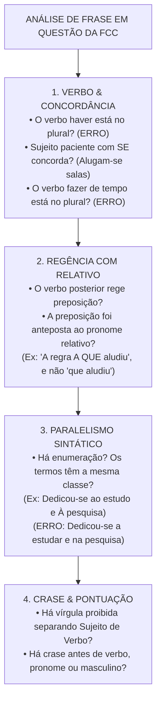
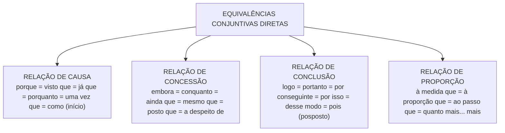

# 06 - Redação: Reescrita, Correção Gramatical e Equivalência de Estruturas

> **Matéria:** Língua Portuguesa  
> **Cargos:** A01 – Técnico de Controle Externo (Adm) / B02 – Técnico de Controle Externo (TI)  
> **Arquivo:** `06_redacao_reescrita_e_equivalencia_de_estruturas.md`  
> **Referência Temática:** Confronto de Frases, Paralelismo Sintático, Paráfrase e Reorganização Textual na FCC

---

## 📌 Ementa / Itens do Edital
- Redação: confronto e reconhecimento de frases corretas e incorretas segundo a norma culta;
- Organização e reorganização de orações e períodos: ordem direta vs. inversões estilísticas e impacto na clareza;
- Equivalência e transformação de estruturas: paráfrase sintática com preservação rigorosa do sentido original;
- Paralelismo sintático e semântico em enumerações e estruturas correlatas (*não só... mas também*, *tanto... quanto*);
- Ambiguidade estrutural e lexical: causas e métodos de saneamento sintático;
- Transposição entre orações desenvolvidas e orações reduzidas (infinitivo, gerúndio e particípio);
- Mecanismos de nominalização e concisão textual;
- Emprego correto das quatro formas dos porquês (*por que*, *por quê*, *porque* e *porquê*).

---

## 🧭 Sumário

1. [Confronto e Julgamento de Frases: O Checklist Caça-Erros da FCC](#1-confronto-e-julgamento-de-frases-o-checklist-caca-erros-da-fcc)
    1. [Estratégia de Varredura e Identificação de Vícios Gramaticais](#11-estrategia-de-varredura-e-identificacao-de-vicios-gramaticais)
    2. [Vícios Recorrentes em Provas de Tribunais](#12-vicios-recorrentes-em-provas-de-tribunais)
    3. [Pronomes Retos Usados Indevidamente como Objetos](#13-pronomes-retos-usados-indevidamente-como-objetos)
    4. [Teste 052](#Teste-052)
2. [Paralelismo Sintático e Semântico](#2-paralelismo-sintatico-e-semantico)
    1. [Princípio da Simetria Estrutural em Termos Coordenados](#21-principio-da-simetria-estrutural-em-termos-coordenados)
    2. [Paralelismo em Estruturas Correlativas](#22-paralelismo-em-estruturas-correlativas)
    3. [Casos Típicos de Quebra de Paralelismo e Métodos de Correção](#23-casos-tipicos-de-quebra-de-paralelismo-e-metodos-de-correcao)
    4. [Teste 053](#Teste-053)
    5. [Teste 054](#Teste-054)
3. [Ambiguidade e Vícios de Construção Frasal](#3-ambiguidade-e-vicios-de-construcao-frasal)
    1. [Ambiguidade Estrutural vs. Ambiguidade Lexical](#31-ambiguidade-estrutural-vs-ambiguidade-lexical)
    2. [Ambiguidade pelo Mau Emprego de Pronomes Possessivos (Seu/Sua)](#32-ambiguidade-pelo-mau-emprego-de-pronomes-possessivos-seusua)
    3. [O Mau Posicionamento de Adjuntos Adverbiais e Orações Reduzidas](#33-o-mau-posicionamento-de-adjuntos-adverbiais-e-oracoes-reduzidas)
    4. [O Emprego Vicioso do Vocábulo O Mesmo](#34-o-emprego-vicioso-do-vocabulo-o-mesmo)
    5. [Teste 055](#Teste-055)
    6. [Teste 056](#Teste-056)
4. [Organização e Reorganização de Orações e Períodos](#4-organizacao-e-reorganizacao-de-oracoes-e-periodos)
    1. [Ordem Direta e os Efeitos Comunicativos das Inversões](#41-ordem-direta-e-os-efeitos-comunicativos-das-inversoes)
    2. [Posicionamento Estratégico de Termos Intercalados e Pontuação](#42-posicionamento-estrategico-de-termos-intercalados-e-pontuacao)
    3. [Coesão Sequencial e Encadeamento Lógico de Argumentos](#43-coesao-sequencial-e-encadeamento-logico-de-argumentos)
    4. [Teste 057](#Teste-057)
5. [Equivalência, Transformação de Estruturas e Paráfrase](#5-equivalencia-transformacao-de-estruturas-e-parafrase)
    1. [Critérios Cumulativos da Paráfrase Legítima](#51-criterios-cumulativos-da-parafrase-legitima)
    2. [Transposição entre Orações Desenvolvidas e Reduzidas](#52-transposicao-entre-oracoes-desenvolvidas-e-reduzidas)
    3. [Matriz de Substituição e Equivalência de Conectivos](#53-matriz-de-substituicao-e-equivalencia-de-conectivos)
    4. [Mecanismos de Nominalização e Concisão Textual](#54-mecanismos-de-nominalizacao-e-concisao-textual)
    5. [Transposição de Vozes Verbais na Reescrita](#55-transposicao-de-vozes-verbais-na-reescrita)
    6. [Teste 058](#Teste-058)
    7. [Teste 059](#Teste-059)
6. [O Emprego Correto das Quatro Formas dos Porquês](#6-o-emprego-correto-das-quatro-formas-dos-porques)
    1. [Por que: Interrogativo e Relativo](#61-por-que-interrogativo-e-relativo)
    2. [Por quê: Isolado ou Imediatamente Antes de Pontuação](#62-por-que-isolado-ou-imediatamente-antes-de-pontuacao)
    3. [Porque: Conjunção Causal ou Explicativa](#63-porque-conjuncao-causal-ou-explicativa)
    4. [Porquê: Substantivo com Artigo ou Determinante](#64-porque-substantivo-com-artigo-ou-determinante)
    5. [Distinções Léxicas Adicionais: A Fim De vs. Afim e Ao Encontro De vs. De Encontro A](#65-distincoes-lexicas-adicionais-a-fim-de-vs-afim-e-ao-encontro-de-vs-de-encontro-a)
    6. [Teste 060](#Teste-060)
    7. [Teste 061](#Teste-061)
7. [🌐 Fontes Oficiais e Referências Bibliográficas](#fontes-oficiais-e-referencias-bibliograficas)

---

## 1. Confronto e Julgamento de Frases: O Checklist Caça-Erros da FCC

As questões de confronto e reconhecimento de frases corretas e incorretas constituem uma das marcas mais temidas e refinadas das provas elaboradas pela Fundação Carlos Chagas. Nelas, o enunciado costuma indagar: *"A frase redigida de modo inteiramente claro, correto e condizente com a norma-padrão é:"* ou *"O período que expressa com correção e concisão as ideias do texto é:"*.

Resolver esse modelo de questão exige do candidato abandonar a leitura intuitiva e aplicar uma **metodologia de varredura sintática por camadas**, inspecionando cada alternativa em busca dos vícios gramaticais recorrentes.

### 1.1 Estratégia de Varredura e Identificação de Vícios Gramaticais

Ao inspecionar uma alternativa de reescrita, examine os quatro pontos cardeais da sintaxe da frase:

1. **Concordância Verbal e Nominal:** Localize os núcleos dos sujeitos e confronte-os com as formas verbais correspondentes, sobretudo diante de inversões sintáticas ou de sujeitos oracionais; examine se verbos impessoais como *haver* e *fazer* foram pluralizados indevidamente.
2. **Regência Verbal associada a Pronomes Relativos:** Verifique se o verbo da oração subordinada adjetiva exige preposição e se essa preposição foi corretamente anteposta ao pronome relativo *que, quem, cujo* ou *o qual*.
3. **Emprego do Sinal Indicativo de Crase:** Cheque se a fusão decorre de preposição exigida e se não há crase antes de palavra masculina, verbo, pronome indefinido ou em expressões simétricas.
4. **Sintaxe de Pontuação e Ordem SVC:** Verifique se não houve a colocação de uma vírgula simples entre o sujeito e o predicado, ou entre o verbo e seus complementos diretos/indiretos.

### 1.2 Vícios Recorrentes em Provas de Tribunais

A FCC utiliza distratores padronizados para construir alternativas incorretas:

* Inserção de preposição indevida após o verbo *implicar* (*"implicará em nulidade"* $\rightarrow$ errado);
* Emprego de locuções comparativas proibidas com o verbo *preferir* (*"prefere trabalhar do que descansar"* $\rightarrow$ errado);
* Confusão entre formas parônimas como *a fim de* (finalidade) e *afim* (parentesco/afinidade), ou *ao encontro de* (concordância) e *de encontro a* (choque/colisão);
* Pluralização viciosa do verbo em construções com partícula indeterminadora do sujeito (*"Tratam-se de processos graves"* $\rightarrow$ errado; deve ser *Trata-se de*).

### 1.3 Pronomes Retos Usados Indevidamente como Objetos

A língua culta formal não admite o uso de pronomes pessoais do caso reto (*ele, ela, eles, elas*) na posição de complemento verbal direto. O pronome reto possui vocação exclusivamente subjetiva (função de sujeito da oração).

> 🚨 **ALERTA DE PROVA / PEGADINHA FCC:** Ao ler uma alternativa da FCC, desconfie sumariamente de sentenças que terminam com construções do tipo: *"A nova lei orçamentária trouxe regras rígidas e o gestor deve cumprir elas"*. Essa frase está eivada de erro gramatical inadmissível na norma culta! A forma exigida é com pronome oblíquo enclítico ajustado à terminação consonantal: *"deve cumpri-las"*.

---

### Teste 052
**(FGV – TJ-DFT – Analista Judiciario Suporte Em Tecnologia da Informacao – 2022)**
“A liberdade, como a vida, só a merece quem deve conquistá-la a cada dia!” Essa frase exemplifica um caso de linguagem figurada que é um(a):

* **A)** pleonasmo, com a repetição da palavra “liberdade” por meio do pronome pessoal em “a merece”;
* **B)** hipérbole, com a expressão “deve conquistá-la a cada dia”, já que indica um exagero;
* **C)** elipse do termo “liberdade” no segmento “só a merece quem deve conquistá-la”;
* **D)** ironia na comparação “como a vida”, igualando duas realidades muito diferentes: a liberdade e a vida;
* **E)** anacoluto com o termo inicial “liberdade”, já que ele não mostra continuidade sintática na frase.

---

> **Comentário Detalhado:**
>
> - **A)** **Correta.** Conforme fundamentado na seção *1.1 Estratégia de Varredura e Identificação de Vícios Gramaticais* deste guia, emprego do Sinal Indicativo de Crase: Cheque se a fusão decorre de preposição exigida e se não há crase antes de palavra masculina, verbo, pronome indefinido ou em expressões simétricas. Dessa forma, está plenamente correta a assertiva da banca (FGV – TJ-DFT/2022) ao estabelecer que "pleonasmo, com a repetição da palavra “liberdade” por meio do pronome pessoal em “a merece”".
> - **B)** **Incorreta.** A opção apresenta proposição em desacordo com os fundamentos teóricos e técnicos do tópico ao afirmar que "hipérbole, com a expressão “deve conquistá-la a cada dia”, já que indica um exagero". De acordo com a teoria estudada em *1.3 Pronomes Retos Usados Indevidamente como Objetos*, essa frase está eivada de erro gramatical inadmissível na norma culta! A forma exigida é com pronome oblíquo enclítico ajustado à terminação consonantal: *"deve cumpri-las"*.
> - **C)** **Incorreta.** A opção apresenta proposição em desacordo com os fundamentos teóricos e técnicos do tópico ao afirmar que "elipse do termo “liberdade” no segmento “só a merece quem deve conquistá-la”". De acordo com a teoria estudada em *3.4 O Emprego Vicioso do Vocábulo O Mesmo*, forma escorreita: Deve-se substituir por pronome oblíquo (*"encaminhou-o ao plenário"*), por pronome demonstrativo (*"encaminhou este ao plenário"*) ou por elipse pura (*"assinou o parecer e encaminhou ao plenário"*).
> - **D)** **Incorreta.** A opção apresenta proposição em desacordo com os fundamentos teóricos e técnicos do tópico ao afirmar que "ironia na comparação “como a vida”, igualando duas realidades muito diferentes: a liberdade e a vida". De acordo com a teoria estudada em *6.1 Por que: Interrogativo e Relativo*, equivalendo ao pronome relativo "pelo qual / pela qual / pelos quais / pelas quais": liga duas orações associando a preposição *por* ao pronome relativo *que*.
> - **E)** **Incorreta.** A opção apresenta proposição em desacordo com os fundamentos teóricos e técnicos do tópico ao afirmar que "anacoluto com o termo inicial “liberdade”, já que ele não mostra continuidade sintática na frase". De acordo com a teoria estudada em *6. O Emprego Correto das Quatro Formas dos Porquês*, a distinção ortográfica e sintática entre as quatro formas da grafia dos porquês decorre do papel morfológico exercido pela palavra na frase.
>
> **Gabarito: A**

---

## 2. Paralelismo Sintático e Semântico

O paralelismo (ou simetria de construção) é o princípio gramatical e estilístico que determina que elementos coordenados entre si, desempenhando a mesma função sintática no período, devem apresentar **estruturas morfológicas e gramaticais idênticas ou equivalentes**.

### 2.1 Princípio da Simetria Estrutural em Termos Coordenados

Quando se coordenam termos em enumeração (ligados por vírgula ou pela conjunção *e*), todos devem pertencer à mesma classe gramatical ou seguir o mesmo padrão frasal:

* Se o primeiro termo for um substantivo, os seguintes devem ser substantivos (*"Exige-se probidade, competência e lealdade"*);
* Se o primeiro for um verbo no infinitivo, os seguintes devem ser verbos no infinitivo (*"O dever de fiscalizar, orientar e julgar"*);
* Se o primeiro for uma oração desenvolvida introduzida por *que*, os seguintes devem manter a mesma estrutura subordinada (*"Determinou que se revisassem os cálculos e que se notificasse o responsável"*).

### 2.2 Paralelismo em Estruturas Correlativas

Nas estruturas formadas por pares de conectivos correlativos (*não só... mas também*, *não apenas... como também*, *tanto... quanto*, *seja... seja*, *quer... quer*, *ora... ora*), a exigência de simetria é rigorosa: o que vier imediatamente após o primeiro termo correlativo deve ter a mesma natureza sintática do que vier após o segundo polo:

* **Construção Perfeita:** *"O tribunal busca aprimorar os mecanismos de fiscalização **não só para conferir transparência**, **mas também para garantir a legalidade**."* (ambos estruturados por oração subordinada final reduzida de infinitivo: *para conferir* $\leftrightarrow$ *para garantir*).
* **Construção Defeituosa (Quebra de Paralelismo):** *"O tribunal busca aprimorar os mecanismos **não só para conferir transparência**, **mas garantindo a legalidade**."* (misturou oração com preposição + infinitivo com oração reduzida no gerúndio).

### 2.3 Casos Típicos de Quebra de Paralelismo e Métodos de Correção

| Frase com Quebra de Paralelismo (Incorreta) | Causa do Desvio | Frase com Paralelismo Perfeito (Correta) |
| :--- | :--- | :--- |
| *"A equipe dedicou-se **a examinar** os contratos e **na verificação** das certidões."* | Misturou verbo no infinitivo regido por *a* com substantivo preposicionado em *em*. | *"A equipe dedicou-se **a examinar** os contratos e **a verificar** as certidões."* |
| *"A auditoria constatou **o desvio** de verbas e **que faltavam** documentos."* | Coordenou um substantivo simples (*o desvio*) com uma oração desenvolvida (*que faltavam*). | *"A auditoria constatou **o desvio** de verbas e **a falta** de documentos."* |
| *"O tribunal tem como atribuição **fiscalizar** as contas e **a emissão** de pareceres."* | Coordenou forma verbal no infinitivo (*fiscalizar*) com substantivo abstrato (*a emissão*). | *"O tribunal tem como atribuição **fiscalizar** as contas e **emitir** pareceres."* |
| *"A comissão propôs **a revisão** das medições e **que se fizesse** nova perícia."* | Coordenou frase nominal com oração subordinada substantiva. | *"A comissão propôs **a revisão** das medições e **a realização** de nova perícia."* |

---

### Teste 053
**(FGV – TJ-AP – Analista Judiciario Apoio Especializado Tecnologia da Informacao Banco de Dados – 2023)**
Observe o texto argumentativo a seguir. “No século XXI, a igualdade entre mulheres e homens ainda não é uma realidade. Por que é tão difícil atribuir às mulheres as mesmas posições que aos homens? Não há nenhum motivo por que uma mulher receba salário menor do que o de um homem, se o trabalho é o mesmo. E esse é exatamente o caso. Em nossos dias, na França, com o mesmo tempo de trabalho, mesma seção, mesma categoria profissional, a redução do salário feminino chega a 10%. Do mesmo modo, não é normal que postos de trabalho de mais responsabilidade sejam majoritariamente ocupados por homens. Segundo os dados fornecidos pela Comissão Europeia, na França de 2017, só 33% dos quadros superiores são de mulheres. É mais do que nos Países Baixos e na Grécia (25%), muito mais que em Luxemburgo (18%), mas menos que na Polônia ou na Eslovênia (41%), do que na Hungria ou na Suécia (39%). De qualquer modo, nenhum país da comunidade europeia chega à paridade nesse terreno.” Sobre o fragmento argumentativo acima, é correto afirmar que:

* **A)** o texto não apresenta argumentos em defesa da tese exposta, limitando-se a citar exemplos;
* **B)** as estatísticas apresentadas servem para apoiar uma tese contrária à defendida no texto;
* **C)** a tese do texto é a de que as mulheres devem receber tratamento igual ao dos homens, no mercado de trabalho;
* **D)** os argumentos apresentados no texto são do tipo subjetivo, apoiados basicamente na opinião do argumentador;
* **E)** o último período do texto confirma a razão de as mulheres receberem distinção no tratamento profissional.

---

> **Comentário Detalhado:**
>
> - **A)** **Incorreta.** A opção apresenta proposição em desacordo com os fundamentos teóricos e técnicos do tópico ao afirmar que "o texto não apresenta argumentos em defesa da tese exposta, limitando-se a citar exemplos". De acordo com a teoria estudada em *4.3 Coesão Sequencial e Encadeamento Lógico de Argumentos*, a reorganização de um período não pode corromper a progressão tópica. Os conectivos oracionais e pronomes de retomada devem orientar o leitor ao longo da cadeia de causas e consequências.
> - **B)** **Incorreta.** A opção apresenta proposição em desacordo com os fundamentos teóricos e técnicos do tópico ao afirmar que "as estatísticas apresentadas servem para apoiar uma tese contrária à defendida no texto". De acordo com a teoria estudada em *4. Organização e Reorganização de Orações e Períodos*, a estruturação eficiente de um texto formal exige domínio sobre a arquitetura da frase, equilibrando clareza semântica, expressividade e conformidade às regras de pontuação.
> - **C)** **Correta.** Conforme fundamentado na seção *1. Confronto e Julgamento de Frases: O Checklist Caça-Erros da FCC* deste guia, nelas, o enunciado costuma indagar: *"A frase redigida de modo inteiramente claro, correto e condizente com a norma-padrão é:"* ou *"O período que expressa com correção e concisão as ideias do texto é:"*. Dessa forma, está plenamente correta a assertiva da banca (FGV – TJ-AP/2023) ao estabelecer que "a tese do texto é a de que as mulheres devem receber tratamento igual ao dos homens, no mercado de trabalho".
> - **D)** **Incorreta.** A opção apresenta proposição em desacordo com os fundamentos teóricos e técnicos do tópico ao afirmar que "os argumentos apresentados no texto são do tipo subjetivo, apoiados basicamente na opinião do argumentador". De acordo com a teoria estudada em *5. Equivalência, Transformação de Estruturas e Paráfrase*, a paráfrase é a reescrita de um texto ou segmento mantendo com fidelidade absoluta o sentido e as relações lógicas da mensagem original, expressando-a por meio de novos recursos vocabulares e sintáticos.
> - **E)** **Incorreta.** A opção apresenta proposição em desacordo com os fundamentos teóricos e técnicos do tópico ao afirmar que "o último período do texto confirma a razão de as mulheres receberem distinção no tratamento profissional". De acordo com a teoria estudada em *2. Paralelismo Sintático e Semântico*, o paralelismo (ou simetria de construção) é o princípio gramatical e estilístico que determina que elementos coordenados entre si, desempenhando a mesma função sintática no período, devem apresentar estruturas morfológicas e gramaticais idênticas ou equivalentes.
>
> **Gabarito: C**

---

### Teste 054
**(FGV – TJ-RR – Analista Judiciario Gestao e Governanca de Tecnologia da Informacao – 2024)**
Observe a seguinte frase: Se disser algo errado, poderá dizê-lo de novo. Se escrever algo errado, poderá reescrevê-lo. Se fizer algo errado, o erro ficará com você para sempre. Sobre a estruturação ou a significação dessa frase, é correto afirmar que

* **A)** os pronomes “lo” usados na frase não possuem antecedente expresso.
* **B)** as ações de “dizer”, “escrever” e “fazer” mostram uma progressão ascendente de gravidade nos três termos.
* **C)** os períodos que formam a frase mostram certo paralelismo sintático.
* **D)** os segmentos “Se disser”, “Se escrever” e “Se fizer” mostram três formas de infinitivo dos verbos.
* **E)** o termo “o erro” não tem antecedente expresso na frase.

---

> **Comentário Detalhado:**
>
> - **A)** **Incorreta.** A opção apresenta proposição em desacordo com os fundamentos teóricos e técnicos do tópico ao afirmar que "os pronomes “lo” usados na frase não possuem antecedente expresso". De acordo com a teoria estudada em *1.3 Pronomes Retos Usados Indevidamente como Objetos*, essa frase está eivada de erro gramatical inadmissível na norma culta! A forma exigida é com pronome oblíquo enclítico ajustado à terminação consonantal: *"deve cumpri-las"*.
> - **B)** **Incorreta.** A opção apresenta proposição em desacordo com os fundamentos teóricos e técnicos do tópico ao afirmar que "as ações de “dizer”, “escrever” e “fazer” mostram uma progressão ascendente de gravidade nos três termos". De acordo com a teoria estudada em *2. Paralelismo Sintático e Semântico*, o paralelismo (ou simetria de construção) é o princípio gramatical e estilístico que determina que elementos coordenados entre si, desempenhando a mesma função sintática no período, devem apresentar estruturas morfológicas e gramaticais idênticas ou equivalentes.
> - **C)** **Correta.** Conforme fundamentado na seção *4. Organização e Reorganização de Orações e Períodos* deste guia, a estruturação eficiente de um texto formal exige domínio sobre a arquitetura da frase, equilibrando clareza semântica, expressividade e conformidade às regras de pontuação. Dessa forma, está plenamente correta a assertiva da banca (FGV – TJ-RR/2024) ao estabelecer que "os períodos que formam a frase mostram certo paralelismo sintático".
> - **D)** **Incorreta.** A opção apresenta proposição em desacordo com os fundamentos teóricos e técnicos do tópico ao afirmar que "os segmentos “Se disser”, “Se escrever” e “Se fizer” mostram três formas de infinitivo dos verbos". De acordo com a teoria estudada em *6. O Emprego Correto das Quatro Formas dos Porquês*, a distinção ortográfica e sintática entre as quatro formas da grafia dos porquês decorre do papel morfológico exercido pela palavra na frase.
> - **E)** **Incorreta.** A opção apresenta proposição em desacordo com os fundamentos teóricos e técnicos do tópico ao afirmar que "o termo “o erro” não tem antecedente expresso na frase". De acordo com a teoria estudada em *2.2 Paralelismo em Estruturas Correlativas*, nas estruturas formadas por pares de conectivos correlativos (*não só... mas também*, *não apenas... como também*, *tanto... quanto*, *seja... seja*, *quer... quer*, *ora... ora*), a exigência de simetria é rigorosa: o que vier imediatamente após o primeiro termo correlativo deve ter a mesma natureza sintática do que vier após o segundo polo.
>
> **Gabarito: C**

---

## 3. Ambiguidade e Vícios de Construção Frasal

A ambiguidade (ou anfibologia) ocorre quando uma frase admite duas ou mais interpretações lógicas distintas em decorrência da má ordenação de suas palavras ou do uso impreciso de termos relacionais.

### 3.1 Ambiguidade Estrutural vs. Ambiguidade Lexical

* **Ambiguidade Lexical:** Decorre do emprego de palavra polissêmica ou homônima em contexto que não esclarece qual de seus sentidos está operando (*"O servidor falou do banco no plenário"* $\rightarrow$ banco financeiro ou assento de sentar?).
* **Ambiguidade Estrutural:** Resulta do mau posicionamento sintático de adjuntos, orações ou pronomes no interior do período, gerando dúvida sobre qual elemento está sendo modificado.

### 3.2 Ambiguidade pelo Mau Emprego de Pronomes Possessivos (Seu/Sua)

No português moderno, os pronomes possessivos de terceira pessoa (*seu, sua, seus, suas*) podem referir-se tanto à pessoa de quem se fala (ele/ela) quanto à pessoa com quem se fala (você / o interlocutor), ou gerar dúvida entre dois sujeitos de terceira pessoa já mencionados:

* *"O presidente comunicou ao conselheiro que sua assessoria seria transferida."*
    * Ambiguidade: a assessoria a ser transferida pertencia ao Presidente ou ao Conselheiro?
* **Método de Saneamento Técnico:** Substitui-se o pronome ambíguo pelas locuções possessivas inequívocas **dele / dela / de você / de Vossa Excelência**:
    * *"O presidente comunicou ao conselheiro a transferência da assessoria **dele** [do conselheiro] para o novo gabinete."*
    * *"O presidente comunicou ao conselheiro que a assessoria **deste** seria transferida."*

### 3.3 O Mau Posicionamento de Adjuntos Adverbiais e Orações Reduzidas

O deslocamento impróprio de adjuntos circunstanciais pode fazê-los incidir sobre orações que não lhes correspondem:

* *"O auditor disse que realizaria a vistoria calmamente."* (O auditor falou com calma ou a vistoria é que seria executada com calma?).
* Saneamento: antecipar o advérbio para junto do verbo que se deseja qualificar: *"O auditor disse calmamente que realizaria a vistoria"* OU *"O auditor disse que, calmamente, realizaria a vistoria"*.

### 3.4 O Emprego Vicioso do Vocábulo O Mesmo

O Manual de Redação da Presidência da República e a boa gramática normativa condenam expressamente o uso das formas *o mesmo, a mesma, os mesmos, as mesmas* como pronomes anafóricos para substituir pessoas ou coisas:

* *"O presidente assinou o parecer e encaminhou o mesmo ao plenário"* $\rightarrow$ **Vício de linguagem**.
* **Forma escorreita:** Deve-se substituir por pronome oblíquo (*"encaminhou-o ao plenário"*), por pronome demonstrativo (*"encaminhou este ao plenário"*) ou por elipse pura (*"assinou o parecer e encaminhou ao plenário"*).

---

### Teste 055
**(FGV – TJ-BA – Analista Judiciario Tecnologia da Informacao – 2015)**
“chegaram a um lugar onde o caminho era estreito”; nesse segmento do texto 4 ocorre o emprego correto do vocábulo sublinhado. A frase abaixo em que o emprego do mesmo vocábulo também mostra correção é:

* **A)** Os soldados sentiram desespero pelo momento onde todos estavam.
* **B)** Em função do mau tempo por onde passavam, decidiram mudar o caminho.
* **C)** No final da tarde, onde as nuvens se escondiam, tudo era mais perigoso.
* **D)** Na viagem, onde tudo era desconhecido, as surpresas preocupavam.
* **E)** No meio da noite, onde o medo aumenta, o comandante tranquilizava a todos.

---

> **Comentário Detalhado:**
>
> - **A)** **Incorreta.** A opção apresenta proposição em desacordo com os fundamentos teóricos e técnicos do tópico ao afirmar que "Os soldados sentiram desespero pelo momento onde todos estavam". De acordo com a teoria estudada em *1.3 Pronomes Retos Usados Indevidamente como Objetos*, a língua culta formal não admite o uso de pronomes pessoais do caso reto (*ele, ela, eles, elas*) na posição de complemento verbal direto. O pronome reto possui vocação exclusivamente subjetiva (função de sujeito da oração).
> - **B)** **Correta.** Conforme fundamentado na seção *1. Confronto e Julgamento de Frases: O Checklist Caça-Erros da FCC* deste guia, nelas, o enunciado costuma indagar: *"A frase redigida de modo inteiramente claro, correto e condizente com a norma-padrão é:"* ou *"O período que expressa com correção e concisão as ideias do texto é:"*. Dessa forma, está plenamente correta a assertiva da banca (FGV – TJ-BA/2015) ao estabelecer que "Em função do mau tempo por onde passavam, decidiram mudar o caminho".
> - **C)** **Incorreta.** A opção apresenta proposição em desacordo com os fundamentos teóricos e técnicos do tópico ao afirmar que "No final da tarde, onde as nuvens se escondiam, tudo era mais perigoso". De acordo com a teoria estudada em *3. Ambiguidade e Vícios de Construção Frasal*, a ambiguidade (ou anfibologia) ocorre quando uma frase admite duas ou mais interpretações lógicas distintas em decorrência da má ordenação de suas palavras ou do uso impreciso de termos relacionais.
> - **D)** **Incorreta.** A opção apresenta proposição em desacordo com os fundamentos teóricos e técnicos do tópico ao afirmar que "Na viagem, onde tudo era desconhecido, as surpresas preocupavam". De acordo com a teoria estudada em *2. Paralelismo Sintático e Semântico*, o paralelismo (ou simetria de construção) é o princípio gramatical e estilístico que determina que elementos coordenados entre si, desempenhando a mesma função sintática no período, devem apresentar estruturas morfológicas e gramaticais idênticas ou equivalentes.
> - **E)** **Incorreta.** A opção apresenta proposição em desacordo com os fundamentos teóricos e técnicos do tópico ao afirmar que "No meio da noite, onde o medo aumenta, o comandante tranquilizava a todos". De acordo com a teoria estudada em *5. Equivalência, Transformação de Estruturas e Paráfrase*, a paráfrase é a reescrita de um texto ou segmento mantendo com fidelidade absoluta o sentido e as relações lógicas da mensagem original, expressando-a por meio de novos recursos vocabulares e sintáticos.
>
> **Gabarito: B**

---

### Teste 056
**(FGV – TRT-16 – Analista Judiciario Area Administrativa Tecnologia da Informacao – 2022)**
Em todas as opções abaixo mostram-se duas frases independentes, com termos repetidos; para evitar a repetição, elas foram unidas por meio de um pronome relativo. Assinale a frase em que essa modificação foi feita de forma adequada.

* **A)** Li o novo livro de Eduardo Gianetti / Comprei o novo livro de Eduardo Gianetti na nova livraria do bairro --- Li o novo livro de Eduardo Gianetti, cujo foi comprado na nova livraria do bairro.
* **B)** Estudei durante dois anos em Madrid / Em Madrid aprendi bastante --- Estudei durante dois anos em Madrid, aonde aprendi bastante.
* **C)** Comprei um carro novo na agência Oxford / O preço do carro foi baixo --- Comprei, na agência Oxford, um carro novo cujo preço foi baixo.
* **D)** Gostei muito da salada / Os legumes da salada são frescos --- Gostei muito de salada onde os legumes são frescos.
* **E)** Encontrei Maria e João / Maria é minha amiga --- Encontrei Maria e João, que é minha amiga.

---

> **Comentário Detalhado:**
>
> - **A)** **Incorreta.** A opção apresenta proposição em desacordo com os fundamentos teóricos e técnicos do tópico ao afirmar que "Li o novo livro de Eduardo Gianetti / Comprei o novo livro de Eduardo Gianetti na nova livraria do bairro --- Li o...". De acordo com a teoria estudada em *3.2 Ambiguidade pelo Mau Emprego de Pronomes Possessivos (Seu/Sua)*, *"O presidente comunicou ao conselheiro a transferência da assessoria dele [do conselheiro] para o novo gabinete."*.
> - **B)** **Incorreta.** A opção apresenta proposição em desacordo com os fundamentos teóricos e técnicos do tópico ao afirmar que "Estudei durante dois anos em Madrid / Em Madrid aprendi bastante --- Estudei durante dois anos em Madrid, aonde...". De acordo com a teoria estudada em *4.2 Posicionamento Estratégico de Termos Intercalados e Pontuação*, termos intercalados (apóstrofos explicativos, orações adjetivas explicativas, conjunções conclusivas deslocadas e adjuntos adverbiais) devem vir sempre isolados por pontuação simétrica (duas vírgulas, dois travessões ou parênteses), garantindo que a linha sintática principal do período não seja rompida.
> - **C)** **Correta.** Conforme fundamentado na seção *1.1 Estratégia de Varredura e Identificação de Vícios Gramaticais* deste guia, regência Verbal associada a Pronomes Relativos: Verifique se o verbo da oração subordinada adjetiva exige preposição e se essa preposição foi corretamente anteposta ao pronome relativo *que, quem, cujo* ou *o qual*. Dessa forma, está plenamente correta a assertiva da banca (FGV – TRT-16/2022) ao estabelecer que "Comprei um carro novo na agência Oxford / O preço do carro foi baixo --- Comprei, na agência Oxford, um carro novo...".
> - **D)** **Incorreta.** A opção apresenta proposição em desacordo com os fundamentos teóricos e técnicos do tópico ao afirmar que "Gostei muito da salada / Os legumes da salada são frescos --- Gostei muito de salada onde os legumes são frescos". De acordo com a teoria estudada em *3. Ambiguidade e Vícios de Construção Frasal*, a ambiguidade (ou anfibologia) ocorre quando uma frase admite duas ou mais interpretações lógicas distintas em decorrência da má ordenação de suas palavras ou do uso impreciso de termos relacionais.
> - **E)** **Incorreta.** A opção apresenta proposição em desacordo com os fundamentos teóricos e técnicos do tópico ao afirmar que "Encontrei Maria e João / Maria é minha amiga --- Encontrei Maria e João, que é minha amiga". De acordo com a teoria estudada em *6.1 Por que: Interrogativo e Relativo*, equivalendo ao pronome relativo "pelo qual / pela qual / pelos quais / pelas quais": liga duas orações associando a preposição *por* ao pronome relativo *que*.
>
> **Gabarito: C**

---

## 4. Organização e Reorganização de Orações e Períodos

A estruturação eficiente de um texto formal exige domínio sobre a arquitetura da frase, equilibrando clareza semântica, expressividade e conformidade às regras de pontuação.

### 4.1 Ordem Direta e os Efeitos Comunicativos das Inversões

A ordem direta canônica da oração na língua portuguesa é constituída por:
$$\mathbf{Sujeito} \longrightarrow \mathbf{Verbo} \longrightarrow \mathbf{Complementos \ (OD/OI)} \longrightarrow \mathbf{Adjuntos \ Adverbiais}$$

Embora a ordem direta seja a mais límpida e recomendada para redações oficiais e relatórios de auditoria, a língua admite inversões estilísticas ou enfáticas (ordem inversa):

* Ordem Direta: *"A equipe técnica de fiscalização constatou irregularidades graves nas contas da prefeitura durante a inspeção matutina."*
* Ordem Inversa com Adjunto Deslocado: *"Durante a inspeção matutina, nas contas da prefeitura, a equipe técnica de fiscalização constatou irregularidades graves."*

O perigo da inversão consiste na possibilidade de truncar o raciocínio ou gerar quebra indevida de termos essenciais com vírgulas solitárias.

### 4.2 Posicionamento Estratégico de Termos Intercalados e Pontuação

Termos intercalados (apóstrofos explicativos, orações adjetivas explicativas, conjunções conclusivas deslocadas e adjuntos adverbiais) devem vir sempre isolados por pontuação simétrica (**duas vírgulas, dois travessões ou parênteses**), garantindo que a linha sintática principal do período não seja rompida.

### 4.3 Coesão Sequencial e Encadeamento Lógico de Argumentos

A reorganização de um período não pode corromper a progressão tópica. Os conectivos oracionais e pronomes de retomada devem orientar o leitor ao longo da cadeia de causas e consequências:

* Preservar os operadores argumentativos que introduzem argumentos mais fortes (*mas, inclusive, até mesmo*);
* Evitar parágrafos construídos por acúmulo excessivo de orações adjetivas encaixadas em cadeia (*que... que... que...* — vício do "queísmo"), saneando-as por meio de nominalizações ou transformações em orações reduzidas.

---

### Teste 057
**(FGV – TRT-16 – Analista Judiciario Area Administrativa Tecnologia da Informacao – 2022)**
Pedro, pessoa com deficiência, após concluir a educação básica, almejava ingressar em uma instituição de ensino superior (IES). Ao se inteirar dos seus direitos, visando à participação no processo seletivo, foi-lhe informado que a Lei nº 13.146/2015 lhe assegurava: (1) disponibilização de provas em formatos acessíveis, para atendimento às suas necessidades especiais; (2) disponibilização, de ofício, pela IES, de recursos de acessibilidade, permitindo que ele possa escolher, entre essas opções, aquela que mais se aproxima da satisfação de suas necessidades; (3) dilação de tempo, em 20%, no exame de seleção, a ser oferecida a todas as pessoas com deficiência, incluindo Pedro; e (4) adoção de critérios de avaliação das provas escritas, discursivas ou de redação, que considerem a singularidade linguística de Pedro no domínio da escrita da língua portuguesa. À luz das informações fornecidas a Pedro, é correto afirmar que

* **A)** todas estão corretas.
* **B)** apenas as informações 1 e 4 estão corretas.
* **C)** apenas as informações 2 e 3 estão corretas.
* **D)** apenas as informações 1, 3 e 4 estão corretas.
* **E)** apenas as informações 2, 3 e 4 estão corretas.

---

> **Comentário Detalhado:**
>
> - **A)** **Incorreta.** A opção apresenta proposição em desacordo com os fundamentos teóricos e técnicos do tópico ao afirmar que "todas estão corretas". De acordo com a teoria estudada em *5.1 Critérios Cumulativos da Paráfrase Legítima*, correção Gramatical Absoluta: Deve respeitar integralmente todas as normas de concordância, regência, crase, colocação e pontuação.
> - **B)** **Correta.** Conforme fundamentado na seção *1. Confronto e Julgamento de Frases: O Checklist Caça-Erros da FCC* deste guia, as questões de confronto e reconhecimento de frases corretas e incorretas constituem uma das marcas mais temidas e refinadas das provas elaboradas pela Fundação Carlos Chagas. Dessa forma, está plenamente correta a assertiva da banca (FGV – TRT-16/2022) ao estabelecer que "apenas as informações 1 e 4 estão corretas".
> - **C)** **Incorreta.** A opção incorre em restrição indevida ao limitar o escopo conceitual ao afirmar que "apenas as informações 2 e 3 estão corretas". De acordo com a teoria estudada em *4.1 Ordem Direta e os Efeitos Comunicativos das Inversões*, a ordem direta canônica da oração na língua portuguesa é constituída por.
> - **D)** **Incorreta.** A opção incorre em restrição indevida ao limitar o escopo conceitual ao afirmar que "apenas as informações 1, 3 e 4 estão corretas". De acordo com a teoria estudada em *5.1 Critérios Cumulativos da Paráfrase Legítima*, para ser declarada correta nas provas da FCC, a reescrita proposta deve atender a dois requisitos inegociáveis.
> - **E)** **Incorreta.** A opção incorre em restrição indevida ao limitar o escopo conceitual ao afirmar que "apenas as informações 2, 3 e 4 estão corretas". De acordo com a teoria estudada em *3.4 O Emprego Vicioso do Vocábulo O Mesmo*, o Manual de Redação da Presidência da República e a boa gramática normativa condenam expressamente o uso das formas *o mesmo, a mesma, os mesmos, as mesmas* como pronomes anafóricos para substituir pessoas ou coisas.
>
> **Gabarito: B**

---

## 5. Equivalência, Transformação de Estruturas e Paráfrase

A paráfrase é a reescrita de um texto ou segmento mantendo com fidelidade absoluta o sentido e as relações lógicas da mensagem original, expressando-a por meio de novos recursos vocabulares e sintáticos.

### 5.1 Critérios Cumulativos da Paráfrase Legítima

Para ser declarada correta nas provas da FCC, a reescrita proposta deve atender a dois requisitos inegociáveis:

1. **Fidelidade Semântica e Intencional:** Não pode introduzir juízos inexistentes (extrapolação), nem suprimir circunstâncias essenciais (redução), nem inverter vínculos de causa e efeito (contradição);
2. **Correção Gramatical Absoluta:** Deve respeitar integralmente todas as normas de concordância, regência, crase, colocação e pontuação.

### 5.2 Transposição entre Orações Desenvolvidas e Reduzidas

Uma das técnicas prediletas de transformação de períodos na banca FCC é a conversão entre orações desenvolvidas (que possuem conjunção subordinativa e verbo em modo finito) e orações reduzidas (desprovidas de conjunção e estruturadas com verbo no infinitivo, gerúndio ou particípio):

1. **De Oração Desenvolvida para Reduzida:**
    * Desenvolvida Concessiva: *"Embora o conselheiro conhecesse os riscos da decisão, manteve seu voto."*
    * Reduzida de Infinitivo: *"**Apesar de conhecer** os riscos da decisão, o conselheiro manteve seu voto."*

2. **De Oração Reduzida para Desenvolvida:**
    * Reduzida Temporal: *"**Ao constatar** a fraude, o auditor lavrou o auto de infração."*
    * Desenvolvida Temporal: *"**Quando constatou** a fraude, o auditor lavrou o auto de infração."*

3. **De Oração Nominal para Oração Subordinada:**
    * *"**A despeito das advertências** emitidas pelo órgão, mantiveram as práticas."*
    * $\rightarrow$ *"**Embora o órgão tenha emitido** advertências, mantiveram as práticas."*

### 5.3 Matriz de Substituição e Equivalência de Conectivos

A substituição de conectivos somente é legítima se pertencerem à mesma família semântica:

* **Causais equivalentes:** *porque, visto que, já que, uma vez que, porquanto, como* (anteposto);
* **Concessivos equivalentes:** *embora, conquanto, ainda que, mesmo que, a despeito de, posto que, se bem que*;
* **Conclusivos equivalentes:** *logo, portanto, por conseguinte, por isso, de modo que, pois* (posposto ao verbo e entre vírgulas);
* **Proporcionais equivalentes:** *à medida que, à proporção que, ao passo que*. Cuidado: a expressão *"à medida em que"* é considerada híbrida e incorreta pela norma padrão; a forma aceita é *à medida que*.

### 5.4 Mecanismos de Nominalização e Concisão Textual

A nominalização consiste em converter uma oração verbal em um sintagma nominal construído em torno de um substantivo abstrato cognato:

* Oração Verbal: *"Quando os diretores **compareceram** ao tribunal e **apresentaram** a defesa..."*
* Sintagma Nominalizado: *"Com o **comparecimento** dos diretores ao tribunal e a **apresentação** da defesa..."*
* Efeito: ganha-se concisão, densidade conceitual e formalidade, características valorizadas pela FCC em relatórios técnicos.

### 5.5 Transposição de Vozes Verbais na Reescrita

A equivalência sintática frequentemente explora a alternância entre voz ativa e passiva analítica ou sintética:

* Ativa: *"Os auditores de controle externo apuraram todas as inconsistências no cronograma."*
* Passiva Analítica: *"Todas as inconsistências no cronograma foram apuradas pelos auditores de controle externo."*
* Passiva Sintética: *"Apuraram-se todas as inconsistências no cronograma."*
* Todas as três formulações são semanticamente equivalentes e mantêm rigorosa correção.

---

### Teste 058
**(FCC – TRT-11 – Analista Judiciario Tecnologia da Informacao – 2017)**
Há um traço fundamental na história indígena do rio Amazonas, cuja percepção é necessária ao entendimento do passado e do presente da região. É um fenômeno demográfico e cultural de longa duração que acompanha os primeiros duzentos anos da ocupação europeia e que irá resultar, em meados do século XVIII, numa realidade etnográfica substancialmente distinta da que havia sido observada pelos primeiros exploradores quinhentistas. 5 Trata-se do desaparecimento das nações que viviam ao longo do rio Amazonas e da sua substituição por novos contingentes indígenas que foram sendo descidos dos afluentes para a calha amazônica pelos agentes da colonização. Desaparecimento, em sentido étnico, é o termo adequado, e ver-se-á mais adiante de que forma ele se deu. Neste processo de despovoamento maciço e repovoamento parcial, dois aspectos devem ser assinalados: a) o desaparecimento dos padrões adaptativos (demográficos, organizacionais e ergológicos) da população original, que não chegam a se reconstituir, a não ser parcial- 10 mente, quando do povoamento induzido pelo colonizador; neste segundo momento ocorre b) a formação de um estrato que chamaremos neo-indígena, inserido na sociedade colonial e marcado pelo desenraizamento e pela aculturação intertribal e interétnica. Obs.: ergológico: relativo à ergologia, ramo da etnologia que estuda a cultura material. (PORRO, Antônio. História indígena do alto e médio Amazonas: séculos XVI a XVIII. In: CUNHA, Manuela C. (org). História dos índios no Brasil. 2. ed. São Paulo, Companhia das Letras; Secretaria Municipal de Cultura; FAPESP,1998, p. 175) 1. Infere-se corretamente do texto:

* **A)** Povos que vivem nas margens de rios são predestinados a migrar, quer em sua totalidade, quer de modo parcial e paulatino.
* **B)** Processos de colonização introduzem padrões de adaptação – no que se refere à distribuição demográfica, ao modo de organização social, ao modo de criar objetos −, porque modelos de comportamento inexistem em grupos autóctones.
* **C)** É traço essencial e determinante na história de um povo aquele que ilumina não só o seu passado, mas também o seu presente.
* **D)** A história de populações autóctones de um país é constituída de poucos fatos de relevo, o que exige percepção apurada daquele que busca entender o passado anterior a um processo colonizador.
* **E)** Da vivência de duzentos anos de um determinado povo procede naturalmente uma realidade que implica desaparecimento e surgimento de etnias.

---

> **Comentário Detalhado:**
>
> - **A)** **Incorreta.** A opção apresenta proposição em desacordo com os fundamentos teóricos e técnicos do tópico ao afirmar que "Povos que vivem nas margens de rios são predestinados a migrar, quer em sua totalidade, quer de modo parcial e...". De acordo com a teoria estudada em *2.2 Paralelismo em Estruturas Correlativas*, nas estruturas formadas por pares de conectivos correlativos (*não só... mas também*, *não apenas... como também*, *tanto... quanto*, *seja... seja*, *quer... quer*, *ora... ora*), a exigência de simetria é rigorosa: o que vier imediatamente após o primeiro termo correlativo deve ter a mesma natureza sintática do que vier após o segundo polo.
> - **B)** **Incorreta.** A opção apresenta proposição em desacordo com os fundamentos teóricos e técnicos do tópico ao afirmar que "Processos de colonização introduzem padrões de adaptação – no que se refere à distribuição demográfica, ao modo de...". De acordo com a teoria estudada em *6.4 Porquê: Substantivo com Artigo ou Determinante*, apresenta-se compulsoriamente antecedido por um artigo definido (*o porquê*), pronome demonstrativo (*este porquê*), pronome possessivo (*seu porquê*) ou numeral (*dois porquês*), admitindo inclusive flexão de plural (*os porquês*).
> - **C)** **Correta.** Conforme fundamentado na seção *5. Equivalência, Transformação de Estruturas e Paráfrase* deste guia, a paráfrase é a reescrita de um texto ou segmento mantendo com fidelidade absoluta o sentido e as relações lógicas da mensagem original, expressando-a por meio de novos recursos vocabulares e sintáticos. Dessa forma, está plenamente correta a assertiva da banca (FCC – TRT-11/2017) ao estabelecer que "É traço essencial e determinante na história de um povo aquele que ilumina não só o seu passado, mas também o seu...".
> - **D)** **Incorreta.** A opção apresenta proposição em desacordo com os fundamentos teóricos e técnicos do tópico ao afirmar que "A história de populações autóctones de um país é constituída de poucos fatos de relevo, o que exige percepção...". De acordo com a teoria estudada em *1. Confronto e Julgamento de Frases: O Checklist Caça-Erros da FCC*, resolver esse modelo de questão exige do candidato abandonar a leitura intuitiva e aplicar uma metodologia de varredura sintática por camadas, inspecionando cada alternativa em busca dos vícios gramaticais recorrentes.
> - **E)** **Incorreta.** A opção apresenta proposição em desacordo com os fundamentos teóricos e técnicos do tópico ao afirmar que "Da vivência de duzentos anos de um determinado povo procede naturalmente uma realidade que implica desaparecimento...". De acordo com a teoria estudada em *2.1 Princípio da Simetria Estrutural em Termos Coordenados*, se o primeiro termo for um substantivo, os seguintes devem ser substantivos (*"Exige-se probidade, competência e lealdade"*).
>
> **Gabarito: C**

---

### Teste 059
**(FCC – TRT-3 – Analista Judiciario Tecnologia da Informacao – 2015)**
Considere os segmentos 1, 2 e 3 abaixo e os comentários que os seguem. 1. Mas pode-se elaborar melhor essa análise. 2. Se tudo é opinião, tudo é não-notícia. 3. ...não propriamente pelo que dizem, mas principalmente pelo que tentam esconder. I. A formulação "Mas essa análise pode ser mais bem elaborada" respeita as orientações da gramática normativa, tanto quanto a redação de 1. II. A formulação "Tudo é não-notícia, à medida que tudo é opinião" preserva a relação estabelecida entre os fatos na redação de 2. III. A formulação "não exatamente pelo que dizem, mas sobretudo pelo que tentam esconder" mantém o sentido e a correção vistos em 3. Está correto o que se afirma APENAS em

* **A)** I.
* **B)** I e II.
* **C)** II e III.
* **D)** III.
* **E)** I e III. Atenção: As questões de números 10 e 11 referem-se ao texto que segue.

---

> **Comentário Detalhado:**
>
> - **A)** **Incorreta.** A opção apresenta proposição em desacordo com os fundamentos teóricos e técnicos do tópico ao afirmar que "I". De acordo com a teoria estudada em *5. Equivalência, Transformação de Estruturas e Paráfrase*, a paráfrase é a reescrita de um texto ou segmento mantendo com fidelidade absoluta o sentido e as relações lógicas da mensagem original, expressando-a por meio de novos recursos vocabulares e sintáticos.
> - **B)** **Incorreta.** A opção apresenta proposição em desacordo com os fundamentos teóricos e técnicos do tópico ao afirmar que "I e II". De acordo com a teoria estudada em *1. Confronto e Julgamento de Frases: O Checklist Caça-Erros da FCC*, as questões de confronto e reconhecimento de frases corretas e incorretas constituem uma das marcas mais temidas e refinadas das provas elaboradas pela Fundação Carlos Chagas.
> - **C)** **Incorreta.** A opção apresenta proposição em desacordo com os fundamentos teóricos e técnicos do tópico ao afirmar que "II e III". De acordo com a teoria estudada em *3.4 O Emprego Vicioso do Vocábulo O Mesmo*, o Manual de Redação da Presidência da República e a boa gramática normativa condenam expressamente o uso das formas *o mesmo, a mesma, os mesmos, as mesmas* como pronomes anafóricos para substituir pessoas ou coisas.
> - **D)** **Incorreta.** A opção apresenta proposição em desacordo com os fundamentos teóricos e técnicos do tópico ao afirmar que "III". De acordo com a teoria estudada em *4. Organização e Reorganização de Orações e Períodos*, a estruturação eficiente de um texto formal exige domínio sobre a arquitetura da frase, equilibrando clareza semântica, expressividade e conformidade às regras de pontuação.
> - **E)** **Correta.** Conforme fundamentado na seção *1. Confronto e Julgamento de Frases: O Checklist Caça-Erros da FCC* deste guia, nelas, o enunciado costuma indagar: *"A frase redigida de modo inteiramente claro, correto e condizente com a norma-padrão é:"* ou *"O período que expressa com correção e concisão as ideias do texto é:"*. Dessa forma, está plenamente correta a assertiva da banca (FCC – TRT-3/2015) ao estabelecer que "I e III. Atenção: As questões de números 10 e 11 referem-se ao texto que segue".
>
> **Gabarito: E**

---

## 6. O Emprego Correto das Quatro Formas dos Porquês

A distinção ortográfica e sintática entre as quatro formas da grafia dos porquês decorre do papel morfológico exercido pela palavra na frase.

### 6.1 Por que: Interrogativo e Relativo

A grafia **separada e sem acento** ocorre em três contextos bem delimitados:

1. **Em frases interrogativas diretas ou indiretas:** atua como locução prepositiva interrogativa (= *por qual razão*, *por qual motivo*):
    * *"**Por que** o cronograma físico-financeiro sofreu sucessivas prorrogações?"* (pergunta direta).
    * *"Gostaria de compreender **por que** o cronograma sofreu atrasos."* (pergunta indireta).

2. **Equivalendo ao pronome relativo "pelo qual / pela qual / pelos quais / pelas quais":** liga duas orações associando a preposição *por* ao pronome relativo *que*:
    * *"Os motivos **por que** [pelos quais] o contrato foi rescindido são graves."*
    * *"As causas **por que** lutamos são nobres."*

3. **Equivalendo a "por qual razão" diante de substantivos elípticos:**
    * *"Não compreendo **por que** tanta relutância."* (= por qual razão).

### 6.2 Por quê: Isolado ou Imediatamente Antes de Pontuação

A grafia **separada e com acento circunflexo** é utilizada sempre que a palavra se posicionar **imediatamente antes de um sinal de pontuação** (ponto final, ponto de interrogação, ponto de exclamação ou reticências) ou surgir de forma isolada na oração. Nessa posição de final de frase, o monossílabo *que* sofre tonicidade fonética e atrai o acento gráfico:

* *"O ordenador de despesas não apresentou recurso no prazo regulamentar, e ninguém sabe **por quê**."*
* *"Eles rejeitaram a proposta sem explicar **por quê**?"*
* *"Você não compareceu à convocação do plenário. **Por quê**?"*

### 6.3 Porque: Conjunção Causal ou Explicativa

A grafia **junta e sem acento** corresponde a uma **conjunção subordinativa causal** ou **conjunção coordenativa explicativa**, equivalendo a *pois, já que, visto que, porquanto, dado que*:

* *"A prestação de contas foi reprovada **porque** [pois / visto que] os gastos não foram devidamente comprovados."*
* *"Não atrase a entrega dos relatórios, **porque** [pois] a pauta do plenário já está fechada."*

### 6.4 Porquê: Substantivo com Artigo ou Determinante

A grafia **junta e com acento circunflexo** consubstancia um **substantivo masculino**, sinônimo exato de *"o motivo", "a razão", "o fundamento"*. Apresenta-se compulsoriamente antecedido por um artigo definido (*o porquê*), pronome demonstrativo (*este porquê*), pronome possessivo (*seu porquê*) ou numeral (*dois porquês*), admitindo inclusive flexão de plural (*os porquês*):

* *"O conselheiro relator desvendou **o porquê** de tantas notas fiscais emitidas sem atesto de entrega."*
* *"Gostaria de saber **um porquê** plausível para tamanha discrepância orçamentária."*

### 6.5 Distinções Léxicas Adicionais: A Fim De vs. Afim e Ao Encontro De vs. De Encontro A

Para garantir a perfeição no confronto de frases da FCC:

1. **A Fim De vs. Afim:**
    * **A fim de (separado):** locução prepositiva de finalidade (= com o objetivo de, com o propósito de): *"Reuniram-se **a fim de** deliberar sobre as diretrizes"*.
    * **Afim (junto):** adjetivo que expressa parentesco, semelhança ou afinidade de interesses: *"Possuíam ideias **afins** sobre auditoria"*; *"Parentes **afins**"*.

2. **Ao Encontro De vs. De Encontro A:**
    * **Ao encontro de:** indica concordância, harmonia, aproximação favorável: *"A decisão do pleno foi **ao encontro dos** anseios da sociedade"*.
    * **De encontro a:** indica colisão, choque, oposição, contrariedade: *"O reajuste salarial sem previsão orçamentária vai **de encontro às** determinações da LRF"*.

---

### Teste 060
**(FGV – TRT-13 – Analista Judiciario Tecnologia da Informacao – 2022)**
Em todas as frases a seguir foi usada a conjunção “porque”; as opções a seguir apresentam formas adequadas de reescrever essas frases, retirando-se essa conjunção, com a manutenção do sentido original, à exceção de uma. Assinale-a.

* **A)** O invejoso é tirano e verdugo de si próprio: ele sofre porque os outros gozam / Por causa do gozo dos outros, o invejoso sofre e é tirano e verdugo de si próprio.
* **B)** Muitos homens são louvados porque são mal conhecidos / Pelo mau conhecimento que se tem de alguns homens, eles são louvados.
* **C)** Arguimos a vaidade alheia porque ofende a nossa própria / Por ofensa à nossa própria vaidade, arguimos a vaidade alheia.
* **D)** A mocidade é temerária; presume muito porque sabe pouco / Pela pouca sabedoria, a mocidade é temerária e presume muito.
* **E)** As nações não envelhecem como as pessoas, porque todos os dias se renovam pelos nascimentos / Pela renovação diária por meio dos nascimentos, as nações, como as pessoas, não envelhecem.

---

> **Comentário Detalhado:**
>
> - **A)** **Incorreta.** A opção apresenta proposição em desacordo com os fundamentos teóricos e técnicos do tópico ao afirmar que "O invejoso é tirano e verdugo de si próprio: ele sofre porque os outros gozam / Por causa do gozo dos outros, o...". De acordo com a teoria estudada em *6.3 Porque: Conjunção Causal ou Explicativa*, *"A prestação de contas foi reprovada porque [pois / visto que] os gastos não foram devidamente comprovados."*.
> - **B)** **Incorreta.** A opção apresenta proposição em desacordo com os fundamentos teóricos e técnicos do tópico ao afirmar que "Muitos homens são louvados porque são mal conhecidos / Pelo mau conhecimento que se tem de alguns homens, eles são...". De acordo com a teoria estudada em *6.3 Porque: Conjunção Causal ou Explicativa*, *"Não atrase a entrega dos relatórios, porque [pois] a pauta do plenário já está fechada."*.
> - **C)** **Incorreta.** A opção apresenta proposição em desacordo com os fundamentos teóricos e técnicos do tópico ao afirmar que "Arguimos a vaidade alheia porque ofende a nossa própria / Por ofensa à nossa própria vaidade, arguimos a vaidade...". De acordo com a teoria estudada em *6.2 Por quê: Isolado ou Imediatamente Antes de Pontuação*, *"O ordenador de despesas não apresentou recurso no prazo regulamentar, e ninguém sabe por quê."*.
> - **D)** **Correta.** Conforme fundamentado na seção *6.3 Porque: Conjunção Causal ou Explicativa* deste guia, a grafia junta e sem acento corresponde a uma conjunção subordinativa causal ou conjunção coordenativa explicativa, equivalendo a *pois, já que, visto que, porquanto, dado que*. Dessa forma, está plenamente correta a assertiva da banca (FGV – TRT-13/2022) ao estabelecer que "A mocidade é temerária; presume muito porque sabe pouco / Pela pouca sabedoria, a mocidade é temerária e presume...".
> - **E)** **Incorreta.** A opção apresenta proposição em desacordo com os fundamentos teóricos e técnicos do tópico ao afirmar que "As nações não envelhecem como as pessoas, porque todos os dias se renovam pelos nascimentos / Pela renovação...". De acordo com a teoria estudada em *5. Equivalência, Transformação de Estruturas e Paráfrase*, a paráfrase é a reescrita de um texto ou segmento mantendo com fidelidade absoluta o sentido e as relações lógicas da mensagem original, expressando-a por meio de novos recursos vocabulares e sintáticos.
>
> **Gabarito: D**

---

### Teste 061
**(FCC – TRT-16 – Analista Judiciario Tecnologia da Informacao – 2014)**
Em um encontro de 60 colegas, 20% são homens, e o restante mulheres. Sabe-se que 37,5% das mulheres presentes no encontro têm mais de 50 anos de idade, e que 25% dos homens presentes no encontro têm mais de 50 anos de idade. Apenas com relação às pessoas com 50 anos de idade ou menos, presentes no encontro, os homens correspondem à

* **A)** 25% das mulheres.
* **B)** 30% das mulheres.
* **C)** 20% das mulheres.
* **D)** 35% das mulheres.
* **E)** 15% das mulheres.

---

> **Comentário Detalhado:**
>
> - **A)** **Incorreta.** A opção apresenta proposição em desacordo com os fundamentos teóricos e técnicos do tópico ao afirmar que "25% das mulheres". De acordo com a teoria estudada em *6.5 Distinções Léxicas Adicionais: A Fim De vs. Afim e Ao Encontro De vs. De Encontro A*, para garantir a perfeição no confronto de frases da FCC.
> - **B)** **Correta.** Conforme fundamentado na seção *6.2 Por quê: Isolado ou Imediatamente Antes de Pontuação* deste guia, *"O ordenador de despesas não apresentou recurso no prazo regulamentar, e ninguém sabe por quê."*. Dessa forma, está plenamente correta a assertiva da banca (FCC – TRT-16/2014) ao estabelecer que "30% das mulheres".
> - **C)** **Incorreta.** A opção apresenta proposição em desacordo com os fundamentos teóricos e técnicos do tópico ao afirmar que "20% das mulheres". De acordo com a teoria estudada em *6.5 Distinções Léxicas Adicionais: A Fim De vs. Afim e Ao Encontro De vs. De Encontro A*, a fim de (separado): locução prepositiva de finalidade (= com o objetivo de, com o propósito de): *"Reuniram-se a fim de deliberar sobre as diretrizes"*.
> - **D)** **Incorreta.** A opção apresenta proposição em desacordo com os fundamentos teóricos e técnicos do tópico ao afirmar que "35% das mulheres". De acordo com a teoria estudada em *6.5 Distinções Léxicas Adicionais: A Fim De vs. Afim e Ao Encontro De vs. De Encontro A*, afim (junto): adjetivo que expressa parentesco, semelhança ou afinidade de interesses: *"Possuíam ideias afins sobre auditoria"*; *"Parentes afins"*.
> - **E)** **Incorreta.** A opção apresenta proposição em desacordo com os fundamentos teóricos e técnicos do tópico ao afirmar que "15% das mulheres". De acordo com a teoria estudada em *6.5 Distinções Léxicas Adicionais: A Fim De vs. Afim e Ao Encontro De vs. De Encontro A*, ao encontro de: indica concordância, harmonia, aproximação favorável: *"A decisão do pleno foi ao encontro dos anseios da sociedade"*.
>
> **Gabarito: B**

---

