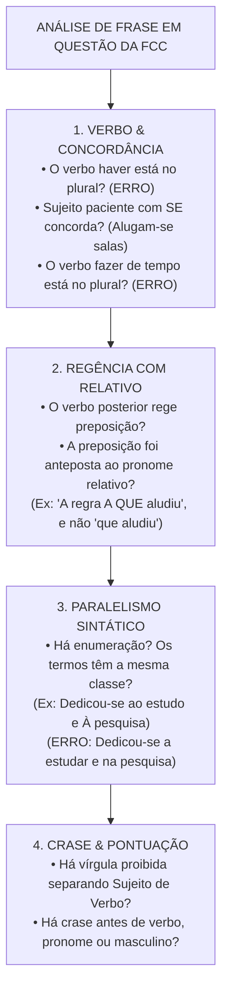
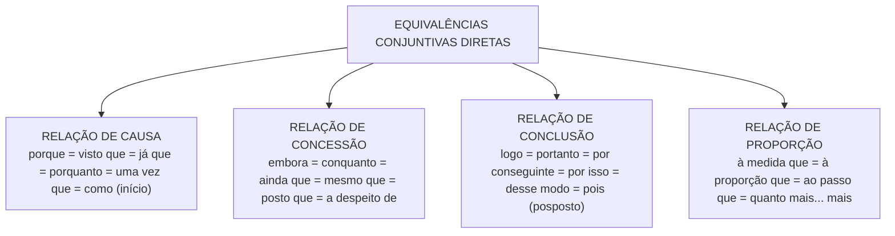

# 06 - Redação: Reescrita, Correção Gramatical e Equivalência de Estruturas

> **Matéria:** Língua Portuguesa  
> **Cargos:** A01 – Técnico de Controle Externo (Adm) / B02 – Técnico de Controle Externo (TI)  
> **Arquivo:** `06_redacao_reescrita_e_equivalencia_de_estruturas.md`  
> **Referência Temática:** Confronto de Frases, Paralelismo Sintático, Paráfrase e Reorganização Textual na FCC

---

## 📌 Ementa / Itens do Edital
- Redação: confronto e reconhecimento de frases corretas e incorretas segundo a norma culta;
- Organização e reorganização de orações e períodos: ordem direta vs. inversões estilísticas e impacto na clareza;
- Equivalência e transformação de estruturas: paráfrase sintática com preservação rigorosa do sentido original;
- Paralelismo sintático e semântico em enumerações e estruturas correlatas (*não só... mas também*, *tanto... quanto*);
- Ambiguidade estrutural e lexical: causas e métodos de saneamento sintático;
- Transposição entre orações desenvolvidas e orações reduzidas (infinitivo, gerúndio e particípio);
- Mecanismos de nominalização e concisão textual;
- Emprego correto das quatro formas dos porquês (*por que*, *por quê*, *porque* e *porquê*).

---

## 🧭 Sumário

1. [Confronto e Julgamento de Frases: O Checklist Caça-Erros da FCC](#1-confronto-e-julgamento-de-frases-o-checklist-caca-erros-da-fcc)
    1. [Estratégia de Varredura e Identificação de Vícios Gramaticais](#11-estrategia-de-varredura-e-identificacao-de-vicios-gramaticais)
    2. [Vícios Recorrentes em Provas de Tribunais](#12-vicios-recorrentes-em-provas-de-tribunais)
    3. [Pronomes Retos Usados Indevidamente como Objetos](#13-pronomes-retos-usados-indevidamente-como-objetos)
    4. [Teste 052](#Teste-052)
2. [Paralelismo Sintático e Semântico](#2-paralelismo-sintatico-e-semantico)
    1. [Princípio da Simetria Estrutural em Termos Coordenados](#21-principio-da-simetria-estrutural-em-termos-coordenados)
    2. [Paralelismo em Estruturas Correlativas](#22-paralelismo-em-estruturas-correlativas)
    3. [Casos Típicos de Quebra de Paralelismo e Métodos de Correção](#23-casos-tipicos-de-quebra-de-paralelismo-e-metodos-de-correcao)
    4. [Teste 053](#Teste-053)
    5. [Teste 054](#Teste-054)
3. [Ambiguidade e Vícios de Construção Frasal](#3-ambiguidade-e-vicios-de-construcao-frasal)
    1. [Ambiguidade Estrutural vs. Ambiguidade Lexical](#31-ambiguidade-estrutural-vs-ambiguidade-lexical)
    2. [Ambiguidade pelo Mau Emprego de Pronomes Possessivos (Seu/Sua)](#32-ambiguidade-pelo-mau-emprego-de-pronomes-possessivos-seusua)
    3. [O Mau Posicionamento de Adjuntos Adverbiais e Orações Reduzidas](#33-o-mau-posicionamento-de-adjuntos-adverbiais-e-oracoes-reduzidas)
    4. [O Emprego Vicioso do Vocábulo O Mesmo](#34-o-emprego-vicioso-do-vocabulo-o-mesmo)
    5. [Teste 055](#Teste-055)
    6. [Teste 056](#Teste-056)
4. [Organização e Reorganização de Orações e Períodos](#4-organizacao-e-reorganizacao-de-oracoes-e-periodos)
    1. [Ordem Direta e os Efeitos Comunicativos das Inversões](#41-ordem-direta-e-os-efeitos-comunicativos-das-inversoes)
    2. [Posicionamento Estratégico de Termos Intercalados e Pontuação](#42-posicionamento-estrategico-de-termos-intercalados-e-pontuacao)
    3. [Coesão Sequencial e Encadeamento Lógico de Argumentos](#43-coesao-sequencial-e-encadeamento-logico-de-argumentos)
    4. [Teste 057](#Teste-057)
5. [Equivalência, Transformação de Estruturas e Paráfrase](#5-equivalencia-transformacao-de-estruturas-e-parafrase)
    1. [Critérios Cumulativos da Paráfrase Legítima](#51-criterios-cumulativos-da-parafrase-legitima)
    2. [Transposição entre Orações Desenvolvidas e Reduzidas](#52-transposicao-entre-oracoes-desenvolvidas-e-reduzidas)
    3. [Matriz de Substituição e Equivalência de Conectivos](#53-matriz-de-substituicao-e-equivalencia-de-conectivos)
    4. [Mecanismos de Nominalização e Concisão Textual](#54-mecanismos-de-nominalizacao-e-concisao-textual)
    5. [Transposição de Vozes Verbais na Reescrita](#55-transposicao-de-vozes-verbais-na-reescrita)
    6. [Teste 058](#Teste-058)
    7. [Teste 059](#Teste-059)
6. [O Emprego Correto das Quatro Formas dos Porquês](#6-o-emprego-correto-das-quatro-formas-dos-porques)
    1. [Por que: Interrogativo e Relativo](#61-por-que-interrogativo-e-relativo)
    2. [Por quê: Isolado ou Imediatamente Antes de Pontuação](#62-por-que-isolado-ou-imediatamente-antes-de-pontuacao)
    3. [Porque: Conjunção Causal ou Explicativa](#63-porque-conjuncao-causal-ou-explicativa)
    4. [Porquê: Substantivo com Artigo ou Determinante](#64-porque-substantivo-com-artigo-ou-determinante)
    5. [Distinções Léxicas Adicionais: A Fim De vs. Afim e Ao Encontro De vs. De Encontro A](#65-distincoes-lexicas-adicionais-a-fim-de-vs-afim-e-ao-encontro-de-vs-de-encontro-a)
    6. [Teste 060](#Teste-060)
    7. [Teste 061](#Teste-061)
7. [🌐 Fontes Oficiais e Referências Bibliográficas](#fontes-oficiais-e-referencias-bibliograficas)

---

## 1. Confronto e Julgamento de Frases: O Checklist Caça-Erros da FCC

As questões de confronto e reconhecimento de frases corretas e incorretas constituem uma das marcas mais temidas e refinadas das provas elaboradas pela Fundação Carlos Chagas. Nelas, o enunciado costuma indagar: *"A frase redigida de modo inteiramente claro, correto e condizente com a norma-padrão é:"* ou *"O período que expressa com correção e concisão as ideias do texto é:"*.

Resolver esse modelo de questão exige do candidato abandonar a leitura intuitiva e aplicar uma **metodologia de varredura sintática por camadas**, inspecionando cada alternativa em busca dos vícios gramaticais recorrentes.

### 1.1 Estratégia de Varredura e Identificação de Vícios Gramaticais

Ao inspecionar uma alternativa de reescrita, examine os quatro pontos cardeais da sintaxe da frase:

1. **Concordância Verbal e Nominal:** Localize os núcleos dos sujeitos e confronte-os com as formas verbais correspondentes, sobretudo diante de inversões sintáticas ou de sujeitos oracionais; examine se verbos impessoais como *haver* e *fazer* foram pluralizados indevidamente.
2. **Regência Verbal associada a Pronomes Relativos:** Verifique se o verbo da oração subordinada adjetiva exige preposição e se essa preposição foi corretamente anteposta ao pronome relativo *que, quem, cujo* ou *o qual*.
3. **Emprego do Sinal Indicativo de Crase:** Cheque se a fusão decorre de preposição exigida e se não há crase antes de palavra masculina, verbo, pronome indefinido ou em expressões simétricas.
4. **Sintaxe de Pontuação e Ordem SVC:** Verifique se não houve a colocação de uma vírgula simples entre o sujeito e o predicado, ou entre o verbo e seus complementos diretos/indiretos.

### 1.2 Vícios Recorrentes em Provas de Tribunais

A FCC utiliza distratores padronizados para construir alternativas incorretas:

* Inserção de preposição indevida após o verbo *implicar* (*"implicará em nulidade"* $\rightarrow$ errado);
* Emprego de locuções comparativas proibidas com o verbo *preferir* (*"prefere trabalhar do que descansar"* $\rightarrow$ errado);
* Confusão entre formas parônimas como *a fim de* (finalidade) e *afim* (parentesco/afinidade), ou *ao encontro de* (concordância) e *de encontro a* (choque/colisão);
* Pluralização viciosa do verbo em construções com partícula indeterminadora do sujeito (*"Tratam-se de processos graves"* $\rightarrow$ errado; deve ser *Trata-se de*).

### 1.3 Pronomes Retos Usados Indevidamente como Objetos

A língua culta formal não admite o uso de pronomes pessoais do caso reto (*ele, ela, eles, elas*) na posição de complemento verbal direto. O pronome reto possui vocação exclusivamente subjetiva (função de sujeito da oração).

> 🚨 **ALERTA DE PROVA / PEGADINHA FCC:** Ao ler uma alternativa da FCC, desconfie sumariamente de sentenças que terminam com construções do tipo: *"A nova lei orçamentária trouxe regras rígidas e o gestor deve cumprir elas"*. Essa frase está eivada de erro gramatical inadmissível na norma culta! A forma exigida é com pronome oblíquo enclítico ajustado à terminação consonantal: *"deve cumpri-las"*.

---

### Teste 052
**(FGV – TJ/RR – 2024 – Analista Judiciario Gestao E Governanca De Tecnologia Da Informacao)**
Uma marca que mostra um traço da língua falada e não da língua escrita, é

* **A)** a predominância de frases complexas.
* **B)** o uso frequente da voz passiva.
* **C)** o uso de interrupções para melhoria da expressão.
* **D)** o apelo a variadas estratégias de produção textual.
* **E)** a continuidade na expressão textual.

---

> **Comentário Detalhado:**
>
> - **A)** **Incorreta.** A opção apresenta proposição em desacordo com os fundamentos teóricos e técnicos do tópico ao afirmar que "a predominância de frases complexas". De acordo com a teoria estudada em *5.3 Matriz de Substituição e Equivalência de Conectivos*, proporcionais equivalentes: *à medida que, à proporção que, ao passo que*. Cuidado: a expressão *"à medida em que"* é considerada híbrida e incorreta pela norma padrão; a forma aceita é *à medida que*.
> - **B)** **Incorreta.** A opção apresenta proposição em desacordo com os fundamentos teóricos e técnicos do tópico ao afirmar que "o uso frequente da voz passiva". De acordo com a teoria estudada em *5.5 Transposição de Vozes Verbais na Reescrita*, a equivalência sintática frequentemente explora a alternância entre voz ativa e passiva analítica ou sintética.
> - **C)** **Correta.** Conforme fundamentado na seção *1.3 Pronomes Retos Usados Indevidamente como Objetos* deste guia, a língua culta formal não admite o uso de pronomes pessoais do caso reto (*ele, ela, eles, elas*) na posição de complemento verbal direto. O pronome reto possui vocação exclusivamente subjetiva (função de sujeito da oração). Dessa forma, está plenamente correta a assertiva da banca (FGV – TJ/RR/2024) ao estabelecer que "o uso de interrupções para melhoria da expressão".
> - **D)** **Incorreta.** A opção apresenta proposição em desacordo com os fundamentos teóricos e técnicos do tópico ao afirmar que "o apelo a variadas estratégias de produção textual". De acordo com a teoria estudada em *3. Ambiguidade e Vícios de Construção Frasal*, a ambiguidade (ou anfibologia) ocorre quando uma frase admite duas ou mais interpretações lógicas distintas em decorrência da má ordenação de suas palavras ou do uso impreciso de termos relacionais.
> - **E)** **Incorreta.** A opção apresenta proposição em desacordo com os fundamentos teóricos e técnicos do tópico ao afirmar que "a continuidade na expressão textual". De acordo com a teoria estudada em *3.4 O Emprego Vicioso do Vocábulo O Mesmo*, o Manual de Redação da Presidência da República e a boa gramática normativa condenam expressamente o uso das formas *o mesmo, a mesma, os mesmos, as mesmas* como pronomes anafóricos para substituir pessoas ou coisas.
>
> **Gabarito: C**

---

## 2. Paralelismo Sintático e Semântico

O paralelismo (ou simetria de construção) é o princípio gramatical e estilístico que determina que elementos coordenados entre si, desempenhando a mesma função sintática no período, devem apresentar **estruturas morfológicas e gramaticais idênticas ou equivalentes**.

### 2.1 Princípio da Simetria Estrutural em Termos Coordenados

Quando se coordenam termos em enumeração (ligados por vírgula ou pela conjunção *e*), todos devem pertencer à mesma classe gramatical ou seguir o mesmo padrão frasal:

* Se o primeiro termo for um substantivo, os seguintes devem ser substantivos (*"Exige-se probidade, competência e lealdade"*);
* Se o primeiro for um verbo no infinitivo, os seguintes devem ser verbos no infinitivo (*"O dever de fiscalizar, orientar e julgar"*);
* Se o primeiro for uma oração desenvolvida introduzida por *que*, os seguintes devem manter a mesma estrutura subordinada (*"Determinou que se revisassem os cálculos e que se notificasse o responsável"*).

### 2.2 Paralelismo em Estruturas Correlativas

Nas estruturas formadas por pares de conectivos correlativos (*não só... mas também*, *não apenas... como também*, *tanto... quanto*, *seja... seja*, *quer... quer*, *ora... ora*), a exigência de simetria é rigorosa: o que vier imediatamente após o primeiro termo correlativo deve ter a mesma natureza sintática do que vier após o segundo polo:

* **Construção Perfeita:** *"O tribunal busca aprimorar os mecanismos de fiscalização **não só para conferir transparência**, **mas também para garantir a legalidade**."* (ambos estruturados por oração subordinada final reduzida de infinitivo: *para conferir* $\leftrightarrow$ *para garantir*).
* **Construção Defeituosa (Quebra de Paralelismo):** *"O tribunal busca aprimorar os mecanismos **não só para conferir transparência**, **mas garantindo a legalidade**."* (misturou oração com preposição + infinitivo com oração reduzida no gerúndio).

### 2.3 Casos Típicos de Quebra de Paralelismo e Métodos de Correção

| Frase com Quebra de Paralelismo (Incorreta) | Causa do Desvio | Frase com Paralelismo Perfeito (Correta) |
| :--- | :--- | :--- |
| *"A equipe dedicou-se **a examinar** os contratos e **na verificação** das certidões."* | Misturou verbo no infinitivo regido por *a* com substantivo preposicionado em *em*. | *"A equipe dedicou-se **a examinar** os contratos e **a verificar** as certidões."* |
| *"A auditoria constatou **o desvio** de verbas e **que faltavam** documentos."* | Coordenou um substantivo simples (*o desvio*) com uma oração desenvolvida (*que faltavam*). | *"A auditoria constatou **o desvio** de verbas e **a falta** de documentos."* |
| *"O tribunal tem como atribuição **fiscalizar** as contas e **a emissão** de pareceres."* | Coordenou forma verbal no infinitivo (*fiscalizar*) com substantivo abstrato (*a emissão*). | *"O tribunal tem como atribuição **fiscalizar** as contas e **emitir** pareceres."* |
| *"A comissão propôs **a revisão** das medições e **que se fizesse** nova perícia."* | Coordenou frase nominal com oração subordinada substantiva. | *"A comissão propôs **a revisão** das medições e **a realização** de nova perícia."* |

---

### Teste 053
**(FCC – TRT 1ª – 2014 – Analista Judiciário - Tecnologia da Informação)**
Deseja-se que uma página criada a partir da linguagem HTML, apresente o seguinte texto e figura: Casa térrea em terreno de 500 m2, 180 m2 de área construída, com 3 quartos (1 suíte), banheiro, salas para 3 ambientes, lavabo, copa-cozinha, área de serviço, quintal e vaga para 3 carros. Para tanto, elaborou-se o seguinte programa: <html> <body> comando x 
Casa térrea em terreno de 500 m2, 180 m2 de área construída, com 3 quartos (1 suite), banheiro, salas para 3 ambientes, lavabo, copa-cozinha, área de serviço, quintal e vaga para 3 carros.
 </body> </html> Supondo que a imagem da casa se encontre no arquivo casa123.jpg, um comando que poderia ser colocado no lugar do comando x, para apresentar o resultado desejado é:

* **A)** <input type="button" text="Nova Página" click="window.location='P1.html'">
* **B)** <input type="button" text="Nova Página" onclick="window.location='P1.html'">
* **C)** <input type="onbutton" text="Nova Página" onclick="window.location='P1.html'">
* **D)** <input type="button" value="Nova Página" onclick="window.location='P1.html'">
* **E)** <input type="onbutton" value="Nova Página" click="window.location='P1.html'">

---

> **Comentário Detalhado:**
>
> - **A)** **Incorreta.** A opção apresenta proposição em desacordo com os fundamentos teóricos e técnicos do tópico ao afirmar que "<input type="button" text="Nova Página" click="window.location='P1.html'">". De acordo com a teoria estudada em *1.3 Pronomes Retos Usados Indevidamente como Objetos*, ao ler uma alternativa da FCC, desconfie sumariamente de sentenças que terminam com construções do tipo: *"A nova lei orçamentária trouxe regras rígidas e o gestor deve cumprir elas"*.
> - **B)** **Correta.** Conforme fundamentado na seção *2.3 Casos Típicos de Quebra de Paralelismo e Métodos de Correção* deste guia, *"A comissão propôs a revisão das medições e que se fizesse nova perícia."*: Coordenou frase nominal com oração subordinada substantiva. — *"A comissão propôs a revisão das medições e a realização de nova perícia."*. Dessa forma, está plenamente correta a assertiva da banca (FCC – TRT 1ª/2014) ao estabelecer que "<input type="button" text="Nova Página" onclick="window.location='P1.html'">".
> - **C)** **Incorreta.** A opção apresenta proposição em desacordo com os fundamentos teóricos e técnicos do tópico ao afirmar que "<input type="onbutton" text="Nova Página" onclick="window.location='P1.html'">". De acordo com a teoria estudada em *2. Paralelismo Sintático e Semântico*, o paralelismo (ou simetria de construção) é o princípio gramatical e estilístico que determina que elementos coordenados entre si, desempenhando a mesma função sintática no período, devem apresentar estruturas morfológicas e gramaticais idênticas ou equivalentes.
> - **D)** **Incorreta.** A opção apresenta proposição em desacordo com os fundamentos teóricos e técnicos do tópico ao afirmar que "<input type="button" value="Nova Página" onclick="window.location='P1.html'">". De acordo com a teoria estudada em *2.2 Paralelismo em Estruturas Correlativas*, nas estruturas formadas por pares de conectivos correlativos (*não só... mas também*, *não apenas... como também*, *tanto... quanto*, *seja... seja*, *quer... quer*, *ora... ora*), a exigência de simetria é rigorosa: o que vier imediatamente após o primeiro termo correlativo deve ter a mesma natureza sintática do que vier após o segundo polo.
> - **E)** **Incorreta.** A opção apresenta proposição em desacordo com os fundamentos teóricos e técnicos do tópico ao afirmar que "<input type="onbutton" value="Nova Página" click="window.location='P1.html'">". De acordo com a teoria estudada em *2.1 Princípio da Simetria Estrutural em Termos Coordenados*, se o primeiro termo for um substantivo, os seguintes devem ser substantivos (*"Exige-se probidade, competência e lealdade"*).
>
> **Gabarito: B**

---

### Teste 054
**(CEBRASPE – TJ/DFT – 2015 – Analista Judiciario Suporte Em Tecnologia Da Informacao)**
O direito é um produto histórico que resulta de constante luta de uma coletividade ou de um indivíduo. o início do período — escrevendo-se Se define — prejudicaria a correção gramatical do texto.

* **C)** Certo
* **E)** Errado

---

> **Comentário Detalhado:**
>
> - **C)** **Correta.** O item está **Certo**. Conforme fundamentado na seção *1. Confronto e Julgamento de Frases: O Checklist Caça-Erros da FCC* deste guia, nelas, o enunciado costuma indagar: *"A frase redigida de modo inteiramente claro, correto e condizente com a norma-padrão é:"* ou *"O período que expressa com correção e concisão as ideias do texto é:"*. Dessa forma, está plenamente correta a proposição da banca (CEBRASPE – TJ/DFT/2015) ao afirmar que "O direito é um produto histórico que resulta de constante luta de uma coletividade ou de um indivíduo. o...".
> - **E)** **Incorreta.** A marcação como **Errado** não procede, visto que a assertiva guarda integral conformidade com a teoria estudada em *3.1 Ambiguidade Estrutural vs. Ambiguidade Lexical*, segundo a qual ambiguidade Estrutural: Resulta do mau posicionamento sintático de adjuntos, orações ou pronomes no interior do período, gerando dúvida sobre qual elemento está sendo modificado.
>
> **Gabarito: C**

---

## 3. Ambiguidade e Vícios de Construção Frasal

A ambiguidade (ou anfibologia) ocorre quando uma frase admite duas ou mais interpretações lógicas distintas em decorrência da má ordenação de suas palavras ou do uso impreciso de termos relacionais.

### 3.1 Ambiguidade Estrutural vs. Ambiguidade Lexical

* **Ambiguidade Lexical:** Decorre do emprego de palavra polissêmica ou homônima em contexto que não esclarece qual de seus sentidos está operando (*"O servidor falou do banco no plenário"* $\rightarrow$ banco financeiro ou assento de sentar?).
* **Ambiguidade Estrutural:** Resulta do mau posicionamento sintático de adjuntos, orações ou pronomes no interior do período, gerando dúvida sobre qual elemento está sendo modificado.

### 3.2 Ambiguidade pelo Mau Emprego de Pronomes Possessivos (Seu/Sua)

No português moderno, os pronomes possessivos de terceira pessoa (*seu, sua, seus, suas*) podem referir-se tanto à pessoa de quem se fala (ele/ela) quanto à pessoa com quem se fala (você / o interlocutor), ou gerar dúvida entre dois sujeitos de terceira pessoa já mencionados:

* *"O presidente comunicou ao conselheiro que sua assessoria seria transferida."*
    * Ambiguidade: a assessoria a ser transferida pertencia ao Presidente ou ao Conselheiro?
* **Método de Saneamento Técnico:** Substitui-se o pronome ambíguo pelas locuções possessivas inequívocas **dele / dela / de você / de Vossa Excelência**:
    * *"O presidente comunicou ao conselheiro a transferência da assessoria **dele** [do conselheiro] para o novo gabinete."*
    * *"O presidente comunicou ao conselheiro que a assessoria **deste** seria transferida."*

### 3.3 O Mau Posicionamento de Adjuntos Adverbiais e Orações Reduzidas

O deslocamento impróprio de adjuntos circunstanciais pode fazê-los incidir sobre orações que não lhes correspondem:

* *"O auditor disse que realizaria a vistoria calmamente."* (O auditor falou com calma ou a vistoria é que seria executada com calma?).
* Saneamento: antecipar o advérbio para junto do verbo que se deseja qualificar: *"O auditor disse calmamente que realizaria a vistoria"* OU *"O auditor disse que, calmamente, realizaria a vistoria"*.

### 3.4 O Emprego Vicioso do Vocábulo O Mesmo

O Manual de Redação da Presidência da República e a boa gramática normativa condenam expressamente o uso das formas *o mesmo, a mesma, os mesmos, as mesmas* como pronomes anafóricos para substituir pessoas ou coisas:

* *"O presidente assinou o parecer e encaminhou o mesmo ao plenário"* $\rightarrow$ **Vício de linguagem**.
* **Forma escorreita:** Deve-se substituir por pronome oblíquo (*"encaminhou-o ao plenário"*), por pronome demonstrativo (*"encaminhou este ao plenário"*) ou por elipse pura (*"assinou o parecer e encaminhou ao plenário"*).

---

### Teste 055
**(FGV – TJ/BA – 2015 – Analista Judiciario Tecnologia Da Informacao)**
“tanto os homens quanto os animais”; “todos os que saíam da trilha ou tropeçavam em algo”. Nesses dois segmentos do texto 4, os conectores tanto/quanto e ou indicam, respectivamente:

* **A)** comparação e alternância;
* **B)** semelhança e alternância;
* **C)** adição e adição;
* **D)** comparação e adição;
* **E)** adição e alternância.

---

> **Comentário Detalhado:**
>
> - **A)** **Incorreta.** A opção apresenta proposição em desacordo com os fundamentos teóricos e técnicos do tópico ao afirmar que "comparação e alternância". De acordo com a teoria estudada em *5.5 Transposição de Vozes Verbais na Reescrita*, a equivalência sintática frequentemente explora a alternância entre voz ativa e passiva analítica ou sintética.
> - **B)** **Incorreta.** A opção apresenta proposição em desacordo com os fundamentos teóricos e técnicos do tópico ao afirmar que "semelhança e alternância". De acordo com a teoria estudada em *6.5 Distinções Léxicas Adicionais: A Fim De vs. Afim e Ao Encontro De vs. De Encontro A*, afim (junto): adjetivo que expressa parentesco, semelhança ou afinidade de interesses: *"Possuíam ideias afins sobre auditoria"*; *"Parentes afins"*.
> - **C)** **Correta.** Conforme fundamentado na seção *3.2 Ambiguidade pelo Mau Emprego de Pronomes Possessivos (Seu/Sua)* deste guia, no português moderno, os pronomes possessivos de terceira pessoa (*seu, sua, seus, suas*) podem referir-se tanto à pessoa de quem se fala (ele/ela) quanto à pessoa com quem se fala (você / o interlocutor), ou gerar dúvida entre dois sujeitos de terceira pessoa já mencionados. Dessa forma, está plenamente correta a assertiva da banca (FGV – TJ/BA/2015) ao estabelecer que "adição e adição".
> - **D)** **Incorreta.** A opção apresenta proposição em desacordo com os fundamentos teóricos e técnicos do tópico ao afirmar que "comparação e adição". De acordo com a teoria estudada em *2.2 Paralelismo em Estruturas Correlativas*, nas estruturas formadas por pares de conectivos correlativos (*não só... mas também*, *não apenas... como também*, *tanto... quanto*, *seja... seja*, *quer... quer*, *ora... ora*), a exigência de simetria é rigorosa: o que vier imediatamente após o primeiro termo correlativo deve ter a mesma natureza sintática do que vier após o segundo polo.
> - **E)** **Incorreta.** A opção apresenta proposição em desacordo com os fundamentos teóricos e técnicos do tópico ao afirmar que "adição e alternância". De acordo com a teoria estudada em *1. Confronto e Julgamento de Frases: O Checklist Caça-Erros da FCC*, nelas, o enunciado costuma indagar: *"A frase redigida de modo inteiramente claro, correto e condizente com a norma-padrão é:"* ou *"O período que expressa com correção e concisão as ideias do texto é:"*.
>
> **Gabarito: C**

---

### Teste 056
**(FGV – TCE/GO – 2024 – Analista de Controle Externo - Engenharia)**
Orçamento de uma obra compõe-se pela identificação, descrição, quantificação e valoração da mão de obra, equipamentos e materiais utilizados na obra, custos financeiros, impostos, riscos e margem de lucro desejada, para a adequada previsão do preço final. A elaboração do orçamento requer o conhecimento de conceitos, que são fundamentais para a utilização das referências dos Sistemas de Custo disponíveis. Associe os conceitos listados a seguir com as respectivas descrições: 1. Bonificação 2. Despesa Fixa 3. Despesa Variável 4. Custo Indireto 5. Custo Direto ( ) Mobilização e desmobilização; ( ) Tributação sobre faturamento; ( ) Manutenção da sede da empresa; ( ) Materiais usados na obra; ( ) Remuneração da empresa pelo desenvolvimento de sua atividade econômica A sequência correta da numeração, na ordem apresentada é

* **A)** 5 – 1 – 4 – 3 – 2.
* **B)** 4 – 3 – 2 – 5 – 1.
* **C)** 3 – 4 – 2 – 5 – 1.
* **D)** 3 – 4 – 1 – 5 – 2.
* **E)** 5 – 3 – 2 – 4 – 1.

---

> **Comentário Detalhado:**
>
> - **A)** **Incorreta.** A opção apresenta proposição em desacordo com os fundamentos teóricos e técnicos do tópico ao afirmar que "5 – 1 – 4 – 3 – 2". De acordo com a teoria estudada em *1.1 Estratégia de Varredura e Identificação de Vícios Gramaticais*, sintaxe de Pontuação e Ordem SVC: Verifique se não houve a colocação de uma vírgula simples entre o sujeito e o predicado, ou entre o verbo e seus complementos diretos/indiretos.
> - **B)** **Correta.** Conforme fundamentado na seção *1.3 Pronomes Retos Usados Indevidamente como Objetos* deste guia, a língua culta formal não admite o uso de pronomes pessoais do caso reto (*ele, ela, eles, elas*) na posição de complemento verbal direto. O pronome reto possui vocação exclusivamente subjetiva (função de sujeito da oração). Dessa forma, está plenamente correta a assertiva da banca (FGV – TCE/GO/2024) ao estabelecer que "4 – 3 – 2 – 5 – 1".
> - **C)** **Incorreta.** A opção apresenta proposição em desacordo com os fundamentos teóricos e técnicos do tópico ao afirmar que "3 – 4 – 2 – 5 – 1". De acordo com a teoria estudada em *6.5 Distinções Léxicas Adicionais: A Fim De vs. Afim e Ao Encontro De vs. De Encontro A*, de encontro a: indica colisão, choque, oposição, contrariedade: *"O reajuste salarial sem previsão orçamentária vai de encontro às determinações da LRF"*.
> - **D)** **Incorreta.** A opção apresenta proposição em desacordo com os fundamentos teóricos e técnicos do tópico ao afirmar que "3 – 4 – 1 – 5 – 2". De acordo com a teoria estudada em *5.2 Transposição entre Orações Desenvolvidas e Reduzidas*, desenvolvida Concessiva: *"Embora o conselheiro conhecesse os riscos da decisão, manteve seu voto."*.
> - **E)** **Incorreta.** A opção apresenta proposição em desacordo com os fundamentos teóricos e técnicos do tópico ao afirmar que "5 – 3 – 2 – 4 – 1". De acordo com a teoria estudada em *5.2 Transposição entre Orações Desenvolvidas e Reduzidas*, reduzida de Infinitivo: *"Apesar de conhecer os riscos da decisão, o conselheiro manteve seu voto."*.
>
> **Gabarito: B**

---

## 4. Organização e Reorganização de Orações e Períodos

A estruturação eficiente de um texto formal exige domínio sobre a arquitetura da frase, equilibrando clareza semântica, expressividade e conformidade às regras de pontuação.

### 4.1 Ordem Direta e os Efeitos Comunicativos das Inversões

A ordem direta canônica da oração na língua portuguesa é constituída por:
$$\mathbf{Sujeito} \longrightarrow \mathbf{Verbo} \longrightarrow \mathbf{Complementos \ (OD/OI)} \longrightarrow \mathbf{Adjuntos \ Adverbiais}$$

Embora a ordem direta seja a mais límpida e recomendada para redações oficiais e relatórios de auditoria, a língua admite inversões estilísticas ou enfáticas (ordem inversa):

* Ordem Direta: *"A equipe técnica de fiscalização constatou irregularidades graves nas contas da prefeitura durante a inspeção matutina."*
* Ordem Inversa com Adjunto Deslocado: *"Durante a inspeção matutina, nas contas da prefeitura, a equipe técnica de fiscalização constatou irregularidades graves."*

O perigo da inversão consiste na possibilidade de truncar o raciocínio ou gerar quebra indevida de termos essenciais com vírgulas solitárias.

### 4.2 Posicionamento Estratégico de Termos Intercalados e Pontuação

Termos intercalados (apóstrofos explicativos, orações adjetivas explicativas, conjunções conclusivas deslocadas e adjuntos adverbiais) devem vir sempre isolados por pontuação simétrica (**duas vírgulas, dois travessões ou parênteses**), garantindo que a linha sintática principal do período não seja rompida.

### 4.3 Coesão Sequencial e Encadeamento Lógico de Argumentos

A reorganização de um período não pode corromper a progressão tópica. Os conectivos oracionais e pronomes de retomada devem orientar o leitor ao longo da cadeia de causas e consequências:

* Preservar os operadores argumentativos que introduzem argumentos mais fortes (*mas, inclusive, até mesmo*);
* Evitar parágrafos construídos por acúmulo excessivo de orações adjetivas encaixadas em cadeia (*que... que... que...* — vício do "queísmo"), saneando-as por meio de nominalizações ou transformações em orações reduzidas.

---

### Teste 057
**(FGV – TCE/SC – 2026 – Auditor Fiscal de Controle Externo - Economia)**
Considere as seguintes afirmativas Em relação à análise de risco de mercado, avalie cada afirmativa a seguir e assinale (V), se for verdadeira, e (F), se for falsa. ( ) O Valor em Risco (VaR) estima um limite potencial de perda de uma carteira, para dado horizonte de tempo e nível de confiança, em condições normais de mercado.. ( ) Os testes de estresse são úteis para avaliar perdas potenciais em situações extremas, inclusive fora do padrão histórico usual, complementando as limitações do VaR. ( ) A análise de cenários difere do teste de estresse porque se restringe a pequenas variações em fatores de risco, não contemplando choques severos e combinados. As afirmativas são, respectivamente,

* **A)** F – F – V.
* **B)** F – V – F.
* **C)** F – V – V.
* **D)** V – F – F.
* **E)** V – V – F.

---

> **Comentário Detalhado:**
>
> - **A)** **Incorreta.** A opção apresenta proposição em desacordo com os fundamentos teóricos e técnicos do tópico ao afirmar que "F – F – V". De acordo com a teoria estudada em *6.4 Porquê: Substantivo com Artigo ou Determinante*, apresenta-se compulsoriamente antecedido por um artigo definido (*o porquê*), pronome demonstrativo (*este porquê*), pronome possessivo (*seu porquê*) ou numeral (*dois porquês*), admitindo inclusive flexão de plural (*os porquês*).
> - **B)** **Incorreta.** A opção apresenta proposição em desacordo com os fundamentos teóricos e técnicos do tópico ao afirmar que "F – V – F". De acordo com a teoria estudada em *4.3 Coesão Sequencial e Encadeamento Lógico de Argumentos*, preservar os operadores argumentativos que introduzem argumentos mais fortes (*mas, inclusive, até mesmo*).
> - **C)** **Correta.** Conforme fundamentado na seção *6.3 Porque: Conjunção Causal ou Explicativa* deste guia, a grafia junta e sem acento corresponde a uma conjunção subordinativa causal ou conjunção coordenativa explicativa, equivalendo a *pois, já que, visto que, porquanto, dado que*. Dessa forma, está plenamente correta a assertiva da banca (FGV – TCE/SC/2026) ao estabelecer que "F – V – V".
> - **D)** **Incorreta.** A opção apresenta proposição em desacordo com os fundamentos teóricos e técnicos do tópico ao afirmar que "V – F – F". De acordo com a teoria estudada em *1. Confronto e Julgamento de Frases: O Checklist Caça-Erros da FCC*, nelas, o enunciado costuma indagar: *"A frase redigida de modo inteiramente claro, correto e condizente com a norma-padrão é:"* ou *"O período que expressa com correção e concisão as ideias do texto é:"*.
> - **E)** **Incorreta.** A opção apresenta proposição em desacordo com os fundamentos teóricos e técnicos do tópico ao afirmar que "V – V – F". De acordo com a teoria estudada em *2.1 Princípio da Simetria Estrutural em Termos Coordenados*, quando se coordenam termos em enumeração (ligados por vírgula ou pela conjunção *e*), todos devem pertencer à mesma classe gramatical ou seguir o mesmo padrão frasal.
>
> **Gabarito: C**

---

## 5. Equivalência, Transformação de Estruturas e Paráfrase

A paráfrase é a reescrita de um texto ou segmento mantendo com fidelidade absoluta o sentido e as relações lógicas da mensagem original, expressando-a por meio de novos recursos vocabulares e sintáticos.

### 5.1 Critérios Cumulativos da Paráfrase Legítima

Para ser declarada correta nas provas da FCC, a reescrita proposta deve atender a dois requisitos inegociáveis:

1. **Fidelidade Semântica e Intencional:** Não pode introduzir juízos inexistentes (extrapolação), nem suprimir circunstâncias essenciais (redução), nem inverter vínculos de causa e efeito (contradição);
2. **Correção Gramatical Absoluta:** Deve respeitar integralmente todas as normas de concordância, regência, crase, colocação e pontuação.

### 5.2 Transposição entre Orações Desenvolvidas e Reduzidas

Uma das técnicas prediletas de transformação de períodos na banca FCC é a conversão entre orações desenvolvidas (que possuem conjunção subordinativa e verbo em modo finito) e orações reduzidas (desprovidas de conjunção e estruturadas com verbo no infinitivo, gerúndio ou particípio):

1. **De Oração Desenvolvida para Reduzida:**
    * Desenvolvida Concessiva: *"Embora o conselheiro conhecesse os riscos da decisão, manteve seu voto."*
    * Reduzida de Infinitivo: *"**Apesar de conhecer** os riscos da decisão, o conselheiro manteve seu voto."*

2. **De Oração Reduzida para Desenvolvida:**
    * Reduzida Temporal: *"**Ao constatar** a fraude, o auditor lavrou o auto de infração."*
    * Desenvolvida Temporal: *"**Quando constatou** a fraude, o auditor lavrou o auto de infração."*

3. **De Oração Nominal para Oração Subordinada:**
    * *"**A despeito das advertências** emitidas pelo órgão, mantiveram as práticas."*
    * $\rightarrow$ *"**Embora o órgão tenha emitido** advertências, mantiveram as práticas."*

### 5.3 Matriz de Substituição e Equivalência de Conectivos

A substituição de conectivos somente é legítima se pertencerem à mesma família semântica:

* **Causais equivalentes:** *porque, visto que, já que, uma vez que, porquanto, como* (anteposto);
* **Concessivos equivalentes:** *embora, conquanto, ainda que, mesmo que, a despeito de, posto que, se bem que*;
* **Conclusivos equivalentes:** *logo, portanto, por conseguinte, por isso, de modo que, pois* (posposto ao verbo e entre vírgulas);
* **Proporcionais equivalentes:** *à medida que, à proporção que, ao passo que*. Cuidado: a expressão *"à medida em que"* é considerada híbrida e incorreta pela norma padrão; a forma aceita é *à medida que*.

### 5.4 Mecanismos de Nominalização e Concisão Textual

A nominalização consiste em converter uma oração verbal em um sintagma nominal construído em torno de um substantivo abstrato cognato:

* Oração Verbal: *"Quando os diretores **compareceram** ao tribunal e **apresentaram** a defesa..."*
* Sintagma Nominalizado: *"Com o **comparecimento** dos diretores ao tribunal e a **apresentação** da defesa..."*
* Efeito: ganha-se concisão, densidade conceitual e formalidade, características valorizadas pela FCC em relatórios técnicos.

### 5.5 Transposição de Vozes Verbais na Reescrita

A equivalência sintática frequentemente explora a alternância entre voz ativa e passiva analítica ou sintética:

* Ativa: *"Os auditores de controle externo apuraram todas as inconsistências no cronograma."*
* Passiva Analítica: *"Todas as inconsistências no cronograma foram apuradas pelos auditores de controle externo."*
* Passiva Sintética: *"Apuraram-se todas as inconsistências no cronograma."*
* Todas as três formulações são semanticamente equivalentes e mantêm rigorosa correção.

---

### Teste 058
**(CEBRASPE – STJ – 2015 – Analista Judiciario Suporte Em Tecnologia Da Informacao)**
Na linha 12, a vírgula que se segue ao vocábulo “Talionis” representa a elipse da forma verbal “significando”.

* **C)** Certo
* **E)** Errado

---

> **Comentário Detalhado:**
>
> - **C)** **Incorreta.** A marcação como **Certo** não procede, pois o enunciado apresenta proposição em desacordo com os fundamentos teóricos e técnicos do tópico ao afirmar que "Na linha 12, a vírgula que se segue ao vocábulo “Talionis” representa a elipse da forma verbal “significando”". De acordo com a teoria estudada em *2.3 Casos Típicos de Quebra de Paralelismo e Métodos de Correção*, *"O tribunal tem como atribuição fiscalizar as contas e a emissão de pareceres."*: Coordenou forma verbal no infinitivo (*fiscalizar*) com substantivo abstrato (*a emissão*). — *"O tribunal tem como atribuição fiscalizar as contas e emitir pareceres."*.
> - **E)** **Correta.** O item está **Errado** (gabarito oficial: **E**). Conforme fundamentado na seção *3.4 O Emprego Vicioso do Vocábulo O Mesmo* deste guia, forma escorreita: Deve-se substituir por pronome oblíquo (*"encaminhou-o ao plenário"*), por pronome demonstrativo (*"encaminhou este ao plenário"*) ou por elipse pura (*"assinou o parecer e encaminhou ao plenário"*). Portanto, a assertiva examinada pela banca (CEBRASPE – STJ/2015) viola os preceitos técnicos do tópico.
>
> **Gabarito: E**

---

### Teste 059
**(CEBRASPE – STF – 2008 – Analista Judiciario Suporte Em Tecnologia Da Informacao)**
Em tempos de globalização, as disputas esportivas, sobretudo aquelas que envolvem as modalidades de maior apelo popular, também se subordinam aos mecanismos da economia de mercado, o que implica altos investimentos, grandes estruturas e possibilidades de lucros expressivos. A figura acima ilustra uma janela do Windows XP, denominada Atividades, que contém uma pasta e dois arquivos. Com relação a essa figura e ao Windows XP, julgue os itens a seguir.

* **C)** Certo
* **E)** Errado

---

> **Comentário Detalhado:**
>
> - **C)** **Correta.** O item está **Certo**. Conforme fundamentado na seção *2.2 Paralelismo em Estruturas Correlativas* deste guia, construção Perfeita: *"O tribunal busca aprimorar os mecanismos de fiscalização não só para conferir transparência, mas também para garantir a legalidade."* (ambos estruturados por oração subordinada final reduzida de infinitivo: *para conferir* $\leftrightarrow$ *para garantir*). Dessa forma, está plenamente correta a proposição da banca (CEBRASPE – STF/2008) ao afirmar que "Em tempos de globalização, as disputas esportivas, sobretudo aquelas que envolvem as modalidades de maior...".
> - **E)** **Incorreta.** A marcação como **Errado** não procede, visto que a assertiva guarda integral conformidade com a teoria estudada em *2.2 Paralelismo em Estruturas Correlativas*, segundo a qual construção Defeituosa (Quebra de Paralelismo): *"O tribunal busca aprimorar os mecanismos não só para conferir transparência, mas garantindo a legalidade."* (misturou oração com preposição + infinitivo com oração reduzida no gerúndio).
>
> **Gabarito: C**

---

## 6. O Emprego Correto das Quatro Formas dos Porquês

A distinção ortográfica e sintática entre as quatro formas da grafia dos porquês decorre do papel morfológico exercido pela palavra na frase.

### 6.1 Por que: Interrogativo e Relativo

A grafia **separada e sem acento** ocorre em três contextos bem delimitados:

1. **Em frases interrogativas diretas ou indiretas:** atua como locução prepositiva interrogativa (= *por qual razão*, *por qual motivo*):
    * *"**Por que** o cronograma físico-financeiro sofreu sucessivas prorrogações?"* (pergunta direta).
    * *"Gostaria de compreender **por que** o cronograma sofreu atrasos."* (pergunta indireta).

2. **Equivalendo ao pronome relativo "pelo qual / pela qual / pelos quais / pelas quais":** liga duas orações associando a preposição *por* ao pronome relativo *que*:
    * *"Os motivos **por que** [pelos quais] o contrato foi rescindido são graves."*
    * *"As causas **por que** lutamos são nobres."*

3. **Equivalendo a "por qual razão" diante de substantivos elípticos:**
    * *"Não compreendo **por que** tanta relutância."* (= por qual razão).

### 6.2 Por quê: Isolado ou Imediatamente Antes de Pontuação

A grafia **separada e com acento circunflexo** é utilizada sempre que a palavra se posicionar **imediatamente antes de um sinal de pontuação** (ponto final, ponto de interrogação, ponto de exclamação ou reticências) ou surgir de forma isolada na oração. Nessa posição de final de frase, o monossílabo *que* sofre tonicidade fonética e atrai o acento gráfico:

* *"O ordenador de despesas não apresentou recurso no prazo regulamentar, e ninguém sabe **por quê**."*
* *"Eles rejeitaram a proposta sem explicar **por quê**?"*
* *"Você não compareceu à convocação do plenário. **Por quê**?"*

### 6.3 Porque: Conjunção Causal ou Explicativa

A grafia **junta e sem acento** corresponde a uma **conjunção subordinativa causal** ou **conjunção coordenativa explicativa**, equivalendo a *pois, já que, visto que, porquanto, dado que*:

* *"A prestação de contas foi reprovada **porque** [pois / visto que] os gastos não foram devidamente comprovados."*
* *"Não atrase a entrega dos relatórios, **porque** [pois] a pauta do plenário já está fechada."*

### 6.4 Porquê: Substantivo com Artigo ou Determinante

A grafia **junta e com acento circunflexo** consubstancia um **substantivo masculino**, sinônimo exato de *"o motivo", "a razão", "o fundamento"*. Apresenta-se compulsoriamente antecedido por um artigo definido (*o porquê*), pronome demonstrativo (*este porquê*), pronome possessivo (*seu porquê*) ou numeral (*dois porquês*), admitindo inclusive flexão de plural (*os porquês*):

* *"O conselheiro relator desvendou **o porquê** de tantas notas fiscais emitidas sem atesto de entrega."*
* *"Gostaria de saber **um porquê** plausível para tamanha discrepância orçamentária."*

### 6.5 Distinções Léxicas Adicionais: A Fim De vs. Afim e Ao Encontro De vs. De Encontro A

Para garantir a perfeição no confronto de frases da FCC:

1. **A Fim De vs. Afim:**
    * **A fim de (separado):** locução prepositiva de finalidade (= com o objetivo de, com o propósito de): *"Reuniram-se **a fim de** deliberar sobre as diretrizes"*.
    * **Afim (junto):** adjetivo que expressa parentesco, semelhança ou afinidade de interesses: *"Possuíam ideias **afins** sobre auditoria"*; *"Parentes **afins**"*.

2. **Ao Encontro De vs. De Encontro A:**
    * **Ao encontro de:** indica concordância, harmonia, aproximação favorável: *"A decisão do pleno foi **ao encontro dos** anseios da sociedade"*.
    * **De encontro a:** indica colisão, choque, oposição, contrariedade: *"O reajuste salarial sem previsão orçamentária vai **de encontro às** determinações da LRF"*.

---

### Teste 060
**(FGV – TCE/SC – 2026 – Auditor Fiscal de Controle Externo - Engenharia Civil)**
Em um telhado, as tesouras são vigas de treliça, normalmente triangulares, e que visam suportar a cobertura e sobrecargas do telhado, por meio de um vigamento secundário. Os esforços suportados pelas tesouras são essencialmente de

* **A)** torção e flexão.
* **B)** flexão e extensão.
* **C)** torção e compressão.
* **D)** compressão e flexão.
* **E)** compressão e extensão. Realização

---

> **Comentário Detalhado:**
>
> - **A)** **Incorreta.** A opção apresenta proposição em desacordo com os fundamentos teóricos e técnicos do tópico ao afirmar que "torção e flexão". De acordo com a teoria estudada em *6.4 Porquê: Substantivo com Artigo ou Determinante*, apresenta-se compulsoriamente antecedido por um artigo definido (*o porquê*), pronome demonstrativo (*este porquê*), pronome possessivo (*seu porquê*) ou numeral (*dois porquês*), admitindo inclusive flexão de plural (*os porquês*).
> - **B)** **Incorreta.** A opção apresenta proposição em desacordo com os fundamentos teóricos e técnicos do tópico ao afirmar que "flexão e extensão". De acordo com a teoria estudada em *4.3 Coesão Sequencial e Encadeamento Lógico de Argumentos*, evitar parágrafos construídos por acúmulo excessivo de orações adjetivas encaixadas em cadeia (*que... que... que...* — vício do "queísmo"), saneando-as por meio de nominalizações ou transformações em orações reduzidas.
> - **C)** **Incorreta.** A opção apresenta proposição em desacordo com os fundamentos teóricos e técnicos do tópico ao afirmar que "torção e compressão". De acordo com a teoria estudada em *5. Equivalência, Transformação de Estruturas e Paráfrase*, a paráfrase é a reescrita de um texto ou segmento mantendo com fidelidade absoluta o sentido e as relações lógicas da mensagem original, expressando-a por meio de novos recursos vocabulares e sintáticos.
> - **D)** **Incorreta.** A opção apresenta proposição em desacordo com os fundamentos teóricos e técnicos do tópico ao afirmar que "compressão e flexão". De acordo com a teoria estudada em *6. O Emprego Correto das Quatro Formas dos Porquês*, a distinção ortográfica e sintática entre as quatro formas da grafia dos porquês decorre do papel morfológico exercido pela palavra na frase.
> - **E)** **Correta.** Conforme fundamentado na seção *2.3 Casos Típicos de Quebra de Paralelismo e Métodos de Correção* deste guia, *"A comissão propôs a revisão das medições e que se fizesse nova perícia."*: Coordenou frase nominal com oração subordinada substantiva. — *"A comissão propôs a revisão das medições e a realização de nova perícia."*. Dessa forma, está plenamente correta a assertiva da banca (FGV – TCE/SC/2026) ao estabelecer que "compressão e extensão. Realização".
>
> **Gabarito: E**

---

### Teste 061
**(CEBRASPE – STF – 2008 – Analista Judiciario Suporte Em Tecnologia Da Informacao)**
Infere-se do texto que países ricos, emergentes ou pobres, além de organismos multilaterais e de especialistas em geral, concordam quanto à identificação da causa comum determinante para o quadro de inflação dos alimentos hoje existente no mundo.

* **C)** Certo
* **E)** Errado

---

> **Comentário Detalhado:**
>
> - **C)** **Incorreta.** A marcação como **Certo** não procede, pois o enunciado apresenta proposição em desacordo com os fundamentos teóricos e técnicos do tópico ao afirmar que "Infere-se do texto que países ricos, emergentes ou pobres, além de organismos multilaterais e de...". De acordo com a teoria estudada em *2.3 Casos Típicos de Quebra de Paralelismo e Métodos de Correção*, frase com Quebra de Paralelismo (Incorreta): Causa do Desvio — Frase com Paralelismo Perfeito (Correta).
> - **E)** **Correta.** O item está **Errado** (gabarito oficial: **E**). Conforme fundamentado na seção *2.2 Paralelismo em Estruturas Correlativas* deste guia, nas estruturas formadas por pares de conectivos correlativos (*não só... mas também*, *não apenas... como também*, *tanto... quanto*, *seja... seja*, *quer... quer*, *ora... ora*), a exigência de simetria é rigorosa: o que vier imediatamente após o primeiro termo correlativo deve ter a mesma natureza sintática do que vier após o segundo polo. Portanto, a assertiva examinada pela banca (CEBRASPE – STF/2008) viola os preceitos técnicos do tópico.
>
> **Gabarito: E**

---

