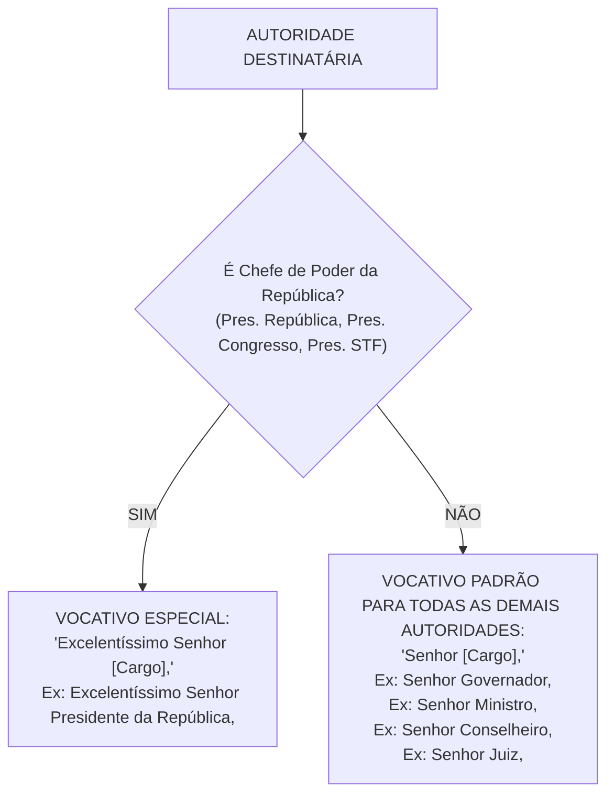
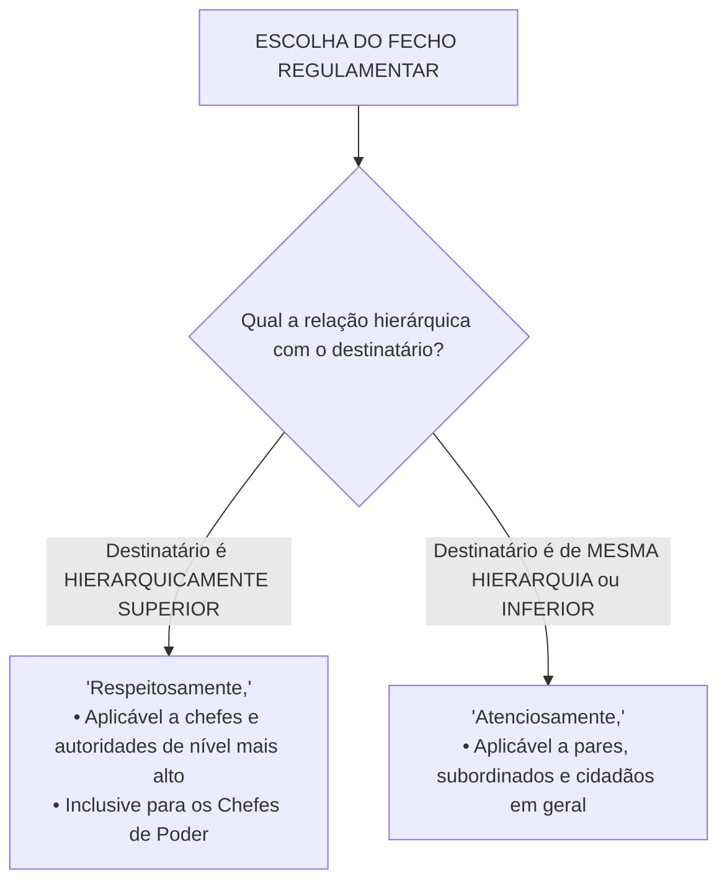

# 07 - Redação Oficial

> **Matéria:** Língua Portuguesa  
> **Cargos:** A01 – Técnico de Controle Externo (Adm) / B02 – Técnico de Controle Externo (TI)  
> **Arquivo:** `07_redacao_oficial.md`  
> **Documento Base:** Manual de Redação da Presidência da República (MRPR - 3ª Edição, revista e atualizada) e Decreto Federal nº 9.758/2019

---

## 📌 Ementa / Itens do Edital
- Redação Oficial: definição, finalidade e fundamentos constitucionais (Art. 37 da CF/88);
- Atributos essenciais da correspondência pública: clareza, precisão, concisão, impessoalidade, formalidade, padronização e uso do padrão culto;
- Pronomes de tratamento: emprego de *Vossa Excelência* vs. *Vossa Senhoria*, regras de concordância verbal, pronominal e de gênero;
- Vocativos regulamentares: distinção entre *"Excelentíssimo Senhor [Cargo],"* (exclusivo para Chefes de Poder) e *"Senhor [Cargo],"* (demais autoridades);
- Abolição de fórmulas laudatórias e arcaísmos (*Digníssimo*, *Ilustríssimo*, etc.);
- O Padrão Ofício unificado na 3ª edição do MRPR (absorção e extinção do Aviso e do Memorando);
- Partes componentes do expediente oficial: cabeçalho, numeração, local e data, endereçamento, assunto, vocativo, texto, fecho e assinatura;
- Fechos regulamentares obrigatórios: *"Respeitosamente,"* (para autoridades superiores) vs. *"Atenciosamente,"* (para mesma hierarquia ou inferior e particulares);
- Correio eletrônico (e-mail institucional) no serviço público e outros atos administrativos (Exposição de Motivos, Mensagem, Parecer e Relatório Técnico).

---

## 🧭 Sumário

1. [Fundamentos Constitucionais e Conceito de Redação Oficial](#1-fundamentos-constitucionais-e-conceito-de-redacao-oficial)
    1. [Definição e Finalidade da Comunicação Pública](#11-definicao-e-finalidade-da-comunicacao-publica)
    2. [Fundamentos Constitucionais: O Artigo 37 da CF/88 e os Princípios da Administração](#12-fundamentos-constitucionais-o-artigo-37-da-cf88-e-os-principios-da-administracao)
    3. [Evolução Normativa: O MRPR 3ª Edição e o Decreto Federal nº 9.758/2019](#13-evolucao-normativa-o-mrpr-3a-edicao-e-o-decreto-federal-no-97582019)
    4. [Teste 062](#Teste-062)
2. [Atributos Fundamentais da Redação Oficial](#2-atributos-fundamentais-da-redacao-oficial)
    1. [Princípio da Impessoalidade e Seus Três Desdobramentos](#21-principio-da-impessoalidade-e-seus-tres-desdobramentos)
    2. [Clareza e Precisão Linguística](#22-clareza-e-precisao-linguistica)
    3. [Concisão Textual e Eliminação da Prolixidade](#23-concisao-textual-e-eliminacao-da-prolixidade)
    4. [Formalidade, Padronização e Tipografia](#24-formalidade-padronizacao-e-tipografia)
    5. [O Uso do Padrão Culto da Língua](#25-o-uso-do-padrao-culto-da-lingua)
    6. [Teste 063](#Teste-063)
    7. [Teste 064](#Teste-064)
3. [Pronomes de Tratamento, Vocativos e Endereçamento](#3-pronomes-de-tratamento-vocativos-e-enderecamento)
    1. [Vossa Excelência vs. Vossa Senhoria: Tabela Completa de Aplicação](#31-vossa-excelencia-vs-vossa-senhoria-tabela-completa-de-aplicacao)
    2. [Regras Rígidas de Concordância Gramatical com Pronomes de Tratamento](#32-regras-rigidas-de-concordancia-gramatical-com-pronomes-de-tratamento)
    3. [Sistema de Vocativos: A Distinção entre Chefes de Poder e Demais Autoridades](#33-sistema-de-vocativos-a-distincao-entre-chefes-de-poder-e-demais-autoridades)
    4. [Endereçamento no Envelope e Regras Dêiticas: Vossa vs. Sua](#34-enderecamento-no-envelope-e-regras-deiticas-vossa-vs-sua)
    5. [Abolição de Fórmulas Laudatórias, Adulações e Arcaísmos](#35-abolicao-de-formulas-laudatorias-adulacoes-e-arcaismos)
    6. [Teste 065](#Teste-065)
    7. [Teste 066](#Teste-066)
4. [O Padrão Ofício Unificado na 3ª Edição do MRPR](#4-o-padrao-oficio-unificado-na-3a-edicao-do-mrpr)
    1. [Unificação Formal: Extinção do Aviso e do Memorando](#41-unificacao-formal-extincao-do-aviso-e-do-memorando)
    2. [Partes Componentes e Diagramação Oficial do Ofício](#42-partes-componentes-e-diagramacao-oficial-do-oficio)
    3. [Estrutura do Texto: Introdução, Desenvolvimento e Conclusão](#43-estrutura-do-texto-introducao-desenvolvimento-e-conclusao)
    4. [Regras de Numeração de Parágrafos](#44-regras-de-numeracao-de-paragrafos)
    5. [Identificação do Signatário e Vedação à Linha de Assinatura](#45-identificacao-do-signatario-e-vedacao-a-linha-de-assinatura)
    6. [O Sistema Binário de Fechos Regulamentares](#46-o-sistema-binario-de-fechos-regulamentares)
    7. [Teste 067](#Teste-067)
    8. [Teste 068](#Teste-068)
    9. [Teste 069](#Teste-069)
5. [Espécies Documentais e Comunicação Digital](#5-especies-documentais-e-comunicacao-digital)
    1. [O Correio Eletrônico Institucional (E-mail Público)](#51-o-correio-eletronico-institucional-e-mail-publico)
    2. [A Mensagem entre Chefes de Poder](#52-a-mensagem-entre-chefes-de-poder)
    3. [A Exposição de Motivos (EM)](#53-a-exposicao-de-motivos-em)
    4. [Atos Típicos dos Tribunais de Contas: Relatório Técnico, Parecer e Acórdão](#54-atos-tipicos-dos-tribunais-de-contas-relatorio-tecnico-parecer-e-acordao)
    5. [Teste 070](#Teste-070)
    6. [Teste 071](#Teste-071)
6. [🌐 Fontes Oficiais e Referências Bibliográficas](#fontes-oficiais-e-referencias-bibliograficas)

---

## 1. Fundamentos Constitucionais e Conceito de Redação Oficial

A Redação Oficial é a maneira formal e padronizada pela qual o Poder Público redige seus atos administrativos, normativos e comunicações epistolares. Longe de constituir um gênero literário estético ou uma expressão de subjetividade do redator, a correspondência pública é a voz impessoal do próprio Estado manifestando-se perante os cidadãos, os demais entes federativos e os órgãos de controle.

### 1.1 Definição e Finalidade da Comunicação Pública

A redação oficial destina-se a viabilizar a comunicação clara, transparente e juridicamente vinculante entre os órgãos da administração pública direta e indireta dos Poderes Executivo, Legislativo e Judiciário, bem como entre estes e os administrados em geral. Sua finalidade última é assegurar que a manifestação da vontade estatal seja plenamente compreensível a qualquer cidadão, afastando ambiguidades que possam comprometer a fruição de direitos ou a imposição de deveres.

### 1.2 Fundamentos Constitucionais: O Artigo 37 da CF/88 e os Princípios da Administração

A redação de expedientes oficiais decorre imediatamente dos princípios basilares esculpidos no *caput* do artigo 37 da Constituição Federal de 1988:

* **Legalidade:** A expedição de atos e comunicações só é válida quando amparada em lei ou competência regulamentar explícita.
* **Impessoalidade:** O documento não representa a vontade pessoal do servidor ou agente público emitente, mas a manifestação institucional impessoal do órgão ou entidade.
* **Moralidade:** Veda o emprego de comunicações oficiais para finalidades espúrias, autopromoção ou perseguição de administrados.
* **Publicidade:** Os atos oficiais devem ser amplamente acessíveis e inteligíveis a todos os destinatários da norma pública.
* **Eficiência:** Impõe o dever de concisão, clareza e celeridade na tramitação e no entendimento das ordens e solicitações administrativas.

### 1.3 Evolução Normativa: O MRPR 3ª Edição e o Decreto Federal nº 9.758/2019

O documento de referência primária no Brasil é o **Manual de Redação da Presidência da República (MRPR)**, cuja 3ª edição (revista e atualizada em 2018) unificou expedientes históricos e aboliu formalismos estéreis. Complementarmente, o **Decreto Federal nº 9.758/2019** consolidou o princípio da simplicidade e da moderação no tratamento dispensado aos agentes públicos, vedando o uso de pronomes honoríficos desproporcionais e simplificando o diálogo entre o Estado e a sociedade.

---

### Teste 062
**(FGV – TCE-SC – Auditor Fiscal de Controle Externo Administracao – 2026)**
O Manual de Redação da Presidência da República (2018) estabelece padrões para a produção de documentos oficiais, diferenciando-os conforme sua finalidade, seu destinatário e sua forma de circulação. Com base nesses padrões, assinale a afirmativa correta.

* **A)** O memorando é o documento oficial adequado para a comunicação entre órgãos de diferentes esferas federativas, sendo vedado seu uso para comunicações internas de um mesmo órgão.
* **B)** A ata é um documento de caráter normativo, utilizado para registrar decisões de caráter vinculante emanadas de autoridade competente.
* **C)** O ofício é o documento oficial utilizado tanto para comunicações entre unidades de um mesmo órgão quanto para a comunicação com particulares e outros órgãos públicos.
* **D)** O relatório tem como finalidade registrar, de forma sumária e cronológica, acontecimentos e deliberações ocorridos em reuniões ou assembleias.
* **E)** A ata é o instrumento adequado para encaminhar documentos ou informações entre diferentes órgãos públicos, devendo conter identificação do remetente e do destinatário.

---

> **Comentário Detalhado:**
>
> - **A)** **Correta.** Conforme fundamentado na seção *1.1 Definição e Finalidade da Comunicação Pública* deste guia, a redação oficial destina-se a viabilizar a comunicação clara, transparente e juridicamente vinculante entre os órgãos da administração pública direta e indireta dos Poderes Executivo, Legislativo e Judiciário, bem como entre estes e os administrados em geral. Dessa forma, está plenamente correta a assertiva da banca (FGV – TCE-SC/2026) ao estabelecer que "O memorando é o documento oficial adequado para a comunicação entre órgãos de diferentes esferas federativas...".
> - **B)** **Incorreta.** A opção apresenta proposição em desacordo com os fundamentos teóricos e técnicos do tópico ao afirmar que "A ata é um documento de caráter normativo, utilizado para registrar decisões de caráter vinculante emanadas de...". De acordo com a teoria estudada em *4.1 Unificação Formal: Extinção do Aviso e do Memorando*, historicamente, a administração federal brasileira dividia suas correspondências formais entre três modalidades: o *Ofício* (comunicação externa com outros órgãos ou particulares), o *Aviso* (comunicação exclusiva expedida por Ministros de Estado para autoridades de idêntica hierarquia) e o *Memorando* (comunicação interna de caráter eminentemente intersetorial).
> - **C)** **Incorreta.** A opção apresenta proposição em desacordo com os fundamentos teóricos e técnicos do tópico ao afirmar que "O ofício é o documento oficial utilizado tanto para comunicações entre unidades de um mesmo órgão quanto para a...". De acordo com a teoria estudada em *4.1 Unificação Formal: Extinção do Aviso e do Memorando*, o ofício passou a ser o instrumento geral de comunicação tanto externa quanto interna.
> - **D)** **Incorreta.** A opção apresenta proposição em desacordo com os fundamentos teóricos e técnicos do tópico ao afirmar que "O relatório tem como finalidade registrar, de forma sumária e cronológica, acontecimentos e deliberações ocorridos...". De acordo com a teoria estudada em *1.3 Evolução Normativa: O MRPR 3ª Edição e o Decreto Federal nº 9.758/2019*, o documento de referência primária no Brasil é o Manual de Redação da Presidência da República (MRPR), cuja 3ª edição (revista e atualizada em 2018) unificou expedientes históricos e aboliu formalismos estéreis.
> - **E)** **Incorreta.** A opção apresenta proposição em desacordo com os fundamentos teóricos e técnicos do tópico ao afirmar que "A ata é o instrumento adequado para encaminhar documentos ou informações entre diferentes órgãos públicos, devendo...". De acordo com a teoria estudada em *4.2 Partes Componentes e Diagramação Oficial do Ofício*, identificação do Expediente: Alinhado à margem esquerda, composto por tipo do documento, número, ano e sigla do órgão emissor (*Ofício 123/2026/GAB-PRES/TCE-GO*).
>
> **Gabarito: A**

---

## 2. Atributos Fundamentais da Redação Oficial

Para que uma correspondência ou ato público cumpra sua missão constitucional, deve observar cumulativamente seis atributos indeclináveis.

### 2.1 Princípio da Impessoalidade e Seus Três Desdobramentos

A impessoalidade é a viga mestra da redação pública, decompondo-se em três planos complementares:

1. **Impessoalidade do Emissor:** Quem emite a comunicação não é o cidadão privado que ocupa temporariamente o cargo, mas o serviço público institucionalizado. Não cabem impressões individuais, desabafos, opiniões particulares ou estilo literário floreado.
2. **Impessoalidade do Destinatário:** O público-alvo ou o cidadão é considerado genericamente como membro da coletividade, vedando-se qualquer distinção fundada em simpatias, antipatias ou privilégios de casta.
3. **Impessoalidade do Assunto:** A matéria tratada deve circunscrever-se rigorosamente ao interesse público e à finalidade legal do ato.

### 2.2 Clareza e Precisão Linguística

* **Clareza:** O texto deve ser compreendido de forma imediata e inequívoca desde a primeira leitura. Rejeitam-se frases labirínticas, períodos excessivamente longos, inversões sintáticas rebuscadas e termos ambíguos.
* **Precisão:** Consiste no emprego da palavra exata para designar o conceito jurídico, contábil ou técnico correspondente, evitando generalizações vagas ou eufemismos evasivos. Evita-se o jargão corporativo hermético quando o destinatário for o cidadão comum.

### 2.3 Concisão Textual e Eliminação da Prolixidade

A concisão consiste em transmitir o máximo de conteúdo informativo útil com o menor número possível de palavras, sem jamais sacrificar a clareza. São regras práticas para atingir a concisão:

* Cortar adjetivações vazias, advérbios redundantes e superlativos artificiais;
* Eliminar rodeios oratórios e circunlóquios burocráticos (*"Vimos pela presente trazer ao vosso conhecimento o fato de que.."* $\rightarrow$ substitua simplesmente por: *"Comunico que.."*);
* Suprimir períodos de introdução cerimoniosa que nada acrescentam à matéria de fato.

### 2.4 Formalidade, Padronização e Tipografia

* **Formalidade e Polidez:** O texto público orienta-se pela sobriedade, civilidade e polidez republicana, evitando intimidades, gírias e agressividades verbais.
* **Padronização Visual:** A identidade institucional dos expedientes oficiais exige parâmetros rígidos de diagramação:
    * Fonte tipográfica padrão: **Calibri** ou **Carlito**, corpo 12 para o corpo do texto e corpo 9 para notas de rodapé e citações longas;
    * Espaçamento entrelinhas simples (1,0) ou de 1,15, com recuo de parágrafo padronizado (2,5 cm da margem esquerda);
    * Margem esquerda e superior de 3,0 cm; margem direita e inferior de 2,0 cm.

### 2.5 O Uso do Padrão Culto da Língua

O emprego da norma-padrão da língua portuguesa decorre do fato de que a língua culta é a única variante linguística que desfruta de uniformidade nacional codificada pelas gramáticas e dicionários, estando imune às flutuações passageiras de gírias e regionalismos orais.

---

### Teste 063
**(FGV – TRT-24 – Analista Judiciario Area Administrativa Sem Especialidade – 2025)**
Os documentos oficiais da Administração Pública devem observar, entre outros, os princípios da clareza, concisão, impessoalidade e objetividade na sua redação. Assinale a opção em que há uma inadequação em relação a um ou mais desses princípios.

* **A)** A sociedade se divide em duas classes: os que têm mais refeições que apetite e os que têm mais apetite que refeições.
* **B)** Só existe uma coisa melhor do que fazer novos amigos: conservar os velhos.
* **C)** São necessários três elementos para amar os vizinhos: desejar o melhor possível para todos, fazermos o bem que pudermos e aguentar as falhas dos outros.
* **D)** Há dois tipos de pessoas: aquelas que terminam o que começam e aquelas que estão sempre começando.
* **E)** Existem duas classes de escritores geniais: os que pensam obras imortais são eternos.

---

> **Comentário Detalhado:**
>
> - **A)** **Incorreta.** A opção apresenta proposição em desacordo com os fundamentos teóricos e técnicos do tópico ao afirmar que "A sociedade se divide em duas classes: os que têm mais refeições que apetite e os que têm mais apetite que...". De acordo com a teoria estudada em *3.5 Abolição de Fórmulas Laudatórias, Adulações e Arcaísmos*, é vedado o uso de fórmulas de encerramento vazias ou servientes (*"Com votos de elevado apreço e distinta consideração"*, *"Aproveito o ensejo para renovar protestos de estima"* ou *"Sem mais para o momento"*).
> - **B)** **Correta.** Conforme fundamentado na seção *1.2 Fundamentos Constitucionais: O Artigo 37 da CF/88 e os Princípios da Administração* deste guia, publicidade: Os atos oficiais devem ser amplamente acessíveis e inteligíveis a todos os destinatários da norma pública. Dessa forma, está plenamente correta a assertiva da banca (FGV – TRT-24/2025) ao estabelecer que "Só existe uma coisa melhor do que fazer novos amigos: conservar os velhos".
> - **C)** **Incorreta.** A opção apresenta proposição em desacordo com os fundamentos teóricos e técnicos do tópico ao afirmar que "São necessários três elementos para amar os vizinhos: desejar o melhor possível para todos, fazermos o bem que...". De acordo com a teoria estudada em *4.1 Unificação Formal: Extinção do Aviso e do Memorando*, historicamente, a administração federal brasileira dividia suas correspondências formais entre três modalidades: o *Ofício* (comunicação externa com outros órgãos ou particulares), o *Aviso* (comunicação exclusiva expedida por Ministros de Estado para autoridades de idêntica hierarquia) e o *Memorando* (comunicação interna de caráter eminentemente intersetorial).
> - **D)** **Incorreta.** A opção promove generalização excessiva que desconsidera as condições técnicas e normativas ao afirmar que "Há dois tipos de pessoas: aquelas que terminam o que começam e aquelas que estão sempre começando". De acordo com a teoria estudada em *4.4 Regras de Numeração de Parágrafos*, se o texto contiver dois ou mais parágrafos, todos os parágrafos são numerados a partir do segundo (o primeiro parágrafo, correspondente à introdução, nunca é numerado).
> - **E)** **Incorreta.** A opção apresenta proposição em desacordo com os fundamentos teóricos e técnicos do tópico ao afirmar que "Existem duas classes de escritores geniais: os que pensam obras imortais são eternos". De acordo com a teoria estudada em *1.2 Fundamentos Constitucionais: O Artigo 37 da CF/88 e os Princípios da Administração*, eficiência: Impõe o dever de concisão, clareza e celeridade na tramitação e no entendimento das ordens e solicitações administrativas.
>
> **Gabarito: B**

---

### Teste 064
**(FGV – TRT-24 – Analista Judiciario Area Administrativa Sem Especialidade – 2025)**
Segundo o Manual de Redação da Presidência da República, a objetividade é uma das marcas de um texto de redação oficial. Para que essa objetividade seja atingida, é aconselhável, entre outras coisas,

* **A)** eliminar marcas de caráter informativo.
* **B)** mostrar a organização textual dos conteúdos.
* **C)** usar digressões temáticas.
* **D)** empregar linguagem culta ou erudita.
* **E)** construir textos longos em parágrafos extensos.

---

> **Comentário Detalhado:**
>
> - **A)** **Incorreta.** A opção apresenta proposição em desacordo com os fundamentos teóricos e técnicos do tópico ao afirmar que "eliminar marcas de caráter informativo". De acordo com a teoria estudada em *2.3 Concisão Textual e Eliminação da Prolixidade*, eliminar rodeios oratórios e circunlóquios burocráticos (*"Vimos pela presente trazer ao vosso conhecimento o fato de que.."* \$\rightarrow\$ substitua simplesmente por: *"Comunico que.."*).
> - **B)** **Incorreta.** A opção apresenta proposição em desacordo com os fundamentos teóricos e técnicos do tópico ao afirmar que "mostrar a organização textual dos conteúdos". De acordo com a teoria estudada em *1.3 Evolução Normativa: O MRPR 3ª Edição e o Decreto Federal nº 9.758/2019*, o documento de referência primária no Brasil é o Manual de Redação da Presidência da República (MRPR), cuja 3ª edição (revista e atualizada em 2018) unificou expedientes históricos e aboliu formalismos estéreis.
> - **C)** **Incorreta.** A opção apresenta proposição em desacordo com os fundamentos teóricos e técnicos do tópico ao afirmar que "usar digressões temáticas". De acordo com a teoria estudada em *3.5 Abolição de Fórmulas Laudatórias, Adulações e Arcaísmos*, o Manual de Redação da Presidência da República e o Decreto nº 9.758/2019 baniram expressamente o uso de qualificativos bajuladores e expressões arcaicas na administração pública.
> - **D)** **Incorreta.** A opção apresenta proposição em desacordo com os fundamentos teóricos e técnicos do tópico ao afirmar que "empregar linguagem culta ou erudita". De acordo com a teoria estudada em *2.5 O Uso do Padrão Culto da Língua*, o emprego da norma-padrão da língua portuguesa decorre do fato de que a língua culta é a única variante linguística que desfruta de uniformidade nacional codificada pelas gramáticas e dicionários, estando imune às flutuações passageiras de gírias e regionalismos orais.
> - **E)** **Correta.** Conforme fundamentado na seção *2.2 Clareza e Precisão Linguística* deste guia, clareza: O texto deve ser compreendido de forma imediata e inequívoca desde a primeira leitura. Rejeitam-se frases labirínticas, períodos excessivamente longos, inversões sintáticas rebuscadas e termos ambíguos. Dessa forma, está plenamente correta a assertiva da banca (FGV – TRT-24/2025) ao estabelecer que "construir textos longos em parágrafos extensos".
>
> **Gabarito: E**

---

## 3. Pronomes de Tratamento, Vocativos e Endereçamento

Os pronomes de tratamento constituem formas cerimoniais consagradas pela tradição e pelo direito administrativo para expressar deferência às autoridades investidas em cargos de soberania ou gestão estatal.

### 3.1 Vossa Excelência vs. Vossa Senhoria: Tabela Completa de Aplicação

A 3ª edição do MRPR uniformizou o rol de autoridades contempladas com cada fórmula de tratamento:

| Pronome de Tratamento | Abrev. Singular | Abrev. Plural | Autoridades Abrangidas |
| :--- | :---: | :---: | :--- |
| **Vossa Excelência** | *V. Ex.ª* | *V. Ex.ªs* | **Poder Executivo:** Presidente e Vice-Presidente da República; Ministros de Estado; Governadores e Vice-Governadores; Secretários de Estado; Prefeitos Municipais. **Poder Legislativo:** Senadores da República; Deputados Federais; Deputados Estaduais; Vereadores. **Poder Judiciário:** Ministros de Tribunais Superiores (STF, STJ, TST, TSE, STM); Desembargadores de TJs e TRFs; Juízes de Direito e Juízes Federais. **Órgãos Autônomos:** Conselheiros dos Tribunais de Contas (TCU, TCEs e TCMs); Membros do Ministério Público (PGR, Procuradores e Promotores de Justiça); Defensores Públicos-Gerais. **Forças Armadas:** Oficiais-Generais. |
| **Vossa Senhoria** | *V. S.ª* | *V. S.ªs* | Todas as demais autoridades públicas não contempladas com *Vossa Excelência* (Diretores de autarquias e escolas, Coordenadores, Gerentes, Chefes de Seção, Auditores e Servidores em geral) e particulares. |

### 3.2 Regras Rígidas de Concordância Gramatical com Pronomes de Tratamento

O emprego dos pronomes de tratamento exige o cumprimento rigoroso de três regras morfossintáticas:

1. **Concordância Verbal Compulsoriamente em 3ª Pessoa:** Embora o pronome de tratamento se refira à pessoa com quem se fala (2ª pessoa do discurso), a forma verbal associada deve ser flexionada **obrigatoriamente na 3ª pessoa do singular (ou do plural)**:
    * *"Vossa Excelência **aprovou** a prestação de contas"* (e nunca *"aprovastes"*).
    * *"Vossa Senhoria **deve** apresentar os laudos"* (e nunca *"deveis"*).

2. **Concordância Pronominal em 3ª Pessoa:** Os pronomes possessivos ou oblíquos associados devem ser estritamente de terceira pessoa (**seu, sua, seus, suas, o, a, lhe**). É erro gravíssimo usar formas de 2ª pessoa do plural (*vosso, vossa, vos*):
    * *"Comunico a Vossa Excelência que **sua** assessoria já concluiu o relatório"* (e nunca *"vossa assessoria"*).
    * *"Solicito a Vossa Senhoria que apresente **seus** esclarecimentos"* (e nunca *"vossos esclarecimentos"*).

3. **Concordância de Gênero com o Sexo Real do Interlocutor:** Adjetivos e particípios predicativos concordam em gênero gramatical com o sexo real e biológico da pessoa física a quem o pronome se dirige (concordância por silepse de gênero consagrada):
    * Se o Conselheiro for homem: *"Vossa Excelência está **atento** às recomendações."*
    * Se a Conselheira for mulher: *"Vossa Excelência está **atenta** às recomendações."*

### 3.3 Sistema de Vocativos: A Distinção entre Chefes de Poder e Demais Autoridades

A 3ª edição do MRPR simplificou radicalmente os vocativos, reservando a locução *"Excelentíssimo Senhor.."* **exclusivamente aos Chefes dos Três Poderes da República**:

1. **Vocativo "Excelentíssimo Senhor [Cargo],":**
    * *Excelentíssimo Senhor Presidente da República,*
    * *Excelentíssimo Senhor Presidente do Congresso Nacional,*
    * *Excelentíssimo Senhor Presidente do Supremo Tribunal Federal,*

2. **Vocativo "Senhor [Cargo]," (Para TODAS as demais autoridades):**
    * Aplica-se a governadores de estado, ministros de estado, senadores, deputados federais e estaduais, prefeitos, juízes, desembargadores e **Conselheiros de Tribunais de Contas**:
    * *Senhor Governador,*
    * *Senhor Ministro,*
    * *Senhor Conselheiro,*
    * *Senhor Juiz de Direito,*
    * *Senhor Diretor-Geral,*

> 🚨 **ALERTA DE PROVA / PEGADINHA FCC:** A Fundação Carlos Chagas reiteradamente tenta induzir o candidato ao erro inserindo o vocativo *"Excelentíssimo Senhor Governador,"* ou *"Excelentíssimo Senhor Ministro de Estado,"*. Trata-se de erro frontal contra a 3ª edição do MRPR. O vocativo cerimonial *Excelentíssimo* é privativo dos **três Chefes de Poder da União** (PR, CN e STF). Para governadores, conselheiros e ministros, usa-se compulsoriamente: *"Senhor Governador,"*, *"Senhor Conselheiro,"*, *"Senhor Ministro,"*.

### 3.4 Endereçamento no Envelope e Regras Dêiticas: Vossa vs. Sua

* **Vossa Excelência / Vossa Senhoria:** Utiliza-se a forma **Vossa** quando o enunciador está em comunicação direta face a face com o interlocutor (no corpo do texto ou no diálogo oral): *"Informo a Vossa Excelência que os autos foram instruídos"*.
* **Sua Excelência / Sua Senhoria:** Emprega-se a forma **Sua** quando o enunciador refere-se a uma terceira autoridade sobre quem se está falando ou no sobrescrito do envelope/endereçamento do documento:
    * No endereçamento do ofício: *"A Sua Excelência o Senhor Conselheiro Presidente do TCE-GO"*.
    * Ao referir-se à autoridade ausente: *"Sua Excelência o Governador determinou a imediata apuração dos fatos"*.

### 3.5 Abolição de Fórmulas Laudatórias, Adulações e Arcaísmos

O Manual de Redação da Presidência da República e o Decreto nº 9.758/2019 baniram expressamente o uso de qualificativos bajuladores e expressões arcaicas na administração pública:

* Foram expressamente extintos os tratamentos: **Digníssimo (DD.)**, **Ilustríssimo (Ilmo.)**, **Preclaro**, **Insígne** e **Mui Digno**;
* A dignidade e a honradez são predicados inerentes ao próprio cargo público, sendo redundante e despropositado explicitá-las em correspondências oficiais;
* É vedado o uso de fórmulas de encerramento vazias ou servientes (*"Com votos de elevado apreço e distinta consideração"*, *"Aproveito o ensejo para renovar protestos de estima"* ou *"Sem mais para o momento"*).

---

### Teste 065
**(FCC – TRT-24 – Analista Judiciario Tecnologia da Informacao – 2017)**
Para fins de atendimento prioritário, é considerado idoso

* **A)** o homem, a partir de 70 anos, e a mulher, a partir dos 60
* **B)** tanto o homem como a mulher a partir de 60 anos.
* **C)** o homem, a partir de 65 anos, e a mulher, a partir dos 60.
* **D)** tanto o homem como a mulher a partir de 65 anos.
* **E)** tanto o homem como a mulher a partir de 70 anos.

---

> **Comentário Detalhado:**
>
> - **A)** **Incorreta.** A opção apresenta proposição em desacordo com os fundamentos teóricos e técnicos do tópico ao afirmar que "o homem, a partir de 70 anos, e a mulher, a partir dos 60". De acordo com a teoria estudada em *3.2 Regras Rígidas de Concordância Gramatical com Pronomes de Tratamento*, se a Conselheira for mulher: *"Vossa Excelência está atenta às recomendações."*.
> - **B)** **Correta.** Conforme fundamentado na seção *3.2 Regras Rígidas de Concordância Gramatical com Pronomes de Tratamento* deste guia, se o Conselheiro for homem: *"Vossa Excelência está atento às recomendações."*. Dessa forma, está plenamente correta a assertiva da banca (FCC – TRT-24/2017) ao estabelecer que "tanto o homem como a mulher a partir de 60 anos".
> - **C)** **Incorreta.** A opção apresenta proposição em desacordo com os fundamentos teóricos e técnicos do tópico ao afirmar que "o homem, a partir de 65 anos, e a mulher, a partir dos 60". De acordo com a teoria estudada em *4.1 Unificação Formal: Extinção do Aviso e do Memorando*, o ofício passou a ser o instrumento geral de comunicação tanto externa quanto interna.
> - **D)** **Incorreta.** A opção apresenta proposição em desacordo com os fundamentos teóricos e técnicos do tópico ao afirmar que "tanto o homem como a mulher a partir de 65 anos". De acordo com a teoria estudada em *4.4 Regras de Numeração de Parágrafos*, se o texto contiver dois ou mais parágrafos, todos os parágrafos são numerados a partir do segundo (o primeiro parágrafo, correspondente à introdução, nunca é numerado).
> - **E)** **Incorreta.** A opção apresenta proposição em desacordo com os fundamentos teóricos e técnicos do tópico ao afirmar que "tanto o homem como a mulher a partir de 70 anos". De acordo com a teoria estudada em *2.1 Princípio da Impessoalidade e Seus Três Desdobramentos*, impessoalidade do Destinatário: O público-alvo ou o cidadão é considerado genericamente como membro da coletividade, vedando-se qualquer distinção fundada em simpatias, antipatias ou privilégios de casta.
>
> **Gabarito: B**

---

### Teste 066
**(FGV – TJ-SC – Analista Administrativo – 2026)**
Leia o texto a seguir: Departamento de Libras promove palestra ‘Trazendo a universidade para a vida e vida à universidade’ O Departamento de Libras da UFSC irá promover a palestra “Trazendo a universidade para a vida e vida à universidade” com o educador Fernando Leão (vice-presidente do Instituto Caminho do Meio). O evento será realizado na sala 305 do Espaço Físico Integrado (EFI), 3º andar, no dia 8 de outubro, das 8h30 às 11h30. Haverá interpretação para Libras. https://noticias.ufsc.br/tags/departamento-de-libras/ No texto apresentado, observa-se a predominância de verbos no futuro, como em “irá promover”, “será realizado” e “haverá”. Considerando o efeito de sentido produzido por essa escolha verbal, é correto afirmar que

* **A)** o emprego de verbos no futuro reforça o caráter informativo e prospectivo do texto, anunciando ações previstas para momento posterior.
* **B)** o uso predominante de verbos no futuro indica hipótese, sugerindo incerteza quanto à realização do evento anunciado.
* **C)** a predominância de verbos no futuro contribui para a construção de um texto narrativo, relatando acontecimentos posteriores ao momento da enunciação.
* **D)** o uso do futuro verbal aproxima o texto da linguagem injuntiva, orientando o leitor sobre ações que deverão ser realizadas.
* **E)** a utilização do futuro verbal confere subjetividade ao texto, destacando expectativas pessoais do autor sobre o evento divulgado.

---

> **Comentário Detalhado:**
>
> - **A)** **Incorreta.** A opção apresenta proposição em desacordo com os fundamentos teóricos e técnicos do tópico ao afirmar que "o emprego de verbos no futuro reforça o caráter informativo e prospectivo do texto, anunciando ações previstas...". De acordo com a teoria estudada em *3.5 Abolição de Fórmulas Laudatórias, Adulações e Arcaísmos*, é vedado o uso de fórmulas de encerramento vazias ou servientes (*"Com votos de elevado apreço e distinta consideração"*, *"Aproveito o ensejo para renovar protestos de estima"* ou *"Sem mais para o momento"*).
> - **B)** **Correta.** Conforme fundamentado na seção *4.1 Unificação Formal: Extinção do Aviso e do Memorando* deste guia, o ofício passou a ser o instrumento geral de comunicação tanto externa quanto interna. Dessa forma, está plenamente correta a assertiva da banca (FGV – TJ-SC/2026) ao estabelecer que "o uso predominante de verbos no futuro indica hipótese, sugerindo incerteza quanto à realização do evento anunciado".
> - **C)** **Incorreta.** A opção apresenta proposição em desacordo com os fundamentos teóricos e técnicos do tópico ao afirmar que "a predominância de verbos no futuro contribui para a construção de um texto narrativo, relatando acontecimentos...". De acordo com a teoria estudada em *3.4 Endereçamento no Envelope e Regras Dêiticas: Vossa vs. Sua*, vossa Excelência / Vossa Senhoria: Utiliza-se a forma Vossa quando o enunciador está em comunicação direta face a face com o interlocutor (no corpo do texto ou no diálogo oral): *"Informo a Vossa Excelência que os autos foram instruídos"*.
> - **D)** **Incorreta.** A opção apresenta proposição em desacordo com os fundamentos teóricos e técnicos do tópico ao afirmar que "o uso do futuro verbal aproxima o texto da linguagem injuntiva, orientando o leitor sobre ações que deverão ser...". De acordo com a teoria estudada em *3.2 Regras Rígidas de Concordância Gramatical com Pronomes de Tratamento*, concordância Verbal Compulsoriamente em 3ª Pessoa: Embora o pronome de tratamento se refira à pessoa com quem se fala (2ª pessoa do discurso), a forma verbal associada deve ser flexionada obrigatoriamente na 3ª pessoa do singular (ou do plural).
> - **E)** **Incorreta.** A opção apresenta proposição em desacordo com os fundamentos teóricos e técnicos do tópico ao afirmar que "a utilização do futuro verbal confere subjetividade ao texto, destacando expectativas pessoais do autor sobre o...". De acordo com a teoria estudada em *5.1 O Correio Eletrônico Institucional (E-mail Público)*, o endereço eletrônico deve ser invariavelmente institucional (*@tce.go.gov.br*), repudiando-se o uso de e-mails pessoais para a prática de atos funcionais.
>
> **Gabarito: B**

---

## 4. O Padrão Ofício Unificado na 3ª Edição do MRPR

### 4.1 Unificação Formal: Extinção do Aviso e do Memorando

Historicamente, a administração federal brasileira dividia suas correspondências formais entre três modalidades: o *Ofício* (comunicação externa com outros órgãos ou particulares), o *Aviso* (comunicação exclusiva expedida por Ministros de Estado para autoridades de idêntica hierarquia) e o *Memorando* (comunicação interna de caráter eminentemente intersetorial).

A 3ª edição do MRPR promoveu uma revolução de simplificação: **aboliu formalmente o Aviso e o Memorando**, unificando todas as correspondências oficiais sob a designação única e abrangente de **OFÍCIO**. O ofício passou a ser o instrumento geral de comunicação tanto externa quanto interna.

> ⭐ **IMPORTANTE / EXTINÇÃO DO MEMORANDO EM PROVA:** Questões que afirmem que a comunicação interna entre diretorias ou secretarias de um mesmo tribunal de contas deve ser expedida sob a forma de *Memorando* estão **desatualizadas e incorretas** perante o MRPR vigente. Essa comunicação formaliza-se hoje mediante **Ofício**.

### 4.2 Partes Componentes e Diagramação Oficial do Ofício

O expediente regido pelo Padrão Ofício estrutura-se nos seguintes blocos obrigatórios:

1. **Cabeçalho Oficial:** Centralizado no topo da primeira página, contendo o Brasão de Armas da República e o nome do órgão (nunca impresso nas páginas de continuação);
2. **Identificação do Expediente:** Alinhado à margem esquerda, composto por tipo do documento, número, ano e sigla do órgão emissor (*Ofício 123/2026/GAB-PRES/TCE-GO*);
3. **Local e Data:** Alinhados à **margem direita**, com a cidade por extenso e o mês em minúsculas (*Goiânia, 15 de abril de 2026.*);
4. **Endereçamento:** Alinhado à margem esquerda, indicando o destinatário por meio de *A Sua Excelência o Senhor [Cargo e Endereço]*;
5. **Assunto:** Frase curta, destacada em negrito, sintetizando o objeto da correspondência (*Assunto: Encaminhamento do relatório de auditoria governamental.*);
6. **Vocativo:** Alinhado à margem esquerda, com o cargo da autoridade seguido de vírgula (*Senhor Secretário,*);
7. **Corpo do Texto:** Dividido em introdução, desenvolvimento e conclusão;
8. **Fecho Regulamentar:** Alinhado à margem esquerda;
9. **Assinatura e Cargo:** Centralizados na página.

### 4.3 Estrutura do Texto: Introdução, Desenvolvimento e Conclusão

* **Introdução:** Apresenta claramente o objetivo do documento, identificando o ato normativo ou o documento anterior que motivou a manifestação.
* **Desenvolvimento:** Expõe os fundamentos fáticos, jurídicos, técnicos e contábeis que embasam a solicitação ou a ordem administrativa.
* **Conclusão:** Arremata a comunicação, especificando a medida administrativa solicitada, o prazo concedido para cumprimento ou a providência final adotada.

### 4.4 Regras de Numeração de Parágrafos

Nos expedientes estruturados no padrão ofício:

* Se o texto contiver **apenas um único parágrafo**, este **não recebe numeração** arábica;
* Se o texto contiver dois ou mais parágrafos, **todos os parágrafos são numerados a partir do segundo** (o primeiro parágrafo, correspondente à introdução, nunca é numerado):
    * Primeiro parágrafo: não numerado (introdução);
    * Segundo parágrafo em diante: numerados com algarismos arábicos (2., 3., 4..).

### 4.5 Identificação do Signatário e Vedação à Linha de Assinatura

No encerramento do documento:

* Escreve-se o **nome da autoridade signatária** em letras maiúsculas e negrito;
* Imediatamente abaixo, sem negrito, inscreve-se a designação de seu **cargo público**;
* **É formalmente vedada a colocação de linha tracejada ou traço sobreposto** para apor a assinatura. A assinatura física ou digital deve recair diretamente sobre o nome digitado.

### 4.6 O Sistema Binário de Fechos Regulamentares

O MRPR instituiu um sistema binário de fechos que eliminou a antiga pluralidade de fórmulas de encerramento:

* **Respeitosamente,** $\rightarrow$ Utilizado compulsoriamente quando a comunicação for dirigida a autoridade hierarquicamente **superior** àquela que emite o expediente (inclusive aos Chefes de Poder).
* **Atenciosamente,** $\rightarrow$ Utilizado para autoridades de **mesma hierarquia**, de hierarquia **subordinada/inferior** e para particulares em geral.

---

### Teste 067
**(FCC – TRT-14 – Analista Judiciario Apoio Especializado Tecnologia da Informacao – 2016)**
Entre os graves equívocos que podem se incluir na relação entre um homem e uma mulher destaca-se, no texto,

* **A)** a natural subserviência que a mulher prefere demonstrar a seu parceiro violento, em vez de confrontá-lo.
* **B)** a falta da discriminação masculina entre o que seja uma demonstração de amor e uma iniciativa intimidadora.
* **C)** o exagero de se avaliar como violentas algumas iniciativas masculinas tão somente carinhosas.
* **D)** o fato de a moral dominante classificar como hipócrita toda e qualquer iniciativa amorosa do homem machista.
* **E)** o fato de a mulher relutante tomar como amorosa a violência da sedução a que se atira seu namorado.

---

> **Comentário Detalhado:**
>
> - **A)** **Incorreta.** A opção apresenta proposição em desacordo com os fundamentos teóricos e técnicos do tópico ao afirmar que "a natural subserviência que a mulher prefere demonstrar a seu parceiro violento, em vez de confrontá-lo". De acordo com a teoria estudada em *3.2 Regras Rígidas de Concordância Gramatical com Pronomes de Tratamento*, se a Conselheira for mulher: *"Vossa Excelência está atenta às recomendações."*.
> - **B)** **Correta.** Conforme fundamentado na seção *3.2 Regras Rígidas de Concordância Gramatical com Pronomes de Tratamento* deste guia, se o Conselheiro for homem: *"Vossa Excelência está atento às recomendações."*. Dessa forma, está plenamente correta a assertiva da banca (FCC – TRT-14/2016) ao estabelecer que "a falta da discriminação masculina entre o que seja uma demonstração de amor e uma iniciativa intimidadora".
> - **C)** **Incorreta.** A opção incorre em restrição indevida ao limitar o escopo conceitual ao afirmar que "o exagero de se avaliar como violentas algumas iniciativas masculinas tão somente carinhosas". De acordo com a teoria estudada em *4.2 Partes Componentes e Diagramação Oficial do Ofício*, corpo do Texto: Dividido em introdução, desenvolvimento e conclusão.
> - **D)** **Incorreta.** A opção promove generalização excessiva que desconsidera as condições técnicas e normativas ao afirmar que "o fato de a moral dominante classificar como hipócrita toda e qualquer iniciativa amorosa do homem machista". De acordo com a teoria estudada em *1.1 Definição e Finalidade da Comunicação Pública*, sua finalidade última é assegurar que a manifestação da vontade estatal seja plenamente compreensível a qualquer cidadão, afastando ambiguidades que possam comprometer a fruição de direitos ou a imposição de deveres.
> - **E)** **Incorreta.** A opção apresenta proposição em desacordo com os fundamentos teóricos e técnicos do tópico ao afirmar que "o fato de a mulher relutante tomar como amorosa a violência da sedução a que se atira seu namorado". De acordo com a teoria estudada em *2.3 Concisão Textual e Eliminação da Prolixidade*, eliminar rodeios oratórios e circunlóquios burocráticos (*"Vimos pela presente trazer ao vosso conhecimento o fato de que.."* \$\rightarrow\$ substitua simplesmente por: *"Comunico que.."*).
>
> **Gabarito: B**

---

### Teste 068
**(FCC – TCE-GO – Analista de Controle Externo Gestao de Conhecimento – 2009)**
Considere as afirmativas abaixo sobre catalogação. I. Enquanto o AACR-2 é usado para descrever fisicamente um documento e definir a forma das suas entradas, o padrão MARC organiza esses mesmos dados para que possam ser processados por linguagens de marcação. II. Os Requisitos Funcionais para Registros Bibliográficos podem ser entendidos como um modelo conceitual que reestrutura os registros bibliográficos baseado na necessidade dos usuários. III. De acordo com o AACR-2, quando uma obra tem mais de três autores, a entrada principal é pelo primeiro autor, seguido da expressão “et al”. IV. O AACR-2 especifica três níveis para a descrição catalográfica, o que dá às bibliotecas certa flexibilidade para determinar a sua política de catalogação. V. Segundo o AACR-2, a área dos detalhes específicos do documento, cuja citação é obrigatória, aplica-se a monografias, livros, folhetos e folhas soltas impressas. Está correto o que se afirma APENAS em

* **A)** I, II e III.
* **B)** I, III e IV.
* **C)** II, III e IV.
* **D)** II, IV e V.
* **E)** III, IV e V.

---

> **Comentário Detalhado:**
>
> - **A)** **Incorreta.** A opção apresenta proposição em desacordo com os fundamentos teóricos e técnicos do tópico ao afirmar que "I, II e III". De acordo com a teoria estudada em *4.1 Unificação Formal: Extinção do Aviso e do Memorando*, questões que afirmem que a comunicação interna entre diretorias ou secretarias de um mesmo tribunal de contas deve ser expedida sob a forma de *Memorando* estão desatualizadas e incorretas perante o MRPR vigente.
> - **B)** **Incorreta.** A opção apresenta proposição em desacordo com os fundamentos teóricos e técnicos do tópico ao afirmar que "I, III e IV". De acordo com a teoria estudada em *1.3 Evolução Normativa: O MRPR 3ª Edição e o Decreto Federal nº 9.758/2019*, o documento de referência primária no Brasil é o Manual de Redação da Presidência da República (MRPR), cuja 3ª edição (revista e atualizada em 2018) unificou expedientes históricos e aboliu formalismos estéreis.
> - **C)** **Correta.** Conforme fundamentado na seção *4.4 Regras de Numeração de Parágrafos* deste guia, se o texto contiver dois ou mais parágrafos, todos os parágrafos são numerados a partir do segundo (o primeiro parágrafo, correspondente à introdução, nunca é numerado). Dessa forma, está plenamente correta a assertiva da banca (FCC – TCE-GO/2009) ao estabelecer que "II, III e IV".
> - **D)** **Incorreta.** A opção apresenta proposição em desacordo com os fundamentos teóricos e técnicos do tópico ao afirmar que "II, IV e V". De acordo com a teoria estudada em *5.1 O Correio Eletrônico Institucional (E-mail Público)*, o endereço eletrônico deve ser invariavelmente institucional (*@tce.go.gov.br*), repudiando-se o uso de e-mails pessoais para a prática de atos funcionais.
> - **E)** **Incorreta.** A opção apresenta proposição em desacordo com os fundamentos teóricos e técnicos do tópico ao afirmar que "III, IV e V". De acordo com a teoria estudada em *3.4 Endereçamento no Envelope e Regras Dêiticas: Vossa vs. Sua*, sua Excelência / Sua Senhoria: Emprega-se a forma Sua quando o enunciador refere-se a uma terceira autoridade sobre quem se está falando ou no sobrescrito do envelope/endereçamento do documento.
>
> **Gabarito: C**

---

### Teste 069
**(FGV – TCE-SC – Auditor Fiscal de Controle Externo Administracao – 2026)**
A tramitação de documentos oficiais envolve procedimentos que garantem o registro, o controle e o encaminhamento adequado das comunicações na Administração Pública, assegurando rastreabilidade e eficiência no fluxo de informações. Com base no Manual de Redação da Presidência da República (2018), assinale a afirmativa correta.

* **A)** A numeração dos ofícios é facultativa e pode ser suprimida quando o documento se destinar a comunicações internas de baixa complexidade.
* **B)** O registro e o controle da tramitação de documentos oficiais dispensam identificação do destinatário, desde que o assunto esteja claramente descrito no corpo do texto.
* **C)** A identificação do signatário, o número do documento e o registro do assunto são elementos que contribuem para o controle e a rastreabilidade da tramitação dos expedientes oficiais.
* **D)** A tramitação de documentos oficiais prescinde de registro formal quando realizada entre unidades de um mesmo órgão público.
* **E)** O arquivamento dos documentos oficiais é uma etapa opcional do processo de tramitação, cabendo a cada unidade definir se adota ou não esse procedimento.

---

> **Comentário Detalhado:**
>
> - **A)** **Incorreta.** A opção afasta requisito ou relação estrutural exigida pela matéria ao afirmar que "A numeração dos ofícios é facultativa e pode ser suprimida quando o documento se destinar a comunicações internas...". De acordo com a teoria estudada em *4.2 Partes Componentes e Diagramação Oficial do Ofício*, identificação do Expediente: Alinhado à margem esquerda, composto por tipo do documento, número, ano e sigla do órgão emissor (*Ofício 123/2026/GAB-PRES/TCE-GO*).
> - **B)** **Incorreta.** A opção apresenta proposição em desacordo com os fundamentos teóricos e técnicos do tópico ao afirmar que "O registro e o controle da tramitação de documentos oficiais dispensam identificação do destinatário, desde que o...". De acordo com a teoria estudada em *1.2 Fundamentos Constitucionais: O Artigo 37 da CF/88 e os Princípios da Administração*, a redação de expedientes oficiais decorre imediatamente dos princípios basilares esculpidos no *caput* do artigo 37 da Constituição Federal de 1988.
> - **C)** **Correta.** Conforme fundamentado na seção *1.3 Evolução Normativa: O MRPR 3ª Edição e o Decreto Federal nº 9.758/2019* deste guia, o documento de referência primária no Brasil é o Manual de Redação da Presidência da República (MRPR), cuja 3ª edição (revista e atualizada em 2018) unificou expedientes históricos e aboliu formalismos estéreis. Dessa forma, está plenamente correta a assertiva da banca (FGV – TCE-SC/2026) ao estabelecer que "A identificação do signatário, o número do documento e o registro do assunto são elementos que contribuem para o...".
> - **D)** **Incorreta.** A opção afasta requisito ou relação estrutural exigida pela matéria ao afirmar que "A tramitação de documentos oficiais prescinde de registro formal quando realizada entre unidades de um mesmo órgão...". De acordo com a teoria estudada em *1.2 Fundamentos Constitucionais: O Artigo 37 da CF/88 e os Princípios da Administração*, eficiência: Impõe o dever de concisão, clareza e celeridade na tramitação e no entendimento das ordens e solicitações administrativas.
> - **E)** **Incorreta.** A opção apresenta proposição em desacordo com os fundamentos teóricos e técnicos do tópico ao afirmar que "O arquivamento dos documentos oficiais é uma etapa opcional do processo de tramitação, cabendo a cada unidade...". De acordo com a teoria estudada em *4.5 Identificação do Signatário e Vedação à Linha de Assinatura*, escreve-se o nome da autoridade signatária em letras maiúsculas e negrito.
>
> **Gabarito: C**

---

## 5. Espécies Documentais e Comunicação Digital

### 5.1 O Correio Eletrônico Institucional (E-mail Público)

O correio eletrônico consolidou-se como meio legítimo e preferencial de comunicação administrativa ágil no setor público, devendo observar parâmetros estritos de validade jurídica:

* O endereço eletrônico deve ser invariavelmente institucional (*@tce.go.gov.br*), repudiando-se o uso de e-mails pessoais para a prática de atos funcionais;
* Deve conter campo de assunto conciso e informativo;
* O texto deve primar pela sobriedade e impessoalidade, mantendo os mesmos fechos regulamentares (*Respeitosamente* ou *Atenciosamente*);
* Possui eficácia documental plena quando associado a mecanismos de certificação digital no padrão ICP-Brasil.

### 5.2 A Mensagem entre Chefes de Poder

A Mensagem é o instrumento formal e privativo utilizado pelo Chefe do Poder Executivo para se comunicar diretamente com os Chefes dos demais Poderes da República:

* Encaminhamento de projetos de lei ordinária, complementar ou propostas de emenda constitucional ao Poder Legislativo;
* Apresentação da prestação de contas anual do Governador ao Tribunal de Contas do Estado e à Assembleia Legislativa;
* Comunicação de razões de veto a projetos de lei.

### 5.3 A Exposição de Motivos (EM)

A Exposição de Motivos é o expediente submetido privativamente por um Ministro de Estado ou titular de órgão ao Presidente da República (ou por Secretário de Estado ao Governador) com a finalidade de:

* Propor a edição de ato normativo (projeto de lei, medida provisória ou decreto);
* Submeter matéria de alta relevância governamental à decisão superior do Chefe do Executivo.

### 5.4 Atos Típicos dos Tribunais de Contas: Relatório Técnico, Parecer e Acórdão

No âmbito do controle externo, a produção textual desdobra-se em espécies especializadas:

* **Relatório de Auditoria:** Documento descritivo e analítico elaborado pelos auditores de controle externo, contendo os achados de auditoria, critérios de auditoria, matriz de responsabilização e propostas de encaminhamento;
* **Instrução Técnica:** Peça processual intermediária que examina as defesas apresentadas pelos jurisdicionados;
* **Parecer do Ministério Público de Contas:** Manifestação jurídica conclusiva do Procurador de Contas opinando pela regularidade, regularidade com ressalva ou irregularidade das contas;
* **Acórdão:** Decisão colegiada formal deliberada pelo Tribunal Pleno ou pelas Câmaras julgadoras do Tribunal de Contas, dotada de força vinculante e eficácia de título executivo extrajudicial para cobrança de débitos e multas.

---

### Teste 070
**(FGV – TCE-PA – Auditor de Controle Externo Administrativa Administracao – 2024)**
Observe o texto a seguir: De fato, na língua falada, o homem vive a sua vida sobre a terra. Cada uma das medidas naturais de sua existência está inscrita em quatro palavras. As duas primeiras ‘Bom dia’. Ao dizê-las, ingressamos em um dia a mais, nos preparamos para consumir uma mais dessas unidades de tempo, feitas do céu, do sol e da luz. E, quando, já usado, nos corre por entre as mãos esse pedaço da nossa existência, nos despedimos com outras duas palavras: ‘Boa noite’ ou ‘Até amanhã’. Essas duas formas verbais nos contam o transcorrer de nossos passos sobre a terra. Esse segmento textual deve estar inserido no modo expositivo de organização discursiva. Uma marca que caracteriza esse modo de organização é a

* **A)** apresentação de uma série de fatos cronologicamente sucessivos que dão conta de um período de tempo.
* **B)** exposição de um tema de forma coerente, ordenada e clara, de modo que possa ser lido com fluidez e interpretado com facilidade.
* **C)** indicação de um conjunto de traços de uma realidade qualquer de forma que a possamos identificar.
* **D)** defesa de uma ideia diante de uma realidade que permite mais de um posicionamento ideológico.
* **E)** demonstração de uma ideia apoiada em diferentes meios de comprovação ou apoio para convencimento do leitor.

---

> **Comentário Detalhado:**
>
> - **A)** **Incorreta.** A opção apresenta proposição em desacordo com os fundamentos teóricos e técnicos do tópico ao afirmar que "apresentação de uma série de fatos cronologicamente sucessivos que dão conta de um período de tempo". De acordo com a teoria estudada em *3.2 Regras Rígidas de Concordância Gramatical com Pronomes de Tratamento*, concordância Verbal Compulsoriamente em 3ª Pessoa: Embora o pronome de tratamento se refira à pessoa com quem se fala (2ª pessoa do discurso), a forma verbal associada deve ser flexionada obrigatoriamente na 3ª pessoa do singular (ou do plural).
> - **B)** **Correta.** Conforme fundamentado na seção *2.2 Clareza e Precisão Linguística* deste guia, clareza: O texto deve ser compreendido de forma imediata e inequívoca desde a primeira leitura. Rejeitam-se frases labirínticas, períodos excessivamente longos, inversões sintáticas rebuscadas e termos ambíguos. Dessa forma, está plenamente correta a assertiva da banca (FGV – TCE-PA/2024) ao estabelecer que "exposição de um tema de forma coerente, ordenada e clara, de modo que possa ser lido com fluidez e interpretado...".
> - **C)** **Incorreta.** A opção promove generalização excessiva que desconsidera as condições técnicas e normativas ao afirmar que "indicação de um conjunto de traços de uma realidade qualquer de forma que a possamos identificar". De acordo com a teoria estudada em *4.1 Unificação Formal: Extinção do Aviso e do Memorando*, questões que afirmem que a comunicação interna entre diretorias ou secretarias de um mesmo tribunal de contas deve ser expedida sob a forma de *Memorando* estão desatualizadas e incorretas perante o MRPR vigente.
> - **D)** **Incorreta.** A opção apresenta proposição em desacordo com os fundamentos teóricos e técnicos do tópico ao afirmar que "defesa de uma ideia diante de uma realidade que permite mais de um posicionamento ideológico". De acordo com a teoria estudada em *4.4 Regras de Numeração de Parágrafos*, se o texto contiver dois ou mais parágrafos, todos os parágrafos são numerados a partir do segundo (o primeiro parágrafo, correspondente à introdução, nunca é numerado).
> - **E)** **Incorreta.** A opção apresenta proposição em desacordo com os fundamentos teóricos e técnicos do tópico ao afirmar que "demonstração de uma ideia apoiada em diferentes meios de comprovação ou apoio para convencimento do leitor". De acordo com a teoria estudada em *1.1 Definição e Finalidade da Comunicação Pública*, a redação oficial destina-se a viabilizar a comunicação clara, transparente e juridicamente vinculante entre os órgãos da administração pública direta e indireta dos Poderes Executivo, Legislativo e Judiciário, bem como entre estes e os administrados em geral.
>
> **Gabarito: B**

---

### Teste 071
**(FGV – TCE-SC – Auditor Fiscal de Controle Externo Administracao – 2026)**
No contexto do atendimento ao público, a comunicação assertiva se caracteriza por permitir que o servidor expresse posições, limites e informações de forma clara e respeitosa, sem adotar comportamentos passivos ou agressivos. Com base nesse conceito, assinale a opção que apresenta um exemplo de comunicação assertiva no atendimento ao cidadão.

* **A)** Concordar com todas as solicitações do cidadão, ainda que inviáveis, para evitar qualquer situação de desconforto durante o atendimento.
* **B)** Interromper o cidadão repetidamente para demonstrar domínio técnico e agilizar a resolução do problema.
* **C)** Responder de forma monossilábica e sem explicações adicionais, a fim de manter a objetividade e reduzir o tempo de atendimento.
* **D)** Informar ao cidadão, com clareza e respeito, que sua solicitação não pode ser atendida naquele momento, explicando o motivo e indicando alternativas disponíveis.
* **E)** Utilizar linguagem técnica e formal em todas as situações, independentemente do perfil do cidadão, para assegurar a precisão das informações transmitidas.

---

> **Comentário Detalhado:**
>
> - **A)** **Incorreta.** A opção promove generalização excessiva que desconsidera as condições técnicas e normativas ao afirmar que "Concordar com todas as solicitações do cidadão, ainda que inviáveis, para evitar qualquer situação de desconforto...". De acordo com a teoria estudada em *1.1 Definição e Finalidade da Comunicação Pública*, sua finalidade última é assegurar que a manifestação da vontade estatal seja plenamente compreensível a qualquer cidadão, afastando ambiguidades que possam comprometer a fruição de direitos ou a imposição de deveres.
> - **B)** **Correta.** Conforme fundamentado na seção *2.2 Clareza e Precisão Linguística* deste guia, precisão: Consiste no emprego da palavra exata para designar o conceito jurídico, contábil ou técnico correspondente, evitando generalizações vagas ou eufemismos evasivos. Evita-se o jargão corporativo hermético quando o destinatário for o cidadão comum. Dessa forma, está plenamente correta a assertiva da banca (FGV – TCE-SC/2026) ao estabelecer que "Interromper o cidadão repetidamente para demonstrar domínio técnico e agilizar a resolução do problema".
> - **C)** **Incorreta.** A opção apresenta proposição em desacordo com os fundamentos teóricos e técnicos do tópico ao afirmar que "Responder de forma monossilábica e sem explicações adicionais, a fim de manter a objetividade e reduzir o tempo de...". De acordo com a teoria estudada em *2.1 Princípio da Impessoalidade e Seus Três Desdobramentos*, impessoalidade do Emissor: Quem emite a comunicação não é o cidadão privado que ocupa temporariamente o cargo, mas o serviço público institucionalizado. Não cabem impressões individuais, desabafos, opiniões particulares ou estilo literário floreado.
> - **D)** **Incorreta.** A opção apresenta proposição em desacordo com os fundamentos teóricos e técnicos do tópico ao afirmar que "Informar ao cidadão, com clareza e respeito, que sua solicitação não pode ser atendida naquele momento, explicando...". De acordo com a teoria estudada em *2.2 Clareza e Precisão Linguística*, clareza: O texto deve ser compreendido de forma imediata e inequívoca desde a primeira leitura. Rejeitam-se frases labirínticas, períodos excessivamente longos, inversões sintáticas rebuscadas e termos ambíguos.
> - **E)** **Incorreta.** A opção apresenta proposição em desacordo com os fundamentos teóricos e técnicos do tópico ao afirmar que "Utilizar linguagem técnica e formal em todas as situações, independentemente do perfil do cidadão, para assegurar...". De acordo com a teoria estudada em *4.1 Unificação Formal: Extinção do Aviso e do Memorando*, a 3ª edição do MRPR promoveu uma revolução de simplificação: aboliu formalmente o Aviso e o Memorando, unificando todas as correspondências oficiais sob a designação única e abrangente de OFÍCIO.
>
> **Gabarito: B**

---

## 🌐 Fontes Oficiais e Referências Bibliográficas

* [Manual de Redação da Presidência da República — 3ª Edição Revista e Atualizada (PDF Oficial Planalto)](https://www4.planalto.gov.br/centrais-de-conteudos/publicacoes/manual-de-redacao-da-presidencia-da-republica-1.pdf) - Texto normativo integral que disciplina os atributos da redação oficial, pronomes de tratamento, vocativos, fechos e o Padrão Ofício unificado.
* [Decreto Federal nº 9.758/2019 — Formas de Tratamento na Administração Pública (Planalto)](https://www.planalto.gov.br/ccivil_03/_ato2019-2022/2019/decreto/d9758.htm) - Dispõe sobre a forma de tratamento *Senhor* e veda o emprego de títulos honoríficos e fórmulas laudatórias no serviço público federal.
* [Lei Complementar Federal nº 95/1998 — Elaboração, Redação e Consolidação das Leis (Planalto)](https://www.planalto.gov.br/ccivil_03/leis/lcp/lcp95.htm) - Diretrizes sobre estruturação de atos normativos, articulação de artigos, clareza e precisão legislativa.
* [Manual de Comunicação do Senado Federal — Fundamentos e Diretrizes da Comunicação Pública](https://www12.senado.leg.br/manualdecomunicacao/fundamentos-e-diretrizes) - Princípios de impessoalidade, concisão, formalidade e transparência institucional.
* [Manual de Comunicação do Senado Federal — Emprego de Pronomes de Tratamento e Concordância](https://www.planalto.gov.br/ccivil_03/_ato2019-2022/2019/decreto/d9758.htm) - Regras de concordância em 3ª pessoa com *Vossa Excelência* e *Vossa Senhoria* e distinção dêitica (*Vossa* vs. *Sua*).
* BRASIL. Presidência da República. Casa Civil. **Manual de Redação da Presidência da República**. 3. ed. rev., atual. e ampl. Brasília: Presidência da República, 2018. (Cap. I a III - As Comunicações Oficiais, Pronomes de Tratamento e O Padrão Ofício).
* CUNHA, Celso; CINTRA, Lindley. **Nova Gramática do Português Contemporâneo**. 7. ed. Rio de Janeiro: Lexikon, 2017. (Cap. 11 - Pronomes de Tratamento e Silepse de Gênero).
* GARCIA, Othon M. **Comunicação em Prosa Moderna**. 27. ed. Rio de Janeiro: Editora FGV, 2010. (Terceira Parte - Clareza, Concisão e Correção na Prosa Administrativa).
