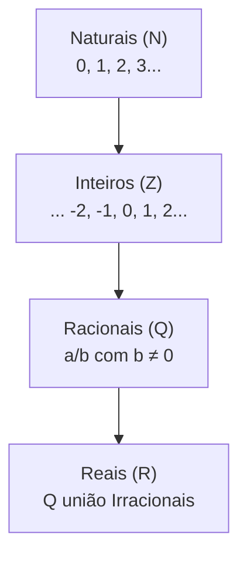
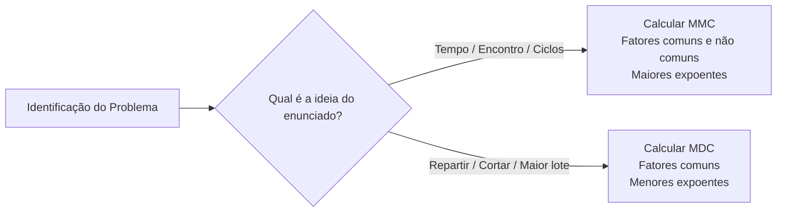

# 01 - Aritmética e Conjuntos Numéricos

> **Matéria:** Matemática e Raciocínio Lógico  
> **Cargos:** A01 – Técnico de Controle Externo (Adm) / B02 – Técnico de Controle Externo (TI)  
> **Arquivo:** `01_conjuntos_numericos_fracoes_e_aritmetica.md`  
> **Status:** 🟢 Teoria Aprofundada + 5 Questões FCC Comentadas (A a E)

---

## 📌 Ementa / Itens do Edital
- Números inteiros e racionais: operações (adição, subtração, multiplicação, divisão, potenciação).
- Expressões numéricas.
- Múltiplos e divisores de números naturais.
- Problemas envolvendo números inteiros e racionais.
- Frações e operações com frações.

---

## 🧭 Sumário

1. [Conjuntos Numéricos Fundamentais e Propriedades Estruturais](#1-conjuntos-numericos-fundamentais-e-propriedades-estruturais)
    1. [Conjunto dos Números Naturais e Inteiros](#11-conjunto-dos-numeros-naturais-e-inteiros)
    2. [Conjunto dos Números Racionais: Decimais Finitos e Dízimas Periódicas](#12-conjunto-dos-numeros-racionais-decimais-finitos-e-dizimas-periodicas)
    3. [Algoritmo da Divisão Euclidiana e Aritmética dos Restos](#13-algoritmo-da-divisao-euclidiana-e-aritmetica-dos-restos)
    4. [Teste 072](#Teste-072)
    5. [Teste 073](#Teste-073)
2. [Operações Aritméticas e Expressões Numéricas](#2-operacoes-aritmeticas-e-expressoes-numericas)
    1. [Ordem de Precedência das Operações e Delimitadores](#21-ordem-de-precedencia-das-operacoes-e-delimitadores)
    2. [Potenciação: Propriedades Operatórias e Notação Científica](#22-potenciacao-propriedades-operatorias-e-notacao-cientifica)
    3. [Teste 074](#Teste-074)
3. [Teoria dos Números: Divisibilidade, Primos, MMC e MDC](#3-teoria-dos-numeros-divisibilidade-primos-mmc-e-mdc)
    1. [Critérios de Divisibilidade Aplicados](#31-criterios-de-divisibilidade-aplicados)
    2. [Decomposição em Fatores Primos e Contagem de Divisores Positivos](#32-decomposicao-em-fatores-primos-e-contagem-de-divisores-positivos)
    3. [Mínimo Múltiplo Comum: Ciclos, Coincidências e Periodicidade](#33-minimo-multiplo-comum-ciclos-coincidencias-e-periodicidade)
    4. [Máximo Divisor Comum: Partições Equitativas e Lotes Máximos](#34-maximo-divisor-comum-particoes-equitativas-e-lotes-maximos)
    5. [Relação Fundamental entre MMC e MDC](#35-relacao-fundamental-entre-mmc-e-mdc)
    6. [Teste 075](#Teste-075)
    7. [Teste 076](#Teste-076)
    8. [Teste 077](#Teste-077)
4. [Álgebra Fracionária e Operações com Frações](#4-algebra-fracionaria-e-operacoes-com-fracoes)
    1. [Conceito, Tipologias e Equivalência de Frações](#41-conceito-tipologias-e-equivalencia-de-fracoes)
    2. [Operações Aritméticas com Frações](#42-operacoes-aritmeticas-com-fracoes)
    3. [Teste 078](#Teste-078)
5. [Modelagem e Resolução de Problemas no Padrão FCC](#5-modelagem-e-resolucao-de-problemas-no-padrao-fcc)
    1. [Problemas de Fração de Resto ou Cadeia Regressiva](#51-problemas-de-fracao-de-resto-ou-cadeia-regressiva)
    2. [Problemas de Trabalho Conjunto e Torneiras](#52-problemas-de-trabalho-conjunto-e-torneiras)
    3. [Problemas de Ciclos Periódicos e Padrões Sequenciais](#53-problemas-de-ciclos-periodicos-e-padroes-sequenciais)
    4. [Teste 079](#Teste-079)
    5. [Teste 080](#Teste-080)
    6. [Teste 081](#Teste-081)
6. [🌐 Fontes Oficiais e Referências Bibliográficas](#fontes-oficiais-e-referencias-bibliograficas)

---

## 1. Conjuntos Numéricos Fundamentais e Propriedades Estruturais

O estudo dos conjuntos numéricos estabelece as bases conceituais sobre as quais repousa toda a aritmética e o raciocínio quantitativo exigido nos concursos da área fiscal e de controle. A estruturação desses conjuntos desenvolveu-se historicamente para sanar impossibilidades operatórias verificadas em conjuntos mais restritos.

### 1.1 Conjunto dos Números Naturais e Inteiros

* **Conjunto dos Números Naturais ($\mathbb{N}$):**
  $$\mathbb{N} = \{0, 1, 2, 3, 4, 5, \dots\}$$
  Representa o conjunto de contagem primitiva e ordenação de elementos discretos. É fechado sob as operações de adição e multiplicação (a soma ou produto de dois naturais é sempre um natural), mas falha no fechamento da subtração quando o minuendo é menor que o subtraendo ($3 - 8 \notin \mathbb{N}$).
* **Conjunto dos Números Inteiros ($\mathbb{Z}$):**
  $$\mathbb{Z} = \{\dots, -3, -2, -1, 0, 1, 2, 3, \dots\}$$
  Incorpora os opostos simétricos (negativos) aos números naturais, viabilizando o fechamento irrestrito da subtração. Na reta numérica, os inteiros organizam-se ordenadamente em torno da origem zero.
    * *Regra de Sinais na Multiplicação e Divisão:* Sinais iguais geram resultado positivo ($+ \cdot + = +$; $- \cdot - = +$); sinais contrários geram resultado negativo ($+ \cdot - = -$; $- \cdot + = -$).
    * *Adição de Inteiros com Sinais Opostos:* Conserva-se o sinal do termo de maior valor absoluto (módulo) e subtraem-se os valores: $(-15) + (+9) = -(15 - 9) = -6$.

### 1.2 Conjunto dos Números Racionais: Decimais Finitos e Dízimas Periódicas

O **Conjunto dos Números Racionais ($\mathbb{Q}$)** reúne todos os números suscetíveis de representação sob a forma de uma razão ou fração de dois números inteiros com denominador não nulo:
$$\mathbb{Q} = \left\{ x = \frac{a}{b} \ \middle| \ a \in \mathbb{Z}, \ b \in \mathbb{Z}, \ b \neq 0 \right\}$$

Todo número racional pode ser transcrito sob representação decimal, dividindo-se o numerador pelo denominador, resultando em apenas duas possibilidades formais:

1. **Decimais Exatos (ou Finitos):** Apresentam um número finito de casas decimais após a vírgula. Isso ocorre quando a fração irredutível $\frac{a}{b}$ possui um denominador $b$ decomposto exclusivamente em fatores primos iguais a $2$ e/ou $5$:
   $$0,75 = \frac{75}{100} = \frac{3}{4} \quad (4 = 2^2); \qquad 0,35 = \frac{35}{100} = \frac{7}{20} \quad (20 = 2^2 \times 5)$$
2. **Dízimas Periódicas:** Apresentam infinitas casas decimais que se repetem de maneira cíclica a partir de um bloco repetitivo denominado **período**:
    * **Dízima Periódica Simples:** O período principia imediatamente após a vírgula:
     $$0,\overline{4} = 0,444\dots = \frac{4}{9}; \qquad 0,\overline{27} = 0,2727\dots = \frac{27}{99} = \frac{3}{11}$$
    * **Dízima Periódica Composta:** Existe um segmento decimal que não se repete (o antiperíodo) posicionado entre a vírgula e o início do período:
     $$0,1\overline{6} = 0,1666\dots$$
    * **Regra Prática da Fração Geratriz para Dízimas Compostas:**
     $$\text{Fração Geratriz} = \frac{(\text{Antiperíodo seguido do Período}) - (\text{Antiperíodo})}{(\text{tantos 9 quantos forem os dígitos do período}) \times 10^{(\text{dígitos do antiperíodo})}}$$
     Exemplo para $0,1\overline{6}$:
     $$0,1\overline{6} = \frac{16 - 1}{90} = \frac{15}{90} = \frac{1}{6}$$

### 1.3 Algoritmo da Divisão Euclidiana e Aritmética dos Restos

Para quaisquer dois números inteiros $D$ (dividendo) e $d$ (divisor não nulo), existem inteiros únicos $q$ (quociente) e $r$ (resto) tais que:
$$D = d \cdot q + r, \quad \text{onde } 0 \le r < |d|$$

Propriedades críticas da divisão inteira:

* O resto $r$ é **estritamente não negativo** e **menor que o divisor** ($0 \le r \le d - 1$).
* O **resto máximo possível** na divisão por um divisor $d$ é sempre igual a $d - 1$. Se um problema indagar o resto máximo obtido na divisão por $15$, esse valor é inequivocamente $15 - 1 = 14$.

> 🚨 **ALERTA DE PROVA / PEGADINHA FCC:** Em problemas que envolvem ciclos e restos de divisão (dias da semana, rodízio de equipes, posições de algarismos), o divisor corresponde ao tamanho do ciclo. Se o resto for zero, significa que a divisão foi exata e que a posição procurada corresponde rigorosamente ao **último elemento** do ciclo periódico, e não ao primeiro!

---

### Teste 001
**(FGV – TJ/AP – 2023 – Analista Judiciario Apoio Especializado Tecnologia Da Informacao Seguranca Da Informacao)**
A equipe de gestão de riscos de um órgão público está atualizando seu Plano de Gestão de Riscos (PGR). Na atual fase de trabalho, a equipe está executando o processo de avaliação de riscos das atividades constantes do escopo do PGR, descrevendo, analisando e avaliando os riscos identificados. Durante a identificação dos riscos, a equipe deve considerar o fator:

* **A)** mudanças nos contextos externo e interno do órgão;
* **B)** natureza e magnitude das consequências;
* **C)** probabilidade de eventos e consequências;
* **D)** opções existentes para tratamento de riscos;
* **E)** recursos requeridos, incluindo contingências.

---

> **Comentário Detalhado:**
>
> - **A)** **Correta.** Conforme fundamentado na seção *5.2 Problemas de Trabalho Conjunto e Torneiras* deste guia, quando dois agentes executam uma mesma tarefa de forma cooperativa em ritmos constantes, somam se as suas taxas unitárias horárias de produtividade. Dessa forma, está plenamente correta a assertiva da banca (FGV – TJ/AP/2023) ao estabelecer que "mudanças nos contextos externo e interno do órgão".
> - **B)** **Incorreta.** A opção apresenta proposição em desacordo com os fundamentos teóricos e técnicos do tópico ao afirmar que "natureza e magnitude das consequências". De acordo com a teoria estudada em *5.2 Problemas de Trabalho Conjunto e Torneiras*, atenção à Conversão de Tempo: Se o resultado da divisão em horas for decimal, como $2,4\text{ horas}$, a parte inteira corresponde a $2\text{ horas}$ e a parte decimal $0,4$ deve ser multiplicada por $60\text{ minutos}$ ($0,4 \times 60 = 24\text{ minutos}$). Logo, $2,4\text{ h} = 2\text{ horas e } 24\text{ minutos}$ (e nunca 2h40min!).
> - **C)** **Incorreta.** A opção apresenta proposição em desacordo com os fundamentos teóricos e técnicos do tópico ao afirmar que "probabilidade de eventos e consequências". De acordo com a teoria estudada em *3.3 Mínimo Múltiplo Comum: Ciclos, Coincidências e Periodicidade*, o problema exige MMC sempre que veicular ideias de coincidência temporal futura, reencontro de eventos periódicos, ciclos de rondas/inspeções ou questões que indaguem: "quando voltarão a se encontrar simultaneamente?".
> - **D)** **Incorreta.** A opção apresenta proposição em desacordo com os fundamentos teóricos e técnicos do tópico ao afirmar que "opções existentes para tratamento de riscos". De acordo com a teoria estudada em *2.1 Ordem de Precedência das Operações e Delimitadores*, a avaliação de expressões aritméticas complexas exige obediência à ordem universal de precedência matemática (mnemônico PEMDAS / PDMAS).
> - **E)** **Incorreta.** A opção apresenta proposição em desacordo com os fundamentos teóricos e técnicos do tópico ao afirmar que "recursos requeridos, incluindo contingências". De acordo com a teoria estudada em *3.1 Critérios de Divisibilidade Aplicados*, por 11: A diferença entre a soma dos algarismos de ordem ímpar e a soma dos algarismos de ordem par é múltipla de 11 (incluindo o zero).
>
> **Gabarito: A**

---

### Teste 002
**(FGV – TJ/AP – 2023 – Analista Judiciario Apoio Especializado Tecnologia Da Informacao Telecomunicacoes)**
Em contraste com as redes conectadas fisicamente, as redes sem fio são ruidosas e pouco confiáveis. Um dos padrões mais famosos para redes sem fio é o IEEE 802.11. Dentre as características das redes que usam o protocolo IEEE 802.11, é correto afirmar que:

* **A)** o protocolo IEEE 802.11 tenta resolver os problemas das estações expostas, ocultas ou transparentes;
* **B)** em ambientes abertos e sem obstáculos, quanto maior a frequência do sinal, menor a atenuação do sinal;
* **C)** o IEEE 802.11, para o acesso ao meio, procura detectar as colisões, escutando o canal durante as transmissões;
* **D)** a probabilidade de um quadro trafegar por essas redes com sucesso aumenta com o aumento do tamanho do quadro;
* **E)** o IEEE 802.11, para o acesso ao meio, procura evitar as colisões, enviando quadros de aviso antes das transmissões.

---

> **Comentário Detalhado:**
>
> - **A)** **Incorreta.** A opção apresenta proposição em desacordo com os fundamentos teóricos e técnicos do tópico ao afirmar que "o protocolo IEEE 802.11 tenta resolver os problemas das estações expostas, ocultas ou transparentes". De acordo com a teoria estudada em *5.3 Problemas de Ciclos Periódicos e Padrões Sequenciais*, em problemas que constroem sequências infinitas repetindo ciclicamente um conjunto finito de $k$ elementos ($x 1, x 2, \dots, x k$).
> - **B)** **Incorreta.** A opção apresenta proposição em desacordo com os fundamentos teóricos e técnicos do tópico ao afirmar que "em ambientes abertos e sem obstáculos, quanto maior a frequência do sinal, menor a atenuação do sinal". De acordo com a teoria estudada em *1.1 Conjunto dos Números Naturais e Inteiros*, adição de Inteiros com Sinais Opostos: Conserva se o sinal do termo de maior valor absoluto (módulo) e subtraem se os valores: $( 15) + (+9) = (15 9) = 6$.
> - **C)** **Incorreta.** A opção apresenta proposição em desacordo com os fundamentos teóricos e técnicos do tópico ao afirmar que "o IEEE 802.11, para o acesso ao meio, procura detectar as colisões, escutando o canal durante as transmissões". De acordo com a teoria estudada em *3.3 Mínimo Múltiplo Comum: Ciclos, Coincidências e Periodicidade*, o Mínimo Múltiplo Comum (MMC) entre dois ou mais inteiros é o menor número natural não nulo que é divisível simultaneamente por todos eles.
> - **D)** **Incorreta.** A opção apresenta proposição em desacordo com os fundamentos teóricos e técnicos do tópico ao afirmar que "a probabilidade de um quadro trafegar por essas redes com sucesso aumenta com o aumento do tamanho do quadro". De acordo com a teoria estudada em *5.3 Problemas de Ciclos Periódicos e Padrões Sequenciais*, divide se $P$ pelo tamanho do ciclo $k$, obtendo o quociente $q$ e o resto $r$ ($P = k \cdot q + r$).
> - **E)** **Correta.** Conforme fundamentado na seção *1. Conjuntos Numéricos Fundamentais e Propriedades Estruturais* deste guia, o estudo dos conjuntos numéricos estabelece as bases conceituais sobre as quais repousa toda a aritmética e o raciocínio quantitativo exigido nos concursos da área fiscal e de controle. A estruturação desses conjuntos desenvolveu se historicamente para sanar impossibilidades operatórias verificadas em conjuntos mais restritos. Dessa forma, está plenamente correta a assertiva da banca (FGV – TJ/AP/2023) ao estabelecer que "o IEEE 802.11, para o acesso ao meio, procura evitar as colisões, enviando quadros de aviso antes das transmissões".
>
> **Gabarito: E**

---

### Teste 003
**(FGV – TRT da 24º Região – 2025 – Analista Judiciário - Área Administrativa - Contabilidade)**
A Gestão de Riscos busca identificar, analisar e mitigar ameaças potenciais, garantindo a resiliência e a sustentabilidade da organização. Assinale a opção que apresenta, corretamente, o risco de conformidade.

* **A)** Trata-se do risco de perdas financeiras geradas por falhas tecnológicas, como interrupções em sistemas e ataques cibernéticos.
* **B)** Representa a probabilidade de perdas decorrentes do não cumprimento de leis, normas e regulamentos, internos ou externos, podendo afetar financeiramente a organização.
* **C)** Refere-se ao risco associado à variação de mercado e às flutuações cambiais, que impactam diretamente o desempenho financeiro da organização.
* **D)** Diz respeito aos riscos operacionais relacionados à má alocação de recursos humanos e à deficiência na comunicação interna.
* **E)** Está ligado exclusivamente à gestão de contratos e ao descumprimento de cláusulas contratuais por parte de fornecedores terceirizados.

---

> **Comentário Detalhado:**
>
> - **A)** **Incorreta.** A opção apresenta proposição em desacordo com os fundamentos teóricos e técnicos do tópico ao afirmar que "Trata se do risco de perdas financeiras geradas por falhas tecnológicas, como interrupções em sistemas e ataques...". De acordo com a teoria estudada em *4. Álgebra Fracionária e Operações com Frações*, uma fração $\frac{a}{b}$ representa uma divisão indicada onde o denominador $b$ assinala em quantas partes iguais a unidade inteira foi particionada, e o numerador $a$ indica quantas dessas partes foram tomadas.
> - **B)** **Correta.** Conforme fundamentado na seção *1.1 Conjunto dos Números Naturais e Inteiros* deste guia, representa o conjunto de contagem primitiva e ordenação de elementos discretos. É fechado sob as operações de adição e multiplicação (a soma ou produto de dois naturais é sempre um natural), mas falha no fechamento da subtração quando o minuendo é menor que o subtraendo ($3 8 \notin \mathbb{N}$). Dessa forma, está plenamente correta a assertiva da banca (FGV – TRT da 24º Região/2025) ao estabelecer que "Representa a probabilidade de perdas decorrentes do não cumprimento de leis, normas e regulamentos, internos ou...".
> - **C)** **Incorreta.** A opção apresenta proposição em desacordo com os fundamentos teóricos e técnicos do tópico ao afirmar que "Refere se ao risco associado à variação de mercado e às flutuações cambiais, que impactam diretamente o desempenho...". De acordo com a teoria estudada em *4.1 Conceito, Tipologias e Equivalência de Frações*, fração Própria: O numerador é menor que o denominador ($a < b$). Representa um valor estritamente menor que a unidade inteira ($\frac{2}{5}, \frac{7}{9}$).
> - **D)** **Incorreta.** A opção apresenta proposição em desacordo com os fundamentos teóricos e técnicos do tópico ao afirmar que "Diz respeito aos riscos operacionais relacionados à má alocação de recursos humanos e à deficiência na comunicação...". De acordo com a teoria estudada em *4.1 Conceito, Tipologias e Equivalência de Frações*, fração Imprópria: O numerador é maior ou igual ao denominador ($a \ge b$). Representa um valor maior ou igual à unidade inteira ($\frac{7}{4}, \frac{11}{3}$). Podem ser convertidas em números mistos: $\frac{7}{4} = 1 \frac{3}{4}$.
> - **E)** **Incorreta.** A opção incorre em restrição indevida ao limitar o escopo conceitual ao afirmar que "Está ligado exclusivamente à gestão de contratos e ao descumprimento de cláusulas contratuais por parte de...". De acordo com a teoria estudada em *1.2 Conjunto dos Números Racionais: Decimais Finitos e Dízimas Periódicas*, decimais Exatos (ou Finitos): Apresentam um número finito de casas decimais após a vírgula. Isso ocorre quando a fração irredutível $\frac{a}{b}$ possui um denominador $b$ decomposto exclusivamente em fatores primos iguais a $2$ e/ou $5$.
>
> **Gabarito: B**

---

### Teste 004
**(FGV – TRT da 24º Região – 2025 – Analista Judiciário - Área Administrativa - Sem Especialidade)**
Um problema importante em inferência estatística decorre da necessidade de se obter uma amostra de uma determinada população para se estudar determinado fenômeno. Nesse caso, um problema crucial é se obter uma mostra que seja, em algum sentido, representativa da população em estudo, o que nos leva a pensar em como nossa amostra pode ser obtida. Um método importante, nesse sentido, é a amostragem aleatória simples, na qual

* **A)** a população apresenta uma subdivisão em pequenos grupos, e é possível e conveniente sortear um número suficiente desses grupos, cujos elementos constituirão a amostra.
* **B)** a população se divide em subpopulações, de tal modo que podemos especificar quantos elementos da amostra serão retirados em cada subpopulação.
* **C)** todos os elementos da população têm igual probabilidade de pertencer à amostra, e todas as possíveis amostras têm também igual probabilidade de ocorrer.
* **D)** a população pode ser ordenada e cada elemento da amostra é obtido a partir de uma escolha sistemática e periódica.
* **E)** a amostra é retirada em diversas etapas sucessivas e, dependendo dos resultados obtidos, etapas suplementares são necessárias ou dispensadas.

---

> **Comentário Detalhado:**
>
> - **A)** **Incorreta.** A opção apresenta proposição em desacordo com os fundamentos teóricos e técnicos do tópico ao afirmar que "a população apresenta uma subdivisão em pequenos grupos, e é possível e conveniente sortear um número suficiente...". De acordo com a teoria estudada em *1. Conjuntos Numéricos Fundamentais e Propriedades Estruturais*, o estudo dos conjuntos numéricos estabelece as bases conceituais sobre as quais repousa toda a aritmética e o raciocínio quantitativo exigido nos concursos da área fiscal e de controle. A estruturação desses conjuntos desenvolveu se historicamente para sanar impossibilidades operatórias verificadas em conjuntos mais restritos.
> - **B)** **Incorreta.** A opção apresenta proposição em desacordo com os fundamentos teóricos e técnicos do tópico ao afirmar que "a população se divide em subpopulações, de tal modo que podemos especificar quantos elementos da amostra serão...". De acordo com a teoria estudada em *4.1 Conceito, Tipologias e Equivalência de Frações*, fração Imprópria: O numerador é maior ou igual ao denominador ($a \ge b$). Representa um valor maior ou igual à unidade inteira ($\frac{7}{4}, \frac{11}{3}$). Podem ser convertidas em números mistos: $\frac{7}{4} = 1 \frac{3}{4}$.
> - **C)** **Correta.** Conforme fundamentado na seção *1.3 Algoritmo da Divisão Euclidiana e Aritmética dos Restos* deste guia, o resto máximo possível na divisão por um divisor $d$ é sempre igual a $d 1$. Se um problema indagar o resto máximo obtido na divisão por $15$, esse valor é inequivocamente $15 1 = 14$. Dessa forma, está plenamente correta a assertiva da banca (FGV – TRT da 24º Região/2025) ao estabelecer que "todos os elementos da população têm igual probabilidade de pertencer à amostra, e todas as possíveis amostras têm...".
> - **D)** **Incorreta.** A opção apresenta proposição em desacordo com os fundamentos teóricos e técnicos do tópico ao afirmar que "a população pode ser ordenada e cada elemento da amostra é obtido a partir de uma escolha sistemática e periódica". De acordo com a teoria estudada em *1.2 Conjunto dos Números Racionais: Decimais Finitos e Dízimas Periódicas*, todo número racional pode ser transcrito sob representação decimal, dividindo se o numerador pelo denominador, resultando em apenas duas possibilidades formais.
> - **E)** **Incorreta.** A opção apresenta proposição em desacordo com os fundamentos teóricos e técnicos do tópico ao afirmar que "a amostra é retirada em diversas etapas sucessivas e, dependendo dos resultados obtidos, etapas suplementares são...". De acordo com a teoria estudada em *Quantidade Total de Divisores Positivos:*, o número total de divisores inteiros positivos de $N$ é obtido somando se uma unidade a cada expoente da fatoração canônica e multiplicando se os resultados.
>
> **Gabarito: C**

---

### Teste 005
**(FGV – TRT 1ª – 2024 – Analista Judiciário - Área Administrativa)**
Recentemente, o Supremo Tribunal Federal determinou a prorrogação da vigência da Lei de Cotas em concursos públicos federais até que o Congresso Nacional aprove uma nova norma sobre a matéria, diante da proximidade do respectivo termo. Tal orientação teve por fundamento determinado princípio implícito na Constituição da República, tendo em vista os certames ainda em andamento, dentre outros aspectos, o que importaria na probabilidade de multiplicação de litígios judiciais. É correto afirmar que o referido princípio é o da:

* **A)** moralidade;
* **B)** publicidade;
* **C)** impessoalidade;
* **D)** segurança jurídica;
* **E)** eficiência.

---

> **Comentário Detalhado:**
>
> - **A)** **Incorreta.** A opção apresenta proposição em desacordo com os fundamentos teóricos e técnicos do tópico ao afirmar que "moralidade". De acordo com a teoria estudada em *1.1 Conjunto dos Números Naturais e Inteiros*, adição de Inteiros com Sinais Opostos: Conserva se o sinal do termo de maior valor absoluto (módulo) e subtraem se os valores: $( 15) + (+9) = (15 9) = 6$.
> - **B)** **Incorreta.** A opção apresenta proposição em desacordo com os fundamentos teóricos e técnicos do tópico ao afirmar que "publicidade". De acordo com a teoria estudada em *1.1 Conjunto dos Números Naturais e Inteiros*, representa o conjunto de contagem primitiva e ordenação de elementos discretos. É fechado sob as operações de adição e multiplicação (a soma ou produto de dois naturais é sempre um natural), mas falha no fechamento da subtração quando o minuendo é menor que o subtraendo ($3 8 \notin \mathbb{N}$).
> - **C)** **Incorreta.** A opção apresenta proposição em desacordo com os fundamentos teóricos e técnicos do tópico ao afirmar que "impessoalidade". De acordo com a teoria estudada em *1.1 Conjunto dos Números Naturais e Inteiros*, regra de Sinais na Multiplicação e Divisão: Sinais iguais geram resultado positivo ($+ \cdot + = +$; $ \cdot = +$); sinais contrários geram resultado negativo ($+ \cdot = $; $ \cdot + = $).
> - **D)** **Correta.** Conforme fundamentado na seção *1. Conjuntos Numéricos Fundamentais e Propriedades Estruturais* deste guia, o estudo dos conjuntos numéricos estabelece as bases conceituais sobre as quais repousa toda a aritmética e o raciocínio quantitativo exigido nos concursos da área fiscal e de controle. A estruturação desses conjuntos desenvolveu se historicamente para sanar impossibilidades operatórias verificadas em conjuntos mais restritos. Dessa forma, está plenamente correta a assertiva da banca (FGV – TRT 1ª/2024) ao estabelecer que "segurança jurídica".
> - **E)** **Incorreta.** A opção apresenta proposição em desacordo com os fundamentos teóricos e técnicos do tópico ao afirmar que "eficiência". De acordo com a teoria estudada em *5.3 Problemas de Ciclos Periódicos e Padrões Sequenciais*, se o resto $r 0$: O termo procurado é exatamente o $r$ ésimo elemento do ciclo padrão.
>
> **Gabarito: D**

---

### Teste 006
**(FGV – TRF/1 – 2024 – Analista Judiciario Area Apoio Especializado Especialidade Suporte Em Tecnologia Da Informacao)**
A analista Maria é a gerente de um projeto do TRF1 em que foi identificado grande número de riscos, com elevada gravidade. A fim de diminuir o risco, a gerente solicitou que a equipe do projeto confeccionasse um conjunto de respostas para cada um dos riscos identificados. Após a confecção do conjunto de respostas, Maria determinou que o risco residual fosse revisado. A gerente do projeto deve solicitar a revisão do planejamento de respostas aos riscos até que:

* **A)** o risco residual seja baixo;
* **B)** todos os riscos tenham baixo impacto;
* **C)** todos os riscos tenham baixa probabilidade;
* **D)** todos os riscos tenham sido mitigados;
* **E)** o risco residual seja compatível com o apetite ao risco da organização.

---

> **Comentário Detalhado:**
>
> - **A)** **Incorreta.** A opção apresenta proposição em desacordo com os fundamentos teóricos e técnicos do tópico ao afirmar que "o risco residual seja baixo". De acordo com a teoria estudada em *1.2 Conjunto dos Números Racionais: Decimais Finitos e Dízimas Periódicas*, dízima Periódica Simples: O período principia imediatamente após a vírgula.
> - **B)** **Incorreta.** A opção apresenta proposição em desacordo com os fundamentos teóricos e técnicos do tópico ao afirmar que "todos os riscos tenham baixo impacto". De acordo com a teoria estudada em *5.2 Problemas de Trabalho Conjunto e Torneiras*, atenção à Conversão de Tempo: Se o resultado da divisão em horas for decimal, como $2,4\text{ horas}$, a parte inteira corresponde a $2\text{ horas}$ e a parte decimal $0,4$ deve ser multiplicada por $60\text{ minutos}$ ($0,4 \times 60 = 24\text{ minutos}$). Logo, $2,4\text{ h} = 2\text{ horas e } 24\text{ minutos}$ (e nunca 2h40min!).
> - **C)** **Incorreta.** A opção apresenta proposição em desacordo com os fundamentos teóricos e técnicos do tópico ao afirmar que "todos os riscos tenham baixa probabilidade". De acordo com a teoria estudada em *1.2 Conjunto dos Números Racionais: Decimais Finitos e Dízimas Periódicas*, todo número racional pode ser transcrito sob representação decimal, dividindo se o numerador pelo denominador, resultando em apenas duas possibilidades formais.
> - **D)** **Incorreta.** A opção apresenta proposição em desacordo com os fundamentos teóricos e técnicos do tópico ao afirmar que "todos os riscos tenham sido mitigados". De acordo com a teoria estudada em *3.4 Máximo Divisor Comum: Partições Equitativas e Lotes Máximos*, em problemas de particionamento (como arquivar pastas em caixas de maior tamanho possível), o cálculo do MDC fornece a capacidade de cada caixa, e não a quantidade total de caixas! Para achar a quantidade de caixas, deve se somar a divisão de cada lote pelo valor do MDC encontrado.
> - **E)** **Correta.** Conforme fundamentado na seção *1.2 Conjunto dos Números Racionais: Decimais Finitos e Dízimas Periódicas* deste guia, decimais Exatos (ou Finitos): Apresentam um número finito de casas decimais após a vírgula. Isso ocorre quando a fração irredutível $\frac{a}{b}$ possui um denominador $b$ decomposto exclusivamente em fatores primos iguais a $2$ e/ou $5$. Dessa forma, está plenamente correta a assertiva da banca (FGV – TRF/1/2024) ao estabelecer que "o risco residual seja compatível com o apetite ao risco da organização".
>
> **Gabarito: E**

---

### Teste 007
**(CEBRASPE – STF – 2013 – Analista Judiciario Suporte Em Tecnologia Da Informacao)**
Incidente de segurança da informação é um evento simples ou uma série de eventos indesejados ou inesperados, que tenham uma grande probabilidade de comprometer as operações do negócio e ameaçar a segurança da informação.

* **C)** Certo
* **E)** Errado

---

> **Comentário Detalhado:**
>
> - **C)** **Correta.** O item está **Certo**. Conforme fundamentado na seção *1.2 Conjunto dos Números Racionais: Decimais Finitos e Dízimas Periódicas*, dízima Periódica Simples: O período principia imediatamente após a vírgula. Dessa forma, está plenamente correta a assertiva da banca (CEBRASPE – STF/2013) ao afirmar que "Incidente de segurança da informação é um evento simples ou uma série de eventos indesejados ou inesperados...".
> - **E)** **Incorreta.** A assertiva não incorre em erro conceitual, guardando conformidade com a teoria estudada.
>
> **Gabarito: C**

---

### Teste 008
**(FCC – TRT 15ª – 2015 – Analista Judiciário - Tecnologia da Informação)**
Um analista da área de Tecnologia da Informação criou uma Matriz de Probabilidade e Impacto para classificar os riscos e priorizar as respostas a eles. Como esse Analista segue à risca o PMBoK 4a edição, esta matriz foi utilizada como técnica (ou ferramenta) do processo

* **A)** ANS pode ser formal ou informal, realizado entre o provedor de serviços de TI e o cliente.
* **B)** ANS descreve os serviços de TI e documenta metas de nível de serviço, mas não especifica as responsabilidades das partes envolvidas.
* **C)** único ANS pode cobrir múltiplos serviços de TI ou múltiplos clientes.
* **D)** ANS cobre um serviço para todos os clientes desse serviço, neste caso, sendo chamado de ANS multi-nível baseado em Cliente.
* **E)** ANS é firmado, exclusivamente, entre o provedor de serviços de TI e outra parte da mesma organização.

---

> **Comentário Detalhado:**
>
> - **A)** **Correta.** Conforme fundamentado na seção *1.2 Conjunto dos Números Racionais: Decimais Finitos e Dízimas Periódicas* deste guia, todo número racional pode ser transcrito sob representação decimal, dividindo se o numerador pelo denominador, resultando em apenas duas possibilidades formais. Dessa forma, está plenamente correta a assertiva da banca (FCC – TRT 15ª/2015) ao estabelecer que "ANS pode ser formal ou informal, realizado entre o provedor de serviços de TI e o cliente".
> - **B)** **Incorreta.** A opção apresenta proposição em desacordo com os fundamentos teóricos e técnicos do tópico ao afirmar que "ANS descreve os serviços de TI e documenta metas de nível de serviço, mas não especifica as responsabilidades das...". De acordo com a teoria estudada em *3.2 Decomposição em Fatores Primos e Contagem de Divisores Positivos*, pelo Teorema Fundamental da Aritmética, qualquer número natural maior que 1 pode ser decomposto de forma única (a menos da ordem dos fatores) em um produto de potências de números primos.
> - **C)** **Incorreta.** A opção apresenta proposição em desacordo com os fundamentos teóricos e técnicos do tópico ao afirmar que "único ANS pode cobrir múltiplos serviços de TI ou múltiplos clientes". De acordo com a teoria estudada em *4.1 Conceito, Tipologias e Equivalência de Frações*, fração Imprópria: O numerador é maior ou igual ao denominador ($a \ge b$). Representa um valor maior ou igual à unidade inteira ($\frac{7}{4}, \frac{11}{3}$). Podem ser convertidas em números mistos: $\frac{7}{4} = 1 \frac{3}{4}$.
> - **D)** **Incorreta.** A opção apresenta proposição em desacordo com os fundamentos teóricos e técnicos do tópico ao afirmar que "ANS cobre um serviço para todos os clientes desse serviço, neste caso, sendo chamado de ANS multi nível baseado em...". De acordo com a teoria estudada em *5.2 Problemas de Trabalho Conjunto e Torneiras*, para o caso específico de dois agentes que levam tempos individuais $t 1$ e $t 2$.
> - **E)** **Incorreta.** A opção incorre em restrição indevida ao limitar o escopo conceitual ao afirmar que "ANS é firmado, exclusivamente, entre o provedor de serviços de TI e outra parte da mesma organização". De acordo com a teoria estudada em *5.2 Problemas de Trabalho Conjunto e Torneiras*, atenção à Conversão de Tempo: Se o resultado da divisão em horas for decimal, como $2,4\text{ horas}$, a parte inteira corresponde a $2\text{ horas}$ e a parte decimal $0,4$ deve ser multiplicada por $60\text{ minutos}$ ($0,4 \times 60 = 24\text{ minutos}$). Logo, $2,4\text{ h} = 2\text{ horas e } 24\text{ minutos}$ (e nunca 2h40min!).
>
> **Gabarito: A**

---

### Teste 009
**(FGV – TCE/PA – 2024 – Auditor de Controle Externo - Administrativa - Ciência de Dados)**
Diferentes técnicas de classificação são utilizadas em aprendizado de máquina para organizar e categorizar dados de acordo com características predefinidas. Com respeito a técnicas de classificação em aprendizado de máquina, analise as afirmativas a seguir. I. A regressão logística determina um hiperplano no espaço 𝑛- dimensional para separar as instâncias de dados de entrada em partições de acordo com suas classes. II. As máquinas de vetores de suporte (Support Vector Machines - SVM) consistem em uma abordagem probabilística, determinando uma distribuição de probabilidades de que uma nova instância de dados de entrada pertença as respectivas classes. III. O algoritmo K vizinhos mais próximos (K Nearest Neighbors - KNN) classifica uma nova instância de dados de entrada conforme a classe das instâncias mais próximas já observadas. Está correto o que se afirma em

* **A)** I, apenas.
* **B)** II, apenas.
* **C)** III, apenas.
* **D)** I e II, apenas.
* **E)** I, II e III.

---

> **Comentário Detalhado:**
>
> - **A)** **Incorreta.** A opção incorre em restrição indevida ao limitar o escopo conceitual ao afirmar que "I, apenas". De acordo com a teoria estudada em *1. Conjuntos Numéricos Fundamentais e Propriedades Estruturais*, o estudo dos conjuntos numéricos estabelece as bases conceituais sobre as quais repousa toda a aritmética e o raciocínio quantitativo exigido nos concursos da área fiscal e de controle. A estruturação desses conjuntos desenvolveu se historicamente para sanar impossibilidades operatórias verificadas em conjuntos mais restritos.
> - **B)** **Incorreta.** A opção incorre em restrição indevida ao limitar o escopo conceitual ao afirmar que "II, apenas". De acordo com a teoria estudada em *3. Teoria dos Números: Divisibilidade, Primos, MMC e MDC*, a teoria dos números fornece o ferramental algébrico para lidar com divisões inteiras, periodicidade de escalas e otimização de lotes em logística e auditoria.
> - **C)** **Correta.** Conforme fundamentado na seção *3.4 Máximo Divisor Comum: Partições Equitativas e Lotes Máximos* deste guia, o Máximo Divisor Comum (MDC) é o maior número inteiro capaz de dividir exatamente todos os números dados, sem deixar resto. Dessa forma, está plenamente correta a assertiva da banca (FGV – TCE/PA/2024) ao estabelecer que "III, apenas".
> - **D)** **Incorreta.** A opção incorre em restrição indevida ao limitar o escopo conceitual ao afirmar que "I e II, apenas". De acordo com a teoria estudada em *1.3 Algoritmo da Divisão Euclidiana e Aritmética dos Restos*, para quaisquer dois números inteiros $D$ (dividendo) e $d$ (divisor não nulo), existem inteiros únicos $q$ (quociente) e $r$ (resto) tais que.
> - **E)** **Incorreta.** A opção apresenta proposição em desacordo com os fundamentos teóricos e técnicos do tópico ao afirmar que "I, II e III". De acordo com a teoria estudada em *1.3 Algoritmo da Divisão Euclidiana e Aritmética dos Restos*, $$D = d \cdot q + r, \quad \text{onde } 0 \le r < |d|$$.
>
> **Gabarito: C**

---

### Teste 010
**(FGV – TCE/PA – 2024 – Auditor de Controle Externo - Administrativa - Engenharia Telecomunicação)**
Considerando o processo de gerenciamento de risco de acordo com a Norma ABNT NBR ISO 31000:2018, leia o seguinte fragmento: Seu propósito é compreender a natureza do risco e suas características, incluindo o nível de risco. Além disso, envolve a consideração detalhada de incertezas, fontes de risco, consequências, probabilidade, eventos, cenários, controles e sua eficácia. A definição acima se refere ao conceito de

* **A)** Análise de riscos
* **B)** Identificação de riscos
* **C)** Tratamento de riscos
* **D)** Monitoramento e registro de riscos
* **E)** Avaliação de riscos

---

> **Comentário Detalhado:**
>
> - **A)** **Correta.** Conforme fundamentado na seção *3.1 Critérios de Divisibilidade Aplicados* deste guia, por 11: A diferença entre a soma dos algarismos de ordem ímpar e a soma dos algarismos de ordem par é múltipla de 11 (incluindo o zero). Dessa forma, está plenamente correta a assertiva da banca (FGV – TCE/PA/2024) ao estabelecer que "Análise de riscos".
> - **B)** **Incorreta.** A opção apresenta proposição em desacordo com os fundamentos teóricos e técnicos do tópico ao afirmar que "Identificação de riscos". De acordo com a teoria estudada em *3.3 Mínimo Múltiplo Comum: Ciclos, Coincidências e Periodicidade*, a["Identificação do Problema"] B{"Qual é a ideia do enunciado?"}.
> - **C)** **Incorreta.** A opção apresenta proposição em desacordo com os fundamentos teóricos e técnicos do tópico ao afirmar que "Tratamento de riscos". De acordo com a teoria estudada em *3.3 Mínimo Múltiplo Comum: Ciclos, Coincidências e Periodicidade*, o problema exige MMC sempre que veicular ideias de coincidência temporal futura, reencontro de eventos periódicos, ciclos de rondas/inspeções ou questões que indaguem: "quando voltarão a se encontrar simultaneamente?".
> - **D)** **Incorreta.** A opção apresenta proposição em desacordo com os fundamentos teóricos e técnicos do tópico ao afirmar que "Monitoramento e registro de riscos". De acordo com a teoria estudada em *4.1 Conceito, Tipologias e Equivalência de Frações*, fração Própria: O numerador é menor que o denominador ($a < b$). Representa um valor estritamente menor que a unidade inteira ($\frac{2}{5}, \frac{7}{9}$).
> - **E)** **Incorreta.** A opção apresenta proposição em desacordo com os fundamentos teóricos e técnicos do tópico ao afirmar que "Avaliação de riscos". De acordo com a teoria estudada em *2.1 Ordem de Precedência das Operações e Delimitadores*, a avaliação de expressões aritméticas complexas exige obediência à ordem universal de precedência matemática (mnemônico PEMDAS / PDMAS).
>
> **Gabarito: A**

---

### Teste 011
**(FGV – TCE/PA – 2024 – Auditor de Controle Externo - Administrativa - Gestão Governamental)**
Trata-se de uma importante fonte de receita do setor público, que decorre, dentre outros possíveis determinantes, da incapacidade de pagamento dos contribuintes ou da ineficiência do setor público em arrecadar os tributos lançados no prazo previsto. O texto se refere à:

* **A)** Receita da Dívida Ativa.
* **B)** Receita de Autos de Infração.
* **C)** Receita Patrimonial.
* **D)** Receita de Serviços.
* **E)** Receita da Sonegação.

---

> **Comentário Detalhado:**
>
> - **A)** **Correta.** Conforme fundamentado na seção *1. Conjuntos Numéricos Fundamentais e Propriedades Estruturais* deste guia, o estudo dos conjuntos numéricos estabelece as bases conceituais sobre as quais repousa toda a aritmética e o raciocínio quantitativo exigido nos concursos da área fiscal e de controle. A estruturação desses conjuntos desenvolveu se historicamente para sanar impossibilidades operatórias verificadas em conjuntos mais restritos. Dessa forma, está plenamente correta a assertiva da banca (FGV – TCE/PA/2024) ao estabelecer que "Receita da Dívida Ativa".
> - **B)** **Incorreta.** A opção apresenta proposição em desacordo com os fundamentos teóricos e técnicos do tópico ao afirmar que "Receita de Autos de Infração". De acordo com a teoria estudada em *1. Conjuntos Numéricos Fundamentais e Propriedades Estruturais*, n["Naturais (N)<br/ 0, 1, 2, 3..."] Z["Inteiros (Z)<br/ ... 2, 1, 0, 1, 2..."].
> - **C)** **Incorreta.** A opção apresenta proposição em desacordo com os fundamentos teóricos e técnicos do tópico ao afirmar que "Receita Patrimonial". De acordo com a teoria estudada em *1. Conjuntos Numéricos Fundamentais e Propriedades Estruturais*, z Q["Racionais (Q)<br/ a/b com b ≠ 0"].
> - **D)** **Incorreta.** A opção apresenta proposição em desacordo com os fundamentos teóricos e técnicos do tópico ao afirmar que "Receita de Serviços". De acordo com a teoria estudada em *1. Conjuntos Numéricos Fundamentais e Propriedades Estruturais*, q R["Reais (R)<br/ Q união Irracionais"].
> - **E)** **Incorreta.** A opção apresenta proposição em desacordo com os fundamentos teóricos e técnicos do tópico ao afirmar que "Receita da Sonegação". De acordo com a teoria estudada em *1.1 Conjunto dos Números Naturais e Inteiros*, conjunto dos Números Naturais ($\mathbb{N}$).
>
> **Gabarito: A**

---

### Teste 012
**(FGV – TCE/PI – 2025 – Auditor de Controle Externo - Controle Externo - Específica de Área Comum)**
Numa determinada população, 40% das famílias moram em locais sem acesso a saneamento básico. Se quatro famílias dessa população forem sorteadas ao acaso, sem reposição, a probabilidade de que duas morem em locais sem saneamento básico é, aproximadamente, igual a

* **A)** 0,25.
* **B)** 0,30.
* **C)** 0,35.
* **D)** 0,40.
* **E)** 0,45.

---

> **Comentário Detalhado:**
>
> - **A)** **Incorreta.** A opção apresenta proposição em desacordo com os fundamentos teóricos e técnicos do tópico ao afirmar que "0,25". De acordo com a teoria estudada em *1.2 Conjunto dos Números Racionais: Decimais Finitos e Dízimas Periódicas*, todo número racional pode ser transcrito sob representação decimal, dividindo se o numerador pelo denominador, resultando em apenas duas possibilidades formais.
> - **B)** **Incorreta.** A opção apresenta proposição em desacordo com os fundamentos teóricos e técnicos do tópico ao afirmar que "0,30". De acordo com a teoria estudada em *1.3 Algoritmo da Divisão Euclidiana e Aritmética dos Restos*, o resto máximo possível na divisão por um divisor $d$ é sempre igual a $d 1$. Se um problema indagar o resto máximo obtido na divisão por $15$, esse valor é inequivocamente $15 1 = 14$.
> - **C)** **Correta.** Conforme fundamentado na seção *1.2 Conjunto dos Números Racionais: Decimais Finitos e Dízimas Periódicas* deste guia, $$\text{Fração Geratriz} = \frac{(\text{Antiperíodo seguido do Período}) (\text{Antiperíodo})}{(\text{tantos 9 quantos forem os dígitos do período}) \times 10^{(\text{dígitos do antiperíodo})}}$$. Dessa forma, está plenamente correta a assertiva da banca (FGV – TCE/PI/2025) ao estabelecer que "0,35".
> - **D)** **Incorreta.** A opção apresenta proposição em desacordo com os fundamentos teóricos e técnicos do tópico ao afirmar que "0,40". De acordo com a teoria estudada em *4.1 Conceito, Tipologias e Equivalência de Frações*, frações Equivalentes e Irredutibilidade: Duas frações são equivalentes quando representam a mesma grandeza fracionária ($\frac{2}{3} = \frac{4}{6} = \frac{10}{15}$). Obtém se a fração irredutível simplificando numerador e denominador pelo seu MDC.
> - **E)** **Incorreta.** A opção apresenta proposição em desacordo com os fundamentos teóricos e técnicos do tópico ao afirmar que "0,45". De acordo com a teoria estudada em *3.5 Relação Fundamental entre MMC e MDC*, para quaisquer dois números inteiros positivos $a$ e $b$, o produto entre o seu MMC e o seu MDC é rigorosamente igual ao produto entre os próprios números.
>
> **Gabarito: C**

---

### Teste 013
**(FGV – TCE/SC – 2026 – Auditor Fiscal de Controle Externo - Ciências Atuariais)**
Um plano de benefícios adota o regime financeiro de Repartição de Capitais de Cobertura para a renda vitalícia de aposentadoria por invalidez. Considere que o benefício é devido no início do ano da entrada em invalidez. Para um grupo de segurados de idade x, dispõe-se das seguintes informações: Salários no ano (base de contribuição): R$ 1.000.000,00 • Probabilidade de entrada em Invalidez: i = 0,005 x • Probabilidade de mortalidade de inválido: 𝑞𝑖 = 0,01 𝑥 • Anuidade vitalícia de inválido 𝑎̈𝑖 =: 12,000 𝑥 O custo normal (em R$) necessário para financiar o capital de cobertura dos eventos que ocorrerão no ano para esses participantes de idade x é de

* **A)** 50.
* **B)** 600.
* **C)** 5.000.
* **D)** 60.000.
* **E)** 500.000.

---

> **Comentário Detalhado:**
>
> - **A)** **Incorreta.** A opção apresenta proposição em desacordo com os fundamentos teóricos e técnicos do tópico ao afirmar que "50". De acordo com a teoria estudada em *1.2 Conjunto dos Números Racionais: Decimais Finitos e Dízimas Periódicas*, dízima Periódica Composta: Existe um segmento decimal que não se repete (o antiperíodo) posicionado entre a vírgula e o início do período.
> - **B)** **Incorreta.** A opção apresenta proposição em desacordo com os fundamentos teóricos e técnicos do tópico ao afirmar que "600". De acordo com a teoria estudada em *3.3 Mínimo Múltiplo Comum: Ciclos, Coincidências e Periodicidade*, o problema exige MMC sempre que veicular ideias de coincidência temporal futura, reencontro de eventos periódicos, ciclos de rondas/inspeções ou questões que indaguem: "quando voltarão a se encontrar simultaneamente?".
> - **C)** **Correta.** Conforme fundamentado na seção *3.1 Critérios de Divisibilidade Aplicados* deste guia, por 8: O número formado pelos três últimos algarismos é divisível por 8 ou termina em $000$. Dessa forma, está plenamente correta a assertiva da banca (FGV – TCE/SC/2026) ao estabelecer que "5.000".
> - **D)** **Incorreta.** A opção apresenta proposição em desacordo com os fundamentos teóricos e técnicos do tópico ao afirmar que "60.000". De acordo com a teoria estudada em *2.2 Potenciação: Propriedades Operatórias e Notação Científica*, produto de potências de mesma base: $a^m \cdot a^n = a^{m+n}$.
> - **E)** **Incorreta.** A opção apresenta proposição em desacordo com os fundamentos teóricos e técnicos do tópico ao afirmar que "500.000". De acordo com a teoria estudada em *2.2 Potenciação: Propriedades Operatórias e Notação Científica*, divisão de potências de mesma base: $\frac{a^m}{a^n} = a^{m n} \quad (a \neq 0)$.
>
> **Gabarito: C**

---

### Teste 014
**(FGV – TCE/SC – 2026 – Auditor Fiscal de Controle Externo - Ciências Atuariais)**
Um atuário realizou testes de aderência Qui-Quadrado para avaliar qual tábua de mortalidade de determinado sexo melhor se ajusta aos dados históricos de um regime de Previdência. Para o teste “por ano de ocorrência”, foi adotado um nível de significância de 5%, com 10 graus de liberdade na distribuição de probabilidade, o que resultou em um valor crítico de aproximadamente 18,3070. Tábua Qui-Quadrado p-valor AT-2000 35,5662 0,0001 BR-EMSmt 2021 18,2258 0,0513 BR-EMSsb 2021 18,4231 0,0482 IBGE 2021 20,4697 0,0251 IBGE 2024 20,2690 0,0268 A tábua biométrica a ser escolhida, a partir dos números obtidos nesse teste, é a

* **A)** AT-2000.
* **B)** BR-EMSmt 2021.
* **C)** BR-EMSsb 2021.
* **D)** IBGE 2021.
* **E)** IBGE 2024.

---

> **Comentário Detalhado:**
>
> - **A)** **Incorreta.** A opção apresenta proposição em desacordo com os fundamentos teóricos e técnicos do tópico ao afirmar que "AT 2000". De acordo com a teoria estudada em *1.2 Conjunto dos Números Racionais: Decimais Finitos e Dízimas Periódicas*, dízimas Periódicas: Apresentam infinitas casas decimais que se repetem de maneira cíclica a partir de um bloco repetitivo denominado período.
> - **B)** **Incorreta.** A opção apresenta proposição em desacordo com os fundamentos teóricos e técnicos do tópico ao afirmar que "BR EMSmt 2021". De acordo com a teoria estudada em *1.2 Conjunto dos Números Racionais: Decimais Finitos e Dízimas Periódicas*, todo número racional pode ser transcrito sob representação decimal, dividindo se o numerador pelo denominador, resultando em apenas duas possibilidades formais.
> - **C)** **Incorreta.** A opção apresenta proposição em desacordo com os fundamentos teóricos e técnicos do tópico ao afirmar que "BR EMSsb 2021". De acordo com a teoria estudada em *1.1 Conjunto dos Números Naturais e Inteiros*, adição de Inteiros com Sinais Opostos: Conserva se o sinal do termo de maior valor absoluto (módulo) e subtraem se os valores: $( 15) + (+9) = (15 9) = 6$.
> - **D)** **Incorreta.** A opção apresenta proposição em desacordo com os fundamentos teóricos e técnicos do tópico ao afirmar que "IBGE 2021". De acordo com a teoria estudada em *3.4 Máximo Divisor Comum: Partições Equitativas e Lotes Máximos*, o Máximo Divisor Comum (MDC) é o maior número inteiro capaz de dividir exatamente todos os números dados, sem deixar resto.
> - **E)** **Correta.** Conforme fundamentado na seção *4.1 Conceito, Tipologias e Equivalência de Frações* deste guia, fração Imprópria: O numerador é maior ou igual ao denominador ($a \ge b$). Representa um valor maior ou igual à unidade inteira ($\frac{7}{4}, \frac{11}{3}$). Podem ser convertidas em números mistos: $\frac{7}{4} = 1 \frac{3}{4}$. Dessa forma, está plenamente correta a assertiva da banca (FGV – TCE/SC/2026) ao estabelecer que "IBGE 2024".
>
> **Gabarito: E**

---

### Teste 015
**(FGV – TCE/SC – 2026 – Auditor Fiscal de Controle Externo - Ciências da Computação, Sistemas de Informação...)**
O Tribunal quer reduzir o número de incidentes repetitivos em sua Central de Serviços. O Auditor sugere focar na identificação da causa raiz desses incidentes. No ITIL 4, a prática que tem como objetivo principal reduzir a probabilidade e o impacto de incidentes por meio da identificação de suas causas reais e do gerenciamento de soluções de contorno é o(a)

* **A)** Gerenciamento de Incidentes.
* **B)** Gerenciamento de Problemas.
* **C)** Gerenciamento de Mudanças.
* **D)** Central de Serviços.
* **E)** Gerenciamento de Nível de Serviço.

---

> **Comentário Detalhado:**
>
> - **A)** **Incorreta.** A opção apresenta proposição em desacordo com os fundamentos teóricos e técnicos do tópico ao afirmar que "Gerenciamento de Incidentes". De acordo com a teoria estudada em *1.3 Algoritmo da Divisão Euclidiana e Aritmética dos Restos*, em problemas que envolvem ciclos e restos de divisão (dias da semana, rodízio de equipes, posições de algarismos), o divisor corresponde ao tamanho do ciclo. Se o resto for zero, significa que a divisão foi exata e que a posição procurada corresponde rigorosamente ao último elemento do ciclo periódico, e não ao primeiro!.
> - **B)** **Correta.** Conforme fundamentado na seção *5.3 Problemas de Ciclos Periódicos e Padrões Sequenciais* deste guia, toma se o número da posição requerida $P$. Dessa forma, está plenamente correta a assertiva da banca (FGV – TCE/SC/2026) ao estabelecer que "Gerenciamento de Problemas".
> - **C)** **Incorreta.** A opção apresenta proposição em desacordo com os fundamentos teóricos e técnicos do tópico ao afirmar que "Gerenciamento de Mudanças". De acordo com a teoria estudada em *1. Conjuntos Numéricos Fundamentais e Propriedades Estruturais*, o estudo dos conjuntos numéricos estabelece as bases conceituais sobre as quais repousa toda a aritmética e o raciocínio quantitativo exigido nos concursos da área fiscal e de controle. A estruturação desses conjuntos desenvolveu se historicamente para sanar impossibilidades operatórias verificadas em conjuntos mais restritos.
> - **D)** **Incorreta.** A opção apresenta proposição em desacordo com os fundamentos teóricos e técnicos do tópico ao afirmar que "Central de Serviços". De acordo com a teoria estudada em *3.4 Máximo Divisor Comum: Partições Equitativas e Lotes Máximos*, ideia central: Coincidência, repetição, sincronia periódica — Divisão, partição equitativa, corte em partes iguais.
> - **E)** **Incorreta.** A opção apresenta proposição em desacordo com os fundamentos teóricos e técnicos do tópico ao afirmar que "Gerenciamento de Nível de Serviço". De acordo com a teoria estudada em *1. Conjuntos Numéricos Fundamentais e Propriedades Estruturais*, q R["Reais (R)<br/ Q união Irracionais"].
>
> **Gabarito: B**

---

### Teste 016
**(FGV – TRT/DA – 2025 – Tecnico Judiciario Area Administrativa Agente Da Policia Judicial)**
Seis homens e oito mulheres estão reunidos. Uma comissão de três pessoas será formada, entre essas pessoas, para compor um grupo de trabalho. A probabilidade de que a comissão seja composta por duas mulheres e um homem é igual a

* **A)** 3/8.
* **B)** 5/12.
* **C)** 6/13.
* **D)** 8/15.
* **E)** 9/16.

---

> **Comentário Detalhado:**
>
> - **A)** **Incorreta.** A opção apresenta proposição em desacordo com os fundamentos teóricos e técnicos do tópico ao afirmar que "3/8". De acordo com a teoria estudada em *1.2 Conjunto dos Números Racionais: Decimais Finitos e Dízimas Periódicas*, todo número racional pode ser transcrito sob representação decimal, dividindo se o numerador pelo denominador, resultando em apenas duas possibilidades formais.
> - **B)** **Incorreta.** A opção apresenta proposição em desacordo com os fundamentos teóricos e técnicos do tópico ao afirmar que "5/12". De acordo com a teoria estudada em *1.3 Algoritmo da Divisão Euclidiana e Aritmética dos Restos*, o resto máximo possível na divisão por um divisor $d$ é sempre igual a $d 1$. Se um problema indagar o resto máximo obtido na divisão por $15$, esse valor é inequivocamente $15 1 = 14$.
> - **C)** **Correta.** Conforme fundamentado na seção *1.2 Conjunto dos Números Racionais: Decimais Finitos e Dízimas Periódicas* deste guia, dízima Periódica Composta: Existe um segmento decimal que não se repete (o antiperíodo) posicionado entre a vírgula e o início do período. Dessa forma, está plenamente correta a assertiva da banca (FGV – TRT/DA/2025) ao estabelecer que "6/13".
> - **D)** **Incorreta.** A opção apresenta proposição em desacordo com os fundamentos teóricos e técnicos do tópico ao afirmar que "8/15". De acordo com a teoria estudada em *3.1 Critérios de Divisibilidade Aplicados*, por 8: O número formado pelos três últimos algarismos é divisível por 8 ou termina em $000$.
> - **E)** **Incorreta.** A opção apresenta proposição em desacordo com os fundamentos teóricos e técnicos do tópico ao afirmar que "9/16". De acordo com a teoria estudada em *4.1 Conceito, Tipologias e Equivalência de Frações*, frações Equivalentes e Irredutibilidade: Duas frações são equivalentes quando representam a mesma grandeza fracionária ($\frac{2}{3} = \frac{4}{6} = \frac{10}{15}$). Obtém se a fração irredutível simplificando numerador e denominador pelo seu MDC.
>
> **Gabarito: C**

---

## 2. Operações Aritméticas e Expressões Numéricas

### 2.1 Ordem de Precedência das Operações e Delimitadores

A avaliação de expressões aritméticas complexas exige obediência à ordem universal de precedência matemática (mnemônico PEMDAS / PDMAS):

1. **Ordem dos Delimitadores de Escopo (de dentro para fora):**
   1º) Parênteses $( \ )$;
   2º) Colchetes $[ \ ]$;
   3º) Chaves $\{ \ \}$.
2. **Ordem Hierárquica das Operações:**
   1º) **Potenciações e Radiciações** (na ordem em que aparecem da esquerda para a direita);
   2º) **Multiplicações e Divisões** (com estrita igualdade de precedência, calculando-se o que vier primeiro da esquerda para a direita);
   3º) **Adições e Subtrações** (igualmente da esquerda para a direita).

> 📌 **NOTA EXPLICATIVA / ERRO COMUM DE DIVISÃO E MULTIPLICAÇÃO:** Na expressão $12 \div 3 \times 2$, a multiplicação **não** tem prioridade sobre a divisão! Ambas possuem a mesma hierarquia; resolve-se da esquerda para a direita: $12 \div 3 = 4$, e $4 \times 2 = 8$ (o cálculo incorreto $12 \div 6 = 2$ é uma armadilha frequente).

### 2.2 Potenciação: Propriedades Operatórias e Notação Científica

A potenciação traduz o produto de fatores idênticos repetidos ($a^n = \underbrace{a \cdot a \cdots a}_{n \text{ vezes}}$). Suas propriedades fundamentais incluem:

* Produto de potências de mesma base: $a^m \cdot a^n = a^{m+n}$
* Divisão de potências de mesma base: $\frac{a^m}{a^n} = a^{m-n} \quad (a \neq 0)$
* Potência de potência: $(a^m)^n = a^{m \cdot n}$
* Potência de produto: $(a \cdot b)^n = a^n \cdot b^n$
* Expoente nulo: $a^0 = 1 \quad (a \neq 0)$
* Expoente negativo: $a^{-n} = \frac{1}{a^n} = \left(\frac{1}{a}\right)^n \quad (a \neq 0)$
* Expoente fracionário (Radiciação): $a^{\frac{m}{n}} = \sqrt[n]{a^m}$

---

## 3. Teoria dos Números: Divisibilidade, Primos, MMC e MDC

A teoria dos números fornece o ferramental algébrico para lidar com divisões inteiras, periodicidade de escalas e otimização de lotes em logística e auditoria.

### 3.1 Critérios de Divisibilidade Aplicados

Permitem verificar se um número inteiro $N$ é divisível por outro sem executar a divisão longa:

* **Por 2:** O último algarismo da direita é par ($0, 2, 4, 6, 8$).
* **Por 3:** A soma dos valores absolutos dos seus algarismos é um múltiplo de 3 (ex.: $7.458 \rightarrow 7 + 4 + 5 + 8 = 24$, que é divisível por 3).
* **Por 4:** O número formado pelos dois últimos algarismos é divisível por 4 ou termina em $00$.
* **Por 5:** O último algarismo é $0$ ou $5$.
* **Por 6:** É simultaneamente divisível por 2 (par) e por 3 (soma dos algarismos múltipla de 3).
* **Por 8:** O número formado pelos três últimos algarismos é divisível por 8 ou termina em $000$.
* **Por 9:** A soma dos seus algarismos resulta em um múltiplo de 9.
* **Por 10:** O último algarismo é obrigatoriamente $0$.
* **Por 11:** A diferença entre a soma dos algarismos de ordem ímpar e a soma dos algarismos de ordem par é múltipla de 11 (incluindo o zero).

### 3.2 Decomposição em Fatores Primos e Contagem de Divisores Positivos

Pelo Teorema Fundamental da Aritmética, qualquer número natural maior que 1 pode ser decomposto de forma única (a menos da ordem dos fatores) em um produto de potências de números primos:
$$N = p_1^{\alpha} \cdot p_2^{\beta} \cdot p_3^{\gamma} \cdots p_k^{\omega}$$

#### Quantidade Total de Divisores Positivos:
O número total de divisores inteiros positivos de $N$ é obtido somando-se uma unidade a cada expoente da fatoração canônica e multiplicando-se os resultados:
$$Q(N) = (\alpha + 1)(\beta + 1)(\gamma + 1)\cdots(\omega + 1)$$
*Exemplo:* Para encontrar quantos divisores possui o número 360:
$$360 = 2^3 \cdot 3^2 \cdot 5^1 \implies Q(360) = (3 + 1)(2 + 1)(1 + 1) = 4 \times 3 \times 2 = 24 \text{ divisores}$$

### 3.3 Mínimo Múltiplo Comum: Ciclos, Coincidências e Periodicidade

O **Mínimo Múltiplo Comum (MMC)** entre dois ou mais inteiros é o menor número natural não nulo que é divisível simultaneamente por todos eles.

* **Cálculo Prático:** Decompõem-se os números em fatores primos; o MMC é o produto de **todos os fatores primos comuns e não comuns, elevados aos seus maiores expoentes**.

> 💡 **DICA DE IDENTIFICAÇÃO (MMC NA FCC):** O problema exige MMC sempre que veicular ideias de **coincidência temporal futura**, **reencontro de eventos periódicos**, **ciclos de rondas/inspeções** ou questões que indaguem: *"quando voltarão a se encontrar simultaneamente?"*.

### 3.4 Máximo Divisor Comum: Partições Equitativas e Lotes Máximos

O **Máximo Divisor Comum (MDC)** é o maior número inteiro capaz de dividir exatamente todos os números dados, sem deixar resto.

* **Cálculo Prático:** É o produto **apenas dos fatores primos comuns a todos os números, elevados aos seus menores expoentes**.

| Característica | Mínimo Múltiplo Comum (MMC) | Máximo Divisor Comum (MDC) |
|---|---|---|
| **Ideia central** | Coincidência, repetição, sincronia periódica | Divisão, partição equitativa, corte em partes iguais |
| **Palavras-chave** | "Quando voltarão a se encontrar?", "periodicidade", "ciclos", "simultaneamente" | "Maior tamanho possível", "sem sobras", "dividir igualmente", "menor número de caixas" |
| **Fatoração em primos** | Fatores comuns e não comuns com os **maiores expoentes** | Apenas fatores **comuns** com os **menores expoentes** |

> 🚨 **ALERTA DE PROVA / PEGADINHA CLÁSSICA DO MDC:** Em problemas de particionamento (como arquivar pastas em caixas de maior tamanho possível), o cálculo do MDC fornece a **capacidade de cada caixa**, e **não a quantidade total de caixas**! Para achar a quantidade de caixas, deve-se somar a divisão de cada lote pelo valor do MDC encontrado.

### 3.5 Relação Fundamental entre MMC e MDC

Para quaisquer dois números inteiros positivos $a$ e $b$, o produto entre o seu MMC e o seu MDC é rigorosamente igual ao produto entre os próprios números:
$$\text{MMC}(a, b) \times \text{MDC}(a, b) = a \times b$$

---

## 4. Álgebra Fracionária e Operações com Frações

Uma fração $\frac{a}{b}$ representa uma divisão indicada onde o denominador $b$ assinala em quantas partes iguais a unidade inteira foi particionada, e o numerador $a$ indica quantas dessas partes foram tomadas.

### 4.1 Conceito, Tipologias e Equivalência de Frações

* **Fração Própria:** O numerador é menor que o denominador ($a < b$). Representa um valor estritamente menor que a unidade inteira ($\frac{2}{5}, \frac{7}{9}$).
* **Fração Imprópria:** O numerador é maior ou igual ao denominador ($a \ge b$). Representa um valor maior ou igual à unidade inteira ($\frac{7}{4}, \frac{11}{3}$). Podem ser convertidas em **números mistos**: $\frac{7}{4} = 1 \frac{3}{4}$.
* **Fração Aparente:** O numerador é múltiplo exato do denominador, consubstanciando um número inteiro disfarçado ($\frac{12}{3} = 4, \frac{35}{7} = 5$).
* **Frações Equivalentes e Irredutibilidade:** Duas frações são equivalentes quando representam a mesma grandeza fracionária ($\frac{2}{3} = \frac{4}{6} = \frac{10}{15}$). Obtém-se a fração irredutível simplificando numerador e denominador pelo seu MDC.

### 4.2 Operações Aritméticas com Frações

1. **Adição e Subtração:**
    * Com denominadores iguais: conserva-se o denominador comum e operam-se os numeradores: $\frac{a}{c} \pm \frac{b}{c} = \frac{a \pm b}{c}$.
    * Com denominadores distintos: reduz-se ao mesmo denominador mediante o cálculo do MMC dos denominadores:
     $$\frac{a}{b} \pm \frac{c}{d} = \frac{\left(\frac{\text{MMC}}{b} \cdot a\right) \pm \left(\frac{\text{MMC}}{d} \cdot c\right)}{\text{MMC}(b, d)}$$
2. **Multiplicação:** Multiplicam-se os numeradores entre si e os denominadores entre si:
   $$\frac{a}{b} \times \frac{c}{d} = \frac{a \cdot c}{b \cdot d}$$
   A preposição "de" na matemática denota multiplicação: $\frac{2}{3}$ *de* $\frac{4}{5} = \frac{2}{3} \times \frac{4}{5} = \frac{8}{15}$.
3. **Divisão:** Conserva-se a primeira fração e multiplica-se pela fração inversa da segunda:
   $$\frac{a}{b} \div \frac{c}{d} = \frac{a}{b} \times \frac{d}{c} = \frac{a \cdot d}{b \cdot c} \quad (c, d \neq 0)$$

---

## 5. Modelagem e Resolução de Problemas no Padrão FCC

### 5.1 Problemas de Fração de Resto ou Cadeia Regressiva

Problemas clássicos da FCC narram um agente que consome uma fração de um montante total no primeiro dia, gasta uma fração **do restante** no segundo dia e encerra com uma quantia fixa final:

* Se no passo 1 gasta-se $\frac{1}{3}$ do total $T$, sobra:
  $$\text{Resto}_1 = 1 - \frac{1}{3} = \frac{2}{3}T$$
* Se no passo 2 gasta-se $\frac{3}{5}$ **do que sobrou**, o gasto é $\frac{3}{5} \times \frac{2}{3}T = \frac{6}{15}T = \frac{2}{5}T$.
* A parcela que resta ao final é o complementar de $\frac{3}{5}$ sobre o restante prévio:
  $$\text{Resto Final} = \left(1 - \frac{3}{5}\right) \times \frac{2}{3}T = \frac{2}{5} \times \frac{2}{3}T = \frac{4}{15}T$$
* Igualando essa fração ao valor numérico remanescente dado no enunciado, descobre-se o total $T$ por equação direta.

### 5.2 Problemas de Trabalho Conjunto e Torneiras

Quando dois agentes executam uma mesma tarefa de forma cooperativa em ritmos constantes, somam-se as suas taxas unitárias horárias de produtividade:
$$\text{Taxa Conjunta} = \frac{1}{T_{\text{junto}}} = \frac{1}{t_1} + \frac{1}{t_2} + \dots - \frac{1}{t_{\text{ralo}}}$$
Para o caso específico de dois agentes que levam tempos individuais $t_1$ e $t_2$:
$$T = \frac{t_1 \cdot t_2}{t_1 + t_2}$$

*Atenção à Conversão de Tempo:* Se o resultado da divisão em horas for decimal, como $2,4\text{ horas}$, a parte inteira corresponde a $2\text{ horas}$ e a parte decimal $0,4$ deve ser multiplicada por $60\text{ minutos}$ ($0,4 \times 60 = 24\text{ minutos}$). Logo, $2,4\text{ h} = 2\text{ horas e } 24\text{ minutos}$ (e nunca 2h40min!).

### 5.3 Problemas de Ciclos Periódicos e Padrões Sequenciais

Em problemas que constroem sequências infinitas repetindo ciclicamente um conjunto finito de $k$ elementos ($x_1, x_2, \dots, x_k$):

1. Toma-se o número da posição requerida $P$;
2. Divide-se $P$ pelo tamanho do ciclo $k$, obtendo o quociente $q$ e o resto $r$ ($P = k \cdot q + r$);
3. **Se o resto $r > 0$:** O termo procurado é exatamente o $r$-ésimo elemento do ciclo padrão;
4. **Se o resto $r = 0$:** O termo procurado é o último elemento do ciclo (o $k$-ésimo elemento).

---

## 🌐 Fontes Oficiais e Referências Bibliográficas

* [Khan Academy Brasil - Aritmética e Operações Fundamentais](https://pt.khanacademy.org/math/arithmetic) - Operações fundamentais com inteiros e números racionais, potenciação e expressões numéricas.
* [Khan Academy Brasil - Frações e Operações Fracionárias](https://pt.khanacademy.org/math/arithmetic/fraction-arithmetic) - Adição, subtração, multiplicação, divisão e simplificação de frações ordinárias.
* [Khan Academy Brasil - Pré-Álgebra: Fatores, Primos e Divisibilidade](https://pt.khanacademy.org/math/pre-algebra) - Critérios de divisibilidade, números primos, fatoração e cálculo de MMC e MDC.
* [OBMEP / IMPA - Apostila 1 do PIC: Iniciação à Aritmética](https://www.obmep.org.br/docs/apostila1.pdf) - Teoria elementar dos números, divisibilidade, algoritmo da divisão de Euclides e propriedades de restos (Prof. Abramo Hefez).
* [OBMEP / IMPA - Apostila Temática: Aritmética](https://www.obmep.org.br/docs/aritmetica.pdf) - Módulo aprofundado com demonstrações teóricas e problemas clássicos de aritmética e números inteiros.
* ALENCAR FILHO, Edgard de. **Iniciação à Lógica Matemática**. São Paulo: Nobel, 2002. (Cap. 1 e 2 - Fundamentos e Operações Básicas).
* HEFEZ, Abramo. **Elementos de Aritmética**. 2. ed. Rio de Janeiro: SBM, 2011. (Cap. 2 - Divisibilidade e Algoritmo de Euclides).
* IEZZI, Gelson; MURAKAMI, Carlos. **Fundamentos de Matemática Elementar, Volume 1: Conjuntos e Funções**. 9. ed. São Paulo: Atual, 2013. (Cap. 1 a 3 - Conjuntos Numéricos Fundamentais).
