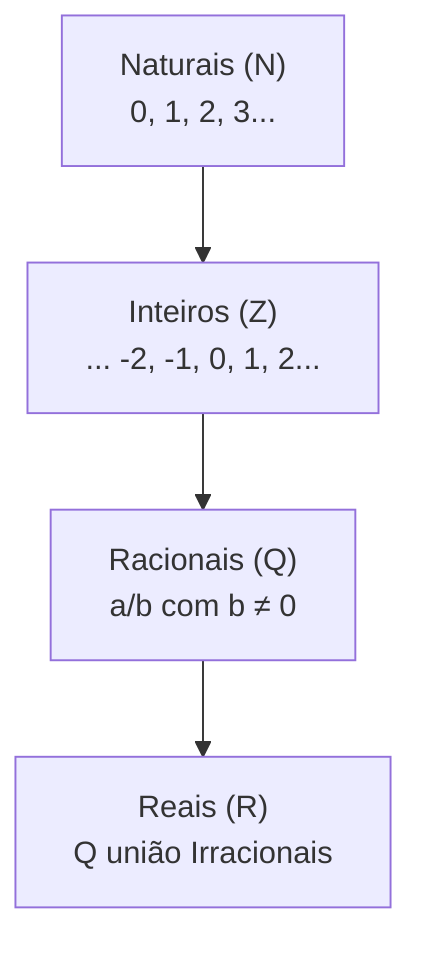
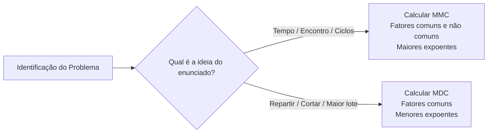

# 01 - Aritmética e Conjuntos Numéricos

> **Matéria:** Matemática e Raciocínio Lógico  
> **Cargos:** A01 – Técnico de Controle Externo (Adm) / B02 – Técnico de Controle Externo (TI)  
> **Arquivo:** `01_conjuntos_numericos_fracoes_e_aritmetica.md`  
> **Status:** 🟢 Teoria Aprofundada + 5 Questões FCC Comentadas (A a E)

---

## 📌 Ementa / Itens do Edital
- Números inteiros e racionais: operações (adição, subtração, multiplicação, divisão, potenciação).
- Expressões numéricas.
- Múltiplos e divisores de números naturais.
- Problemas envolvendo números inteiros e racionais.
- Frações e operações com frações.

---

## 🧭 Sumário

1. [Conjuntos Numéricos Fundamentais e Propriedades Estruturais](#1-conjuntos-numericos-fundamentais-e-propriedades-estruturais)
    1. [Conjunto dos Números Naturais e Inteiros](#11-conjunto-dos-numeros-naturais-e-inteiros)
    2. [Conjunto dos Números Racionais: Decimais Finitos e Dízimas Periódicas](#12-conjunto-dos-numeros-racionais-decimais-finitos-e-dizimas-periodicas)
    3. [Algoritmo da Divisão Euclidiana e Aritmética dos Restos](#13-algoritmo-da-divisao-euclidiana-e-aritmetica-dos-restos)
    4. [Teste 072](#Teste-072)
    5. [Teste 073](#Teste-073)
2. [Operações Aritméticas e Expressões Numéricas](#2-operacoes-aritmeticas-e-expressoes-numericas)
    1. [Ordem de Precedência das Operações e Delimitadores](#21-ordem-de-precedencia-das-operacoes-e-delimitadores)
    2. [Potenciação: Propriedades Operatórias e Notação Científica](#22-potenciacao-propriedades-operatorias-e-notacao-cientifica)
    3. [Teste 074](#Teste-074)
3. [Teoria dos Números: Divisibilidade, Primos, MMC e MDC](#3-teoria-dos-numeros-divisibilidade-primos-mmc-e-mdc)
    1. [Critérios de Divisibilidade Aplicados](#31-criterios-de-divisibilidade-aplicados)
    2. [Decomposição em Fatores Primos e Contagem de Divisores Positivos](#32-decomposicao-em-fatores-primos-e-contagem-de-divisores-positivos)
    3. [Mínimo Múltiplo Comum: Ciclos, Coincidências e Periodicidade](#33-minimo-multiplo-comum-ciclos-coincidencias-e-periodicidade)
    4. [Máximo Divisor Comum: Partições Equitativas e Lotes Máximos](#34-maximo-divisor-comum-particoes-equitativas-e-lotes-maximos)
    5. [Relação Fundamental entre MMC e MDC](#35-relacao-fundamental-entre-mmc-e-mdc)
    6. [Teste 075](#Teste-075)
    7. [Teste 076](#Teste-076)
    8. [Teste 077](#Teste-077)
4. [Álgebra Fracionária e Operações com Frações](#4-algebra-fracionaria-e-operacoes-com-fracoes)
    1. [Conceito, Tipologias e Equivalência de Frações](#41-conceito-tipologias-e-equivalencia-de-fracoes)
    2. [Operações Aritméticas com Frações](#42-operacoes-aritmeticas-com-fracoes)
    3. [Teste 078](#Teste-078)
5. [Modelagem e Resolução de Problemas no Padrão FCC](#5-modelagem-e-resolucao-de-problemas-no-padrao-fcc)
    1. [Problemas de Fração de Resto ou Cadeia Regressiva](#51-problemas-de-fracao-de-resto-ou-cadeia-regressiva)
    2. [Problemas de Trabalho Conjunto e Torneiras](#52-problemas-de-trabalho-conjunto-e-torneiras)
    3. [Problemas de Ciclos Periódicos e Padrões Sequenciais](#53-problemas-de-ciclos-periodicos-e-padroes-sequenciais)
    4. [Teste 079](#Teste-079)
    5. [Teste 080](#Teste-080)
    6. [Teste 081](#Teste-081)
6. [🌐 Fontes Oficiais e Referências Bibliográficas](#fontes-oficiais-e-referencias-bibliograficas)

---

## 1. Conjuntos Numéricos Fundamentais e Propriedades Estruturais

O estudo dos conjuntos numéricos estabelece as bases conceituais sobre as quais repousa toda a aritmética e o raciocínio quantitativo exigido nos concursos da área fiscal e de controle. A estruturação desses conjuntos desenvolveu-se historicamente para sanar impossibilidades operatórias verificadas em conjuntos mais restritos.

### 1.1 Conjunto dos Números Naturais e Inteiros

* **Conjunto dos Números Naturais ($\mathbb{N}$):**
  $$\mathbb{N} = \{0, 1, 2, 3, 4, 5, \dots\}$$
  Representa o conjunto de contagem primitiva e ordenação de elementos discretos. É fechado sob as operações de adição e multiplicação (a soma ou produto de dois naturais é sempre um natural), mas falha no fechamento da subtração quando o minuendo é menor que o subtraendo ($3 - 8 \notin \mathbb{N}$).
* **Conjunto dos Números Inteiros ($\mathbb{Z}$):**
  $$\mathbb{Z} = \{\dots, -3, -2, -1, 0, 1, 2, 3, \dots\}$$
  Incorpora os opostos simétricos (negativos) aos números naturais, viabilizando o fechamento irrestrito da subtração. Na reta numérica, os inteiros organizam-se ordenadamente em torno da origem zero.
    * *Regra de Sinais na Multiplicação e Divisão:* Sinais iguais geram resultado positivo ($+ \cdot + = +$; $- \cdot - = +$); sinais contrários geram resultado negativo ($+ \cdot - = -$; $- \cdot + = -$).
    * *Adição de Inteiros com Sinais Opostos:* Conserva-se o sinal do termo de maior valor absoluto (módulo) e subtraem-se os valores: $(-15) + (+9) = -(15 - 9) = -6$.

### 1.2 Conjunto dos Números Racionais: Decimais Finitos e Dízimas Periódicas

O **Conjunto dos Números Racionais ($\mathbb{Q}$)** reúne todos os números suscetíveis de representação sob a forma de uma razão ou fração de dois números inteiros com denominador não nulo:
$$\mathbb{Q} = \left\{ x = \frac{a}{b} \ \middle| \ a \in \mathbb{Z}, \ b \in \mathbb{Z}, \ b \neq 0 \right\}$$

Todo número racional pode ser transcrito sob representação decimal, dividindo-se o numerador pelo denominador, resultando em apenas duas possibilidades formais:

1. **Decimais Exatos (ou Finitos):** Apresentam um número finito de casas decimais após a vírgula. Isso ocorre quando a fração irredutível $\frac{a}{b}$ possui um denominador $b$ decomposto exclusivamente em fatores primos iguais a $2$ e/ou $5$:
   $$0,75 = \frac{75}{100} = \frac{3}{4} \quad (4 = 2^2); \qquad 0,35 = \frac{35}{100} = \frac{7}{20} \quad (20 = 2^2 \times 5)$$
2. **Dízimas Periódicas:** Apresentam infinitas casas decimais que se repetem de maneira cíclica a partir de um bloco repetitivo denominado **período**:
    * **Dízima Periódica Simples:** O período principia imediatamente após a vírgula:
     $$0,\overline{4} = 0,444\dots = \frac{4}{9}; \qquad 0,\overline{27} = 0,2727\dots = \frac{27}{99} = \frac{3}{11}$$
    * **Dízima Periódica Composta:** Existe um segmento decimal que não se repete (o antiperíodo) posicionado entre a vírgula e o início do período:
     $$0,1\overline{6} = 0,1666\dots$$
    * **Regra Prática da Fração Geratriz para Dízimas Compostas:**
     $$\text{Fração Geratriz} = \frac{(\text{Antiperíodo seguido do Período}) - (\text{Antiperíodo})}{(\text{tantos 9 quantos forem os dígitos do período}) \times 10^{(\text{dígitos do antiperíodo})}}$$
     Exemplo para $0,1\overline{6}$:
     $$0,1\overline{6} = \frac{16 - 1}{90} = \frac{15}{90} = \frac{1}{6}$$

### 1.3 Algoritmo da Divisão Euclidiana e Aritmética dos Restos

Para quaisquer dois números inteiros $D$ (dividendo) e $d$ (divisor não nulo), existem inteiros únicos $q$ (quociente) e $r$ (resto) tais que:
$$D = d \cdot q + r, \quad \text{onde } 0 \le r < |d|$$

Propriedades críticas da divisão inteira:

* O resto $r$ é **estritamente não negativo** e **menor que o divisor** ($0 \le r \le d - 1$).
* O **resto máximo possível** na divisão por um divisor $d$ é sempre igual a $d - 1$. Se um problema indagar o resto máximo obtido na divisão por $15$, esse valor é inequivocamente $15 - 1 = 14$.

> 🚨 **ALERTA DE PROVA / PEGADINHA FCC:** Em problemas que envolvem ciclos e restos de divisão (dias da semana, rodízio de equipes, posições de algarismos), o divisor corresponde ao tamanho do ciclo. Se o resto for zero, significa que a divisão foi exata e que a posição procurada corresponde rigorosamente ao **último elemento** do ciclo periódico, e não ao primeiro!

---

### Teste 072
**(FGV – TRT/13 – 2022 – Analista Judiciario Tecnologia Da Informacao)**
No contexto do PostgreSQL, avalie se o comando TRUNCATE I. Inibe a ação dos triggers para DELETE associados à tabela durante a deleção dos registros (linhas); II. Requer o privilégio TRUNCATE; III. Permite “resetar” as colunas identificadoras para os valores originais por meio da cláusula RESTART IDENTITY; IV. Permite o truncamento ode várias tabelas numa única linha de comando. Assinale o número de características que são fidedignas ao funcionamento do PostgreSQL.

* **A)** Zero.
* **B)** Uma.
* **C)** Duas.
* **D)** Três.
* **E)** Quatro. Questão Discursiva Analise o código JavaScript da função XPTO exibido a seguir. function XPTO(valor, lista) { var i = 0; var posicao = -1; for (i = 0; i < lista.length; i++) { if (lista[i] == valor) { posicao = i; } } return posicao; } A função percorre um array contendo números inteiros e retorna a posição de um determinado número. Se esse número não é encontrado no array, a função retorna o valor -1. O número procurado e o array são fornecidos como parâmetros. Note que o código, como apresentado, executa tantos ciclos quantos forem os elementos na lista. Por exemplo, XPTO (11, [2, 1, 3, 4, 7, 8, 10, 12]) retornaria -1, e percorreria 8 ciclos. XPTO (13, [1, 2, 3, 5, 8, 13, 21]) retornaria 5, e percorreria 7 ciclos. XPTO (1, [1, 2]) retornaria 0, e percorreria 2 ciclos. Pede-se Considerando que o array fornecido jamais contém números repetidos, e que seus elementos estão sempre dispostos em ordem crescente, apresente uma nova versão do código dessa função de modo que o tempo de processamento (ou número de ciclos) diminua tanto quanto possível. Note que a solução apresentada: a) deve manter a assinatura original e a especificação da função original; b) não pode utilizar funções/métodos de busca auxiliares; c) não pode criar/utilizar índices/tabelas auxiliares; c) deve manter a sintaxe JavaScript; d) não deve conter comentários. Serão avaliados: a) a conformidade com a assinatura e a especificação original; b) a correção da versão apresentada; c) o grau de redução do tempo de processamento obtida.

---

> **Comentário Detalhado:**
>
> - **A)** **Incorreta.** A opção apresenta proposição em desacordo com os fundamentos teóricos e técnicos do tópico ao afirmar que "Zero". De acordo com a teoria estudada em *1.2 Conjunto dos Números Racionais: Decimais Finitos e Dízimas Periódicas*, $$\text{Fração Geratriz} = \frac{(\text{Antiperíodo seguido do Período}) - (\text{Antiperíodo})}{(\text{tantos 9 quantos forem os dígitos do período}) \times 10^{(\text{dígitos do antiperíodo})}}$$.
> - **B)** **Incorreta.** A opção apresenta proposição em desacordo com os fundamentos teóricos e técnicos do tópico ao afirmar que "Uma". De acordo com a teoria estudada em *3.2 Decomposição em Fatores Primos e Contagem de Divisores Positivos*, pelo Teorema Fundamental da Aritmética, qualquer número natural maior que 1 pode ser decomposto de forma única (a menos da ordem dos fatores) em um produto de potências de números primos.
> - **C)** **Incorreta.** A opção apresenta proposição em desacordo com os fundamentos teóricos e técnicos do tópico ao afirmar que "Duas". De acordo com a teoria estudada em *1.2 Conjunto dos Números Racionais: Decimais Finitos e Dízimas Periódicas*, todo número racional pode ser transcrito sob representação decimal, dividindo-se o numerador pelo denominador, resultando em apenas duas possibilidades formais.
> - **D)** **Incorreta.** A opção apresenta proposição em desacordo com os fundamentos teóricos e técnicos do tópico ao afirmar que "Três". De acordo com a teoria estudada em *Quantidade Total de Divisores Positivos:*, *Exemplo:* Para encontrar quantos divisores possui o número 360.
> - **E)** **Correta.** Conforme fundamentado na seção *3.4 Máximo Divisor Comum: Partições Equitativas e Lotes Máximos* deste guia, em problemas de particionamento (como arquivar pastas em caixas de maior tamanho possível), o cálculo do MDC fornece a capacidade de cada caixa, e não a quantidade total de caixas! Para achar a quantidade de caixas, deve-se somar a divisão de cada lote pelo valor do MDC encontrado. Dessa forma, está plenamente correta a assertiva da banca (FGV – TRT/13/2022) ao estabelecer que "Quatro. Questão Discursiva Analise o código JavaScript da função XPTO exibido a seguir. function XPTO(valor...".
>
> **Gabarito: E**

---

### Teste 073
**(FCC – TRT 23ª – 2016 – Analista Judiciário - Apoio Especializado - Tecnologia da Informação)**
São vários os tipos de dados numéricos no PostgreSQL. O tipo

* **A)** smallint tem tamanho de armazenamento de 1 byte, que permite armazenar a faixa de valores inteiros de −128 a 127.
* **B)** bigint é a escolha usual para números inteiros, pois oferece o melhor equilíbrio entre faixa de valores, tamanho de armazenamento e desempenho.
* **C)** integer tem tamanho de armazenamento de 4 bytes e pode armazenar valores na faixa de −32768 a 32767.
* **D)** numeric pode armazenar números com precisão variável de, no máximo, 100 dígitos.
* **E)** serial é um tipo conveniente para definir colunas identificadoras únicas, semelhante à propriedade auto incremento.

---

> **Comentário Detalhado:**
>
> - **A)** **Incorreta.** A opção apresenta proposição em desacordo com os fundamentos teóricos e técnicos do tópico ao afirmar que "smallint tem tamanho de armazenamento de 1 byte, que permite armazenar a faixa de valores inteiros de −128 a 127". De acordo com a teoria estudada em *1.1 Conjunto dos Números Naturais e Inteiros*, *Adição de Inteiros com Sinais Opostos:* Conserva-se o sinal do termo de maior valor absoluto (módulo) e subtraem-se os valores: $(-15) + (+9) = -(15 - 9) = -6$.
> - **B)** **Incorreta.** A opção apresenta proposição em desacordo com os fundamentos teóricos e técnicos do tópico ao afirmar que "bigint é a escolha usual para números inteiros, pois oferece o melhor equilíbrio entre faixa de valores, tamanho...". De acordo com a teoria estudada em *1.2 Conjunto dos Números Racionais: Decimais Finitos e Dízimas Periódicas*, $$\text{Fração Geratriz} = \frac{(\text{Antiperíodo seguido do Período}) - (\text{Antiperíodo})}{(\text{tantos 9 quantos forem os dígitos do período}) \times 10^{(\text{dígitos do antiperíodo})}}$$.
> - **C)** **Incorreta.** A opção apresenta proposição em desacordo com os fundamentos teóricos e técnicos do tópico ao afirmar que "integer tem tamanho de armazenamento de 4 bytes e pode armazenar valores na faixa de −32768 a 32767". De acordo com a teoria estudada em *3.4 Máximo Divisor Comum: Partições Equitativas e Lotes Máximos*, palavras-chave: "Quando voltarão a se encontrar?", "periodicidade", "ciclos", "simultaneamente" — "Maior tamanho possível", "sem sobras", "dividir igualmente", "menor número de caixas".
> - **D)** **Correta.** Conforme fundamentado na seção *1.2 Conjunto dos Números Racionais: Decimais Finitos e Dízimas Periódicas* deste guia, $$0,75 = \frac{75}{100} = \frac{3}{4} \quad (4 = 2^2); \qquad 0,35 = \frac{35}{100} = \frac{7}{20} \quad (20 = 2^2 \times 5)$$. Dessa forma, está plenamente correta a assertiva da banca (FCC – TRT 23ª/2016) ao estabelecer que "numeric pode armazenar números com precisão variável de, no máximo, 100 dígitos".
> - **E)** **Incorreta.** A opção apresenta proposição em desacordo com os fundamentos teóricos e técnicos do tópico ao afirmar que "serial é um tipo conveniente para definir colunas identificadoras únicas, semelhante à propriedade auto incremento". De acordo com a teoria estudada em *1.2 Conjunto dos Números Racionais: Decimais Finitos e Dízimas Periódicas*, todo número racional pode ser transcrito sob representação decimal, dividindo-se o numerador pelo denominador, resultando em apenas duas possibilidades formais.
>
> **Gabarito: D**

---

## 2. Operações Aritméticas e Expressões Numéricas

### 2.1 Ordem de Precedência das Operações e Delimitadores

A avaliação de expressões aritméticas complexas exige obediência à ordem universal de precedência matemática (mnemônico PEMDAS / PDMAS):

1. **Ordem dos Delimitadores de Escopo (de dentro para fora):**
   1º) Parênteses $( \ )$;
   2º) Colchetes $[ \ ]$;
   3º) Chaves $\{ \ \}$.
2. **Ordem Hierárquica das Operações:**
   1º) **Potenciações e Radiciações** (na ordem em que aparecem da esquerda para a direita);
   2º) **Multiplicações e Divisões** (com estrita igualdade de precedência, calculando-se o que vier primeiro da esquerda para a direita);
   3º) **Adições e Subtrações** (igualmente da esquerda para a direita).

> 📌 **NOTA EXPLICATIVA / ERRO COMUM DE DIVISÃO E MULTIPLICAÇÃO:** Na expressão $12 \div 3 \times 2$, a multiplicação **não** tem prioridade sobre a divisão! Ambas possuem a mesma hierarquia; resolve-se da esquerda para a direita: $12 \div 3 = 4$, e $4 \times 2 = 8$ (o cálculo incorreto $12 \div 6 = 2$ é uma armadilha frequente).

### 2.2 Potenciação: Propriedades Operatórias e Notação Científica

A potenciação traduz o produto de fatores idênticos repetidos ($a^n = \underbrace{a \cdot a \cdots a}_{n \text{ vezes}}$). Suas propriedades fundamentais incluem:

* Produto de potências de mesma base: $a^m \cdot a^n = a^{m+n}$
* Divisão de potências de mesma base: $\frac{a^m}{a^n} = a^{m-n} \quad (a \neq 0)$
* Potência de potência: $(a^m)^n = a^{m \cdot n}$
* Potência de produto: $(a \cdot b)^n = a^n \cdot b^n$
* Expoente nulo: $a^0 = 1 \quad (a \neq 0)$
* Expoente negativo: $a^{-n} = \frac{1}{a^n} = \left(\frac{1}{a}\right)^n \quad (a \neq 0)$
* Expoente fracionário (Radiciação): $a^{\frac{m}{n}} = \sqrt[n]{a^m}$

---

### Teste 074
**(FGV – TJ/MT – 2024 – Analista Judiciario Tecnologia Da Informacao)**
Os tabuleiros utilizados para jogos de damas e de xadrez são objetos quadrados divididos em linhas e colunas formando uma matriz 8 x 8. Cada uma das casas do tabuleiro corresponde a posições na matriz. As linhas (𝐿) são numeradas de 1 a 8, de cima para baixo e as colunas (𝐶) são numeradas de 1 a 8, da esquerda para a direita, conforme ilustra a figura a seguir. Cada casa do tabuleiro tem uma única cor definida como segue: branca,se 𝐿+𝐶 é par cor da casa = { preta,se 𝐿+𝐶 é ímpar Se, na definição das cores das casas do tabuleiro apresentada acima, ambas as operações de adição fossem trocadas por operações de multiplicação, o tabuleiro passaria a ter

* **A)** 8 casas brancas e 56 casas pretas.
* **B)** 16 casas brancas e 48 casas pretas.
* **C)** 24 casas brancas e 40 casas pretas.
* **D)** 36 casas brancas e 28 casas pretas.
* **E)** 48 casas brancas e 16 casas pretas.

---

> **Comentário Detalhado:**
>
> - **A)** **Incorreta.** A opção apresenta proposição em desacordo com os fundamentos teóricos e técnicos do tópico ao afirmar que "8 casas brancas e 56 casas pretas". De acordo com a teoria estudada em *1.2 Conjunto dos Números Racionais: Decimais Finitos e Dízimas Periódicas*, decimais Exatos (ou Finitos): Apresentam um número finito de casas decimais após a vírgula. Isso ocorre quando a fração irredutível $\frac{a}{b}$ possui um denominador $b$ decomposto exclusivamente em fatores primos iguais a $2$ e/ou $5$.
> - **B)** **Incorreta.** A opção apresenta proposição em desacordo com os fundamentos teóricos e técnicos do tópico ao afirmar que "16 casas brancas e 48 casas pretas". De acordo com a teoria estudada em *1.2 Conjunto dos Números Racionais: Decimais Finitos e Dízimas Periódicas*, dízimas Periódicas: Apresentam infinitas casas decimais que se repetem de maneira cíclica a partir de um bloco repetitivo denominado período.
> - **C)** **Incorreta.** A opção apresenta proposição em desacordo com os fundamentos teóricos e técnicos do tópico ao afirmar que "24 casas brancas e 40 casas pretas". De acordo com a teoria estudada em *2.1 Ordem de Precedência das Operações e Delimitadores*, 1º) Potenciações e Radiciações (na ordem em que aparecem da esquerda para a direita).
> - **D)** **Incorreta.** A opção apresenta proposição em desacordo com os fundamentos teóricos e técnicos do tópico ao afirmar que "36 casas brancas e 28 casas pretas". De acordo com a teoria estudada em *2.1 Ordem de Precedência das Operações e Delimitadores*, 2º) Multiplicações e Divisões (com estrita igualdade de precedência, calculando-se o que vier primeiro da esquerda para a direita).
> - **E)** **Correta.** Conforme fundamentado na seção *2.1 Ordem de Precedência das Operações e Delimitadores* deste guia, na expressão $12 \div 3 \times 2$, a multiplicação não tem prioridade sobre a divisão! Ambas possuem a mesma hierarquia; resolve-se da esquerda para a direita: $12 \div 3 = 4$, e $4 \times 2 = 8$ (o cálculo incorreto $12 \div 6 = 2$ é uma armadilha frequente). Dessa forma, está plenamente correta a assertiva da banca (FGV – TJ/MT/2024) ao estabelecer que "48 casas brancas e 16 casas pretas".
>
> **Gabarito: E**

---

## 3. Teoria dos Números: Divisibilidade, Primos, MMC e MDC

A teoria dos números fornece o ferramental algébrico para lidar com divisões inteiras, periodicidade de escalas e otimização de lotes em logística e auditoria.

### 3.1 Critérios de Divisibilidade Aplicados

Permitem verificar se um número inteiro $N$ é divisível por outro sem executar a divisão longa:

* **Por 2:** O último algarismo da direita é par ($0, 2, 4, 6, 8$).
* **Por 3:** A soma dos valores absolutos dos seus algarismos é um múltiplo de 3 (ex.: $7.458 \rightarrow 7 + 4 + 5 + 8 = 24$, que é divisível por 3).
* **Por 4:** O número formado pelos dois últimos algarismos é divisível por 4 ou termina em $00$.
* **Por 5:** O último algarismo é $0$ ou $5$.
* **Por 6:** É simultaneamente divisível por 2 (par) e por 3 (soma dos algarismos múltipla de 3).
* **Por 8:** O número formado pelos três últimos algarismos é divisível por 8 ou termina em $000$.
* **Por 9:** A soma dos seus algarismos resulta em um múltiplo de 9.
* **Por 10:** O último algarismo é obrigatoriamente $0$.
* **Por 11:** A diferença entre a soma dos algarismos de ordem ímpar e a soma dos algarismos de ordem par é múltipla de 11 (incluindo o zero).

### 3.2 Decomposição em Fatores Primos e Contagem de Divisores Positivos

Pelo Teorema Fundamental da Aritmética, qualquer número natural maior que 1 pode ser decomposto de forma única (a menos da ordem dos fatores) em um produto de potências de números primos:
$$N = p_1^{\alpha} \cdot p_2^{\beta} \cdot p_3^{\gamma} \cdots p_k^{\omega}$$

#### Quantidade Total de Divisores Positivos:
O número total de divisores inteiros positivos de $N$ é obtido somando-se uma unidade a cada expoente da fatoração canônica e multiplicando-se os resultados:
$$Q(N) = (\alpha + 1)(\beta + 1)(\gamma + 1)\cdots(\omega + 1)$$
*Exemplo:* Para encontrar quantos divisores possui o número 360:
$$360 = 2^3 \cdot 3^2 \cdot 5^1 \implies Q(360) = (3 + 1)(2 + 1)(1 + 1) = 4 \times 3 \times 2 = 24 \text{ divisores}$$

### 3.3 Mínimo Múltiplo Comum: Ciclos, Coincidências e Periodicidade

O **Mínimo Múltiplo Comum (MMC)** entre dois ou mais inteiros é o menor número natural não nulo que é divisível simultaneamente por todos eles.

* **Cálculo Prático:** Decompõem-se os números em fatores primos; o MMC é o produto de **todos os fatores primos comuns e não comuns, elevados aos seus maiores expoentes**.

> 💡 **DICA DE IDENTIFICAÇÃO (MMC NA FCC):** O problema exige MMC sempre que veicular ideias de **coincidência temporal futura**, **reencontro de eventos periódicos**, **ciclos de rondas/inspeções** ou questões que indaguem: *"quando voltarão a se encontrar simultaneamente?"*.

### 3.4 Máximo Divisor Comum: Partições Equitativas e Lotes Máximos

O **Máximo Divisor Comum (MDC)** é o maior número inteiro capaz de dividir exatamente todos os números dados, sem deixar resto.

* **Cálculo Prático:** É o produto **apenas dos fatores primos comuns a todos os números, elevados aos seus menores expoentes**.

| Característica | Mínimo Múltiplo Comum (MMC) | Máximo Divisor Comum (MDC) |
|---|---|---|
| **Ideia central** | Coincidência, repetição, sincronia periódica | Divisão, partição equitativa, corte em partes iguais |
| **Palavras-chave** | "Quando voltarão a se encontrar?", "periodicidade", "ciclos", "simultaneamente" | "Maior tamanho possível", "sem sobras", "dividir igualmente", "menor número de caixas" |
| **Fatoração em primos** | Fatores comuns e não comuns com os **maiores expoentes** | Apenas fatores **comuns** com os **menores expoentes** |

> 🚨 **ALERTA DE PROVA / PEGADINHA CLÁSSICA DO MDC:** Em problemas de particionamento (como arquivar pastas em caixas de maior tamanho possível), o cálculo do MDC fornece a **capacidade de cada caixa**, e **não a quantidade total de caixas**! Para achar a quantidade de caixas, deve-se somar a divisão de cada lote pelo valor do MDC encontrado.

### 3.5 Relação Fundamental entre MMC e MDC

Para quaisquer dois números inteiros positivos $a$ e $b$, o produto entre o seu MMC e o seu MDC é rigorosamente igual ao produto entre os próprios números:
$$\text{MMC}(a, b) \times \text{MDC}(a, b) = a \times b$$

---

### Teste 075
**(FGV – TRT/13 – 2022 – Analista Judiciario Tecnologia Da Informacao)**
A soma de 2 números naturais é 22253. Um dos números é divisível por 10 e se retirarmos o algarismo das unidades desse número obtém-se o outro número. A diferença entre o maior e o menor número é

* **A)** 13222.
* **B)** 14644.
* **C)** 15876.
* **D)** 17732.
* **E)** 18207.

---

> **Comentário Detalhado:**
>
> - **A)** **Incorreta.** A opção apresenta proposição em desacordo com os fundamentos teóricos e técnicos do tópico ao afirmar que "13222". De acordo com a teoria estudada em *1.1 Conjunto dos Números Naturais e Inteiros*, é fechado sob as operações de adição e multiplicação (a soma ou produto de dois naturais é sempre um natural), mas falha no fechamento da subtração quando o minuendo é menor que o subtraendo ($3 - 8 \notin \mathbb{N}$).
> - **B)** **Incorreta.** A opção apresenta proposição em desacordo com os fundamentos teóricos e técnicos do tópico ao afirmar que "14644". De acordo com a teoria estudada em *3.3 Mínimo Múltiplo Comum: Ciclos, Coincidências e Periodicidade*, o Mínimo Múltiplo Comum (MMC) entre dois ou mais inteiros é o menor número natural não nulo que é divisível simultaneamente por todos eles.
> - **C)** **Incorreta.** A opção apresenta proposição em desacordo com os fundamentos teóricos e técnicos do tópico ao afirmar que "15876". De acordo com a teoria estudada em *3.4 Máximo Divisor Comum: Partições Equitativas e Lotes Máximos*, palavras-chave: "Quando voltarão a se encontrar?", "periodicidade", "ciclos", "simultaneamente" — "Maior tamanho possível", "sem sobras", "dividir igualmente", "menor número de caixas".
> - **D)** **Incorreta.** A opção apresenta proposição em desacordo com os fundamentos teóricos e técnicos do tópico ao afirmar que "17732". De acordo com a teoria estudada em *3.1 Critérios de Divisibilidade Aplicados*, por 11: A diferença entre a soma dos algarismos de ordem ímpar e a soma dos algarismos de ordem par é múltipla de 11 (incluindo o zero).
> - **E)** **Correta.** Conforme fundamentado na seção *3.1 Critérios de Divisibilidade Aplicados* deste guia, permitem verificar se um número inteiro $N$ é divisível por outro sem executar a divisão longa. Dessa forma, está plenamente correta a assertiva da banca (FGV – TRT/13/2022) ao estabelecer que "18207".
>
> **Gabarito: E**

---

### Teste 076
**(FGV – TRT/DA – 2025 – Tecnico Judiciario Area Administrativa Agente Da Policia Judicial)**
Um palíndromo numérico, ou capicua, é um número que lido de trás para a frente é igual ao número original. Por exemplo: 121, 35653, 8778, 108801 são palíndromos. Entre os números de seis algarismos, a quantidade de palíndromos numéricos é igual a

* **A)** 600.
* **B)** 900.
* **C)** 8.100.
* **D)** 18.000.
* **E)** 180.000.

---

> **Comentário Detalhado:**
>
> - **A)** **Incorreta.** A opção apresenta proposição em desacordo com os fundamentos teóricos e técnicos do tópico ao afirmar que "600". De acordo com a teoria estudada em *Quantidade Total de Divisores Positivos:*, o número total de divisores inteiros positivos de $N$ é obtido somando-se uma unidade a cada expoente da fatoração canônica e multiplicando-se os resultados.
> - **B)** **Correta.** Conforme fundamentado na seção *Quantidade Total de Divisores Positivos:* deste guia, *Exemplo:* Para encontrar quantos divisores possui o número 360. Dessa forma, está plenamente correta a assertiva da banca (FGV – TRT/DA/2025) ao estabelecer que "900".
> - **C)** **Incorreta.** A opção apresenta proposição em desacordo com os fundamentos teóricos e técnicos do tópico ao afirmar que "8.100". De acordo com a teoria estudada em *1.2 Conjunto dos Números Racionais: Decimais Finitos e Dízimas Periódicas*, $$0,75 = \frac{75}{100} = \frac{3}{4} \quad (4 = 2^2); \qquad 0,35 = \frac{35}{100} = \frac{7}{20} \quad (20 = 2^2 \times 5)$$.
> - **D)** **Incorreta.** A opção apresenta proposição em desacordo com os fundamentos teóricos e técnicos do tópico ao afirmar que "18.000". De acordo com a teoria estudada em *3.1 Critérios de Divisibilidade Aplicados*, por 8: O número formado pelos três últimos algarismos é divisível por 8 ou termina em $000$.
> - **E)** **Incorreta.** A opção apresenta proposição em desacordo com os fundamentos teóricos e técnicos do tópico ao afirmar que "180.000". De acordo com a teoria estudada em *3.1 Critérios de Divisibilidade Aplicados*, por 4: O número formado pelos dois últimos algarismos é divisível por 4 ou termina em $00$.
>
> **Gabarito: B**

---

### Teste 077
**(FGV – TCE/SC – 2026 – Auditor Fiscal de Controle Externo - Administração)**
Gabriel fez um sorteio dos seis primeiros números naturais e obteve a sequência: 6 3 5 1 4 2 Essa sequência poderá ser alterada mediante uma sucessão de movimentos. Realizar um movimento significa escolher um dos números da sequência e fazê-lo pular o número que está imediatamente à sua direita. A partir da sequência dada, após 𝑛 movimentos, Gabriel obteve esta sequência natural: 1 2 3 4 5 6. O menor valor possível de 𝑛 é

* **A)** 10.
* **B)** 11.
* **C)** 12.
* **D)** 13.
* **E)** 14. Ética no Serviço Público

---

> **Comentário Detalhado:**
>
> - **A)** **Incorreta.** A opção apresenta proposição em desacordo com os fundamentos teóricos e técnicos do tópico ao afirmar que "10". De acordo com a teoria estudada em *3.3 Mínimo Múltiplo Comum: Ciclos, Coincidências e Periodicidade*, o Mínimo Múltiplo Comum (MMC) entre dois ou mais inteiros é o menor número natural não nulo que é divisível simultaneamente por todos eles.
> - **B)** **Correta.** Conforme fundamentado na seção *3.2 Decomposição em Fatores Primos e Contagem de Divisores Positivos* deste guia, pelo Teorema Fundamental da Aritmética, qualquer número natural maior que 1 pode ser decomposto de forma única (a menos da ordem dos fatores) em um produto de potências de números primos. Dessa forma, está plenamente correta a assertiva da banca (FGV – TCE/SC/2026) ao estabelecer que "11".
> - **C)** **Incorreta.** A opção apresenta proposição em desacordo com os fundamentos teóricos e técnicos do tópico ao afirmar que "12". De acordo com a teoria estudada em *3.4 Máximo Divisor Comum: Partições Equitativas e Lotes Máximos*, palavras-chave: "Quando voltarão a se encontrar?", "periodicidade", "ciclos", "simultaneamente" — "Maior tamanho possível", "sem sobras", "dividir igualmente", "menor número de caixas".
> - **D)** **Incorreta.** A opção apresenta proposição em desacordo com os fundamentos teóricos e técnicos do tópico ao afirmar que "13". De acordo com a teoria estudada em *1.1 Conjunto dos Números Naturais e Inteiros*, é fechado sob as operações de adição e multiplicação (a soma ou produto de dois naturais é sempre um natural), mas falha no fechamento da subtração quando o minuendo é menor que o subtraendo ($3 - 8 \notin \mathbb{N}$).
> - **E)** **Incorreta.** A opção apresenta proposição em desacordo com os fundamentos teóricos e técnicos do tópico ao afirmar que "14. Ética no Serviço Público". De acordo com a teoria estudada em *1.2 Conjunto dos Números Racionais: Decimais Finitos e Dízimas Periódicas*, dízima Periódica Simples: O período principia imediatamente após a vírgula.
>
> **Gabarito: B**

---

## 4. Álgebra Fracionária e Operações com Frações

Uma fração $\frac{a}{b}$ representa uma divisão indicada onde o denominador $b$ assinala em quantas partes iguais a unidade inteira foi particionada, e o numerador $a$ indica quantas dessas partes foram tomadas.

### 4.1 Conceito, Tipologias e Equivalência de Frações

* **Fração Própria:** O numerador é menor que o denominador ($a < b$). Representa um valor estritamente menor que a unidade inteira ($\frac{2}{5}, \frac{7}{9}$).
* **Fração Imprópria:** O numerador é maior ou igual ao denominador ($a \ge b$). Representa um valor maior ou igual à unidade inteira ($\frac{7}{4}, \frac{11}{3}$). Podem ser convertidas em **números mistos**: $\frac{7}{4} = 1 \frac{3}{4}$.
* **Fração Aparente:** O numerador é múltiplo exato do denominador, consubstanciando um número inteiro disfarçado ($\frac{12}{3} = 4, \frac{35}{7} = 5$).
* **Frações Equivalentes e Irredutibilidade:** Duas frações são equivalentes quando representam a mesma grandeza fracionária ($\frac{2}{3} = \frac{4}{6} = \frac{10}{15}$). Obtém-se a fração irredutível simplificando numerador e denominador pelo seu MDC.

### 4.2 Operações Aritméticas com Frações

1. **Adição e Subtração:**
    * Com denominadores iguais: conserva-se o denominador comum e operam-se os numeradores: $\frac{a}{c} \pm \frac{b}{c} = \frac{a \pm b}{c}$.
    * Com denominadores distintos: reduz-se ao mesmo denominador mediante o cálculo do MMC dos denominadores:
     $$\frac{a}{b} \pm \frac{c}{d} = \frac{\left(\frac{\text{MMC}}{b} \cdot a\right) \pm \left(\frac{\text{MMC}}{d} \cdot c\right)}{\text{MMC}(b, d)}$$
2. **Multiplicação:** Multiplicam-se os numeradores entre si e os denominadores entre si:
   $$\frac{a}{b} \times \frac{c}{d} = \frac{a \cdot c}{b \cdot d}$$
   A preposição "de" na matemática denota multiplicação: $\frac{2}{3}$ *de* $\frac{4}{5} = \frac{2}{3} \times \frac{4}{5} = \frac{8}{15}$.
3. **Divisão:** Conserva-se a primeira fração e multiplica-se pela fração inversa da segunda:
   $$\frac{a}{b} \div \frac{c}{d} = \frac{a}{b} \times \frac{d}{c} = \frac{a \cdot d}{b \cdot c} \quad (c, d \neq 0)$$

---

### Teste 078
**(FCC – TRT 13ª – 2014 – Analista Judiciário - Tecnologia da Informação)**
A classe Stack da biblioteca Java implementa o tipo abstrato de pilha e as operações push e pop. Considere o exemplo abaixo. import java.util.Stack; public class Pilha { public static void main(String[] args) { Stack<String> s = new Stack<String>(); s.push("Ana"); s.push("Paulo"); s.push("Pedro"); s.push("Marcos"); while (s.size() > 0) { System.out.println(s.pop()); } } } Sobre a classe Pilha apresentada é correto afirmar:

* **A)** JTest e teste de carga.
* **B)** JMeter e teste de unidade.
* **C)** JRun e teste funcional.
* **D)** JUnit e teste de unidade.
* **E)** JMeter e teste de carga.

---

> **Comentário Detalhado:**
>
> - **A)** **Incorreta.** A opção apresenta proposição em desacordo com os fundamentos teóricos e técnicos do tópico ao afirmar que "JTest e teste de carga". De acordo com a teoria estudada em *4.1 Conceito, Tipologias e Equivalência de Frações*, fração Própria: O numerador é menor que o denominador ($a < b$). Representa um valor estritamente menor que a unidade inteira ($\frac{2}{5}, \frac{7}{9}$).
> - **B)** **Correta.** Conforme fundamentado na seção *4. Álgebra Fracionária e Operações com Frações* deste guia, uma fração $\frac{a}{b}$ representa uma divisão indicada onde o denominador $b$ assinala em quantas partes iguais a unidade inteira foi particionada, e o numerador $a$ indica quantas dessas partes foram tomadas. Dessa forma, está plenamente correta a assertiva da banca (FCC – TRT 13ª/2014) ao estabelecer que "JMeter e teste de unidade".
> - **C)** **Incorreta.** A opção apresenta proposição em desacordo com os fundamentos teóricos e técnicos do tópico ao afirmar que "JRun e teste funcional". De acordo com a teoria estudada em *4.1 Conceito, Tipologias e Equivalência de Frações*, fração Imprópria: O numerador é maior ou igual ao denominador ($a \ge b$). Representa um valor maior ou igual à unidade inteira ($\frac{7}{4}, \frac{11}{3}$). Podem ser convertidas em números mistos: $\frac{7}{4} = 1 \frac{3}{4}$.
> - **D)** **Incorreta.** A opção apresenta proposição em desacordo com os fundamentos teóricos e técnicos do tópico ao afirmar que "JUnit e teste de unidade". De acordo com a teoria estudada em *Quantidade Total de Divisores Positivos:*, o número total de divisores inteiros positivos de $N$ é obtido somando-se uma unidade a cada expoente da fatoração canônica e multiplicando-se os resultados.
> - **E)** **Incorreta.** A opção apresenta proposição em desacordo com os fundamentos teóricos e técnicos do tópico ao afirmar que "JMeter e teste de carga". De acordo com a teoria estudada em *Quantidade Total de Divisores Positivos:*, *Exemplo:* Para encontrar quantos divisores possui o número 360.
>
> **Gabarito: B**

---

## 5. Modelagem e Resolução de Problemas no Padrão FCC

### 5.1 Problemas de Fração de Resto ou Cadeia Regressiva

Problemas clássicos da FCC narram um agente que consome uma fração de um montante total no primeiro dia, gasta uma fração **do restante** no segundo dia e encerra com uma quantia fixa final:

* Se no passo 1 gasta-se $\frac{1}{3}$ do total $T$, sobra:
  $$\text{Resto}_1 = 1 - \frac{1}{3} = \frac{2}{3}T$$
* Se no passo 2 gasta-se $\frac{3}{5}$ **do que sobrou**, o gasto é $\frac{3}{5} \times \frac{2}{3}T = \frac{6}{15}T = \frac{2}{5}T$.
* A parcela que resta ao final é o complementar de $\frac{3}{5}$ sobre o restante prévio:
  $$\text{Resto Final} = \left(1 - \frac{3}{5}\right) \times \frac{2}{3}T = \frac{2}{5} \times \frac{2}{3}T = \frac{4}{15}T$$
* Igualando essa fração ao valor numérico remanescente dado no enunciado, descobre-se o total $T$ por equação direta.

### 5.2 Problemas de Trabalho Conjunto e Torneiras

Quando dois agentes executam uma mesma tarefa de forma cooperativa em ritmos constantes, somam-se as suas taxas unitárias horárias de produtividade:
$$\text{Taxa Conjunta} = \frac{1}{T_{\text{junto}}} = \frac{1}{t_1} + \frac{1}{t_2} + \dots - \frac{1}{t_{\text{ralo}}}$$
Para o caso específico de dois agentes que levam tempos individuais $t_1$ e $t_2$:
$$T = \frac{t_1 \cdot t_2}{t_1 + t_2}$$

*Atenção à Conversão de Tempo:* Se o resultado da divisão em horas for decimal, como $2,4\text{ horas}$, a parte inteira corresponde a $2\text{ horas}$ e a parte decimal $0,4$ deve ser multiplicada por $60\text{ minutos}$ ($0,4 \times 60 = 24\text{ minutos}$). Logo, $2,4\text{ h} = 2\text{ horas e } 24\text{ minutos}$ (e nunca 2h40min!).

### 5.3 Problemas de Ciclos Periódicos e Padrões Sequenciais

Em problemas que constroem sequências infinitas repetindo ciclicamente um conjunto finito de $k$ elementos ($x_1, x_2, \dots, x_k$):

1. Toma-se o número da posição requerida $P$;
2. Divide-se $P$ pelo tamanho do ciclo $k$, obtendo o quociente $q$ e o resto $r$ ($P = k \cdot q + r$);
3. **Se o resto $r > 0$:** O termo procurado é exatamente o $r$-ésimo elemento do ciclo padrão;
4. **Se o resto $r = 0$:** O termo procurado é o último elemento do ciclo (o $k$-ésimo elemento).

---

### Teste 079
**(FCC – TRT 14ª – 2016 – Analista Judiciário - Apoio Especializado - Tecnologia da Informação)**
De acordo com o texto, a Microsoft

* **A)** criou o OneDrive para concorrer com o Dropbox.
* **B)** faz ofertas de tempos em tempos.
* **C)** tem problemas em encontrar nomes adequados para seus produtos.
* **D)** tem um padrão consagrado para nomear seus produtos.
* **E)** foi processada por usar a palavra Sky para nomear um de seus produtos.

---

> **Comentário Detalhado:**
>
> - **A)** **Incorreta.** A opção apresenta proposição em desacordo com os fundamentos teóricos e técnicos do tópico ao afirmar que "criou o OneDrive para concorrer com o Dropbox". De acordo com a teoria estudada em *3.3 Mínimo Múltiplo Comum: Ciclos, Coincidências e Periodicidade*, o problema exige MMC sempre que veicular ideias de coincidência temporal futura, reencontro de eventos periódicos, ciclos de rondas/inspeções ou questões que indaguem: *"quando voltarão a se encontrar simultaneamente?"*.
> - **B)** **Incorreta.** A opção apresenta proposição em desacordo com os fundamentos teóricos e técnicos do tópico ao afirmar que "faz ofertas de tempos em tempos". De acordo com a teoria estudada em *5.2 Problemas de Trabalho Conjunto e Torneiras*, para o caso específico de dois agentes que levam tempos individuais $t_1$ e $t_2$.
> - **C)** **Correta.** Conforme fundamentado na seção *Quantidade Total de Divisores Positivos:* deste guia, *Exemplo:* Para encontrar quantos divisores possui o número 360. Dessa forma, está plenamente correta a assertiva da banca (FCC – TRT 14ª/2016) ao estabelecer que "tem problemas em encontrar nomes adequados para seus produtos".
> - **D)** **Incorreta.** A opção apresenta proposição em desacordo com os fundamentos teóricos e técnicos do tópico ao afirmar que "tem um padrão consagrado para nomear seus produtos". De acordo com a teoria estudada em *5.3 Problemas de Ciclos Periódicos e Padrões Sequenciais*, se o resto $r > 0$: O termo procurado é exatamente o $r$-ésimo elemento do ciclo padrão.
> - **E)** **Incorreta.** A opção apresenta proposição em desacordo com os fundamentos teóricos e técnicos do tópico ao afirmar que "foi processada por usar a palavra Sky para nomear um de seus produtos". De acordo com a teoria estudada em *3.4 Máximo Divisor Comum: Partições Equitativas e Lotes Máximos*, palavras-chave: "Quando voltarão a se encontrar?", "periodicidade", "ciclos", "simultaneamente" — "Maior tamanho possível", "sem sobras", "dividir igualmente", "menor número de caixas".
>
> **Gabarito: C**

---

### Teste 080
**(FGV – TJ/BA – 2015 – Analista Judiciario Tecnologia Da Informacao)**
“A saga do rapto de Helena e a subsequente Guerra de Troia continuam sendo um dos melhores exemplos dos perigos da luxúria.” Sobre os componentes desse segmento do texto 2, a afirmação correta é:

* **A)** os termos “de Helena” e “de Troia” desempenham a mesma função sintática;
* **B)** a saga do rapto de Helena e a Guerra de Troia são acontecimentos sucessivos, sendo o segundo causa do primeiro;
* **C)** o verbo “continuar” é um verbo de ligação, expressando mudança de estado;
* **D)** a Guerra de Troia, segundo o texto, é o exemplo mais importante dos problemas trazidos pela luxúria;
* **E)** na expressão “perigos da luxúria”, o termo “da luxúria” representa a causa dos “perigos” aludidos.

---

> **Comentário Detalhado:**
>
> - **A)** **Incorreta.** A opção apresenta proposição em desacordo com os fundamentos teóricos e técnicos do tópico ao afirmar que "os termos “de Helena” e “de Troia” desempenham a mesma função sintática". De acordo com a teoria estudada em *5.3 Problemas de Ciclos Periódicos e Padrões Sequenciais*, se o resto $r > 0$: O termo procurado é exatamente o $r$-ésimo elemento do ciclo padrão.
> - **B)** **Incorreta.** A opção apresenta proposição em desacordo com os fundamentos teóricos e técnicos do tópico ao afirmar que "a saga do rapto de Helena e a Guerra de Troia são acontecimentos sucessivos, sendo o segundo causa do primeiro". De acordo com a teoria estudada em *5.1 Problemas de Fração de Resto ou Cadeia Regressiva*, problemas clássicos da FCC narram um agente que consome uma fração de um montante total no primeiro dia, gasta uma fração do restante no segundo dia e encerra com uma quantia fixa final.
> - **C)** **Incorreta.** A opção apresenta proposição em desacordo com os fundamentos teóricos e técnicos do tópico ao afirmar que "o verbo “continuar” é um verbo de ligação, expressando mudança de estado". De acordo com a teoria estudada em *5.3 Problemas de Ciclos Periódicos e Padrões Sequenciais*, se o resto $r = 0$: O termo procurado é o último elemento do ciclo (o $k$-ésimo elemento).
> - **D)** **Incorreta.** A opção apresenta proposição em desacordo com os fundamentos teóricos e técnicos do tópico ao afirmar que "a Guerra de Troia, segundo o texto, é o exemplo mais importante dos problemas trazidos pela luxúria". De acordo com a teoria estudada em *Quantidade Total de Divisores Positivos:*, *Exemplo:* Para encontrar quantos divisores possui o número 360.
> - **E)** **Correta.** Conforme fundamentado na seção *2.1 Ordem de Precedência das Operações e Delimitadores* deste guia, na expressão $12 \div 3 \times 2$, a multiplicação não tem prioridade sobre a divisão! Ambas possuem a mesma hierarquia; resolve-se da esquerda para a direita: $12 \div 3 = 4$, e $4 \times 2 = 8$ (o cálculo incorreto $12 \div 6 = 2$ é uma armadilha frequente). Dessa forma, está plenamente correta a assertiva da banca (FGV – TJ/BA/2015) ao estabelecer que "na expressão “perigos da luxúria”, o termo “da luxúria” representa a causa dos “perigos” aludidos".
>
> **Gabarito: E**

---

### Teste 081
**(FGV – TCE/PA – 2024 – Auditor de Controle Externo - Administrativa - Administração)**
Um dos problemas da escrita é o emprego desnecessário de palavras. Assinale a frase a seguir em que não ocorre esse problema.

* **A)** Todas as interações humanas são oportunidades ou para aprender ou para ensinar.
* **B)** O destino do mundo depende em primeiro lugar dos estadistas. Em segundo lugar, dos intérpretes.
* **C)** Para o seu próprio bem, não fale demais.
* **D)** Umas vezes penso; outras vezes, existo.
* **E)** Uma hora de conversação vale mais que 50 cartas.

---

> **Comentário Detalhado:**
>
> - **A)** **Incorreta.** A opção apresenta proposição em desacordo com os fundamentos teóricos e técnicos do tópico ao afirmar que "Todas as interações humanas são oportunidades ou para aprender ou para ensinar". De acordo com a teoria estudada em *3.3 Mínimo Múltiplo Comum: Ciclos, Coincidências e Periodicidade*, o Mínimo Múltiplo Comum (MMC) entre dois ou mais inteiros é o menor número natural não nulo que é divisível simultaneamente por todos eles.
> - **B)** **Incorreta.** A opção apresenta proposição em desacordo com os fundamentos teóricos e técnicos do tópico ao afirmar que "O destino do mundo depende em primeiro lugar dos estadistas. Em segundo lugar, dos intérpretes". De acordo com a teoria estudada em *5.1 Problemas de Fração de Resto ou Cadeia Regressiva*, problemas clássicos da FCC narram um agente que consome uma fração de um montante total no primeiro dia, gasta uma fração do restante no segundo dia e encerra com uma quantia fixa final.
> - **C)** **Incorreta.** A opção apresenta proposição em desacordo com os fundamentos teóricos e técnicos do tópico ao afirmar que "Para o seu próprio bem, não fale demais". De acordo com a teoria estudada em *1.2 Conjunto dos Números Racionais: Decimais Finitos e Dízimas Periódicas*, decimais Exatos (ou Finitos): Apresentam um número finito de casas decimais após a vírgula. Isso ocorre quando a fração irredutível $\frac{a}{b}$ possui um denominador $b$ decomposto exclusivamente em fatores primos iguais a $2$ e/ou $5$.
> - **D)** **Incorreta.** A opção apresenta proposição em desacordo com os fundamentos teóricos e técnicos do tópico ao afirmar que "Umas vezes penso; outras vezes, existo". De acordo com a teoria estudada em *3.4 Máximo Divisor Comum: Partições Equitativas e Lotes Máximos*, palavras-chave: "Quando voltarão a se encontrar?", "periodicidade", "ciclos", "simultaneamente" — "Maior tamanho possível", "sem sobras", "dividir igualmente", "menor número de caixas".
> - **E)** **Correta.** Conforme fundamentado na seção *1. Conjuntos Numéricos Fundamentais e Propriedades Estruturais* deste guia, a estruturação desses conjuntos desenvolveu-se historicamente para sanar impossibilidades operatórias verificadas em conjuntos mais restritos. Dessa forma, está plenamente correta a assertiva da banca (FGV – TCE/PA/2024) ao estabelecer que "Uma hora de conversação vale mais que 50 cartas".
>
> **Gabarito: E**

---

## 🌐 Fontes Oficiais e Referências Bibliográficas

* [Khan Academy Brasil - Aritmética e Operações Fundamentais](https://pt.khanacademy.org/math/arithmetic) - Operações fundamentais com inteiros e números racionais, potenciação e expressões numéricas.
* [Khan Academy Brasil - Frações e Operações Fracionárias](https://pt.khanacademy.org/math/arithmetic/fraction-arithmetic) - Adição, subtração, multiplicação, divisão e simplificação de frações ordinárias.
* [Khan Academy Brasil - Pré-Álgebra: Fatores, Primos e Divisibilidade](https://pt.khanacademy.org/math/pre-algebra) - Critérios de divisibilidade, números primos, fatoração e cálculo de MMC e MDC.
* [OBMEP / IMPA - Apostila 1 do PIC: Iniciação à Aritmética](https://www.obmep.org.br/docs/apostila1.pdf) - Teoria elementar dos números, divisibilidade, algoritmo da divisão de Euclides e propriedades de restos (Prof. Abramo Hefez).
* [OBMEP / IMPA - Apostila Temática: Aritmética](https://www.obmep.org.br/docs/aritmetica.pdf) - Módulo aprofundado com demonstrações teóricas e problemas clássicos de aritmética e números inteiros.
* ALENCAR FILHO, Edgard de. **Iniciação à Lógica Matemática**. São Paulo: Nobel, 2002. (Cap. 1 e 2 - Fundamentos e Operações Básicas).
* HEFEZ, Abramo. **Elementos de Aritmética**. 2. ed. Rio de Janeiro: SBM, 2011. (Cap. 2 - Divisibilidade e Algoritmo de Euclides).
* IEZZI, Gelson; MURAKAMI, Carlos. **Fundamentos de Matemática Elementar, Volume 1: Conjuntos e Funções**. 9. ed. São Paulo: Atual, 2013. (Cap. 1 a 3 - Conjuntos Numéricos Fundamentais).
