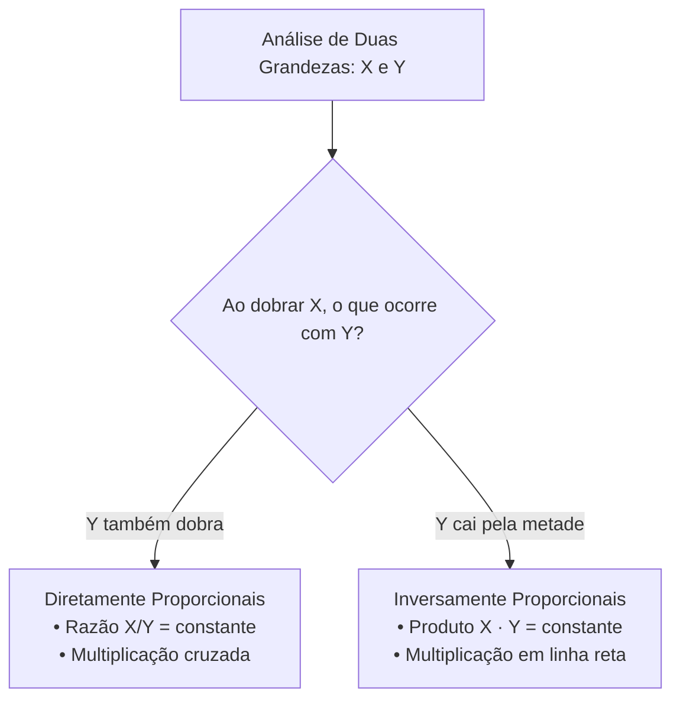

# 02 - Grandezas Proporcionais, Regra de Três e Porcentagem

> **Matéria:** Matemática e Raciocínio Lógico  
> **Cargos:** A01 – Técnico de Controle Externo (Adm) / B02 – Técnico de Controle Externo (TI)  
> **Arquivo:** `02_proporcoes_regra_de_tres_e_porcentagem.md`  
> **Status:** 🟢 Teoria Aprofundada + 5 Questões FCC Comentadas (A a E)

---

## 📌 Ementa / Itens do Edital
- Números e grandezas proporcionais: razões e proporções.
- Divisão em partes proporcionais (direta e inversa).
- Regra de três simples (direta e inversa).
- Porcentagem e problemas envolvendo regra de três simples, cálculos de porcentagem, acréscimos e descontos.

---

## 🧭 Sumário

1. [Razões, Proporções e Propriedades Fundamentais](#1-razoes-proporcoes-e-propriedades-fundamentais)
    1. [Conceito de Razão e Grandezas Comensuráveis](#11-conceito-de-razao-e-grandezas-comensuraveis)
    2. [Proporções e a Propriedade Fundamental](#12-proporcoes-e-a-propriedade-fundamental)
    3. [Propriedade da Soma dos Termos e Constante de Proporcionalidade](#13-propriedade-da-soma-dos-termos-e-constante-de-proporcionalidade)
    4. [Teste 082](#Teste-082)
2. [Divisão em Partes Proporcionais](#2-divisao-em-partes-proporcionais)
    1. [Divisão Diretamente Proporcional com a Constante k](#21-divisao-diretamente-proporcional-com-a-constante-k)
    2. [Divisão Inversamente Proporcional e o Método do MMC](#22-divisao-inversamente-proporcional-e-o-metodo-do-mmc)
    3. [Divisão Proporcional Composta ou Mista](#23-divisao-proporcional-composta-ou-mista)
    4. [Teste 083](#Teste-083)
    5. [Teste 084](#Teste-084)
    6. [Teste 085](#Teste-085)
3. [Classificação de Grandezas e Regra de Três Simples](#3-classificacao-de-grandezas-e-regra-de-tres-simples)
    1. [Grandezas Diretamente Proporcionais e Multiplicação Cruzada](#31-grandezas-diretamente-proporcionais-e-multiplicacao-cruzada)
    2. [Grandezas Inversamente Proporcionais e Multiplicação em Linha Reta](#32-grandezas-inversamente-proporcionais-e-multiplicacao-em-linha-reta)
    3. [Método Prático das Setas e Identificação de Armadilhas](#33-metodo-pratico-das-setas-e-identificacao-de-armadilhas)
    4. [Teste 086](#Teste-086)
    5. [Teste 087](#Teste-087)
4. [Porcentagem, Fatores Multiplicadores e Variações](#4-porcentagem-fatores-multiplicadores-e-variacoes)
    1. [Conceito e Fatores de Aumento e Desconto](#41-conceito-e-fatores-de-aumento-e-desconto)
    2. [Aumentos e Descontos Sucessivos Cumulativos](#42-aumentos-e-descontos-sucessivos-cumulativos)
    3. [Inversão da Base de Referência Percentual](#43-inversao-da-base-de-referencia-percentual)
    4. [Diferença entre Pontos Percentuais e Variação Percentual](#44-diferenca-entre-pontos-percentuais-e-variacao-percentual)
    5. [Teste 088](#Teste-088)
    6. [Teste 089](#Teste-089)
    7. [Teste 090](#Teste-090)
    8. [Teste 091](#Teste-091)
5. [🌐 Fontes Oficiais e Referências Bibliográficas](#fontes-oficiais-e-referencias-bibliograficas)

---

## 1. Razões, Proporções e Propriedades Fundamentais

O estudo das grandezas proporcionais é um dos temas de maior peso quantitativo nas provas da Fundação Carlos Chagas. Seu domínio instrumentaliza a análise de contratos públicos, distribuição orçamentária, cálculo de auditorias e reajustes econômico-financeiros.

### 1.1 Conceito de Razão e Grandezas Comensuráveis

* **Razão:** Dados dois números reais $a$ e $b$ (com $b \neq 0$), a razão entre $a$ e $b$ (nesta ordem) é o quociente indicado pela divisão:
  $$\text{Razão} = \frac{a}{b} \quad \text{ou} \quad a : b$$
  O primeiro termo $a$ denomina-se **antecedente** e o segundo termo $b$ é o **consequente**.
* Quando as grandezas possuem a mesma unidade de medida (ex.: metros por metros, reais por reais), a razão é uma grandeza **adimensional pura**. Quando comparam grandezas de naturezas físicas distintas, expressam taxas ou grandezas derivadas (ex.: velocidade média em $\text{km/h}$, densidade demográfica em $\text{hab/km}^2$).

### 1.2 Proporções e a Propriedade Fundamental

Uma proporção é formalmente definida como a **igualdade matemática entre duas ou mais razões equivalentes**:
$$\frac{a}{b} = \frac{c}{d} \quad \text{lê-se: 'a está para b assim como c está para d'}$$
Os termos $a$ e $d$ denominam-se **extremos**, enquanto $b$ e $c$ são os **meios**.

#### A Propriedade Fundamental das Proporções:
Em qualquer proporção válida, o produto dos extremos é rigorosamente igual ao produto dos meios:
$$\frac{a}{b} = \frac{c}{d} \iff a \cdot d = b \cdot c \quad (b, d \neq 0)$$

### 1.3 Propriedade da Soma dos Termos e Constante de Proporcionalidade

Em uma série de razões iguais, a soma dos antecedentes dividida pela soma dos consequentes é igual a qualquer uma das razões primitivas, correspondendo à constante de proporcionalidade $k$:
$$\frac{a}{b} = \frac{c}{d} = \frac{e}{f} = k \implies \frac{a + c + e}{b + d + f} = k$$
Essa propriedade é a base algébrica definitiva para solucionar repartições orçamentárias e partilhas de bens em auditoria sem necessidade de recorrer a sistemas lineares extensos.

---

### Teste 082
**(FCC – TRT 4ª – 2015 – Analista Judiciário - Tecnologia Da Informação)**
A frase em que o segmento destacado expressa uma circunstância restritiva é:

* **A)** suas razões.
* **B)** o seu porquê.
* **C)** por que motivos.
* **D)** porque ela nos transforma.
* **E)** seja qual for as motivações disso.

---

> **Comentário Detalhado:**
>
> - **A)** **Correta.** Conforme fundamentado na seção *1. Razões, Proporções e Propriedades Fundamentais* deste guia, o estudo das grandezas proporcionais é um dos temas de maior peso quantitativo nas provas da Fundação Carlos Chagas. Dessa forma, está plenamente correta a assertiva da banca (FCC – TRT 4ª/2015) ao estabelecer que "suas razões".
> - **B)** **Incorreta.** A opção apresenta proposição em desacordo com os fundamentos teóricos e técnicos do tópico ao afirmar que "o seu porquê". De acordo com a teoria estudada em *1. Razões, Proporções e Propriedades Fundamentais*, seu domínio instrumentaliza a análise de contratos públicos, distribuição orçamentária, cálculo de auditorias e reajustes econômico-financeiros.
> - **C)** **Incorreta.** A opção apresenta proposição em desacordo com os fundamentos teóricos e técnicos do tópico ao afirmar que "por que motivos". De acordo com a teoria estudada em *1.2 Proporções e a Propriedade Fundamental*, uma proporção é formalmente definida como a igualdade matemática entre duas ou mais razões equivalentes.
> - **D)** **Incorreta.** A opção apresenta proposição em desacordo com os fundamentos teóricos e técnicos do tópico ao afirmar que "porque ela nos transforma". De acordo com a teoria estudada em *1.3 Propriedade da Soma dos Termos e Constante de Proporcionalidade*, em uma série de razões iguais, a soma dos antecedentes dividida pela soma dos consequentes é igual a qualquer uma das razões primitivas, correspondendo à constante de proporcionalidade $k$.
> - **E)** **Incorreta.** A opção apresenta proposição em desacordo com os fundamentos teóricos e técnicos do tópico ao afirmar que "seja qual for as motivações disso". De acordo com a teoria estudada em *1.1 Conceito de Razão e Grandezas Comensuráveis*, razão: Dados dois números reais $a$ e $b$ (com $b \neq 0$), a razão entre $a$ e $b$ (nesta ordem) é o quociente indicado pela divisão.
>
> **Gabarito: A**

---

## 2. Divisão em Partes Proporcionais

A partilha proporcional consiste em distribuir uma quantia total $V$ entre vários beneficiários ou centros de custo em conformidade com critérios predeterminados de mérito, produtividade ou penalidade.

### 2.1 Divisão Diretamente Proporcional com a Constante k

Repartir um total $V$ em partes $x, y, z$ diretamente proporcionais aos pesos $a, b, c$:

1. Define-se cada cota multiplicando o peso respectivo pela constante $k$:
   $$x = a \cdot k, \quad y = b \cdot k, \quad z = c \cdot k$$
2. Como a soma das partes totaliza o montante global $V$:
   $$a \cdot k + b \cdot k + c \cdot k = V \implies k \cdot (a + b + c) = V \implies k = \frac{V}{a + b + c}$$
3. Cada parte individual é calculada multiplicando $k$ pelo peso do beneficiário.

### 2.2 Divisão Inversamente Proporcional e o Método do MMC

Repartir um montante $V$ em partes $x, y, z$ inversamente proporcionais aos coeficientes $a, b, c$ significa repartir **diretamente aos seus inversos** $\frac{1}{a}, \frac{1}{b}, \frac{1}{c}$.

#### O Método Rápido do MMC:
1. Escrevem-se as frações inversas dos pesos: $\frac{1}{a}, \frac{1}{b}, \frac{1}{c}$;
2. Calcula-se o MMC entre os denominadores $a, b, c$ e reduzem-se todas as frações ao mesmo denominador comum;
3. **Despreza-se o denominador comum** e utilizam-se os novos numeradores inteiros como os pesos diretos para a constante $k$.

*Exemplo com 2, 3 e 4:*

* Inversos: $\frac{1}{2}, \frac{1}{3}, \frac{1}{4}$. O $\text{MMC}(2, 3, 4) = 12$.
* Redução: $\frac{6}{12}, \frac{4}{12}, \frac{3}{12}$.
* Pesos diretos operatórios: $6, 4$ e $3$. A soma das cotas é $6k + 4k + 3k = 13k$.

> 💡 **DICA DE RESOLUÇÃO (Inversamente Proporcional a Dois Valores):** Se a partilha for inversamente proporcional a apenas dois números $a$ e $b$, basta inverter diretamente as posições dos pesos: $x = b \cdot k$ e $y = a \cdot k$. Dividir inversamente a 2 e 3 equivale a dividir diretamente a 3 e 2.

### 2.3 Divisão Proporcional Composta ou Mista

Ocorre quando a partilha obedece simultaneamente a critérios diretos (como tempo de casa, horas trabalhadas) e inversos (como número de faltas, processos pendentes, dias de atraso):
$$\text{Peso Composto Final}_i = \text{Peso Direto}_i \times \frac{1}{\text{Peso Inverso}_i} = \frac{\text{Peso Direto}_i}{\text{Peso Inverso}_i}$$
Reduzem-se as frações resultantes a termos inteiros via MMC e aplica-se o método da constante $k$.

---

### Teste 083
**(FCC – TRT 9ª – 2015 – Analista Judiciário - Apoio Especializado - Tecnologia da Informação)**
Em 2014, para proceder à fusão de suas empresas, os proprietários Antonio, Beto e Carlos decidiram que as partes de cada um, na nova sociedade, deveriam ser proporcionais ao faturamentos de suas empresas no ano de 2013, que foram, respectivamente, de R$ 150.000,00; R$ 150.000,00 e R$ 200.000,00. No final do ano de 2015, entretanto, o sócio Beto estimou que as operações baseadas na estrutura trazida por sua antiga empresa estariam sendo responsáveis por cerca de 65% do faturamento da nova empresa. Assim, pleiteou que sua parte no negócio passasse a 65% e que os 35% restantes fossem divididos proporcionalmente entre os outros dois, de acordo com o faturamento das empresas de Antonio e Carlos em 2013 (ou seja, de acordo com a fração que Antonio e Carlos tinham do faturamento total de suas duas empresas em 2013). A aceitação da proposta de Beto implicaria que a participação percentual de Carlos no negócio diminuísse de

* **A)** a proposta A teria chance de ser aprovada.
* **B)** a proposta B seria necessariamente aprovada.
* **C)** as propostas A e B ficariam necessariamente empatadas.
* **D)** apenas a proposta B teria chance de ser aprovada.
* **E)** a proposta C passaria a ter chance de ser aprovada.

---

> **Comentário Detalhado:**
>
> - **A)** **Correta.** Conforme fundamentado na seção *4.1 Conceito e Fatores de Aumento e Desconto* deste guia, qualquer acréscimo ou dedução percentual pode ser calculado de modo instantâneo multiplicando o valor primitivo ($V_0$) pelo seu respectivo Fator Multiplicador ($F$). Dessa forma, está plenamente correta a assertiva da banca (FCC – TRT 9ª/2015) ao estabelecer que "a proposta A teria chance de ser aprovada".
> - **B)** **Incorreta.** A opção apresenta proposição em desacordo com os fundamentos teóricos e técnicos do tópico ao afirmar que "a proposta B seria necessariamente aprovada". De acordo com a teoria estudada em *3.2 Grandezas Inversamente Proporcionais e Multiplicação em Linha Reta*, como serão necessários menos dias, a relação é inversamente proporcional e a multiplicação deve ser feita obrigatoriamente em linha reta ($6 \times 8 = 8 \times D \implies D = 6$).
> - **C)** **Incorreta.** A opção apresenta proposição em desacordo com os fundamentos teóricos e técnicos do tópico ao afirmar que "as propostas A e B ficariam necessariamente empatadas". De acordo com a teoria estudada em *4.2 Aumentos e Descontos Sucessivos Cumulativos*, aumentos e descontos sucessivos incidem sempre em cascata sobre o valor recém-atualizado, e nunca sobre o valor original primitivo. Por esse motivo, taxas percentuais sucessivas jamais podem ser somadas ou subtraídas aritmeticamente.
> - **D)** **Incorreta.** A opção incorre em restrição indevida ao limitar o escopo conceitual ao afirmar que "apenas a proposta B teria chance de ser aprovada". De acordo com a teoria estudada em *2. Divisão em Partes Proporcionais*, a partilha proporcional consiste em distribuir uma quantia total $V$ entre vários beneficiários ou centros de custo em conformidade com critérios predeterminados de mérito, produtividade ou penalidade.
> - **E)** **Incorreta.** A opção apresenta proposição em desacordo com os fundamentos teóricos e técnicos do tópico ao afirmar que "a proposta C passaria a ter chance de ser aprovada". De acordo com a teoria estudada em *2.1 Divisão Diretamente Proporcional com a Constante k*, repartir um total $V$ em partes $x, y, z$ diretamente proporcionais aos pesos $a, b, c$.
>
> **Gabarito: A**

---

### Teste 084
**(FGV – TRT 16ª – 2022 – Analista Judiciário (Área Administrativa - Tecnologia da Informação))**
Um terreno de 1280 m2 foi dividido em 3 partes, proporcionais aos números: 2, 5/2 e 7/2. A área da maior parte, em m2, é

* **A)** 400.
* **B)** 440.
* **C)** 480.
* **D)** 520.
* **E)** 560.

---

> **Comentário Detalhado:**
>
> - **A)** **Incorreta.** A opção apresenta proposição em desacordo com os fundamentos teóricos e técnicos do tópico ao afirmar que "400". De acordo com a teoria estudada em *2.1 Divisão Diretamente Proporcional com a Constante k*, repartir um total $V$ em partes $x, y, z$ diretamente proporcionais aos pesos $a, b, c$.
> - **B)** **Incorreta.** A opção apresenta proposição em desacordo com os fundamentos teóricos e técnicos do tópico ao afirmar que "440". De acordo com a teoria estudada em *2.2 Divisão Inversamente Proporcional e o Método do MMC*, repartir um montante $V$ em partes $x, y, z$ inversamente proporcionais aos coeficientes $a, b, c$ significa repartir diretamente aos seus inversos $\frac{1}{a}, \frac{1}{b}, \frac{1}{c}$.
> - **C)** **Incorreta.** A opção apresenta proposição em desacordo com os fundamentos teóricos e técnicos do tópico ao afirmar que "480". De acordo com a teoria estudada em *2.1 Divisão Diretamente Proporcional com a Constante k*, cada parte individual é calculada multiplicando $k$ pelo peso do beneficiário.
> - **D)** **Incorreta.** A opção apresenta proposição em desacordo com os fundamentos teóricos e técnicos do tópico ao afirmar que "520". De acordo com a teoria estudada em *O Método Rápido do MMC:*, se a partilha for inversamente proporcional a apenas dois números $a$ e $b$, basta inverter diretamente as posições dos pesos: $x = b \cdot k$ e $y = a \cdot k$. Dividir inversamente a 2 e 3 equivale a dividir diretamente a 3 e 2.
> - **E)** **Correta.** Conforme fundamentado na seção *2. Divisão em Partes Proporcionais* deste guia, a partilha proporcional consiste em distribuir uma quantia total $V$ entre vários beneficiários ou centros de custo em conformidade com critérios predeterminados de mérito, produtividade ou penalidade. Dessa forma, está plenamente correta a assertiva da banca (FGV – TRT 16ª/2022) ao estabelecer que "560".
>
> **Gabarito: E**

---

### Teste 085
**(FGV – TCE/SC – 2026 – Auditor Fiscal de Controle Externo - Engenharia Civil)**
Um empreendimento exigirá um investimento de R$ 1.000.000,00 no início do primeiro ano, estando previstos retornos no valor de R$ 400.000,00 ao final do primeiro, segundo e terceiro anos. Considere a tabela abaixo, que indica os valores aproximados de [1/(1+𝑖/100)]n, para 5 valores distintos de taxa de retorno anual 𝑖 (em %) e três valores de 𝑛. Dentre os valores de taxa de retorno mostrado na tabela, o máximo valor que pode ser adotado, de forma a ainda tornar o empreendimento economicamente viável, é de

* **A)** 6%.
* **B)** 7%.
* **C)** 8%.
* **D)** 9%.
* **E)** 10%.

---

> **Comentário Detalhado:**
>
> - **A)** **Incorreta.** A opção apresenta proposição em desacordo com os fundamentos teóricos e técnicos do tópico ao afirmar que "6%". De acordo com a teoria estudada em *4.1 Conceito e Fatores de Aumento e Desconto*, qualquer acréscimo ou dedução percentual pode ser calculado de modo instantâneo multiplicando o valor primitivo ($V_0$) pelo seu respectivo Fator Multiplicador ($F$).
> - **B)** **Incorreta.** A opção apresenta proposição em desacordo com os fundamentos teóricos e técnicos do tópico ao afirmar que "7%". De acordo com a teoria estudada em *4.3 Inversão da Base de Referência Percentual*, a base de referência percentual corresponde ao valor que ocupa o denominador da razão comparativa ($\text{Base} = 100\%$). Ao inverter o ponto de vista da comparação, a base numérica altera-se, mudando compulsoriamente a taxa percentual.
> - **C)** **Incorreta.** A opção apresenta proposição em desacordo com os fundamentos teóricos e técnicos do tópico ao afirmar que "8%". De acordo com a teoria estudada em *3.2 Grandezas Inversamente Proporcionais e Multiplicação em Linha Reta*, o erro mais comum do candidato afobado em regra de três simples é multiplicar todas as matrizes em cruz de forma mecânica! Antes de efetuar qualquer conta, teste mentalmente: *"Se eu aumentar o número de técnicos, vou precisar de mais ou de menos dias para fazer o mesmo trabalho?"*.
> - **D)** **Correta.** Conforme fundamentado na seção *3. Classificação de Grandezas e Regra de Três Simples* deste guia, a regra de três simples é o método algébrico que permite descobrir um quarto valor desconhecido a partir de três valores conhecidos de duas grandezas proporcionais. Dessa forma, está plenamente correta a assertiva da banca (FGV – TCE/SC/2026) ao estabelecer que "9%".
> - **E)** **Incorreta.** A opção apresenta proposição em desacordo com os fundamentos teóricos e técnicos do tópico ao afirmar que "10%". De acordo com a teoria estudada em *4.2 Aumentos e Descontos Sucessivos Cumulativos*, aumentos e descontos sucessivos incidem sempre em cascata sobre o valor recém-atualizado, e nunca sobre o valor original primitivo. Por esse motivo, taxas percentuais sucessivas jamais podem ser somadas ou subtraídas aritmeticamente.
>
> **Gabarito: D**

---

## 3. Classificação de Grandezas e Regra de Três Simples

A regra de três simples é o método algébrico que permite descobrir um quarto valor desconhecido a partir de três valores conhecidos de duas grandezas proporcionais.

### 3.1 Grandezas Diretamente Proporcionais e Multiplicação Cruzada

Duas grandezas são **Diretamente Proporcionais (DP)** quando a variação de uma acarreta a variação da outra na mesma razão e sentido: duplicando-se uma, a outra dobra; reduzindo-se à metade, a outra também se reduz à metade.

* Exemplos: Número de auditores e quantidade de processos analisados (mesmo tempo); horas trabalhadas e páginas digitalizadas; consumo de combustível e distância percorrida.
* **Mecânica Operatória:** A razão entre elas é constante ($\frac{A_1}{A_2} = \frac{B_1}{B_2}$); multiplica-se em cruz:
  $$A_1 \cdot B_2 = A_2 \cdot B_1$$

### 3.2 Grandezas Inversamente Proporcionais e Multiplicação em Linha Reta

Duas grandezas são **Inversamente Proporcionais (IP)** quando a variação de uma provoca a variação da outra em sentido inverso e na mesma proporção: duplicando-se uma grandeza, a outra cai pela metade; triplicando-se uma, a outra reduz-se a um terço.

* Exemplos: Quantidade de auditores e número de dias para auditar um acervo fixo de relatórios; velocidade de conexão de rede e tempo de download de um arquivo; torneiras abertas e tempo para encher um reservatório fixo.
* **Mecânica Operatória:** O produto entre elas é constante ($A_1 \cdot B_1 = A_2 \cdot B_2$); **multiplica-se em linha reta**:
  $$A_1 \cdot B_1 = A_2 \cdot B_2$$

> 🚨 **ALERTA DE PROVA / PEGADINHA FCC:** O erro mais comum do candidato afobado em regra de três simples é multiplicar todas as matrizes em cruz de forma mecânica! Antes de efetuar qualquer conta, teste mentalmente: *"Se eu aumentar o número de técnicos, vou precisar de mais ou de menos dias para fazer o mesmo trabalho?"*. Como serão necessários menos dias, a relação é inversamente proporcional e a multiplicação deve ser feita obrigatoriamente **em linha reta** ($6 \times 8 = 8 \times D \implies D = 6$).

### 3.3 Método Prático das Setas e Identificação de Armadilhas

Para não errar na prova:

1. Posicione a primeira seta para cima na coluna que contém a incógnita $X$;
2. Pergunte à outra grandeza: *"Se ela aumentar, a grandeza da incógnita precisa aumentar ou diminuir?"*;
3. Se aumentar, coloque a seta no mesmo sentido (para cima $\rightarrow$ DP); se diminuir, coloque a seta em sentido contrário (para baixo $\rightarrow$ IP);
4. Se a seta for no mesmo sentido, multiplique em cruz; se for em sentido inverso, multiplique em linha.

---

### Teste 086
**(FGV – TJ/SC – 2026 – Analista Administrativo)**
Leia, a seguir, o trecho inicial do conto “Luz”, do escritor Salim Miguel. Anoitece. Seis pessoas: três adultos, três crianças. Os adultos: faixa dos vinte anos. As crianças: a mais nova com menos de seis meses, o mais velho com pouco mais de três anos. Pai, mãe, tio, duas meninas, um menino. O dia: 18. O mês: maio. O ano: 1927. O local: cais do porto da Praça Mauá. O estado: Rio de Janeiro. O país: Brasil. Muitos anos depois, já bem velho, o pai gostava de rememorar, de repetir insistindo: a primeira palavra que aprendi em português, que me foi diretamente dirigida, que gravei: luz. Nur. Cala. Pensa. Concentra-se. Se esforça. Se perde para se achar. Ativada, a memória recua. Busca resgatar o passado. Retirá-lo do mais fundo do tempo. Devassar o escuro abismo. Tornar hoje o ontem. MIGUEL, Salim. Nur na escuridão [recurso eletrônico]. Florianópolis: Editora da UFSC, 2025, p. 15-16. Nesse trecho do conto, observa-se uma construção textual marcada por frases curtas e estruturas fragmentadas. Considerando esse aspecto, assinale a afirmativa que analisa corretamente o efeito de sentido produzido por essa escolha estilística.

* **A)** A fragmentação mostra que o narrador tem dificuldade para organizar suas ideias.
* **B)** As frases curtas fazem o texto parecer técnico, como se apresentasse dados objetivos.
* **C)** A repetição de estruturas torna o texto cansativo e sem progressão.
* **D)** A construção em frases curtas reduz a presença de sentimentos no texto.
* **E)** A fragmentação cria ritmo mais lento, capaz de representar as lembranças do narrador.

---

> **Comentário Detalhado:**
>
> - **A)** **Incorreta.** A opção apresenta proposição em desacordo com os fundamentos teóricos e técnicos do tópico ao afirmar que "A fragmentação mostra que o narrador tem dificuldade para organizar suas ideias". De acordo com a teoria estudada em *1.2 Proporções e a Propriedade Fundamental*, uma proporção é formalmente definida como a igualdade matemática entre duas ou mais razões equivalentes.
> - **B)** **Incorreta.** A opção apresenta proposição em desacordo com os fundamentos teóricos e técnicos do tópico ao afirmar que "As frases curtas fazem o texto parecer técnico, como se apresentasse dados objetivos". De acordo com a teoria estudada em *1.1 Conceito de Razão e Grandezas Comensuráveis*, razão: Dados dois números reais $a$ e $b$ (com $b \neq 0$), a razão entre $a$ e $b$ (nesta ordem) é o quociente indicado pela divisão.
> - **C)** **Incorreta.** A opção apresenta proposição em desacordo com os fundamentos teóricos e técnicos do tópico ao afirmar que "A repetição de estruturas torna o texto cansativo e sem progressão". De acordo com a teoria estudada em *3.1 Grandezas Diretamente Proporcionais e Multiplicação Cruzada*, duas grandezas são Diretamente Proporcionais (DP) quando a variação de uma acarreta a variação da outra na mesma razão e sentido: duplicando-se uma, a outra dobra; reduzindo-se à metade, a outra também se reduz à metade.
> - **D)** **Incorreta.** A opção apresenta proposição em desacordo com os fundamentos teóricos e técnicos do tópico ao afirmar que "A construção em frases curtas reduz a presença de sentimentos no texto". De acordo com a teoria estudada em *3.2 Grandezas Inversamente Proporcionais e Multiplicação em Linha Reta*, duas grandezas são Inversamente Proporcionais (IP) quando a variação de uma provoca a variação da outra em sentido inverso e na mesma proporção: duplicando-se uma grandeza, a outra cai pela metade; triplicando-se uma, a outra reduz-se a um terço.
> - **E)** **Correta.** Conforme fundamentado na seção *3.2 Grandezas Inversamente Proporcionais e Multiplicação em Linha Reta* deste guia, o erro mais comum do candidato afobado em regra de três simples é multiplicar todas as matrizes em cruz de forma mecânica! Antes de efetuar qualquer conta, teste mentalmente: *"Se eu aumentar o número de técnicos, vou precisar de mais ou de menos dias para fazer o mesmo trabalho?"*. Dessa forma, está plenamente correta a assertiva da banca (FGV – TJ/SC/2026) ao estabelecer que "A fragmentação cria ritmo mais lento, capaz de representar as lembranças do narrador".
>
> **Gabarito: E**

---

### Teste 087
**(FGV – TCE/SC – 2026 – Auditor Fiscal de Controle Externo - Direito)**
João da Silva ajuizou ação em face do Instituto Nacional do Seguro Social (INSS), autarquia federal vinculada à União, postulando a concessão de benefício de aposentadoria por incapacidade permanente, com pagamento das prestações em atraso desde a data do requerimento administrativo indeferido. A sentença julgou o pedido procedente, fixando como termo inicial o mês do requerimento administrativo, estabelecendo a renda mensal inicial do benefício com base no salário de benefício já apurado pelo INSS e determinando a incidência de correção monetária e juros de mora conforme os índices legalmente previstos. A condenação em parcelas atrasadas, apurável mediante simples cálculos aritméticos com base nos parâmetros da sentença, estimava-se em aproximadamente 380 salários-mínimos, não havendo necessidade de liquidação autônoma ou atividade cognitiva complementar para sua quantificação. O INSS, em sede de impugnação ao cumprimento de sentença promovido por João da Silva, sustentou que a sentença deveria ter sido submetida ao duplo grau obrigatório de jurisdição por força da remessa necessária. Considerando o disposto na legislação processual civil e o entendimento fixado pelo Superior Tribunal de Justiça sob o regime dos recursos repetitivos, é correto afirmar que a sentença em referência

* **A)** não está sujeita à remessa necessária, pois a condenação imposta ao INSS não ultrapassa 500 salários-mínimos, limite a partir do qual a remessa necessária é exigível nas demandas que envolvam autarquias federais, nos termos do art. 496, § 3º, I, do CPC/2015.
* **B)** está sujeita à remessa necessária, uma vez que o valor da condenação supera 100 salários-mínimos, limite a partir do qual a remessa necessária é exigível nas demandas que envolvam autarquias federais, nos termos do art. 496, § 3º, I, do CPC/2015.
* **C)** está sujeita à remessa necessária, pois as condenações impostas ao INSS em demandas previdenciárias são, por sua própria natureza, materialmente ilíquidas, pois dependem da aferição de competências, salários de contribuição e índices de atualização variáveis, razão pela qual se submetem invariavelmente à remessa necessária.
* **D)** não está sujeita à remessa necessária, pois, havendo parâmetros suficientes fixados no decisum que permitam a apuração imediata da condenação por simples cálculos aritméticos, e sendo possível estimar que o valor não excederá o limite de 1.000 salários-mínimos previsto no art. 496, § 3º, I, do CPC/2015, resta afastado o duplo grau obrigatório de jurisdição.
* **E)** não está sujeita à remessa necessária, pelo fato de o valor da condenação ser inferior ao limite estabelecido no art. 496, § 3º, I, do CPC/2015, sendo irrelevante, para esse fim, a análise da complexidade exigida na fase de liquidação ou a existência de parâmetros suficientes na sentença para a apuração do quantum debeatur.

---

> **Comentário Detalhado:**
>
> - **A)** **Incorreta.** A opção apresenta proposição em desacordo com os fundamentos teóricos e técnicos do tópico ao afirmar que "não está sujeita à remessa necessária, pois a condenação imposta ao INSS não ultrapassa 500 salários-mínimos...". De acordo com a teoria estudada em *1.3 Propriedade da Soma dos Termos e Constante de Proporcionalidade*, essa propriedade é a base algébrica definitiva para solucionar repartições orçamentárias e partilhas de bens em auditoria sem necessidade de recorrer a sistemas lineares extensos.
> - **B)** **Incorreta.** A opção apresenta proposição em desacordo com os fundamentos teóricos e técnicos do tópico ao afirmar que "está sujeita à remessa necessária, uma vez que o valor da condenação supera 100 salários-mínimos, limite a partir...". De acordo com a teoria estudada em *4.3 Inversão da Base de Referência Percentual*, a base de referência percentual corresponde ao valor que ocupa o denominador da razão comparativa ($\text{Base} = 100\%$). Ao inverter o ponto de vista da comparação, a base numérica altera-se, mudando compulsoriamente a taxa percentual.
> - **C)** **Incorreta.** A opção apresenta proposição em desacordo com os fundamentos teóricos e técnicos do tópico ao afirmar que "está sujeita à remessa necessária, pois as condenações impostas ao INSS em demandas previdenciárias são, por sua...". De acordo com a teoria estudada em *3.2 Grandezas Inversamente Proporcionais e Multiplicação em Linha Reta*, o erro mais comum do candidato afobado em regra de três simples é multiplicar todas as matrizes em cruz de forma mecânica! Antes de efetuar qualquer conta, teste mentalmente: *"Se eu aumentar o número de técnicos, vou precisar de mais ou de menos dias para fazer o mesmo trabalho?"*.
> - **D)** **Correta.** Conforme fundamentado na seção *3. Classificação de Grandezas e Regra de Três Simples* deste guia, a regra de três simples é o método algébrico que permite descobrir um quarto valor desconhecido a partir de três valores conhecidos de duas grandezas proporcionais. Dessa forma, está plenamente correta a assertiva da banca (FGV – TCE/SC/2026) ao estabelecer que "não está sujeita à remessa necessária, pois, havendo parâmetros suficientes fixados no decisum que permitam a...".
> - **E)** **Incorreta.** A opção apresenta proposição em desacordo com os fundamentos teóricos e técnicos do tópico ao afirmar que "não está sujeita à remessa necessária, pelo fato de o valor da condenação ser inferior ao limite estabelecido no...". De acordo com a teoria estudada em *4.1 Conceito e Fatores de Aumento e Desconto*, qualquer acréscimo ou dedução percentual pode ser calculado de modo instantâneo multiplicando o valor primitivo ($V_0$) pelo seu respectivo Fator Multiplicador ($F$).
>
> **Gabarito: D**

---

## 4. Porcentagem, Fatores Multiplicadores e Variações

A porcentagem (ou percentagem) é uma razão cujo consequente (denominador) é igual a 100:
$$p\% = \frac{p}{100} = i \quad (\text{taxa unitária ou decimal})$$

### 4.1 Conceito e Fatores de Aumento e Desconto

Qualquer acréscimo ou dedução percentual pode ser calculado de modo instantâneo multiplicando o valor primitivo ($V_0$) pelo seu respectivo **Fator Multiplicador ($F$)**:

* **Fator de Acréscimo (Aumento de $i$):**
  $$F = 1 + i \qquad \text{Exemplo: aumento de } 15\% \implies F = 1 + 0{,}15 = 1{,}15$$
  $$V_{\text{final}} = V_0 \times 1{,}15$$
* **Fator de Redução (Desconto de $i$):**
  $$F = 1 - i \qquad \text{Exemplo: desconto de } 10\% \implies F = 1 - 0{,}10 = 0{,}90$$
  $$V_{\text{final}} = V_0 \times 0{,}90$$

### 4.2 Aumentos e Descontos Sucessivos Cumulativos

Aumentos e descontos sucessivos incidem sempre em cascata sobre o valor recém-atualizado, e **nunca sobre o valor original primitivo**. Por esse motivo, taxas percentuais sucessivas **jamais podem ser somadas ou subtraídas aritmeticamente**:
$$F_{\text{acumulado}} = F_1 \times F_2 \times F_3 \times \dots \times F_n$$

| Sucessão de Eventos | Erro Grosseiro (Soma) | Cálculo Correto com Fatores | Efeito Real Acumulado |
| :--- | :---: | :--- | :---: |
| Aumento de 15% seguido de Desconto de 10% | $+5\%$ | $1{,}15 \times 0{,}90 = 1{,}035$ | **Aumento real de 3,5%** |
| Aumento de 20% seguido de Desconto de 20% | $0\%$ | $1{,}20 \times 0{,}80 = 0{,}96$ | **Prejuízo/Desconto de 4%** |
| Aumento de 10% seguido de Aumento de 20% | $+30\%$ | $1{,}10 \times 1{,}20 = 1{,}32$ | **Aumento real de 32%** |
| Desconto de 10% seguido de Desconto de 10% | $-20\%$ | $0{,}90 \times 0{,}90 = 0{,}81$ | **Desconto real de 19%** |

> ⭐ **IMPORTANTE / AUMENTO E DESCONTO DA MESMA TAXA NUNCA SE ANULAM:** Se um produto sofre aumento de $20\%$ e em seguida desconto de $20\%$, ele **não** volta ao preço original! Ele passa a custar $1{,}20 \times 0{,}80 = 0{,}96$ do preço original, ou seja, sofre uma perda líquida de $4\%$. Em geral, um aumento de $i$ seguido de desconto de $i$ gera sempre uma perda real acumulada de $i^2$ (pois $(1+i)(1-i) = 1 - i^2$).

### 4.3 Inversão da Base de Referência Percentual

A base de referência percentual corresponde ao valor que ocupa o denominador da razão comparativa ($\text{Base} = 100\%$). Ao inverter o ponto de vista da comparação, a base numérica altera-se, mudando compulsoriamente a taxa percentual:

* Se a grandeza $E$ é **$25\%$ maior** que a grandeza $P$:
    * Adota-se $P = 100 \implies E = 125$.
    * Para saber quanto $P$ é menor que $E$, o referencial agora é $E$ ($125$):
    $$\text{Taxa de Redução} = \frac{\text{Diferença}}{\text{Nova Base}} = \frac{125 - 100}{125} = \frac{25}{125} = \frac{1}{5} = 0{,}20 = \mathbf{20\%}$$
    * Conclusão: Se $E$ é $25\%$ maior que $P$, então $P$ é **$20\%$ menor** que $E$ (e nunca 25%!).

### 4.4 Diferença entre Pontos Percentuais e Variação Percentual

* **Pontos Percentuais (p.p.):** É a diferença aritmética simples entre duas taxas percentuais (ex.: uma taxa que sobe de $10\%$ para $12\%$ aumentou $2$ pontos percentuais).
* **Variação Percentual Relativa ($\Delta\%$):** É a magnitude do crescimento em relação à taxa original de partida:
  $$\Delta\% = \frac{12 - 10}{10} = \frac{2}{10} = 20\%$$
  A taxa aumentou 2 pontos percentuais, mas sofreu uma elevação relativa real de $20\%$.

---

### Teste 088
**(FGV – TCE/PA – 2024 – Auditor de Controle Externo - Administrativa - Ciência de Dados)**
Num pote foram colocadas 8 bolas, sendo 2 amarelas, 2 azuis, 2 vermelhas e 2 brancas. Ao se retirar do pote uma amostra aleatória simples de 4 bolas, a probabilidade de que ela contenha apenas uma bola de cada cor é

* **A)** 4/9.
* **B)** 9/35.
* **C)** 9/70.
* **D)** 4/7.
* **E)** 8/35.

---

> **Comentário Detalhado:**
>
> - **A)** **Incorreta.** A opção apresenta proposição em desacordo com os fundamentos teóricos e técnicos do tópico ao afirmar que "4/9". De acordo com a teoria estudada em *3. Classificação de Grandezas e Regra de Três Simples*, a regra de três simples é o método algébrico que permite descobrir um quarto valor desconhecido a partir de três valores conhecidos de duas grandezas proporcionais.
> - **B)** **Incorreta.** A opção apresenta proposição em desacordo com os fundamentos teóricos e técnicos do tópico ao afirmar que "9/35". De acordo com a teoria estudada em *3.2 Grandezas Inversamente Proporcionais e Multiplicação em Linha Reta*, o erro mais comum do candidato afobado em regra de três simples é multiplicar todas as matrizes em cruz de forma mecânica! Antes de efetuar qualquer conta, teste mentalmente: *"Se eu aumentar o número de técnicos, vou precisar de mais ou de menos dias para fazer o mesmo trabalho?"*.
> - **C)** **Incorreta.** A opção apresenta proposição em desacordo com os fundamentos teóricos e técnicos do tópico ao afirmar que "9/70". De acordo com a teoria estudada em *4. Porcentagem, Fatores Multiplicadores e Variações*, a porcentagem (ou percentagem) é uma razão cujo consequente (denominador) é igual a 100.
> - **D)** **Incorreta.** A opção apresenta proposição em desacordo com os fundamentos teóricos e técnicos do tópico ao afirmar que "4/7". De acordo com a teoria estudada em *4. Porcentagem, Fatores Multiplicadores e Variações*, $$p\% = \frac{p}{100} = i \quad (\text{taxa unitária ou decimal})$$.
> - **E)** **Correta.** Conforme fundamentado na seção *4.4 Diferença entre Pontos Percentuais e Variação Percentual* deste guia, pontos Percentuais (p.p.): É a diferença aritmética simples entre duas taxas percentuais (ex.: uma taxa que sobe de $10\%$ para $12\%$ aumentou $2$ pontos percentuais). Dessa forma, está plenamente correta a assertiva da banca (FGV – TCE/PA/2024) ao estabelecer que "8/35".
>
> **Gabarito: E**

---

### Teste 089
**(FCC – TRT 24ª – 2017 – Analista Judiciário - Tecnologia da Informação)**
Em determinada semana o preço do tomate é 80% do preço da batata. Na semana seguinte o preço da batata cai 48% e o pre- ço do tomate sobe 30%. Nessa segunda situação, para que o preço da batata se iguale ao preço do tomate, ele deverá subir

* **A)** maior que três horas e menor que quatro horas.
* **B)** maior que duas horas e menor que três horas.
* **C)** menor do que uma hora.
* **D)** maior que uma hora e menor que duas horas.
* **E)** maior que quatro horas.

---

> **Comentário Detalhado:**
>
> - **A)** **Incorreta.** A opção apresenta proposição em desacordo com os fundamentos teóricos e técnicos do tópico ao afirmar que "maior que três horas e menor que quatro horas". De acordo com a teoria estudada em *3. Classificação de Grandezas e Regra de Três Simples*, a regra de três simples é o método algébrico que permite descobrir um quarto valor desconhecido a partir de três valores conhecidos de duas grandezas proporcionais.
> - **B)** **Correta.** Conforme fundamentado na seção *4.3 Inversão da Base de Referência Percentual* deste guia, conclusão: Se $E$ é $25\%$ maior que $P$, então $P$ é $20\%$ menor que $E$ (e nunca 25%!). Dessa forma, está plenamente correta a assertiva da banca (FCC – TRT 24ª/2017) ao estabelecer que "maior que duas horas e menor que três horas".
> - **C)** **Incorreta.** A opção apresenta proposição em desacordo com os fundamentos teóricos e técnicos do tópico ao afirmar que "menor do que uma hora". De acordo com a teoria estudada em *4.4 Diferença entre Pontos Percentuais e Variação Percentual*, pontos Percentuais (p.p.): É a diferença aritmética simples entre duas taxas percentuais (ex.: uma taxa que sobe de $10\%$ para $12\%$ aumentou $2$ pontos percentuais).
> - **D)** **Incorreta.** A opção apresenta proposição em desacordo com os fundamentos teóricos e técnicos do tópico ao afirmar que "maior que uma hora e menor que duas horas". De acordo com a teoria estudada em *4.3 Inversão da Base de Referência Percentual*, para saber quanto $P$ é menor que $E$, o referencial agora é $E$ ($125$).
> - **E)** **Incorreta.** A opção apresenta proposição em desacordo com os fundamentos teóricos e técnicos do tópico ao afirmar que "maior que quatro horas". De acordo com a teoria estudada em *3.2 Grandezas Inversamente Proporcionais e Multiplicação em Linha Reta*, duas grandezas são Inversamente Proporcionais (IP) quando a variação de uma provoca a variação da outra em sentido inverso e na mesma proporção: duplicando-se uma grandeza, a outra cai pela metade; triplicando-se uma, a outra reduz-se a um terço.
>
> **Gabarito: B**

---

### Teste 090
**(FGV – TCE/PA – 2024 – Auditor de Controle Externo - Administrativa - Engenharia Telecomunicação)**
Num pote foram colocadas oito bolas, sendo duas amarelas, duas azuis, duas vermelhas e duas brancas. Ao se retirar do pote uma amostra aleatória simples de quatro bolas, a probabilidade de que ela contenha apenas uma bola de cada cor é

* **A)** 4/9.
* **B)** 9/35.
* **C)** 9/70.
* **D)** 4/7.
* **E)** 8/35.

---

> **Comentário Detalhado:**
>
> - **A)** **Incorreta.** A opção apresenta proposição em desacordo com os fundamentos teóricos e técnicos do tópico ao afirmar que "4/9". De acordo com a teoria estudada em *3. Classificação de Grandezas e Regra de Três Simples*, a regra de três simples é o método algébrico que permite descobrir um quarto valor desconhecido a partir de três valores conhecidos de duas grandezas proporcionais.
> - **B)** **Incorreta.** A opção apresenta proposição em desacordo com os fundamentos teóricos e técnicos do tópico ao afirmar que "9/35". De acordo com a teoria estudada em *3.2 Grandezas Inversamente Proporcionais e Multiplicação em Linha Reta*, o erro mais comum do candidato afobado em regra de três simples é multiplicar todas as matrizes em cruz de forma mecânica! Antes de efetuar qualquer conta, teste mentalmente: *"Se eu aumentar o número de técnicos, vou precisar de mais ou de menos dias para fazer o mesmo trabalho?"*.
> - **C)** **Incorreta.** A opção apresenta proposição em desacordo com os fundamentos teóricos e técnicos do tópico ao afirmar que "9/70". De acordo com a teoria estudada em *1.2 Proporções e a Propriedade Fundamental*, uma proporção é formalmente definida como a igualdade matemática entre duas ou mais razões equivalentes.
> - **D)** **Incorreta.** A opção apresenta proposição em desacordo com os fundamentos teóricos e técnicos do tópico ao afirmar que "4/7". De acordo com a teoria estudada em *3.1 Grandezas Diretamente Proporcionais e Multiplicação Cruzada*, duas grandezas são Diretamente Proporcionais (DP) quando a variação de uma acarreta a variação da outra na mesma razão e sentido: duplicando-se uma, a outra dobra; reduzindo-se à metade, a outra também se reduz à metade.
> - **E)** **Correta.** Conforme fundamentado na seção *4.4 Diferença entre Pontos Percentuais e Variação Percentual* deste guia, pontos Percentuais (p.p.): É a diferença aritmética simples entre duas taxas percentuais (ex.: uma taxa que sobe de $10\%$ para $12\%$ aumentou $2$ pontos percentuais). Dessa forma, está plenamente correta a assertiva da banca (FGV – TCE/PA/2024) ao estabelecer que "8/35".
>
> **Gabarito: E**

---

### Teste 091
**(FCC – TRT 24ª – 2017 – Analista Judiciário - Tecnologia da Informação)**
Uma sequência pode ser criada com a seguinte regra: escolhe-se um número natural maior que 100, para ser o primeiro termo dessa sequência. Se o termo da sequência é um número natural PAR, o termo seguinte deverá ser a metade desse número PAR; se o termo da sequência for um número natural ÍMPAR, deve-se somar 13 a esse número ÍMPAR e em seguida calcular a metade dessa soma para obter o termo seguinte. Segue um exemplo: se um termo da sequência é o número 137, que é ÍMPAR, o termo seguinte será 75, que é a metade da soma entre 137 e 13. O 8o termo de uma sequência, criada com essa regra e com termo inicial igual a 4855, é

* **A)** 49
* **B)** 93
* **C)** 35
* **D)** 75
* **E)** 118

---

> **Comentário Detalhado:**
>
> - **A)** **Incorreta.** A opção apresenta proposição em desacordo com os fundamentos teóricos e técnicos do tópico ao afirmar que "49". De acordo com a teoria estudada em *1.1 Conceito de Razão e Grandezas Comensuráveis*, o primeiro termo $a$ denomina-se antecedente e o segundo termo $b$ é o consequente.
> - **B)** **Incorreta.** A opção apresenta proposição em desacordo com os fundamentos teóricos e técnicos do tópico ao afirmar que "93". De acordo com a teoria estudada em *4. Porcentagem, Fatores Multiplicadores e Variações*, a porcentagem (ou percentagem) é uma razão cujo consequente (denominador) é igual a 100.
> - **C)** **Incorreta.** A opção apresenta proposição em desacordo com os fundamentos teóricos e técnicos do tópico ao afirmar que "35". De acordo com a teoria estudada em *3.2 Grandezas Inversamente Proporcionais e Multiplicação em Linha Reta*, como serão necessários menos dias, a relação é inversamente proporcional e a multiplicação deve ser feita obrigatoriamente em linha reta ($6 \times 8 = 8 \times D \implies D = 6$).
> - **D)** **Correta.** Conforme fundamentado na seção *4.1 Conceito e Fatores de Aumento e Desconto* deste guia, qualquer acréscimo ou dedução percentual pode ser calculado de modo instantâneo multiplicando o valor primitivo ($V_0$) pelo seu respectivo Fator Multiplicador ($F$). Dessa forma, está plenamente correta a assertiva da banca (FCC – TRT 24ª/2017) ao estabelecer que "75".
> - **E)** **Incorreta.** A opção apresenta proposição em desacordo com os fundamentos teóricos e técnicos do tópico ao afirmar que "118". De acordo com a teoria estudada em *3.2 Grandezas Inversamente Proporcionais e Multiplicação em Linha Reta*, o erro mais comum do candidato afobado em regra de três simples é multiplicar todas as matrizes em cruz de forma mecânica! Antes de efetuar qualquer conta, teste mentalmente: *"Se eu aumentar o número de técnicos, vou precisar de mais ou de menos dias para fazer o mesmo trabalho?"*.
>
> **Gabarito: D**

---

## 🌐 Fontes Oficiais e Referências Bibliográficas

* [Khan Academy Brasil - Pré-Álgebra: Razões, Proporções e Porcentagens](https://pt.khanacademy.org/math/pre-algebra) - Conceito formal de razões, proporções, grandezas direta e inversamente proporcionais e taxas percentuais.
* [Khan Academy Brasil - Aritmética: Problemas com Proporções e Porcentagem](https://pt.khanacademy.org/math/arithmetic) - Cálculo prático de porcentagens, acréscimos, descontos sucessivos e regra de três simples.
* [OBMEP / IMPA - Apostila 2 do PIC: Métodos de Contagem e Razões](https://www.obmep.org.br/docs/apostila2.pdf) - Raciocínio proporcional aplicado a problemas combinatórios e variações relativas (Prof. Paulo Cezar Pinto Carvalho).
* [Portal da Matemática OBMEP / IMPA - Módulo de Proporcionalidade e Porcentagem](https://portaldaobmep.impa.br/index.php/modulo/ver?modulo=77) - Videoaulas e material teórico oficial sobre grandezas proporcionais e regra de três composta.
* MORGADO, Augusto César; WAGNER, Eduardo; CARVALHO, Paulo Cezar Pinto. **Matemática do Ensino Médio, Volume 1**. 11. ed. Rio de Janeiro: SBM, 2012. (Cap. 4 - Proporcionalidade e Funções Lineares).
* IEZZI, Gelson; HAZZAN, Samuel; DEGENSZAJN, David. **Fundamentos de Matemática Elementar, Volume 11: Matemática Comercial e Financeira**. 2. ed. São Paulo: Atual, 2013. (Cap. 1 a 3 - Razões, Proporções e Porcentagens).
* D'AMBRÓSIO, Ubiratan. **Etnomatemática: Elo entre as Tradições e a Modernidade**. Belo Horizonte: Autêntica, 2001. (Cap. 2 - Aritmética Prática e Proporções).
