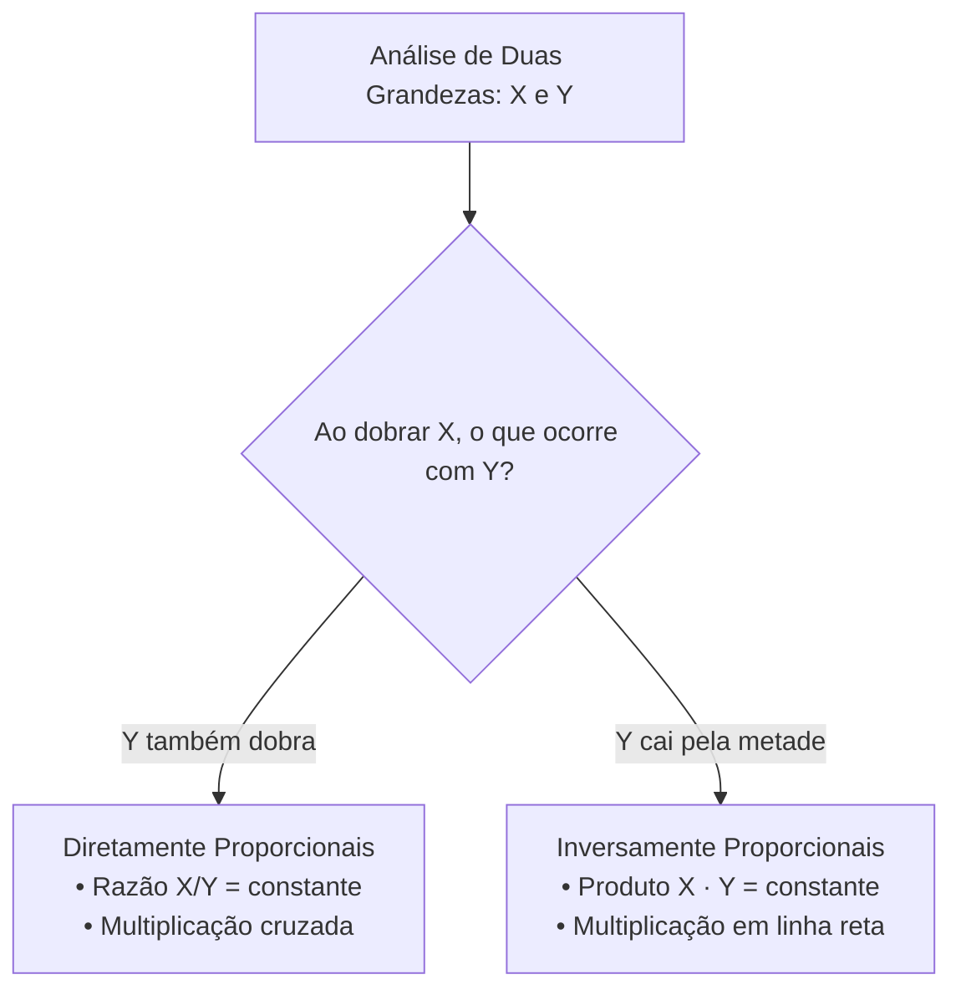

# 02 - Grandezas Proporcionais, Regra de Três e Porcentagem

> **Matéria:** Matemática e Raciocínio Lógico  
> **Cargos:** A01 – Técnico de Controle Externo (Adm) / B02 – Técnico de Controle Externo (TI)  
> **Arquivo:** `02_proporcoes_regra_de_tres_e_porcentagem.md`  
> **Status:** 🟢 Teoria Aprofundada + 5 Questões FCC Comentadas (A a E)

---

## 📌 Ementa / Itens do Edital
- Números e grandezas proporcionais: razões e proporções.
- Divisão em partes proporcionais (direta e inversa).
- Regra de três simples (direta e inversa).
- Porcentagem e problemas envolvendo regra de três simples, cálculos de porcentagem, acréscimos e descontos.

---

## 🧭 Sumário

1. [Razões, Proporções e Propriedades Fundamentais](#1-razoes-proporcoes-e-propriedades-fundamentais)
    1. [Conceito de Razão e Grandezas Comensuráveis](#11-conceito-de-razao-e-grandezas-comensuraveis)
    2. [Proporções e a Propriedade Fundamental](#12-proporcoes-e-a-propriedade-fundamental)
    3. [Propriedade da Soma dos Termos e Constante de Proporcionalidade](#13-propriedade-da-soma-dos-termos-e-constante-de-proporcionalidade)
    4. [Teste 082](#Teste-082)
2. [Divisão em Partes Proporcionais](#2-divisao-em-partes-proporcionais)
    1. [Divisão Diretamente Proporcional com a Constante k](#21-divisao-diretamente-proporcional-com-a-constante-k)
    2. [Divisão Inversamente Proporcional e o Método do MMC](#22-divisao-inversamente-proporcional-e-o-metodo-do-mmc)
    3. [Divisão Proporcional Composta ou Mista](#23-divisao-proporcional-composta-ou-mista)
    4. [Teste 083](#Teste-083)
    5. [Teste 084](#Teste-084)
    6. [Teste 085](#Teste-085)
3. [Classificação de Grandezas e Regra de Três Simples](#3-classificacao-de-grandezas-e-regra-de-tres-simples)
    1. [Grandezas Diretamente Proporcionais e Multiplicação Cruzada](#31-grandezas-diretamente-proporcionais-e-multiplicacao-cruzada)
    2. [Grandezas Inversamente Proporcionais e Multiplicação em Linha Reta](#32-grandezas-inversamente-proporcionais-e-multiplicacao-em-linha-reta)
    3. [Método Prático das Setas e Identificação de Armadilhas](#33-metodo-pratico-das-setas-e-identificacao-de-armadilhas)
    4. [Teste 086](#Teste-086)
    5. [Teste 087](#Teste-087)
4. [Porcentagem, Fatores Multiplicadores e Variações](#4-porcentagem-fatores-multiplicadores-e-variacoes)
    1. [Conceito e Fatores de Aumento e Desconto](#41-conceito-e-fatores-de-aumento-e-desconto)
    2. [Aumentos e Descontos Sucessivos Cumulativos](#42-aumentos-e-descontos-sucessivos-cumulativos)
    3. [Inversão da Base de Referência Percentual](#43-inversao-da-base-de-referencia-percentual)
    4. [Diferença entre Pontos Percentuais e Variação Percentual](#44-diferenca-entre-pontos-percentuais-e-variacao-percentual)
    5. [Teste 088](#Teste-088)
    6. [Teste 089](#Teste-089)
    7. [Teste 090](#Teste-090)
    8. [Teste 091](#Teste-091)
5. [🌐 Fontes Oficiais e Referências Bibliográficas](#fontes-oficiais-e-referencias-bibliograficas)

---

## 1. Razões, Proporções e Propriedades Fundamentais

O estudo das grandezas proporcionais é um dos temas de maior peso quantitativo nas provas da Fundação Carlos Chagas. Seu domínio instrumentaliza a análise de contratos públicos, distribuição orçamentária, cálculo de auditorias e reajustes econômico-financeiros.

### 1.1 Conceito de Razão e Grandezas Comensuráveis

* **Razão:** Dados dois números reais $a$ e $b$ (com $b \neq 0$), a razão entre $a$ e $b$ (nesta ordem) é o quociente indicado pela divisão:
  $$\text{Razão} = \frac{a}{b} \quad \text{ou} \quad a : b$$
  O primeiro termo $a$ denomina-se **antecedente** e o segundo termo $b$ é o **consequente**.
* Quando as grandezas possuem a mesma unidade de medida (ex.: metros por metros, reais por reais), a razão é uma grandeza **adimensional pura**. Quando comparam grandezas de naturezas físicas distintas, expressam taxas ou grandezas derivadas (ex.: velocidade média em $\text{km/h}$, densidade demográfica em $\text{hab/km}^2$).

### 1.2 Proporções e a Propriedade Fundamental

Uma proporção é formalmente definida como a **igualdade matemática entre duas ou mais razões equivalentes**:
$$\frac{a}{b} = \frac{c}{d} \quad \text{lê-se: 'a está para b assim como c está para d'}$$
Os termos $a$ e $d$ denominam-se **extremos**, enquanto $b$ e $c$ são os **meios**.

#### A Propriedade Fundamental das Proporções:
Em qualquer proporção válida, o produto dos extremos é rigorosamente igual ao produto dos meios:
$$\frac{a}{b} = \frac{c}{d} \iff a \cdot d = b \cdot c \quad (b, d \neq 0)$$

### 1.3 Propriedade da Soma dos Termos e Constante de Proporcionalidade

Em uma série de razões iguais, a soma dos antecedentes dividida pela soma dos consequentes é igual a qualquer uma das razões primitivas, correspondendo à constante de proporcionalidade $k$:
$$\frac{a}{b} = \frac{c}{d} = \frac{e}{f} = k \implies \frac{a + c + e}{b + d + f} = k$$
Essa propriedade é a base algébrica definitiva para solucionar repartições orçamentárias e partilhas de bens em auditoria sem necessidade de recorrer a sistemas lineares extensos.

---

### Teste 082
**(FCC – TRT-2 – Analista Judiciario Tecnologia da Informacao – 2014)**
O número A é composto por 2000 algarismos, todos eles iguais a 1, e o número B é composto por 1000 algarismos, todos eles iguais a 3. Se o número C é igual à soma dos números A e B, então a soma de todos os algarismos que compõem C é igual a

* **A)** 5000.
* **B)** 4444.
* **C)** 4000.
* **D)** 3333.
* **E)** 3000.

---

> **Comentário Detalhado:**
>
> - **A)** **Correta.** Conforme fundamentado na seção *1.3 Propriedade da Soma dos Termos e Constante de Proporcionalidade* deste guia, em uma série de razões iguais, a soma dos antecedentes dividida pela soma dos consequentes é igual a qualquer uma das razões primitivas, correspondendo à constante de proporcionalidade \$k\$. Dessa forma, está plenamente correta a assertiva da banca (FCC – TRT-2/2014) ao estabelecer que "5000".
> - **B)** **Incorreta.** A opção apresenta proposição em desacordo com os fundamentos teóricos e técnicos do tópico ao afirmar que "4444". De acordo com a teoria estudada em *1.1 Conceito de Razão e Grandezas Comensuráveis*, razão: Dados dois números reais \$a\$ e \$b\$ (com \$b \neq 0\$), a razão entre \$a\$ e \$b\$ (nesta ordem) é o quociente indicado pela divisão.
> - **C)** **Incorreta.** A opção apresenta proposição em desacordo com os fundamentos teóricos e técnicos do tópico ao afirmar que "4000". De acordo com a teoria estudada em *A Propriedade Fundamental das Proporções:*, em qualquer proporção válida, o produto dos extremos é rigorosamente igual ao produto dos meios.
> - **D)** **Incorreta.** A opção apresenta proposição em desacordo com os fundamentos teóricos e técnicos do tópico ao afirmar que "3333". De acordo com a teoria estudada em *1.3 Propriedade da Soma dos Termos e Constante de Proporcionalidade*, \$\$\frac{a}{b} = \frac{c}{d} = \frac{e}{f} = k \implies \frac{a + c + e}{b + d + f} = k\$\$.
> - **E)** **Incorreta.** A opção apresenta proposição em desacordo com os fundamentos teóricos e técnicos do tópico ao afirmar que "3000". De acordo com a teoria estudada em *1.3 Propriedade da Soma dos Termos e Constante de Proporcionalidade*, essa propriedade é a base algébrica definitiva para solucionar repartições orçamentárias e partilhas de bens em auditoria sem necessidade de recorrer a sistemas lineares extensos.
>
> **Gabarito: A**

---

## 2. Divisão em Partes Proporcionais

A partilha proporcional consiste em distribuir uma quantia total $V$ entre vários beneficiários ou centros de custo em conformidade com critérios predeterminados de mérito, produtividade ou penalidade.

### 2.1 Divisão Diretamente Proporcional com a Constante k

Repartir um total $V$ em partes $x, y, z$ diretamente proporcionais aos pesos $a, b, c$:

1. Define-se cada cota multiplicando o peso respectivo pela constante $k$:
   $$x = a \cdot k, \quad y = b \cdot k, \quad z = c \cdot k$$
2. Como a soma das partes totaliza o montante global $V$:
   $$a \cdot k + b \cdot k + c \cdot k = V \implies k \cdot (a + b + c) = V \implies k = \frac{V}{a + b + c}$$
3. Cada parte individual é calculada multiplicando $k$ pelo peso do beneficiário.

### 2.2 Divisão Inversamente Proporcional e o Método do MMC

Repartir um montante $V$ em partes $x, y, z$ inversamente proporcionais aos coeficientes $a, b, c$ significa repartir **diretamente aos seus inversos** $\frac{1}{a}, \frac{1}{b}, \frac{1}{c}$.

#### O Método Rápido do MMC:
1. Escrevem-se as frações inversas dos pesos: $\frac{1}{a}, \frac{1}{b}, \frac{1}{c}$;
2. Calcula-se o MMC entre os denominadores $a, b, c$ e reduzem-se todas as frações ao mesmo denominador comum;
3. **Despreza-se o denominador comum** e utilizam-se os novos numeradores inteiros como os pesos diretos para a constante $k$.

*Exemplo com 2, 3 e 4:*

* Inversos: $\frac{1}{2}, \frac{1}{3}, \frac{1}{4}$. O $\text{MMC}(2, 3, 4) = 12$.
* Redução: $\frac{6}{12}, \frac{4}{12}, \frac{3}{12}$.
* Pesos diretos operatórios: $6, 4$ e $3$. A soma das cotas é $6k + 4k + 3k = 13k$.

> 💡 **DICA DE RESOLUÇÃO (Inversamente Proporcional a Dois Valores):** Se a partilha for inversamente proporcional a apenas dois números $a$ e $b$, basta inverter diretamente as posições dos pesos: $x = b \cdot k$ e $y = a \cdot k$. Dividir inversamente a 2 e 3 equivale a dividir diretamente a 3 e 2.

### 2.3 Divisão Proporcional Composta ou Mista

Ocorre quando a partilha obedece simultaneamente a critérios diretos (como tempo de casa, horas trabalhadas) e inversos (como número de faltas, processos pendentes, dias de atraso):
$$\text{Peso Composto Final}_i = \text{Peso Direto}_i \times \frac{1}{\text{Peso Inverso}_i} = \frac{\text{Peso Direto}_i}{\text{Peso Inverso}_i}$$
Reduzem-se as frações resultantes a termos inteiros via MMC e aplica-se o método da constante $k$.

---

### Teste 083
**(FCC – TRT-9 – Analista Judiciario Apoio Especializado Tecnologia da Informacao – 2015)**
Em 2014, para proceder à fusão de suas empresas, os proprietários Antonio, Beto e Carlos decidiram que as partes de cada um, na nova sociedade, deveriam ser proporcionais ao faturamentos de suas empresas no ano de 2013, que foram, respectivamente, de R$ 150.000,00; R$ 150.000,00 e R$ 200.000,00. No final do ano de 2015, entretanto, o sócio Beto estimou que as operações baseadas na estrutura trazida por sua antiga empresa estariam sendo responsáveis por cerca de 65% do faturamento da nova empresa. Assim, pleiteou que sua parte no negócio passasse a 65% e que os 35% restantes fossem divididos proporcionalmente entre os outros dois, de acordo com o faturamento das empresas de Antonio e Carlos em 2013 (ou seja, de acordo com a fração que Antonio e Carlos tinham do faturamento total de suas duas empresas em 2013). A aceitação da proposta de Beto implicaria que a participação percentual de Carlos no negócio diminuísse de

* **A)** 40% para 20%.
* **B)** 40% para 15%.
* **C)** 30% para 10%.
* **D)** 30% para 20%
* **E)** 35% para 15%.

---

> **Comentário Detalhado:**
>
> - **A)** **Correta.** Conforme fundamentado na seção *2. Divisão em Partes Proporcionais* deste guia, a partilha proporcional consiste em distribuir uma quantia total \$V\$ entre vários beneficiários ou centros de custo em conformidade com critérios predeterminados de mérito, produtividade ou penalidade. Dessa forma, está plenamente correta a assertiva da banca (FCC – TRT-9/2015) ao estabelecer que "40% para 20%".
> - **B)** **Incorreta.** A opção apresenta proposição em desacordo com os fundamentos teóricos e técnicos do tópico ao afirmar que "40% para 15%". De acordo com a teoria estudada em *2.1 Divisão Diretamente Proporcional com a Constante k*, repartir um total \$V\$ em partes \$x, y, z\$ diretamente proporcionais aos pesos \$a, b, c\$.
> - **C)** **Incorreta.** A opção apresenta proposição em desacordo com os fundamentos teóricos e técnicos do tópico ao afirmar que "30% para 10%". De acordo com a teoria estudada em *2.2 Divisão Inversamente Proporcional e o Método do MMC*, repartir um montante \$V\$ em partes \$x, y, z\$ inversamente proporcionais aos coeficientes \$a, b, c\$ significa repartir diretamente aos seus inversos \$\frac{1}{a}, \frac{1}{b}, \frac{1}{c}\$.
> - **D)** **Incorreta.** A opção apresenta proposição em desacordo com os fundamentos teóricos e técnicos do tópico ao afirmar que "30% para 20%". De acordo com a teoria estudada em *4.3 Inversão da Base de Referência Percentual*, \$\$\text{Taxa de Redução} = \frac{\text{Diferença}}{\text{Nova Base}} = \frac{125 - 100}{125} = \frac{25}{125} = \frac{1}{5} = 0{,}20 = \mathbf{20\%}\$\$.
> - **E)** **Incorreta.** A opção apresenta proposição em desacordo com os fundamentos teóricos e técnicos do tópico ao afirmar que "35% para 15%". De acordo com a teoria estudada em *1. Razões, Proporções e Propriedades Fundamentais*, o estudo das grandezas proporcionais é um dos temas de maior peso quantitativo nas provas da Fundação Carlos Chagas.
>
> **Gabarito: A**

---

### Teste 084
**(FGV – TCE-PA – Auditor de Controle Externo Administrativa Contabilidade – 2024)**
Em 01/12/2023, uma escola estadual recebeu uma doação de 100.000 pesos, em dinheiro, de entidades argentinas. Na data da doação, um peso argentino era cotado a 0,01352 Reais. Já em 31/12/2023, a cotação de um peso argentino era de R$0,006014. Além disso, sabe-se que em dezembro de 2023, a pior taxa cambial para o peso foi de R$0,005979, enquanto a melhor taxa foi de R$0,01364. Além disso, a taxa cambial média, em dezembro, foi de R$0,008921. No mês de dezembro, não houve movimentação no dinheiro doado. Assinale a opção que indica o valor contabilizado, referente à doação, no balanço patrimonial da escola, em 31/12/2023:

* **A)** R$597,90.
* **B)** R$601,40.
* **C)** R$892,10.
* **D)** R$1.352,00.
* **E)** R$1.364,00.

---

> **Comentário Detalhado:**
>
> - **A)** **Incorreta.** A opção apresenta proposição em desacordo com os fundamentos teóricos e técnicos do tópico ao afirmar que "R$597,90". De acordo com a teoria estudada em *4. Porcentagem, Fatores Multiplicadores e Variações*, \$\$p\% = \frac{p}{100} = i \quad (\text{taxa unitária ou decimal})\$\$.
> - **B)** **Correta.** Conforme fundamentado na seção *4.3 Inversão da Base de Referência Percentual* deste guia, a base de referência percentual corresponde ao valor que ocupa o denominador da razão comparativa (\$\text{Base} = 100\%\$). Ao inverter o ponto de vista da comparação, a base numérica altera-se, mudando compulsoriamente a taxa percentual. Dessa forma, está plenamente correta a assertiva da banca (FGV – TCE-PA/2024) ao estabelecer que "R$601,40".
> - **C)** **Incorreta.** A opção apresenta proposição em desacordo com os fundamentos teóricos e técnicos do tópico ao afirmar que "R$892,10". De acordo com a teoria estudada em *4.3 Inversão da Base de Referência Percentual*, \$\$\text{Taxa de Redução} = \frac{\text{Diferença}}{\text{Nova Base}} = \frac{125 - 100}{125} = \frac{25}{125} = \frac{1}{5} = 0{,}20 = \mathbf{20\%}\$\$.
> - **D)** **Incorreta.** A opção apresenta proposição em desacordo com os fundamentos teóricos e técnicos do tópico ao afirmar que "R$1.352,00". De acordo com a teoria estudada em *2.1 Divisão Diretamente Proporcional com a Constante k*, define-se cada cota multiplicando o peso respectivo pela constante \$k\$.
> - **E)** **Incorreta.** A opção apresenta proposição em desacordo com os fundamentos teóricos e técnicos do tópico ao afirmar que "R$1.364,00". De acordo com a teoria estudada em *2.1 Divisão Diretamente Proporcional com a Constante k*, cada parte individual é calculada multiplicando \$k\$ pelo peso do beneficiário.
>
> **Gabarito: B**

---

### Teste 085
**(FCC – TRT-24 – Analista Judiciario Tecnologia da Informacao – 2017)**
(E) 13. Um bônus de R$ 47.600,00 foi distribuído, a três funcionários de uma empresa, em partes diretamente proporcionais às respectivas idades. Sabendo que as idades são 23, 35 e 54 anos, a diferença, em reais, entre o valor daquele que recebeu mais e o valor daquele que recebeu menos, é

* **A)** 13175
* **B)** 9850
* **C)** 16650
* **D)** 8925
* **E)** 12745

---

> **Comentário Detalhado:**
>
> - **A)** **Incorreta.** A opção apresenta proposição em desacordo com os fundamentos teóricos e técnicos do tópico ao afirmar que "13175". De acordo com a teoria estudada em *2.1 Divisão Diretamente Proporcional com a Constante k*, repartir um total \$V\$ em partes \$x, y, z\$ diretamente proporcionais aos pesos \$a, b, c\$.
> - **B)** **Correta.** Conforme fundamentado na seção *3.2 Grandezas Inversamente Proporcionais e Multiplicação em Linha Reta* deste guia, o erro mais comum do candidato afobado em regra de três simples é multiplicar todas as matrizes em cruz de forma mecânica! Antes de efetuar qualquer conta, teste mentalmente: *"Se eu aumentar o número de técnicos, vou precisar de mais ou de menos dias para fazer o mesmo trabalho?"*. Dessa forma, está plenamente correta a assertiva da banca (FCC – TRT-24/2017) ao estabelecer que "9850".
> - **C)** **Incorreta.** A opção apresenta proposição em desacordo com os fundamentos teóricos e técnicos do tópico ao afirmar que "16650". De acordo com a teoria estudada em *2.2 Divisão Inversamente Proporcional e o Método do MMC*, repartir um montante \$V\$ em partes \$x, y, z\$ inversamente proporcionais aos coeficientes \$a, b, c\$ significa repartir diretamente aos seus inversos \$\frac{1}{a}, \frac{1}{b}, \frac{1}{c}\$.
> - **D)** **Incorreta.** A opção apresenta proposição em desacordo com os fundamentos teóricos e técnicos do tópico ao afirmar que "8925". De acordo com a teoria estudada em *3. Classificação de Grandezas e Regra de Três Simples*, a regra de três simples é o método algébrico que permite descobrir um quarto valor desconhecido a partir de três valores conhecidos de duas grandezas proporcionais.
> - **E)** **Incorreta.** A opção apresenta proposição em desacordo com os fundamentos teóricos e técnicos do tópico ao afirmar que "12745". De acordo com a teoria estudada em *2.1 Divisão Diretamente Proporcional com a Constante k*, como a soma das partes totaliza o montante global \$V\$.
>
> **Gabarito: B**

---

## 3. Classificação de Grandezas e Regra de Três Simples

A regra de três simples é o método algébrico que permite descobrir um quarto valor desconhecido a partir de três valores conhecidos de duas grandezas proporcionais.

### 3.1 Grandezas Diretamente Proporcionais e Multiplicação Cruzada

Duas grandezas são **Diretamente Proporcionais (DP)** quando a variação de uma acarreta a variação da outra na mesma razão e sentido: duplicando-se uma, a outra dobra; reduzindo-se à metade, a outra também se reduz à metade.

* Exemplos: Número de auditores e quantidade de processos analisados (mesmo tempo); horas trabalhadas e páginas digitalizadas; consumo de combustível e distância percorrida.
* **Mecânica Operatória:** A razão entre elas é constante ($\frac{A_1}{A_2} = \frac{B_1}{B_2}$); multiplica-se em cruz:
  $$A_1 \cdot B_2 = A_2 \cdot B_1$$

### 3.2 Grandezas Inversamente Proporcionais e Multiplicação em Linha Reta

Duas grandezas são **Inversamente Proporcionais (IP)** quando a variação de uma provoca a variação da outra em sentido inverso e na mesma proporção: duplicando-se uma grandeza, a outra cai pela metade; triplicando-se uma, a outra reduz-se a um terço.

* Exemplos: Quantidade de auditores e número de dias para auditar um acervo fixo de relatórios; velocidade de conexão de rede e tempo de download de um arquivo; torneiras abertas e tempo para encher um reservatório fixo.
* **Mecânica Operatória:** O produto entre elas é constante ($A_1 \cdot B_1 = A_2 \cdot B_2$); **multiplica-se em linha reta**:
  $$A_1 \cdot B_1 = A_2 \cdot B_2$$

> 🚨 **ALERTA DE PROVA / PEGADINHA FCC:** O erro mais comum do candidato afobado em regra de três simples é multiplicar todas as matrizes em cruz de forma mecânica! Antes de efetuar qualquer conta, teste mentalmente: *"Se eu aumentar o número de técnicos, vou precisar de mais ou de menos dias para fazer o mesmo trabalho?"*. Como serão necessários menos dias, a relação é inversamente proporcional e a multiplicação deve ser feita obrigatoriamente **em linha reta** ($6 \times 8 = 8 \times D \implies D = 6$).

### 3.3 Método Prático das Setas e Identificação de Armadilhas

Para não errar na prova:

1. Posicione a primeira seta para cima na coluna que contém a incógnita $X$;
2. Pergunte à outra grandeza: *"Se ela aumentar, a grandeza da incógnita precisa aumentar ou diminuir?"*;
3. Se aumentar, coloque a seta no mesmo sentido (para cima $\rightarrow$ DP); se diminuir, coloque a seta em sentido contrário (para baixo $\rightarrow$ IP);
4. Se a seta for no mesmo sentido, multiplique em cruz; se for em sentido inverso, multiplique em linha.

---

### Teste 086
**(FCC – TRT-11 – Analista Judiciario Tecnologia da Informacao – 2017)**
Marlene, Jair, Renata, Alexandre e Patrícia fizeram uma prova de um concurso obtendo cinco pontuações diferentes. Sabe-se ainda que, nessa prova: − Marlene obteve mais pontos do que Alexandre, mas menos pontos do que Patrícia; − Jair obteve mais pontos do que Renata, que por sua vez obteve mais pontos do que Marlene. Sendo assim, é necessariamente correto que

* **A)** Alexandre foi o que obteve menos pontos.
* **B)** Patrícia foi a que obteve mais pontos.
* **C)** Marlene obteve mais pontos do que Renata.
* **D)** Jair obteve menos pontos do que Patrícia.
* **E)** Renata obteve menos pontos do que Patrícia.

---

> **Comentário Detalhado:**
>
> - **A)** **Correta.** Conforme fundamentado na seção *3.2 Grandezas Inversamente Proporcionais e Multiplicação em Linha Reta* deste guia, o erro mais comum do candidato afobado em regra de três simples é multiplicar todas as matrizes em cruz de forma mecânica! Antes de efetuar qualquer conta, teste mentalmente: *"Se eu aumentar o número de técnicos, vou precisar de mais ou de menos dias para fazer o mesmo trabalho?"*. Dessa forma, está plenamente correta a assertiva da banca (FCC – TRT-11/2017) ao estabelecer que "Alexandre foi o que obteve menos pontos".
> - **B)** **Incorreta.** A opção apresenta proposição em desacordo com os fundamentos teóricos e técnicos do tópico ao afirmar que "Patrícia foi a que obteve mais pontos". De acordo com a teoria estudada em *3.2 Grandezas Inversamente Proporcionais e Multiplicação em Linha Reta*, como serão necessários menos dias, a relação é inversamente proporcional e a multiplicação deve ser feita obrigatoriamente em linha reta (\$6 \times 8 = 8 \times D \implies D = 6\$).
> - **C)** **Incorreta.** A opção apresenta proposição em desacordo com os fundamentos teóricos e técnicos do tópico ao afirmar que "Marlene obteve mais pontos do que Renata". De acordo com a teoria estudada em *1.2 Proporções e a Propriedade Fundamental*, uma proporção é formalmente definida como a igualdade matemática entre duas ou mais razões equivalentes.
> - **D)** **Incorreta.** A opção apresenta proposição em desacordo com os fundamentos teóricos e técnicos do tópico ao afirmar que "Jair obteve menos pontos do que Patrícia". De acordo com a teoria estudada em *4.4 Diferença entre Pontos Percentuais e Variação Percentual*, pontos Percentuais (p.p.): É a diferença aritmética simples entre duas taxas percentuais (ex.: uma taxa que sobe de \$10\%\$ para \$12\%\$ aumentou \$2\$ pontos percentuais).
> - **E)** **Incorreta.** A opção apresenta proposição em desacordo com os fundamentos teóricos e técnicos do tópico ao afirmar que "Renata obteve menos pontos do que Patrícia". De acordo com a teoria estudada em *4.4 Diferença entre Pontos Percentuais e Variação Percentual*, variação Percentual Relativa (\$\Delta\%\$): É a magnitude do crescimento em relação à taxa original de partida.
>
> **Gabarito: A**

---

### Teste 087
**(FGV – TRT-16 – Analista Judiciario Area Administrativa Tecnologia da Informacao – 2022)**
Anjos Tronchos (Caetano Veloso) Uns anjos tronchos do Vale do Silício Desses que vivem no escuro em plena luz Disseram: Vai ser virtuoso no vício Das telas dos azuis mais do que azuis Agora a minha história é um denso algoritmo Que vende venda a vendedores reais Neurônios meus ganharam novo outro ritmo E mais, e mais, e mais, e mais, e mais Primavera árabe E logo o horror Querer que o mundo acabe-se Sombras do amor Palhaços líderes brotaram macabros No império e nos seus vastos quintais Ao que revêm impérios já milenares Munidos de controles totais Anjos já mi, ou bi, ou trilionários Comandam só seus mi, bi, trilhões E nós, quando não somos otários Ouvimos Schoenberg, Webern, Cage, canções Ah, morena bela Estás aqui Sem pele, tela a tela Estamos aí Um post vil poderá matar Que é que pode ser salvação? Que nuvem, se nem espaço há? Nem tempo, nem sim, nem não Sim, nem não Mas há poemas como jamais Ou como algum poeta sonhou Nos tempos em que havia tempos atrás E eu vou, por que não? Eu vou, por que não? Eu vou Uns anjos tronchos do Vale do Silício Tocaram fundo o minimíssimo grão E enquanto nós nos perguntamos do início Miss Eilish faz tudo do quarto com o irmão. As afirmativas a seguir, acerca de referências que a letra da música faz, estão corretas, à exceção de uma. Assinale-a.

* **A)** “Vale do Silício”, na Califórnia, EUA, é uma das maiores aglomerações de empresas com domínio de tecnologia de ponta do mundo.
* **B)** “Primavera Árabe” é uma expressão criada para designar a onda de protestos que marcou os países árabes a partir do final do ano de 2010.
* **C)** “Schoenberg, Webern, Cage” foram compositores eruditos com obra marcante no século XIX.
* **D)** “E eu vou, por que não? Eu vou, por que não? Eu vou” cita versos do próprio Caetano em Alegria, Alegria.
* **E)** “Miss Eilish” refere-se a Billie Eilish, jovem compositora e cantora, já ganhadora de Oscar e outros prêmios importantes, que compôs seu álbum de estreia no quarto do irmão, Finneas.

---

> **Comentário Detalhado:**
>
> - **A)** **Incorreta.** A opção apresenta proposição em desacordo com os fundamentos teóricos e técnicos do tópico ao afirmar que "“Vale do Silício”, na Califórnia, EUA, é uma das maiores aglomerações de empresas com domínio de tecnologia de...". De acordo com a teoria estudada em *1. Razões, Proporções e Propriedades Fundamentais*, seu domínio instrumentaliza a análise de contratos públicos, distribuição orçamentária, cálculo de auditorias e reajustes econômico-financeiros.
> - **B)** **Incorreta.** A opção apresenta proposição em desacordo com os fundamentos teóricos e técnicos do tópico ao afirmar que "“Primavera Árabe” é uma expressão criada para designar a onda de protestos que marcou os países árabes a partir do...". De acordo com a teoria estudada em *3. Classificação de Grandezas e Regra de Três Simples*, a regra de três simples é o método algébrico que permite descobrir um quarto valor desconhecido a partir de três valores conhecidos de duas grandezas proporcionais.
> - **C)** **Correta.** Conforme fundamentado na seção *3.2 Grandezas Inversamente Proporcionais e Multiplicação em Linha Reta* deste guia, o erro mais comum do candidato afobado em regra de três simples é multiplicar todas as matrizes em cruz de forma mecânica! Antes de efetuar qualquer conta, teste mentalmente: *"Se eu aumentar o número de técnicos, vou precisar de mais ou de menos dias para fazer o mesmo trabalho?"*. Dessa forma, está plenamente correta a assertiva da banca (FGV – TRT-16/2022) ao estabelecer que "“Schoenberg, Webern, Cage” foram compositores eruditos com obra marcante no século XIX".
> - **D)** **Incorreta.** A opção apresenta proposição em desacordo com os fundamentos teóricos e técnicos do tópico ao afirmar que "“E eu vou, por que não? Eu vou, por que não? Eu vou” cita versos do próprio Caetano em Alegria, Alegria". De acordo com a teoria estudada em *4.1 Conceito e Fatores de Aumento e Desconto*, qualquer acréscimo ou dedução percentual pode ser calculado de modo instantâneo multiplicando o valor primitivo (\$V_0\$) pelo seu respectivo Fator Multiplicador (\$F\$).
> - **E)** **Incorreta.** A opção apresenta proposição em desacordo com os fundamentos teóricos e técnicos do tópico ao afirmar que "“Miss Eilish” refere-se a Billie Eilish, jovem compositora e cantora, já ganhadora de Oscar e outros prêmios...". De acordo com a teoria estudada em *4.2 Aumentos e Descontos Sucessivos Cumulativos*, aumentos e descontos sucessivos incidem sempre em cascata sobre o valor recém-atualizado, e nunca sobre o valor original primitivo. Por esse motivo, taxas percentuais sucessivas jamais podem ser somadas ou subtraídas aritmeticamente.
>
> **Gabarito: C**

---

## 4. Porcentagem, Fatores Multiplicadores e Variações

A porcentagem (ou percentagem) é uma razão cujo consequente (denominador) é igual a 100:
$$p\% = \frac{p}{100} = i \quad (\text{taxa unitária ou decimal})$$

### 4.1 Conceito e Fatores de Aumento e Desconto

Qualquer acréscimo ou dedução percentual pode ser calculado de modo instantâneo multiplicando o valor primitivo ($V_0$) pelo seu respectivo **Fator Multiplicador ($F$)**:

* **Fator de Acréscimo (Aumento de $i$):**
  $$F = 1 + i \qquad \text{Exemplo: aumento de } 15\% \implies F = 1 + 0{,}15 = 1{,}15$$
  $$V_{\text{final}} = V_0 \times 1{,}15$$
* **Fator de Redução (Desconto de $i$):**
  $$F = 1 - i \qquad \text{Exemplo: desconto de } 10\% \implies F = 1 - 0{,}10 = 0{,}90$$
  $$V_{\text{final}} = V_0 \times 0{,}90$$

### 4.2 Aumentos e Descontos Sucessivos Cumulativos

Aumentos e descontos sucessivos incidem sempre em cascata sobre o valor recém-atualizado, e **nunca sobre o valor original primitivo**. Por esse motivo, taxas percentuais sucessivas **jamais podem ser somadas ou subtraídas aritmeticamente**:
$$F_{\text{acumulado}} = F_1 \times F_2 \times F_3 \times \dots \times F_n$$

| Sucessão de Eventos | Erro Grosseiro (Soma) | Cálculo Correto com Fatores | Efeito Real Acumulado |
| :--- | :---: | :--- | :---: |
| Aumento de 15% seguido de Desconto de 10% | $+5\%$ | $1{,}15 \times 0{,}90 = 1{,}035$ | **Aumento real de 3,5%** |
| Aumento de 20% seguido de Desconto de 20% | $0\%$ | $1{,}20 \times 0{,}80 = 0{,}96$ | **Prejuízo/Desconto de 4%** |
| Aumento de 10% seguido de Aumento de 20% | $+30\%$ | $1{,}10 \times 1{,}20 = 1{,}32$ | **Aumento real de 32%** |
| Desconto de 10% seguido de Desconto de 10% | $-20\%$ | $0{,}90 \times 0{,}90 = 0{,}81$ | **Desconto real de 19%** |

> ⭐ **IMPORTANTE / AUMENTO E DESCONTO DA MESMA TAXA NUNCA SE ANULAM:** Se um produto sofre aumento de $20\%$ e em seguida desconto de $20\%$, ele **não** volta ao preço original! Ele passa a custar $1{,}20 \times 0{,}80 = 0{,}96$ do preço original, ou seja, sofre uma perda líquida de $4\%$. Em geral, um aumento de $i$ seguido de desconto de $i$ gera sempre uma perda real acumulada de $i^2$ (pois $(1+i)(1-i) = 1 - i^2$).

### 4.3 Inversão da Base de Referência Percentual

A base de referência percentual corresponde ao valor que ocupa o denominador da razão comparativa ($\text{Base} = 100\%$). Ao inverter o ponto de vista da comparação, a base numérica altera-se, mudando compulsoriamente a taxa percentual:

* Se a grandeza $E$ é **$25\%$ maior** que a grandeza $P$:
    * Adota-se $P = 100 \implies E = 125$.
    * Para saber quanto $P$ é menor que $E$, o referencial agora é $E$ ($125$):
    $$\text{Taxa de Redução} = \frac{\text{Diferença}}{\text{Nova Base}} = \frac{125 - 100}{125} = \frac{25}{125} = \frac{1}{5} = 0{,}20 = \mathbf{20\%}$$
    * Conclusão: Se $E$ é $25\%$ maior que $P$, então $P$ é **$20\%$ menor** que $E$ (e nunca 25%!).

### 4.4 Diferença entre Pontos Percentuais e Variação Percentual

* **Pontos Percentuais (p.p.):** É a diferença aritmética simples entre duas taxas percentuais (ex.: uma taxa que sobe de $10\%$ para $12\%$ aumentou $2$ pontos percentuais).
* **Variação Percentual Relativa ($\Delta\%$):** É a magnitude do crescimento em relação à taxa original de partida:
  $$\Delta\% = \frac{12 - 10}{10} = \frac{2}{10} = 20\%$$
  A taxa aumentou 2 pontos percentuais, mas sofreu uma elevação relativa real de $20\%$.

---

### Teste 088
**(FGV – TJ-SC – Analista Administrativo – 2026)**
O Departamento de Produção da empresa X apresentava consumo anual de 9.000 materiais diferentes. Após a aplicação da técnica da curva ABC, obteve-se a seguinte distribuição: - 720 itens correspondiam a 70% do valor anual do consumo; - 1.800 itens correspondiam a 20% do valor anual do consumo; - 6.480 itens correspondiam a 10% do valor anual do consumo. Com base nas premissas da curva ABC, assinale a afirmativa correta.

* **A)** Os 6.480 itens compõem a classe A, pois, em razão de sua quantidade expressiva, demandam controles administrativos mais rigorosos.
* **B)** Os 1.800 itens compõem a classe C, por ocuparem posição intermediária na ordenação dos materiais por valor de consumo.
* **C)** Os 720 itens compõem a classe A e devem receber atenção especial da administração, por concentrarem a maior parcela do valor anual do consumo.
* **D)** Para controlar 90% do valor de consumo, é necessário estabelecer controles rigorosos sobre a totalidade dos 9.000 itens da curva.
* **E)** A classe C, por reunir o maior número de itens, justifica a aplicação das técnicas mais sofisticadas de gestão administrativa.

---

> **Comentário Detalhado:**
>
> - **A)** **Incorreta.** A opção apresenta proposição em desacordo com os fundamentos teóricos e técnicos do tópico ao afirmar que "Os 6.480 itens compõem a classe A, pois, em razão de sua quantidade expressiva, demandam controles administrativos...". De acordo com a teoria estudada em *4.3 Inversão da Base de Referência Percentual*, a base de referência percentual corresponde ao valor que ocupa o denominador da razão comparativa (\$\text{Base} = 100\%\$). Ao inverter o ponto de vista da comparação, a base numérica altera-se, mudando compulsoriamente a taxa percentual.
> - **B)** **Correta.** Conforme fundamentado na seção *3.1 Grandezas Diretamente Proporcionais e Multiplicação Cruzada* deste guia, exemplos: Número de auditores e quantidade de processos analisados (mesmo tempo); horas trabalhadas e páginas digitalizadas; consumo de combustível e distância percorrida. Dessa forma, está plenamente correta a assertiva da banca (FGV – TJ-SC/2026) ao estabelecer que "Os 1.800 itens compõem a classe C, por ocuparem posição intermediária na ordenação dos materiais por valor de...".
> - **C)** **Incorreta.** A opção apresenta proposição em desacordo com os fundamentos teóricos e técnicos do tópico ao afirmar que "Os 720 itens compõem a classe A e devem receber atenção especial da administração, por concentrarem a maior...". De acordo com a teoria estudada em *4.3 Inversão da Base de Referência Percentual*, se a grandeza \$E\$ é \$25\%\$ maior que a grandeza \$P\$.
> - **D)** **Incorreta.** A opção apresenta proposição em desacordo com os fundamentos teóricos e técnicos do tópico ao afirmar que "Para controlar 90% do valor de consumo, é necessário estabelecer controles rigorosos sobre a totalidade dos 9.000...". De acordo com a teoria estudada em *4.1 Conceito e Fatores de Aumento e Desconto*, qualquer acréscimo ou dedução percentual pode ser calculado de modo instantâneo multiplicando o valor primitivo (\$V_0\$) pelo seu respectivo Fator Multiplicador (\$F\$).
> - **E)** **Incorreta.** A opção apresenta proposição em desacordo com os fundamentos teóricos e técnicos do tópico ao afirmar que "A classe C, por reunir o maior número de itens, justifica a aplicação das técnicas mais sofisticadas de gestão...". De acordo com a teoria estudada em *3.2 Grandezas Inversamente Proporcionais e Multiplicação em Linha Reta*, o erro mais comum do candidato afobado em regra de três simples é multiplicar todas as matrizes em cruz de forma mecânica! Antes de efetuar qualquer conta, teste mentalmente: *"Se eu aumentar o número de técnicos, vou precisar de mais ou de menos dias para fazer o mesmo trabalho?"*.
>
> **Gabarito: B**

---

### Teste 089
**(FCC – TRT-11 – Analista Judiciario Tecnologia da Informacao – 2017)**
Considere que em um projeto foi utilizada a métrica com base na contagem de Pontos de Função (PF). O projeto foi estimado em 100 PF. Em uma determinada fase, que corresponde a 20% do projeto: − trabalham 4 pessoas; − a produtividade média é de 20 horas/PF; − a jornada diária é de 8 horas, 5 dias por semana; − o valor por 1 hora de trabalho é R$ 50,00. Com base nos dados relativos à fase, o esforço total em horas, o prazo em dias e o custo do projeto podem ser estimados e correspondem, correta e respectivamente, a:

* **A)** 500 horas − 12.5 dias − R$ 25.000,00.
* **B)** 400 horas − 10 dias − R$ 20.000,00.
* **C)** 480 horas − 12 dias − R$ 24.000,00.
* **D)** 200 horas − 5 dias − R$ 10.000,00.
* **E)** 600 horas − 15 dias − R$ 30.000,00.

---

> **Comentário Detalhado:**
>
> - **A)** **Incorreta.** A opção apresenta proposição em desacordo com os fundamentos teóricos e técnicos do tópico ao afirmar que "500 horas − 12.5 dias − R$ 25.000,00". De acordo com a teoria estudada em *2.3 Divisão Proporcional Composta ou Mista*, ocorre quando a partilha obedece simultaneamente a critérios diretos (como tempo de casa, horas trabalhadas) e inversos (como número de faltas, processos pendentes, dias de atraso).
> - **B)** **Correta.** Conforme fundamentado na seção *4.3 Inversão da Base de Referência Percentual* deste guia, a base de referência percentual corresponde ao valor que ocupa o denominador da razão comparativa (\$\text{Base} = 100\%\$). Ao inverter o ponto de vista da comparação, a base numérica altera-se, mudando compulsoriamente a taxa percentual. Dessa forma, está plenamente correta a assertiva da banca (FCC – TRT-11/2017) ao estabelecer que "400 horas − 10 dias − R$ 20.000,00".
> - **C)** **Incorreta.** A opção apresenta proposição em desacordo com os fundamentos teóricos e técnicos do tópico ao afirmar que "480 horas − 12 dias − R$ 24.000,00". De acordo com a teoria estudada em *3.1 Grandezas Diretamente Proporcionais e Multiplicação Cruzada*, exemplos: Número de auditores e quantidade de processos analisados (mesmo tempo); horas trabalhadas e páginas digitalizadas; consumo de combustível e distância percorrida.
> - **D)** **Incorreta.** A opção apresenta proposição em desacordo com os fundamentos teóricos e técnicos do tópico ao afirmar que "200 horas − 5 dias − R$ 10.000,00". De acordo com a teoria estudada em *4.2 Aumentos e Descontos Sucessivos Cumulativos*, aumentos e descontos sucessivos incidem sempre em cascata sobre o valor recém-atualizado, e nunca sobre o valor original primitivo. Por esse motivo, taxas percentuais sucessivas jamais podem ser somadas ou subtraídas aritmeticamente.
> - **E)** **Incorreta.** A opção apresenta proposição em desacordo com os fundamentos teóricos e técnicos do tópico ao afirmar que "600 horas − 15 dias − R$ 30.000,00". De acordo com a teoria estudada em *2. Divisão em Partes Proporcionais*, a partilha proporcional consiste em distribuir uma quantia total \$V\$ entre vários beneficiários ou centros de custo em conformidade com critérios predeterminados de mérito, produtividade ou penalidade.
>
> **Gabarito: B**

---

### Teste 090
**(FGV – TRT-1 – Analista Judiciario Area Administrativa – 2024)**
A cada vértice de um pentágono convexo é atribuído um valor positivo. O valor de cada lado e de cada diagonal do pentágono é definido como a soma dos valores dos vértices correspondentes. O valor do pentágono é definido como a soma dos valores de todos os seus lados e de todas as suas diagonais. Se a soma dos valores atribuídos aos vértices de um pentágono convexo é igual a 120, o valor do pentágono é:

* **A)** 600;
* **B)** 540;
* **C)** 480;
* **D)** 420;
* **E)** 360.

---

> **Comentário Detalhado:**
>
> - **A)** **Incorreta.** A opção apresenta proposição em desacordo com os fundamentos teóricos e técnicos do tópico ao afirmar que "600". De acordo com a teoria estudada em *1.3 Propriedade da Soma dos Termos e Constante de Proporcionalidade*, em uma série de razões iguais, a soma dos antecedentes dividida pela soma dos consequentes é igual a qualquer uma das razões primitivas, correspondendo à constante de proporcionalidade \$k\$.
> - **B)** **Incorreta.** A opção apresenta proposição em desacordo com os fundamentos teóricos e técnicos do tópico ao afirmar que "540". De acordo com a teoria estudada em *4. Porcentagem, Fatores Multiplicadores e Variações*, a porcentagem (ou percentagem) é uma razão cujo consequente (denominador) é igual a 100.
> - **C)** **Correta.** Conforme fundamentado na seção *3. Classificação de Grandezas e Regra de Três Simples* deste guia, a regra de três simples é o método algébrico que permite descobrir um quarto valor desconhecido a partir de três valores conhecidos de duas grandezas proporcionais. Dessa forma, está plenamente correta a assertiva da banca (FGV – TRT-1/2024) ao estabelecer que "480".
> - **D)** **Incorreta.** A opção apresenta proposição em desacordo com os fundamentos teóricos e técnicos do tópico ao afirmar que "420". De acordo com a teoria estudada em *4.1 Conceito e Fatores de Aumento e Desconto*, qualquer acréscimo ou dedução percentual pode ser calculado de modo instantâneo multiplicando o valor primitivo (\$V_0\$) pelo seu respectivo Fator Multiplicador (\$F\$).
> - **E)** **Incorreta.** A opção apresenta proposição em desacordo com os fundamentos teóricos e técnicos do tópico ao afirmar que "360". De acordo com a teoria estudada em *4.2 Aumentos e Descontos Sucessivos Cumulativos*, aumentos e descontos sucessivos incidem sempre em cascata sobre o valor recém-atualizado, e nunca sobre o valor original primitivo. Por esse motivo, taxas percentuais sucessivas jamais podem ser somadas ou subtraídas aritmeticamente.
>
> **Gabarito: C**

---

### Teste 091
**(FCC – TRT-4 – Analista Judiciario Tecnologia da Informacao – 2015)**
Para produzir 900 catálogos, cada um de 240 páginas, uma gráfica consome 250 kg de papel. Se os catálogos produzidos tivessem 180 páginas cada um, o número de catálogos que poderiam ser produzidos com 780 kg de papel seria igual a

* **A)** 2985.
* **B)** 3280.
* **C)** 3744.
* **D)** 2864.
* **E)** 3426.

---

> **Comentário Detalhado:**
>
> - **A)** **Incorreta.** A opção apresenta proposição em desacordo com os fundamentos teóricos e técnicos do tópico ao afirmar que "2985". De acordo com a teoria estudada em *4. Porcentagem, Fatores Multiplicadores e Variações*, a porcentagem (ou percentagem) é uma razão cujo consequente (denominador) é igual a 100.
> - **B)** **Incorreta.** A opção apresenta proposição em desacordo com os fundamentos teóricos e técnicos do tópico ao afirmar que "3280". De acordo com a teoria estudada em *4.1 Conceito e Fatores de Aumento e Desconto*, qualquer acréscimo ou dedução percentual pode ser calculado de modo instantâneo multiplicando o valor primitivo (\$V_0\$) pelo seu respectivo Fator Multiplicador (\$F\$).
> - **C)** **Correta.** Conforme fundamentado na seção *3.1 Grandezas Diretamente Proporcionais e Multiplicação Cruzada* deste guia, exemplos: Número de auditores e quantidade de processos analisados (mesmo tempo); horas trabalhadas e páginas digitalizadas; consumo de combustível e distância percorrida. Dessa forma, está plenamente correta a assertiva da banca (FCC – TRT-4/2015) ao estabelecer que "3744".
> - **D)** **Incorreta.** A opção apresenta proposição em desacordo com os fundamentos teóricos e técnicos do tópico ao afirmar que "2864". De acordo com a teoria estudada em *4.2 Aumentos e Descontos Sucessivos Cumulativos*, aumentos e descontos sucessivos incidem sempre em cascata sobre o valor recém-atualizado, e nunca sobre o valor original primitivo. Por esse motivo, taxas percentuais sucessivas jamais podem ser somadas ou subtraídas aritmeticamente.
> - **E)** **Incorreta.** A opção apresenta proposição em desacordo com os fundamentos teóricos e técnicos do tópico ao afirmar que "3426". De acordo com a teoria estudada em *A Propriedade Fundamental das Proporções:*, em qualquer proporção válida, o produto dos extremos é rigorosamente igual ao produto dos meios.
>
> **Gabarito: C**

---

## 🌐 Fontes Oficiais e Referências Bibliográficas

* [Khan Academy Brasil - Pré-Álgebra: Razões, Proporções e Porcentagens](https://pt.khanacademy.org/math/pre-algebra) - Conceito formal de razões, proporções, grandezas direta e inversamente proporcionais e taxas percentuais.
* [Khan Academy Brasil - Aritmética: Problemas com Proporções e Porcentagem](https://pt.khanacademy.org/math/arithmetic) - Cálculo prático de porcentagens, acréscimos, descontos sucessivos e regra de três simples.
* [OBMEP / IMPA - Apostila 2 do PIC: Métodos de Contagem e Razões](https://www.obmep.org.br/docs/apostila2.pdf) - Raciocínio proporcional aplicado a problemas combinatórios e variações relativas (Prof. Paulo Cezar Pinto Carvalho).
* [Portal da Matemática OBMEP / IMPA - Módulo de Proporcionalidade e Porcentagem](https://portaldaobmep.impa.br/index.php/modulo/ver?modulo=77) - Videoaulas e material teórico oficial sobre grandezas proporcionais e regra de três composta.
* MORGADO, Augusto César; WAGNER, Eduardo; CARVALHO, Paulo Cezar Pinto. **Matemática do Ensino Médio, Volume 1**. 11. ed. Rio de Janeiro: SBM, 2012. (Cap. 4 - Proporcionalidade e Funções Lineares).
* IEZZI, Gelson; HAZZAN, Samuel; DEGENSZAJN, David. **Fundamentos de Matemática Elementar, Volume 11: Matemática Comercial e Financeira**. 2. ed. São Paulo: Atual, 2013. (Cap. 1 a 3 - Razões, Proporções e Porcentagens).
* D'AMBRÓSIO, Ubiratan. **Etnomatemática: Elo entre as Tradições e a Modernidade**. Belo Horizonte: Autêntica, 2001. (Cap. 2 - Aritmética Prática e Proporções).
