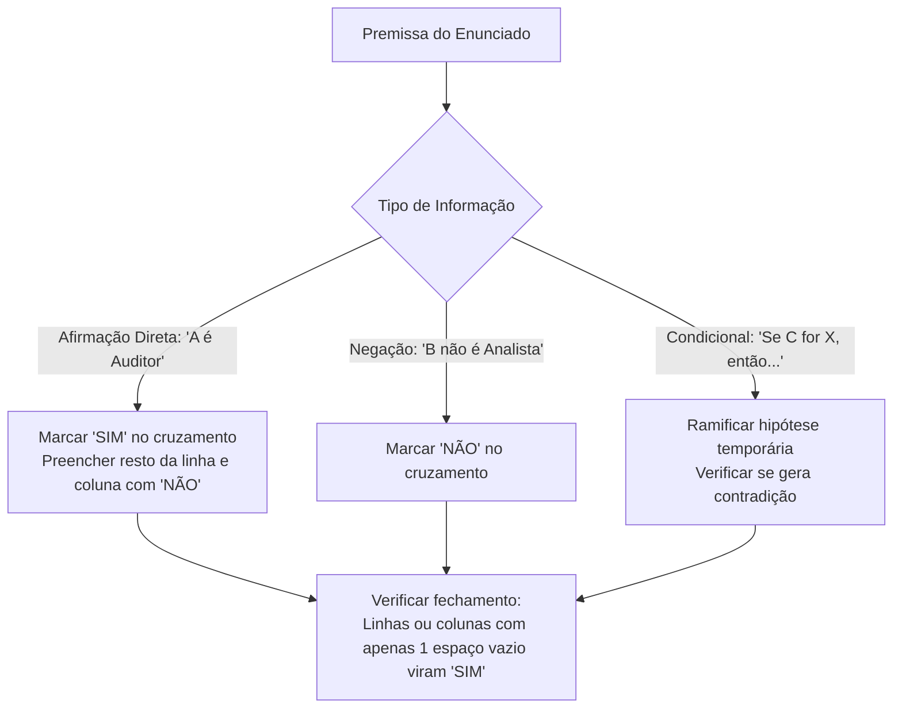

# 03 - Estruturas Lógicas, Associação e Dedução

> **Matéria:** Matemática e Raciocínio Lógico  
> **Cargos:** A01 – Técnico de Controle Externo (Adm) / B02 – Técnico de Controle Externo (TI)  
> **Arquivo:** `03_estruturas_logicas_e_associacao.md`  
> **Status:** 🟢 Teoria Aprofundada + 5 Questões FCC Comentadas (A a E)

---

## 📌 Ementa / Itens do Edital
- Estrutura lógica de relações arbitrárias entre pessoas, lugares, objetos ou eventos fictícios.
- Dedução de novas informações das relações fornecidas.
- Avaliação das condições usadas para estabelecer a estrutura daquelas relações.

---

## 🧭 Sumário

1. [Fundamentos da Associação Lógica Biunívoca](#1-fundamentos-da-associacao-logica-biunivoca)
    1. [Natureza das Relações Arbitrárias e Conjuntos Finitos](#11-natureza-das-relacoes-arbitrarias-e-conjuntos-finitos)
    2. [O Princípio da Correspondência Biunívoca](#12-o-principio-da-correspondencia-biunivoca)
    3. [Tipologia de Pistas e Classificação de Premissas](#13-tipologia-de-pistas-e-classificacao-de-premissas)
    4. [Teste 092](#Teste-092)
    5. [Teste 093](#Teste-093)
2. [Metodologia das Matrizes Cruzadas de Associação](#2-metodologia-das-matrizes-cruzadas-de-associacao)
    1. [Estruturação da Tabela Bidimensional e Tridimensional](#21-estruturacao-da-tabela-bidimensional-e-tridimensional)
    2. [O Princípio de Propagação do SIM e Fechamento por Exclusão](#22-o-principio-de-propagacao-do-sim-e-fechamento-por-exclusao)
    3. [Tratamento de Pistas Compostas e Vínculos Indiretos](#23-tratamento-de-pistas-compostas-e-vinculos-indiretos)
    4. [Teste 094](#Teste-094)
    5. [Teste 095](#Teste-095)
3. [Problemas de Ordenação Linear e Posicionamento Relativo](#3-problemas-de-ordenacao-linear-e-posicionamento-relativo)
    1. [Semântica de Ordenação: Imediatamente Antes vs. Antes Genérico](#31-semantica-de-ordenacao-imediatamente-antes-vs-antes-generico)
    2. [Filas, Andares e Classificações em Concurso](#32-filas-andares-e-classificacoes-em-concurso)
    3. [O Método das Caixas e Blocos Contíguos](#33-o-metodo-das-caixas-e-blocos-contiguos)
    4. [Teste 096](#Teste-096)
    5. [Teste 097](#Teste-097)
4. [Problemas de Ordenação Circular e Mesas Redondas](#4-problemas-de-ordenacao-circular-e-mesas-redondas)
    1. [Ponto de Vista Referencial e Orientação Espacial](#41-ponto-de-vista-referencial-e-orientacao-espacial)
    2. [Posições Diametralmente Opostas em Mesas Pares](#42-posicoes-diametralmente-opostas-em-mesas-pares)
    3. [Vizinhos Imediatos e Adjacências Direita e Esquerda](#43-vizinhos-imediatos-e-adjacencias-direita-e-esquerda)
    4. [Teste 098](#Teste-098)
    5. [Teste 099](#Teste-099)
5. [Dedução Lógica e Avaliação de Suficiência de Condições](#5-deducao-logica-e-avaliacao-de-suficiencia-de-condicoes)
    1. [Dedução Hipotética e Eliminação de Contradições](#51-deducao-hipotetica-e-eliminacao-de-contradicoes)
    2. [Condições Necessárias, Suficientes e Redundantes](#52-condicoes-necessarias-suficientes-e-redundantes)
    3. [Teste 100](#Teste-100)
    4. [Teste 101](#Teste-101)
6. [🌐 Fontes Oficiais e Referências Bibliográficas](#fontes-oficiais-e-referencias-bibliograficas)

---

## 1. Fundamentos da Associação Lógica Biunívoca

Os problemas de estruturas lógicas e relações arbitrárias exigem do candidato a capacidade de reconstruir uma teia de relações entre elementos de universos disjuntos (pessoas, cargos, salas, cidades, veículos, turnos de plantão) a partir de um conjunto restrito e aparentemente fragmentado de pistas informativas.

### 1.1 Natureza das Relações Arbitrárias e Conjuntos Finitos

Nessas questões, a relação entre os entes não decorre de nenhuma lei física ou científica prévia, mas de um cenário ficcional arbitrariamente desenhado pela banca examinadora. Os conjuntos fornecidos são finitos e de mesma cardinalidade (por exemplo: 4 auditores, 4 municípios de auditoria e 4 tipos de licitação fiscalizada).

### 1.2 O Princípio da Correspondência Biunívoca

A premissa implícita em quase todas as questões de associação lógica da FCC é o **princípio da bijeção (correspondência biunívoca)**:

* Cada elemento de um determinado conjunto associa-se a **exatamente um** elemento de cada um dos demais conjuntos;
* Não há elementos repetidos nem elementos desprovidos de correspondente no modelo padrão (salvo se o enunciado indicar expressamente o contrário).

### 1.3 Tipologia de Pistas e Classificação de Premissas

As informações fornecidas dividem-se em três modalidades lógicas:

1. **Afirmações Diretas (Pistas Positivas):** Vinculam dois elementos de modo afirmativo e categórico (*"Alice trabalha no gabinete Z"*, *"O economista é de Goiânia"*).
2. **Negações Diretas (Pistas Negativas):** Declaram a incompatibilidade mútua entre dois atributos (*"Bruno não é formado em Contabilidade"*, *"Carlos não trabalha na TI"*).
3. **Pistas Condicionais ou Compostas:** Estabelecem vínculos de causa-efeito ou conexões temporais e espaciais simultâneas (*"Se Lucas cuida da Folha, então Mateus cuida do Portal"*; *"O técnico que mora em Anápolis chegou depois de Carlos"*).

---

### Teste 092
**(FGV – TRT 1ª – 2024 – Analista Judiciário - Área Administrativa)**
Uma lei impôs aos estabelecimentos federais de ensino a utilização de cadeiras adaptadas para alunos com deficiência física ou mobilidade reduzida. Nela foi determinado que o número de cadeiras adaptadas deve ser, no mínimo, igual ao número de alunos regularmente matriculados em cada sala. Deixou a lei de tratar sobre pessoas com deficiência auditiva e visual. Com relação ao tema do enunciado, à Lei nº 10.098/2000, que trata sobre normas gerais e critérios básicos para a promoção da acessibilidade das pessoas com deficiência ou com mobilidade reduzida, e ao pensamento do Supremo Tribunal Federal (STF), é correto afirmar que:

* **A)** a Lei nº 10.098/2000 não tratou dos locais de aula para pessoas que utilizam cadeiras de roda, deixando um vácuo suplementado pela aludida lei, que optou pelo uso de cadeiras adaptadas;
* **B)** a lei federal, em respeito ao princípio da proporcionalidade, deveria estabelecer que o número de cadeiras adaptadas seria o número de alunos com deficiência regularmente matriculados em cada sala;
* **C)** a Lei nº 10.098/2000 dispôs sobre lugares específicos para pessoas com deficiência auditiva e visual, mas não sobre a presença do respectivo acompanhante, o que obedece à ideia de autonomia;
* **D)** o respeito à imposição legal não seria um problema orçamentário, pois o aludido critério do número de alunos regularmente matriculados obedece à lógica da integração social;
* **E)** a referida imposição aos estabelecimentos federais de ensino viola a não discriminação, porque as pessoas com deficiência receberiam tratamento diferenciado em decorrência dessa condição.

---

> **Comentário Detalhado:**
>
> - **A)** **Incorreta.** A opção apresenta proposição em desacordo com os fundamentos teóricos e técnicos do tópico ao afirmar que "a Lei nº 10.098/2000 não tratou dos locais de aula para pessoas que utilizam cadeiras de roda, deixando um vácuo...". De acordo com a teoria estudada em *4.2 Posições Diametralmente Opostas em Mesas Pares*, em mesas circulares com um número par $N$ de assentos ($N = 6$ ou $N = 8$), diz-se que duas pessoas estão sentadas em frente ou diametralmente opostas quando a linha reta que as une passa pelo centro da mesa.
> - **B)** **Correta.** Conforme fundamentado na seção *1.1 Natureza das Relações Arbitrárias e Conjuntos Finitos* deste guia, nessas questões, a relação entre os entes não decorre de nenhuma lei física ou científica prévia, mas de um cenário ficcional arbitrariamente desenhado pela banca examinadora. Dessa forma, está plenamente correta a assertiva da banca (FGV – TRT 1ª/2024) ao estabelecer que "a lei federal, em respeito ao princípio da proporcionalidade, deveria estabelecer que o número de cadeiras...".
> - **C)** **Incorreta.** A opção apresenta proposição em desacordo com os fundamentos teóricos e técnicos do tópico ao afirmar que "a Lei nº 10.098/2000 dispôs sobre lugares específicos para pessoas com deficiência auditiva e visual, mas não...". De acordo com a teoria estudada em *4.2 Posições Diametralmente Opostas em Mesas Pares*, em uma mesa de 6 cadeiras numeradas de 1 a 6 em sentido horário.
> - **D)** **Incorreta.** A opção apresenta proposição em desacordo com os fundamentos teóricos e técnicos do tópico ao afirmar que "o respeito à imposição legal não seria um problema orçamentário, pois o aludido critério do número de alunos...". De acordo com a teoria estudada em *2.3 Tratamento de Pistas Compostas e Vínculos Indiretos*, se sabemos por outra pista que *Bruno reside em Goiânia*, deduz-se imediatamente que *Bruno NÃO é formado em Direito* (pois se o fosse, deveria residir em Aparecida).
> - **E)** **Incorreta.** A opção apresenta proposição em desacordo com os fundamentos teóricos e técnicos do tópico ao afirmar que "a referida imposição aos estabelecimentos federais de ensino viola a não discriminação, porque as pessoas com...". De acordo com a teoria estudada em *2.2 O Princípio de Propagação do SIM e Fechamento por Exclusão*, ao marcar SIM na interseção entre um indivíduo e um atributo (ex.: Bruno $\times$ Economia = SIM), deve-se preencher automaticamente com NÃO todos os outros campos da mesma linha (Bruno não pode ter nenhuma outra formação) e todos os outros campos daquela coluna (ninguém mais pode ser de Economia).
>
> **Gabarito: B**

---

### Teste 093
**(FCC – TRT 2ª – 2014 – Analista Judiciário - Tecnologia da Informação)**
Um banco de dados Oracle pode conter muitos esquemas (schemas). Um esquema é uma estrutura lógica que contém objetos, como segmentos, visualizações, procedures, funções etc. Um segmento é uma estrutura de dados que, dentre outras coisas, pode ser

* **A)** um gatilho.
* **B)** um objeto definido pelo usuário.
* **C)** um índice.
* **D)** uma coleção de tipos de dados.
* **E)** um link de um banco de dados.

---

> **Comentário Detalhado:**
>
> - **A)** **Incorreta.** A opção apresenta proposição em desacordo com os fundamentos teóricos e técnicos do tópico ao afirmar que "um gatilho". De acordo com a teoria estudada em *1. Fundamentos da Associação Lógica Biunívoca*, os problemas de estruturas lógicas e relações arbitrárias exigem do candidato a capacidade de reconstruir uma teia de relações entre elementos de universos disjuntos (pessoas, cargos, salas, cidades, veículos, turnos de plantão) a partir de um conjunto restrito e aparentemente fragmentado de pistas informativas.
> - **B)** **Incorreta.** A opção apresenta proposição em desacordo com os fundamentos teóricos e técnicos do tópico ao afirmar que "um objeto definido pelo usuário". De acordo com a teoria estudada em *1.2 O Princípio da Correspondência Biunívoca*, a premissa implícita em quase todas as questões de associação lógica da FCC é o princípio da bijeção (correspondência biunívoca).
> - **C)** **Correta.** Conforme fundamentado na seção *2.2 O Princípio de Propagação do SIM e Fechamento por Exclusão* deste guia, ao marcar SIM na interseção entre um indivíduo e um atributo (ex.: Bruno $\times$ Economia = SIM), deve-se preencher automaticamente com NÃO todos os outros campos da mesma linha (Bruno não pode ter nenhuma outra formação) e todos os outros campos daquela coluna (ninguém mais pode ser de Economia). Dessa forma, está plenamente correta a assertiva da banca (FCC – TRT 2ª/2014) ao estabelecer que "um índice".
> - **D)** **Incorreta.** A opção apresenta proposição em desacordo com os fundamentos teóricos e técnicos do tópico ao afirmar que "uma coleção de tipos de dados". De acordo com a teoria estudada em *5.2 Condições Necessárias, Suficientes e Redundantes*, condição Suficiente: Aquela que, por si só, basta para fixar uma conclusão ou determinar o sistema sem necessidade de dados complementares.
> - **E)** **Incorreta.** A opção apresenta proposição em desacordo com os fundamentos teóricos e técnicos do tópico ao afirmar que "um link de um banco de dados". De acordo com a teoria estudada em *5.2 Condições Necessárias, Suficientes e Redundantes*, a ementa do edital exige expressamente a *"avaliação das condições usadas para estabelecer a estrutura daquelas relações"*.
>
> **Gabarito: C**

---

## 2. Metodologia das Matrizes Cruzadas de Associação

A ferramenta mais confiável e à prova de falhas para solucionar problemas de associação multidimensional é a **matriz cruzada de pertinência (tabela lógica)**.

### 2.1 Estruturação da Tabela Bidimensional e Tridimensional

Quando o problema envolve 3 categorias (por exemplo: Nomes, Formações e Cidades), adota-se um conjunto fixo como eixo vertical (comumente os Nomes) e desdobram-se os outros conjuntos nos eixos horizontais adjacentes:

| Nome | Direito | Contabilidade | Economia | Goiânia | Aparecida | Anápolis |
| :--- | :---: | :---: | :---: | :---: | :---: | :---: |
| **Alice** | | | | | | |
| **Bruno** | | | | | | |
| **Camila** | | | | | | |

Adiciona-se ainda, se necessário, uma submatriz relacionando diretamente as Formações com as Cidades.

### 2.2 O Princípio de Propagação do SIM e Fechamento por Exclusão

1. **Propagação do "SIM" (ou valor verdadeiro):**
    * Ao marcar **SIM** na interseção entre um indivíduo e um atributo (ex.: Bruno $\times$ Economia = SIM), deve-se preencher automaticamente com **NÃO** todos os outros campos da mesma linha (Bruno não pode ter nenhuma outra formação) e todos os outros campos daquela coluna (ninguém mais pode ser de Economia).

2. **Fechamento Dedutivo por Exclusão:**
    * Se em uma linha de três atributos surgirem dois **NÃO**, o terceiro campo vazio torna-se compulsoriamente **SIM**.
    * Se em uma coluna surgirem todos os campos preenchidos com **NÃO** exceto um, esse último é obrigatoriamente preenchido com **SIM**.

### 2.3 Tratamento de Pistas Compostas e Vínculos Indiretos

Quando o texto apresenta a pista: *"O servidor formado em Direito reside em Aparecida de Goiânia"*:

* Essa pista amarra os atributos *Direito* e *Aparecida* como uma **unidade inseparável**.
* Se sabemos por outra pista que *Bruno reside em Goiânia*, deduz-se imediatamente que *Bruno NÃO é formado em Direito* (pois se o fosse, deveria residir em Aparecida).

---

### Teste 094
**(FCC – TRT 14ª – 2016 – Analista Judiciário - Apoio Especializado - Tecnologia da Informação)**
O verbo indicado entre parênteses deverá flexionar-se em uma forma do plural para preencher corretamente a lacuna da frase:

* **A)** Nem se ...... (pensar) em dar ouvidos às pessoas que não acreditam no poder da arte de contar histórias.
* **B)** Aos meninos do bairro ...... (parecer) melhor ouvir histórias do que se entreter com jogos eletrônicos.
* **C)** Das histórias que ouviram nada os ...... (encantar) mais do que as inflexões do narrador.
* **D)** É improvável que nos anos futuros ...... (deixar) de haver gratas recordações dessas histórias que ouvimos.
* **E)** Para a maioria dos alunos ainda se ...... (conservar) os momentos mágicos daquela antiga sessão. Matemática e Raciocínio Lógico-Matemático

---

> **Comentário Detalhado:**
>
> - **A)** **Incorreta.** A opção apresenta proposição em desacordo com os fundamentos teóricos e técnicos do tópico ao afirmar que "Nem se ...... (pensar) em dar ouvidos às pessoas que não acreditam no poder da arte de contar histórias". De acordo com a teoria estudada em *2.1 Estruturação da Tabela Bidimensional e Tridimensional*, adiciona-se ainda, se necessário, uma submatriz relacionando diretamente as Formações com as Cidades.
> - **B)** **Incorreta.** A opção apresenta proposição em desacordo com os fundamentos teóricos e técnicos do tópico ao afirmar que "Aos meninos do bairro ...... (parecer) melhor ouvir histórias do que se entreter com jogos eletrônicos". De acordo com a teoria estudada em *3.1 Semântica de Ordenação: Imediatamente Antes vs. Antes Genérico*, expressão no Enunciado: Significado Lógico Rigoroso — Implicação Estrutural.
> - **C)** **Incorreta.** A opção apresenta proposição em desacordo com os fundamentos teóricos e técnicos do tópico ao afirmar que "Das histórias que ouviram nada os ...... (encantar) mais do que as inflexões do narrador". De acordo com a teoria estudada em *2. Metodologia das Matrizes Cruzadas de Associação*, a ferramenta mais confiável e à prova de falhas para solucionar problemas de associação multidimensional é a matriz cruzada de pertinência (tabela lógica).
> - **D)** **Incorreta.** A opção apresenta proposição em desacordo com os fundamentos teóricos e técnicos do tópico ao afirmar que "É improvável que nos anos futuros ...... (deixar) de haver gratas recordações dessas histórias que ouvimos". De acordo com a teoria estudada em *3.1 Semântica de Ordenação: Imediatamente Antes vs. Antes Genérico*, "A está antes de B": Precedência estrita na ordenação ($\text{Pos}(A) < \text{Pos}(B)$). — Não exige contiguidade; pode haver zero, uma ou múltiplas pessoas entre $A$ e $B$.
> - **E)** **Correta.** Conforme fundamentado na seção *2.2 O Princípio de Propagação do SIM e Fechamento por Exclusão* deste guia, ao marcar SIM na interseção entre um indivíduo e um atributo (ex.: Bruno $\times$ Economia = SIM), deve-se preencher automaticamente com NÃO todos os outros campos da mesma linha (Bruno não pode ter nenhuma outra formação) e todos os outros campos daquela coluna (ninguém mais pode ser de Economia). Dessa forma, está plenamente correta a assertiva da banca (FCC – TRT 14ª/2016) ao estabelecer que "Para a maioria dos alunos ainda se ...... (conservar) os momentos mágicos daquela antiga sessão. Matemática e...".
>
> **Gabarito: E**

---

### Teste 095
**(FGV – TJ/MT – 2024 – Analista Judiciario Tecnologia Da Informacao)**
O Chefe do Poder Judiciário do Estado de Mato Grosso recebeu solicitação, do Chefe do Poder Executivo do Município Alfa, situado no território do referido Estado, almejando a cessão de João, servidor daquela estrutura de poder. Considerando a sistemática estabelecida pelo regime jurídico a que João está sujeito, é correto afirmar que

* **A)** a cessão é vedada, pois somente pode ocorrer entre órgãos do Poder Executivo.
* **B)** a cessão deve ser limitada a cinco anos, prorrogáveis por interesse da Administração Pública.
* **C)** realizada a cessão, o ônus da remuneração de João deve ficar a cargo do Poder Judiciário de Mato Grosso.
* **D)** realizada a cessão, é vedado que João ocupe cargo em comissão no Poder Executivo do Município Alfa.
* **E)** somente é permitida a cessão caso o Poder Executivo do Município Alfa não tenha quadro de pessoal próprio. MATEMÁTICA, RACIOCÍNIO LÓGICO E ESTATÍSTICA

---

> **Comentário Detalhado:**
>
> - **A)** **Incorreta.** A opção incorre em restrição indevida ao limitar o escopo conceitual ao afirmar que "a cessão é vedada, pois somente pode ocorrer entre órgãos do Poder Executivo". De acordo com a teoria estudada em *2.3 Tratamento de Pistas Compostas e Vínculos Indiretos*, se sabemos por outra pista que *Bruno reside em Goiânia*, deduz-se imediatamente que *Bruno NÃO é formado em Direito* (pois se o fosse, deveria residir em Aparecida).
> - **B)** **Correta.** Conforme fundamentado na seção *2.2 O Princípio de Propagação do SIM e Fechamento por Exclusão* deste guia, ao marcar SIM na interseção entre um indivíduo e um atributo (ex.: Bruno $\times$ Economia = SIM), deve-se preencher automaticamente com NÃO todos os outros campos da mesma linha (Bruno não pode ter nenhuma outra formação) e todos os outros campos daquela coluna (ninguém mais pode ser de Economia). Dessa forma, está plenamente correta a assertiva da banca (FGV – TJ/MT/2024) ao estabelecer que "a cessão deve ser limitada a cinco anos, prorrogáveis por interesse da Administração Pública".
> - **C)** **Incorreta.** A opção apresenta proposição em desacordo com os fundamentos teóricos e técnicos do tópico ao afirmar que "realizada a cessão, o ônus da remuneração de João deve ficar a cargo do Poder Judiciário de Mato Grosso". De acordo com a teoria estudada em *2.3 Tratamento de Pistas Compostas e Vínculos Indiretos*, quando o texto apresenta a pista: *"O servidor formado em Direito reside em Aparecida de Goiânia"*.
> - **D)** **Incorreta.** A opção apresenta proposição em desacordo com os fundamentos teóricos e técnicos do tópico ao afirmar que "realizada a cessão, é vedado que João ocupe cargo em comissão no Poder Executivo do Município Alfa". De acordo com a teoria estudada em *3.1 Semântica de Ordenação: Imediatamente Antes vs. Antes Genérico*, quando o enunciado afirmar que *"André chegou à frente de Caio"*, jamais presuma que André chegou colado a Caio! Isso significa apenas que André precede Caio no tempo ($t_A < t_C$).
> - **E)** **Incorreta.** A opção incorre em restrição indevida ao limitar o escopo conceitual ao afirmar que "somente é permitida a cessão caso o Poder Executivo do Município Alfa não tenha quadro de pessoal próprio...". De acordo com a teoria estudada em *3.1 Semântica de Ordenação: Imediatamente Antes vs. Antes Genérico*, expressão no Enunciado: Significado Lógico Rigoroso — Implicação Estrutural.
>
> **Gabarito: B**

---

## 3. Problemas de Ordenação Linear e Posicionamento Relativo

Os problemas de ordenação linear lidam com grandezas posicionais dispostas em uma única dimensão orientada (classificação de concurso, andares de um edifício, fila de atendimento, ordem cronológica de chegada).

### 3.1 Semântica de Ordenação: Imediatamente Antes vs. Antes Genérico

A FCC é rigorosamente precisa na seleção de seus termos relacionais:

| Expressão no Enunciado | Significado Lógico Rigoroso | Implicação Estrutural |
| :--- | :--- | :--- |
| **"A está imediatamente antes de B"** | Adjacência e contiguidade obrigatórias: a posição de $B$ é igual à posição de $A + 1$. | Formam um bloco indivisível $(A, B)$ sem intermediários. |
| **"A está antes de B"** | Precedência estrita na ordenação ($\text{Pos}(A) < \text{Pos}(B)$). | Não exige contiguidade; pode haver zero, uma ou múltiplas pessoas entre $A$ e $B$. |
| **"A está a duas posições de B"** | A distância modular entre eles é 2 ($|\text{Pos}(A) - \text{Pos}(B)| = 2$). | Há exatamente uma pessoa posicionada entre $A$ e $B$. |
| **"Extremidades"** | Ocupam a primeira posição ($1$) ou a última posição ($N$). | Bloqueiam as pontas do arranjo linear. |

> 🚨 **ALERTA DE PROVA / PEGADINHA FCC:** Quando o enunciado afirmar que *"André chegou à frente de Caio"*, jamais presuma que André chegou colado a Caio! Isso significa apenas que André precede Caio no tempo ($t_A < t_C$). Apenas a presença expressa dos advérbios *"imediatamente"*, *"consecutivamente"* ou *"logo antes"* autoriza a fusão em bloco adjacente.

### 3.2 Filas, Andares e Classificações em Concurso

Em ordenações de 1 a $N$, convém desenhar esquematicamente as lacunas vazias numeradas no rascunho:
$$\underline{\quad 1º \quad} \quad \underline{\quad 2º \quad} \quad \underline{\quad 3º \quad} \quad \underline{\quad 4º \quad} \quad \underline{\quad 5º \quad}$$
Preenchem-se primeiro as posições fixas garantidas (ex.: *"Daniel obteve o 3º lugar"* $\implies$ fixa $D$ no 3º traço).

### 3.3 O Método das Caixas e Blocos Contíguos

Se uma pista estabelece que *"Bernardo ficou em colocação imediatamente anterior à de Caio"*, agrupa-se mentalmente o par em uma caixa única: $[B, C]$.

* Em uma fila de 5 posições com o 3º lugar já ocupado por Daniel ($1, 2, \mathbf{D}, 4, 5$), o bloco contíguo $[B, C]$ só pode caber em dois nichos: nas posições $\{1, 2\}$ ou nas posições $\{4, 5\}$;
* Testa-se cada nicho com as demais restrições para descartar inconsistências (se $C$ estivesse no 5º lugar, não poderia superar ninguém, o que violaria a regra de que Caio superou Eduardo).

---

### Teste 096
**(FGV – TCE/PA – 2024 – Auditor de Controle Externo - Administrativa - Administração)**
As frases a seguir mostram locuções adjetivas que foram substituídas por adjetivos, indicados entre parênteses. Entre as substituições propostas, assinale aquela que é possível e adequada.

* **A)** O artista tem uma concepção original do infinito (infinita).
* **B)** A vida da cidade (suburbana) é um inferno, mas ninguém quer mudar-se para o paraíso.
* **C)** Escrever humor é um método de lucro (lucrativo) engraçado.
* **D)** O dever da literatura (literário) é levar a pessoa a inserir-se na história.
* **E)** Fora o cachorro, o livro é o melhor amigo do homem (humano). Matemática Financeira, Estatística e Raciocínio Lógico

---

> **Comentário Detalhado:**
>
> - **A)** **Incorreta.** A opção apresenta proposição em desacordo com os fundamentos teóricos e técnicos do tópico ao afirmar que "O artista tem uma concepção original do infinito (infinita)". De acordo com a teoria estudada em *2.2 O Princípio de Propagação do SIM e Fechamento por Exclusão*, ao marcar SIM na interseção entre um indivíduo e um atributo (ex.: Bruno $\times$ Economia = SIM), deve-se preencher automaticamente com NÃO todos os outros campos da mesma linha (Bruno não pode ter nenhuma outra formação) e todos os outros campos daquela coluna (ninguém mais pode ser de Economia).
> - **B)** **Correta.** Conforme fundamentado na seção *3.3 O Método das Caixas e Blocos Contíguos* deste guia, testa-se cada nicho com as demais restrições para descartar inconsistências (se $C$ estivesse no 5º lugar, não poderia superar ninguém, o que violaria a regra de que Caio superou Eduardo). Dessa forma, está plenamente correta a assertiva da banca (FGV – TCE/PA/2024) ao estabelecer que "A vida da cidade (suburbana) é um inferno, mas ninguém quer mudar-se para o paraíso".
> - **C)** **Incorreta.** A opção apresenta proposição em desacordo com os fundamentos teóricos e técnicos do tópico ao afirmar que "Escrever humor é um método de lucro (lucrativo) engraçado". De acordo com a teoria estudada em *3.3 O Método das Caixas e Blocos Contíguos*, se uma pista estabelece que *"Bernardo ficou em colocação imediatamente anterior à de Caio"*, agrupa-se mentalmente o par em uma caixa única: $[B, C]$.
> - **D)** **Incorreta.** A opção apresenta proposição em desacordo com os fundamentos teóricos e técnicos do tópico ao afirmar que "O dever da literatura (literário) é levar a pessoa a inserir-se na história". De acordo com a teoria estudada em *3.1 Semântica de Ordenação: Imediatamente Antes vs. Antes Genérico*, "A está a duas posições de B": A distância modular entre eles é 2 ($ — \text{Pos}(A) - \text{Pos}(B) — = 2$). — Há exatamente uma pessoa posicionada entre $A$ e $B$.
> - **E)** **Incorreta.** A opção apresenta proposição em desacordo com os fundamentos teóricos e técnicos do tópico ao afirmar que "Fora o cachorro, o livro é o melhor amigo do homem (humano). Matemática Financeira, Estatística e Raciocínio Lógico". De acordo com a teoria estudada em *3.1 Semântica de Ordenação: Imediatamente Antes vs. Antes Genérico*, expressão no Enunciado: Significado Lógico Rigoroso — Implicação Estrutural.
>
> **Gabarito: B**

---

### Teste 097
**(FGV – TRT da 24º Região – 2025 – Analista Judiciário - Área Administrativa - Contabilidade)**
A gramática, a mesma árida gramática, transforma-se em algo parecido a uma feitiçaria evocatória; as palavras ressuscitam revestidas de carne e osso, o substantivo em sua majestade substancial, o adjetivo, roupa transparente que o veste e colore como um verniz, e o verbo, anjo do movimento que dá impulso à frase. (Baudelaire) Sobre essa frase, assinale a afirmativa correta.

* **A)** Ao dizer que o verbo é o anjo do movimento, o autor se refere a todos os verbos da classe por meio de sua característica básica.
* **B)** Ao usar a metáfora “roupa transparente”, o autor se refere ao fato de o adjetivo determinar o substantivo, dando-lhe qualidades, características ou relações.
* **C)** Ao afirmar que o adjetivo veste e colore o substantivo “como um verniz”, Baudelaire se refere à inutilidade semântica do adjetivo.
* **D)** Ao dizer que o substantivo mostra “majestade substancial”, o autor aponta para o fato de o substantivo ser a palavra mais simples da frase.
* **E)** Ao empregar a metáfora de “feitiçaria” para o trabalho da gramática, o autor cita a propriedade que tem a gramática de mudar as classes das palavras. Raciocínio Lógico-matemático

---

> **Comentário Detalhado:**
>
> - **A)** **Incorreta.** A opção apresenta proposição em desacordo com os fundamentos teóricos e técnicos do tópico ao afirmar que "Ao dizer que o verbo é o anjo do movimento, o autor se refere a todos os verbos da classe por meio de sua...". De acordo com a teoria estudada em *5. Dedução Lógica e Avaliação de Suficiência de Condições*, a avaliação das condições de contorno de um problema examina a consistência e a suficiência do conjunto de premissas para determinar uma solução única.
> - **B)** **Correta.** Conforme fundamentado na seção *1.1 Natureza das Relações Arbitrárias e Conjuntos Finitos* deste guia, os conjuntos fornecidos são finitos e de mesma cardinalidade (por exemplo: 4 auditores, 4 municípios de auditoria e 4 tipos de licitação fiscalizada). Dessa forma, está plenamente correta a assertiva da banca (FGV – TRT da 24º Região/2025) ao estabelecer que "Ao usar a metáfora “roupa transparente”, o autor se refere ao fato de o adjetivo determinar o substantivo...".
> - **C)** **Incorreta.** A opção apresenta proposição em desacordo com os fundamentos teóricos e técnicos do tópico ao afirmar que "Ao afirmar que o adjetivo veste e colore o substantivo “como um verniz”, Baudelaire se refere à inutilidade...". De acordo com a teoria estudada em *3.1 Semântica de Ordenação: Imediatamente Antes vs. Antes Genérico*, quando o enunciado afirmar que *"André chegou à frente de Caio"*, jamais presuma que André chegou colado a Caio! Isso significa apenas que André precede Caio no tempo ($t_A < t_C$).
> - **D)** **Incorreta.** A opção apresenta proposição em desacordo com os fundamentos teóricos e técnicos do tópico ao afirmar que "Ao dizer que o substantivo mostra “majestade substancial”, o autor aponta para o fato de o substantivo ser a...". De acordo com a teoria estudada em *2.2 O Princípio de Propagação do SIM e Fechamento por Exclusão*, ao marcar SIM na interseção entre um indivíduo e um atributo (ex.: Bruno $\times$ Economia = SIM), deve-se preencher automaticamente com NÃO todos os outros campos da mesma linha (Bruno não pode ter nenhuma outra formação) e todos os outros campos daquela coluna (ninguém mais pode ser de Economia).
> - **E)** **Incorreta.** A opção apresenta proposição em desacordo com os fundamentos teóricos e técnicos do tópico ao afirmar que "Ao empregar a metáfora de “feitiçaria” para o trabalho da gramática, o autor cita a propriedade que tem a...". De acordo com a teoria estudada em *3.1 Semântica de Ordenação: Imediatamente Antes vs. Antes Genérico*, expressão no Enunciado: Significado Lógico Rigoroso — Implicação Estrutural.
>
> **Gabarito: B**

---

## 4. Problemas de Ordenação Circular e Mesas Redondas

O raciocínio espacial em arranjos circulares é recorrente em questões que simulam reuniões deliberativas de colegiados de Tribunais de Contas.

### 4.1 Ponto de Vista Referencial e Orientação Espacial

A resolução exige que o candidato projete seu olhar a partir da cadeira do ocupante analisado, **voltado para o centro da mesa circular**:

* O braço direito do ocupante aponta para a sua direita na mesa;
* O braço esquerdo aponta para a sua esquerda;
* A rotação no sentido horário corresponde à esquerda de quem está no topo e à direita de quem está na base. Convém sempre desenhar o círculo com setas indicativas de "olhando para dentro".

### 4.2 Posições Diametralmente Opostas em Mesas Pares

Em mesas circulares com um número par $N$ de assentos ($N = 6$ ou $N = 8$), diz-se que duas pessoas estão sentadas **em frente** ou **diametralmente opostas** quando a linha reta que as une passa pelo centro da mesa:
$$\text{Distância de Oposição} = \frac{N}{2} \text{ posições}$$

* Em uma mesa de 6 cadeiras numeradas de 1 a 6 em sentido horário:
    * O oposto da cadeira 1 é a cadeira $1 + 3 = 4$;
    * O oposto da cadeira 2 é a cadeira $2 + 3 = 5$;
    * O oposto da cadeira 3 é a cadeira $3 + 3 = 6$.

### 4.3 Vizinhos Imediatos e Adjacências Direita e Esquerda

Cada ocupante possui exatamente dois vizinhos imediatos (adjacentes):

* O vizinho imediatamente à sua direita;
* O vizinho imediatamente à sua esquerda.
Todos os demais ocupantes não são vizinhos imediatos.

---

### Teste 098
**(FGV – TCE/GO – 2024 – Analista de Controle Externo - Tecnologia da Informação)**
No gerenciamento de redes, a função do protocolo MIB é criar um conjunto de objetos com nomes, tipos e relações entre si para uma entidade a ser gerenciada. Desses objetos, aquele que tem a função de definir as informações sobre a tabela ARP é o

* **A)** sys.
* **B)** if.
* **C)** at.
* **D)** Ip.
* **E)** Icmp.

---

> **Comentário Detalhado:**
>
> - **A)** **Incorreta.** A opção apresenta proposição em desacordo com os fundamentos teóricos e técnicos do tópico ao afirmar que "sys". De acordo com a teoria estudada em *1.1 Natureza das Relações Arbitrárias e Conjuntos Finitos*, os conjuntos fornecidos são finitos e de mesma cardinalidade (por exemplo: 4 auditores, 4 municípios de auditoria e 4 tipos de licitação fiscalizada).
> - **B)** **Incorreta.** A opção apresenta proposição em desacordo com os fundamentos teóricos e técnicos do tópico ao afirmar que "if". De acordo com a teoria estudada em *1. Fundamentos da Associação Lógica Biunívoca*, os problemas de estruturas lógicas e relações arbitrárias exigem do candidato a capacidade de reconstruir uma teia de relações entre elementos de universos disjuntos (pessoas, cargos, salas, cidades, veículos, turnos de plantão) a partir de um conjunto restrito e aparentemente fragmentado de pistas informativas.
> - **C)** **Correta.** Conforme fundamentado na seção *2.1 Estruturação da Tabela Bidimensional e Tridimensional* deste guia, quando o problema envolve 3 categorias (por exemplo: Nomes, Formações e Cidades), adota-se um conjunto fixo como eixo vertical (comumente os Nomes) e desdobram-se os outros conjuntos nos eixos horizontais adjacentes. Dessa forma, está plenamente correta a assertiva da banca (FGV – TCE/GO/2024) ao estabelecer que "at".
> - **D)** **Incorreta.** A opção apresenta proposição em desacordo com os fundamentos teóricos e técnicos do tópico ao afirmar que "Ip". De acordo com a teoria estudada em *1.3 Tipologia de Pistas e Classificação de Premissas*, as informações fornecidas dividem-se em três modalidades lógicas.
> - **E)** **Incorreta.** A opção apresenta proposição em desacordo com os fundamentos teóricos e técnicos do tópico ao afirmar que "Icmp". De acordo com a teoria estudada em *2.2 O Princípio de Propagação do SIM e Fechamento por Exclusão*, ao marcar SIM na interseção entre um indivíduo e um atributo (ex.: Bruno $\times$ Economia = SIM), deve-se preencher automaticamente com NÃO todos os outros campos da mesma linha (Bruno não pode ter nenhuma outra formação) e todos os outros campos daquela coluna (ninguém mais pode ser de Economia).
>
> **Gabarito: C**

---

### Teste 099
**(FGV – TCE/PA – 2024 – Auditor de Controle Externo - Administrativa - Gestão Governamental)**
Leia a frase abaixo com atenção: Ninguém fica velho apenas por viver, mas por perder o interesse em viver. Assinale a afirmativa correta o significado ou a estruturação dessa frase.

* **A)** A relação entre os segmentos da frase não é de oposição, mas de diferença.
* **B)** O adjetivo “velho”, no contexto da frase, tem alto valor pejorativo.
* **C)** O segundo segmento da frase retifica algo dito erradamente no primeiro segmento.
* **D)** O termo “fica velho” pode ser adequadamente substituído por “envelheceu”.
* **E)** O emprego de “apenas” mostra uma visão negativa do ato de viver. Matemática Financeira, Estatística e Raciocínio Lógico

---

> **Comentário Detalhado:**
>
> - **A)** **Correta.** Conforme fundamentado na seção *4.2 Posições Diametralmente Opostas em Mesas Pares* deste guia, $$\text{Distância de Oposição} = \frac{N}{2} \text{ posições}$$. Dessa forma, está plenamente correta a assertiva da banca (FGV – TCE/PA/2024) ao estabelecer que "A relação entre os segmentos da frase não é de oposição, mas de diferença".
> - **B)** **Incorreta.** A opção apresenta proposição em desacordo com os fundamentos teóricos e técnicos do tópico ao afirmar que "O adjetivo “velho”, no contexto da frase, tem alto valor pejorativo". De acordo com a teoria estudada em *1.1 Natureza das Relações Arbitrárias e Conjuntos Finitos*, nessas questões, a relação entre os entes não decorre de nenhuma lei física ou científica prévia, mas de um cenário ficcional arbitrariamente desenhado pela banca examinadora.
> - **C)** **Incorreta.** A opção apresenta proposição em desacordo com os fundamentos teóricos e técnicos do tópico ao afirmar que "O segundo segmento da frase retifica algo dito erradamente no primeiro segmento". De acordo com a teoria estudada em *3.2 Filas, Andares e Classificações em Concurso*, preenchem-se primeiro as posições fixas garantidas (ex.: *"Daniel obteve o 3º lugar"* $\implies$ fixa $D$ no 3º traço).
> - **D)** **Incorreta.** A opção apresenta proposição em desacordo com os fundamentos teóricos e técnicos do tópico ao afirmar que "O termo “fica velho” pode ser adequadamente substituído por “envelheceu”". De acordo com a teoria estudada em *2.2 O Princípio de Propagação do SIM e Fechamento por Exclusão*, ao marcar SIM na interseção entre um indivíduo e um atributo (ex.: Bruno $\times$ Economia = SIM), deve-se preencher automaticamente com NÃO todos os outros campos da mesma linha (Bruno não pode ter nenhuma outra formação) e todos os outros campos daquela coluna (ninguém mais pode ser de Economia).
> - **E)** **Incorreta.** A opção incorre em restrição indevida ao limitar o escopo conceitual ao afirmar que "O emprego de “apenas” mostra uma visão negativa do ato de viver. Matemática Financeira, Estatística e Raciocínio...". De acordo com a teoria estudada em *3.1 Semântica de Ordenação: Imediatamente Antes vs. Antes Genérico*, expressão no Enunciado: Significado Lógico Rigoroso — Implicação Estrutural.
>
> **Gabarito: A**

---

## 5. Dedução Lógica e Avaliação de Suficiência de Condições

A avaliação das condições de contorno de um problema examina a consistência e a suficiência do conjunto de premissas para determinar uma solução única.

### 5.1 Dedução Hipotética e Eliminação de Contradições

Quando as pistas diretas não encerram todas as variáveis, recorre-se ao método da **bifurcação hipotética**:

1. Formula-se uma hipótese arbitrária para uma célula não preenchida (ex.: *"Suponha que Alice more em Anápolis"*);
2. Desdobram-se as consequências lógicas da hipótese nas demais variáveis;
3. Se o desdobramento conduzir a uma **contradição lógica** (uma linha sem nenhum elemento verdadeiro, ou duas pessoas com o mesmo cargo), a hipótese é falsa e seu oposto é compulsoriamente verdadeiro;
4. Se o desdobramento fechar o sistema sem inconsistências e for compatível com as regras de unicidade, a configuração é legítima.

### 5.2 Condições Necessárias, Suficientes e Redundantes

A ementa do edital exige expressamente a *"avaliação das condições usadas para estabelecer a estrutura daquelas relações"*:

* **Condição Suficiente:** Aquela que, por si só, basta para fixar uma conclusão ou determinar o sistema sem necessidade de dados complementares.
* **Condição Necessária:** Requisito sem o qual o sistema não atinge a determinação unívoca, gerando graus de liberdade ou ambiguidade entre múltiplos cenários válidos.
* **Condição Redundante:** Informação cuja veracidade já havia sido demonstrada pelo encadeamento das premissas precedentes, nada acrescentando à solução final.

---

### Teste 100
**(FGV – TRT 16ª – 2022 – Analista Judiciário (Área Administrativa - Tecnologia da Informação))**
Pedro, pessoa com deficiência, após concluir a educação básica, almejava ingressar em uma instituição de ensino superior (IES). Ao se inteirar dos seus direitos, visando à participação no processo seletivo, foi-lhe informado que a Lei nº 13.146/2015 lhe assegurava: (1) disponibilização de provas em formatos acessíveis, para atendimento às suas necessidades especiais; (2) disponibilização, de ofício, pela IES, de recursos de acessibilidade, permitindo que ele possa escolher, entre essas opções, aquela que mais se aproxima da satisfação de suas necessidades; (3) dilação de tempo, em 20%, no exame de seleção, a ser oferecida a todas as pessoas com deficiência, incluindo Pedro; e (4) adoção de critérios de avaliação das provas escritas, discursivas ou de redação, que considerem a singularidade linguística de Pedro no domínio da escrita da língua portuguesa. À luz das informações fornecidas a Pedro, é correto afirmar que

* **A)** todas estão corretas.
* **B)** apenas as informações 1 e 4 estão corretas.
* **C)** apenas as informações 2 e 3 estão corretas.
* **D)** apenas as informações 1, 3 e 4 estão corretas.
* **E)** apenas as informações 2, 3 e 4 estão corretas.

---

> **Comentário Detalhado:**
>
> - **A)** **Incorreta.** A opção apresenta proposição em desacordo com os fundamentos teóricos e técnicos do tópico ao afirmar que "todas estão corretas". De acordo com a teoria estudada em *5.1 Dedução Hipotética e Eliminação de Contradições*, quando as pistas diretas não encerram todas as variáveis, recorre-se ao método da bifurcação hipotética.
> - **B)** **Correta.** Conforme fundamentado na seção *1.3 Tipologia de Pistas e Classificação de Premissas* deste guia, as informações fornecidas dividem-se em três modalidades lógicas. Dessa forma, está plenamente correta a assertiva da banca (FGV – TRT 16ª/2022) ao estabelecer que "apenas as informações 1 e 4 estão corretas".
> - **C)** **Incorreta.** A opção incorre em restrição indevida ao limitar o escopo conceitual ao afirmar que "apenas as informações 2 e 3 estão corretas". De acordo com a teoria estudada em *4.2 Posições Diametralmente Opostas em Mesas Pares*, em mesas circulares com um número par $N$ de assentos ($N = 6$ ou $N = 8$), diz-se que duas pessoas estão sentadas em frente ou diametralmente opostas quando a linha reta que as une passa pelo centro da mesa.
> - **D)** **Incorreta.** A opção incorre em restrição indevida ao limitar o escopo conceitual ao afirmar que "apenas as informações 1, 3 e 4 estão corretas". De acordo com a teoria estudada em *3.1 Semântica de Ordenação: Imediatamente Antes vs. Antes Genérico*, quando o enunciado afirmar que *"André chegou à frente de Caio"*, jamais presuma que André chegou colado a Caio! Isso significa apenas que André precede Caio no tempo ($t_A < t_C$).
> - **E)** **Incorreta.** A opção incorre em restrição indevida ao limitar o escopo conceitual ao afirmar que "apenas as informações 2, 3 e 4 estão corretas". De acordo com a teoria estudada em *2.2 O Princípio de Propagação do SIM e Fechamento por Exclusão*, ao marcar SIM na interseção entre um indivíduo e um atributo (ex.: Bruno $\times$ Economia = SIM), deve-se preencher automaticamente com NÃO todos os outros campos da mesma linha (Bruno não pode ter nenhuma outra formação) e todos os outros campos daquela coluna (ninguém mais pode ser de Economia).
>
> **Gabarito: B**

---

### Teste 101
**(FGV – TCE/PA – 2024 – Auditor de Controle Externo - Administrativa - Direito)**
João contratou o empreiteiro Carlos para construir uma casa no terreno que havia comprado, restando pactuado que Carlos, além do trabalho em si, forneceria os materiais para a obra; que o prazo para a construção era de um ano, contados da assinatura do contrato; e que o pagamento do valor acordado seria feito em parcela única ao final da obra. Tão logo iniciada a obra, toda a região sofreu danos inestimáveis em razão de fortes chuvas que alagaram várias cidades do estado que, inclusive, decretou estado de calamidade pública. Em razão das chuvas imprevisíveis em volume e quantidade, a morfologia do terreno em que a casa seria construída foi alterada, exigindo um acréscimo considerável de trabalho e materiais para a conclusão da obra. Além disso, em razão do alagamento de toda a região, várias estradas foram fechadas, assim como o aeroporto da cidade, impossibilitando a entrega de materiais. Diante das novas condições do terreno, do custo do material e da impossibilidade de cumprimento do prazo originalmente pactuado, Carlos procurou João, requerendo a revisão do contrato, o que foi prontamente negado. Diante dessa situação hipotética, assinale a afirmativa correta.

* **A)** Carlos arcará sozinho com o prejuízo decorrente das chuvas e do alagamento, independentemente de serem caracterizados como eventos extraordinários e imprevisíveis, pois incide o princípio da obrigatoriedade dos efeitos contratuais.
* **B)** Comprovada a onerosidade excessiva em razão das chuvas e alagamento, Carlos pode pedir judicialmente a resolução do contrato, sendo que os efeitos da sentença retroagirão à data da citação.
* **C)** Caso Carlos requeira a resolução do contrato, João não poderá evitá-la ainda que ofereça modificar equitativamente as condições do contrato em razão da natureza potestativa do direito de Carlos.
* **D)** Apesar de o princípio da obrigatoriedade dos efeitos contratuais não ser absoluto, Carlos não poderá pedir a resolução do contrato em razão de seu superveniente desequilíbrio, tendo em vista o princípio da conservação dos efeitos contratuais.
* **E)** Como Carlos assumiu a obrigação de fornecer os materiais, o contrato celebrado com João assume natureza aleatória, razão pela qual não incide a proteção contra a onerosidade excessiva.

---

> **Comentário Detalhado:**
>
> - **A)** **Incorreta.** A opção apresenta proposição em desacordo com os fundamentos teóricos e técnicos do tópico ao afirmar que "Carlos arcará sozinho com o prejuízo decorrente das chuvas e do alagamento, independentemente de serem...". De acordo com a teoria estudada em *2.2 O Princípio de Propagação do SIM e Fechamento por Exclusão*, ao marcar SIM na interseção entre um indivíduo e um atributo (ex.: Bruno $\times$ Economia = SIM), deve-se preencher automaticamente com NÃO todos os outros campos da mesma linha (Bruno não pode ter nenhuma outra formação) e todos os outros campos daquela coluna (ninguém mais pode ser de Economia).
> - **B)** **Correta.** Conforme fundamentado na seção *1.3 Tipologia de Pistas e Classificação de Premissas* deste guia, negações Diretas (Pistas Negativas): Declaram a incompatibilidade mútua entre dois atributos (*"Bruno não é formado em Contabilidade"*, *"Carlos não trabalha na TI"*). Dessa forma, está plenamente correta a assertiva da banca (FGV – TCE/PA/2024) ao estabelecer que "Comprovada a onerosidade excessiva em razão das chuvas e alagamento, Carlos pode pedir judicialmente a resolução...".
> - **C)** **Incorreta.** A opção apresenta proposição em desacordo com os fundamentos teóricos e técnicos do tópico ao afirmar que "Caso Carlos requeira a resolução do contrato, João não poderá evitá-la ainda que ofereça modificar equitativamente...". De acordo com a teoria estudada em *5.2 Condições Necessárias, Suficientes e Redundantes*, condição Redundante: Informação cuja veracidade já havia sido demonstrada pelo encadeamento das premissas precedentes, nada acrescentando à solução final.
> - **D)** **Incorreta.** A opção promove generalização excessiva que desconsidera as condições técnicas e normativas ao afirmar que "Apesar de o princípio da obrigatoriedade dos efeitos contratuais não ser absoluto, Carlos não poderá pedir a...". De acordo com a teoria estudada em *4.1 Ponto de Vista Referencial e Orientação Espacial*, a resolução exige que o candidato projete seu olhar a partir da cadeira do ocupante analisado, voltado para o centro da mesa circular.
> - **E)** **Incorreta.** A opção apresenta proposição em desacordo com os fundamentos teóricos e técnicos do tópico ao afirmar que "Como Carlos assumiu a obrigação de fornecer os materiais, o contrato celebrado com João assume natureza aleatória...". De acordo com a teoria estudada em *1.3 Tipologia de Pistas e Classificação de Premissas*, pistas Condicionais ou Compostas: Estabelecem vínculos de causa-efeito ou conexões temporais e espaciais simultâneas (*"Se Lucas cuida da Folha, então Mateus cuida do Portal"*; *"O técnico que mora em Anápolis chegou depois de Carlos"*).
>
> **Gabarito: B**

---

## 🌐 Fontes Oficiais e Referências Bibliográficas

* [Portal da Matemática OBMEP / IMPA - Noções de Lógica e Argumentação](https://portaldaobmep.impa.br/index.php/modulo/ver?modulo=1059) - Aulas do IMPA sobre princípios da lógica formal, tabelas-verdade, negações e proposições compostas.
* [OBMEP / IMPA - Apostila 2 do PIC: Métodos de Contagem e Lógica](https://www.obmep.org.br/docs/apostila2.pdf) - Estratégias estruturadas de dedução, análise combinatória e diagramas de associação lógica.
* [Khan Academy Brasil - Álgebra I: Lógica e Raciocínio Dedutivo](https://pt.khanacademy.org/math/algebra) - Resolução de quebra-cabeças lógicos, tabelas de contingência e modelagem dedutiva.
* [OBMEP / IMPA - Apostila 8 do PIC: Raciocínio Geométrico e Estruturas Lógicas](https://www.obmep.org.br/docs/apostila8.pdf) - Modelos formais de pensamento estruturado e deduções axiomáticas em problemas lógicos.
* ALENCAR FILHO, Edgard de. **Iniciação à Lógica Matemática**. São Paulo: Nobel, 2002. (Cap. 3 e 4 - Proposições Compostas e Conectivos Lógicos).
* COPI, Irving M. **Introdução à Lógica**. 2. ed. São Paulo: Mestre Jou, 1978. (Cap. 8 - Lógica Simbólica e Tabelas-Verdade).
* MORTARI, Cezar A. **Introdução à Lógica**. 2. ed. São Paulo: Editora Unesp, 2016. (Cap. 5 e 6 - Sintaxe e Semântica do Cálculo Proposicional).
