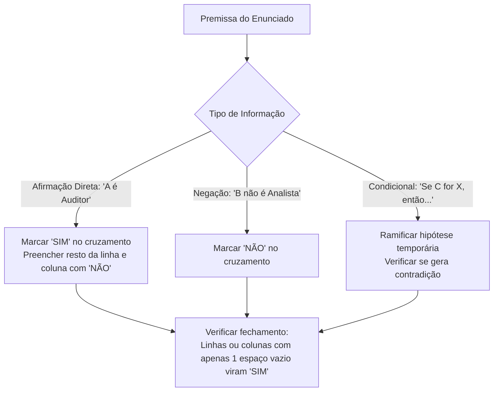

# 03 - Estruturas Lógicas, Associação e Dedução

> **Matéria:** Matemática e Raciocínio Lógico  
> **Cargos:** A01 – Técnico de Controle Externo (Adm) / B02 – Técnico de Controle Externo (TI)  
> **Arquivo:** `03_estruturas_logicas_e_associacao.md`  
> **Status:** 🟢 Teoria Aprofundada + 5 Questões FCC Comentadas (A a E)

---

## 📌 Ementa / Itens do Edital
- Estrutura lógica de relações arbitrárias entre pessoas, lugares, objetos ou eventos fictícios.
- Dedução de novas informações das relações fornecidas.
- Avaliação das condições usadas para estabelecer a estrutura daquelas relações.

---

## 🧭 Sumário

1. [Fundamentos da Associação Lógica Biunívoca](#1-fundamentos-da-associacao-logica-biunivoca)
    1. [Natureza das Relações Arbitrárias e Conjuntos Finitos](#11-natureza-das-relacoes-arbitrarias-e-conjuntos-finitos)
    2. [O Princípio da Correspondência Biunívoca](#12-o-principio-da-correspondencia-biunivoca)
    3. [Tipologia de Pistas e Classificação de Premissas](#13-tipologia-de-pistas-e-classificacao-de-premissas)
    4. [Teste 092](#Teste-092)
    5. [Teste 093](#Teste-093)
2. [Metodologia das Matrizes Cruzadas de Associação](#2-metodologia-das-matrizes-cruzadas-de-associacao)
    1. [Estruturação da Tabela Bidimensional e Tridimensional](#21-estruturacao-da-tabela-bidimensional-e-tridimensional)
    2. [O Princípio de Propagação do SIM e Fechamento por Exclusão](#22-o-principio-de-propagacao-do-sim-e-fechamento-por-exclusao)
    3. [Tratamento de Pistas Compostas e Vínculos Indiretos](#23-tratamento-de-pistas-compostas-e-vinculos-indiretos)
    4. [Teste 094](#Teste-094)
    5. [Teste 095](#Teste-095)
3. [Problemas de Ordenação Linear e Posicionamento Relativo](#3-problemas-de-ordenacao-linear-e-posicionamento-relativo)
    1. [Semântica de Ordenação: Imediatamente Antes vs. Antes Genérico](#31-semantica-de-ordenacao-imediatamente-antes-vs-antes-generico)
    2. [Filas, Andares e Classificações em Concurso](#32-filas-andares-e-classificacoes-em-concurso)
    3. [O Método das Caixas e Blocos Contíguos](#33-o-metodo-das-caixas-e-blocos-contiguos)
    4. [Teste 096](#Teste-096)
    5. [Teste 097](#Teste-097)
4. [Problemas de Ordenação Circular e Mesas Redondas](#4-problemas-de-ordenacao-circular-e-mesas-redondas)
    1. [Ponto de Vista Referencial e Orientação Espacial](#41-ponto-de-vista-referencial-e-orientacao-espacial)
    2. [Posições Diametralmente Opostas em Mesas Pares](#42-posicoes-diametralmente-opostas-em-mesas-pares)
    3. [Vizinhos Imediatos e Adjacências Direita e Esquerda](#43-vizinhos-imediatos-e-adjacencias-direita-e-esquerda)
    4. [Teste 098](#Teste-098)
    5. [Teste 099](#Teste-099)
5. [Dedução Lógica e Avaliação de Suficiência de Condições](#5-deducao-logica-e-avaliacao-de-suficiencia-de-condicoes)
    1. [Dedução Hipotética e Eliminação de Contradições](#51-deducao-hipotetica-e-eliminacao-de-contradicoes)
    2. [Condições Necessárias, Suficientes e Redundantes](#52-condicoes-necessarias-suficientes-e-redundantes)
    3. [Teste 100](#Teste-100)
    4. [Teste 101](#Teste-101)
6. [🌐 Fontes Oficiais e Referências Bibliográficas](#fontes-oficiais-e-referencias-bibliograficas)

---

## 1. Fundamentos da Associação Lógica Biunívoca

Os problemas de estruturas lógicas e relações arbitrárias exigem do candidato a capacidade de reconstruir uma teia de relações entre elementos de universos disjuntos (pessoas, cargos, salas, cidades, veículos, turnos de plantão) a partir de um conjunto restrito e aparentemente fragmentado de pistas informativas.

### 1.1 Natureza das Relações Arbitrárias e Conjuntos Finitos

Nessas questões, a relação entre os entes não decorre de nenhuma lei física ou científica prévia, mas de um cenário ficcional arbitrariamente desenhado pela banca examinadora. Os conjuntos fornecidos são finitos e de mesma cardinalidade (por exemplo: 4 auditores, 4 municípios de auditoria e 4 tipos de licitação fiscalizada).

### 1.2 O Princípio da Correspondência Biunívoca

A premissa implícita em quase todas as questões de associação lógica da FCC é o **princípio da bijeção (correspondência biunívoca)**:

* Cada elemento de um determinado conjunto associa-se a **exatamente um** elemento de cada um dos demais conjuntos;
* Não há elementos repetidos nem elementos desprovidos de correspondente no modelo padrão (salvo se o enunciado indicar expressamente o contrário).

### 1.3 Tipologia de Pistas e Classificação de Premissas

As informações fornecidas dividem-se em três modalidades lógicas:

1. **Afirmações Diretas (Pistas Positivas):** Vinculam dois elementos de modo afirmativo e categórico (*"Alice trabalha no gabinete Z"*, *"O economista é de Goiânia"*).
2. **Negações Diretas (Pistas Negativas):** Declaram a incompatibilidade mútua entre dois atributos (*"Bruno não é formado em Contabilidade"*, *"Carlos não trabalha na TI"*).
3. **Pistas Condicionais ou Compostas:** Estabelecem vínculos de causa-efeito ou conexões temporais e espaciais simultâneas (*"Se Lucas cuida da Folha, então Mateus cuida do Portal"*; *"O técnico que mora em Anápolis chegou depois de Carlos"*).

---

## 2. Metodologia das Matrizes Cruzadas de Associação

A ferramenta mais confiável e à prova de falhas para solucionar problemas de associação multidimensional é a **matriz cruzada de pertinência (tabela lógica)**.

### 2.1 Estruturação da Tabela Bidimensional e Tridimensional

Quando o problema envolve 3 categorias (por exemplo: Nomes, Formações e Cidades), adota-se um conjunto fixo como eixo vertical (comumente os Nomes) e desdobram-se os outros conjuntos nos eixos horizontais adjacentes:

| Nome | Direito | Contabilidade | Economia | Goiânia | Aparecida | Anápolis |
| :--- | :---: | :---: | :---: | :---: | :---: | :---: |
| **Alice** | | | | | | |
| **Bruno** | | | | | | |
| **Camila** | | | | | | |

Adiciona-se ainda, se necessário, uma submatriz relacionando diretamente as Formações com as Cidades.

### 2.2 O Princípio de Propagação do SIM e Fechamento por Exclusão

1. **Propagação do "SIM" (ou valor verdadeiro):**
    * Ao marcar **SIM** na interseção entre um indivíduo e um atributo (ex.: Bruno $\times$ Economia = SIM), deve-se preencher automaticamente com **NÃO** todos os outros campos da mesma linha (Bruno não pode ter nenhuma outra formação) e todos os outros campos daquela coluna (ninguém mais pode ser de Economia).

2. **Fechamento Dedutivo por Exclusão:**
    * Se em uma linha de três atributos surgirem dois **NÃO**, o terceiro campo vazio torna-se compulsoriamente **SIM**.
    * Se em uma coluna surgirem todos os campos preenchidos com **NÃO** exceto um, esse último é obrigatoriamente preenchido com **SIM**.

### 2.3 Tratamento de Pistas Compostas e Vínculos Indiretos

Quando o texto apresenta a pista: *"O servidor formado em Direito reside em Aparecida de Goiânia"*:

* Essa pista amarra os atributos *Direito* e *Aparecida* como uma **unidade inseparável**.
* Se sabemos por outra pista que *Bruno reside em Goiânia*, deduz-se imediatamente que *Bruno NÃO é formado em Direito* (pois se o fosse, deveria residir em Aparecida).

---

## 3. Problemas de Ordenação Linear e Posicionamento Relativo

Os problemas de ordenação linear lidam com grandezas posicionais dispostas em uma única dimensão orientada (classificação de concurso, andares de um edifício, fila de atendimento, ordem cronológica de chegada).

### 3.1 Semântica de Ordenação: Imediatamente Antes vs. Antes Genérico

A FCC é rigorosamente precisa na seleção de seus termos relacionais:

| Expressão no Enunciado | Significado Lógico Rigoroso | Implicação Estrutural |
| :--- | :--- | :--- |
| **"A está imediatamente antes de B"** | Adjacência e contiguidade obrigatórias: a posição de $B$ é igual à posição de $A + 1$. | Formam um bloco indivisível $(A, B)$ sem intermediários. |
| **"A está antes de B"** | Precedência estrita na ordenação ($\text{Pos}(A) < \text{Pos}(B)$). | Não exige contiguidade; pode haver zero, uma ou múltiplas pessoas entre $A$ e $B$. |
| **"A está a duas posições de B"** | A distância modular entre eles é 2 ($|\text{Pos}(A) - \text{Pos}(B)| = 2$). | Há exatamente uma pessoa posicionada entre $A$ e $B$. |
| **"Extremidades"** | Ocupam a primeira posição ($1$) ou a última posição ($N$). | Bloqueiam as pontas do arranjo linear. |

> 🚨 **ALERTA DE PROVA / PEGADINHA FCC:** Quando o enunciado afirmar que *"André chegou à frente de Caio"*, jamais presuma que André chegou colado a Caio! Isso significa apenas que André precede Caio no tempo ($t_A < t_C$). Apenas a presença expressa dos advérbios *"imediatamente"*, *"consecutivamente"* ou *"logo antes"* autoriza a fusão em bloco adjacente.

### 3.2 Filas, Andares e Classificações em Concurso

Em ordenações de 1 a $N$, convém desenhar esquematicamente as lacunas vazias numeradas no rascunho:
$$\underline{\quad 1º \quad} \quad \underline{\quad 2º \quad} \quad \underline{\quad 3º \quad} \quad \underline{\quad 4º \quad} \quad \underline{\quad 5º \quad}$$
Preenchem-se primeiro as posições fixas garantidas (ex.: *"Daniel obteve o 3º lugar"* $\implies$ fixa $D$ no 3º traço).

### 3.3 O Método das Caixas e Blocos Contíguos

Se uma pista estabelece que *"Bernardo ficou em colocação imediatamente anterior à de Caio"*, agrupa-se mentalmente o par em uma caixa única: $[B, C]$.

* Em uma fila de 5 posições com o 3º lugar já ocupado por Daniel ($1, 2, \mathbf{D}, 4, 5$), o bloco contíguo $[B, C]$ só pode caber em dois nichos: nas posições $\{1, 2\}$ ou nas posições $\{4, 5\}$;
* Testa-se cada nicho com as demais restrições para descartar inconsistências (se $C$ estivesse no 5º lugar, não poderia superar ninguém, o que violaria a regra de que Caio superou Eduardo).

---

## 4. Problemas de Ordenação Circular e Mesas Redondas

O raciocínio espacial em arranjos circulares é recorrente em questões que simulam reuniões deliberativas de colegiados de Tribunais de Contas.

### 4.1 Ponto de Vista Referencial e Orientação Espacial

A resolução exige que o candidato projete seu olhar a partir da cadeira do ocupante analisado, **voltado para o centro da mesa circular**:

* O braço direito do ocupante aponta para a sua direita na mesa;
* O braço esquerdo aponta para a sua esquerda;
* A rotação no sentido horário corresponde à esquerda de quem está no topo e à direita de quem está na base. Convém sempre desenhar o círculo com setas indicativas de "olhando para dentro".

### 4.2 Posições Diametralmente Opostas em Mesas Pares

Em mesas circulares com um número par $N$ de assentos ($N = 6$ ou $N = 8$), diz-se que duas pessoas estão sentadas **em frente** ou **diametralmente opostas** quando a linha reta que as une passa pelo centro da mesa:
$$\text{Distância de Oposição} = \frac{N}{2} \text{ posições}$$

* Em uma mesa de 6 cadeiras numeradas de 1 a 6 em sentido horário:
    * O oposto da cadeira 1 é a cadeira $1 + 3 = 4$;
    * O oposto da cadeira 2 é a cadeira $2 + 3 = 5$;
    * O oposto da cadeira 3 é a cadeira $3 + 3 = 6$.

### 4.3 Vizinhos Imediatos e Adjacências Direita e Esquerda

Cada ocupante possui exatamente dois vizinhos imediatos (adjacentes):

* O vizinho imediatamente à sua direita;
* O vizinho imediatamente à sua esquerda.
Todos os demais ocupantes não são vizinhos imediatos.

---

## 5. Dedução Lógica e Avaliação de Suficiência de Condições

A avaliação das condições de contorno de um problema examina a consistência e a suficiência do conjunto de premissas para determinar uma solução única.

### 5.1 Dedução Hipotética e Eliminação de Contradições

Quando as pistas diretas não encerram todas as variáveis, recorre-se ao método da **bifurcação hipotética**:

1. Formula-se uma hipótese arbitrária para uma célula não preenchida (ex.: *"Suponha que Alice more em Anápolis"*);
2. Desdobram-se as consequências lógicas da hipótese nas demais variáveis;
3. Se o desdobramento conduzir a uma **contradição lógica** (uma linha sem nenhum elemento verdadeiro, ou duas pessoas com o mesmo cargo), a hipótese é falsa e seu oposto é compulsoriamente verdadeiro;
4. Se o desdobramento fechar o sistema sem inconsistências e for compatível com as regras de unicidade, a configuração é legítima.

### 5.2 Condições Necessárias, Suficientes e Redundantes

A ementa do edital exige expressamente a *"avaliação das condições usadas para estabelecer a estrutura daquelas relações"*:

* **Condição Suficiente:** Aquela que, por si só, basta para fixar uma conclusão ou determinar o sistema sem necessidade de dados complementares.
* **Condição Necessária:** Requisito sem o qual o sistema não atinge a determinação unívoca, gerando graus de liberdade ou ambiguidade entre múltiplos cenários válidos.
* **Condição Redundante:** Informação cuja veracidade já havia sido demonstrada pelo encadeamento das premissas precedentes, nada acrescentando à solução final.

---

## 🌐 Fontes Oficiais e Referências Bibliográficas

* [Portal da Matemática OBMEP / IMPA - Noções de Lógica e Argumentação](https://portaldaobmep.impa.br/index.php/modulo/ver?modulo=1059) - Aulas do IMPA sobre princípios da lógica formal, tabelas-verdade, negações e proposições compostas.
* [OBMEP / IMPA - Apostila 2 do PIC: Métodos de Contagem e Lógica](https://www.obmep.org.br/docs/apostila2.pdf) - Estratégias estruturadas de dedução, análise combinatória e diagramas de associação lógica.
* [Khan Academy Brasil - Álgebra I: Lógica e Raciocínio Dedutivo](https://pt.khanacademy.org/math/algebra) - Resolução de quebra-cabeças lógicos, tabelas de contingência e modelagem dedutiva.
* [OBMEP / IMPA - Apostila 8 do PIC: Raciocínio Geométrico e Estruturas Lógicas](https://www.obmep.org.br/docs/apostila8.pdf) - Modelos formais de pensamento estruturado e deduções axiomáticas em problemas lógicos.
* ALENCAR FILHO, Edgard de. **Iniciação à Lógica Matemática**. São Paulo: Nobel, 2002. (Cap. 3 e 4 - Proposições Compostas e Conectivos Lógicos).
* COPI, Irving M. **Introdução à Lógica**. 2. ed. São Paulo: Mestre Jou, 1978. (Cap. 8 - Lógica Simbólica e Tabelas-Verdade).
* MORTARI, Cezar A. **Introdução à Lógica**. 2. ed. São Paulo: Editora Unesp, 2016. (Cap. 5 e 6 - Sintaxe e Semântica do Cálculo Proposicional).
