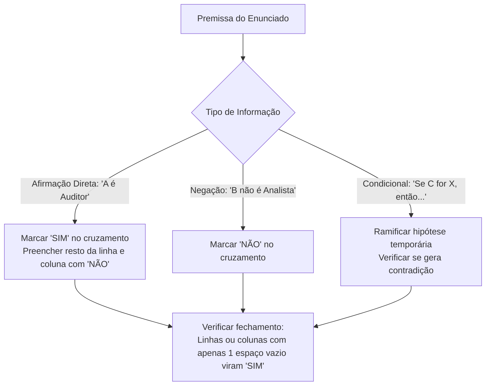

# 03 - Estruturas Lógicas, Associação e Dedução

> **Matéria:** Matemática e Raciocínio Lógico  
> **Cargos:** A01 – Técnico de Controle Externo (Adm) / B02 – Técnico de Controle Externo (TI)  
> **Arquivo:** `03_estruturas_logicas_e_associacao.md`  
> **Status:** 🟢 Teoria Aprofundada + 5 Questões FCC Comentadas (A a E)

---

## 📌 Ementa / Itens do Edital
- Estrutura lógica de relações arbitrárias entre pessoas, lugares, objetos ou eventos fictícios.
- Dedução de novas informações das relações fornecidas.
- Avaliação das condições usadas para estabelecer a estrutura daquelas relações.

---

## 🧭 Sumário

1. [Fundamentos da Associação Lógica Biunívoca](#1-fundamentos-da-associacao-logica-biunivoca)
    1. [Natureza das Relações Arbitrárias e Conjuntos Finitos](#11-natureza-das-relacoes-arbitrarias-e-conjuntos-finitos)
    2. [O Princípio da Correspondência Biunívoca](#12-o-principio-da-correspondencia-biunivoca)
    3. [Tipologia de Pistas e Classificação de Premissas](#13-tipologia-de-pistas-e-classificacao-de-premissas)
    4. [Teste 092](#Teste-092)
    5. [Teste 093](#Teste-093)
2. [Metodologia das Matrizes Cruzadas de Associação](#2-metodologia-das-matrizes-cruzadas-de-associacao)
    1. [Estruturação da Tabela Bidimensional e Tridimensional](#21-estruturacao-da-tabela-bidimensional-e-tridimensional)
    2. [O Princípio de Propagação do SIM e Fechamento por Exclusão](#22-o-principio-de-propagacao-do-sim-e-fechamento-por-exclusao)
    3. [Tratamento de Pistas Compostas e Vínculos Indiretos](#23-tratamento-de-pistas-compostas-e-vinculos-indiretos)
    4. [Teste 094](#Teste-094)
    5. [Teste 095](#Teste-095)
3. [Problemas de Ordenação Linear e Posicionamento Relativo](#3-problemas-de-ordenacao-linear-e-posicionamento-relativo)
    1. [Semântica de Ordenação: Imediatamente Antes vs. Antes Genérico](#31-semantica-de-ordenacao-imediatamente-antes-vs-antes-generico)
    2. [Filas, Andares e Classificações em Concurso](#32-filas-andares-e-classificacoes-em-concurso)
    3. [O Método das Caixas e Blocos Contíguos](#33-o-metodo-das-caixas-e-blocos-contiguos)
    4. [Teste 096](#Teste-096)
    5. [Teste 097](#Teste-097)
4. [Problemas de Ordenação Circular e Mesas Redondas](#4-problemas-de-ordenacao-circular-e-mesas-redondas)
    1. [Ponto de Vista Referencial e Orientação Espacial](#41-ponto-de-vista-referencial-e-orientacao-espacial)
    2. [Posições Diametralmente Opostas em Mesas Pares](#42-posicoes-diametralmente-opostas-em-mesas-pares)
    3. [Vizinhos Imediatos e Adjacências Direita e Esquerda](#43-vizinhos-imediatos-e-adjacencias-direita-e-esquerda)
    4. [Teste 098](#Teste-098)
    5. [Teste 099](#Teste-099)
5. [Dedução Lógica e Avaliação de Suficiência de Condições](#5-deducao-logica-e-avaliacao-de-suficiencia-de-condicoes)
    1. [Dedução Hipotética e Eliminação de Contradições](#51-deducao-hipotetica-e-eliminacao-de-contradicoes)
    2. [Condições Necessárias, Suficientes e Redundantes](#52-condicoes-necessarias-suficientes-e-redundantes)
    3. [Teste 100](#Teste-100)
    4. [Teste 101](#Teste-101)
6. [🌐 Fontes Oficiais e Referências Bibliográficas](#fontes-oficiais-e-referencias-bibliograficas)

---

## 1. Fundamentos da Associação Lógica Biunívoca

Os problemas de estruturas lógicas e relações arbitrárias exigem do candidato a capacidade de reconstruir uma teia de relações entre elementos de universos disjuntos (pessoas, cargos, salas, cidades, veículos, turnos de plantão) a partir de um conjunto restrito e aparentemente fragmentado de pistas informativas.

### 1.1 Natureza das Relações Arbitrárias e Conjuntos Finitos

Nessas questões, a relação entre os entes não decorre de nenhuma lei física ou científica prévia, mas de um cenário ficcional arbitrariamente desenhado pela banca examinadora. Os conjuntos fornecidos são finitos e de mesma cardinalidade (por exemplo: 4 auditores, 4 municípios de auditoria e 4 tipos de licitação fiscalizada).

### 1.2 O Princípio da Correspondência Biunívoca

A premissa implícita em quase todas as questões de associação lógica da FCC é o **princípio da bijeção (correspondência biunívoca)**:

* Cada elemento de um determinado conjunto associa-se a **exatamente um** elemento de cada um dos demais conjuntos;
* Não há elementos repetidos nem elementos desprovidos de correspondente no modelo padrão (salvo se o enunciado indicar expressamente o contrário).

### 1.3 Tipologia de Pistas e Classificação de Premissas

As informações fornecidas dividem-se em três modalidades lógicas:

1. **Afirmações Diretas (Pistas Positivas):** Vinculam dois elementos de modo afirmativo e categórico (*"Alice trabalha no gabinete Z"*, *"O economista é de Goiânia"*).
2. **Negações Diretas (Pistas Negativas):** Declaram a incompatibilidade mútua entre dois atributos (*"Bruno não é formado em Contabilidade"*, *"Carlos não trabalha na TI"*).
3. **Pistas Condicionais ou Compostas:** Estabelecem vínculos de causa-efeito ou conexões temporais e espaciais simultâneas (*"Se Lucas cuida da Folha, então Mateus cuida do Portal"*; *"O técnico que mora em Anápolis chegou depois de Carlos"*).

---

### Teste 092
**(FGV – TCE-PA – Auditor de Controle Externo Administrativa Ciencia de Dados – 2024)**
A decomposição em valores singulares (Singular Value Decomposition - SVD) é uma técnica para determinar relações entre dados, sendo utilizada no projeto de sistemas de recomendação. Considere a matriz 𝐴= [2 2 3 3], e sua decomposição em valores singulares dada por 𝐴= 𝑈 Σ 𝑉𝑇. Nesse caso, avalie se as afirmativas a seguir são verdadeiras (V) ou falsas (F). ( ) Os elementos da diagonal principal de Σ são √26 e √6. ( ) Os elementos da primeira coluna da matriz 𝑈 podem ser dados por 2 √13 e 3 √13 . ( ) Os elementos da primeira coluna da matriz 𝑉 podem ser dados por − 3 √13 e 2 √13 . As afirmativas são, respectivamente,

* **A)** V – V – V.
* **B)** F – V – V.
* **C)** F – F – V.
* **D)** F – F – F.
* **E)** F – V – F.

---

> **Comentário Detalhado:**
>
> - **A)** **Incorreta.** A opção apresenta proposição em desacordo com os fundamentos teóricos e técnicos do tópico ao afirmar que "V – V – V". De acordo com a teoria estudada em *2.2 O Princípio de Propagação do SIM e Fechamento por Exclusão*, ao marcar SIM na interseção entre um indivíduo e um atributo (ex.: Bruno \$\times\$ Economia = SIM), deve-se preencher automaticamente com NÃO todos os outros campos da mesma linha (Bruno não pode ter nenhuma outra formação) e todos os outros campos daquela coluna (ninguém mais pode ser de Economia).
> - **B)** **Incorreta.** A opção apresenta proposição em desacordo com os fundamentos teóricos e técnicos do tópico ao afirmar que "F – V – V". De acordo com a teoria estudada em *5.2 Condições Necessárias, Suficientes e Redundantes*, condição Suficiente: Aquela que, por si só, basta para fixar uma conclusão ou determinar o sistema sem necessidade de dados complementares.
> - **C)** **Incorreta.** A opção apresenta proposição em desacordo com os fundamentos teóricos e técnicos do tópico ao afirmar que "F – F – V". De acordo com a teoria estudada em *1.2 O Princípio da Correspondência Biunívoca*, não há elementos repetidos nem elementos desprovidos de correspondente no modelo padrão (salvo se o enunciado indicar expressamente o contrário).
> - **D)** **Incorreta.** A opção apresenta proposição em desacordo com os fundamentos teóricos e técnicos do tópico ao afirmar que "F – F – F". De acordo com a teoria estudada em *1.3 Tipologia de Pistas e Classificação de Premissas*, afirmações Diretas (Pistas Positivas): Vinculam dois elementos de modo afirmativo e categórico (*"Alice trabalha no gabinete Z"*, *"O economista é de Goiânia"*).
> - **E)** **Correta.** Conforme fundamentado na seção *1. Fundamentos da Associação Lógica Biunívoca* deste guia, os problemas de estruturas lógicas e relações arbitrárias exigem do candidato a capacidade de reconstruir uma teia de relações entre elementos de universos disjuntos (pessoas, cargos, salas, cidades, veículos, turnos de plantão) a partir de um conjunto restrito e aparentemente fragmentado de pistas informativas. Dessa forma, está plenamente correta a assertiva da banca (FGV – TCE-PA/2024) ao estabelecer que "F – V – F".
>
> **Gabarito: E**

---

### Teste 093
**(FGV – TJ-DFT – Analista Judiciario Suporte Em Tecnologia da Informacao – 2022)**
Lucas é um trader profissional que trabalha em uma corretora de valores. Ele efetua muitas operações durante o período em que a bolsa negocia seus ativos. Após fazer uma revisão em suas operações do dia, não validou, como sendo efetuadas por ele, algumas das operações que obtiveram prejuízo. Lucas, então, entrou em contato com a corretora e esta demonstrou, a partir de registros de auditoria e garantia de identidade, que as operações em questão realmente foram executadas por ele. Para que a corretora prove que foi Lucas quem realmente executou as operações, ela deve fazer uso do conceito de segurança chamado:

* **A)** confidencialidade;
* **B)** autenticidade;
* **C)** integridade;
* **D)** disponibilidade;
* **E)** irretratabilidade.

---

> **Comentário Detalhado:**
>
> - **A)** **Incorreta.** A opção apresenta proposição em desacordo com os fundamentos teóricos e técnicos do tópico ao afirmar que "confidencialidade". De acordo com a teoria estudada em *1.1 Natureza das Relações Arbitrárias e Conjuntos Finitos*, os conjuntos fornecidos são finitos e de mesma cardinalidade (por exemplo: 4 auditores, 4 municípios de auditoria e 4 tipos de licitação fiscalizada).
> - **B)** **Incorreta.** A opção apresenta proposição em desacordo com os fundamentos teóricos e técnicos do tópico ao afirmar que "autenticidade". De acordo com a teoria estudada em *1. Fundamentos da Associação Lógica Biunívoca*, os problemas de estruturas lógicas e relações arbitrárias exigem do candidato a capacidade de reconstruir uma teia de relações entre elementos de universos disjuntos (pessoas, cargos, salas, cidades, veículos, turnos de plantão) a partir de um conjunto restrito e aparentemente fragmentado de pistas informativas.
> - **C)** **Incorreta.** A opção apresenta proposição em desacordo com os fundamentos teóricos e técnicos do tópico ao afirmar que "integridade". De acordo com a teoria estudada em *1.3 Tipologia de Pistas e Classificação de Premissas*, afirmações Diretas (Pistas Positivas): Vinculam dois elementos de modo afirmativo e categórico (*"Alice trabalha no gabinete Z"*, *"O economista é de Goiânia"*).
> - **D)** **Incorreta.** A opção apresenta proposição em desacordo com os fundamentos teóricos e técnicos do tópico ao afirmar que "disponibilidade". De acordo com a teoria estudada em *1.3 Tipologia de Pistas e Classificação de Premissas*, negações Diretas (Pistas Negativas): Declaram a incompatibilidade mútua entre dois atributos (*"Bruno não é formado em Contabilidade"*, *"Carlos não trabalha na TI"*).
> - **E)** **Correta.** Conforme fundamentado na seção *1.3 Tipologia de Pistas e Classificação de Premissas* deste guia, pistas Condicionais ou Compostas: Estabelecem vínculos de causa-efeito ou conexões temporais e espaciais simultâneas (*"Se Lucas cuida da Folha, então Mateus cuida do Portal"*; *"O técnico que mora em Anápolis chegou depois de Carlos"*). Dessa forma, está plenamente correta a assertiva da banca (FGV – TJ-DFT/2022) ao estabelecer que "irretratabilidade".
>
> **Gabarito: E**

---

## 2. Metodologia das Matrizes Cruzadas de Associação

A ferramenta mais confiável e à prova de falhas para solucionar problemas de associação multidimensional é a **matriz cruzada de pertinência (tabela lógica)**.

### 2.1 Estruturação da Tabela Bidimensional e Tridimensional

Quando o problema envolve 3 categorias (por exemplo: Nomes, Formações e Cidades), adota-se um conjunto fixo como eixo vertical (comumente os Nomes) e desdobram-se os outros conjuntos nos eixos horizontais adjacentes:

| Nome | Direito | Contabilidade | Economia | Goiânia | Aparecida | Anápolis |
| :--- | :---: | :---: | :---: | :---: | :---: | :---: |
| **Alice** | | | | | | |
| **Bruno** | | | | | | |
| **Camila** | | | | | | |

Adiciona-se ainda, se necessário, uma submatriz relacionando diretamente as Formações com as Cidades.

### 2.2 O Princípio de Propagação do SIM e Fechamento por Exclusão

1. **Propagação do "SIM" (ou valor verdadeiro):**
    * Ao marcar **SIM** na interseção entre um indivíduo e um atributo (ex.: Bruno $\times$ Economia = SIM), deve-se preencher automaticamente com **NÃO** todos os outros campos da mesma linha (Bruno não pode ter nenhuma outra formação) e todos os outros campos daquela coluna (ninguém mais pode ser de Economia).

2. **Fechamento Dedutivo por Exclusão:**
    * Se em uma linha de três atributos surgirem dois **NÃO**, o terceiro campo vazio torna-se compulsoriamente **SIM**.
    * Se em uma coluna surgirem todos os campos preenchidos com **NÃO** exceto um, esse último é obrigatoriamente preenchido com **SIM**.

### 2.3 Tratamento de Pistas Compostas e Vínculos Indiretos

Quando o texto apresenta a pista: *"O servidor formado em Direito reside em Aparecida de Goiânia"*:

* Essa pista amarra os atributos *Direito* e *Aparecida* como uma **unidade inseparável**.
* Se sabemos por outra pista que *Bruno reside em Goiânia*, deduz-se imediatamente que *Bruno NÃO é formado em Direito* (pois se o fosse, deveria residir em Aparecida).

---

### Teste 094
**(FCC – TRT-15 – Analista Judiciario Tecnologia da Informacao – 2015)**
Renato comprou um cartucho de tinta e dois pacotes de papel para sua impressora gastando, no total, R$ 69,00. Sabe-se que o cartucho de tinta custou 30% mais caro do que os dois pacotes de papel juntos. Se cada um dos pacotes de papel custou o mesmo preço, então, em R$, o preço do cartucho de tinta superou o de um único pacote de papel em

* **A)** 24,00.
* **B)** 21,00.
* **C)** 28,00.
* **D)** 26,00.
* **E)** 23,00.

---

> **Comentário Detalhado:**
>
> - **A)** **Correta.** Conforme fundamentado na seção *2. Metodologia das Matrizes Cruzadas de Associação* deste guia, a ferramenta mais confiável e à prova de falhas para solucionar problemas de associação multidimensional é a matriz cruzada de pertinência (tabela lógica). Dessa forma, está plenamente correta a assertiva da banca (FCC – TRT-15/2015) ao estabelecer que "24,00".
> - **B)** **Incorreta.** A opção apresenta proposição em desacordo com os fundamentos teóricos e técnicos do tópico ao afirmar que "21,00". De acordo com a teoria estudada em *2.2 O Princípio de Propagação do SIM e Fechamento por Exclusão*, ao marcar SIM na interseção entre um indivíduo e um atributo (ex.: Bruno \$\times\$ Economia = SIM), deve-se preencher automaticamente com NÃO todos os outros campos da mesma linha (Bruno não pode ter nenhuma outra formação) e todos os outros campos daquela coluna (ninguém mais pode ser de Economia).
> - **C)** **Incorreta.** A opção apresenta proposição em desacordo com os fundamentos teóricos e técnicos do tópico ao afirmar que "28,00". De acordo com a teoria estudada em *2.2 O Princípio de Propagação do SIM e Fechamento por Exclusão*, se em uma linha de três atributos surgirem dois NÃO, o terceiro campo vazio torna-se compulsoriamente SIM.
> - **D)** **Incorreta.** A opção apresenta proposição em desacordo com os fundamentos teóricos e técnicos do tópico ao afirmar que "26,00". De acordo com a teoria estudada em *1.3 Tipologia de Pistas e Classificação de Premissas*, pistas Condicionais ou Compostas: Estabelecem vínculos de causa-efeito ou conexões temporais e espaciais simultâneas (*"Se Lucas cuida da Folha, então Mateus cuida do Portal"*; *"O técnico que mora em Anápolis chegou depois de Carlos"*).
> - **E)** **Incorreta.** A opção apresenta proposição em desacordo com os fundamentos teóricos e técnicos do tópico ao afirmar que "23,00". De acordo com a teoria estudada em *3.3 O Método das Caixas e Blocos Contíguos*, testa-se cada nicho com as demais restrições para descartar inconsistências (se \$C\$ estivesse no 5º lugar, não poderia superar ninguém, o que violaria a regra de que Caio superou Eduardo).
>
> **Gabarito: A**

---

### Teste 095
**(FGV – TCE-SC – Auditor Fiscal de Controle Externo Administracao – 2026)**
As amigas Alice, Laura e Catarina foram a um shopping comprar coisas de que necessitavam. Uma delas comprou uma bolsa, outra comprou um par de tênis e a terceira comprou um casaco. Sabe-se que, das afirmações a seguir, apenas uma é verdadeira. • Laura comprou a bolsa. • Catarina não comprou o tênis. • Laura não comprou o casaco. Nesse caso, é correto afirmar que

* **A)** Catarina comprou a bolsa.
* **B)** Laura comprou o par de tênis.
* **C)** Alice comprou o casaco.
* **D)** Laura comprou a bolsa.
* **E)** Alice não comprou o par de tênis.

---

> **Comentário Detalhado:**
>
> - **A)** **Incorreta.** A opção apresenta proposição em desacordo com os fundamentos teóricos e técnicos do tópico ao afirmar que "Catarina comprou a bolsa". De acordo com a teoria estudada em *3.3 O Método das Caixas e Blocos Contíguos*, se uma pista estabelece que *"Bernardo ficou em colocação imediatamente anterior à de Caio"*, agrupa-se mentalmente o par em uma caixa única: \$[B, C]\$.
> - **B)** **Incorreta.** A opção apresenta proposição em desacordo com os fundamentos teóricos e técnicos do tópico ao afirmar que "Laura comprou o par de tênis". De acordo com a teoria estudada em *4.2 Posições Diametralmente Opostas em Mesas Pares*, em mesas circulares com um número par \$N\$ de assentos (\$N = 6\$ ou \$N = 8\$), diz-se que duas pessoas estão sentadas em frente ou diametralmente opostas quando a linha reta que as une passa pelo centro da mesa.
> - **C)** **Incorreta.** A opção apresenta proposição em desacordo com os fundamentos teóricos e técnicos do tópico ao afirmar que "Alice comprou o casaco". De acordo com a teoria estudada em *5.1 Dedução Hipotética e Eliminação de Contradições*, formula-se uma hipótese arbitrária para uma célula não preenchida (ex.: *"Suponha que Alice more em Anápolis"*).
> - **D)** **Incorreta.** A opção apresenta proposição em desacordo com os fundamentos teóricos e técnicos do tópico ao afirmar que "Laura comprou a bolsa". De acordo com a teoria estudada em *2.2 O Princípio de Propagação do SIM e Fechamento por Exclusão*, ao marcar SIM na interseção entre um indivíduo e um atributo (ex.: Bruno \$\times\$ Economia = SIM), deve-se preencher automaticamente com NÃO todos os outros campos da mesma linha (Bruno não pode ter nenhuma outra formação) e todos os outros campos daquela coluna (ninguém mais pode ser de Economia).
> - **E)** **Correta.** Conforme fundamentado na seção *1.3 Tipologia de Pistas e Classificação de Premissas* deste guia, afirmações Diretas (Pistas Positivas): Vinculam dois elementos de modo afirmativo e categórico (*"Alice trabalha no gabinete Z"*, *"O economista é de Goiânia"*). Dessa forma, está plenamente correta a assertiva da banca (FGV – TCE-SC/2026) ao estabelecer que "Alice não comprou o par de tênis".
>
> **Gabarito: E**

---

## 3. Problemas de Ordenação Linear e Posicionamento Relativo

Os problemas de ordenação linear lidam com grandezas posicionais dispostas em uma única dimensão orientada (classificação de concurso, andares de um edifício, fila de atendimento, ordem cronológica de chegada).

### 3.1 Semântica de Ordenação: Imediatamente Antes vs. Antes Genérico

A FCC é rigorosamente precisa na seleção de seus termos relacionais:

| Expressão no Enunciado | Significado Lógico Rigoroso | Implicação Estrutural |
| :--- | :--- | :--- |
| **"A está imediatamente antes de B"** | Adjacência e contiguidade obrigatórias: a posição de $B$ é igual à posição de $A + 1$. | Formam um bloco indivisível $(A, B)$ sem intermediários. |
| **"A está antes de B"** | Precedência estrita na ordenação ($\text{Pos}(A) < \text{Pos}(B)$). | Não exige contiguidade; pode haver zero, uma ou múltiplas pessoas entre $A$ e $B$. |
| **"A está a duas posições de B"** | A distância modular entre eles é 2 ($|\text{Pos}(A) - \text{Pos}(B)| = 2$). | Há exatamente uma pessoa posicionada entre $A$ e $B$. |
| **"Extremidades"** | Ocupam a primeira posição ($1$) ou a última posição ($N$). | Bloqueiam as pontas do arranjo linear. |

> 🚨 **ALERTA DE PROVA / PEGADINHA FCC:** Quando o enunciado afirmar que *"André chegou à frente de Caio"*, jamais presuma que André chegou colado a Caio! Isso significa apenas que André precede Caio no tempo ($t_A < t_C$). Apenas a presença expressa dos advérbios *"imediatamente"*, *"consecutivamente"* ou *"logo antes"* autoriza a fusão em bloco adjacente.

### 3.2 Filas, Andares e Classificações em Concurso

Em ordenações de 1 a $N$, convém desenhar esquematicamente as lacunas vazias numeradas no rascunho:
$$\underline{\quad 1º \quad} \quad \underline{\quad 2º \quad} \quad \underline{\quad 3º \quad} \quad \underline{\quad 4º \quad} \quad \underline{\quad 5º \quad}$$
Preenchem-se primeiro as posições fixas garantidas (ex.: *"Daniel obteve o 3º lugar"* $\implies$ fixa $D$ no 3º traço).

### 3.3 O Método das Caixas e Blocos Contíguos

Se uma pista estabelece que *"Bernardo ficou em colocação imediatamente anterior à de Caio"*, agrupa-se mentalmente o par em uma caixa única: $[B, C]$.

* Em uma fila de 5 posições com o 3º lugar já ocupado por Daniel ($1, 2, \mathbf{D}, 4, 5$), o bloco contíguo $[B, C]$ só pode caber em dois nichos: nas posições $\{1, 2\}$ ou nas posições $\{4, 5\}$;
* Testa-se cada nicho com as demais restrições para descartar inconsistências (se $C$ estivesse no 5º lugar, não poderia superar ninguém, o que violaria a regra de que Caio superou Eduardo).

---

### Teste 096
**(FCC – TRT-4 – Analista Judiciario Tecnologia da Informacao – 2015)**
Há sete participantes de um torneio de tiro ao alvo, cada um disparando um único tiro. Quatro deles (André, Francisco, Sérgio e José) são experientes, e três deles (Eduardo, Fernando e Gabriel) são novatos. Sabe-se que: − para que um novato dispare seu tiro, ele deve ser antecedido e precedido por um atirador experiente; − Fernando é o segundo a disparar seu tiro, enquanto que Sérgio é o último atirador experiente a disparar um tiro; − Francisco dispara antes do que José dispara seu tiro, mas depois do que André dispara seu tiro. Dentre as opções abaixo, NÃO é necessariamente correto que

* **A)** Gabriel dispare seu tiro depois de Fernando.
* **B)** Sérgio dispare seu tiro depois de todos os atiradores novatos.
* **C)** Fernando é o primeiro novato a disparar um tiro.
* **D)** Eduardo dispare seu tiro antes do que José.
* **E)** José dispare seu tiro entre Eduardo e Gabriel.

---

> **Comentário Detalhado:**
>
> - **A)** **Incorreta.** A opção apresenta proposição em desacordo com os fundamentos teóricos e técnicos do tópico ao afirmar que "Gabriel dispare seu tiro depois de Fernando". De acordo com a teoria estudada em *3.1 Semântica de Ordenação: Imediatamente Antes vs. Antes Genérico*, quando o enunciado afirmar que *"André chegou à frente de Caio"*, jamais presuma que André chegou colado a Caio! Isso significa apenas que André precede Caio no tempo (\$t_A < t_C\$).
> - **B)** **Incorreta.** A opção apresenta proposição em desacordo com os fundamentos teóricos e técnicos do tópico ao afirmar que "Sérgio dispare seu tiro depois de todos os atiradores novatos". De acordo com a teoria estudada em *3.1 Semântica de Ordenação: Imediatamente Antes vs. Antes Genérico*, a FCC é rigorosamente precisa na seleção de seus termos relacionais.
> - **C)** **Incorreta.** A opção apresenta proposição em desacordo com os fundamentos teóricos e técnicos do tópico ao afirmar que "Fernando é o primeiro novato a disparar um tiro". De acordo com a teoria estudada em *3.2 Filas, Andares e Classificações em Concurso*, preenchem-se primeiro as posições fixas garantidas (ex.: *"Daniel obteve o 3º lugar"* \$\implies\$ fixa \$D\$ no 3º traço).
> - **D)** **Correta.** Conforme fundamentado na seção *3.3 O Método das Caixas e Blocos Contíguos* deste guia, testa-se cada nicho com as demais restrições para descartar inconsistências (se \$C\$ estivesse no 5º lugar, não poderia superar ninguém, o que violaria a regra de que Caio superou Eduardo). Dessa forma, está plenamente correta a assertiva da banca (FCC – TRT-4/2015) ao estabelecer que "Eduardo dispare seu tiro antes do que José".
> - **E)** **Incorreta.** A opção apresenta proposição em desacordo com os fundamentos teóricos e técnicos do tópico ao afirmar que "José dispare seu tiro entre Eduardo e Gabriel". De acordo com a teoria estudada em *3.1 Semântica de Ordenação: Imediatamente Antes vs. Antes Genérico*, expressão no Enunciado: Significado Lógico Rigoroso — Implicação Estrutural.
>
> **Gabarito: D**

---

### Teste 097
**(FCC – TRT-14 – Analista Judiciario Apoio Especializado Tecnologia da Informacao – 2016)**
Aldo, Daniel e Eduardo são três amigos. Dois deles têm 66 anos, e sempre mentem. O outro deles tem 48 anos e sempre diz a verdade. Se Aldo disse “− A idade de Daniel não é 66 anos”, então, é correto afirmar que

* **A)** Eduardo e Daniel dizem a verdade.
* **B)** Aldo e Eduardo mentem.
* **C)** Eduardo tem 48 anos.
* **D)** Aldo diz a verdade.
* **E)** Aldo tem 48 anos.

---

> **Comentário Detalhado:**
>
> - **A)** **Incorreta.** A opção apresenta proposição em desacordo com os fundamentos teóricos e técnicos do tópico ao afirmar que "Eduardo e Daniel dizem a verdade". De acordo com a teoria estudada em *3.3 O Método das Caixas e Blocos Contíguos*, em uma fila de 5 posições com o 3º lugar já ocupado por Daniel (\$1, 2, \mathbf{D}, 4, 5\$), o bloco contíguo \$[B, C]\$ só pode caber em dois nichos: nas posições \$\{1, 2\}\$ ou nas posições \$\{4, 5\}\$.
> - **B)** **Incorreta.** A opção apresenta proposição em desacordo com os fundamentos teóricos e técnicos do tópico ao afirmar que "Aldo e Eduardo mentem". De acordo com a teoria estudada em *2.2 O Princípio de Propagação do SIM e Fechamento por Exclusão*, se em uma linha de três atributos surgirem dois NÃO, o terceiro campo vazio torna-se compulsoriamente SIM.
> - **C)** **Correta.** Conforme fundamentado na seção *3.3 O Método das Caixas e Blocos Contíguos* deste guia, testa-se cada nicho com as demais restrições para descartar inconsistências (se \$C\$ estivesse no 5º lugar, não poderia superar ninguém, o que violaria a regra de que Caio superou Eduardo). Dessa forma, está plenamente correta a assertiva da banca (FCC – TRT-14/2016) ao estabelecer que "Eduardo tem 48 anos".
> - **D)** **Incorreta.** A opção apresenta proposição em desacordo com os fundamentos teóricos e técnicos do tópico ao afirmar que "Aldo diz a verdade". De acordo com a teoria estudada em *4.2 Posições Diametralmente Opostas em Mesas Pares*, em mesas circulares com um número par \$N\$ de assentos (\$N = 6\$ ou \$N = 8\$), diz-se que duas pessoas estão sentadas em frente ou diametralmente opostas quando a linha reta que as une passa pelo centro da mesa.
> - **E)** **Incorreta.** A opção apresenta proposição em desacordo com os fundamentos teóricos e técnicos do tópico ao afirmar que "Aldo tem 48 anos". De acordo com a teoria estudada em *3.1 Semântica de Ordenação: Imediatamente Antes vs. Antes Genérico*, quando o enunciado afirmar que *"André chegou à frente de Caio"*, jamais presuma que André chegou colado a Caio! Isso significa apenas que André precede Caio no tempo (\$t_A < t_C\$).
>
> **Gabarito: C**

---

## 4. Problemas de Ordenação Circular e Mesas Redondas

O raciocínio espacial em arranjos circulares é recorrente em questões que simulam reuniões deliberativas de colegiados de Tribunais de Contas.

### 4.1 Ponto de Vista Referencial e Orientação Espacial

A resolução exige que o candidato projete seu olhar a partir da cadeira do ocupante analisado, **voltado para o centro da mesa circular**:

* O braço direito do ocupante aponta para a sua direita na mesa;
* O braço esquerdo aponta para a sua esquerda;
* A rotação no sentido horário corresponde à esquerda de quem está no topo e à direita de quem está na base. Convém sempre desenhar o círculo com setas indicativas de "olhando para dentro".

### 4.2 Posições Diametralmente Opostas em Mesas Pares

Em mesas circulares com um número par $N$ de assentos ($N = 6$ ou $N = 8$), diz-se que duas pessoas estão sentadas **em frente** ou **diametralmente opostas** quando a linha reta que as une passa pelo centro da mesa:
$$\text{Distância de Oposição} = \frac{N}{2} \text{ posições}$$

* Em uma mesa de 6 cadeiras numeradas de 1 a 6 em sentido horário:
    * O oposto da cadeira 1 é a cadeira $1 + 3 = 4$;
    * O oposto da cadeira 2 é a cadeira $2 + 3 = 5$;
    * O oposto da cadeira 3 é a cadeira $3 + 3 = 6$.

### 4.3 Vizinhos Imediatos e Adjacências Direita e Esquerda

Cada ocupante possui exatamente dois vizinhos imediatos (adjacentes):

* O vizinho imediatamente à sua direita;
* O vizinho imediatamente à sua esquerda.
Todos os demais ocupantes não são vizinhos imediatos.

---

### Teste 098
**(FGV – TJ-AP – Analista Judiciario Apoio Especializado Tecnologia da Informacao Banco de Dados – 2023)**
“Se você escolher a cidade como local de residência, você deve estar preparado para escutar a bela música das buzinas e a respirar um ar saudável, enriquecido de fumaça de todas as espécies. Por outro lado, viver no campo é benéfico porque isso permite que você se aproxime da natureza, que escute os belos cantos dos pássaros, sem contar a solidariedade dos vizinhos em caso de aborrecimento ou doença.” Sobre esse segmento textual, é correto afirmar que:

* **A)** a tese defendida no texto é a de que a vida no campo e na cidade apresentam diferentes vantagens;
* **B)** o conector “Por outro lado”, empregado entre os dois principais segmentos do texto, indica semelhança entre a vida na cidade e a vida no campo;
* **C)** o processo utilizado pelo argumentador na desvalorização da vida na cidade é a ironia;
* **D)** os argumentos utilizados na defesa da tese pelo argumentador se apoiam em valores humanos, sociais e econômicos;
* **E)** o argumentador apresenta de forma imparcial as vantagens e desvantagens de viver-se no campo e na cidade.

---

> **Comentário Detalhado:**
>
> - **A)** **Incorreta.** A opção apresenta proposição em desacordo com os fundamentos teóricos e técnicos do tópico ao afirmar que "a tese defendida no texto é a de que a vida no campo e na cidade apresentam diferentes vantagens". De acordo com a teoria estudada em *2.2 O Princípio de Propagação do SIM e Fechamento por Exclusão*, se em uma linha de três atributos surgirem dois NÃO, o terceiro campo vazio torna-se compulsoriamente SIM.
> - **B)** **Incorreta.** A opção apresenta proposição em desacordo com os fundamentos teóricos e técnicos do tópico ao afirmar que "o conector “Por outro lado”, empregado entre os dois principais segmentos do texto, indica semelhança entre a vida...". De acordo com a teoria estudada em *2.3 Tratamento de Pistas Compostas e Vínculos Indiretos*, quando o texto apresenta a pista: *"O servidor formado em Direito reside em Aparecida de Goiânia"*.
> - **C)** **Correta.** Conforme fundamentado na seção *4.3 Vizinhos Imediatos e Adjacências Direita e Esquerda* deste guia, cada ocupante possui exatamente dois vizinhos imediatos (adjacentes). Dessa forma, está plenamente correta a assertiva da banca (FGV – TJ-AP/2023) ao estabelecer que "o processo utilizado pelo argumentador na desvalorização da vida na cidade é a ironia".
> - **D)** **Incorreta.** A opção apresenta proposição em desacordo com os fundamentos teóricos e técnicos do tópico ao afirmar que "os argumentos utilizados na defesa da tese pelo argumentador se apoiam em valores humanos, sociais e econômicos". De acordo com a teoria estudada em *4.3 Vizinhos Imediatos e Adjacências Direita e Esquerda*, todos os demais ocupantes não são vizinhos imediatos.
> - **E)** **Incorreta.** A opção apresenta proposição em desacordo com os fundamentos teóricos e técnicos do tópico ao afirmar que "o argumentador apresenta de forma imparcial as vantagens e desvantagens de viver-se no campo e na cidade". De acordo com a teoria estudada em *2.2 O Princípio de Propagação do SIM e Fechamento por Exclusão*, ao marcar SIM na interseção entre um indivíduo e um atributo (ex.: Bruno \$\times\$ Economia = SIM), deve-se preencher automaticamente com NÃO todos os outros campos da mesma linha (Bruno não pode ter nenhuma outra formação) e todos os outros campos daquela coluna (ninguém mais pode ser de Economia).
>
> **Gabarito: C**

---

### Teste 099
**(FCC – TRT-11 – Analista Judiciario Tecnologia da Informacao – 2017)**
Ricardo e Luiz largaram juntos em uma competição de ciclismo disputada em pista circular. Ricardo sempre dá uma volta completa na pista em 28 segundos, enquanto Luiz sempre leva 30 segundos para completar uma volta. Quando Ricardo tiver completado a 70a volta na pista, Luiz estará percorrendo a volta número

* **A)** 67.
* **B)** 64.
* **C)** 65.
* **D)** 55.
* **E)** 66.

---

> **Comentário Detalhado:**
>
> - **A)** **Incorreta.** A opção apresenta proposição em desacordo com os fundamentos teóricos e técnicos do tópico ao afirmar que "67". De acordo com a teoria estudada em *4.2 Posições Diametralmente Opostas em Mesas Pares*, em mesas circulares com um número par \$N\$ de assentos (\$N = 6\$ ou \$N = 8\$), diz-se que duas pessoas estão sentadas em frente ou diametralmente opostas quando a linha reta que as une passa pelo centro da mesa.
> - **B)** **Incorreta.** A opção apresenta proposição em desacordo com os fundamentos teóricos e técnicos do tópico ao afirmar que "64". De acordo com a teoria estudada em *4. Problemas de Ordenação Circular e Mesas Redondas*, o raciocínio espacial em arranjos circulares é recorrente em questões que simulam reuniões deliberativas de colegiados de Tribunais de Contas.
> - **C)** **Incorreta.** A opção apresenta proposição em desacordo com os fundamentos teóricos e técnicos do tópico ao afirmar que "65". De acordo com a teoria estudada em *4.1 Ponto de Vista Referencial e Orientação Espacial*, a resolução exige que o candidato projete seu olhar a partir da cadeira do ocupante analisado, voltado para o centro da mesa circular.
> - **D)** **Incorreta.** A opção apresenta proposição em desacordo com os fundamentos teóricos e técnicos do tópico ao afirmar que "55". De acordo com a teoria estudada em *2.3 Tratamento de Pistas Compostas e Vínculos Indiretos*, quando o texto apresenta a pista: *"O servidor formado em Direito reside em Aparecida de Goiânia"*.
> - **E)** **Correta.** Conforme fundamentado na seção *4.1 Ponto de Vista Referencial e Orientação Espacial* deste guia, a rotação no sentido horário corresponde à esquerda de quem está no topo e à direita de quem está na base. Convém sempre desenhar o círculo com setas indicativas de "olhando para dentro". Dessa forma, está plenamente correta a assertiva da banca (FCC – TRT-11/2017) ao estabelecer que "66".
>
> **Gabarito: E**

---

## 5. Dedução Lógica e Avaliação de Suficiência de Condições

A avaliação das condições de contorno de um problema examina a consistência e a suficiência do conjunto de premissas para determinar uma solução única.

### 5.1 Dedução Hipotética e Eliminação de Contradições

Quando as pistas diretas não encerram todas as variáveis, recorre-se ao método da **bifurcação hipotética**:

1. Formula-se uma hipótese arbitrária para uma célula não preenchida (ex.: *"Suponha que Alice more em Anápolis"*);
2. Desdobram-se as consequências lógicas da hipótese nas demais variáveis;
3. Se o desdobramento conduzir a uma **contradição lógica** (uma linha sem nenhum elemento verdadeiro, ou duas pessoas com o mesmo cargo), a hipótese é falsa e seu oposto é compulsoriamente verdadeiro;
4. Se o desdobramento fechar o sistema sem inconsistências e for compatível com as regras de unicidade, a configuração é legítima.

### 5.2 Condições Necessárias, Suficientes e Redundantes

A ementa do edital exige expressamente a *"avaliação das condições usadas para estabelecer a estrutura daquelas relações"*:

* **Condição Suficiente:** Aquela que, por si só, basta para fixar uma conclusão ou determinar o sistema sem necessidade de dados complementares.
* **Condição Necessária:** Requisito sem o qual o sistema não atinge a determinação unívoca, gerando graus de liberdade ou ambiguidade entre múltiplos cenários válidos.
* **Condição Redundante:** Informação cuja veracidade já havia sido demonstrada pelo encadeamento das premissas precedentes, nada acrescentando à solução final.

---

### Teste 100
**(FCC – TRT-2 – Analista Judiciario Tecnologia da Informacao – 2014)**
No próximo ano, uma enfermeira deverá estar de plantão em 210 dos 365 dias do ano. No hospital em que ela trabalha, só se permite que uma enfermeira fique de plantão por, no máximo, 3 dias consecutivos. Nessas condições, combinando adequadamente os dias de plantão e de folga, o número máximo de dias consecutivos que ela poderá tirar de folga nesse ano é igual a

* **A)** 78.
* **B)** 85.
* **C)** 87.
* **D)** 90.
* **E)** 155.

---

> **Comentário Detalhado:**
>
> - **A)** **Incorreta.** A opção apresenta proposição em desacordo com os fundamentos teóricos e técnicos do tópico ao afirmar que "78". De acordo com a teoria estudada em *5.2 Condições Necessárias, Suficientes e Redundantes*, a ementa do edital exige expressamente a *"avaliação das condições usadas para estabelecer a estrutura daquelas relações"*.
> - **B)** **Incorreta.** A opção apresenta proposição em desacordo com os fundamentos teóricos e técnicos do tópico ao afirmar que "85". De acordo com a teoria estudada em *5.2 Condições Necessárias, Suficientes e Redundantes*, condição Suficiente: Aquela que, por si só, basta para fixar uma conclusão ou determinar o sistema sem necessidade de dados complementares.
> - **C)** **Correta.** Conforme fundamentado na seção *5. Dedução Lógica e Avaliação de Suficiência de Condições* deste guia, a avaliação das condições de contorno de um problema examina a consistência e a suficiência do conjunto de premissas para determinar uma solução única. Dessa forma, está plenamente correta a assertiva da banca (FCC – TRT-2/2014) ao estabelecer que "87".
> - **D)** **Incorreta.** A opção apresenta proposição em desacordo com os fundamentos teóricos e técnicos do tópico ao afirmar que "90". De acordo com a teoria estudada em *5.2 Condições Necessárias, Suficientes e Redundantes*, condição Necessária: Requisito sem o qual o sistema não atinge a determinação unívoca, gerando graus de liberdade ou ambiguidade entre múltiplos cenários válidos.
> - **E)** **Incorreta.** A opção apresenta proposição em desacordo com os fundamentos teóricos e técnicos do tópico ao afirmar que "155". De acordo com a teoria estudada em *5.2 Condições Necessárias, Suficientes e Redundantes*, condição Redundante: Informação cuja veracidade já havia sido demonstrada pelo encadeamento das premissas precedentes, nada acrescentando à solução final.
>
> **Gabarito: C**

---

### Teste 101
**(FGV – TJ-DFT – Analista Judiciario Suporte Em Tecnologia da Informacao – 2022)**
Considere uma tabela relacional com uma coluna, intitulada Cidade, que contém as strings “São Paulo”, “Rio de Janeiro”, “Manaus”, “Sao Paulo”, “Manaus”, dispostas uma em cada linha. A execução dos comandos SQL SELECT Cidade FROM Locations where Cidade COLLATE Latin1_General_CI_AI in ('São Paulo','Rio de Janeiro', 'MANAUS') SELECT Cidade FROM Locations where Cidade COLLATE Latin1_General_CI_AS in ('São Paulo','Rio de Janeiro', 'MANAUS') SELECT Cidade FROM Locations where Cidade COLLATE Latin1_General_CS_AI in ('São Paulo','Rio de Janeiro', 'MANAUS') no MS SQL Server produz resultados que, além da linha de títulos, contêm, respectivamente:

* **A)** 3, 4 e 5 linhas;
* **B)** 4, 3 e 5 linhas;
* **C)** 4, 5 e 3 linhas;
* **D)** 5, 3 e 4 linhas;
* **E)** 5, 4 e 3 linhas.

---

> **Comentário Detalhado:**
>
> - **A)** **Incorreta.** A opção apresenta proposição em desacordo com os fundamentos teóricos e técnicos do tópico ao afirmar que "3, 4 e 5 linhas". De acordo com a teoria estudada em *5.1 Dedução Hipotética e Eliminação de Contradições*, se o desdobramento conduzir a uma contradição lógica (uma linha sem nenhum elemento verdadeiro, ou duas pessoas com o mesmo cargo), a hipótese é falsa e seu oposto é compulsoriamente verdadeiro.
> - **B)** **Incorreta.** A opção apresenta proposição em desacordo com os fundamentos teóricos e técnicos do tópico ao afirmar que "4, 3 e 5 linhas". De acordo com a teoria estudada em *3. Problemas de Ordenação Linear e Posicionamento Relativo*, os problemas de ordenação linear lidam com grandezas posicionais dispostas em uma única dimensão orientada (classificação de concurso, andares de um edifício, fila de atendimento, ordem cronológica de chegada).
> - **C)** **Incorreta.** A opção apresenta proposição em desacordo com os fundamentos teóricos e técnicos do tópico ao afirmar que "4, 5 e 3 linhas". De acordo com a teoria estudada em *2.2 O Princípio de Propagação do SIM e Fechamento por Exclusão*, se em uma coluna surgirem todos os campos preenchidos com NÃO exceto um, esse último é obrigatoriamente preenchido com SIM.
> - **D)** **Incorreta.** A opção apresenta proposição em desacordo com os fundamentos teóricos e técnicos do tópico ao afirmar que "5, 3 e 4 linhas". De acordo com a teoria estudada em *2. Metodologia das Matrizes Cruzadas de Associação*, a ferramenta mais confiável e à prova de falhas para solucionar problemas de associação multidimensional é a matriz cruzada de pertinência (tabela lógica).
> - **E)** **Correta.** Conforme fundamentado na seção *2.2 O Princípio de Propagação do SIM e Fechamento por Exclusão* deste guia, ao marcar SIM na interseção entre um indivíduo e um atributo (ex.: Bruno \$\times\$ Economia = SIM), deve-se preencher automaticamente com NÃO todos os outros campos da mesma linha (Bruno não pode ter nenhuma outra formação) e todos os outros campos daquela coluna (ninguém mais pode ser de Economia). Dessa forma, está plenamente correta a assertiva da banca (FGV – TJ-DFT/2022) ao estabelecer que "5, 4 e 3 linhas".
>
> **Gabarito: E**

---

## 🌐 Fontes Oficiais e Referências Bibliográficas

* [Portal da Matemática OBMEP / IMPA - Noções de Lógica e Argumentação](https://portaldaobmep.impa.br/index.php/modulo/ver?modulo=1059) - Aulas do IMPA sobre princípios da lógica formal, tabelas-verdade, negações e proposições compostas.
* [OBMEP / IMPA - Apostila 2 do PIC: Métodos de Contagem e Lógica](https://www.obmep.org.br/docs/apostila2.pdf) - Estratégias estruturadas de dedução, análise combinatória e diagramas de associação lógica.
* [Khan Academy Brasil - Álgebra I: Lógica e Raciocínio Dedutivo](https://pt.khanacademy.org/math/algebra) - Resolução de quebra-cabeças lógicos, tabelas de contingência e modelagem dedutiva.
* [OBMEP / IMPA - Apostila 8 do PIC: Raciocínio Geométrico e Estruturas Lógicas](https://www.obmep.org.br/docs/apostila8.pdf) - Modelos formais de pensamento estruturado e deduções axiomáticas em problemas lógicos.
* ALENCAR FILHO, Edgard de. **Iniciação à Lógica Matemática**. São Paulo: Nobel, 2002. (Cap. 3 e 4 - Proposições Compostas e Conectivos Lógicos).
* COPI, Irving M. **Introdução à Lógica**. 2. ed. São Paulo: Mestre Jou, 1978. (Cap. 8 - Lógica Simbólica e Tabelas-Verdade).
* MORTARI, Cezar A. **Introdução à Lógica**. 2. ed. São Paulo: Editora Unesp, 2016. (Cap. 5 e 6 - Sintaxe e Semântica do Cálculo Proposicional).
