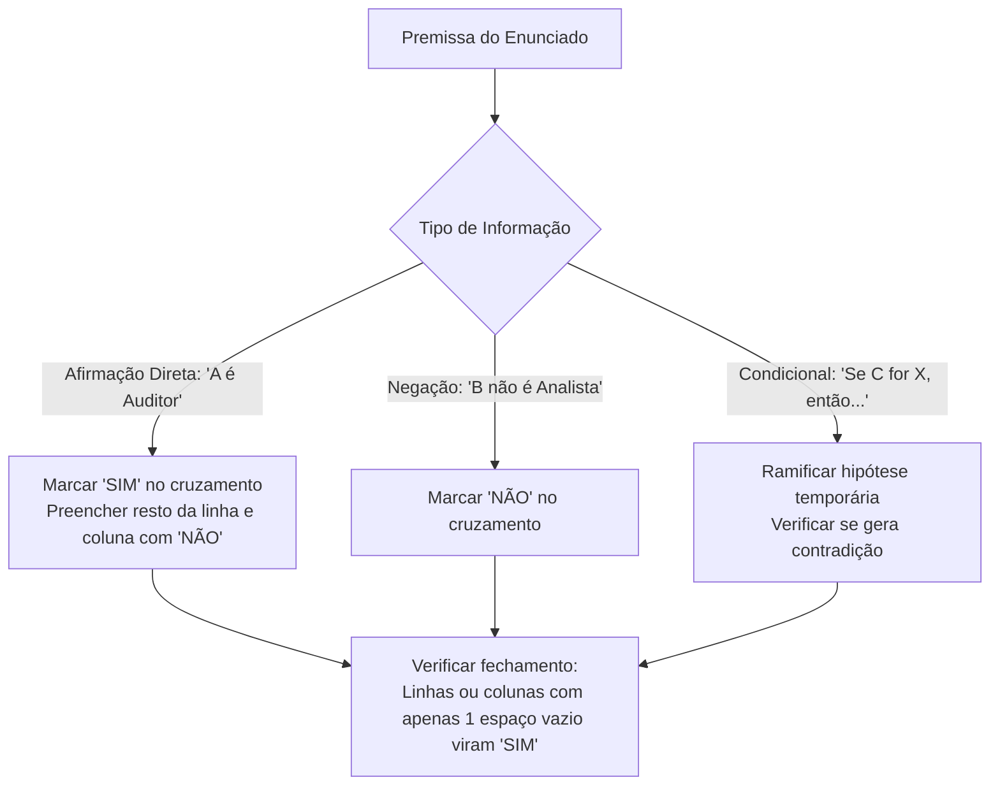

# 03 - Estruturas Lógicas, Associação e Dedução

> **Matéria:** Matemática e Raciocínio Lógico  
> **Cargos:** A01 – Técnico de Controle Externo (Adm) / B02 – Técnico de Controle Externo (TI)  
> **Arquivo:** `03_estruturas_logicas_e_associacao.md`  
> **Status:** 🟢 Teoria Aprofundada + 5 Questões FCC Comentadas (A a E)

---

## 📌 Ementa / Itens do Edital
- Estrutura lógica de relações arbitrárias entre pessoas, lugares, objetos ou eventos fictícios.
- Dedução de novas informações das relações fornecidas.
- Avaliação das condições usadas para estabelecer a estrutura daquelas relações.

---

## 🧭 Sumário

1. [Fundamentos da Associação Lógica Biunívoca](#1-fundamentos-da-associacao-logica-biunivoca)
    1. [Natureza das Relações Arbitrárias e Conjuntos Finitos](#11-natureza-das-relacoes-arbitrarias-e-conjuntos-finitos)
    2. [O Princípio da Correspondência Biunívoca](#12-o-principio-da-correspondencia-biunivoca)
    3. [Tipologia de Pistas e Classificação de Premissas](#13-tipologia-de-pistas-e-classificacao-de-premissas)
    4. [Teste 092](#Teste-092)
    5. [Teste 093](#Teste-093)
2. [Metodologia das Matrizes Cruzadas de Associação](#2-metodologia-das-matrizes-cruzadas-de-associacao)
    1. [Estruturação da Tabela Bidimensional e Tridimensional](#21-estruturacao-da-tabela-bidimensional-e-tridimensional)
    2. [O Princípio de Propagação do SIM e Fechamento por Exclusão](#22-o-principio-de-propagacao-do-sim-e-fechamento-por-exclusao)
    3. [Tratamento de Pistas Compostas e Vínculos Indiretos](#23-tratamento-de-pistas-compostas-e-vinculos-indiretos)
    4. [Teste 094](#Teste-094)
    5. [Teste 095](#Teste-095)
3. [Problemas de Ordenação Linear e Posicionamento Relativo](#3-problemas-de-ordenacao-linear-e-posicionamento-relativo)
    1. [Semântica de Ordenação: Imediatamente Antes vs. Antes Genérico](#31-semantica-de-ordenacao-imediatamente-antes-vs-antes-generico)
    2. [Filas, Andares e Classificações em Concurso](#32-filas-andares-e-classificacoes-em-concurso)
    3. [O Método das Caixas e Blocos Contíguos](#33-o-metodo-das-caixas-e-blocos-contiguos)
    4. [Teste 096](#Teste-096)
    5. [Teste 097](#Teste-097)
4. [Problemas de Ordenação Circular e Mesas Redondas](#4-problemas-de-ordenacao-circular-e-mesas-redondas)
    1. [Ponto de Vista Referencial e Orientação Espacial](#41-ponto-de-vista-referencial-e-orientacao-espacial)
    2. [Posições Diametralmente Opostas em Mesas Pares](#42-posicoes-diametralmente-opostas-em-mesas-pares)
    3. [Vizinhos Imediatos e Adjacências Direita e Esquerda](#43-vizinhos-imediatos-e-adjacencias-direita-e-esquerda)
    4. [Teste 098](#Teste-098)
    5. [Teste 099](#Teste-099)
5. [Dedução Lógica e Avaliação de Suficiência de Condições](#5-deducao-logica-e-avaliacao-de-suficiencia-de-condicoes)
    1. [Dedução Hipotética e Eliminação de Contradições](#51-deducao-hipotetica-e-eliminacao-de-contradicoes)
    2. [Condições Necessárias, Suficientes e Redundantes](#52-condicoes-necessarias-suficientes-e-redundantes)
    3. [Teste 100](#Teste-100)
    4. [Teste 101](#Teste-101)
6. [🌐 Fontes Oficiais e Referências Bibliográficas](#fontes-oficiais-e-referencias-bibliograficas)

---

## 1. Fundamentos da Associação Lógica Biunívoca

Os problemas de estruturas lógicas e relações arbitrárias exigem do candidato a capacidade de reconstruir uma teia de relações entre elementos de universos disjuntos (pessoas, cargos, salas, cidades, veículos, turnos de plantão) a partir de um conjunto restrito e aparentemente fragmentado de pistas informativas.

### 1.1 Natureza das Relações Arbitrárias e Conjuntos Finitos

Nessas questões, a relação entre os entes não decorre de nenhuma lei física ou científica prévia, mas de um cenário ficcional arbitrariamente desenhado pela banca examinadora. Os conjuntos fornecidos são finitos e de mesma cardinalidade (por exemplo: 4 auditores, 4 municípios de auditoria e 4 tipos de licitação fiscalizada).

### 1.2 O Princípio da Correspondência Biunívoca

A premissa implícita em quase todas as questões de associação lógica da FCC é o **princípio da bijeção (correspondência biunívoca)**:

* Cada elemento de um determinado conjunto associa-se a **exatamente um** elemento de cada um dos demais conjuntos;
* Não há elementos repetidos nem elementos desprovidos de correspondente no modelo padrão (salvo se o enunciado indicar expressamente o contrário).

### 1.3 Tipologia de Pistas e Classificação de Premissas

As informações fornecidas dividem-se em três modalidades lógicas:

1. **Afirmações Diretas (Pistas Positivas):** Vinculam dois elementos de modo afirmativo e categórico (*"Alice trabalha no gabinete Z"*, *"O economista é de Goiânia"*).
2. **Negações Diretas (Pistas Negativas):** Declaram a incompatibilidade mútua entre dois atributos (*"Bruno não é formado em Contabilidade"*, *"Carlos não trabalha na TI"*).
3. **Pistas Condicionais ou Compostas:** Estabelecem vínculos de causa-efeito ou conexões temporais e espaciais simultâneas (*"Se Lucas cuida da Folha, então Mateus cuida do Portal"*; *"O técnico que mora em Anápolis chegou depois de Carlos"*).

---

### Teste 001
**(FGV – TCE/GO – 2024 – Analista de Controle Externo - Ciências Contábeis)**
A Lei nº 9.717/1998 atribui funções específicas aos Tribunais de Contas no contexto da fiscalização e controle dos regimes próprios de previdência social dos servidores públicos. Assinale a opção que indica uma função dos Tribunais de Contas constante na Lei nº 9.717/1998.

* **A)** Representar ao Poder competente sobre irregularidades ou abusos apurados, indicando o ato inquinado e definindo responsabilidades.
* **B)** Realizar inspeções e auditorias de natureza atuarial, contábil, financeira, orçamentária e patrimonial.
* **C)** Elaborar relatórios de transparência e informação social acerca das atividades da Corregedoria-Geral, contendo informações sobre os processos relativos à sua competência.
* **D)** Verificar o cumprimento dos prazos legais, regimentais e regulamentares e, no caso de não observância, propor abertura de sindicância ou de processo administrativo disciplinar.
* **E)** Manter cadastro de servidores submetidos a processo criminal ou administrativo ou punidos por infração de conduta funcional nos últimos cinco anos.

---

> **Comentário Detalhado:**
>
> - **A)** **Incorreta.** A opção apresenta proposição em desacordo com os fundamentos teóricos e técnicos do tópico ao afirmar que "Representar ao Poder competente sobre irregularidades ou abusos apurados, indicando o ato inquinado e definindo...". De acordo com a teoria estudada em *4. Problemas de Ordenação Circular e Mesas Redondas*, o raciocínio espacial em arranjos circulares é recorrente em questões que simulam reuniões deliberativas de colegiados de Tribunais de Contas.
> - **B)** **Correta.** Conforme fundamentado na seção *1.1 Natureza das Relações Arbitrárias e Conjuntos Finitos* deste guia, nessas questões, a relação entre os entes não decorre de nenhuma lei física ou científica prévia, mas de um cenário ficcional arbitrariamente desenhado pela banca examinadora. Os conjuntos fornecidos são finitos e de mesma cardinalidade (por exemplo: 4 auditores, 4 municípios de auditoria e 4 tipos de licitação fiscalizada). Dessa forma, está plenamente correta a assertiva da banca (FGV – TCE/GO/2024) ao estabelecer que "Realizar inspeções e auditorias de natureza atuarial, contábil, financeira, orçamentária e patrimonial".
> - **C)** **Incorreta.** A opção apresenta proposição em desacordo com os fundamentos teóricos e técnicos do tópico ao afirmar que "Elaborar relatórios de transparência e informação social acerca das atividades da Corregedoria Geral, contendo...". De acordo com a teoria estudada em *1.3 Tipologia de Pistas e Classificação de Premissas*, as informações fornecidas dividem se em três modalidades lógicas.
> - **D)** **Incorreta.** A opção apresenta proposição em desacordo com os fundamentos teóricos e técnicos do tópico ao afirmar que "Verificar o cumprimento dos prazos legais, regimentais e regulamentares e, no caso de não observância, propor...". De acordo com a teoria estudada em *2. Metodologia das Matrizes Cruzadas de Associação*, t |"Condicional: 'Se C for X, então...'"| H["Ramificar hipótese temporária<br/ Verificar se gera contradição"].
> - **E)** **Incorreta.** A opção apresenta proposição em desacordo com os fundamentos teóricos e técnicos do tópico ao afirmar que "Manter cadastro de servidores submetidos a processo criminal ou administrativo ou punidos por infração de conduta...". De acordo com a teoria estudada em *1. Fundamentos da Associação Lógica Biunívoca*, os problemas de estruturas lógicas e relações arbitrárias exigem do candidato a capacidade de reconstruir uma teia de relações entre elementos de universos disjuntos (pessoas, cargos, salas, cidades, veículos, turnos de plantão) a partir de um conjunto restrito e aparentemente fragmentado de pistas informativas.
>
> **Gabarito: B**

---

### Teste 002
**(FCC – TCE/GO – 2009 – Analista de Controle Externo - Gestão de Conhecimento)**
Em um levantamento bibliográfico sobre a jurisprudência usuário. relativa à responsabilidade fiscal de estados da federação, o bibliotecário deverá compilar

* **A)** ações, recursos e acórdãos.
* **B)** livros, teses e artigos de periódicos.
* **C)** leis ordinárias e complementares e decretos. informações semelhantes.
* **D)** medidas provisórias, normas e decisões. _________________________________________________________
* **E)** sentenças, proposições e atos. _________________________________________________________ 71. O catálogo de registro, também chamado de tombo, rela- ciona os documentos pela ordem cronológica de inclusão

---

> **Comentário Detalhado:**
>
> - **A)** **Incorreta.** A opção apresenta proposição em desacordo com os fundamentos teóricos e técnicos do tópico ao afirmar que "ações, recursos e acórdãos". De acordo com a teoria estudada em *5.2 Condições Necessárias, Suficientes e Redundantes*, condição Suficiente: Aquela que, por si só, basta para fixar uma conclusão ou determinar o sistema sem necessidade de dados complementares.
> - **B)** **Incorreta.** A opção apresenta proposição em desacordo com os fundamentos teóricos e técnicos do tópico ao afirmar que "livros, teses e artigos de periódicos". De acordo com a teoria estudada em *1. Fundamentos da Associação Lógica Biunívoca*, os problemas de estruturas lógicas e relações arbitrárias exigem do candidato a capacidade de reconstruir uma teia de relações entre elementos de universos disjuntos (pessoas, cargos, salas, cidades, veículos, turnos de plantão) a partir de um conjunto restrito e aparentemente fragmentado de pistas informativas.
> - **C)** **Correta.** Conforme fundamentado na seção *1.3 Tipologia de Pistas e Classificação de Premissas* deste guia, as informações fornecidas dividem se em três modalidades lógicas. Dessa forma, está plenamente correta a assertiva da banca (FCC – TCE/GO/2009) ao estabelecer que "leis ordinárias e complementares e decretos. informações semelhantes".
> - **D)** **Incorreta.** A opção apresenta proposição em desacordo com os fundamentos teóricos e técnicos do tópico ao afirmar que "medidas provisórias, normas e decisões". De acordo com a teoria estudada em *1.1 Natureza das Relações Arbitrárias e Conjuntos Finitos*, nessas questões, a relação entre os entes não decorre de nenhuma lei física ou científica prévia, mas de um cenário ficcional arbitrariamente desenhado pela banca examinadora. Os conjuntos fornecidos são finitos e de mesma cardinalidade (por exemplo: 4 auditores, 4 municípios de auditoria e 4 tipos de licitação fiscalizada).
> - **E)** **Incorreta.** A opção apresenta proposição em desacordo com os fundamentos teóricos e técnicos do tópico ao afirmar que "sentenças, proposições e atos. 71. O catálogo de registro, também chamado de tombo, rela ciona os documentos pela...". De acordo com a teoria estudada em *3. Problemas de Ordenação Linear e Posicionamento Relativo*, os problemas de ordenação linear lidam com grandezas posicionais dispostas em uma única dimensão orientada (classificação de concurso, andares de um edifício, fila de atendimento, ordem cronológica de chegada).
>
> **Gabarito: C**

---

### Teste 003
**(FGV – TCE/GO – 2024 – Analista de Controle Externo - Jurídica)**
A Assembleia Legislativa do Estado Alfa recebeu projeto de lei, encaminhado pelo Tribunal de Justiça do Estado, com o objetivo de regulamentar o pagamento de horas extraordinárias aos magistrados vinculados ao referido Tribunal. A Comissão de Constituição e Justiça, ao analisar o referido projeto, concluiu corretamente que

* **A)** o Estado Alfa tem competência legislativa para suplementar a legislação federal nessa temática.
* **B)** a matéria deveria ser disciplinada na Constituição Estadual, em simetria com o paradigma federal.
* **C)** por dizer respeito a matéria afeta aos magistrados, era necessária a apresentação de projeto de lei complementar.
* **D)** o Tribunal de Justiça carece de legitimidade para apresentar a proposição, e a Assembleia de competência para apreciá-la.
* **E)** se os servidores públicos do respectivo Estado fizerem jus ao referido pagamento, o respectivo regime jurídico deve ser aplicado subsidiariamente aos magistrados.

---

> **Comentário Detalhado:**
>
> - **A)** **Incorreta.** A opção apresenta proposição em desacordo com os fundamentos teóricos e técnicos do tópico ao afirmar que "o Estado Alfa tem competência legislativa para suplementar a legislação federal nessa temática". De acordo com a teoria estudada em *1. Fundamentos da Associação Lógica Biunívoca*, os problemas de estruturas lógicas e relações arbitrárias exigem do candidato a capacidade de reconstruir uma teia de relações entre elementos de universos disjuntos (pessoas, cargos, salas, cidades, veículos, turnos de plantão) a partir de um conjunto restrito e aparentemente fragmentado de pistas informativas.
> - **B)** **Incorreta.** A opção apresenta proposição em desacordo com os fundamentos teóricos e técnicos do tópico ao afirmar que "a matéria deveria ser disciplinada na Constituição Estadual, em simetria com o paradigma federal". De acordo com a teoria estudada em *2.2 O Princípio de Propagação do SIM e Fechamento por Exclusão*, ao marcar SIM na interseção entre um indivíduo e um atributo (ex.: Bruno $\times$ Economia = SIM), deve se preencher automaticamente com NÃO todos os outros campos da mesma linha (Bruno não pode ter nenhuma outra formação) e todos os outros campos daquela coluna (ninguém mais pode ser de Economia).
> - **C)** **Incorreta.** A opção apresenta proposição em desacordo com os fundamentos teóricos e técnicos do tópico ao afirmar que "por dizer respeito a matéria afeta aos magistrados, era necessária a apresentação de projeto de lei complementar". De acordo com a teoria estudada em *5.2 Condições Necessárias, Suficientes e Redundantes*, condição Necessária: Requisito sem o qual o sistema não atinge a determinação unívoca, gerando graus de liberdade ou ambiguidade entre múltiplos cenários válidos.
> - **D)** **Correta.** Conforme fundamentado na seção *1.1 Natureza das Relações Arbitrárias e Conjuntos Finitos* deste guia, nessas questões, a relação entre os entes não decorre de nenhuma lei física ou científica prévia, mas de um cenário ficcional arbitrariamente desenhado pela banca examinadora. Os conjuntos fornecidos são finitos e de mesma cardinalidade (por exemplo: 4 auditores, 4 municípios de auditoria e 4 tipos de licitação fiscalizada). Dessa forma, está plenamente correta a assertiva da banca (FGV – TCE/GO/2024) ao estabelecer que "o Tribunal de Justiça carece de legitimidade para apresentar a proposição, e a Assembleia de competência para...".
> - **E)** **Incorreta.** A opção apresenta proposição em desacordo com os fundamentos teóricos e técnicos do tópico ao afirmar que "se os servidores públicos do respectivo Estado fizerem jus ao referido pagamento, o respectivo regime jurídico...". De acordo com a teoria estudada em *1.2 O Princípio da Correspondência Biunívoca*, a premissa implícita em quase todas as questões de associação lógica da FCC é o princípio da bijeção (correspondência biunívoca).
>
> **Gabarito: D**

---

### Teste 004
**(FGV – TJ/AP – 2023 – Analista Judiciario Apoio Especializado Tecnologia Da Informacao Banco De Dados)**
A Assembleia Legislativa do Estado Alfa recebeu uma proposição legislativa que tem por objeto a alteração das atribuições de certo órgão colegiado da Administração Superior do Ministério Público do Estado. Considerando os balizamentos estabelecidos pela Constituição da República a respeito das normas que estabelecem a organização, as atribuições e o estatuto de cada Ministério Público, é correto afirmar que a proposição legislativa precisa ter a natureza de:

* **A)** projeto de lei ordinária, de iniciativa privativa do governador do Estado;
* **B)** projeto de lei ordinária, de iniciativa privativa do Colégio de Procuradores de Justiça;
* **C)** projeto de lei complementar, de iniciativa privativa do procurador-geral de Justiça;
* **D)** proposta de emenda constitucional, podendo ter sido apresentada por qualquer legitimado para a reforma;
* **E)** projeto de lei complementar, podendo ter sido apresentado pelo procurador-geral de Justiça ou pelo governador do Estado.

---

> **Comentário Detalhado:**
>
> - **A)** **Incorreta.** A opção apresenta proposição em desacordo com os fundamentos teóricos e técnicos do tópico ao afirmar que "projeto de lei ordinária, de iniciativa privativa do governador do Estado". De acordo com a teoria estudada em *1.3 Tipologia de Pistas e Classificação de Premissas*, pistas Condicionais ou Compostas: Estabelecem vínculos de causa efeito ou conexões temporais e espaciais simultâneas ( "Se Lucas cuida da Folha, então Mateus cuida do Portal" ; "O técnico que mora em Anápolis chegou depois de Carlos" ).
> - **B)** **Incorreta.** A opção apresenta proposição em desacordo com os fundamentos teóricos e técnicos do tópico ao afirmar que "projeto de lei ordinária, de iniciativa privativa do Colégio de Procuradores de Justiça". De acordo com a teoria estudada em *3.1 Semântica de Ordenação: Imediatamente Antes vs. Antes Genérico*, a FCC é rigorosamente precisa na seleção de seus termos relacionais.
> - **C)** **Correta.** Conforme fundamentado na seção *1.1 Natureza das Relações Arbitrárias e Conjuntos Finitos* deste guia, nessas questões, a relação entre os entes não decorre de nenhuma lei física ou científica prévia, mas de um cenário ficcional arbitrariamente desenhado pela banca examinadora. Os conjuntos fornecidos são finitos e de mesma cardinalidade (por exemplo: 4 auditores, 4 municípios de auditoria e 4 tipos de licitação fiscalizada). Dessa forma, está plenamente correta a assertiva da banca (FGV – TJ/AP/2023) ao estabelecer que "projeto de lei complementar, de iniciativa privativa do procurador geral de Justiça".
> - **D)** **Incorreta.** A opção promove generalização excessiva que desconsidera as condições técnicas e normativas ao afirmar que "proposta de emenda constitucional, podendo ter sido apresentada por qualquer legitimado para a reforma". De acordo com a teoria estudada em *5.2 Condições Necessárias, Suficientes e Redundantes*, condição Redundante: Informação cuja veracidade já havia sido demonstrada pelo encadeamento das premissas precedentes, nada acrescentando à solução final.
> - **E)** **Incorreta.** A opção apresenta proposição em desacordo com os fundamentos teóricos e técnicos do tópico ao afirmar que "projeto de lei complementar, podendo ter sido apresentado pelo procurador geral de Justiça ou pelo governador do...". De acordo com a teoria estudada em *3.1 Semântica de Ordenação: Imediatamente Antes vs. Antes Genérico*, quando o enunciado afirmar que "André chegou à frente de Caio" , jamais presuma que André chegou colado a Caio! Isso significa apenas que André precede Caio no tempo ($t A < t C$). Apenas a presença expressa dos advérbios "imediatamente" , "consecutivamente" ou "logo antes" autoriza a fusão em bloco adjacente.
>
> **Gabarito: C**

---

### Teste 005
**(FGV – TRT da 24º Região – 2025 – Analista Judiciário - Área Administrativa - Contabilidade)**
A informação de que Pedro, servidor público federal de escalão hierárquico superior, teria praticado uma infração disciplinar, chegou ao conhecimento da autoridade competente. Além de ser informado por seus assessores imediatos sobre a necessidade de instaurar o respectivo processo administrativo disciplinar, também lhe foi sugerida a possibilidade de afastamento preventivo, em razão do risco de que ele influísse na apuração do ilícito administrativo. Em relação ao sugerido afastamento de Pedro, considerando os balizamentos estabelecidos pela Lei nº 8.112/1990, assinale a afirmativa correta.

* **A)** É vedado, considerando a presunção de inocência.
* **B)** Pode se estender pelo prazo máximo de cento e oitenta dias.
* **C)** Caso seja decretado, acarretará a suspensão da remuneração durante a sua vigência.
* **D)** Somente é possível em se tratando de infração disciplinar que possa acarretar a sanção de demissão.
* **E)** Deve cessar, uma vez ultrapassado o limite temporal fixado em lei, ainda que não concluído o processo disciplinar.

---

> **Comentário Detalhado:**
>
> - **A)** **Incorreta.** A opção apresenta proposição em desacordo com os fundamentos teóricos e técnicos do tópico ao afirmar que "É vedado, considerando a presunção de inocência". De acordo com a teoria estudada em *2.2 O Princípio de Propagação do SIM e Fechamento por Exclusão*, ao marcar SIM na interseção entre um indivíduo e um atributo (ex.: Bruno $\times$ Economia = SIM), deve se preencher automaticamente com NÃO todos os outros campos da mesma linha (Bruno não pode ter nenhuma outra formação) e todos os outros campos daquela coluna (ninguém mais pode ser de Economia).
> - **B)** **Incorreta.** A opção apresenta proposição em desacordo com os fundamentos teóricos e técnicos do tópico ao afirmar que "Pode se estender pelo prazo máximo de cento e oitenta dias". De acordo com a teoria estudada em *2.1 Estruturação da Tabela Bidimensional e Tridimensional*, adiciona se ainda, se necessário, uma submatriz relacionando diretamente as Formações com as Cidades.
> - **C)** **Incorreta.** A opção apresenta proposição em desacordo com os fundamentos teóricos e técnicos do tópico ao afirmar que "Caso seja decretado, acarretará a suspensão da remuneração durante a sua vigência". De acordo com a teoria estudada em *1.3 Tipologia de Pistas e Classificação de Premissas*, pistas Condicionais ou Compostas: Estabelecem vínculos de causa efeito ou conexões temporais e espaciais simultâneas ( "Se Lucas cuida da Folha, então Mateus cuida do Portal" ; "O técnico que mora em Anápolis chegou depois de Carlos" ).
> - **D)** **Incorreta.** A opção incorre em restrição indevida ao limitar o escopo conceitual ao afirmar que "Somente é possível em se tratando de infração disciplinar que possa acarretar a sanção de demissão". De acordo com a teoria estudada em *2.3 Tratamento de Pistas Compostas e Vínculos Indiretos*, quando o texto apresenta a pista: "O servidor formado em Direito reside em Aparecida de Goiânia".
> - **E)** **Correta.** Conforme fundamentado na seção *1.1 Natureza das Relações Arbitrárias e Conjuntos Finitos* deste guia, nessas questões, a relação entre os entes não decorre de nenhuma lei física ou científica prévia, mas de um cenário ficcional arbitrariamente desenhado pela banca examinadora. Os conjuntos fornecidos são finitos e de mesma cardinalidade (por exemplo: 4 auditores, 4 municípios de auditoria e 4 tipos de licitação fiscalizada). Dessa forma, está plenamente correta a assertiva da banca (FGV – TRT da 24º Região/2025) ao estabelecer que "Deve cessar, uma vez ultrapassado o limite temporal fixado em lei, ainda que não concluído o processo disciplinar".
>
> **Gabarito: E**

---

### Teste 006
**(FGV – TRF/1 – 2024 – Analista Judiciario Area Apoio Especializado Especialidade Suporte Em Tecnologia Da Informacao)**
Maria, servidora pública federal, foi condenada, em sentença transitada em julgado, pela prática de infração penal. No momento em que o regime de cumprimento da pena passou para o aberto, procurou se informar em relação aos atos que poderia, ou não, praticar enquanto estivesse cumprindo a pena. Ao final, Maria concluiu corretamente que, na perspectiva das eleições para cargos dos Poderes Executivo e Legislativo:

* **A)** não pode votar nem concorrer a cargo eletivo;
* **B)** pode votar, mas não pode concorrer a cargo eletivo;
* **C)** pode votar e concorrer apenas a cargos eletivos do Poder Executivo, não do Legislativo;
* **D)** pode votar e concorrer a cargo eletivo, apenas não podendo deixar o distrito da culpa;
* **E)** pode votar e concorrer apenas a cargos eletivos do Poder Legislativo, não do Executivo.

---

> **Comentário Detalhado:**
>
> - **A)** **Correta.** Conforme fundamentado na seção *2.2 O Princípio de Propagação do SIM e Fechamento por Exclusão* deste guia, ao marcar SIM na interseção entre um indivíduo e um atributo (ex.: Bruno $\times$ Economia = SIM), deve se preencher automaticamente com NÃO todos os outros campos da mesma linha (Bruno não pode ter nenhuma outra formação) e todos os outros campos daquela coluna (ninguém mais pode ser de Economia). Dessa forma, está plenamente correta a assertiva da banca (FGV – TRF/1/2024) ao estabelecer que "não pode votar nem concorrer a cargo eletivo".
> - **B)** **Incorreta.** A opção apresenta proposição em desacordo com os fundamentos teóricos e técnicos do tópico ao afirmar que "pode votar, mas não pode concorrer a cargo eletivo". De acordo com a teoria estudada em *3.1 Semântica de Ordenação: Imediatamente Antes vs. Antes Genérico*, "A está antes de B": Precedência estrita na ordenação ($\text{Pos}(A) < \text{Pos}(B)$). — Não exige contiguidade; pode haver zero, uma ou múltiplas pessoas entre $A$ e $B$.
> - **C)** **Incorreta.** A opção incorre em restrição indevida ao limitar o escopo conceitual ao afirmar que "pode votar e concorrer apenas a cargos eletivos do Poder Executivo, não do Legislativo". De acordo com a teoria estudada em *1. Fundamentos da Associação Lógica Biunívoca*, os problemas de estruturas lógicas e relações arbitrárias exigem do candidato a capacidade de reconstruir uma teia de relações entre elementos de universos disjuntos (pessoas, cargos, salas, cidades, veículos, turnos de plantão) a partir de um conjunto restrito e aparentemente fragmentado de pistas informativas.
> - **D)** **Incorreta.** A opção incorre em restrição indevida ao limitar o escopo conceitual ao afirmar que "pode votar e concorrer a cargo eletivo, apenas não podendo deixar o distrito da culpa". De acordo com a teoria estudada em *3.3 O Método das Caixas e Blocos Contíguos*, em uma fila de 5 posições com o 3º lugar já ocupado por Daniel ($1, 2, \mathbf{D}, 4, 5$), o bloco contíguo $[B, C]$ só pode caber em dois nichos: nas posições $\{1, 2\}$ ou nas posições $\{4, 5\}$.
> - **E)** **Incorreta.** A opção incorre em restrição indevida ao limitar o escopo conceitual ao afirmar que "pode votar e concorrer apenas a cargos eletivos do Poder Legislativo, não do Executivo". De acordo com a teoria estudada em *Fundamentos Teóricos*, cargos: A01 – Técnico de Controle Externo (Adm) / B02 – Técnico de Controle Externo (TI).
>
> **Gabarito: A**

---

### Teste 007
**(FGV – TRF/1 – 2024 – Analista Judiciario Area Apoio Especializado Especialidade Suporte Em Tecnologia Da Informacao)**
João, especialista em gestão pública, foi consultado pela deputada federal Maria em relação ao modelo de gestão a ser adotado na seguridade social, o que iria subsidiar a elaboração de uma proposição legislativa que pretendia apresentar. Foi corretamente informado a Maria que a referida gestão:

* **A)** deve ser centralizada na União, de modo a assegurar a uniformidade do sistema;
* **B)** será delineada pelo Congresso Nacional, podendo ser centralizada ou descentralizada;
* **C)** deve contar com a participação do governo e dos segurados do sistema nos órgãos colegiados;
* **D)** deve contar com a participação dos trabalhadores, dos empregadores, dos aposentados e do governo nos órgãos colegiados;
* **E)** deve contar com a participação da sociedade civil, dos trabalhadores, dos empregadores, dos aposentados e do governo nos órgãos colegiados.

---

> **Comentário Detalhado:**
>
> - **A)** **Incorreta.** A opção apresenta proposição em desacordo com os fundamentos teóricos e técnicos do tópico ao afirmar que "deve ser centralizada na União, de modo a assegurar a uniformidade do sistema". De acordo com a teoria estudada em *1.3 Tipologia de Pistas e Classificação de Premissas*, afirmações Diretas (Pistas Positivas): Vinculam dois elementos de modo afirmativo e categórico ( "Alice trabalha no gabinete Z" , "O economista é de Goiânia" ).
> - **B)** **Incorreta.** A opção apresenta proposição em desacordo com os fundamentos teóricos e técnicos do tópico ao afirmar que "será delineada pelo Congresso Nacional, podendo ser centralizada ou descentralizada". De acordo com a teoria estudada em *4. Problemas de Ordenação Circular e Mesas Redondas*, o raciocínio espacial em arranjos circulares é recorrente em questões que simulam reuniões deliberativas de colegiados de Tribunais de Contas.
> - **C)** **Incorreta.** A opção apresenta proposição em desacordo com os fundamentos teóricos e técnicos do tópico ao afirmar que "deve contar com a participação do governo e dos segurados do sistema nos órgãos colegiados". De acordo com a teoria estudada em *5.1 Dedução Hipotética e Eliminação de Contradições*, se o desdobramento fechar o sistema sem inconsistências e for compatível com as regras de unicidade, a configuração é legítima.
> - **D)** **Correta.** Conforme fundamentado na seção *2.2 O Princípio de Propagação do SIM e Fechamento por Exclusão* deste guia, ao marcar SIM na interseção entre um indivíduo e um atributo (ex.: Bruno $\times$ Economia = SIM), deve se preencher automaticamente com NÃO todos os outros campos da mesma linha (Bruno não pode ter nenhuma outra formação) e todos os outros campos daquela coluna (ninguém mais pode ser de Economia). Dessa forma, está plenamente correta a assertiva da banca (FGV – TRF/1/2024) ao estabelecer que "deve contar com a participação dos trabalhadores, dos empregadores, dos aposentados e do governo nos órgãos...".
> - **E)** **Incorreta.** A opção apresenta proposição em desacordo com os fundamentos teóricos e técnicos do tópico ao afirmar que "deve contar com a participação da sociedade civil, dos trabalhadores, dos empregadores, dos aposentados e do...". De acordo com a teoria estudada em *1.1 Natureza das Relações Arbitrárias e Conjuntos Finitos*, nessas questões, a relação entre os entes não decorre de nenhuma lei física ou científica prévia, mas de um cenário ficcional arbitrariamente desenhado pela banca examinadora. Os conjuntos fornecidos são finitos e de mesma cardinalidade (por exemplo: 4 auditores, 4 municípios de auditoria e 4 tipos de licitação fiscalizada).
>
> **Gabarito: D**

---

### Teste 008
**(CEBRASPE – TJ/DFT – 2015 – Analista Judiciario Suporte Em Tecnologia Da Informacao)**
O servidor não efetivo que ocupe cargo em comissão será demitido do cargo nos casos de infração sujeita às penalidades de suspensão e de demissão. Com referência às disposições inscritas no Código de Ética Profissional do Serviço Público, julgue os próximos itens.

* **C)** Certo
* **E)** Errado

---

> **Comentário Detalhado:**
>
> - **C)** **Correta.** O item está **Certo**. Conforme fundamentado na seção *2.3 Tratamento de Pistas Compostas e Vínculos Indiretos*, quando o texto apresenta a pista: "O servidor formado em Direito reside em Aparecida de Goiânia". Dessa forma, está plenamente correta a assertiva da banca (CEBRASPE – TJ/DFT/2015) ao afirmar que "O servidor não efetivo que ocupe cargo em comissão será demitido do cargo nos casos de infração sujeita às...".
> - **E)** **Incorreta.** A assertiva não incorre em erro conceitual, guardando conformidade com a teoria estudada.
>
> **Gabarito: C**

---

### Teste 009
**(CEBRASPE – TJ/DFT – 2015 – Analista Judiciario Suporte Em Tecnologia Da Informacao)**
Se um servidor da justiça do Distrito Federal (DF) cometer infração disciplinar cuja penalidade, após processo disciplinar, seja a demissão, a autoridade responsável para aplicá-la será o corregedor da justiça.

* **C)** Certo
* **E)** Errado

---

> **Comentário Detalhado:**
>
> - **C)** **Incorreta.** A proposição apresenta proposição em desacordo com os fundamentos teóricos e técnicos do tópico ao afirmar que "Se um servidor da justiça do Distrito Federal (DF) cometer infração disciplinar cuja penalidade, após...". De acordo com a teoria em *2.3 Tratamento de Pistas Compostas e Vínculos Indiretos*, quando o texto apresenta a pista: "O servidor formado em Direito reside em Aparecida de Goiânia".
> - **E)** **Correta.** O item está **Errado** (gabarito oficial: **E**), pois contraria a disciplina teórica aplicável.
>
> **Gabarito: E**

---

### Teste 010
**(FCC – TRT 1ª – 2014 – Analista Judiciário - Tecnologia da Informação)**
O premente esgotamento dos endereços IPv4 desenca- dados, o que aumenta o seu desempenho. deou a proposição do IPv6 que possui endereços de 128 bits. Para postergar o esgotamento, uma solução pa-

* **A)** NAS e CIFS.
* **B)** NAS e FibreChannel.
* **C)** DAS e NFS.
* **D)** SAN e NFS.
* **E)** SAN e FoE.

---

> **Comentário Detalhado:**
>
> - **A)** **Incorreta.** A opção apresenta proposição em desacordo com os fundamentos teóricos e técnicos do tópico ao afirmar que "NAS e CIFS". De acordo com a teoria estudada em *5.2 Condições Necessárias, Suficientes e Redundantes*, condição Suficiente: Aquela que, por si só, basta para fixar uma conclusão ou determinar o sistema sem necessidade de dados complementares.
> - **B)** **Incorreta.** A opção apresenta proposição em desacordo com os fundamentos teóricos e técnicos do tópico ao afirmar que "NAS e FibreChannel". De acordo com a teoria estudada em *5. Dedução Lógica e Avaliação de Suficiência de Condições*, a avaliação das condições de contorno de um problema examina a consistência e a suficiência do conjunto de premissas para determinar uma solução única.
> - **C)** **Incorreta.** A opção apresenta proposição em desacordo com os fundamentos teóricos e técnicos do tópico ao afirmar que "DAS e NFS". De acordo com a teoria estudada em *5.2 Condições Necessárias, Suficientes e Redundantes*, condição Redundante: Informação cuja veracidade já havia sido demonstrada pelo encadeamento das premissas precedentes, nada acrescentando à solução final.
> - **D)** **Correta.** Conforme fundamentado na seção *4.3 Vizinhos Imediatos e Adjacências Direita e Esquerda* deste guia, cada ocupante possui exatamente dois vizinhos imediatos (adjacentes). Dessa forma, está plenamente correta a assertiva da banca (FCC – TRT 1ª/2014) ao estabelecer que "SAN e NFS".
> - **E)** **Incorreta.** A opção apresenta proposição em desacordo com os fundamentos teóricos e técnicos do tópico ao afirmar que "SAN e FoE". De acordo com a teoria estudada em *1. Fundamentos da Associação Lógica Biunívoca*, os problemas de estruturas lógicas e relações arbitrárias exigem do candidato a capacidade de reconstruir uma teia de relações entre elementos de universos disjuntos (pessoas, cargos, salas, cidades, veículos, turnos de plantão) a partir de um conjunto restrito e aparentemente fragmentado de pistas informativas.
>
> **Gabarito: D**

---

### Teste 011
**(FCC – TRT 13ª – 2014 – Analista Judiciário - Tecnologia da Informação)**
É sabido que um dos motivantes para a proposição do IPv6 para substituir o IPv4 foi a capacidade limitada de endereçamento do IPv4. Entretanto, e aproveitando a oportunidade para melhorar a funcionalidade do protocolo IP, outros recursos foram modificados ou introduzidos no IPv6. Dentre eles,

* **A)** a introdução do recurso de QoS (Qualidade de Serviço) utilizando o campo Flow Label.
* **B)** o uso do ARP incorporado no campo EXT do cabeçalho IPv6.
* **C)** a redução do tamanho dos fragmentos dos pacotes para minimizar os erros de transmissão.
* **D)** a incorporação do serviço TCP para fragmentar os pacotes no roteador.
* **E)** o uso de endereços Broadcast ao invés de Multicast para aumentar a eficiência.

---

> **Comentário Detalhado:**
>
> - **A)** **Correta.** Conforme fundamentado na seção *2.2 O Princípio de Propagação do SIM e Fechamento por Exclusão* deste guia, se em uma linha de três atributos surgirem dois NÃO, o terceiro campo vazio torna se compulsoriamente SIM. Dessa forma, está plenamente correta a assertiva da banca (FCC – TRT 13ª/2014) ao estabelecer que "a introdução do recurso de QoS (Qualidade de Serviço) utilizando o campo Flow Label".
> - **B)** **Incorreta.** A opção apresenta proposição em desacordo com os fundamentos teóricos e técnicos do tópico ao afirmar que "o uso do ARP incorporado no campo EXT do cabeçalho IPv6". De acordo com a teoria estudada em *🌐 Fontes Oficiais e Referências Bibliográficas*, cOPI, Irving M. Introdução à Lógica. 2. ed. São Paulo: Mestre Jou, 1978. (Cap. 8 Lógica Simbólica e Tabelas Verdade).
> - **C)** **Incorreta.** A opção apresenta proposição em desacordo com os fundamentos teóricos e técnicos do tópico ao afirmar que "a redução do tamanho dos fragmentos dos pacotes para minimizar os erros de transmissão". De acordo com a teoria estudada em *🌐 Fontes Oficiais e Referências Bibliográficas*, mORTARI, Cezar A. Introdução à Lógica. 2. ed. São Paulo: Editora Unesp, 2016. (Cap. 5 e 6 Sintaxe e Semântica do Cálculo Proposicional).
> - **D)** **Incorreta.** A opção apresenta proposição em desacordo com os fundamentos teóricos e técnicos do tópico ao afirmar que "a incorporação do serviço TCP para fragmentar os pacotes no roteador". De acordo com a teoria estudada em *1. Fundamentos da Associação Lógica Biunívoca*, os problemas de estruturas lógicas e relações arbitrárias exigem do candidato a capacidade de reconstruir uma teia de relações entre elementos de universos disjuntos (pessoas, cargos, salas, cidades, veículos, turnos de plantão) a partir de um conjunto restrito e aparentemente fragmentado de pistas informativas.
> - **E)** **Incorreta.** A opção apresenta proposição em desacordo com os fundamentos teóricos e técnicos do tópico ao afirmar que "o uso de endereços Broadcast ao invés de Multicast para aumentar a eficiência". De acordo com a teoria estudada em *2.1 Estruturação da Tabela Bidimensional e Tridimensional*, quando o problema envolve 3 categorias (por exemplo: Nomes, Formações e Cidades), adota se um conjunto fixo como eixo vertical (comumente os Nomes) e desdobram se os outros conjuntos nos eixos horizontais adjacentes.
>
> **Gabarito: A**

---

### Teste 012
**(FCC – TRT 16ª – 2014 – Analista Judiciário - Tecnologia da Informação)**
Suzana, servidora pública, permitiu a permuta de bem pú- ocasiões diferentes. Nos termos da Lei no 8.112/1990, a blico por preço superior ao de mercado, razão pela qual foi penalidade aplicada condenada por improbidade administrativa. Uma das san- ções aplicáveis ao agente ímprobo é a suspensão dos

* **A)** 5 a 8 anos.
* **B)** 8 a 10 anos. anos de efetivo exercício, se Vanessa não houver,
* **C)** terá seu registro cancelado após o decurso de dois anos de efetivo exercício, sendo irrelevante se
* **D)** 2 a 4 anos.
* **E)** 10 anos, obrigatoriamente. Vanessa praticar, nesse período, nova infração _________________________________________________________ disciplinar.

---

> **Comentário Detalhado:**
>
> - **A)** **Correta.** Conforme fundamentado na seção *1.1 Natureza das Relações Arbitrárias e Conjuntos Finitos* deste guia, nessas questões, a relação entre os entes não decorre de nenhuma lei física ou científica prévia, mas de um cenário ficcional arbitrariamente desenhado pela banca examinadora. Os conjuntos fornecidos são finitos e de mesma cardinalidade (por exemplo: 4 auditores, 4 municípios de auditoria e 4 tipos de licitação fiscalizada). Dessa forma, está plenamente correta a assertiva da banca (FCC – TRT 16ª/2014) ao estabelecer que "5 a 8 anos".
> - **B)** **Incorreta.** A opção apresenta proposição em desacordo com os fundamentos teóricos e técnicos do tópico ao afirmar que "8 a 10 anos. anos de efetivo exercício, se Vanessa não houver,". De acordo com a teoria estudada em *3.1 Semântica de Ordenação: Imediatamente Antes vs. Antes Genérico*, a FCC é rigorosamente precisa na seleção de seus termos relacionais.
> - **C)** **Incorreta.** A opção apresenta proposição em desacordo com os fundamentos teóricos e técnicos do tópico ao afirmar que "terá seu registro cancelado após o decurso de dois anos de efetivo exercício, sendo irrelevante se". De acordo com a teoria estudada em *1.3 Tipologia de Pistas e Classificação de Premissas*, afirmações Diretas (Pistas Positivas): Vinculam dois elementos de modo afirmativo e categórico ( "Alice trabalha no gabinete Z" , "O economista é de Goiânia" ).
> - **D)** **Incorreta.** A opção apresenta proposição em desacordo com os fundamentos teóricos e técnicos do tópico ao afirmar que "2 a 4 anos". De acordo com a teoria estudada em *1. Fundamentos da Associação Lógica Biunívoca*, os problemas de estruturas lógicas e relações arbitrárias exigem do candidato a capacidade de reconstruir uma teia de relações entre elementos de universos disjuntos (pessoas, cargos, salas, cidades, veículos, turnos de plantão) a partir de um conjunto restrito e aparentemente fragmentado de pistas informativas.
> - **E)** **Incorreta.** A opção apresenta proposição em desacordo com os fundamentos teóricos e técnicos do tópico ao afirmar que "10 anos, obrigatoriamente. Vanessa praticar, nesse período, nova infração disciplinar". De acordo com a teoria estudada em *2.2 O Princípio de Propagação do SIM e Fechamento por Exclusão*, se em uma coluna surgirem todos os campos preenchidos com NÃO exceto um, esse último é obrigatoriamente preenchido com SIM.
>
> **Gabarito: A**

---

### Teste 013
**(FGV – TCE/PA – 2024 – Auditor de Controle Externo - Administrativa - Administração)**
O Presidente da República apresentou projeto de lei complementar versando sobre matéria de sua iniciativa exclusiva, estranha à sistemática orçamentária. No âmbito da Câmara dos Deputados, foi aprovada emenda que estendia o alcance da proposição legislativa e acarretava aumento de despesa obrigatória, sendo indicada a respectiva fonte de custeio. Após o trâmite regular, o projeto foi aprovado nas duas Casas do Congresso Nacional, mas foi vetado pelo Presidente da República. O veto foi derrubado pelo Poder Legislativo e, ato contínuo, foi promulgada a Lei nº X pelo Presidente do Senado Federal. Com base nas normas constitucionais afetas ao processo legislativo, é correto afirmar que a narrativa

* **A)** não apresenta nenhuma incorreção.
* **B)** somente apresenta incorreção em relação à emenda aprovada pela Câmara dos Deputados.
* **C)** somente apresenta incorreção em relação à promulgação realizada pelo Presidente do Senado Federal.
* **D)** somente apresenta incorreção em relação à promulgação, que deveria ser realizada em momento anterior à derrubada do veto.
* **E)** somente apresenta incorreção em relação à emenda aprovada pela Câmara dos Deputados, e à promulgação realizada pelo Presidente do Senado Federal.

---

> **Comentário Detalhado:**
>
> - **A)** **Incorreta.** A opção apresenta proposição em desacordo com os fundamentos teóricos e técnicos do tópico ao afirmar que "não apresenta nenhuma incorreção". De acordo com a teoria estudada em *2.3 Tratamento de Pistas Compostas e Vínculos Indiretos*, quando o texto apresenta a pista: "O servidor formado em Direito reside em Aparecida de Goiânia".
> - **B)** **Incorreta.** A opção incorre em restrição indevida ao limitar o escopo conceitual ao afirmar que "somente apresenta incorreção em relação à emenda aprovada pela Câmara dos Deputados". De acordo com a teoria estudada em *3.1 Semântica de Ordenação: Imediatamente Antes vs. Antes Genérico*, quando o enunciado afirmar que "André chegou à frente de Caio" , jamais presuma que André chegou colado a Caio! Isso significa apenas que André precede Caio no tempo ($t A < t C$). Apenas a presença expressa dos advérbios "imediatamente" , "consecutivamente" ou "logo antes" autoriza a fusão em bloco adjacente.
> - **C)** **Incorreta.** A opção incorre em restrição indevida ao limitar o escopo conceitual ao afirmar que "somente apresenta incorreção em relação à promulgação realizada pelo Presidente do Senado Federal". De acordo com a teoria estudada em *4.1 Ponto de Vista Referencial e Orientação Espacial*, a rotação no sentido horário corresponde à esquerda de quem está no topo e à direita de quem está na base. Convém sempre desenhar o círculo com setas indicativas de "olhando para dentro".
> - **D)** **Incorreta.** A opção incorre em restrição indevida ao limitar o escopo conceitual ao afirmar que "somente apresenta incorreção em relação à promulgação, que deveria ser realizada em momento anterior à derrubada...". De acordo com a teoria estudada em *2.2 O Princípio de Propagação do SIM e Fechamento por Exclusão*, ao marcar SIM na interseção entre um indivíduo e um atributo (ex.: Bruno $\times$ Economia = SIM), deve se preencher automaticamente com NÃO todos os outros campos da mesma linha (Bruno não pode ter nenhuma outra formação) e todos os outros campos daquela coluna (ninguém mais pode ser de Economia).
> - **E)** **Correta.** Conforme fundamentado na seção *1.1 Natureza das Relações Arbitrárias e Conjuntos Finitos* deste guia, nessas questões, a relação entre os entes não decorre de nenhuma lei física ou científica prévia, mas de um cenário ficcional arbitrariamente desenhado pela banca examinadora. Os conjuntos fornecidos são finitos e de mesma cardinalidade (por exemplo: 4 auditores, 4 municípios de auditoria e 4 tipos de licitação fiscalizada). Dessa forma, está plenamente correta a assertiva da banca (FGV – TCE/PA/2024) ao estabelecer que "somente apresenta incorreção em relação à emenda aprovada pela Câmara dos Deputados, e à promulgação realizada...".
>
> **Gabarito: E**

---

### Teste 014
**(FGV – TCE/PA – 2024 – Auditor de Controle Externo - Administrativa - Administração)**
Na população de determinado município sobressaíram discussões quanto à necessidade do incremento da economia local, mais propriamente dos microempreendedores. Após análises e discussões com os diferentes atores públicos, a Administração Pública decidiu implementar política de concessão de crédito mediante agência pública de fomento a ser criada. Para isso foi realizado planejamento inicial e apresentada proposição legislativa junto ao parlamento local para criação da agência, previsão orçamentária e autorização da instituição das linhas de crédito. A situação apresentada se refere à seguinte etapa do ciclo das políticas públicas:

* **A)** predefinição do problema público.
* **B)** formação da agenda pública.
* **C)** elaboração da política pública.
* **D)** formulação da política pública.
* **E)** implementação da política pública.

---

> **Comentário Detalhado:**
>
> - **A)** **Incorreta.** A opção apresenta proposição em desacordo com os fundamentos teóricos e técnicos do tópico ao afirmar que "predefinição do problema público". De acordo com a teoria estudada em *2.1 Estruturação da Tabela Bidimensional e Tridimensional*, quando o problema envolve 3 categorias (por exemplo: Nomes, Formações e Cidades), adota se um conjunto fixo como eixo vertical (comumente os Nomes) e desdobram se os outros conjuntos nos eixos horizontais adjacentes.
> - **B)** **Incorreta.** A opção apresenta proposição em desacordo com os fundamentos teóricos e técnicos do tópico ao afirmar que "formação da agenda pública". De acordo com a teoria estudada em *1.2 O Princípio da Correspondência Biunívoca*, cada elemento de um determinado conjunto associa se a exatamente um elemento de cada um dos demais conjuntos.
> - **C)** **Incorreta.** A opção apresenta proposição em desacordo com os fundamentos teóricos e técnicos do tópico ao afirmar que "elaboração da política pública". De acordo com a teoria estudada em *2. Metodologia das Matrizes Cruzadas de Associação*, s F["Verificar fechamento:<br/ Linhas ou colunas com apenas 1 espaço vazio viram 'SIM'"].
> - **D)** **Correta.** Conforme fundamentado na seção *2.2 O Princípio de Propagação do SIM e Fechamento por Exclusão* deste guia, ao marcar SIM na interseção entre um indivíduo e um atributo (ex.: Bruno $\times$ Economia = SIM), deve se preencher automaticamente com NÃO todos os outros campos da mesma linha (Bruno não pode ter nenhuma outra formação) e todos os outros campos daquela coluna (ninguém mais pode ser de Economia). Dessa forma, está plenamente correta a assertiva da banca (FGV – TCE/PA/2024) ao estabelecer que "formulação da política pública".
> - **E)** **Incorreta.** A opção apresenta proposição em desacordo com os fundamentos teóricos e técnicos do tópico ao afirmar que "implementação da política pública". De acordo com a teoria estudada em *5.2 Condições Necessárias, Suficientes e Redundantes*, condição Suficiente: Aquela que, por si só, basta para fixar uma conclusão ou determinar o sistema sem necessidade de dados complementares.
>
> **Gabarito: D**

---

### Teste 015
**(FGV – TCE/PA – 2024 – Auditor de Controle Externo - Administrativa - Administração)**
Caso determinado contratado cometa infração punível com a penalidade de impedimento de licitar e contratar com a Administração, a aplicação de tal sanção requer a instauração de processo de responsabilização delimitado pela Lei nº 14.133/2021. Nesse contexto, é correto afirmar que

* **A)** tal processo será conduzido por comissão composta por, no mínimo, 3 (três) servidores estáveis.
* **B)** não haverá oportunidade para o licitante ou contratado apresentar alegações finais no mencionado processo, ainda que haja o deferimento de produção de novas provas.
* **C)** se o órgão ou entidade não tiver servidores estatutários em seu quadro funcional, a Comissão responsável pela condução do mencionado processo deverá ser composta por ocupantes de cargo em comissão.
* **D)** serão indeferidas pela comissão, mediante decisão fundamentada, provas ilícitas, impertinentes, desnecessárias, protelatórias ou intempestivas, com relação ao processo em análise.
* **E)** o contratado terá o prazo máximo de 10 (dez) dias úteis, contados da data da intimação, para apresentar defesa técnica e especificar as provas que pretenda produzir, no processo em questão.

---

> **Comentário Detalhado:**
>
> - **A)** **Incorreta.** A opção apresenta proposição em desacordo com os fundamentos teóricos e técnicos do tópico ao afirmar que "tal processo será conduzido por comissão composta por, no mínimo, 3 (três) servidores estáveis". De acordo com a teoria estudada em *1.3 Tipologia de Pistas e Classificação de Premissas*, as informações fornecidas dividem se em três modalidades lógicas.
> - **B)** **Incorreta.** A opção apresenta proposição em desacordo com os fundamentos teóricos e técnicos do tópico ao afirmar que "não haverá oportunidade para o licitante ou contratado apresentar alegações finais no mencionado processo, ainda...". De acordo com a teoria estudada em *2.1 Estruturação da Tabela Bidimensional e Tridimensional*, adiciona se ainda, se necessário, uma submatriz relacionando diretamente as Formações com as Cidades.
> - **C)** **Incorreta.** A opção apresenta proposição em desacordo com os fundamentos teóricos e técnicos do tópico ao afirmar que "se o órgão ou entidade não tiver servidores estatutários em seu quadro funcional, a Comissão responsável pela...". De acordo com a teoria estudada em *2.2 O Princípio de Propagação do SIM e Fechamento por Exclusão*, ao marcar SIM na interseção entre um indivíduo e um atributo (ex.: Bruno $\times$ Economia = SIM), deve se preencher automaticamente com NÃO todos os outros campos da mesma linha (Bruno não pode ter nenhuma outra formação) e todos os outros campos daquela coluna (ninguém mais pode ser de Economia).
> - **D)** **Correta.** Conforme fundamentado na seção *1.1 Natureza das Relações Arbitrárias e Conjuntos Finitos* deste guia, nessas questões, a relação entre os entes não decorre de nenhuma lei física ou científica prévia, mas de um cenário ficcional arbitrariamente desenhado pela banca examinadora. Os conjuntos fornecidos são finitos e de mesma cardinalidade (por exemplo: 4 auditores, 4 municípios de auditoria e 4 tipos de licitação fiscalizada). Dessa forma, está plenamente correta a assertiva da banca (FGV – TCE/PA/2024) ao estabelecer que "serão indeferidas pela comissão, mediante decisão fundamentada, provas ilícitas, impertinentes, desnecessárias...".
> - **E)** **Incorreta.** A opção apresenta proposição em desacordo com os fundamentos teóricos e técnicos do tópico ao afirmar que "o contratado terá o prazo máximo de 10 (dez) dias úteis, contados da data da intimação, para apresentar defesa...". De acordo com a teoria estudada em *🌐 Fontes Oficiais e Referências Bibliográficas*, oBMEP / IMPA Apostila 2 do PIC: Métodos de Contagem e Lógica Estratégias estruturadas de dedução, análise combinatória e diagramas de associação lógica.
>
> **Gabarito: D**

---

### Teste 016
**(FGV – TCE/PA – 2024 – Auditor de Controle Externo - Administrativa - Direito)**
De acordo com o site oficial do Senado, As emendas feitas ao Orçamento Geral da União, denominado de Lei Orçamentária Anual (LOA) – enviada pelo Executivo ao Congresso anualmente –, são propostas por meio das quais os parlamentares podem opinar ou influir na alocação de recursos públicos em função de compromissos políticos que assumiram durante seu mandato, tanto junto aos estados e municípios quanto a instituições. Tais emendas podem acrescentar, suprimir ou modificar determinados itens (rubricas) do projeto de lei orçamentária enviado pelo Executivo. (Fonte: Agência Senado) Consideram-se emenda de remanejamento ao orçamento a

* **A)** que acrescenta ou inclui dotações e, simultaneamente, como fonte de recursos, anula valor equivalente proveniente de outras dotações e de verbas da chamada Reserva de Recursos.
* **B)** que propõe, exclusivamente, a redução de dotações constantes do projeto.
* **C)** destinada à recomposição do orçamento, objetivando corrigir erros e omissões de ordem técnica ou legal.
* **D)** que tem por finalidade alterar o texto da proposição (projetos às leis orçamentárias) ou de seus anexos, sem alterar valores das dotações orçamentárias.
* **E)** que propõe acréscimo ou inclui dotações e, simultaneamente, como fonte exclusiva de recursos, anula dotações equivalentes, exceto as reservas de contingência.

---

> **Comentário Detalhado:**
>
> - **A)** **Incorreta.** A opção apresenta proposição em desacordo com os fundamentos teóricos e técnicos do tópico ao afirmar que "que acrescenta ou inclui dotações e, simultaneamente, como fonte de recursos, anula valor equivalente proveniente...". De acordo com a teoria estudada em *2.2 O Princípio de Propagação do SIM e Fechamento por Exclusão*, propagação do "SIM" (ou valor verdadeiro).
> - **B)** **Incorreta.** A opção incorre em restrição indevida ao limitar o escopo conceitual ao afirmar que "que propõe, exclusivamente, a redução de dotações constantes do projeto". De acordo com a teoria estudada em *🌐 Fontes Oficiais e Referências Bibliográficas*, khan Academy Brasil Álgebra I: Lógica e Raciocínio Dedutivo Resolução de quebra cabeças lógicos, tabelas de contingência e modelagem dedutiva.
> - **C)** **Incorreta.** A opção apresenta proposição em desacordo com os fundamentos teóricos e técnicos do tópico ao afirmar que "destinada à recomposição do orçamento, objetivando corrigir erros e omissões de ordem técnica ou legal". De acordo com a teoria estudada em *3. Problemas de Ordenação Linear e Posicionamento Relativo*, os problemas de ordenação linear lidam com grandezas posicionais dispostas em uma única dimensão orientada (classificação de concurso, andares de um edifício, fila de atendimento, ordem cronológica de chegada).
> - **D)** **Incorreta.** A opção apresenta proposição em desacordo com os fundamentos teóricos e técnicos do tópico ao afirmar que "que tem por finalidade alterar o texto da proposição (projetos às leis orçamentárias) ou de seus anexos, sem...". De acordo com a teoria estudada em *2.3 Tratamento de Pistas Compostas e Vínculos Indiretos*, quando o texto apresenta a pista: "O servidor formado em Direito reside em Aparecida de Goiânia".
> - **E)** **Correta.** Conforme fundamentado na seção *2.2 O Princípio de Propagação do SIM e Fechamento por Exclusão* deste guia, se em uma coluna surgirem todos os campos preenchidos com NÃO exceto um, esse último é obrigatoriamente preenchido com SIM. Dessa forma, está plenamente correta a assertiva da banca (FGV – TCE/PA/2024) ao estabelecer que "que propõe acréscimo ou inclui dotações e, simultaneamente, como fonte exclusiva de recursos, anula dotações...".
>
> **Gabarito: E**

---

### Teste 017
**(FGV – TCE/PA – 2024 – Auditor de Controle Externo - Administrativa - Gestão Governamental)**
Diversas organizações não governamentais, com sede e operações no Estado do Pará, consultaram um especialista em relação à forma de operacionalização da iniciativa popular na forma como disciplinada pela Constituição do Pará. Elas almejavam saber se seus associados poderiam apresentar proposições legislativas, bem como que proposições poderiam ser apresentadas. O especialista respondeu corretamente que

* **A)** apenas projetos de lei, ordinária ou complementar, podem ter iniciativa popular.
* **B)** podem ter iniciativa popular tanto projetos de lei como propostas de emenda constitucional.
* **C)** os projetos de lei de iniciativa popular devem ser subscritos, no mínimo, por dez por cento do eleitorado do Estado.
* **D)** os projetos de lei de iniciativa popular devem ser subscritos, no mínimo, por quinze por cento do eleitorado do Estado.
* **E)** os projetos de lei de iniciativa popular devem ser subscritos, no mínimo, por três décimos por cento do eleitorado do Estado, distribuídos, no mínimo, por dez municípios.

---

> **Comentário Detalhado:**
>
> - **A)** **Incorreta.** A opção incorre em restrição indevida ao limitar o escopo conceitual ao afirmar que "apenas projetos de lei, ordinária ou complementar, podem ter iniciativa popular". De acordo com a teoria estudada em *2.2 O Princípio de Propagação do SIM e Fechamento por Exclusão*, ao marcar SIM na interseção entre um indivíduo e um atributo (ex.: Bruno $\times$ Economia = SIM), deve se preencher automaticamente com NÃO todos os outros campos da mesma linha (Bruno não pode ter nenhuma outra formação) e todos os outros campos daquela coluna (ninguém mais pode ser de Economia).
> - **B)** **Correta.** Conforme fundamentado na seção *1.1 Natureza das Relações Arbitrárias e Conjuntos Finitos* deste guia, nessas questões, a relação entre os entes não decorre de nenhuma lei física ou científica prévia, mas de um cenário ficcional arbitrariamente desenhado pela banca examinadora. Os conjuntos fornecidos são finitos e de mesma cardinalidade (por exemplo: 4 auditores, 4 municípios de auditoria e 4 tipos de licitação fiscalizada). Dessa forma, está plenamente correta a assertiva da banca (FGV – TCE/PA/2024) ao estabelecer que "podem ter iniciativa popular tanto projetos de lei como propostas de emenda constitucional".
> - **C)** **Incorreta.** A opção apresenta proposição em desacordo com os fundamentos teóricos e técnicos do tópico ao afirmar que "os projetos de lei de iniciativa popular devem ser subscritos, no mínimo, por dez por cento do eleitorado do Estado". De acordo com a teoria estudada em *🌐 Fontes Oficiais e Referências Bibliográficas*, portal da Matemática OBMEP / IMPA Noções de Lógica e Argumentação Aulas do IMPA sobre princípios da lógica formal, tabelas verdade, negações e proposições compostas.
> - **D)** **Incorreta.** A opção apresenta proposição em desacordo com os fundamentos teóricos e técnicos do tópico ao afirmar que "os projetos de lei de iniciativa popular devem ser subscritos, no mínimo, por quinze por cento do eleitorado do...". De acordo com a teoria estudada em *🌐 Fontes Oficiais e Referências Bibliográficas*, aLENCAR FILHO, Edgard de. Iniciação à Lógica Matemática. São Paulo: Nobel, 2002. (Cap. 3 e 4 Proposições Compostas e Conectivos Lógicos).
> - **E)** **Incorreta.** A opção apresenta proposição em desacordo com os fundamentos teóricos e técnicos do tópico ao afirmar que "os projetos de lei de iniciativa popular devem ser subscritos, no mínimo, por três décimos por cento do eleitorado...". De acordo com a teoria estudada em *1.3 Tipologia de Pistas e Classificação de Premissas*, as informações fornecidas dividem se em três modalidades lógicas.
>
> **Gabarito: B**

---

### Teste 018
**(FGV – TCE/PA – 2024 – Auditor de Controle Externo - Administrativa - Gestão Governamental)**
A autoridade competente, após o devido processo administrativo, estava em vias de aplicar à sociedade Gafanhoto a sanção de declaração de inidoneidade para licitar ou contratar com a Administração Pública, razão pela qual questionou as peculiaridades de tal penalidade, à luz do disposto na Lei nº 14.133/2021, sendo correto responder a tal indagação que

* **A)** trata-se de penalidade que não é passível de reabilitação.
* **B)** o prazo máximo da penalidade é de 6 (seis) anos.
* **C)** a irresignação pertinente para impugnar a imposição de tal penalidade na via administrativa é o recurso hierárquico.
* **D)** sua aplicação impede o responsável de licitar ou contratar apenas no âmbito da Administração Pública direta e indireta do ente federativo que tiver aplicado a sanção.
* **E)** não é cabível a sua aplicação nas hipóteses em que o contratado comete a infração de não manter a proposta, salvo em decorrência de fato superveniente devidamente justificado.

---

> **Comentário Detalhado:**
>
> - **A)** **Incorreta.** A opção apresenta proposição em desacordo com os fundamentos teóricos e técnicos do tópico ao afirmar que "trata se de penalidade que não é passível de reabilitação". De acordo com a teoria estudada em *1. Fundamentos da Associação Lógica Biunívoca*, os problemas de estruturas lógicas e relações arbitrárias exigem do candidato a capacidade de reconstruir uma teia de relações entre elementos de universos disjuntos (pessoas, cargos, salas, cidades, veículos, turnos de plantão) a partir de um conjunto restrito e aparentemente fragmentado de pistas informativas.
> - **B)** **Correta.** Conforme fundamentado na seção *1.1 Natureza das Relações Arbitrárias e Conjuntos Finitos* deste guia, nessas questões, a relação entre os entes não decorre de nenhuma lei física ou científica prévia, mas de um cenário ficcional arbitrariamente desenhado pela banca examinadora. Os conjuntos fornecidos são finitos e de mesma cardinalidade (por exemplo: 4 auditores, 4 municípios de auditoria e 4 tipos de licitação fiscalizada). Dessa forma, está plenamente correta a assertiva da banca (FGV – TCE/PA/2024) ao estabelecer que "o prazo máximo da penalidade é de 6 (seis) anos".
> - **C)** **Incorreta.** A opção apresenta proposição em desacordo com os fundamentos teóricos e técnicos do tópico ao afirmar que "a irresignação pertinente para impugnar a imposição de tal penalidade na via administrativa é o recurso hierárquico". De acordo com a teoria estudada em *1.2 O Princípio da Correspondência Biunívoca*, a premissa implícita em quase todas as questões de associação lógica da FCC é o princípio da bijeção (correspondência biunívoca).
> - **D)** **Incorreta.** A opção incorre em restrição indevida ao limitar o escopo conceitual ao afirmar que "sua aplicação impede o responsável de licitar ou contratar apenas no âmbito da Administração Pública direta e...". De acordo com a teoria estudada em *2. Metodologia das Matrizes Cruzadas de Associação*, t |"Afirmação Direta: 'A é Auditor'"| S["Marcar 'SIM' no cruzamento<br/ Preencher resto da linha e coluna com 'NÃO'"].
> - **E)** **Incorreta.** A opção apresenta proposição em desacordo com os fundamentos teóricos e técnicos do tópico ao afirmar que "não é cabível a sua aplicação nas hipóteses em que o contratado comete a infração de não manter a proposta, salvo...". De acordo com a teoria estudada em *1.2 O Princípio da Correspondência Biunívoca*, não há elementos repetidos nem elementos desprovidos de correspondente no modelo padrão (salvo se o enunciado indicar expressamente o contrário).
>
> **Gabarito: B**

---

### Teste 019
**(FGV – TCE/PA – 2024 – Auditor de Controle Externo - Fiscalização - Ciências Atuariais)**
Foi instituído um grupo de trabalho no âmbito do Poder Executivo do Estado Alfa, com o objetivo de elaborar anteprojeto de proposição legislativa destinada a promover alterações no regime próprio de previdência social, especificamente direcionadas aos servidores públicos com deficiência que fossem ocupantes de cargos de provimento efetivo. As medidas propostas no anteprojeto são as seguintes: I. a avaliação da deficiência seria realizada não só nos planos físico e mental, mas em uma perspectiva biopsicossocial; II. o cômputo, como tempo de contribuição, dos períodos de férias e licença especial não fruídos pelos servidores até o requerimento de aposentadoria; e III. esses servidores, conforme o grau da deficiência, podem se aposentar com idade inferior aos servidores que não possuem deficiência. A assessoria do Chefe do Poder Executivo, ao analisar a conformidade, com a Constituição da República, das três alterações propostas, concluiu corretamente que

* **A)** todas apresentam conformidade constitucional.
* **B)** apenas a alteração I apresenta conformidade constitucional.
* **C)** apenas a alteração II apresenta conformidade constitucional.
* **D)** apenas as alterações I e III apresentam conformidade constitucional.
* **E)** apenas as alterações II e III apresentam conformidade constitucional.

---

> **Comentário Detalhado:**
>
> - **A)** **Incorreta.** A opção apresenta proposição em desacordo com os fundamentos teóricos e técnicos do tópico ao afirmar que "todas apresentam conformidade constitucional". De acordo com a teoria estudada em *1.2 O Princípio da Correspondência Biunívoca*, a premissa implícita em quase todas as questões de associação lógica da FCC é o princípio da bijeção (correspondência biunívoca).
> - **B)** **Incorreta.** A opção incorre em restrição indevida ao limitar o escopo conceitual ao afirmar que "apenas a alteração I apresenta conformidade constitucional". De acordo com a teoria estudada em *2.3 Tratamento de Pistas Compostas e Vínculos Indiretos*, quando o texto apresenta a pista: "O servidor formado em Direito reside em Aparecida de Goiânia".
> - **C)** **Incorreta.** A opção incorre em restrição indevida ao limitar o escopo conceitual ao afirmar que "apenas a alteração II apresenta conformidade constitucional". De acordo com a teoria estudada em *1.3 Tipologia de Pistas e Classificação de Premissas*, as informações fornecidas dividem se em três modalidades lógicas.
> - **D)** **Correta.** Conforme fundamentado na seção *1. Fundamentos da Associação Lógica Biunívoca* deste guia, os problemas de estruturas lógicas e relações arbitrárias exigem do candidato a capacidade de reconstruir uma teia de relações entre elementos de universos disjuntos (pessoas, cargos, salas, cidades, veículos, turnos de plantão) a partir de um conjunto restrito e aparentemente fragmentado de pistas informativas. Dessa forma, está plenamente correta a assertiva da banca (FGV – TCE/PA/2024) ao estabelecer que "apenas as alterações I e III apresentam conformidade constitucional".
> - **E)** **Incorreta.** A opção incorre em restrição indevida ao limitar o escopo conceitual ao afirmar que "apenas as alterações II e III apresentam conformidade constitucional". De acordo com a teoria estudada em *3.1 Semântica de Ordenação: Imediatamente Antes vs. Antes Genérico*, quando o enunciado afirmar que "André chegou à frente de Caio" , jamais presuma que André chegou colado a Caio! Isso significa apenas que André precede Caio no tempo ($t A < t C$). Apenas a presença expressa dos advérbios "imediatamente" , "consecutivamente" ou "logo antes" autoriza a fusão em bloco adjacente.
>
> **Gabarito: D**

---

### Teste 020
**(FGV – TCE/SC – 2026 – Auditor Fiscal de Controle Externo - Ciências Contábeis)**
Com base na Lei nº 10.028/2000, avalie se as possíveis infrações administrativas contra as leis de finanças públicas incluem: I. Deixar de divulgar ou de enviar ao Poder Legislativo e ao Tribunal de Contas o relatório de gestão fiscal, nos prazos e condições estabelecidos em lei. II. Propor lei de diretrizes orçamentárias anual que não contenha as metas fiscais na forma da lei. III. Deixar de expedir ato determinando limitação de empenho e movimentação financeira, nos casos e condições estabelecidos em lei. De acordo com a Lei nº 10.028/2000, constitui(em) infração(ões) administrativa(s) contra as leis de finanças públicas o que se apresenta em

* **A)** I, apenas.
* **B)** I e II, apenas.
* **C)** I e III, apenas.
* **D)** II e III, apenas.
* **E)** I, II e III.

---

> **Comentário Detalhado:**
>
> - **A)** **Incorreta.** A opção incorre em restrição indevida ao limitar o escopo conceitual ao afirmar que "I, apenas". De acordo com a teoria estudada em *2.3 Tratamento de Pistas Compostas e Vínculos Indiretos*, quando o texto apresenta a pista: "O servidor formado em Direito reside em Aparecida de Goiânia".
> - **B)** **Incorreta.** A opção incorre em restrição indevida ao limitar o escopo conceitual ao afirmar que "I e II, apenas". De acordo com a teoria estudada em *4. Problemas de Ordenação Circular e Mesas Redondas*, o raciocínio espacial em arranjos circulares é recorrente em questões que simulam reuniões deliberativas de colegiados de Tribunais de Contas.
> - **C)** **Incorreta.** A opção incorre em restrição indevida ao limitar o escopo conceitual ao afirmar que "I e III, apenas". De acordo com a teoria estudada em *4.1 Ponto de Vista Referencial e Orientação Espacial*, a rotação no sentido horário corresponde à esquerda de quem está no topo e à direita de quem está na base. Convém sempre desenhar o círculo com setas indicativas de "olhando para dentro".
> - **D)** **Incorreta.** A opção incorre em restrição indevida ao limitar o escopo conceitual ao afirmar que "II e III, apenas". De acordo com a teoria estudada em *5. Dedução Lógica e Avaliação de Suficiência de Condições*, a avaliação das condições de contorno de um problema examina a consistência e a suficiência do conjunto de premissas para determinar uma solução única.
> - **E)** **Correta.** Conforme fundamentado na seção *1.1 Natureza das Relações Arbitrárias e Conjuntos Finitos* deste guia, nessas questões, a relação entre os entes não decorre de nenhuma lei física ou científica prévia, mas de um cenário ficcional arbitrariamente desenhado pela banca examinadora. Os conjuntos fornecidos são finitos e de mesma cardinalidade (por exemplo: 4 auditores, 4 municípios de auditoria e 4 tipos de licitação fiscalizada). Dessa forma, está plenamente correta a assertiva da banca (FGV – TCE/SC/2026) ao estabelecer que "I, II e III".
>
> **Gabarito: E**

---

### Teste 021
**(FGV – TRT/DA – 2025 – Tecnico Judiciario Area Administrativa Agente Da Policia Judicial)**
Após a regular tramitação de processo administrativo disciplinar, foi aplicada a sanção de suspensão a João, servidor público federal ocupante de cargo de provimento efetivo. Apesar da imposição da penalidade, João não se conformou com a condenação, afirmando peremptoriamente que não praticara uma infração disciplinar. Alguns anos depois, informou a familiares que tinha obtido elementos probatórios suficientes para provar sua inocência. Logo após decidir pela formulação do requerimento de revisão do processo disciplinar, João faleceu. O filho de João, ao analisar a disciplina estabelecida na Lei nº 8.112/1990, concluiu corretamente que o pedido de revisão

* **A)** é personalíssimo e poderia ser formulado por João até cinco anos após a publicação da decisão condenatória.
* **B)** não é admitido caso o processo administrativo disciplinar tenha se alicerçado em inquérito administrativo.
* **C)** é incompatível com a coisa julgada administrativa, não podendo ser formulado quer por João, se estivesse vivo, quer por seu filho.
* **D)** pode ser formulado por qualquer pessoa, já que a administração pode agir de ofício, e pode estar lastreado na injustiça da penalidade.
* **E)** pode ser formulado pelo filho, a qualquer tempo, devendo ser aduzidos fatos novos ou circunstâncias que possam justificar a inocência de João ou a inadequação da pena.

---

> **Comentário Detalhado:**
>
> - **A)** **Incorreta.** A opção apresenta proposição em desacordo com os fundamentos teóricos e técnicos do tópico ao afirmar que "é personalíssimo e poderia ser formulado por João até cinco anos após a publicação da decisão condenatória". De acordo com a teoria estudada em *3.1 Semântica de Ordenação: Imediatamente Antes vs. Antes Genérico*, quando o enunciado afirmar que "André chegou à frente de Caio" , jamais presuma que André chegou colado a Caio! Isso significa apenas que André precede Caio no tempo ($t A < t C$). Apenas a presença expressa dos advérbios "imediatamente" , "consecutivamente" ou "logo antes" autoriza a fusão em bloco adjacente.
> - **B)** **Incorreta.** A opção apresenta proposição em desacordo com os fundamentos teóricos e técnicos do tópico ao afirmar que "não é admitido caso o processo administrativo disciplinar tenha se alicerçado em inquérito administrativo". De acordo com a teoria estudada em *🌐 Fontes Oficiais e Referências Bibliográficas*, aLENCAR FILHO, Edgard de. Iniciação à Lógica Matemática. São Paulo: Nobel, 2002. (Cap. 3 e 4 Proposições Compostas e Conectivos Lógicos).
> - **C)** **Incorreta.** A opção apresenta proposição em desacordo com os fundamentos teóricos e técnicos do tópico ao afirmar que "é incompatível com a coisa julgada administrativa, não podendo ser formulado quer por João, se estivesse vivo...". De acordo com a teoria estudada em *3.3 O Método das Caixas e Blocos Contíguos*, testa se cada nicho com as demais restrições para descartar inconsistências (se $C$ estivesse no 5º lugar, não poderia superar ninguém, o que violaria a regra de que Caio superou Eduardo).
> - **D)** **Incorreta.** A opção promove generalização excessiva que desconsidera as condições técnicas e normativas ao afirmar que "pode ser formulado por qualquer pessoa, já que a administração pode agir de ofício, e pode estar lastreado na...". De acordo com a teoria estudada em *3.1 Semântica de Ordenação: Imediatamente Antes vs. Antes Genérico*, "A está a duas posições de B": A distância modular entre eles é 2 ($ — \text{Pos}(A) \text{Pos}(B) — = 2$). — Há exatamente uma pessoa posicionada entre $A$ e $B$.
> - **E)** **Correta.** Conforme fundamentado na seção *2.2 O Princípio de Propagação do SIM e Fechamento por Exclusão* deste guia, ao marcar SIM na interseção entre um indivíduo e um atributo (ex.: Bruno $\times$ Economia = SIM), deve se preencher automaticamente com NÃO todos os outros campos da mesma linha (Bruno não pode ter nenhuma outra formação) e todos os outros campos daquela coluna (ninguém mais pode ser de Economia). Dessa forma, está plenamente correta a assertiva da banca (FGV – TRT/DA/2025) ao estabelecer que "pode ser formulado pelo filho, a qualquer tempo, devendo ser aduzidos fatos novos ou circunstâncias que possam...".
>
> **Gabarito: E**

---

### Teste 022
**(FGV – TRT/DA – 2025 – Tecnico Judiciario Area Administrativa Sem Especialidade)**
Como promessa de campanha no pleito eleitoral de 2024, o Prefeito do município X divulgou, para 2025, a extinção da Taxa de Manejo de Resíduos Sólidos, implementada pelo gestor anterior e já objeto de arrecadação no ano de 2024. Diante dessa situação, à luz da Lei de Responsabilidade Fiscal (LRF), o Prefeito, para cumprir a referida promessa, deverá

* **A)** apresentar a estimativa do impacto orçamentário-financeiro no exercício de 2025 e nos dois seguintes, visto que estará incorrendo em renúncia de receita.
* **B)** apresentar na sua Lei Orçamentária Anual (LOA) para 2026 o valor não arrecadado com tal extinção, já que a LOA 2025 já fora elaborada pelo gestor anterior.
* **C)** sancionar a lei no primeiro dia útil de 2025, bem como a estimativa de impacto orçamentário-financeiro apenas no exercício de 2025.
* **D)** ser penalizado, porque estaria incorrendo em infração e ficaria sujeito às penalidades previstas na LRF pela promessa de extinção de tributos que são de competência municipal.
* **E)** avaliar os resultados, porque não estará incorrendo em infração à LRF por renúncia de receita se o resultado financeiro previsto para 2025 for superior ao valor arrecadado com a referida taxa.

---

> **Comentário Detalhado:**
>
> - **A)** **Correta.** Conforme fundamentado na seção *1.3 Tipologia de Pistas e Classificação de Premissas* deste guia, afirmações Diretas (Pistas Positivas): Vinculam dois elementos de modo afirmativo e categórico ( "Alice trabalha no gabinete Z" , "O economista é de Goiânia" ). Dessa forma, está plenamente correta a assertiva da banca (FGV – TRT/DA/2025) ao estabelecer que "apresentar a estimativa do impacto orçamentário financeiro no exercício de 2025 e nos dois seguintes, visto que...".
> - **B)** **Incorreta.** A opção apresenta proposição em desacordo com os fundamentos teóricos e técnicos do tópico ao afirmar que "apresentar na sua Lei Orçamentária Anual (LOA) para 2026 o valor não arrecadado com tal extinção, já que a LOA...". De acordo com a teoria estudada em *1.1 Natureza das Relações Arbitrárias e Conjuntos Finitos*, nessas questões, a relação entre os entes não decorre de nenhuma lei física ou científica prévia, mas de um cenário ficcional arbitrariamente desenhado pela banca examinadora. Os conjuntos fornecidos são finitos e de mesma cardinalidade (por exemplo: 4 auditores, 4 municípios de auditoria e 4 tipos de licitação fiscalizada).
> - **C)** **Incorreta.** A opção incorre em restrição indevida ao limitar o escopo conceitual ao afirmar que "sancionar a lei no primeiro dia útil de 2025, bem como a estimativa de impacto orçamentário financeiro apenas no...". De acordo com a teoria estudada em *3.2 Filas, Andares e Classificações em Concurso*, preenchem se primeiro as posições fixas garantidas (ex.: "Daniel obteve o 3º lugar" $\implies$ fixa $D$ no 3º traço).
> - **D)** **Incorreta.** A opção apresenta proposição em desacordo com os fundamentos teóricos e técnicos do tópico ao afirmar que "ser penalizado, porque estaria incorrendo em infração e ficaria sujeito às penalidades previstas na LRF pela...". De acordo com a teoria estudada em *2.2 O Princípio de Propagação do SIM e Fechamento por Exclusão*, ao marcar SIM na interseção entre um indivíduo e um atributo (ex.: Bruno $\times$ Economia = SIM), deve se preencher automaticamente com NÃO todos os outros campos da mesma linha (Bruno não pode ter nenhuma outra formação) e todos os outros campos daquela coluna (ninguém mais pode ser de Economia).
> - **E)** **Incorreta.** A opção apresenta proposição em desacordo com os fundamentos teóricos e técnicos do tópico ao afirmar que "avaliar os resultados, porque não estará incorrendo em infração à LRF por renúncia de receita se o resultado...". De acordo com a teoria estudada em *2.2 O Princípio de Propagação do SIM e Fechamento por Exclusão*, propagação do "SIM" (ou valor verdadeiro).
>
> **Gabarito: A**

---

## 2. Metodologia das Matrizes Cruzadas de Associação

A ferramenta mais confiável e à prova de falhas para solucionar problemas de associação multidimensional é a **matriz cruzada de pertinência (tabela lógica)**.

### 2.1 Estruturação da Tabela Bidimensional e Tridimensional

Quando o problema envolve 3 categorias (por exemplo: Nomes, Formações e Cidades), adota-se um conjunto fixo como eixo vertical (comumente os Nomes) e desdobram-se os outros conjuntos nos eixos horizontais adjacentes:

| Nome | Direito | Contabilidade | Economia | Goiânia | Aparecida | Anápolis |
| :--- | :---: | :---: | :---: | :---: | :---: | :---: |
| **Alice** | | | | | | |
| **Bruno** | | | | | | |
| **Camila** | | | | | | |

Adiciona-se ainda, se necessário, uma submatriz relacionando diretamente as Formações com as Cidades.

### 2.2 O Princípio de Propagação do SIM e Fechamento por Exclusão

1. **Propagação do "SIM" (ou valor verdadeiro):**
    * Ao marcar **SIM** na interseção entre um indivíduo e um atributo (ex.: Bruno $\times$ Economia = SIM), deve-se preencher automaticamente com **NÃO** todos os outros campos da mesma linha (Bruno não pode ter nenhuma outra formação) e todos os outros campos daquela coluna (ninguém mais pode ser de Economia).

2. **Fechamento Dedutivo por Exclusão:**
    * Se em uma linha de três atributos surgirem dois **NÃO**, o terceiro campo vazio torna-se compulsoriamente **SIM**.
    * Se em uma coluna surgirem todos os campos preenchidos com **NÃO** exceto um, esse último é obrigatoriamente preenchido com **SIM**.

### 2.3 Tratamento de Pistas Compostas e Vínculos Indiretos

Quando o texto apresenta a pista: *"O servidor formado em Direito reside em Aparecida de Goiânia"*:

* Essa pista amarra os atributos *Direito* e *Aparecida* como uma **unidade inseparável**.
* Se sabemos por outra pista que *Bruno reside em Goiânia*, deduz-se imediatamente que *Bruno NÃO é formado em Direito* (pois se o fosse, deveria residir em Aparecida).

---

## 3. Problemas de Ordenação Linear e Posicionamento Relativo

Os problemas de ordenação linear lidam com grandezas posicionais dispostas em uma única dimensão orientada (classificação de concurso, andares de um edifício, fila de atendimento, ordem cronológica de chegada).

### 3.1 Semântica de Ordenação: Imediatamente Antes vs. Antes Genérico

A FCC é rigorosamente precisa na seleção de seus termos relacionais:

| Expressão no Enunciado | Significado Lógico Rigoroso | Implicação Estrutural |
| :--- | :--- | :--- |
| **"A está imediatamente antes de B"** | Adjacência e contiguidade obrigatórias: a posição de $B$ é igual à posição de $A + 1$. | Formam um bloco indivisível $(A, B)$ sem intermediários. |
| **"A está antes de B"** | Precedência estrita na ordenação ($\text{Pos}(A) < \text{Pos}(B)$). | Não exige contiguidade; pode haver zero, uma ou múltiplas pessoas entre $A$ e $B$. |
| **"A está a duas posições de B"** | A distância modular entre eles é 2 ($|\text{Pos}(A) - \text{Pos}(B)| = 2$). | Há exatamente uma pessoa posicionada entre $A$ e $B$. |
| **"Extremidades"** | Ocupam a primeira posição ($1$) ou a última posição ($N$). | Bloqueiam as pontas do arranjo linear. |

> 🚨 **ALERTA DE PROVA / PEGADINHA FCC:** Quando o enunciado afirmar que *"André chegou à frente de Caio"*, jamais presuma que André chegou colado a Caio! Isso significa apenas que André precede Caio no tempo ($t_A < t_C$). Apenas a presença expressa dos advérbios *"imediatamente"*, *"consecutivamente"* ou *"logo antes"* autoriza a fusão em bloco adjacente.

### 3.2 Filas, Andares e Classificações em Concurso

Em ordenações de 1 a $N$, convém desenhar esquematicamente as lacunas vazias numeradas no rascunho:
$$\underline{\quad 1º \quad} \quad \underline{\quad 2º \quad} \quad \underline{\quad 3º \quad} \quad \underline{\quad 4º \quad} \quad \underline{\quad 5º \quad}$$
Preenchem-se primeiro as posições fixas garantidas (ex.: *"Daniel obteve o 3º lugar"* $\implies$ fixa $D$ no 3º traço).

### 3.3 O Método das Caixas e Blocos Contíguos

Se uma pista estabelece que *"Bernardo ficou em colocação imediatamente anterior à de Caio"*, agrupa-se mentalmente o par em uma caixa única: $[B, C]$.

* Em uma fila de 5 posições com o 3º lugar já ocupado por Daniel ($1, 2, \mathbf{D}, 4, 5$), o bloco contíguo $[B, C]$ só pode caber em dois nichos: nas posições $\{1, 2\}$ ou nas posições $\{4, 5\}$;
* Testa-se cada nicho com as demais restrições para descartar inconsistências (se $C$ estivesse no 5º lugar, não poderia superar ninguém, o que violaria a regra de que Caio superou Eduardo).

---

## 4. Problemas de Ordenação Circular e Mesas Redondas

O raciocínio espacial em arranjos circulares é recorrente em questões que simulam reuniões deliberativas de colegiados de Tribunais de Contas.

### 4.1 Ponto de Vista Referencial e Orientação Espacial

A resolução exige que o candidato projete seu olhar a partir da cadeira do ocupante analisado, **voltado para o centro da mesa circular**:

* O braço direito do ocupante aponta para a sua direita na mesa;
* O braço esquerdo aponta para a sua esquerda;
* A rotação no sentido horário corresponde à esquerda de quem está no topo e à direita de quem está na base. Convém sempre desenhar o círculo com setas indicativas de "olhando para dentro".

### 4.2 Posições Diametralmente Opostas em Mesas Pares

Em mesas circulares com um número par $N$ de assentos ($N = 6$ ou $N = 8$), diz-se que duas pessoas estão sentadas **em frente** ou **diametralmente opostas** quando a linha reta que as une passa pelo centro da mesa:
$$\text{Distância de Oposição} = \frac{N}{2} \text{ posições}$$

* Em uma mesa de 6 cadeiras numeradas de 1 a 6 em sentido horário:
    * O oposto da cadeira 1 é a cadeira $1 + 3 = 4$;
    * O oposto da cadeira 2 é a cadeira $2 + 3 = 5$;
    * O oposto da cadeira 3 é a cadeira $3 + 3 = 6$.

### 4.3 Vizinhos Imediatos e Adjacências Direita e Esquerda

Cada ocupante possui exatamente dois vizinhos imediatos (adjacentes):

* O vizinho imediatamente à sua direita;
* O vizinho imediatamente à sua esquerda.
Todos os demais ocupantes não são vizinhos imediatos.

---

## 5. Dedução Lógica e Avaliação de Suficiência de Condições

A avaliação das condições de contorno de um problema examina a consistência e a suficiência do conjunto de premissas para determinar uma solução única.

### 5.1 Dedução Hipotética e Eliminação de Contradições

Quando as pistas diretas não encerram todas as variáveis, recorre-se ao método da **bifurcação hipotética**:

1. Formula-se uma hipótese arbitrária para uma célula não preenchida (ex.: *"Suponha que Alice more em Anápolis"*);
2. Desdobram-se as consequências lógicas da hipótese nas demais variáveis;
3. Se o desdobramento conduzir a uma **contradição lógica** (uma linha sem nenhum elemento verdadeiro, ou duas pessoas com o mesmo cargo), a hipótese é falsa e seu oposto é compulsoriamente verdadeiro;
4. Se o desdobramento fechar o sistema sem inconsistências e for compatível com as regras de unicidade, a configuração é legítima.

### 5.2 Condições Necessárias, Suficientes e Redundantes

A ementa do edital exige expressamente a *"avaliação das condições usadas para estabelecer a estrutura daquelas relações"*:

* **Condição Suficiente:** Aquela que, por si só, basta para fixar uma conclusão ou determinar o sistema sem necessidade de dados complementares.
* **Condição Necessária:** Requisito sem o qual o sistema não atinge a determinação unívoca, gerando graus de liberdade ou ambiguidade entre múltiplos cenários válidos.
* **Condição Redundante:** Informação cuja veracidade já havia sido demonstrada pelo encadeamento das premissas precedentes, nada acrescentando à solução final.

---

## 🌐 Fontes Oficiais e Referências Bibliográficas

* [Portal da Matemática OBMEP / IMPA - Noções de Lógica e Argumentação](https://portaldaobmep.impa.br/index.php/modulo/ver?modulo=1059) - Aulas do IMPA sobre princípios da lógica formal, tabelas-verdade, negações e proposições compostas.
* [OBMEP / IMPA - Apostila 2 do PIC: Métodos de Contagem e Lógica](https://www.obmep.org.br/docs/apostila2.pdf) - Estratégias estruturadas de dedução, análise combinatória e diagramas de associação lógica.
* [Khan Academy Brasil - Álgebra I: Lógica e Raciocínio Dedutivo](https://pt.khanacademy.org/math/algebra) - Resolução de quebra-cabeças lógicos, tabelas de contingência e modelagem dedutiva.
* [OBMEP / IMPA - Apostila 8 do PIC: Raciocínio Geométrico e Estruturas Lógicas](https://www.obmep.org.br/docs/apostila8.pdf) - Modelos formais de pensamento estruturado e deduções axiomáticas em problemas lógicos.
* ALENCAR FILHO, Edgard de. **Iniciação à Lógica Matemática**. São Paulo: Nobel, 2002. (Cap. 3 e 4 - Proposições Compostas e Conectivos Lógicos).
* COPI, Irving M. **Introdução à Lógica**. 2. ed. São Paulo: Mestre Jou, 1978. (Cap. 8 - Lógica Simbólica e Tabelas-Verdade).
* MORTARI, Cezar A. **Introdução à Lógica**. 2. ed. São Paulo: Editora Unesp, 2016. (Cap. 5 e 6 - Sintaxe e Semântica do Cálculo Proposicional).
