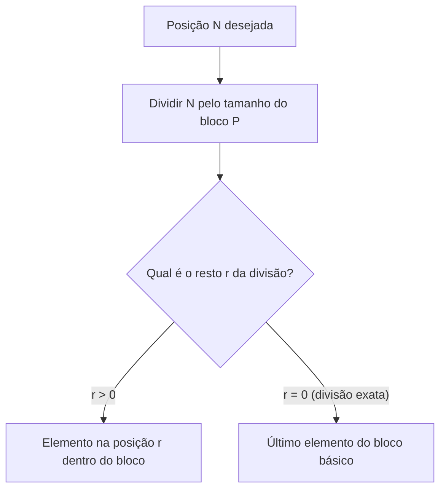
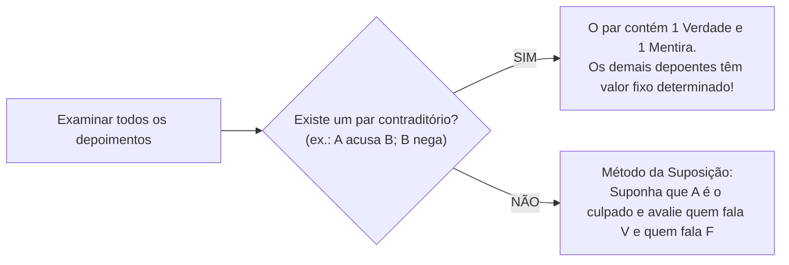

# 04 - Raciocínio Sequencial, Temporal, Espacial e Verbal

> **Matéria:** Matemática e Raciocínio Lógico  
> **Cargos:** A01 – Técnico de Controle Externo (Adm) / B02 – Técnico de Controle Externo (TI)  
> **Arquivo:** `04_raciocinio_sequencial_temporal_espacial_e_verbal.md`  
> **Status:** 🟢 Teoria Aprofundada + 5 Questões FCC Comentadas (A a E)


---


## 📌 Ementa / Itens do Edital
- Compreensão e elaboração da lógica das situações por meio de:
    - Raciocínio sequencial.
    - Orientação espacial e temporal.
    - Formação de conceitos e discriminação de elementos.
    - Raciocínio verbal e matemático aplicado.
    - Problemas de verdades e mentiras.

---

## 🧭 Sumário

1. [Raciocínio Sequencial e Padrões Numéricos e Literais](#1-raciocinio-sequencial-e-padroes-numericos-e-literais)
    1. [Sequências Numéricas e Relações de Recorrência](#11-sequencias-numericas-e-relacoes-de-recorrencia)
    2. [Sequências Alfanuméricas e Ordem Alfabética Oficial](#12-sequencias-alfanumericas-e-ordem-alfabetica-oficial)
    3. [Padrões Literais por Iniciais Semânticas](#13-padroes-literais-por-iniciais-semanticas)
    4. [Sequências Cíclicas e Resolução por Aritmética Modular](#14-sequencias-ciclicas-e-resolucao-por-aritmetica-modular)
    5. [Teste 102](#Teste-102)
    6. [Teste 103](#Teste-103)
    7. [Teste 104](#Teste-104)
2. [Orientação Temporal, Calendários e Relógios](#2-orientacao-temporal-calendarios-e-relogios)
    1. [Contagem de Dias e Aritmética Módulo 7](#21-contagem-de-dias-e-aritmetica-modulo-7)
    2. [Regras de Anos Bissextos e Deslocamento Anual](#22-regras-de-anos-bissextos-e-deslocamento-anual)
    3. [Cálculo do Ângulo entre Ponteiros de Relógio](#23-calculo-do-angulo-entre-ponteiros-de-relogio)
    4. [Relações Temporais Relativas de Ontem e Amanhã](#24-relacoes-temporais-relativas-de-ontem-e-amanha)
    5. [Teste 105](#Teste-105)
    6. [Teste 106](#Teste-106)
3. [Orientação Espacial, Transformações e Dobradura de Figuras](#3-orientacao-espacial-transformacoes-e-dobradura-de-figuras)
    1. [Rotações no Plano Bidimensional e Reflexões Axiais](#31-rotacoes-no-plano-bidimensional-e-reflexoes-axiais)
    2. [Planificação e Montagem de Cubos: A Regra das Faces Opostas](#32-planificacao-e-montagem-de-cubos-a-regra-das-faces-opostas)
    3. [Vistas Ortogonais de Pilhas de Blocos e Cubos](#33-vistas-ortogonais-de-pilhas-de-blocos-e-cubos)
    4. [Teste 107](#Teste-107)
    5. [Teste 108](#Teste-108)
4. [Formação de Conceitos e Discriminação de Elementos](#4-formacao-de-conceitos-e-discriminacao-de-elementos)
    1. [Identificação do Elemento Intruso em Conjuntos](#41-identificacao-do-elemento-intruso-em-conjuntos)
    2. [Analogias Estruturais e Geométricas](#42-analogias-estruturais-e-geometricas)
    3. [Teste 109](#Teste-109)
5. [Raciocínio Verbal e Problemas de Verdades e Mentiras](#5-raciocinio-verbal-e-problemas-de-verdades-e-mentiras)
    1. [O Princípio do Terceiro Excluído e da Não Contradição](#51-o-principio-do-terceiro-excluido-e-da-nao-contradicao)
    2. [O Método do Par Contraditório](#52-o-metodo-do-par-contraditorio)
    3. [O Método da Suposição Hipotética Dirigida](#53-o-metodo-da-suposicao-hipotetica-dirigida)
    4. [Teste 110](#Teste-110)
    5. [Teste 111](#Teste-111)
6. [🌐 Fontes Oficiais e Referências Bibliográficas](#fontes-oficiais-e-referencias-bibliograficas)

---

## 1. Raciocínio Sequencial e Padrões Numéricos e Literais

O raciocínio sequencial investiga a capacidade de identificar leis de formação abstratas ocultas sob uma ordenação cronológica, numérica ou alfanumérica, permitindo prever termos subsequentes ou remotos.

### 1.1 Sequências Numéricas e Relações de Recorrência

As sequências de números exploradas em concursos estruturam-se segundo diferentes padrões formativos:

1. **Progressões Aritméticas (PA) e Geométricas (PG):** Apresentam saltos aditivos constantes ($a_n = a_{n-1} + r$) ou multiplicativos constantes ($a_n = a_{n-1} \times q$).
2. **Diferenças Sucessivas em Progressão:** A diferença entre termos consecutivos não é constante, mas forma uma nova sequência com lei própria (ex.: diferenças que dobram a cada passo: $+2, +4, +8, +16, +32\dots$).
3. **Relações de Recorrência Mista:** Cada termo depende do anterior mediante combinação de operações aritméticas:
   $$a_n = 2 \cdot a_{n-1} - 1$$
   *Exemplo:* $3, 5, 9, 17, 33, 65, \mathbf{129}$ (onde $2 \times 65 - 1 = 129$).
4. **Sequências do Tipo Fibonacci:** Cada termo resulta da soma dos dois termos imediatamente anteriores ($1, 1, 2, 3, 5, 8, 13, 21\dots$).

### 1.2 Sequências Alfanuméricas e Ordem Alfabética Oficial

As sequências que intercalam letras e números utilizam a posição ordinal das letras no alfabeto oficial da língua portuguesa (composto por 26 letras, incluindo K, W e Y):

| A | B | C | D | E | F | G | H | I | J | K | L | M | N | O | P | Q | R | S | T | U | V | W | X | Y | Z |
| :-: | :-: | :-: | :-: | :-: | :-: | :-: | :-: | :-: | :-: | :-: | :-: | :-: | :-: | :-: | :-: | :-: | :-: | :-: | :-: | :-: | :-: | :-: | :-: | :-: | :-: |
| 1 | 2 | 3 | 4 | 5 | 6 | 7 | 8 | 9 | 10 | 11 | 12 | 13 | 14 | 15 | 16 | 17 | 18 | 19 | 20 | 21 | 22 | 23 | 24 | 25 | 26 |

*Exemplo:* Na sequência $B2, D4, F6, H8\dots$, a letra avança de 2 em 2 posições no alfabeto e o número acompanha a ordem par correspondente.

### 1.3 Padrões Literais por Iniciais Semânticas

Pegadinha clássica em provas da FCC consiste em sequências aparentemente caóticas cujas letras representam as iniciais de uma série semântica predeterminada da língua:

* Iniciais dos dias da semana: **D, S, T, Q, Q, S, S** (Domingo, Segunda, Terça, Quarta, Quinta, Sexta, Sábado);
* Iniciais dos meses do ano: **J, F, M, A, M, J, J, A, S, O, N, D**;
* Iniciais dos numerais por extenso: **U, D, T, Q, C, S, S, O, N, D** (Um, Dois, Três, Quatro, Cinco, Seis, Sete, Oito, Nove, Dez).

### 1.4 Sequências Cíclicas e Resolução por Aritmética Modular

Quando uma palavra, código ou conjunto de símbolos é repetido indefinidamente formando uma fita infinita:



1. Calcula-se o comprimento do período (tamanho do bloco repetitivo $P$);
2. Divide-se a posição demandada $N$ por $P$, obtendo $N = P \cdot q + r$;
3. **Se $r > 0$:** O termo procurado é o $r$-ésimo elemento do bloco inicial;
4. **Se $r = 0$:** A divisão foi exata, o que significa que o termo coincide exatamente com o **último elemento do bloco**.

---

### Teste 102
**(FGV – TCE/SC – 2026 – Auditor Fiscal de Controle Externo - Direito)**
A língua portuguesa contém vocábulos com três acentuações tônicas: oxítonas, paroxítonas e proparoxítonas. Entre as opções abaixo, assinale aquela que mostra dois vocábulos com idêntica acentuação tônica (as palavras estão propositalmente sem acentos gráficos).

* **A)** interim / decano.
* **B)** prototipo / gratuito.
* **C)** pesames / carater.
* **D)** filantropo / maquinaria.
* **E)** hipodromo / futil. Raciocínio Lógico Matemático

---

> **Comentário Detalhado:**
>
> - **A)** **Incorreta.** A opção apresenta proposição em desacordo com os fundamentos teóricos e técnicos do tópico ao afirmar que "interim / decano". De acordo com a teoria estudada em *1.3 Padrões Literais por Iniciais Semânticas*, iniciais dos numerais por extenso: U, D, T, Q, C, S, S, O, N, D (Um, Dois, Três, Quatro, Cinco, Seis, Sete, Oito, Nove, Dez).
> - **B)** **Incorreta.** A opção apresenta proposição em desacordo com os fundamentos teóricos e técnicos do tópico ao afirmar que "prototipo / gratuito". De acordo com a teoria estudada em *1.1 Sequências Numéricas e Relações de Recorrência*, sequências do Tipo Fibonacci: Cada termo resulta da soma dos dois termos imediatamente anteriores ($1, 1, 2, 3, 5, 8, 13, 21\dots$).
> - **C)** **Incorreta.** A opção apresenta proposição em desacordo com os fundamentos teóricos e técnicos do tópico ao afirmar que "pesames / carater". De acordo com a teoria estudada em *1.3 Padrões Literais por Iniciais Semânticas*, pegadinha clássica em provas da FCC consiste em sequências aparentemente caóticas cujas letras representam as iniciais de uma série semântica predeterminada da língua.
> - **D)** **Correta.** Conforme fundamentado na seção *1.2 Sequências Alfanuméricas e Ordem Alfabética Oficial* deste guia, as sequências que intercalam letras e números utilizam a posição ordinal das letras no alfabeto oficial da língua portuguesa (composto por 26 letras, incluindo K, W e Y). Dessa forma, está plenamente correta a assertiva da banca (FGV – TCE/SC/2026) ao estabelecer que "filantropo / maquinaria".
> - **E)** **Incorreta.** A opção apresenta proposição em desacordo com os fundamentos teóricos e técnicos do tópico ao afirmar que "hipodromo / futil. Raciocínio Lógico Matemático". De acordo com a teoria estudada em *1. Raciocínio Sequencial e Padrões Numéricos e Literais*, o raciocínio sequencial investiga a capacidade de identificar leis de formação abstratas ocultas sob uma ordenação cronológica, numérica ou alfanumérica, permitindo prever termos subsequentes ou remotos.
>
> **Gabarito: D**

---

### Teste 103
**(FCC – TRT 9ª – 2015 – Analista Judiciário - Apoio Especializado - Tecnologia da Informação)**
Embora as esculturas ficassem longe do público, elas foram vistas por artistas que visitavam Picasso. Sem prejuízo da correção e do sentido, o elemento sublinhado acima pode ser substituído por:

* **A)** Não chegou a preocupar Picasso, evidentemente, as condições de venda de suas esculturas ou mesmo se poderiam ser tema de exposição.
* **B)** Ao se deterem nas obras de Picasso, muitos dos que apreciam a escultura percebem nela uma evidente conexão com a arte africana.
* **C)** Ao permitirem improvisações, segundo a curadora Ann Temke, a escultura se adaptava ao temperamento irrequieto de Picasso.
* **D)** À época, quando se olha as esculturas europeias não se pensa em um poder mágico delas derivado.
* **E)** Devem haver explicações para a escultura de Picasso, embora de reconhecido valor artístico, não ter sido reunida com frequência. Matemática e Raciocínio Lógico-Matemático

---

> **Comentário Detalhado:**
>
> - **A)** **Incorreta.** A opção apresenta proposição em desacordo com os fundamentos teóricos e técnicos do tópico ao afirmar que "Não chegou a preocupar Picasso, evidentemente, as condições de venda de suas esculturas ou mesmo se poderiam ser...". De acordo com a teoria estudada em *2.4 Relações Temporais Relativas de Ontem e Amanhã*, problemas verbais do tipo *"Se o amanhã de ontem fosse o anteontem de depois de amanhã..."* devem ser resolvidos convertendo as expressões em uma reta numérica onde o dia Hoje é a origem $0$.
> - **B)** **Incorreta.** A opção apresenta proposição em desacordo com os fundamentos teóricos e técnicos do tópico ao afirmar que "Ao se deterem nas obras de Picasso, muitos dos que apreciam a escultura percebem nela uma evidente conexão com a...". De acordo com a teoria estudada em *1.4 Sequências Cíclicas e Resolução por Aritmética Modular*, se $r > 0$: O termo procurado é o $r$-ésimo elemento do bloco inicial.
> - **C)** **Incorreta.** A opção apresenta proposição em desacordo com os fundamentos teóricos e técnicos do tópico ao afirmar que "Ao permitirem improvisações, segundo a curadora Ann Temke, a escultura se adaptava ao temperamento irrequieto de...". De acordo com a teoria estudada em *1.4 Sequências Cíclicas e Resolução por Aritmética Modular*, se $r = 0$: A divisão foi exata, o que significa que o termo coincide exatamente com o último elemento do bloco.
> - **D)** **Correta.** Conforme fundamentado na seção *5.1 O Princípio do Terceiro Excluído e da Não Contradição* deste guia, uma declaração não pode ser simultaneamente verdadeira e falsa sob as mesmas circunstâncias (Não Contradição). Dessa forma, está plenamente correta a assertiva da banca (FCC – TRT 9ª/2015) ao estabelecer que "À época, quando se olha as esculturas europeias não se pensa em um poder mágico delas derivado".
> - **E)** **Incorreta.** A opção apresenta proposição em desacordo com os fundamentos teóricos e técnicos do tópico ao afirmar que "Devem haver explicações para a escultura de Picasso, embora de reconhecido valor artístico, não ter sido reunida...". De acordo com a teoria estudada em *1. Raciocínio Sequencial e Padrões Numéricos e Literais*, o raciocínio sequencial investiga a capacidade de identificar leis de formação abstratas ocultas sob uma ordenação cronológica, numérica ou alfanumérica, permitindo prever termos subsequentes ou remotos.
>
> **Gabarito: D**

---

### Teste 104
**(FGV – TCE/SC – 2026 – Auditor Fiscal de Controle Externo - Administração)**
Assinale a frase que mostra uma troca indevida entre parônimos (palavras semelhantes, mas de diferentes significados).

* **A)** Os emigrantes ilegais são hoje uma preocupação flagrante nos países da Europa e nos Estados Unidos.
* **B)** Os cidadãos, se infringem as leis, são punidos.
* **C)** Nas sessões do Congresso, discutem-se fatos importantes para a vida da população.
* **D)** A discrição é uma qualidade importante nos advogados.
* **E)** As tarefas legais não podem ser mal executadas. Raciocínio Lógico Matemático

---

> **Comentário Detalhado:**
>
> - **A)** **Correta.** Conforme fundamentado na seção *2.4 Relações Temporais Relativas de Ontem e Amanhã* deste guia, problemas verbais do tipo *"Se o amanhã de ontem fosse o anteontem de depois de amanhã..."* devem ser resolvidos convertendo as expressões em uma reta numérica onde o dia Hoje é a origem $0$. Dessa forma, está plenamente correta a assertiva da banca (FGV – TCE/SC/2026) ao estabelecer que "Os emigrantes ilegais são hoje uma preocupação flagrante nos países da Europa e nos Estados Unidos".
> - **B)** **Incorreta.** A opção apresenta proposição em desacordo com os fundamentos teóricos e técnicos do tópico ao afirmar que "Os cidadãos, se infringem as leis, são punidos". De acordo com a teoria estudada em *1. Raciocínio Sequencial e Padrões Numéricos e Literais*, o raciocínio sequencial investiga a capacidade de identificar leis de formação abstratas ocultas sob uma ordenação cronológica, numérica ou alfanumérica, permitindo prever termos subsequentes ou remotos.
> - **C)** **Incorreta.** A opção apresenta proposição em desacordo com os fundamentos teóricos e técnicos do tópico ao afirmar que "Nas sessões do Congresso, discutem-se fatos importantes para a vida da população". De acordo com a teoria estudada em *2.4 Relações Temporais Relativas de Ontem e Amanhã*, hoje = $0$; Amanhã = $+1$; Depois de amanhã = $+2$.
> - **D)** **Incorreta.** A opção apresenta proposição em desacordo com os fundamentos teóricos e técnicos do tópico ao afirmar que "A discrição é uma qualidade importante nos advogados". De acordo com a teoria estudada em *1.1 Sequências Numéricas e Relações de Recorrência*, as sequências de números exploradas em concursos estruturam-se segundo diferentes padrões formativos.
> - **E)** **Incorreta.** A opção apresenta proposição em desacordo com os fundamentos teóricos e técnicos do tópico ao afirmar que "As tarefas legais não podem ser mal executadas. Raciocínio Lógico Matemático". De acordo com a teoria estudada em *O Teorema Infalível das Faces Opostas:*, propriedade Inviolável: Duas faces opostas nunca podem ser vizinhas adjacentes e jamais aparecem juntas em uma mesma visão tridimensional ortogonal do cubo.
>
> **Gabarito: A**

---

## 2. Orientação Temporal, Calendários e Relógios

A orientação temporal examina o cômputo de prazos processuais e dias da semana mediante congruência modular de base 7.

### 2.1 Contagem de Dias e Aritmética Módulo 7

A semana compõe-se de exatamente 7 dias cíclicos. Logo, somar qualquer múltiplo de 7 dias a uma data devolve o calendário exatamente ao mesmo dia da semana:
$$\text{Dia Futuro} = \text{Dia Base} + (N \pmod 7)$$

*Exemplo:* Se uma sessão do TCE-GO ocorreu em uma quinta-feira e se quer saber em que dia da semana recairá um prazo de 43 dias corridos contados a partir daquela data:
$$43 = 6 \times 7 + 1 \implies \text{Resto } 1$$
Avança-se 1 dia a partir da quinta-feira, alcançando-se infalivelmente a **sexta-feira**.

### 2.2 Regras de Anos Bissextos e Deslocamento Anual

1. **Deslocamento Anual Comum:** Um ano civil ordinário possui 365 dias:
   $$365 = 52 \times 7 + 1 \implies \text{Avança 1 dia da semana no ano seguinte}$$
2. **Deslocamento em Ano Bissexto:** Possui 366 dias (acréscimo do dia 29 de fevereiro):
   $$366 = 52 \times 7 + 2 \implies \text{Avança 2 dias da semana}$$
3. **Critério Astronômico de Bissextilidade:**
    * É bissexto todo ano divisível por 4;
    * Exceto os anos centenários (terminados em 00), que somente são bissextos se forem divisíveis por 400 (ex.: o ano 2000 foi bissexto; os anos 1900 e 2100 **não** são bissextos).

### 2.3 Cálculo do Ângulo entre Ponteiros de Relógio

Em um mostrador circular analógico tradicional ($360^\circ$ divididos em 12 horas e 60 minutos):

* O ponteiro dos minutos desloca-se a uma velocidade angular de:
  $$v_M = \frac{360^\circ}{60 \text{ min}} = 6^\circ/\text{min}$$
* O ponteiro das horas desloca-se a uma velocidade de:
  $$v_H = \frac{360^\circ}{12 \text{ h} \times 60 \text{ min}} = 0{,}5^\circ/\text{min} \quad (30^\circ \text{ por hora})$$
* **Fórmula do Menor Ângulo ($\theta$) às $H$ horas e $M$ minutos:**
  $$|\theta| = |30 \cdot H - 5{,}5 \cdot M|$$
  Se o resultado modular for superior a $180^\circ$, toma-se o ângulo replementar: $\theta_{\text{menor}} = 360^\circ - \theta$.

### 2.4 Relações Temporais Relativas de Ontem e Amanhã

Problemas verbais do tipo *"Se o amanhã de ontem fosse o anteontem de depois de amanhã..."* devem ser resolvidos convertendo as expressões em uma reta numérica onde o dia **Hoje** é a origem $0$:

* Hoje = $0$; Amanhã = $+1$; Depois de amanhã = $+2$;
* Ontem = $-1$; Anteontem = $-2$.
Monta-se uma equação de primeiro grau simples para encontrar a posição do dia de referência.

---

### Teste 105
**(FGV – TJ/AP – 2023 – Analista Judiciario Apoio Especializado Tecnologia Da Informacao Desenvolvimento De Sistemas)**
Um documento XML é estruturado como uma árvore rotulada ordenada. Cada nó da árvore é um elemento XML. O elemento mais alto da árvore por onde se inicia a formação do documento XML é o:

* **A)** sibling;
* **B)** schema;
* **C)** attribute;
* **D)** leaf node;
* **E)** root node.

---

> **Comentário Detalhado:**
>
> - **A)** **Incorreta.** A opção apresenta proposição em desacordo com os fundamentos teóricos e técnicos do tópico ao afirmar que "sibling". De acordo com a teoria estudada em *1. Raciocínio Sequencial e Padrões Numéricos e Literais*, o raciocínio sequencial investiga a capacidade de identificar leis de formação abstratas ocultas sob uma ordenação cronológica, numérica ou alfanumérica, permitindo prever termos subsequentes ou remotos.
> - **B)** **Incorreta.** A opção apresenta proposição em desacordo com os fundamentos teóricos e técnicos do tópico ao afirmar que "schema". De acordo com a teoria estudada em *5.2 O Método do Par Contraditório*, é o método mais célere e elegante de resolução.
> - **C)** **Incorreta.** A opção apresenta proposição em desacordo com os fundamentos teóricos e técnicos do tópico ao afirmar que "attribute". De acordo com a teoria estudada em *1.1 Sequências Numéricas e Relações de Recorrência*, *Exemplo:* $3, 5, 9, 17, 33, 65, \mathbf{129}$ (onde $2 \times 65 - 1 = 129$).
> - **D)** **Incorreta.** A opção apresenta proposição em desacordo com os fundamentos teóricos e técnicos do tópico ao afirmar que "leaf node". De acordo com a teoria estudada em *1.4 Sequências Cíclicas e Resolução por Aritmética Modular*, se $r > 0$: O termo procurado é o $r$-ésimo elemento do bloco inicial.
> - **E)** **Correta.** Conforme fundamentado na seção *2.4 Relações Temporais Relativas de Ontem e Amanhã* deste guia, problemas verbais do tipo *"Se o amanhã de ontem fosse o anteontem de depois de amanhã..."* devem ser resolvidos convertendo as expressões em uma reta numérica onde o dia Hoje é a origem $0$. Dessa forma, está plenamente correta a assertiva da banca (FGV – TJ/AP/2023) ao estabelecer que "root node".
>
> **Gabarito: E**

---

### Teste 106
**(FGV – TRT 16ª – 2022 – Analista Judiciário (Área Administrativa - Tecnologia da Informação))**
Numa reunião de departamento, um professor mostrou os péssimos resultados de seus alunos no primeiro semestre para demonstrar a falência do ensino universitário. Essa argumentação do professor mostra um problema, que é

* **A)** um círculo vicioso, pois a primeira e a segunda parte do raciocínio mostram o mesmo significado.
* **B)** uma falsa relação de causa e efeito, pois a primeira parte indica uma causa não verdadeira para a conclusão.
* **C)** um estereótipo, pois hoje se consideram os alunos universitários como símbolos da incompetência.
* **D)** uma falsa analogia, já que os elementos comparados são diferentes em um ponto essencial.
* **E)** uma generalização excessiva, pois fez uma dedução para um todo (o ensino universitário), que pode ser injusta.

---

> **Comentário Detalhado:**
>
> - **A)** **Incorreta.** A opção apresenta proposição em desacordo com os fundamentos teóricos e técnicos do tópico ao afirmar que "um círculo vicioso, pois a primeira e a segunda parte do raciocínio mostram o mesmo significado". De acordo com a teoria estudada em *1.3 Padrões Literais por Iniciais Semânticas*, iniciais dos dias da semana: D, S, T, Q, Q, S, S (Domingo, Segunda, Terça, Quarta, Quinta, Sexta, Sábado).
> - **B)** **Incorreta.** A opção apresenta proposição em desacordo com os fundamentos teóricos e técnicos do tópico ao afirmar que "uma falsa relação de causa e efeito, pois a primeira parte indica uma causa não verdadeira para a conclusão". De acordo com a teoria estudada em *5.1 O Princípio do Terceiro Excluído e da Não Contradição*, uma declaração ou é Verdadeira ($V$) ou é Falsa ($F$), não havendo meio-termo (Terceiro Excluído).
> - **C)** **Incorreta.** A opção apresenta proposição em desacordo com os fundamentos teóricos e técnicos do tópico ao afirmar que "um estereótipo, pois hoje se consideram os alunos universitários como símbolos da incompetência". De acordo com a teoria estudada em *2.4 Relações Temporais Relativas de Ontem e Amanhã*, problemas verbais do tipo *"Se o amanhã de ontem fosse o anteontem de depois de amanhã..."* devem ser resolvidos convertendo as expressões em uma reta numérica onde o dia Hoje é a origem $0$.
> - **D)** **Incorreta.** A opção apresenta proposição em desacordo com os fundamentos teóricos e técnicos do tópico ao afirmar que "uma falsa analogia, já que os elementos comparados são diferentes em um ponto essencial". De acordo com a teoria estudada em *1.1 Sequências Numéricas e Relações de Recorrência*, as sequências de números exploradas em concursos estruturam-se segundo diferentes padrões formativos.
> - **E)** **Correta.** Conforme fundamentado na seção *5.1 O Princípio do Terceiro Excluído e da Não Contradição* deste guia, uma declaração não pode ser simultaneamente verdadeira e falsa sob as mesmas circunstâncias (Não Contradição). Dessa forma, está plenamente correta a assertiva da banca (FGV – TRT 16ª/2022) ao estabelecer que "uma generalização excessiva, pois fez uma dedução para um todo (o ensino universitário), que pode ser injusta".
>
> **Gabarito: E**

---

## 3. Orientação Espacial, Transformações e Dobradura de Figuras

O raciocínio espacial avalia a aptidão psicotécnica de manipular objetos tridimensionais mentalmente sem distorcer suas propriedades topológicas.

### 3.1 Rotações no Plano Bidimensional e Reflexões Axiais

* **Rotações:** Giro rígido da figura em torno de um ponto pivô no sentido horário ou anti-horário em ângulos retos de $90^\circ, 180^\circ$ ou $270^\circ$. A forma e as distâncias relativas preservam-se; apenas a orientação espacial se altera.
* **Reflexão Axial (Espelhamento):** Inversão especular da figura em relação a um eixo vertical ou horizontal. O lado direito vira esquerdo na reflexão vertical; o topo vira base na reflexão horizontal.

### 3.2 Planificação e Montagem de Cubos: A Regra das Faces Opostas

A planificação de um hexaedro regular (cubo) compõe-se de 6 quadrados dispostos em cruz ou configurações similares:

```text
       [ ★ ]
[ ♥ ] [ ♠ ] [ ♦ ] [ ♣ ]
       [ ▲ ]
```

#### O Teorema Infalível das Faces Opostas:
1. Em qualquer fileira retilínea com 3 ou 4 quadrados consecutivos, **duas faces separadas por exatamente uma face intermediária formam um par de faces diametralmente opostas no cubo montado**.
    * No esquema acima: $\heartsuit$ é oposta a $\diamondsuit$ (separadas por $\spadesuit$); $\spadesuit$ é oposta a $\clubsuit$ (separadas por $\diamondsuit$).

2. As abas laterais que sobram dobram-se formando o outro par oposto: $\bigstar$ é oposta a $\blacktriangle$.
3. **Propriedade Inviolável:** Duas faces opostas **nunca podem ser vizinhas adjacentes** e **jamais aparecem juntas em uma mesma visão tridimensional ortogonal do cubo**.

### 3.3 Vistas Ortogonais de Pilhas de Blocos e Cubos

Consiste em determinar a projeção visual bidimensional de uma estrutura tridimensional de blocos cúbicos a partir de pontos de vista fixos:

* Vista Superior (planta baixa vista de cima);
* Vista Frontal (elevação frontal);
* Vista Lateral Esquerda ou Direita.

---

### Teste 107
**(FGV – TRT/13 – 2022 – Analista Judiciario Tecnologia Da Informacao)**
O diminutivo em língua portuguesa mostra valores variados. Assinale a frase abaixo em que o diminutivo tem valor afetivo.

* **A)** Nesse frio, bom mesmo é um cobertorzinho amigo.
* **B)** O governo deseja que a inflação vá embora depressinha.
* **C)** O deputado mostrava em seu pulso um reloginho barato.
* **D)** Na Europa ocorre agora uma guerrinha suja.
* **E)** A mobília da boneca tinha apenas duas cadeirinhas. Raciocínio Lógico Matemático

---

> **Comentário Detalhado:**
>
> - **A)** **Correta.** Conforme fundamentado na seção *1.2 Sequências Alfanuméricas e Ordem Alfabética Oficial* deste guia, as sequências que intercalam letras e números utilizam a posição ordinal das letras no alfabeto oficial da língua portuguesa (composto por 26 letras, incluindo K, W e Y). Dessa forma, está plenamente correta a assertiva da banca (FGV – TRT/13/2022) ao estabelecer que "Nesse frio, bom mesmo é um cobertorzinho amigo".
> - **B)** **Incorreta.** A opção apresenta proposição em desacordo com os fundamentos teóricos e técnicos do tópico ao afirmar que "O governo deseja que a inflação vá embora depressinha". De acordo com a teoria estudada em *1.3 Padrões Literais por Iniciais Semânticas*, pegadinha clássica em provas da FCC consiste em sequências aparentemente caóticas cujas letras representam as iniciais de uma série semântica predeterminada da língua.
> - **C)** **Incorreta.** A opção apresenta proposição em desacordo com os fundamentos teóricos e técnicos do tópico ao afirmar que "O deputado mostrava em seu pulso um reloginho barato". De acordo com a teoria estudada em *3. Orientação Espacial, Transformações e Dobradura de Figuras*, o raciocínio espacial avalia a aptidão psicotécnica de manipular objetos tridimensionais mentalmente sem distorcer suas propriedades topológicas.
> - **D)** **Incorreta.** A opção apresenta proposição em desacordo com os fundamentos teóricos e técnicos do tópico ao afirmar que "Na Europa ocorre agora uma guerrinha suja". De acordo com a teoria estudada em *3.1 Rotações no Plano Bidimensional e Reflexões Axiais*, rotações: Giro rígido da figura em torno de um ponto pivô no sentido horário ou anti-horário em ângulos retos de $90^\circ, 180^\circ$ ou $270^\circ$. A forma e as distâncias relativas preservam-se; apenas a orientação espacial se altera.
> - **E)** **Incorreta.** A opção incorre em restrição indevida ao limitar o escopo conceitual ao afirmar que "A mobília da boneca tinha apenas duas cadeirinhas. Raciocínio Lógico Matemático". De acordo com a teoria estudada em *O Teorema Infalível das Faces Opostas:*, em qualquer fileira retilínea com 3 ou 4 quadrados consecutivos, duas faces separadas por exatamente uma face intermediária formam um par de faces diametralmente opostas no cubo montado.
>
> **Gabarito: A**

---

### Teste 108
**(FGV – TRT 16ª – 2022 – Analista Judiciário (Área Administrativa - Tecnologia da Informação))**
Observe o seguinte raciocínio: A gramática portuguesa é de difícil aprendizagem, por isso acho conveniente a contratação de novos professores. Nesse caso, a premissa inicial do raciocínio corresponde a

* **A)** um fato comprovado.
* **B)** uma opinião do enunciador.
* **C)** um testemunho de autoridade.
* **D)** uma dúvida sobre um fato.
* **E)** uma certeza comprovada.

---

> **Comentário Detalhado:**
>
> - **A)** **Incorreta.** A opção apresenta proposição em desacordo com os fundamentos teóricos e técnicos do tópico ao afirmar que "um fato comprovado". De acordo com a teoria estudada em *1.2 Sequências Alfanuméricas e Ordem Alfabética Oficial*, as sequências que intercalam letras e números utilizam a posição ordinal das letras no alfabeto oficial da língua portuguesa (composto por 26 letras, incluindo K, W e Y).
> - **B)** **Correta.** Conforme fundamentado na seção *3. Orientação Espacial, Transformações e Dobradura de Figuras* deste guia, o raciocínio espacial avalia a aptidão psicotécnica de manipular objetos tridimensionais mentalmente sem distorcer suas propriedades topológicas. Dessa forma, está plenamente correta a assertiva da banca (FGV – TRT 16ª/2022) ao estabelecer que "uma opinião do enunciador".
> - **C)** **Incorreta.** A opção apresenta proposição em desacordo com os fundamentos teóricos e técnicos do tópico ao afirmar que "um testemunho de autoridade". De acordo com a teoria estudada em *1.4 Sequências Cíclicas e Resolução por Aritmética Modular*, se $r > 0$: O termo procurado é o $r$-ésimo elemento do bloco inicial.
> - **D)** **Incorreta.** A opção apresenta proposição em desacordo com os fundamentos teóricos e técnicos do tópico ao afirmar que "uma dúvida sobre um fato". De acordo com a teoria estudada em *5.3 O Método da Suposição Hipotética Dirigida*, caso não haja contradição explícita direta entre os depoimentos.
> - **E)** **Incorreta.** A opção apresenta proposição em desacordo com os fundamentos teóricos e técnicos do tópico ao afirmar que "uma certeza comprovada". De acordo com a teoria estudada em *5.3 O Método da Suposição Hipotética Dirigida*, avalia-se a veracidade de cada depoimento sob essa premissa.
>
> **Gabarito: B**

---

## 4. Formação de Conceitos e Discriminação de Elementos

### 4.1 Identificação do Elemento Intruso em Conjuntos

Exige identificar a propriedade lógica oculta que une a maioria dos elementos de um rol e discriminar o único elemento que destoa dessa harmonia funcional ou geométrica:

* Critérios numéricos: paridade, números primos, quadrados perfeitos;
* Critérios geométricos: número de vértices, eixos de simetria, concavidade;
* Critérios morfológicos/verbais: número de sílabas, classe gramatical, campo semântico.

### 4.2 Analogias Estruturais e Geométricas

Resolvem-se pela equivalência de transformações: *"A está para B assim como C está para D"*. Identifica-se qual mutação (rotação de $90^\circ$, inversão de cores, acréscimo de um lado poligonal) operou a passagem de A para B e replica-se essa exata transformação sobre a figura C para encontrar D.

---

### Teste 109
**(FGV – TCE/SC – 2026 – Auditor Fiscal de Controle Externo - Ciências Contábeis)**
Com relação à definição de valor justo, de acordo com o Pronunciamento Técnico CPC 46 - MENSURAÇÃO DO VALOR JUSTO, avalie se os elementos a seguir fazem parte da definição de valor justo. I. ativos II. passivos III. receitas IV. despesas Estão corretos os elementos

* **A)** I e II, apenas.
* **B)** III e IV, apenas.
* **C)** I e IV, apenas.
* **D)** II e III, apenas.
* **E)** I, II, III e IV.

---

> **Comentário Detalhado:**
>
> - **A)** **Correta.** Conforme fundamentado na seção *4.1 Identificação do Elemento Intruso em Conjuntos* deste guia, exige identificar a propriedade lógica oculta que une a maioria dos elementos de um rol e discriminar o único elemento que destoa dessa harmonia funcional ou geométrica. Dessa forma, está plenamente correta a assertiva da banca (FGV – TCE/SC/2026) ao estabelecer que "I e II, apenas".
> - **B)** **Incorreta.** A opção incorre em restrição indevida ao limitar o escopo conceitual ao afirmar que "III e IV, apenas". De acordo com a teoria estudada em *3.1 Rotações no Plano Bidimensional e Reflexões Axiais*, reflexão Axial (Espelhamento): Inversão especular da figura em relação a um eixo vertical ou horizontal. O lado direito vira esquerdo na reflexão vertical; o topo vira base na reflexão horizontal.
> - **C)** **Incorreta.** A opção incorre em restrição indevida ao limitar o escopo conceitual ao afirmar que "I e IV, apenas". De acordo com a teoria estudada em *4.1 Identificação do Elemento Intruso em Conjuntos*, critérios numéricos: paridade, números primos, quadrados perfeitos.
> - **D)** **Incorreta.** A opção incorre em restrição indevida ao limitar o escopo conceitual ao afirmar que "II e III, apenas". De acordo com a teoria estudada em *4.1 Identificação do Elemento Intruso em Conjuntos*, critérios geométricos: número de vértices, eixos de simetria, concavidade.
> - **E)** **Incorreta.** A opção apresenta proposição em desacordo com os fundamentos teóricos e técnicos do tópico ao afirmar que "I, II, III e IV". De acordo com a teoria estudada em *4.1 Identificação do Elemento Intruso em Conjuntos*, critérios morfológicos/verbais: número de sílabas, classe gramatical, campo semântico.
>
> **Gabarito: A**

---

## 5. Raciocínio Verbal e Problemas de Verdades e Mentiras

Os enigmas de depoimentos em sindicâncias e auditorias de fraudes são modelados por lógica proposicional veritativa.

### 5.1 O Princípio do Terceiro Excluído e da Não Contradição

* Uma declaração ou é Verdadeira ($V$) ou é Falsa ($F$), não havendo meio-termo (Terceiro Excluído);
* Uma declaração não pode ser simultaneamente verdadeira e falsa sob as mesmas circunstâncias (Não Contradição).

### 5.2 O Método do Par Contraditório

É o método mais célere e elegante de resolução:



> 🚨 **ALERTA DE PROVA / PEGADINHA FCC:** Se o enunciado garantir que *"entre os quatro servidores ouvidos, apenas um deles mentiu"*, examine os depoimentos em busca de duas pessoas que se contradigam (por exemplo: Daniel diz *"Fernando cometeu a fraude"* e Fernando diz *"Daniel está mentindo"*). Como uma dessas falas é verdadeira e a outra é falsa, **a única mentira da questão está obrigatoriamente confinada a esse par**. Logo, todos os outros servidores fora do par (Eduardo e Gabriel) falaram a verdade irrestrita!

### 5.3 O Método da Suposição Hipotética Dirigida

Caso não haja contradição explícita direta entre os depoimentos:

1. Fixa-se a culpa hipotética em um dos suspeitos (ex.: *"Suponha que o culpado seja Fernando"*);
2. Avalia-se a veracidade de cada depoimento sob essa premissa;
3. Se a quantidade de verdades e mentiras bater com o enunciado (ex.: 3 verdades e 1 mentira), a hipótese é a solução final;
4. Se gerar quantidade diferente de mentirosos, descarta-se e testa-se o próximo suspeito.

---

### Teste 110
**(FGV – TRT 1ª – 2024 – Analista Judiciário - Área Administrativa)**
Leia a frase abaixo com atenção: “As árvores genealógicas são a única espécie arbórea que teria razões para ocultar suas raízes”. A afirmativa correta sobre o significado ou estruturação da frase acima é:

* **A)** a frase não pode ser entendida por faltar lógica aos termos, já que uma árvore genealógica não é uma espécie arbórea;
* **B)** a finalidade da frase é criticar as pessoas demasiadamente preocupadas com sua origem familiar, nem sempre digna de ser valorizada;
* **C)** o referido ocultamento das raízes revela a necessidade de discrição sobre assuntos familiares;
* **D)** a frase foi estruturada na base de uma comparação entre uma árvore genealógica e uma árvore natural;
* **E)** a forma verbal “teria” indica uma certeza na afirmação.

---

> **Comentário Detalhado:**
>
> - **A)** **Incorreta.** A opção apresenta proposição em desacordo com os fundamentos teóricos e técnicos do tópico ao afirmar que "a frase não pode ser entendida por faltar lógica aos termos, já que uma árvore genealógica não é uma espécie...". De acordo com a teoria estudada em *5.1 O Princípio do Terceiro Excluído e da Não Contradição*, uma declaração não pode ser simultaneamente verdadeira e falsa sob as mesmas circunstâncias (Não Contradição).
> - **B)** **Correta.** Conforme fundamentado na seção *2.4 Relações Temporais Relativas de Ontem e Amanhã* deste guia, problemas verbais do tipo *"Se o amanhã de ontem fosse o anteontem de depois de amanhã..."* devem ser resolvidos convertendo as expressões em uma reta numérica onde o dia Hoje é a origem $0$. Dessa forma, está plenamente correta a assertiva da banca (FGV – TRT 1ª/2024) ao estabelecer que "a finalidade da frase é criticar as pessoas demasiadamente preocupadas com sua origem familiar, nem sempre digna...".
> - **C)** **Incorreta.** A opção apresenta proposição em desacordo com os fundamentos teóricos e técnicos do tópico ao afirmar que "o referido ocultamento das raízes revela a necessidade de discrição sobre assuntos familiares". De acordo com a teoria estudada em *5.2 O Método do Par Contraditório*, se o enunciado garantir que *"entre os quatro servidores ouvidos, apenas um deles mentiu"*, examine os depoimentos em busca de duas pessoas que se contradigam (por exemplo: Daniel diz *"Fernando cometeu a fraude"* e Fernando diz *"Daniel está mentindo"*).
> - **D)** **Incorreta.** A opção apresenta proposição em desacordo com os fundamentos teóricos e técnicos do tópico ao afirmar que "a frase foi estruturada na base de uma comparação entre uma árvore genealógica e uma árvore natural". De acordo com a teoria estudada em *2. Orientação Temporal, Calendários e Relógios*, a orientação temporal examina o cômputo de prazos processuais e dias da semana mediante congruência modular de base 7.
> - **E)** **Incorreta.** A opção apresenta proposição em desacordo com os fundamentos teóricos e técnicos do tópico ao afirmar que "a forma verbal “teria” indica uma certeza na afirmação". De acordo com a teoria estudada em *5. Raciocínio Verbal e Problemas de Verdades e Mentiras*, os enigmas de depoimentos em sindicâncias e auditorias de fraudes são modelados por lógica proposicional veritativa.
>
> **Gabarito: B**

---

### Teste 111
**(FGV – TCE/PI – 2025 – Auditor de Controle Externo - Controle Externo - Específica de Área Comum)**
O processo de elaboração das estimativas de Receitas Orçamentárias possui etapas que envolvem a revisão e a possibilidade de alteração nas estimativas realizadas, para as quais se requer uma justificativa, que não pode ser

* **A)** pautada em uma argumentação de necessidade de gasto essencial.
* **B)** baseada em alterações nas alíquotas ou valores de taxas, tarifas e/ou serviços.
* **C)** baseada no fato de se tratar de uma receita nova, que não possui histórico de arrecadação, dificultando a modelagem no SIOP.
* **D)** fundamentada em situações a partir das quais as receitas forem impactadas direta ou indiretamente por efeitos decorrentes de alterações legais ou contratuais.
* **E)** sustentada a partir do fato de que se trata de uma receita atípica ou de baixa previsibilidade, de difícil modelagem no SIOP, como por exemplo as receitas oriundas de licitações, convênios, doações, inscrições, entre outras.

---

> **Comentário Detalhado:**
>
> - **A)** **Correta.** Conforme fundamentado na seção *5.1 O Princípio do Terceiro Excluído e da Não Contradição* deste guia, uma declaração não pode ser simultaneamente verdadeira e falsa sob as mesmas circunstâncias (Não Contradição). Dessa forma, está plenamente correta a assertiva da banca (FGV – TCE/PI/2025) ao estabelecer que "pautada em uma argumentação de necessidade de gasto essencial".
> - **B)** **Incorreta.** A opção apresenta proposição em desacordo com os fundamentos teóricos e técnicos do tópico ao afirmar que "baseada em alterações nas alíquotas ou valores de taxas, tarifas e/ou serviços". De acordo com a teoria estudada em *2.2 Regras de Anos Bissextos e Deslocamento Anual*, deslocamento Anual Comum: Um ano civil ordinário possui 365 dias.
> - **C)** **Incorreta.** A opção apresenta proposição em desacordo com os fundamentos teóricos e técnicos do tópico ao afirmar que "baseada no fato de se tratar de uma receita nova, que não possui histórico de arrecadação, dificultando a...". De acordo com a teoria estudada em *2.2 Regras de Anos Bissextos e Deslocamento Anual*, deslocamento em Ano Bissexto: Possui 366 dias (acréscimo do dia 29 de fevereiro).
> - **D)** **Incorreta.** A opção apresenta proposição em desacordo com os fundamentos teóricos e técnicos do tópico ao afirmar que "fundamentada em situações a partir das quais as receitas forem impactadas direta ou indiretamente por efeitos...". De acordo com a teoria estudada em *5.3 O Método da Suposição Hipotética Dirigida*, caso não haja contradição explícita direta entre os depoimentos.
> - **E)** **Incorreta.** A opção apresenta proposição em desacordo com os fundamentos teóricos e técnicos do tópico ao afirmar que "sustentada a partir do fato de que se trata de uma receita atípica ou de baixa previsibilidade, de difícil...". De acordo com a teoria estudada em *2.1 Contagem de Dias e Aritmética Módulo 7*, *Exemplo:* Se uma sessão do TCE-GO ocorreu em uma quinta-feira e se quer saber em que dia da semana recairá um prazo de 43 dias corridos contados a partir daquela data.
>
> **Gabarito: A**

---

## 🌐 Fontes Oficiais e Referências Bibliográficas

* [Khan Academy Brasil - Álgebra I: Sequências e Progressões](https://pt.khanacademy.org/math/algebra) - Padrões recursivos, progressões aritméticas, sequências numéricas e determinação do termo geral.
* [OBMEP / IMPA - Apostila 1 do PIC: Iniciação à Aritmética e Padrões Cíclicos](https://www.obmep.org.br/docs/apostila1.pdf) - Aritmética modular, periodicidade, cálculo de ciclos e restos na determinação de posições futuras.
* [OBMEP / IMPA - Apostila 8 do PIC: Raciocínio Espacial e Figural](https://www.obmep.org.br/docs/apostila8.pdf) - Transformações no plano, rotações, vistas ortogonais e projeções espaciais.
* [Portal da Matemática OBMEP / IMPA - Módulo de Sequências e Indução Matemática](https://portaldaobmep.impa.br/index.php/modulo/ver?modulo=1059) - Métodos formais para identificar leis de formação e regularidades sequenciais.
* IEZZI, Gelson. **Fundamentos de Matemática Elementar, Volume 4: Sequências, Matrizes e Determinantes**. 8. ed. São Paulo: Atual, 2013. (Cap. 1 e 2 - Progressões Aritméticas e Geométricas).
* ALENCAR FILHO, Edgard de. **Iniciação à Lógica Matemática**. São Paulo: Nobel, 2002. (Cap. 7 - Raciocínio Dedutivo e Sequências Lógicas).
* CARRAHER, David; CARRAHER, Terezinha; SCHLIEMANN, Analúcia. **Na Vida Dez, na Escola Zero**. 16. ed. São Paulo: Cortez, 2011. (Cap. 3 - Raciocínio Sequencial e Operações Cotidianas).
