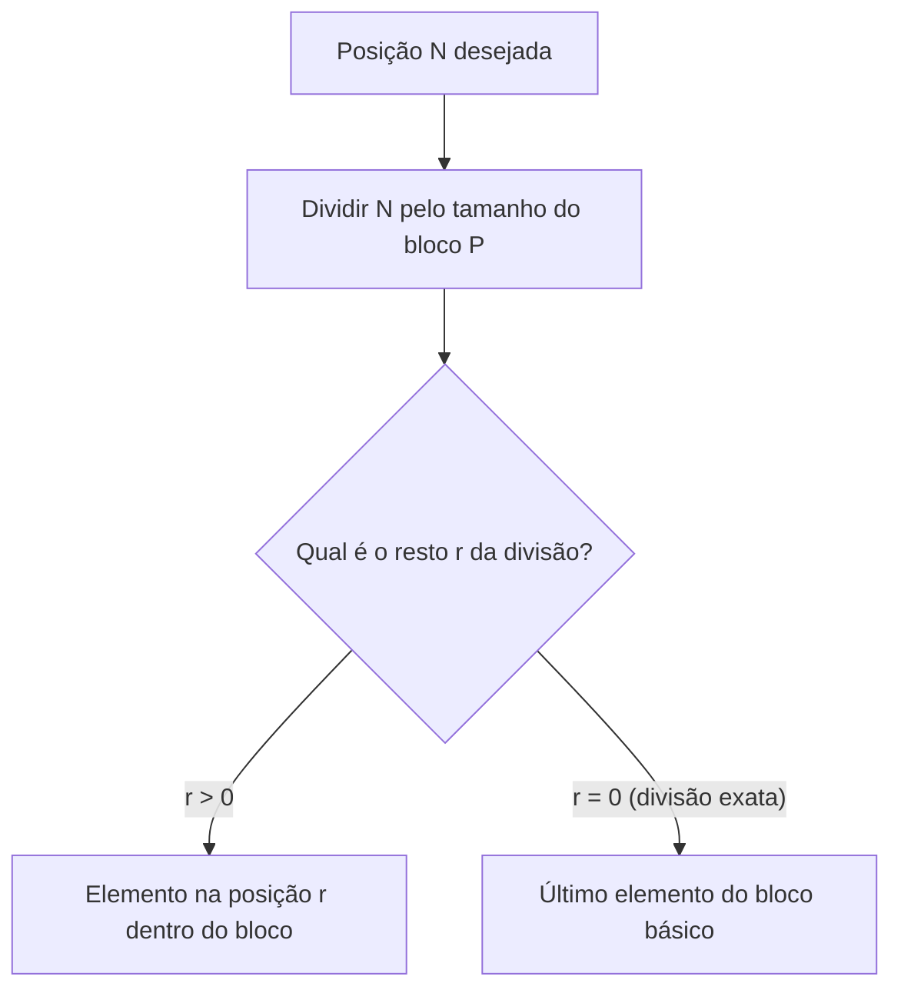
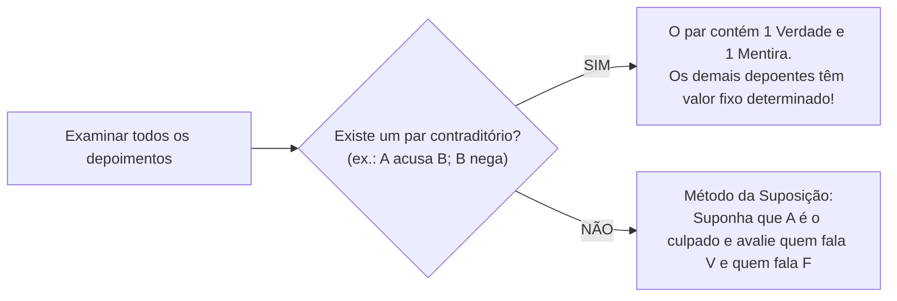

# 04 - Raciocínio Sequencial, Temporal, Espacial e Verbal

> **Matéria:** Matemática e Raciocínio Lógico  
> **Cargos:** A01 – Técnico de Controle Externo (Adm) / B02 – Técnico de Controle Externo (TI)  
> **Arquivo:** `04_raciocinio_sequencial_temporal_espacial_e_verbal.md`  
> **Status:** 🟢 Teoria Aprofundada + 5 Questões FCC Comentadas (A a E)


---


## 📌 Ementa / Itens do Edital
- Compreensão e elaboração da lógica das situações por meio de:
    - Raciocínio sequencial.
    - Orientação espacial e temporal.
    - Formação de conceitos e discriminação de elementos.
    - Raciocínio verbal e matemático aplicado.
    - Problemas de verdades e mentiras.

---

## 🧭 Sumário

1. [Raciocínio Sequencial e Padrões Numéricos e Literais](#1-raciocinio-sequencial-e-padroes-numericos-e-literais)
    1. [Sequências Numéricas e Relações de Recorrência](#11-sequencias-numericas-e-relacoes-de-recorrencia)
    2. [Sequências Alfanuméricas e Ordem Alfabética Oficial](#12-sequencias-alfanumericas-e-ordem-alfabetica-oficial)
    3. [Padrões Literais por Iniciais Semânticas](#13-padroes-literais-por-iniciais-semanticas)
    4. [Sequências Cíclicas e Resolução por Aritmética Modular](#14-sequencias-ciclicas-e-resolucao-por-aritmetica-modular)
    5. [Teste 102](#Teste-102)
    6. [Teste 103](#Teste-103)
    7. [Teste 104](#Teste-104)
2. [Orientação Temporal, Calendários e Relógios](#2-orientacao-temporal-calendarios-e-relogios)
    1. [Contagem de Dias e Aritmética Módulo 7](#21-contagem-de-dias-e-aritmetica-modulo-7)
    2. [Regras de Anos Bissextos e Deslocamento Anual](#22-regras-de-anos-bissextos-e-deslocamento-anual)
    3. [Cálculo do Ângulo entre Ponteiros de Relógio](#23-calculo-do-angulo-entre-ponteiros-de-relogio)
    4. [Relações Temporais Relativas de Ontem e Amanhã](#24-relacoes-temporais-relativas-de-ontem-e-amanha)
    5. [Teste 105](#Teste-105)
    6. [Teste 106](#Teste-106)
3. [Orientação Espacial, Transformações e Dobradura de Figuras](#3-orientacao-espacial-transformacoes-e-dobradura-de-figuras)
    1. [Rotações no Plano Bidimensional e Reflexões Axiais](#31-rotacoes-no-plano-bidimensional-e-reflexoes-axiais)
    2. [Planificação e Montagem de Cubos: A Regra das Faces Opostas](#32-planificacao-e-montagem-de-cubos-a-regra-das-faces-opostas)
    3. [Vistas Ortogonais de Pilhas de Blocos e Cubos](#33-vistas-ortogonais-de-pilhas-de-blocos-e-cubos)
    4. [Teste 107](#Teste-107)
    5. [Teste 108](#Teste-108)
4. [Formação de Conceitos e Discriminação de Elementos](#4-formacao-de-conceitos-e-discriminacao-de-elementos)
    1. [Identificação do Elemento Intruso em Conjuntos](#41-identificacao-do-elemento-intruso-em-conjuntos)
    2. [Analogias Estruturais e Geométricas](#42-analogias-estruturais-e-geometricas)
    3. [Teste 109](#Teste-109)
5. [Raciocínio Verbal e Problemas de Verdades e Mentiras](#5-raciocinio-verbal-e-problemas-de-verdades-e-mentiras)
    1. [O Princípio do Terceiro Excluído e da Não Contradição](#51-o-principio-do-terceiro-excluido-e-da-nao-contradicao)
    2. [O Método do Par Contraditório](#52-o-metodo-do-par-contraditorio)
    3. [O Método da Suposição Hipotética Dirigida](#53-o-metodo-da-suposicao-hipotetica-dirigida)
    4. [Teste 110](#Teste-110)
    5. [Teste 111](#Teste-111)
6. [🌐 Fontes Oficiais e Referências Bibliográficas](#fontes-oficiais-e-referencias-bibliograficas)

---

## 1. Raciocínio Sequencial e Padrões Numéricos e Literais

O raciocínio sequencial investiga a capacidade de identificar leis de formação abstratas ocultas sob uma ordenação cronológica, numérica ou alfanumérica, permitindo prever termos subsequentes ou remotos.

### 1.1 Sequências Numéricas e Relações de Recorrência

As sequências de números exploradas em concursos estruturam-se segundo diferentes padrões formativos:

1. **Progressões Aritméticas (PA) e Geométricas (PG):** Apresentam saltos aditivos constantes ($a_n = a_{n-1} + r$) ou multiplicativos constantes ($a_n = a_{n-1} \times q$).
2. **Diferenças Sucessivas em Progressão:** A diferença entre termos consecutivos não é constante, mas forma uma nova sequência com lei própria (ex.: diferenças que dobram a cada passo: $+2, +4, +8, +16, +32\dots$).
3. **Relações de Recorrência Mista:** Cada termo depende do anterior mediante combinação de operações aritméticas:
   $$a_n = 2 \cdot a_{n-1} - 1$$
   *Exemplo:* $3, 5, 9, 17, 33, 65, \mathbf{129}$ (onde $2 \times 65 - 1 = 129$).
4. **Sequências do Tipo Fibonacci:** Cada termo resulta da soma dos dois termos imediatamente anteriores ($1, 1, 2, 3, 5, 8, 13, 21\dots$).

### 1.2 Sequências Alfanuméricas e Ordem Alfabética Oficial

As sequências que intercalam letras e números utilizam a posição ordinal das letras no alfabeto oficial da língua portuguesa (composto por 26 letras, incluindo K, W e Y):

| A | B | C | D | E | F | G | H | I | J | K | L | M | N | O | P | Q | R | S | T | U | V | W | X | Y | Z |
| :-: | :-: | :-: | :-: | :-: | :-: | :-: | :-: | :-: | :-: | :-: | :-: | :-: | :-: | :-: | :-: | :-: | :-: | :-: | :-: | :-: | :-: | :-: | :-: | :-: | :-: |
| 1 | 2 | 3 | 4 | 5 | 6 | 7 | 8 | 9 | 10 | 11 | 12 | 13 | 14 | 15 | 16 | 17 | 18 | 19 | 20 | 21 | 22 | 23 | 24 | 25 | 26 |

*Exemplo:* Na sequência $B2, D4, F6, H8\dots$, a letra avança de 2 em 2 posições no alfabeto e o número acompanha a ordem par correspondente.

### 1.3 Padrões Literais por Iniciais Semânticas

Pegadinha clássica em provas da FCC consiste em sequências aparentemente caóticas cujas letras representam as iniciais de uma série semântica predeterminada da língua:

* Iniciais dos dias da semana: **D, S, T, Q, Q, S, S** (Domingo, Segunda, Terça, Quarta, Quinta, Sexta, Sábado);
* Iniciais dos meses do ano: **J, F, M, A, M, J, J, A, S, O, N, D**;
* Iniciais dos numerais por extenso: **U, D, T, Q, C, S, S, O, N, D** (Um, Dois, Três, Quatro, Cinco, Seis, Sete, Oito, Nove, Dez).

### 1.4 Sequências Cíclicas e Resolução por Aritmética Modular

Quando uma palavra, código ou conjunto de símbolos é repetido indefinidamente formando uma fita infinita:



1. Calcula-se o comprimento do período (tamanho do bloco repetitivo $P$);
2. Divide-se a posição demandada $N$ por $P$, obtendo $N = P \cdot q + r$;
3. **Se $r > 0$:** O termo procurado é o $r$-ésimo elemento do bloco inicial;
4. **Se $r = 0$:** A divisão foi exata, o que significa que o termo coincide exatamente com o **último elemento do bloco**.

---

### Teste 102
**(FCC – TRT-24 – Analista Judiciario Tecnologia da Informacao – 2017)**
Uma sequência pode ser criada com a seguinte regra: escolhe-se um número natural maior que 100, para ser o primeiro termo dessa sequência. Se o termo da sequência é um número natural PAR, o termo seguinte deverá ser a metade desse número PAR; se o termo da sequência for um número natural ÍMPAR, deve-se somar 13 a esse número ÍMPAR e em seguida calcular a metade dessa soma para obter o termo seguinte. Segue um exemplo: se um termo da sequência é o número 137, que é ÍMPAR, o termo seguinte será 75, que é a metade da soma entre 137 e 13. O 8o termo de uma sequência, criada com essa regra e com termo inicial igual a 4855, é

* **A)** 49
* **B)** 93
* **C)** 35
* **D)** 75
* **E)** 118

---

> **Comentário Detalhado:**
>
> - **A)** **Incorreta.** A opção apresenta proposição em desacordo com os fundamentos teóricos e técnicos do tópico ao afirmar que "49". De acordo com a teoria estudada em *1.1 Sequências Numéricas e Relações de Recorrência*, sequências do Tipo Fibonacci: Cada termo resulta da soma dos dois termos imediatamente anteriores (\$1, 1, 2, 3, 5, 8, 13, 21\dots\$).
> - **B)** **Incorreta.** A opção apresenta proposição em desacordo com os fundamentos teóricos e técnicos do tópico ao afirmar que "93". De acordo com a teoria estudada em *1.4 Sequências Cíclicas e Resolução por Aritmética Modular*, se \$r > 0\$: O termo procurado é o \$r\$-ésimo elemento do bloco inicial.
> - **C)** **Incorreta.** A opção apresenta proposição em desacordo com os fundamentos teóricos e técnicos do tópico ao afirmar que "35". De acordo com a teoria estudada em *5.1 O Princípio do Terceiro Excluído e da Não Contradição*, uma declaração não pode ser simultaneamente verdadeira e falsa sob as mesmas circunstâncias (Não Contradição).
> - **D)** **Correta.** Conforme fundamentado na seção *1.2 Sequências Alfanuméricas e Ordem Alfabética Oficial* deste guia, *Exemplo:* Na sequência \$B2, D4, F6, H8\dots\$, a letra avança de 2 em 2 posições no alfabeto e o número acompanha a ordem par correspondente. Dessa forma, está plenamente correta a assertiva da banca (FCC – TRT-24/2017) ao estabelecer que "75".
> - **E)** **Incorreta.** A opção apresenta proposição em desacordo com os fundamentos teóricos e técnicos do tópico ao afirmar que "118". De acordo com a teoria estudada em *5.2 O Método do Par Contraditório*, se o enunciado garantir que *"entre os quatro servidores ouvidos, apenas um deles mentiu"*, examine os depoimentos em busca de duas pessoas que se contradigam (por exemplo: Daniel diz *"Fernando cometeu a fraude"* e Fernando diz *"Daniel está mentindo"*).
>
> **Gabarito: D**

---

### Teste 103
**(FCC – TRT-6 – Analista Judiciario Apoio Especializado Tecnologia da Informacao – 2012)**
Em um torneio de futebol, as equipes ganham 3 pontos por vitória, 1 ponto por empate e nenhum ponto em caso de derrota. Na 1a fase desse torneio, as equipes são divididas em grupos de quatro, realizando um total de seis jogos (dois contra cada um dos outros três times do grupo). Classificam-se para a 2a fase as duas equipes com o maior número de pontos. Em caso de empate no número de pontos entre duas equipes, prevalece aquela com o maior número de vitórias. A tabela resume o desempenho dos times de um dos grupos do torneio, após cada um ter disputado cinco jogos. Equipe Jogos realizados Vitórias Empates Derrotas Arranca Toco 5 3 1 1 Bola Murcha 5 2 0 3 Canela Fina 5 1 3 1 Espanta Sapo 5 1 2 2 Sabendo que, na última rodada desse grupo, serão realizados os jogos Arranca Toco X Espanta Sapo e Bola Murcha X Canela Fina, avalie as afirmações a seguir. I. A equipe Arranca Toco já está classificada para a 2a fase, independentemente dos resultados da última rodada. II. Para que a equipe Canela Fina se classifique para a 2a fase, é necessário que ela vença sua partida, mas pode não ser suficiente. III. Para que a equipe Espanta Sapo se classifique para a 2a fase, é necessário que ela vença sua partida, mas pode não ser suficiente. Está correto o que se afirma em

* **A)** I, II e III.
* **B)** I, apenas.
* **C)** I e II, apenas.
* **D)** II e III, apenas.
* **E)** I e III, apenas.

---

> **Comentário Detalhado:**
>
> - **A)** **Incorreta.** A opção apresenta proposição em desacordo com os fundamentos teóricos e técnicos do tópico ao afirmar que "I, II e III". De acordo com a teoria estudada em *5.1 O Princípio do Terceiro Excluído e da Não Contradição*, uma declaração não pode ser simultaneamente verdadeira e falsa sob as mesmas circunstâncias (Não Contradição).
> - **B)** **Incorreta.** A opção incorre em restrição indevida ao limitar o escopo conceitual ao afirmar que "I, apenas". De acordo com a teoria estudada em *5.2 O Método do Par Contraditório*, se o enunciado garantir que *"entre os quatro servidores ouvidos, apenas um deles mentiu"*, examine os depoimentos em busca de duas pessoas que se contradigam (por exemplo: Daniel diz *"Fernando cometeu a fraude"* e Fernando diz *"Daniel está mentindo"*).
> - **C)** **Incorreta.** A opção incorre em restrição indevida ao limitar o escopo conceitual ao afirmar que "I e II, apenas". De acordo com a teoria estudada em *O Teorema Infalível das Faces Opostas:*, propriedade Inviolável: Duas faces opostas nunca podem ser vizinhas adjacentes e jamais aparecem juntas em uma mesma visão tridimensional ortogonal do cubo.
> - **D)** **Incorreta.** A opção incorre em restrição indevida ao limitar o escopo conceitual ao afirmar que "II e III, apenas". De acordo com a teoria estudada em *1.1 Sequências Numéricas e Relações de Recorrência*, sequências do Tipo Fibonacci: Cada termo resulta da soma dos dois termos imediatamente anteriores (\$1, 1, 2, 3, 5, 8, 13, 21\dots\$).
> - **E)** **Correta.** Conforme fundamentado na seção *1.3 Padrões Literais por Iniciais Semânticas* deste guia, iniciais dos numerais por extenso: U, D, T, Q, C, S, S, O, N, D (Um, Dois, Três, Quatro, Cinco, Seis, Sete, Oito, Nove, Dez). Dessa forma, está plenamente correta a assertiva da banca (FCC – TRT-6/2012) ao estabelecer que "I e III, apenas".
>
> **Gabarito: E**

---

### Teste 104
**(IBFC – TJ-MG – Analista Judiciario Classe C Analista de Tecnologia da Informacao – 2022)**
Abaixo temos uma sequência lógica de números naturais. Dessa forma, o próximo número dessa sequência que segue a essa lógica 1, 7, 25, 79, ... corresponde a:

* **A)** 108
* **B)** 241
* **C)** 257
* **D)** 571
* **E)** 342

---

> **Comentário Detalhado:**
>
> - **A)** **Incorreta.** A opção apresenta proposição em desacordo com os fundamentos teóricos e técnicos do tópico ao afirmar que "108". De acordo com a teoria estudada em *1.2 Sequências Alfanuméricas e Ordem Alfabética Oficial*, *Exemplo:* Na sequência \$B2, D4, F6, H8\dots\$, a letra avança de 2 em 2 posições no alfabeto e o número acompanha a ordem par correspondente.
> - **B)** **Correta.** Conforme fundamentado na seção *1.1 Sequências Numéricas e Relações de Recorrência* deste guia, diferenças Sucessivas em Progressão: A diferença entre termos consecutivos não é constante, mas forma uma nova sequência com lei própria (ex.: diferenças que dobram a cada passo: \$+2, +4, +8, +16, +32\dots\$). Dessa forma, está plenamente correta a assertiva da banca (IBFC – TJ-MG/2022) ao estabelecer que "241".
> - **C)** **Incorreta.** A opção apresenta proposição em desacordo com os fundamentos teóricos e técnicos do tópico ao afirmar que "257". De acordo com a teoria estudada em *4.1 Identificação do Elemento Intruso em Conjuntos*, exige identificar a propriedade lógica oculta que une a maioria dos elementos de um rol e discriminar o único elemento que destoa dessa harmonia funcional ou geométrica.
> - **D)** **Incorreta.** A opção apresenta proposição em desacordo com os fundamentos teóricos e técnicos do tópico ao afirmar que "571". De acordo com a teoria estudada em *1.1 Sequências Numéricas e Relações de Recorrência*, as sequências de números exploradas em concursos estruturam-se segundo diferentes padrões formativos.
> - **E)** **Incorreta.** A opção apresenta proposição em desacordo com os fundamentos teóricos e técnicos do tópico ao afirmar que "342". De acordo com a teoria estudada em *1.2 Sequências Alfanuméricas e Ordem Alfabética Oficial*, as sequências que intercalam letras e números utilizam a posição ordinal das letras no alfabeto oficial da língua portuguesa (composto por 26 letras, incluindo K, W e Y).
>
> **Gabarito: B**

---

## 2. Orientação Temporal, Calendários e Relógios

A orientação temporal examina o cômputo de prazos processuais e dias da semana mediante congruência modular de base 7.

### 2.1 Contagem de Dias e Aritmética Módulo 7

A semana compõe-se de exatamente 7 dias cíclicos. Logo, somar qualquer múltiplo de 7 dias a uma data devolve o calendário exatamente ao mesmo dia da semana:
$$\text{Dia Futuro} = \text{Dia Base} + (N \pmod 7)$$

*Exemplo:* Se uma sessão do TCE-GO ocorreu em uma quinta-feira e se quer saber em que dia da semana recairá um prazo de 43 dias corridos contados a partir daquela data:
$$43 = 6 \times 7 + 1 \implies \text{Resto } 1$$
Avança-se 1 dia a partir da quinta-feira, alcançando-se infalivelmente a **sexta-feira**.

### 2.2 Regras de Anos Bissextos e Deslocamento Anual

1. **Deslocamento Anual Comum:** Um ano civil ordinário possui 365 dias:
   $$365 = 52 \times 7 + 1 \implies \text{Avança 1 dia da semana no ano seguinte}$$
2. **Deslocamento em Ano Bissexto:** Possui 366 dias (acréscimo do dia 29 de fevereiro):
   $$366 = 52 \times 7 + 2 \implies \text{Avança 2 dias da semana}$$
3. **Critério Astronômico de Bissextilidade:**
    * É bissexto todo ano divisível por 4;
    * Exceto os anos centenários (terminados em 00), que somente são bissextos se forem divisíveis por 400 (ex.: o ano 2000 foi bissexto; os anos 1900 e 2100 **não** são bissextos).

### 2.3 Cálculo do Ângulo entre Ponteiros de Relógio

Em um mostrador circular analógico tradicional ($360^\circ$ divididos em 12 horas e 60 minutos):

* O ponteiro dos minutos desloca-se a uma velocidade angular de:
  $$v_M = \frac{360^\circ}{60 \text{ min}} = 6^\circ/\text{min}$$
* O ponteiro das horas desloca-se a uma velocidade de:
  $$v_H = \frac{360^\circ}{12 \text{ h} \times 60 \text{ min}} = 0{,}5^\circ/\text{min} \quad (30^\circ \text{ por hora})$$
* **Fórmula do Menor Ângulo ($\theta$) às $H$ horas e $M$ minutos:**
  $$|\theta| = |30 \cdot H - 5{,}5 \cdot M|$$
  Se o resultado modular for superior a $180^\circ$, toma-se o ângulo replementar: $\theta_{\text{menor}} = 360^\circ - \theta$.

### 2.4 Relações Temporais Relativas de Ontem e Amanhã

Problemas verbais do tipo *"Se o amanhã de ontem fosse o anteontem de depois de amanhã..."* devem ser resolvidos convertendo as expressões em uma reta numérica onde o dia **Hoje** é a origem $0$:

* Hoje = $0$; Amanhã = $+1$; Depois de amanhã = $+2$;
* Ontem = $-1$; Anteontem = $-2$.
Monta-se uma equação de primeiro grau simples para encontrar a posição do dia de referência.

---

### Teste 105
**(CEBRASPE – TJ-RJ – Analista Judiciario Grupo Tecnologia da Informacao Analista de Gestao de Tic – 2021)**
velocidade média (Mbps) 6 5 4 3 2 1 0 Dom. 2a 3a 4a 5a 6a Sáb. Na figura precedente, são mostrados os resultados de um levantamento feito acerca da velocidade média, em Mbps, da conexão da Internet em um órgão público, para determinada semana. Considerando-se o conjunto de dados formado pelos valores correspondentes aos sete dias da semana, destacados na figura, infere-se que a moda da velocidade média, em Mbps, da conexão da Internet, na referida semana, foi igual a

* **A)** 1.
* **B)** 2.
* **C)** 5.
* **D)** 3.
* **E)** 4.

---

> **Comentário Detalhado:**
>
> - **A)** **Incorreta.** A opção apresenta proposição em desacordo com os fundamentos teóricos e técnicos do tópico ao afirmar que "1". De acordo com a teoria estudada em *2.3 Cálculo do Ângulo entre Ponteiros de Relógio*, o ponteiro das horas desloca-se a uma velocidade de.
> - **B)** **Incorreta.** A opção apresenta proposição em desacordo com os fundamentos teóricos e técnicos do tópico ao afirmar que "2". De acordo com a teoria estudada em *2. Orientação Temporal, Calendários e Relógios*, a orientação temporal examina o cômputo de prazos processuais e dias da semana mediante congruência modular de base 7.
> - **C)** **Incorreta.** A opção apresenta proposição em desacordo com os fundamentos teóricos e técnicos do tópico ao afirmar que "5". De acordo com a teoria estudada em *2.1 Contagem de Dias e Aritmética Módulo 7*, a semana compõe-se de exatamente 7 dias cíclicos. Logo, somar qualquer múltiplo de 7 dias a uma data devolve o calendário exatamente ao mesmo dia da semana.
> - **D)** **Correta.** Conforme fundamentado na seção *2.3 Cálculo do Ângulo entre Ponteiros de Relógio* deste guia, o ponteiro dos minutos desloca-se a uma velocidade angular de. Dessa forma, está plenamente correta a assertiva da banca (CEBRASPE – TJ-RJ/2021) ao estabelecer que "3".
> - **E)** **Incorreta.** A opção apresenta proposição em desacordo com os fundamentos teóricos e técnicos do tópico ao afirmar que "4". De acordo com a teoria estudada em *2.1 Contagem de Dias e Aritmética Módulo 7*, *Exemplo:* Se uma sessão do TCE-GO ocorreu em uma quinta-feira e se quer saber em que dia da semana recairá um prazo de 43 dias corridos contados a partir daquela data.
>
> **Gabarito: D**

---

### Teste 106
**(FCC – TRT-4 – Analista Judiciario Tecnologia da Informacao – 2015)**
Observe o seguinte diálogo entre Alberto e Beatriz. Alberto: − Que horas são? Beatriz: − No horário atual, as horas que passam do meio dia formam um número que é igual a quarta parte dos minutos que faltam para as 18h00. Alberto: − Que horas começa sua festa de aniversário hoje? Beatriz: − As 21h00. Da hora em que ocorreu o diálogo até a hora do começo da festa de aniversário de Beatriz faltam

* **A)** 2 horas e 40 minutos.
* **B)** 3 horas e 20 minutos.
* **C)** 2 horas e 20 minutos.
* **D)** 3 horas e 10 minutos.
* **E)** 3 horas e 40 minutos.

---

> **Comentário Detalhado:**
>
> - **A)** **Incorreta.** A opção apresenta proposição em desacordo com os fundamentos teóricos e técnicos do tópico ao afirmar que "2 horas e 40 minutos". De acordo com a teoria estudada em *2.3 Cálculo do Ângulo entre Ponteiros de Relógio*, fórmula do Menor Ângulo (\$\theta\$) às \$H\$ horas e \$M\$ minutos.
> - **B)** **Correta.** Conforme fundamentado na seção *2.3 Cálculo do Ângulo entre Ponteiros de Relógio* deste guia, em um mostrador circular analógico tradicional (\$360^\circ\$ divididos em 12 horas e 60 minutos). Dessa forma, está plenamente correta a assertiva da banca (FCC – TRT-4/2015) ao estabelecer que "3 horas e 20 minutos".
> - **C)** **Incorreta.** A opção apresenta proposição em desacordo com os fundamentos teóricos e técnicos do tópico ao afirmar que "2 horas e 20 minutos". De acordo com a teoria estudada em *2.3 Cálculo do Ângulo entre Ponteiros de Relógio*, o ponteiro dos minutos desloca-se a uma velocidade angular de.
> - **D)** **Incorreta.** A opção apresenta proposição em desacordo com os fundamentos teóricos e técnicos do tópico ao afirmar que "3 horas e 10 minutos". De acordo com a teoria estudada em *2.3 Cálculo do Ângulo entre Ponteiros de Relógio*, o ponteiro das horas desloca-se a uma velocidade de.
> - **E)** **Incorreta.** A opção apresenta proposição em desacordo com os fundamentos teóricos e técnicos do tópico ao afirmar que "3 horas e 40 minutos". De acordo com a teoria estudada em *2.1 Contagem de Dias e Aritmética Módulo 7*, *Exemplo:* Se uma sessão do TCE-GO ocorreu em uma quinta-feira e se quer saber em que dia da semana recairá um prazo de 43 dias corridos contados a partir daquela data.
>
> **Gabarito: B**

---

## 3. Orientação Espacial, Transformações e Dobradura de Figuras

O raciocínio espacial avalia a aptidão psicotécnica de manipular objetos tridimensionais mentalmente sem distorcer suas propriedades topológicas.

### 3.1 Rotações no Plano Bidimensional e Reflexões Axiais

* **Rotações:** Giro rígido da figura em torno de um ponto pivô no sentido horário ou anti-horário em ângulos retos de $90^\circ, 180^\circ$ ou $270^\circ$. A forma e as distâncias relativas preservam-se; apenas a orientação espacial se altera.
* **Reflexão Axial (Espelhamento):** Inversão especular da figura em relação a um eixo vertical ou horizontal. O lado direito vira esquerdo na reflexão vertical; o topo vira base na reflexão horizontal.

### 3.2 Planificação e Montagem de Cubos: A Regra das Faces Opostas

A planificação de um hexaedro regular (cubo) compõe-se de 6 quadrados dispostos em cruz ou configurações similares:

```text
       [ ★ ]
[ ♥ ] [ ♠ ] [ ♦ ] [ ♣ ]
       [ ▲ ]
```

#### O Teorema Infalível das Faces Opostas:
1. Em qualquer fileira retilínea com 3 ou 4 quadrados consecutivos, **duas faces separadas por exatamente uma face intermediária formam um par de faces diametralmente opostas no cubo montado**.
    * No esquema acima: $\heartsuit$ é oposta a $\diamondsuit$ (separadas por $\spadesuit$); $\spadesuit$ é oposta a $\clubsuit$ (separadas por $\diamondsuit$).

2. As abas laterais que sobram dobram-se formando o outro par oposto: $\bigstar$ é oposta a $\blacktriangle$.
3. **Propriedade Inviolável:** Duas faces opostas **nunca podem ser vizinhas adjacentes** e **jamais aparecem juntas em uma mesma visão tridimensional ortogonal do cubo**.

### 3.3 Vistas Ortogonais de Pilhas de Blocos e Cubos

Consiste em determinar a projeção visual bidimensional de uma estrutura tridimensional de blocos cúbicos a partir de pontos de vista fixos:

* Vista Superior (planta baixa vista de cima);
* Vista Frontal (elevação frontal);
* Vista Lateral Esquerda ou Direita.

---

### Teste 107
**(FGV – TCE-PA – Auditor de Controle Externo Administrativa Administracao – 2024)**
A urna I contém 6 bolas brancas e 10 bolas azuis; a urna II contém 8 bolas brancas e 11 bolas azuis. Sorteamos ao caso uma bola da urna I e a colocamos na urna II sem observar sua cor. Em seguida, sorteamos duas bolas da urna II, sem reposição. A probabilidade de que as duas bolas sorteadas da urna II sejam brancas é aproximadamente igual a

* **A)** 0,180.
* **B)** 0,305.
* **C)** 0,366.
* **D)** 0,466.
* **E)** 0,482. Ética no Serviço Público

---

> **Comentário Detalhado:**
>
> - **A)** **Incorreta.** A opção apresenta proposição em desacordo com os fundamentos teóricos e técnicos do tópico ao afirmar que "0,180". De acordo com a teoria estudada em *3.1 Rotações no Plano Bidimensional e Reflexões Axiais*, rotações: Giro rígido da figura em torno de um ponto pivô no sentido horário ou anti-horário em ângulos retos de \$90^\circ, 180^\circ\$ ou \$270^\circ\$. A forma e as distâncias relativas preservam-se; apenas a orientação espacial se altera.
> - **B)** **Correta.** Conforme fundamentado na seção *O Teorema Infalível das Faces Opostas:* deste guia, em qualquer fileira retilínea com 3 ou 4 quadrados consecutivos, duas faces separadas por exatamente uma face intermediária formam um par de faces diametralmente opostas no cubo montado. Dessa forma, está plenamente correta a assertiva da banca (FGV – TCE-PA/2024) ao estabelecer que "0,305".
> - **C)** **Incorreta.** A opção apresenta proposição em desacordo com os fundamentos teóricos e técnicos do tópico ao afirmar que "0,366". De acordo com a teoria estudada em *2.2 Regras de Anos Bissextos e Deslocamento Anual*, deslocamento em Ano Bissexto: Possui 366 dias (acréscimo do dia 29 de fevereiro).
> - **D)** **Incorreta.** A opção apresenta proposição em desacordo com os fundamentos teóricos e técnicos do tópico ao afirmar que "0,466". De acordo com a teoria estudada em *O Teorema Infalível das Faces Opostas:*, propriedade Inviolável: Duas faces opostas nunca podem ser vizinhas adjacentes e jamais aparecem juntas em uma mesma visão tridimensional ortogonal do cubo.
> - **E)** **Incorreta.** A opção apresenta proposição em desacordo com os fundamentos teóricos e técnicos do tópico ao afirmar que "0,482. Ética no Serviço Público". De acordo com a teoria estudada em *5.3 O Método da Suposição Hipotética Dirigida*, caso não haja contradição explícita direta entre os depoimentos.
>
> **Gabarito: B**

---

### Teste 108
**(FCC – TRT-24 – Analista Judiciario Tecnologia da Informacao – 2017)**
Um veículo trafegando a uma velocidade média de 75 km/h percorre determinada distância em 4 horas e 20 minutos. Se a sua velocidade média cair para 45 km/h, o tempo necessário para percorrer a mesma distância será acrescido de um valor que é

* **A)** maior que três horas e menor que quatro horas.
* **B)** maior que duas horas e menor que três horas.
* **C)** menor do que uma hora.
* **D)** maior que uma hora e menor que duas horas.
* **E)** maior que quatro horas.

---

> **Comentário Detalhado:**
>
> - **A)** **Incorreta.** A opção apresenta proposição em desacordo com os fundamentos teóricos e técnicos do tópico ao afirmar que "maior que três horas e menor que quatro horas". De acordo com a teoria estudada em *1.3 Padrões Literais por Iniciais Semânticas*, iniciais dos numerais por extenso: U, D, T, Q, C, S, S, O, N, D (Um, Dois, Três, Quatro, Cinco, Seis, Sete, Oito, Nove, Dez).
> - **B)** **Incorreta.** A opção apresenta proposição em desacordo com os fundamentos teóricos e técnicos do tópico ao afirmar que "maior que duas horas e menor que três horas". De acordo com a teoria estudada em *2.3 Cálculo do Ângulo entre Ponteiros de Relógio*, o ponteiro das horas desloca-se a uma velocidade de.
> - **C)** **Incorreta.** A opção apresenta proposição em desacordo com os fundamentos teóricos e técnicos do tópico ao afirmar que "menor do que uma hora". De acordo com a teoria estudada em *2.3 Cálculo do Ângulo entre Ponteiros de Relógio*, em um mostrador circular analógico tradicional (\$360^\circ\$ divididos em 12 horas e 60 minutos).
> - **D)** **Correta.** Conforme fundamentado na seção *2.3 Cálculo do Ângulo entre Ponteiros de Relógio* deste guia, fórmula do Menor Ângulo (\$\theta\$) às \$H\$ horas e \$M\$ minutos. Dessa forma, está plenamente correta a assertiva da banca (FCC – TRT-24/2017) ao estabelecer que "maior que uma hora e menor que duas horas".
> - **E)** **Incorreta.** A opção apresenta proposição em desacordo com os fundamentos teóricos e técnicos do tópico ao afirmar que "maior que quatro horas". De acordo com a teoria estudada em *5.2 O Método do Par Contraditório*, se o enunciado garantir que *"entre os quatro servidores ouvidos, apenas um deles mentiu"*, examine os depoimentos em busca de duas pessoas que se contradigam (por exemplo: Daniel diz *"Fernando cometeu a fraude"* e Fernando diz *"Daniel está mentindo"*).
>
> **Gabarito: D**

---

## 4. Formação de Conceitos e Discriminação de Elementos

### 4.1 Identificação do Elemento Intruso em Conjuntos

Exige identificar a propriedade lógica oculta que une a maioria dos elementos de um rol e discriminar o único elemento que destoa dessa harmonia funcional ou geométrica:

* Critérios numéricos: paridade, números primos, quadrados perfeitos;
* Critérios geométricos: número de vértices, eixos de simetria, concavidade;
* Critérios morfológicos/verbais: número de sílabas, classe gramatical, campo semântico.

### 4.2 Analogias Estruturais e Geométricas

Resolvem-se pela equivalência de transformações: *"A está para B assim como C está para D"*. Identifica-se qual mutação (rotação de $90^\circ$, inversão de cores, acréscimo de um lado poligonal) operou a passagem de A para B e replica-se essa exata transformação sobre a figura C para encontrar D.

---

### Teste 109
**(FGV – TCE-PA – Auditor de Controle Externo Administrativa Gestao Governamental – 2024)**
O campeonato interestelar de wongwong será disputado por 24.225 jogadores. Cada partida de wongwong é disputada por dois jogadores e, como resultado, ao final há um vencedor e um perdedor. O campeonato será todo eliminatório, ou seja, em cada partida o perdedor é eliminado e o vencedor prossegue na disputa. Assim, o número de partidas desse campeonato será igual a

* **A)** 24.224.
* **B)** 100.640.
* **C)** 120.460.
* **D)** 412.224.
* **E)** 1.024.316.

---

> **Comentário Detalhado:**
>
> - **A)** **Correta.** Conforme fundamentado na seção *4.2 Analogias Estruturais e Geométricas* deste guia, resolvem-se pela equivalência de transformações: *"A está para B assim como C está para D"*. Dessa forma, está plenamente correta a assertiva da banca (FGV – TCE-PA/2024) ao estabelecer que "24.224".
> - **B)** **Incorreta.** A opção apresenta proposição em desacordo com os fundamentos teóricos e técnicos do tópico ao afirmar que "100.640". De acordo com a teoria estudada em *4.1 Identificação do Elemento Intruso em Conjuntos*, critérios geométricos: número de vértices, eixos de simetria, concavidade.
> - **C)** **Incorreta.** A opção apresenta proposição em desacordo com os fundamentos teóricos e técnicos do tópico ao afirmar que "120.460". De acordo com a teoria estudada em *4.1 Identificação do Elemento Intruso em Conjuntos*, critérios morfológicos/verbais: número de sílabas, classe gramatical, campo semântico.
> - **D)** **Incorreta.** A opção apresenta proposição em desacordo com os fundamentos teóricos e técnicos do tópico ao afirmar que "412.224". De acordo com a teoria estudada em *2.3 Cálculo do Ângulo entre Ponteiros de Relógio*, se o resultado modular for superior a \$180^\circ\$, toma-se o ângulo replementar: \$\theta_{\text{menor}} = 360^\circ - \theta\$.
> - **E)** **Incorreta.** A opção apresenta proposição em desacordo com os fundamentos teóricos e técnicos do tópico ao afirmar que "1.024.316". De acordo com a teoria estudada em *5.3 O Método da Suposição Hipotética Dirigida*, se a quantidade de verdades e mentiras bater com o enunciado (ex.: 3 verdades e 1 mentira), a hipótese é a solução final.
>
> **Gabarito: A**

---

## 5. Raciocínio Verbal e Problemas de Verdades e Mentiras

Os enigmas de depoimentos em sindicâncias e auditorias de fraudes são modelados por lógica proposicional veritativa.

### 5.1 O Princípio do Terceiro Excluído e da Não Contradição

* Uma declaração ou é Verdadeira ($V$) ou é Falsa ($F$), não havendo meio-termo (Terceiro Excluído);
* Uma declaração não pode ser simultaneamente verdadeira e falsa sob as mesmas circunstâncias (Não Contradição).

### 5.2 O Método do Par Contraditório

É o método mais célere e elegante de resolução:



> 🚨 **ALERTA DE PROVA / PEGADINHA FCC:** Se o enunciado garantir que *"entre os quatro servidores ouvidos, apenas um deles mentiu"*, examine os depoimentos em busca de duas pessoas que se contradigam (por exemplo: Daniel diz *"Fernando cometeu a fraude"* e Fernando diz *"Daniel está mentindo"*). Como uma dessas falas é verdadeira e a outra é falsa, **a única mentira da questão está obrigatoriamente confinada a esse par**. Logo, todos os outros servidores fora do par (Eduardo e Gabriel) falaram a verdade irrestrita!

### 5.3 O Método da Suposição Hipotética Dirigida

Caso não haja contradição explícita direta entre os depoimentos:

1. Fixa-se a culpa hipotética em um dos suspeitos (ex.: *"Suponha que o culpado seja Fernando"*);
2. Avalia-se a veracidade de cada depoimento sob essa premissa;
3. Se a quantidade de verdades e mentiras bater com o enunciado (ex.: 3 verdades e 1 mentira), a hipótese é a solução final;
4. Se gerar quantidade diferente de mentirosos, descarta-se e testa-se o próximo suspeito.

---

### Teste 110
**(FCC – TRT-4 – Analista Judiciario Tecnologia da Informacao – 2015)**
As peças de um jogo estão numeradas com a sequência ordenada dos primeiros números inteiros não negativos. Nesse jogo, sabe-se que: − as dez primeiras peças ordenadas devem se submeter à regra A. − as cinco primeiras peças ordenadas de numeração par devem se submeter à regra B; − as cinco primeiras peças ordenadas de numeração ímpar devem se submeter à regra C; − as cinco primeiras peças ordenadas com numeração de número primo devem se submeter à regra D. De acordo com as regras, as peças do jogo submetidas à regra

* **A)** A também estão submetidas à regra C.
* **B)** A também estão submetidas à regra D.
* **C)** A mas não submetidas à regra B são as mesmas que estão submetidas à regra C.
* **D)** A e à regra B, simultaneamente, constituem um conjunto sem elementos.
* **E)** B e à regra C, simultaneamente, constituem um conjunto de um único elemento.

---

> **Comentário Detalhado:**
>
> - **A)** **Incorreta.** A opção apresenta proposição em desacordo com os fundamentos teóricos e técnicos do tópico ao afirmar que "A também estão submetidas à regra C". De acordo com a teoria estudada em *5.1 O Princípio do Terceiro Excluído e da Não Contradição*, uma declaração não pode ser simultaneamente verdadeira e falsa sob as mesmas circunstâncias (Não Contradição).
> - **B)** **Incorreta.** A opção apresenta proposição em desacordo com os fundamentos teóricos e técnicos do tópico ao afirmar que "A também estão submetidas à regra D". De acordo com a teoria estudada em *1.2 Sequências Alfanuméricas e Ordem Alfabética Oficial*, *Exemplo:* Na sequência \$B2, D4, F6, H8\dots\$, a letra avança de 2 em 2 posições no alfabeto e o número acompanha a ordem par correspondente.
> - **C)** **Correta.** Conforme fundamentado na seção *3.2 Planificação e Montagem de Cubos: A Regra das Faces Opostas* deste guia, a planificação de um hexaedro regular (cubo) compõe-se de 6 quadrados dispostos em cruz ou configurações similares. Dessa forma, está plenamente correta a assertiva da banca (FCC – TRT-4/2015) ao estabelecer que "A mas não submetidas à regra B são as mesmas que estão submetidas à regra C".
> - **D)** **Incorreta.** A opção apresenta proposição em desacordo com os fundamentos teóricos e técnicos do tópico ao afirmar que "A e à regra B, simultaneamente, constituem um conjunto sem elementos". De acordo com a teoria estudada em *1.4 Sequências Cíclicas e Resolução por Aritmética Modular*, quando uma palavra, código ou conjunto de símbolos é repetido indefinidamente formando uma fita infinita.
> - **E)** **Incorreta.** A opção apresenta proposição em desacordo com os fundamentos teóricos e técnicos do tópico ao afirmar que "B e à regra C, simultaneamente, constituem um conjunto de um único elemento". De acordo com a teoria estudada em *4.1 Identificação do Elemento Intruso em Conjuntos*, exige identificar a propriedade lógica oculta que une a maioria dos elementos de um rol e discriminar o único elemento que destoa dessa harmonia funcional ou geométrica.
>
> **Gabarito: C**

---

### Teste 111
**(FCC – TRT-11 – Analista Judiciario Tecnologia da Informacao – 2017)**
José Souza, Paulo Almeida e Claudio Prinot são três funcionários que têm que realizar, no total para os três, 72 tarefas diariamente. Cada dia eles escolhem um critério diferente para repartir as tarefas. Por exemplo, no dia de ontem eles decidiram que as 72 tarefas seriam divididas entre eles diretamente proporcional às consoantes do sobrenome de cada um. Sendo assim, ontem Paulo Almeida teve que realizar o total de tarefas igual a

* **A)** 9.
* **B)** 24.
* **C)** 15.
* **D)** 12.
* **E)** 18.

---

> **Comentário Detalhado:**
>
> - **A)** **Incorreta.** A opção apresenta proposição em desacordo com os fundamentos teóricos e técnicos do tópico ao afirmar que "9". De acordo com a teoria estudada em *5.2 O Método do Par Contraditório*, se o enunciado garantir que *"entre os quatro servidores ouvidos, apenas um deles mentiu"*, examine os depoimentos em busca de duas pessoas que se contradigam (por exemplo: Daniel diz *"Fernando cometeu a fraude"* e Fernando diz *"Daniel está mentindo"*).
> - **B)** **Correta.** Conforme fundamentado na seção *5.3 O Método da Suposição Hipotética Dirigida* deste guia, se gerar quantidade diferente de mentirosos, descarta-se e testa-se o próximo suspeito. Dessa forma, está plenamente correta a assertiva da banca (FCC – TRT-11/2017) ao estabelecer que "24".
> - **C)** **Incorreta.** A opção apresenta proposição em desacordo com os fundamentos teóricos e técnicos do tópico ao afirmar que "15". De acordo com a teoria estudada em *1.3 Padrões Literais por Iniciais Semânticas*, iniciais dos numerais por extenso: U, D, T, Q, C, S, S, O, N, D (Um, Dois, Três, Quatro, Cinco, Seis, Sete, Oito, Nove, Dez).
> - **D)** **Incorreta.** A opção apresenta proposição em desacordo com os fundamentos teóricos e técnicos do tópico ao afirmar que "12". De acordo com a teoria estudada em *4.2 Analogias Estruturais e Geométricas*, resolvem-se pela equivalência de transformações: *"A está para B assim como C está para D"*.
> - **E)** **Incorreta.** A opção apresenta proposição em desacordo com os fundamentos teóricos e técnicos do tópico ao afirmar que "18". De acordo com a teoria estudada em *2.4 Relações Temporais Relativas de Ontem e Amanhã*, problemas verbais do tipo *"Se o amanhã de ontem fosse o anteontem de depois de amanhã..."* devem ser resolvidos convertendo as expressões em uma reta numérica onde o dia Hoje é a origem \$0\$.
>
> **Gabarito: B**

---

## 🌐 Fontes Oficiais e Referências Bibliográficas

* [Khan Academy Brasil - Álgebra I: Sequências e Progressões](https://pt.khanacademy.org/math/algebra) - Padrões recursivos, progressões aritméticas, sequências numéricas e determinação do termo geral.
* [OBMEP / IMPA - Apostila 1 do PIC: Iniciação à Aritmética e Padrões Cíclicos](https://www.obmep.org.br/docs/apostila1.pdf) - Aritmética modular, periodicidade, cálculo de ciclos e restos na determinação de posições futuras.
* [OBMEP / IMPA - Apostila 8 do PIC: Raciocínio Espacial e Figural](https://www.obmep.org.br/docs/apostila8.pdf) - Transformações no plano, rotações, vistas ortogonais e projeções espaciais.
* [Portal da Matemática OBMEP / IMPA - Módulo de Sequências e Indução Matemática](https://portaldaobmep.impa.br/index.php/modulo/ver?modulo=1059) - Métodos formais para identificar leis de formação e regularidades sequenciais.
* IEZZI, Gelson. **Fundamentos de Matemática Elementar, Volume 4: Sequências, Matrizes e Determinantes**. 8. ed. São Paulo: Atual, 2013. (Cap. 1 e 2 - Progressões Aritméticas e Geométricas).
* ALENCAR FILHO, Edgard de. **Iniciação à Lógica Matemática**. São Paulo: Nobel, 2002. (Cap. 7 - Raciocínio Dedutivo e Sequências Lógicas).
* CARRAHER, David; CARRAHER, Terezinha; SCHLIEMANN, Analúcia. **Na Vida Dez, na Escola Zero**. 16. ed. São Paulo: Cortez, 2011. (Cap. 3 - Raciocínio Sequencial e Operações Cotidianas).
