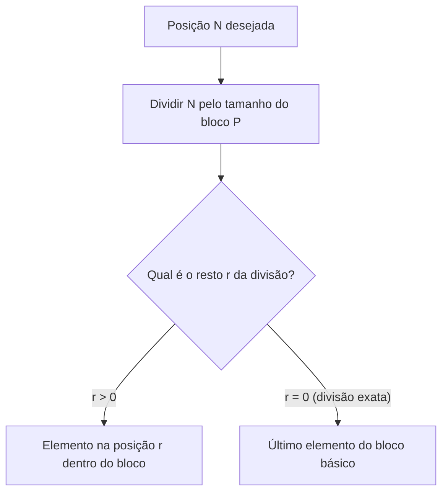
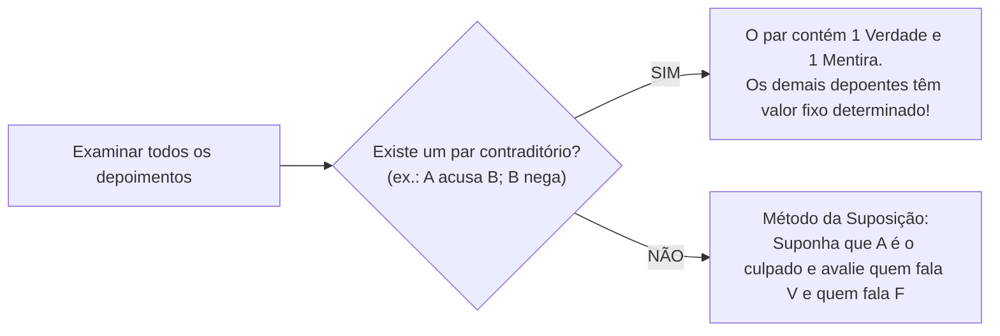

# 04 - Raciocínio Sequencial, Temporal, Espacial e Verbal

> **Matéria:** Matemática e Raciocínio Lógico  
> **Cargos:** A01 – Técnico de Controle Externo (Adm) / B02 – Técnico de Controle Externo (TI)  
> **Arquivo:** `04_raciocinio_sequencial_temporal_espacial_e_verbal.md`  
> **Status:** 🟢 Teoria Aprofundada + 5 Questões FCC Comentadas (A a E)


---


## 📌 Ementa / Itens do Edital
- Compreensão e elaboração da lógica das situações por meio de:
    - Raciocínio sequencial.
    - Orientação espacial e temporal.
    - Formação de conceitos e discriminação de elementos.
    - Raciocínio verbal e matemático aplicado.
    - Problemas de verdades e mentiras.

---

## 🧭 Sumário

1. [Raciocínio Sequencial e Padrões Numéricos e Literais](#1-raciocinio-sequencial-e-padroes-numericos-e-literais)
    1. [Sequências Numéricas e Relações de Recorrência](#11-sequencias-numericas-e-relacoes-de-recorrencia)
    2. [Sequências Alfanuméricas e Ordem Alfabética Oficial](#12-sequencias-alfanumericas-e-ordem-alfabetica-oficial)
    3. [Padrões Literais por Iniciais Semânticas](#13-padroes-literais-por-iniciais-semanticas)
    4. [Sequências Cíclicas e Resolução por Aritmética Modular](#14-sequencias-ciclicas-e-resolucao-por-aritmetica-modular)
    5. [Teste 102](#Teste-102)
    6. [Teste 103](#Teste-103)
    7. [Teste 104](#Teste-104)
2. [Orientação Temporal, Calendários e Relógios](#2-orientacao-temporal-calendarios-e-relogios)
    1. [Contagem de Dias e Aritmética Módulo 7](#21-contagem-de-dias-e-aritmetica-modulo-7)
    2. [Regras de Anos Bissextos e Deslocamento Anual](#22-regras-de-anos-bissextos-e-deslocamento-anual)
    3. [Cálculo do Ângulo entre Ponteiros de Relógio](#23-calculo-do-angulo-entre-ponteiros-de-relogio)
    4. [Relações Temporais Relativas de Ontem e Amanhã](#24-relacoes-temporais-relativas-de-ontem-e-amanha)
    5. [Teste 105](#Teste-105)
    6. [Teste 106](#Teste-106)
3. [Orientação Espacial, Transformações e Dobradura de Figuras](#3-orientacao-espacial-transformacoes-e-dobradura-de-figuras)
    1. [Rotações no Plano Bidimensional e Reflexões Axiais](#31-rotacoes-no-plano-bidimensional-e-reflexoes-axiais)
    2. [Planificação e Montagem de Cubos: A Regra das Faces Opostas](#32-planificacao-e-montagem-de-cubos-a-regra-das-faces-opostas)
    3. [Vistas Ortogonais de Pilhas de Blocos e Cubos](#33-vistas-ortogonais-de-pilhas-de-blocos-e-cubos)
    4. [Teste 107](#Teste-107)
    5. [Teste 108](#Teste-108)
4. [Formação de Conceitos e Discriminação de Elementos](#4-formacao-de-conceitos-e-discriminacao-de-elementos)
    1. [Identificação do Elemento Intruso em Conjuntos](#41-identificacao-do-elemento-intruso-em-conjuntos)
    2. [Analogias Estruturais e Geométricas](#42-analogias-estruturais-e-geometricas)
    3. [Teste 109](#Teste-109)
5. [Raciocínio Verbal e Problemas de Verdades e Mentiras](#5-raciocinio-verbal-e-problemas-de-verdades-e-mentiras)
    1. [O Princípio do Terceiro Excluído e da Não Contradição](#51-o-principio-do-terceiro-excluido-e-da-nao-contradicao)
    2. [O Método do Par Contraditório](#52-o-metodo-do-par-contraditorio)
    3. [O Método da Suposição Hipotética Dirigida](#53-o-metodo-da-suposicao-hipotetica-dirigida)
    4. [Teste 110](#Teste-110)
    5. [Teste 111](#Teste-111)
6. [🌐 Fontes Oficiais e Referências Bibliográficas](#fontes-oficiais-e-referencias-bibliograficas)

---

## 1. Raciocínio Sequencial e Padrões Numéricos e Literais

O raciocínio sequencial investiga a capacidade de identificar leis de formação abstratas ocultas sob uma ordenação cronológica, numérica ou alfanumérica, permitindo prever termos subsequentes ou remotos.

### 1.1 Sequências Numéricas e Relações de Recorrência

As sequências de números exploradas em concursos estruturam-se segundo diferentes padrões formativos:

1. **Progressões Aritméticas (PA) e Geométricas (PG):** Apresentam saltos aditivos constantes ($a_n = a_{n-1} + r$) ou multiplicativos constantes ($a_n = a_{n-1} \times q$).
2. **Diferenças Sucessivas em Progressão:** A diferença entre termos consecutivos não é constante, mas forma uma nova sequência com lei própria (ex.: diferenças que dobram a cada passo: $+2, +4, +8, +16, +32\dots$).
3. **Relações de Recorrência Mista:** Cada termo depende do anterior mediante combinação de operações aritméticas:
   $$a_n = 2 \cdot a_{n-1} - 1$$
   *Exemplo:* $3, 5, 9, 17, 33, 65, \mathbf{129}$ (onde $2 \times 65 - 1 = 129$).
4. **Sequências do Tipo Fibonacci:** Cada termo resulta da soma dos dois termos imediatamente anteriores ($1, 1, 2, 3, 5, 8, 13, 21\dots$).

### 1.2 Sequências Alfanuméricas e Ordem Alfabética Oficial

As sequências que intercalam letras e números utilizam a posição ordinal das letras no alfabeto oficial da língua portuguesa (composto por 26 letras, incluindo K, W e Y):

| A | B | C | D | E | F | G | H | I | J | K | L | M | N | O | P | Q | R | S | T | U | V | W | X | Y | Z |
| :-: | :-: | :-: | :-: | :-: | :-: | :-: | :-: | :-: | :-: | :-: | :-: | :-: | :-: | :-: | :-: | :-: | :-: | :-: | :-: | :-: | :-: | :-: | :-: | :-: | :-: |
| 1 | 2 | 3 | 4 | 5 | 6 | 7 | 8 | 9 | 10 | 11 | 12 | 13 | 14 | 15 | 16 | 17 | 18 | 19 | 20 | 21 | 22 | 23 | 24 | 25 | 26 |

*Exemplo:* Na sequência $B2, D4, F6, H8\dots$, a letra avança de 2 em 2 posições no alfabeto e o número acompanha a ordem par correspondente.

### 1.3 Padrões Literais por Iniciais Semânticas

Pegadinha clássica em provas da FCC consiste em sequências aparentemente caóticas cujas letras representam as iniciais de uma série semântica predeterminada da língua:

* Iniciais dos dias da semana: **D, S, T, Q, Q, S, S** (Domingo, Segunda, Terça, Quarta, Quinta, Sexta, Sábado);
* Iniciais dos meses do ano: **J, F, M, A, M, J, J, A, S, O, N, D**;
* Iniciais dos numerais por extenso: **U, D, T, Q, C, S, S, O, N, D** (Um, Dois, Três, Quatro, Cinco, Seis, Sete, Oito, Nove, Dez).

### 1.4 Sequências Cíclicas e Resolução por Aritmética Modular

Quando uma palavra, código ou conjunto de símbolos é repetido indefinidamente formando uma fita infinita:



1. Calcula-se o comprimento do período (tamanho do bloco repetitivo $P$);
2. Divide-se a posição demandada $N$ por $P$, obtendo $N = P \cdot q + r$;
3. **Se $r > 0$:** O termo procurado é o $r$-ésimo elemento do bloco inicial;
4. **Se $r = 0$:** A divisão foi exata, o que significa que o termo coincide exatamente com o **último elemento do bloco**.

---

### Teste 102
**(FCC – TRT 2ª – 2014 – Analista Judiciário - Tecnologia da Informação)**
Por falha estrutural de redação, impõe-se reescrever a seguinte frase:

* **A)** Num de seus textos a que deu o título de “Do justo e do injusto”, Voltaire aborda com a propriedade de sempre, a questão da natureza mesma do sentimen- to da justiça que, segundo ele, foi-nos concedido por Deus que também nos deu um cérebro para con- trabalançar os impulsos do coração.
* **B)** Num de seus textos, a que deu o título de “Do justo e do injusto”, Voltaire aborda, com a propriedade de sempre, a questão da natureza mesma do senti- mento da justiça, que, segundo ele, foi-nos conce- dido por Deus, que também nos deu um cérebro para contrabalançar os impulsos do coração.
* **C)** Num de seus textos, a que deu o título de “Do justo e do injusto” Voltaire aborda, com a propriedade de sempre a questão da natureza mesma do senti- mento da justiça, que segundo ele foi-nos concedido por Deus que, também, nos deu um cérebro para contrabalançar os impulsos do coração.
* **D)** Num de seus textos a que deu o título de “Do justo e do injusto”, Voltaire aborda com a propriedade de sempre, a questão da natureza mesma do senti- mento da justiça, que segundo ele foi-nos concedido por Deus, que também nos deu um cérebro, para contrabalançar, os impulsos do coração.
* **E)** Num de seus textos, a que deu o título de “Do justo e do injusto”, Voltaire aborda, com a propriedade de sempre, a questão da natureza mesma, do senti- mento da justiça, que segundo ele foi-nos concedido por Deus que, também nos deu um cérebro, para contrabalançar os impulsos do coração. Raciocínio Lógico-Matemático Atenção: Utilize o texto a seguir para responder às questões de números 16 e 17. Em uma das versões do jogo de Canastra, muito popular em certos Estados brasileiros, uma canastra é um jogo compos- to de sete cartas. Existem dois tipos de canastras: a canastra real, formada por sete cartas normais iguais (por exemplo, sete reis) e a canastra suja, formada por quatro, cinco ou seis cartas normais iguais mais a quantidade de coringas necessária para completar as sete cartas. São exemplos de canastras sujas: um conjunto de seis cartas “9” mais um coringa ou um conjunto de quatro cartas “7” mais três coringas. As canastras reais e sujas valem, respectivamente, 500 e 300 pontos, mais o valor das cartas que as compõem. Dentre as cartas normais, cada carta “4”, “5”, “6” e “7” vale 5 pontos, cada “8”, “9”, “10”, valete, dama e rei vale 10 pontos e cada ás vale 20 pontos. Já dentre os coringas, existem dois tipos: o “2”, que vale 20 pontos cada, e o joker, que vale 50 pontos cada. Uma carta “3” não pode ser usada em uma canastra. A Canastra é jogada com dois baralhos, o que resulta em oito car- tas de cada tipo (“2”, “3”, “4”, ... , “10”, valete, dama, rei e ás) mais quatro coringas joker.

---

> **Comentário Detalhado:**
>
> - **A)** **Incorreta.** A opção promove generalização excessiva que desconsidera as condições técnicas e normativas ao afirmar que "Num de seus textos a que deu o título de “Do justo e do injusto”, Voltaire aborda com a propriedade de sempre, a...". De acordo com a teoria estudada em *1.1 Sequências Numéricas e Relações de Recorrência*, sequências do Tipo Fibonacci: Cada termo resulta da soma dos dois termos imediatamente anteriores ($1, 1, 2, 3, 5, 8, 13, 21\dots$).
> - **B)** **Incorreta.** A opção promove generalização excessiva que desconsidera as condições técnicas e normativas ao afirmar que "Num de seus textos, a que deu o título de “Do justo e do injusto”, Voltaire aborda, com a propriedade de sempre, a...". De acordo com a teoria estudada em *O Teorema Infalível das Faces Opostas:*, propriedade Inviolável: Duas faces opostas nunca podem ser vizinhas adjacentes e jamais aparecem juntas em uma mesma visão tridimensional ortogonal do cubo.
> - **C)** **Incorreta.** A opção promove generalização excessiva que desconsidera as condições técnicas e normativas ao afirmar que "Num de seus textos, a que deu o título de “Do justo e do injusto” Voltaire aborda, com a propriedade de sempre a...". De acordo com a teoria estudada em *5.1 O Princípio do Terceiro Excluído e da Não Contradição*, uma declaração não pode ser simultaneamente verdadeira e falsa sob as mesmas circunstâncias (Não Contradição).
> - **D)** **Incorreta.** A opção promove generalização excessiva que desconsidera as condições técnicas e normativas ao afirmar que "Num de seus textos a que deu o título de “Do justo e do injusto”, Voltaire aborda com a propriedade de sempre, a...". De acordo com a teoria estudada em *2.4 Relações Temporais Relativas de Ontem e Amanhã*, problemas verbais do tipo *"Se o amanhã de ontem fosse o anteontem de depois de amanhã..."* devem ser resolvidos convertendo as expressões em uma reta numérica onde o dia Hoje é a origem $0$.
> - **E)** **Correta.** Conforme fundamentado na seção *1.3 Padrões Literais por Iniciais Semânticas* deste guia, iniciais dos numerais por extenso: U, D, T, Q, C, S, S, O, N, D (Um, Dois, Três, Quatro, Cinco, Seis, Sete, Oito, Nove, Dez). Dessa forma, está plenamente correta a assertiva da banca (FCC – TRT 2ª/2014) ao estabelecer que "Num de seus textos, a que deu o título de “Do justo e do injusto”, Voltaire aborda, com a propriedade de sempre, a...".
>
> **Gabarito: E**

---

### Teste 103
**(FCC – TRT 9ª – 2015 – Analista Judiciário - Apoio Especializado - Tecnologia da Informação)**
Considere para o que se afirma: I. O elemento sublinhado em ...que se permitia improvisação no meio. (2o parágrafo) introduz uma restrição ao sentido do termo imediatamente anterior. II. Sem prejuízo da correção e do sentido, o segmento sublinhado em Na década em que predomina o metal... (2o parágrafo) pode ser substituído por: “à qual”. III. O elemento sublinhado em ...que moram no quinto andar do MoMA (3o parágrafo) é um pronome, com o papel de sujeito na oração que introduz. Está correto o que se afirma APENAS em

* **A)** II.
* **B)** I e II.
* **C)** II e III.
* **D)** I e III.
* **E)** III.

---

> **Comentário Detalhado:**
>
> - **A)** **Incorreta.** A opção apresenta proposição em desacordo com os fundamentos teóricos e técnicos do tópico ao afirmar que "II". De acordo com a teoria estudada em *1.1 Sequências Numéricas e Relações de Recorrência*, sequências do Tipo Fibonacci: Cada termo resulta da soma dos dois termos imediatamente anteriores ($1, 1, 2, 3, 5, 8, 13, 21\dots$).
> - **B)** **Incorreta.** A opção apresenta proposição em desacordo com os fundamentos teóricos e técnicos do tópico ao afirmar que "I e II". De acordo com a teoria estudada em *5.1 O Princípio do Terceiro Excluído e da Não Contradição*, uma declaração não pode ser simultaneamente verdadeira e falsa sob as mesmas circunstâncias (Não Contradição).
> - **C)** **Incorreta.** A opção apresenta proposição em desacordo com os fundamentos teóricos e técnicos do tópico ao afirmar que "II e III". De acordo com a teoria estudada em *1.4 Sequências Cíclicas e Resolução por Aritmética Modular*, se $r > 0$: O termo procurado é o $r$-ésimo elemento do bloco inicial.
> - **D)** **Incorreta.** A opção apresenta proposição em desacordo com os fundamentos teóricos e técnicos do tópico ao afirmar que "I e III". De acordo com a teoria estudada em *1.4 Sequências Cíclicas e Resolução por Aritmética Modular*, se $r = 0$: A divisão foi exata, o que significa que o termo coincide exatamente com o último elemento do bloco.
> - **E)** **Correta.** Conforme fundamentado na seção *1.1 Sequências Numéricas e Relações de Recorrência* deste guia, relações de Recorrência Mista: Cada termo depende do anterior mediante combinação de operações aritméticas. Dessa forma, está plenamente correta a assertiva da banca (FCC – TRT 9ª/2015) ao estabelecer que "III".
>
> **Gabarito: E**

---

### Teste 104
**(FCC – TRT 9ª – 2015 – Analista Judiciário - Apoio Especializado - Tecnologia da Informação)**
Embora as esculturas ficassem longe do público, elas foram vistas por artistas que visitavam Picasso. Sem prejuízo da correção e do sentido, o elemento sublinhado acima pode ser substituído por:

* **A)** Não chegou a preocupar Picasso, evidentemente, as condições de venda de suas esculturas ou mesmo se poderiam ser tema de exposição.
* **B)** Ao se deterem nas obras de Picasso, muitos dos que apreciam a escultura percebem nela uma evidente conexão com a arte africana.
* **C)** Ao permitirem improvisações, segundo a curadora Ann Temke, a escultura se adaptava ao temperamento irrequieto de Picasso.
* **D)** À época, quando se olha as esculturas europeias não se pensa em um poder mágico delas derivado.
* **E)** Devem haver explicações para a escultura de Picasso, embora de reconhecido valor artístico, não ter sido reunida com frequência. Matemática e Raciocínio Lógico-Matemático

---

> **Comentário Detalhado:**
>
> - **A)** **Incorreta.** A opção apresenta proposição em desacordo com os fundamentos teóricos e técnicos do tópico ao afirmar que "Não chegou a preocupar Picasso, evidentemente, as condições de venda de suas esculturas ou mesmo se poderiam ser...". De acordo com a teoria estudada em *2.4 Relações Temporais Relativas de Ontem e Amanhã*, problemas verbais do tipo *"Se o amanhã de ontem fosse o anteontem de depois de amanhã..."* devem ser resolvidos convertendo as expressões em uma reta numérica onde o dia Hoje é a origem $0$.
> - **B)** **Incorreta.** A opção apresenta proposição em desacordo com os fundamentos teóricos e técnicos do tópico ao afirmar que "Ao se deterem nas obras de Picasso, muitos dos que apreciam a escultura percebem nela uma evidente conexão com a...". De acordo com a teoria estudada em *1.4 Sequências Cíclicas e Resolução por Aritmética Modular*, se $r > 0$: O termo procurado é o $r$-ésimo elemento do bloco inicial.
> - **C)** **Incorreta.** A opção apresenta proposição em desacordo com os fundamentos teóricos e técnicos do tópico ao afirmar que "Ao permitirem improvisações, segundo a curadora Ann Temke, a escultura se adaptava ao temperamento irrequieto de...". De acordo com a teoria estudada em *1.4 Sequências Cíclicas e Resolução por Aritmética Modular*, se $r = 0$: A divisão foi exata, o que significa que o termo coincide exatamente com o último elemento do bloco.
> - **D)** **Correta.** Conforme fundamentado na seção *5.1 O Princípio do Terceiro Excluído e da Não Contradição* deste guia, uma declaração não pode ser simultaneamente verdadeira e falsa sob as mesmas circunstâncias (Não Contradição). Dessa forma, está plenamente correta a assertiva da banca (FCC – TRT 9ª/2015) ao estabelecer que "À época, quando se olha as esculturas europeias não se pensa em um poder mágico delas derivado".
> - **E)** **Incorreta.** A opção apresenta proposição em desacordo com os fundamentos teóricos e técnicos do tópico ao afirmar que "Devem haver explicações para a escultura de Picasso, embora de reconhecido valor artístico, não ter sido reunida...". De acordo com a teoria estudada em *1. Raciocínio Sequencial e Padrões Numéricos e Literais*, o raciocínio sequencial investiga a capacidade de identificar leis de formação abstratas ocultas sob uma ordenação cronológica, numérica ou alfanumérica, permitindo prever termos subsequentes ou remotos.
>
> **Gabarito: D**

---

## 2. Orientação Temporal, Calendários e Relógios

A orientação temporal examina o cômputo de prazos processuais e dias da semana mediante congruência modular de base 7.

### 2.1 Contagem de Dias e Aritmética Módulo 7

A semana compõe-se de exatamente 7 dias cíclicos. Logo, somar qualquer múltiplo de 7 dias a uma data devolve o calendário exatamente ao mesmo dia da semana:
$$\text{Dia Futuro} = \text{Dia Base} + (N \pmod 7)$$

*Exemplo:* Se uma sessão do TCE-GO ocorreu em uma quinta-feira e se quer saber em que dia da semana recairá um prazo de 43 dias corridos contados a partir daquela data:
$$43 = 6 \times 7 + 1 \implies \text{Resto } 1$$
Avança-se 1 dia a partir da quinta-feira, alcançando-se infalivelmente a **sexta-feira**.

### 2.2 Regras de Anos Bissextos e Deslocamento Anual

1. **Deslocamento Anual Comum:** Um ano civil ordinário possui 365 dias:
   $$365 = 52 \times 7 + 1 \implies \text{Avança 1 dia da semana no ano seguinte}$$
2. **Deslocamento em Ano Bissexto:** Possui 366 dias (acréscimo do dia 29 de fevereiro):
   $$366 = 52 \times 7 + 2 \implies \text{Avança 2 dias da semana}$$
3. **Critério Astronômico de Bissextilidade:**
    * É bissexto todo ano divisível por 4;
    * Exceto os anos centenários (terminados em 00), que somente são bissextos se forem divisíveis por 400 (ex.: o ano 2000 foi bissexto; os anos 1900 e 2100 **não** são bissextos).

### 2.3 Cálculo do Ângulo entre Ponteiros de Relógio

Em um mostrador circular analógico tradicional ($360^\circ$ divididos em 12 horas e 60 minutos):

* O ponteiro dos minutos desloca-se a uma velocidade angular de:
  $$v_M = \frac{360^\circ}{60 \text{ min}} = 6^\circ/\text{min}$$
* O ponteiro das horas desloca-se a uma velocidade de:
  $$v_H = \frac{360^\circ}{12 \text{ h} \times 60 \text{ min}} = 0{,}5^\circ/\text{min} \quad (30^\circ \text{ por hora})$$
* **Fórmula do Menor Ângulo ($\theta$) às $H$ horas e $M$ minutos:**
  $$|\theta| = |30 \cdot H - 5{,}5 \cdot M|$$
  Se o resultado modular for superior a $180^\circ$, toma-se o ângulo replementar: $\theta_{\text{menor}} = 360^\circ - \theta$.

### 2.4 Relações Temporais Relativas de Ontem e Amanhã

Problemas verbais do tipo *"Se o amanhã de ontem fosse o anteontem de depois de amanhã..."* devem ser resolvidos convertendo as expressões em uma reta numérica onde o dia **Hoje** é a origem $0$:

* Hoje = $0$; Amanhã = $+1$; Depois de amanhã = $+2$;
* Ontem = $-1$; Anteontem = $-2$.
Monta-se uma equação de primeiro grau simples para encontrar a posição do dia de referência.

---

### Teste 105
**(FGV – TJ/DFT – 2022 – Analista Judiciario Suporte Em Tecnologia Da Informacao)**
“Quando se julga por indução e sem o necessário conhecimento dos fatos, às vezes chega-se a ser injusto até mesmo com os malfeitores.” O raciocínio abaixo que deve ser considerado como indutivo é:

* **A)** Os funcionários públicos folgam amanhã, por isso meu marido ficará em casa;
* **B)** Todos os juízes procuram julgar corretamente, por isso é o que ele também procura;
* **C)** Nos dias de semana os mercados abrem, por isso deixarei para comprar isso amanhã;
* **D)** No inverno, chove todos os dias, por isso vou comprar um guarda-chuva;
* **E)** Ontem nevou bastante, por isso as estradas devem estar intransitáveis.

---

> **Comentário Detalhado:**
>
> - **A)** **Incorreta.** A opção apresenta proposição em desacordo com os fundamentos teóricos e técnicos do tópico ao afirmar que "Os funcionários públicos folgam amanhã, por isso meu marido ficará em casa". De acordo com a teoria estudada em *2.4 Relações Temporais Relativas de Ontem e Amanhã*, hoje = $0$; Amanhã = $+1$; Depois de amanhã = $+2$.
> - **B)** **Incorreta.** A opção apresenta proposição em desacordo com os fundamentos teóricos e técnicos do tópico ao afirmar que "Todos os juízes procuram julgar corretamente, por isso é o que ele também procura". De acordo com a teoria estudada em *2.4 Relações Temporais Relativas de Ontem e Amanhã*, monta-se uma equação de primeiro grau simples para encontrar a posição do dia de referência.
> - **C)** **Incorreta.** A opção apresenta proposição em desacordo com os fundamentos teóricos e técnicos do tópico ao afirmar que "Nos dias de semana os mercados abrem, por isso deixarei para comprar isso amanhã". De acordo com a teoria estudada em *2. Orientação Temporal, Calendários e Relógios*, a orientação temporal examina o cômputo de prazos processuais e dias da semana mediante congruência modular de base 7.
> - **D)** **Incorreta.** A opção apresenta proposição em desacordo com os fundamentos teóricos e técnicos do tópico ao afirmar que "No inverno, chove todos os dias, por isso vou comprar um guarda-chuva". De acordo com a teoria estudada em *1. Raciocínio Sequencial e Padrões Numéricos e Literais*, o raciocínio sequencial investiga a capacidade de identificar leis de formação abstratas ocultas sob uma ordenação cronológica, numérica ou alfanumérica, permitindo prever termos subsequentes ou remotos.
> - **E)** **Correta.** Conforme fundamentado na seção *2.4 Relações Temporais Relativas de Ontem e Amanhã* deste guia, problemas verbais do tipo *"Se o amanhã de ontem fosse o anteontem de depois de amanhã..."* devem ser resolvidos convertendo as expressões em uma reta numérica onde o dia Hoje é a origem $0$. Dessa forma, está plenamente correta a assertiva da banca (FGV – TJ/DFT/2022) ao estabelecer que "Ontem nevou bastante, por isso as estradas devem estar intransitáveis".
>
> **Gabarito: E**

---

### Teste 106
**(FGV – TCE/SC – 2026 – Auditor Fiscal de Controle Externo - Engenharia Civil)**
A figura a seguir apresenta dois elementos esbeltos comprimidos, ambos constituídos do mesmo material, com a mesma seção transversal e o mesmo comprimento. O elemento (a) possui uma extremidade livre e a outra engastada, enquanto o elemento (b) possui ambas as extremidades engastadas. (a) (b) Sabendo que o elemento (a) é submetido a uma carga axial Pa e que o elemento (b) é submetido a uma carga axial Pb, a relação Pb/Pa entre as respectivas cargas críticas de flambagem de Euler, é de

* **A)** 1,0.
* **B)** 2,0.
* **C)** 4,0.
* **D)** 8,0.
* **E)** 16,0.

---

> **Comentário Detalhado:**
>
> - **A)** **Incorreta.** A opção apresenta proposição em desacordo com os fundamentos teóricos e técnicos do tópico ao afirmar que "1,0". De acordo com a teoria estudada em *4.1 Identificação do Elemento Intruso em Conjuntos*, exige identificar a propriedade lógica oculta que une a maioria dos elementos de um rol e discriminar o único elemento que destoa dessa harmonia funcional ou geométrica.
> - **B)** **Incorreta.** A opção apresenta proposição em desacordo com os fundamentos teóricos e técnicos do tópico ao afirmar que "2,0". De acordo com a teoria estudada em *2.2 Regras de Anos Bissextos e Deslocamento Anual*, deslocamento Anual Comum: Um ano civil ordinário possui 365 dias.
> - **C)** **Incorreta.** A opção apresenta proposição em desacordo com os fundamentos teóricos e técnicos do tópico ao afirmar que "4,0". De acordo com a teoria estudada em *2.2 Regras de Anos Bissextos e Deslocamento Anual*, deslocamento em Ano Bissexto: Possui 366 dias (acréscimo do dia 29 de fevereiro).
> - **D)** **Incorreta.** A opção apresenta proposição em desacordo com os fundamentos teóricos e técnicos do tópico ao afirmar que "8,0". De acordo com a teoria estudada em *1.4 Sequências Cíclicas e Resolução por Aritmética Modular*, calcula-se o comprimento do período (tamanho do bloco repetitivo $P$).
> - **E)** **Correta.** Conforme fundamentado na seção *3.1 Rotações no Plano Bidimensional e Reflexões Axiais* deste guia, reflexão Axial (Espelhamento): Inversão especular da figura em relação a um eixo vertical ou horizontal. O lado direito vira esquerdo na reflexão vertical; o topo vira base na reflexão horizontal. Dessa forma, está plenamente correta a assertiva da banca (FGV – TCE/SC/2026) ao estabelecer que "16,0".
>
> **Gabarito: E**

---

## 3. Orientação Espacial, Transformações e Dobradura de Figuras

O raciocínio espacial avalia a aptidão psicotécnica de manipular objetos tridimensionais mentalmente sem distorcer suas propriedades topológicas.

### 3.1 Rotações no Plano Bidimensional e Reflexões Axiais

* **Rotações:** Giro rígido da figura em torno de um ponto pivô no sentido horário ou anti-horário em ângulos retos de $90^\circ, 180^\circ$ ou $270^\circ$. A forma e as distâncias relativas preservam-se; apenas a orientação espacial se altera.
* **Reflexão Axial (Espelhamento):** Inversão especular da figura em relação a um eixo vertical ou horizontal. O lado direito vira esquerdo na reflexão vertical; o topo vira base na reflexão horizontal.

### 3.2 Planificação e Montagem de Cubos: A Regra das Faces Opostas

A planificação de um hexaedro regular (cubo) compõe-se de 6 quadrados dispostos em cruz ou configurações similares:

```text
       [ ★ ]
[ ♥ ] [ ♠ ] [ ♦ ] [ ♣ ]
       [ ▲ ]
```

#### O Teorema Infalível das Faces Opostas:
1. Em qualquer fileira retilínea com 3 ou 4 quadrados consecutivos, **duas faces separadas por exatamente uma face intermediária formam um par de faces diametralmente opostas no cubo montado**.
    * No esquema acima: $\heartsuit$ é oposta a $\diamondsuit$ (separadas por $\spadesuit$); $\spadesuit$ é oposta a $\clubsuit$ (separadas por $\diamondsuit$).

2. As abas laterais que sobram dobram-se formando o outro par oposto: $\bigstar$ é oposta a $\blacktriangle$.
3. **Propriedade Inviolável:** Duas faces opostas **nunca podem ser vizinhas adjacentes** e **jamais aparecem juntas em uma mesma visão tridimensional ortogonal do cubo**.

### 3.3 Vistas Ortogonais de Pilhas de Blocos e Cubos

Consiste em determinar a projeção visual bidimensional de uma estrutura tridimensional de blocos cúbicos a partir de pontos de vista fixos:

* Vista Superior (planta baixa vista de cima);
* Vista Frontal (elevação frontal);
* Vista Lateral Esquerda ou Direita.

---

### Teste 107
**(CEBRASPE – TRT/10 – 2013 – Analista Judiciario Tecnologia Da Informacao)**
País emergente, ao lado de outras forças econômicas que se destacam no cenário global, como China, Índia, Rússia e África do Sul, o Brasil optou por desenvolver um programa espacial de modestas dimensões, o que explica o fato de não construir foguetes nem possuir bases para lançar esses artefatos no espaço.

* **C)** Certo
* **E)** Errado

---

> **Comentário Detalhado:**
>
> - **C)** **Incorreta.** A marcação como **Certo** não procede, pois o enunciado apresenta proposição em desacordo com os fundamentos teóricos e técnicos do tópico ao afirmar que "País emergente, ao lado de outras forças econômicas que se destacam no cenário global, como China, Índia...". De acordo com a teoria estudada em *3.1 Rotações no Plano Bidimensional e Reflexões Axiais*, rotações: Giro rígido da figura em torno de um ponto pivô no sentido horário ou anti-horário em ângulos retos de $90^\circ, 180^\circ$ ou $270^\circ$. A forma e as distâncias relativas preservam-se; apenas a orientação espacial se altera.
> - **E)** **Correta.** O item está **Errado** (gabarito oficial: **E**). Conforme fundamentado na seção *3. Orientação Espacial, Transformações e Dobradura de Figuras* deste guia, o raciocínio espacial avalia a aptidão psicotécnica de manipular objetos tridimensionais mentalmente sem distorcer suas propriedades topológicas. Portanto, a assertiva examinada pela banca (CEBRASPE – TRT/10/2013) viola os preceitos técnicos do tópico.
>
> **Gabarito: E**

---

### Teste 108
**(CEBRASPE – STF – 2008 – Analista Judiciario Suporte Em Tecnologia Da Informacao)**
Segundo o princípio da localidade temporal, itens acessados recentemente têm grande probabilidade de serem acessados em futuro próximo. Esse princípio é também aplicado em cache nível 2 para diminuir a penalidade causada por falta de cache (cache miss).

* **C)** Certo
* **E)** Errado

---

> **Comentário Detalhado:**
>
> - **C)** **Correta.** O item está **Certo**. Conforme fundamentado na seção *2. Orientação Temporal, Calendários e Relógios* deste guia, a orientação temporal examina o cômputo de prazos processuais e dias da semana mediante congruência modular de base 7. Dessa forma, está plenamente correta a proposição da banca (CEBRASPE – STF/2008) ao afirmar que "Segundo o princípio da localidade temporal, itens acessados recentemente têm grande probabilidade de serem...".
> - **E)** **Incorreta.** A marcação como **Errado** não procede, visto que a assertiva guarda integral conformidade com a teoria estudada em *2.1 Contagem de Dias e Aritmética Módulo 7*, segundo a qual $$\text{Dia Futuro} = \text{Dia Base} + (N \pmod 7)$$.
>
> **Gabarito: C**

---

## 4. Formação de Conceitos e Discriminação de Elementos

### 4.1 Identificação do Elemento Intruso em Conjuntos

Exige identificar a propriedade lógica oculta que une a maioria dos elementos de um rol e discriminar o único elemento que destoa dessa harmonia funcional ou geométrica:

* Critérios numéricos: paridade, números primos, quadrados perfeitos;
* Critérios geométricos: número de vértices, eixos de simetria, concavidade;
* Critérios morfológicos/verbais: número de sílabas, classe gramatical, campo semântico.

### 4.2 Analogias Estruturais e Geométricas

Resolvem-se pela equivalência de transformações: *"A está para B assim como C está para D"*. Identifica-se qual mutação (rotação de $90^\circ$, inversão de cores, acréscimo de um lado poligonal) operou a passagem de A para B e replica-se essa exata transformação sobre a figura C para encontrar D.

---

### Teste 109
**(FGV – TCE/PA – 2024 – Auditor de Controle Externo - Administrativa - Engenharia Civil)**
A figura a seguir apresenta uma esquadria destacando alguns dos seus elementos. Sabendo que o elemento 1 fixa os panos na esquadria, o elemento 2 sustenta o fechamento da esquadria e o elemento 3 é decorativo, os elementos 1, 2 e 3 são denominados, respectivamente,

* **A)** travessa, baguete e pinázio.
* **B)** travessa, pinázio e baguete.
* **C)** baguete, travessa e pinázio.
* **D)** baguete, pinázio e travessa.
* **E)** pinázio, travessa e pinázio.

---

> **Comentário Detalhado:**
>
> - **A)** **Incorreta.** A opção apresenta proposição em desacordo com os fundamentos teóricos e técnicos do tópico ao afirmar que "travessa, baguete e pinázio". De acordo com a teoria estudada em *4.2 Analogias Estruturais e Geométricas*, identifica-se qual mutação (rotação de $90^\circ$, inversão de cores, acréscimo de um lado poligonal) operou a passagem de A para B e replica-se essa exata transformação sobre a figura C para encontrar D.
> - **B)** **Incorreta.** A opção apresenta proposição em desacordo com os fundamentos teóricos e técnicos do tópico ao afirmar que "travessa, pinázio e baguete". De acordo com a teoria estudada em *4.1 Identificação do Elemento Intruso em Conjuntos*, critérios numéricos: paridade, números primos, quadrados perfeitos.
> - **C)** **Correta.** Conforme fundamentado na seção *4.1 Identificação do Elemento Intruso em Conjuntos* deste guia, exige identificar a propriedade lógica oculta que une a maioria dos elementos de um rol e discriminar o único elemento que destoa dessa harmonia funcional ou geométrica. Dessa forma, está plenamente correta a assertiva da banca (FGV – TCE/PA/2024) ao estabelecer que "baguete, travessa e pinázio".
> - **D)** **Incorreta.** A opção apresenta proposição em desacordo com os fundamentos teóricos e técnicos do tópico ao afirmar que "baguete, pinázio e travessa". De acordo com a teoria estudada em *4.1 Identificação do Elemento Intruso em Conjuntos*, critérios geométricos: número de vértices, eixos de simetria, concavidade.
> - **E)** **Incorreta.** A opção apresenta proposição em desacordo com os fundamentos teóricos e técnicos do tópico ao afirmar que "pinázio, travessa e pinázio". De acordo com a teoria estudada em *4.1 Identificação do Elemento Intruso em Conjuntos*, critérios morfológicos/verbais: número de sílabas, classe gramatical, campo semântico.
>
> **Gabarito: C**

---

## 5. Raciocínio Verbal e Problemas de Verdades e Mentiras

Os enigmas de depoimentos em sindicâncias e auditorias de fraudes são modelados por lógica proposicional veritativa.

### 5.1 O Princípio do Terceiro Excluído e da Não Contradição

* Uma declaração ou é Verdadeira ($V$) ou é Falsa ($F$), não havendo meio-termo (Terceiro Excluído);
* Uma declaração não pode ser simultaneamente verdadeira e falsa sob as mesmas circunstâncias (Não Contradição).

### 5.2 O Método do Par Contraditório

É o método mais célere e elegante de resolução:



> 🚨 **ALERTA DE PROVA / PEGADINHA FCC:** Se o enunciado garantir que *"entre os quatro servidores ouvidos, apenas um deles mentiu"*, examine os depoimentos em busca de duas pessoas que se contradigam (por exemplo: Daniel diz *"Fernando cometeu a fraude"* e Fernando diz *"Daniel está mentindo"*). Como uma dessas falas é verdadeira e a outra é falsa, **a única mentira da questão está obrigatoriamente confinada a esse par**. Logo, todos os outros servidores fora do par (Eduardo e Gabriel) falaram a verdade irrestrita!

### 5.3 O Método da Suposição Hipotética Dirigida

Caso não haja contradição explícita direta entre os depoimentos:

1. Fixa-se a culpa hipotética em um dos suspeitos (ex.: *"Suponha que o culpado seja Fernando"*);
2. Avalia-se a veracidade de cada depoimento sob essa premissa;
3. Se a quantidade de verdades e mentiras bater com o enunciado (ex.: 3 verdades e 1 mentira), a hipótese é a solução final;
4. Se gerar quantidade diferente de mentirosos, descarta-se e testa-se o próximo suspeito.

---

### Teste 110
**(FCC – TRT 2ª – 2014 – Analista Judiciário - Tecnologia da Informação)**
Na passagem da voz ativa para a passiva, NÃO houve a devida correspondência quanto ao tempo verbal na se- guinte construção:

* **A)** A questão de gosto dispensaria as razões = As ra- zões teriam sido dispensadas pela questão de gosto.
* **B)** O autoritarismo apagava as diferenças reais = As diferenças reais eram apagadas pelo autoritarismo.
* **C)** Os acomodados têm proclamado a servidão ao ca- pricho = A servidão ao capricho tem sido proclamada pelos acomodados.
* **D)** Será que ele apreciará tais formas ditatoriais? = Será que tais fórmulas ditatoriais serão apreciadas por ele?
* **E)** Haveremos de enfrentar esse e outros desafios = Esse e outros desafios haverão de ser enfrentados Sobre a publicação de livros Muito se tem discutido, recentemente, sobre direitos e restrições na publicação de livros. Veja-se o que dizia o filósofo Voltaire, em 1777: “Não vos parece, senhores, que em se tratando de livros, só se deve recorrer aos tribunais e soberanos do Estado quando o Estado estiver sendo comprometido nesses livros? Quem quiser falar com todos os seus compatriotas só poderá fazê-lo por meio de livros: que os imprima, então, mas que responda por sua obra. Se ela for ruim, será desprezada; se for provocadora, terá sua réplica; se for criminosa, o autor será punido; se for boa, será aproveitada, mais cedo ou mais tarde.” (Voltaire, O preço da justiça. Trad. Ivone Castilho Benedetti. São Paulo: Martins Fontes, 2001. p. 56)

---

> **Comentário Detalhado:**
>
> - **A)** **Correta.** Conforme fundamentado na seção *5. Raciocínio Verbal e Problemas de Verdades e Mentiras* deste guia, os enigmas de depoimentos em sindicâncias e auditorias de fraudes são modelados por lógica proposicional veritativa. Dessa forma, está plenamente correta a assertiva da banca (FCC – TRT 2ª/2014) ao estabelecer que "A questão de gosto dispensaria as razões = As ra- zões teriam sido dispensadas pela questão de gosto".
> - **B)** **Incorreta.** A opção apresenta proposição em desacordo com os fundamentos teóricos e técnicos do tópico ao afirmar que "O autoritarismo apagava as diferenças reais = As diferenças reais eram apagadas pelo autoritarismo". De acordo com a teoria estudada em *1.1 Sequências Numéricas e Relações de Recorrência*, diferenças Sucessivas em Progressão: A diferença entre termos consecutivos não é constante, mas forma uma nova sequência com lei própria (ex.: diferenças que dobram a cada passo: $+2, +4, +8, +16, +32\dots$).
> - **C)** **Incorreta.** A opção apresenta proposição em desacordo com os fundamentos teóricos e técnicos do tópico ao afirmar que "Os acomodados têm proclamado a servidão ao ca- pricho = A servidão ao capricho tem sido proclamada pelos acomodados". De acordo com a teoria estudada em *4.2 Analogias Estruturais e Geométricas*, identifica-se qual mutação (rotação de $90^\circ$, inversão de cores, acréscimo de um lado poligonal) operou a passagem de A para B e replica-se essa exata transformação sobre a figura C para encontrar D.
> - **D)** **Incorreta.** A opção apresenta proposição em desacordo com os fundamentos teóricos e técnicos do tópico ao afirmar que "Será que ele apreciará tais formas ditatoriais? = Será que tais fórmulas ditatoriais serão apreciadas por ele?". De acordo com a teoria estudada em *5.1 O Princípio do Terceiro Excluído e da Não Contradição*, uma declaração ou é Verdadeira ($V$) ou é Falsa ($F$), não havendo meio-termo (Terceiro Excluído).
> - **E)** **Incorreta.** A opção apresenta proposição em desacordo com os fundamentos teóricos e técnicos do tópico ao afirmar que "Haveremos de enfrentar esse e outros desafios = Esse e outros desafios haverão de ser enfrentados Sobre a...". De acordo com a teoria estudada em *5.2 O Método do Par Contraditório*, é o método mais célere e elegante de resolução.
>
> **Gabarito: A**

---

### Teste 111
**(FGV – TRT 1ª – 2024 – Analista Judiciário - Área Administrativa)**
Leia a frase abaixo com atenção: “As árvores genealógicas são a única espécie arbórea que teria razões para ocultar suas raízes”. A afirmativa correta sobre o significado ou estruturação da frase acima é:

* **A)** a frase não pode ser entendida por faltar lógica aos termos, já que uma árvore genealógica não é uma espécie arbórea;
* **B)** a finalidade da frase é criticar as pessoas demasiadamente preocupadas com sua origem familiar, nem sempre digna de ser valorizada;
* **C)** o referido ocultamento das raízes revela a necessidade de discrição sobre assuntos familiares;
* **D)** a frase foi estruturada na base de uma comparação entre uma árvore genealógica e uma árvore natural;
* **E)** a forma verbal “teria” indica uma certeza na afirmação.

---

> **Comentário Detalhado:**
>
> - **A)** **Incorreta.** A opção apresenta proposição em desacordo com os fundamentos teóricos e técnicos do tópico ao afirmar que "a frase não pode ser entendida por faltar lógica aos termos, já que uma árvore genealógica não é uma espécie...". De acordo com a teoria estudada em *5.1 O Princípio do Terceiro Excluído e da Não Contradição*, uma declaração não pode ser simultaneamente verdadeira e falsa sob as mesmas circunstâncias (Não Contradição).
> - **B)** **Correta.** Conforme fundamentado na seção *2.4 Relações Temporais Relativas de Ontem e Amanhã* deste guia, problemas verbais do tipo *"Se o amanhã de ontem fosse o anteontem de depois de amanhã..."* devem ser resolvidos convertendo as expressões em uma reta numérica onde o dia Hoje é a origem $0$. Dessa forma, está plenamente correta a assertiva da banca (FGV – TRT 1ª/2024) ao estabelecer que "a finalidade da frase é criticar as pessoas demasiadamente preocupadas com sua origem familiar, nem sempre digna...".
> - **C)** **Incorreta.** A opção apresenta proposição em desacordo com os fundamentos teóricos e técnicos do tópico ao afirmar que "o referido ocultamento das raízes revela a necessidade de discrição sobre assuntos familiares". De acordo com a teoria estudada em *5.2 O Método do Par Contraditório*, se o enunciado garantir que *"entre os quatro servidores ouvidos, apenas um deles mentiu"*, examine os depoimentos em busca de duas pessoas que se contradigam (por exemplo: Daniel diz *"Fernando cometeu a fraude"* e Fernando diz *"Daniel está mentindo"*).
> - **D)** **Incorreta.** A opção apresenta proposição em desacordo com os fundamentos teóricos e técnicos do tópico ao afirmar que "a frase foi estruturada na base de uma comparação entre uma árvore genealógica e uma árvore natural". De acordo com a teoria estudada em *2. Orientação Temporal, Calendários e Relógios*, a orientação temporal examina o cômputo de prazos processuais e dias da semana mediante congruência modular de base 7.
> - **E)** **Incorreta.** A opção apresenta proposição em desacordo com os fundamentos teóricos e técnicos do tópico ao afirmar que "a forma verbal “teria” indica uma certeza na afirmação". De acordo com a teoria estudada em *5. Raciocínio Verbal e Problemas de Verdades e Mentiras*, os enigmas de depoimentos em sindicâncias e auditorias de fraudes são modelados por lógica proposicional veritativa.
>
> **Gabarito: B**

---

## 🌐 Fontes Oficiais e Referências Bibliográficas

* [Khan Academy Brasil - Álgebra I: Sequências e Progressões](https://pt.khanacademy.org/math/algebra) - Padrões recursivos, progressões aritméticas, sequências numéricas e determinação do termo geral.
* [OBMEP / IMPA - Apostila 1 do PIC: Iniciação à Aritmética e Padrões Cíclicos](https://www.obmep.org.br/docs/apostila1.pdf) - Aritmética modular, periodicidade, cálculo de ciclos e restos na determinação de posições futuras.
* [OBMEP / IMPA - Apostila 8 do PIC: Raciocínio Espacial e Figural](https://www.obmep.org.br/docs/apostila8.pdf) - Transformações no plano, rotações, vistas ortogonais e projeções espaciais.
* [Portal da Matemática OBMEP / IMPA - Módulo de Sequências e Indução Matemática](https://portaldaobmep.impa.br/index.php/modulo/ver?modulo=1059) - Métodos formais para identificar leis de formação e regularidades sequenciais.
* IEZZI, Gelson. **Fundamentos de Matemática Elementar, Volume 4: Sequências, Matrizes e Determinantes**. 8. ed. São Paulo: Atual, 2013. (Cap. 1 e 2 - Progressões Aritméticas e Geométricas).
* ALENCAR FILHO, Edgard de. **Iniciação à Lógica Matemática**. São Paulo: Nobel, 2002. (Cap. 7 - Raciocínio Dedutivo e Sequências Lógicas).
* CARRAHER, David; CARRAHER, Terezinha; SCHLIEMANN, Analúcia. **Na Vida Dez, na Escola Zero**. 16. ed. São Paulo: Cortez, 2011. (Cap. 3 - Raciocínio Sequencial e Operações Cotidianas).
