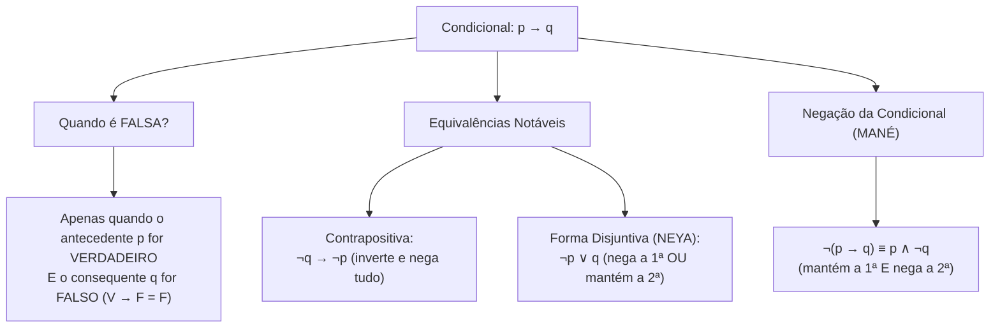
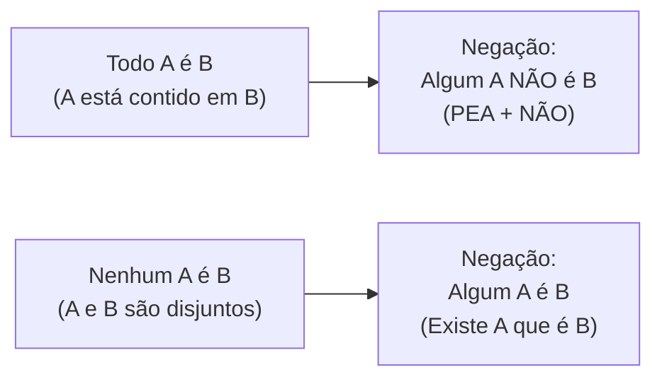

# 05 - Lógica de Argumentação e Conclusões Válidas

> **Matéria:** Matemática e Raciocínio Lógico  
> **Cargos:** A01 – Técnico de Controle Externo (Adm) / B02 – Técnico de Controle Externo (TI)  
> **Arquivo:** `05_logica_de_argumentacao_e_conclusoes_validas.md`  
> **Status:** 🟢 Teoria Aprofundada + 5 Questões FCC Comentadas (A a E)

---

## 📌 Ementa / Itens do Edital
- Compreensão do processo lógico que, a partir de um conjunto de hipóteses, conduz, de forma válida, a conclusões determinadas.
- Proposições lógicas, conectivos e tabelas-verdade.
- Equivalências e negações lógicas.
- Argumentos dedutivos, premissas, conclusão e validade.
- Silogismos categóricos e diagramas lógicos (Todo, Algum, Nenhum).

---

## 🧭 Sumário

1. [Proposições Lógicas, Princípios e Conectivos Fundamentais](#1-proposicoes-logicas-principios-e-conectivos-fundamentais)
    1. [Definição de Proposição e Sentenças Não Proposicionais](#11-definicao-de-proposicao-e-sentencas-nao-proposicionais)
    2. [Os Três Princípios Fundamentais da Lógica Clássica](#12-os-tres-principios-fundamentais-da-logica-classica)
    3. [Conectivos Lógicos e Regras da Tabela-Verdade](#13-conectivos-logicos-e-regras-da-tabela-verdade)
    4. [A Condicional: Peculiaridades e o Caso Falso Único](#14-a-condicional-peculiaridades-e-o-caso-falso-unico)
    5. [Teste 112](#Teste-112)
    6. [Teste 113](#Teste-113)
2. [Álgebra Proposicional: Negações e Equivalências Clássicas](#2-algebra-proposicional-negacoes-e-equivalencias-classicas)
    1. [Leis de De Morgan para Conjunção e Disjunção](#21-leis-de-de-morgan-para-conjuncao-e-disjuncao)
    2. [Negação da Condicional e a Regra do MANÉ](#22-negacao-da-condicional-e-a-regra-do-mane)
    3. [Equivalências Notáveis da Condicional: Contrapositiva e Disjuntiva (NEYA)](#23-equivalencias-notaveis-da-condicional-contrapositiva-e-disjuntiva-neya)
    4. [Tautologias, Contradições e Contingências](#24-tautologias-contradicoes-e-contingencias)
    5. [Teste 114](#Teste-114)
    6. [Teste 115](#Teste-115)
    7. [Teste 116](#Teste-116)
3. [Validade de Argumentos Dedutivos e Regras de Inferência](#3-validade-de-argumentos-dedutivos-e-regras-de-inferencia)
    1. [Estrutura do Argumento: Premissas e Conclusão](#31-estrutura-do-argumento-premissas-e-conclusao)
    2. [Conceito Formal de Validade vs. Verdade Empírica](#32-conceito-formal-de-validade-vs-verdade-empirica)
    3. [Principais Regras de Inferência Válidas](#33-principais-regras-de-inferencia-validas)
    4. [O Método do Encadeamento de Premissas Verdadeiras](#34-o-metodo-do-encadeamento-de-premissas-verdadeiras)
    5. [Teste 117](#Teste-117)
    6. [Teste 118](#Teste-118)
4. [Lógica de Primeira Ordem: Quantificadores e Silogismos Categóricos](#4-logica-de-primeira-ordem-quantificadores-e-silogismos-categoricos)
    1. [Quantificadores Universais e Existenciais: Todo, Nenhum e Algum](#41-quantificadores-universais-e-existenciais-todo-nenhum-e-algum)
    2. [Negação de Proposições Categóricas e a Mnemônica PEA + NÃO](#42-negacao-de-proposicoes-categoricas-e-a-mnemonica-pea-nao)
    3. [Análise de Silogismos via Diagramas de Euler-Venn](#43-analise-de-silogismos-via-diagramas-de-euler-venn)
    4. [Teste 119](#Teste-119)
    5. [Teste 120](#Teste-120)
    6. [Teste 121](#Teste-121)
5. [🌐 Fontes Oficiais e Referências Bibliográficas](#fontes-oficiais-e-referencias-bibliograficas)

---

## 1. Proposições Lógicas, Princípios e Conectivos Fundamentais

A lógica proposicional (ou lógica sentencial) é o ramo da lógica matemática dedicado ao estudo das proposições e dos modos pelos quais estas se combinam para constituir raciocínios dedutivos válidos.

### 1.1 Definição de Proposição e Sentenças Não Proposicionais

* **Proposição Lógica:** Toda oração declarativa com sujeito e predicado expressos que veicula um pensamento completo e à qual se pode atribuir, de forma unívoca, um único valor lógico: **Verdadeiro ($V$)** ou **Falso ($F$)**.
    * Exemplos: *"O TCE-GO fiscaliza as contas municipais"*; *"Goiânia é a capital do Estado de Goiás"*.
* **Sentenças Não Proposicionais (que NÃO são proposições lógicas perante concursos):**
    * Sentenças interrogativas: *"Quem relatou o processo?"*;
    * Sentenças exclamativas: *"Excelente trabalho de auditoria!"*;
    * Sentenças imperativas: *"Instrua os autos imediatamente"*;
    * Sentenças optativas (exprimem desejo): *"Deus o abençoe"*;
    * Sentenças abertas (paradoxo ou incógnita indefinida): *"Ele é auditor fiscal"* (falta definir quem é "ele"); *"$x + 5 = 12$"* (sem o valor de $x$, não é V nem F).

### 1.2 Os Três Princípios Fundamentais da Lógica Clássica

A lógica bivalente aristotélica assenta-se sobre três postulados absolutos:

1. **Princípio da Identidade:** Uma proposição é idêntica a si mesma: se ela é verdadeira, é sempre verdadeira; se é falsa, é sempre falsa ($p \implies p$).
2. **Princípio da Não Contradição:** Uma proposição não pode ser simultaneamente verdadeira e falsa sob as mesmas circunstâncias e no mesmo tempo: $\neg(p \land \neg p)$.
3. **Princípio do Terceiro Excluído:** Uma proposição só pode assumir dois valores lógicos ($V$ ou $F$), excluindo-se qualquer terceiro valor ou estado intermediário.

### 1.3 Conectivos Lógicos e Regras da Tabela-Verdade

As proposições simples combinam-se mediante operadores lógicos (conectivos) para formar proposições compostas. O número de linhas da tabela-verdade de uma proposição composta contendo $n$ proposições simples distintas é sempre dado por:
$$\text{Número de Linhas} = 2^n$$

| Conectivo | Notação Simbólica | Leitura | Condição de Verdade na Tabela-Verdade |
| :--- | :---: | :--- | :--- |
| **Negação** | $\neg p$ ou $\sim p$ | "não p" | Inverte o valor lógico original ($V \rightarrow F$; $F \rightarrow V$). |
| **Conjunção** | $p \land q$ | "p e q" | Só é **VERDADEIRA** se ambas as proposições forem verdadeiras ($V \land V = V$). |
| **Disjunção Inclusiva** | $p \lor q$ | "p ou q" | Só é **FALSA** se ambas as proposições forem falsas ($F \lor F = F$). |
| **Disjunção Exclusiva** | $p \underline{\lor} q$ | "ou p ou q" | É **VERDADEIRA** se os valores lógicos forem opostos/distintos ($V \ \underline{\lor} \ F = V$). |
| **Condicional** | $p \rightarrow q$ | "se p, então q" | Só é **FALSA** se o antecedente for $V$ e o consequente for $F$ ($V \rightarrow F = F$). |
| **Bicondicional** | $p \leftrightarrow q$ | "p se e somente se q" | É **VERDADEIRA** se ambas tiverem o mesmo valor lógico ($V \leftrightarrow V = V$; $F \leftrightarrow F = V$). |

### 1.4 A Condicional: Peculiaridades e o Caso Falso Único

A condicional $p \rightarrow q$ é a estrutura que mais induz candidatos a erro. Na condicional:

* O termo $p$ é o **antecedente** (ou condição suficiente);
* O termo $q$ é o **consequente** (ou condição necessária).
* **A Regra do Falso Único:** A condicional só é avaliada como Falsa se ocorrer a combinação $V \rightarrow F$ (o famoso mnemônico *Vera Fischer é Falsa*).
* Em qualquer outro caso ($V \rightarrow V$, $F \rightarrow V$, $F \rightarrow F$), **a condicional é necessariamente VERDADEIRA**. Note que, se a primeira parte for falsa, a condicional já é automaticamente verdadeira, independentemente do que venha depois.

---

### Teste 112
**(FCC – TCE-GO – Analista de Controle Externo Gestao de Conhecimento – 2009)**
Ao citar as frases Não é sábio o sábio, nem justo o justo, se seu amor à virtude é exagerado e Não sejais mais comportados do que o necessário; ponde alguma sobriedade no bom comportamento, Montaigne deseja mostrar que

* **A)** ambas as frases admitem que o excesso nem sempre é vicioso.
* **B)** a primeira frase apenas ameniza o sentido radical da segunda.
* **C)** a segunda frase desmente o que afirma a primeira.
* **D)** ambas as frases atestam a conveniência da plena moderação.
* **E)** a segunda frase lhe parece mais irracional do que a primeira.

---

> **Comentário Detalhado:**
>
> - **A)** **Incorreta.** A opção promove generalização excessiva que desconsidera as condições técnicas e normativas ao afirmar que "ambas as frases admitem que o excesso nem sempre é vicioso". De acordo com a teoria estudada em *3.4 O Método do Encadeamento de Premissas Verdadeiras*, localizar o ponto de partida mais restrito: quase sempre uma proposição simples isolada ou uma conjunção ("E").
> - **B)** **Incorreta.** A opção incorre em restrição indevida ao limitar o escopo conceitual ao afirmar que "a primeira frase apenas ameniza o sentido radical da segunda". De acordo com a teoria estudada em *2.1 Leis de De Morgan para Conjunção e Disjunção*, negação da Conjunção ("E"): Nega-se a primeira, nega-se a segunda e troca-se o conectivo por "OU".
> - **C)** **Incorreta.** A opção apresenta proposição em desacordo com os fundamentos teóricos e técnicos do tópico ao afirmar que "a segunda frase desmente o que afirma a primeira". De acordo com a teoria estudada em *2.1 Leis de De Morgan para Conjunção e Disjunção*, negação da Disjunção Inclusiva ("OU"): Nega-se a primeira, nega-se a segunda e troca-se o conectivo por "E".
> - **D)** **Correta.** Conforme fundamentado na seção *1.3 Conectivos Lógicos e Regras da Tabela-Verdade* deste guia, conjunção: \$p \land q\$ — "p e q" — Só é VERDADEIRA se ambas as proposições forem verdadeiras (\$V \land V = V\$). Dessa forma, está plenamente correta a assertiva da banca (FCC – TCE-GO/2009) ao estabelecer que "ambas as frases atestam a conveniência da plena moderação".
> - **E)** **Incorreta.** A opção apresenta proposição em desacordo com os fundamentos teóricos e técnicos do tópico ao afirmar que "a segunda frase lhe parece mais irracional do que a primeira". De acordo com a teoria estudada em *2.2 Negação da Condicional e a Regra do MANÉ*, a negação de uma proposição condicional \$p \rightarrow q\$ é obtida pelo célebre mnemônico MANÉ (MAntém a primeira e NEga a segunda).
>
> **Gabarito: D**

---

### Teste 113
**(IBFC – TJ-MG – Analista Judiciario Classe C Analista de Tecnologia da Informacao – 2022)**
Uma frase que representa uma equivalência da proposição lógica “Se Paulo estudou, então teve um bom desempenho no concurso” é:

* **A)** Paulo estudou ou não teve um bom desempenho no concurso
* **B)** Paulo não estudou ou não teve um bom desempenho no concurso
* **C)** Se Paulo não estudou, então não teve um bom desempenho no concurso
* **D)** Paulo não estudou ou teve um bom desempenho no concurso
* **E)** Paulo estudou e teve um bom desempenho no concurso

---

> **Comentário Detalhado:**
>
> - **A)** **Incorreta.** A opção apresenta proposição em desacordo com os fundamentos teóricos e técnicos do tópico ao afirmar que "Paulo estudou ou não teve um bom desempenho no concurso". De acordo com a teoria estudada em *1.2 Os Três Princípios Fundamentais da Lógica Clássica*, princípio da Identidade: Uma proposição é idêntica a si mesma: se ela é verdadeira, é sempre verdadeira; se é falsa, é sempre falsa (\$p \implies p\$).
> - **B)** **Incorreta.** A opção apresenta proposição em desacordo com os fundamentos teóricos e técnicos do tópico ao afirmar que "Paulo não estudou ou não teve um bom desempenho no concurso". De acordo com a teoria estudada em *1.2 Os Três Princípios Fundamentais da Lógica Clássica*, princípio da Não Contradição: Uma proposição não pode ser simultaneamente verdadeira e falsa sob as mesmas circunstâncias e no mesmo tempo: \$\neg(p \land \neg p)\$.
> - **C)** **Incorreta.** A opção apresenta proposição em desacordo com os fundamentos teóricos e técnicos do tópico ao afirmar que "Se Paulo não estudou, então não teve um bom desempenho no concurso". De acordo com a teoria estudada em *1.3 Conectivos Lógicos e Regras da Tabela-Verdade*, condicional: \$p \rightarrow q\$ — "se p, então q" — Só é FALSA se o antecedente for \$V\$ e o consequente for \$F\$ (\$V \rightarrow F = F\$).
> - **D)** **Correta.** Conforme fundamentado na seção *1.1 Definição de Proposição e Sentenças Não Proposicionais* deste guia, proposição Lógica: Toda oração declarativa com sujeito e predicado expressos que veicula um pensamento completo e à qual se pode atribuir, de forma unívoca, um único valor lógico: Verdadeiro (\$V\$) ou Falso (\$F\$). Dessa forma, está plenamente correta a assertiva da banca (IBFC – TJ-MG/2022) ao estabelecer que "Paulo não estudou ou teve um bom desempenho no concurso".
> - **E)** **Incorreta.** A opção apresenta proposição em desacordo com os fundamentos teóricos e técnicos do tópico ao afirmar que "Paulo estudou e teve um bom desempenho no concurso". De acordo com a teoria estudada em *1.2 Os Três Princípios Fundamentais da Lógica Clássica*, princípio do Terceiro Excluído: Uma proposição só pode assumir dois valores lógicos (\$V\$ ou \$F\$), excluindo-se qualquer terceiro valor ou estado intermediário.
>
> **Gabarito: D**

---

## 2. Álgebra Proposicional: Negações e Equivalências Clássicas

Duas proposições compostas são **logicamente equivalentes** ($P \equiv Q$) quando possuem rigorosamente a mesma tabela-verdade para todas as combinações de valorações de suas componentes.

### 2.1 Leis de De Morgan para Conjunção e Disjunção

As Leis de Augustus De Morgan ditam a negação das estruturas conjuntivas e disjuntivas:

1. **Negação da Conjunção ("E"):** Nega-se a primeira, nega-se a segunda e troca-se o conectivo por "OU":
   $$\neg(p \land q) \equiv \neg p \lor \neg q$$
   *Exemplo:* A negação de *"O relatório foi concluído e o prazo foi cumprido"* é *"O relatório **não** foi concluído **OU** o prazo **não** foi cumprido"*.
2. **Negação da Disjunção Inclusiva ("OU"):** Nega-se a primeira, nega-se a segunda e troca-se o conectivo por "E":
   $$\neg(p \lor q) \equiv \neg p \land \neg q$$
   *Exemplo:* A negação de *"Houve sobrepreço ou houve desídia"* é *"**Não** houve sobrepreço **E** **não** houve desídia"*.

### 2.2 Negação da Condicional e a Regra do MANÉ

A negação de uma proposição condicional $p \rightarrow q$ é obtida pelo célebre mnemônico **MANÉ** (**MA**ntém a primeira e **NE**ga a segunda):
$$\neg(p \rightarrow q) \equiv p \land \neg q$$

> 🚨 **ALERTA DE PROVA / PEGADINHA FCC:** A negação de uma proposição do tipo *"Se p, então q"* **JAMAIS começa com a palavra 'Se'**! Se a questão solicitar a negação de uma condicional e alguma alternativa vier iniciada por *"Se..."*, elimine-a imediatamente. A negação lógica da condicional é sempre uma conjunção com o conectivo **"E"**!
>
> * Proposição: *"Se o auditor fiscaliza, a irregularidade diminui."*
> * Negação estrita: *"O auditor fiscaliza **E** a irregularidade **não** diminui."*

### 2.3 Equivalências Notáveis da Condicional: Contrapositiva e Disjuntiva (NEYA)

A FCC explora intensamente duas formas canônicas de reescrever a condicional $p \rightarrow q$:

1. **Equivalência Contrapositiva (Inverte e Nega Tudo):**
   $$p \rightarrow q \equiv \neg q \rightarrow \neg p$$
   *Exemplo:* *"Se a prestação de contas foi apresentada tempestivamente, então a certidão foi emitida"* $\equiv$ *"Se a certidão **não** foi emitida, então a prestação de contas **não** foi apresentada tempestivamente"*.
2. **Equivalência Disjuntiva (Regra do NEYA - NEga a primeira OU mantêm a segunda):**
   $$p \rightarrow q \equiv \neg p \lor q$$
   *Exemplo:* *"Se o servidor observa a moralidade, sua conduta é inatacável"* $\equiv$ *"O servidor **não** observa a moralidade **OU** sua conduta é inatacável"*.

### 2.4 Tautologias, Contradições e Contingências

* **Tautologia:** Proposição composta que é invariavelmente verdadeira em todas as linhas da sua tabela-verdade, independentemente dos valores lógicos das proposições simples (ex.: $p \lor \neg p$, princípio do terceiro excluído).
* **Contradição:** Proposição composta que é invariavelmente falsa em todas as linhas da sua tabela-verdade (ex.: $p \land \neg p$).
* **Contingência:** Proposição composta cuja tabela-verdade apresenta pelo menos um valor verdadeiro e pelo menos um valor falso.

---

### Teste 114
**(IBFC – TJ-MG – Analista Judiciario Classe C Analista de Tecnologia da Informacao – 2022)**
A sentença condicional “Se sou um atleta, então pratico esportes” equivale a conjunção:

* **A)** Não sou um atleta e não pratico esportes
* **B)** Sou um atleta e não pratico esportes
* **C)** Sou um atleta e pratico esportes
* **D)** Não sou um atleta ou não pratico esportes
* **E)** Não sou um atleta ou pratico esportes

---

> **Comentário Detalhado:**
>
> - **A)** **Correta.** Conforme fundamentado na seção *3.4 O Método do Encadeamento de Premissas Verdadeiras* deste guia, o método prático para resolver questões com múltiplas premissas condicionais na FCC consiste em. Dessa forma, está plenamente correta a assertiva da banca (IBFC – TJ-MG/2022) ao estabelecer que "Não sou um atleta e não pratico esportes".
> - **B)** **Incorreta.** A opção apresenta proposição em desacordo com os fundamentos teóricos e técnicos do tópico ao afirmar que "Sou um atleta e não pratico esportes". De acordo com a teoria estudada em *2.2 Negação da Condicional e a Regra do MANÉ*, a negação de uma proposição do tipo *"Se p, então q"* JAMAIS começa com a palavra 'Se'! Se a questão solicitar a negação de uma condicional e alguma alternativa vier iniciada por *"Se..."*, elimine-a imediatamente.
> - **C)** **Incorreta.** A opção apresenta proposição em desacordo com os fundamentos teóricos e técnicos do tópico ao afirmar que "Sou um atleta e pratico esportes". De acordo com a teoria estudada em *2.3 Equivalências Notáveis da Condicional: Contrapositiva e Disjuntiva (NEYA)*, *Exemplo:* *"Se a prestação de contas foi apresentada tempestivamente, então a certidão foi emitida"* \$\equiv\$ *"Se a certidão não foi emitida, então a prestação de contas não foi apresentada tempestivamente"*.
> - **D)** **Incorreta.** A opção apresenta proposição em desacordo com os fundamentos teóricos e técnicos do tópico ao afirmar que "Não sou um atleta ou não pratico esportes". De acordo com a teoria estudada em *2.2 Negação da Condicional e a Regra do MANÉ*, a negação lógica da condicional é sempre uma conjunção com o conectivo "E"!.
> - **E)** **Incorreta.** A opção apresenta proposição em desacordo com os fundamentos teóricos e técnicos do tópico ao afirmar que "Não sou um atleta ou pratico esportes". De acordo com a teoria estudada em *1.3 Conectivos Lógicos e Regras da Tabela-Verdade*, condicional: \$p \rightarrow q\$ — "se p, então q" — Só é FALSA se o antecedente for \$V\$ e o consequente for \$F\$ (\$V \rightarrow F = F\$).
>
> **Gabarito: A**

---

### Teste 115
**(FGV – TCE-PA – Auditor de Controle Externo Administrativa Gestao Governamental – 2024)**
A negação de Se meu time ganhar o campeonato então vou viajar é

* **A)** Meu time não ganha e eu não viajo.
* **B)** Se meu time perder então vou viajar.
* **C)** Se meu time perder então não vou viajar.
* **D)** Meu time não ganha e eu viajo.
* **E)** Meu time ganha e eu não viajo.

---

> **Comentário Detalhado:**
>
> - **A)** **Incorreta.** A opção apresenta proposição em desacordo com os fundamentos teóricos e técnicos do tópico ao afirmar que "Meu time não ganha e eu não viajo". De acordo com a teoria estudada em *2.3 Equivalências Notáveis da Condicional: Contrapositiva e Disjuntiva (NEYA)*, *Exemplo:* *"Se a prestação de contas foi apresentada tempestivamente, então a certidão foi emitida"* \$\equiv\$ *"Se a certidão não foi emitida, então a prestação de contas não foi apresentada tempestivamente"*.
> - **B)** **Incorreta.** A opção apresenta proposição em desacordo com os fundamentos teóricos e técnicos do tópico ao afirmar que "Se meu time perder então vou viajar". De acordo com a teoria estudada em *1.3 Conectivos Lógicos e Regras da Tabela-Verdade*, condicional: \$p \rightarrow q\$ — "se p, então q" — Só é FALSA se o antecedente for \$V\$ e o consequente for \$F\$ (\$V \rightarrow F = F\$).
> - **C)** **Incorreta.** A opção apresenta proposição em desacordo com os fundamentos teóricos e técnicos do tópico ao afirmar que "Se meu time perder então não vou viajar". De acordo com a teoria estudada em *2.1 Leis de De Morgan para Conjunção e Disjunção*, as Leis de Augustus De Morgan ditam a negação das estruturas conjuntivas e disjuntivas.
> - **D)** **Incorreta.** A opção apresenta proposição em desacordo com os fundamentos teóricos e técnicos do tópico ao afirmar que "Meu time não ganha e eu viajo". De acordo com a teoria estudada em *2.1 Leis de De Morgan para Conjunção e Disjunção*, negação da Conjunção ("E"): Nega-se a primeira, nega-se a segunda e troca-se o conectivo por "OU".
> - **E)** **Correta.** Conforme fundamentado na seção *2.2 Negação da Condicional e a Regra do MANÉ* deste guia, a negação de uma proposição do tipo *"Se p, então q"* JAMAIS começa com a palavra 'Se'! Se a questão solicitar a negação de uma condicional e alguma alternativa vier iniciada por *"Se..."*, elimine-a imediatamente. Dessa forma, está plenamente correta a assertiva da banca (FGV – TCE-PA/2024) ao estabelecer que "Meu time ganha e eu não viajo".
>
> **Gabarito: E**

---

### Teste 116
**(FGV – TCE-PA – Auditor de Controle Externo Administrativa Administracao – 2024)**
A negação de Paulo gosta de futebol ou João gosta de basquetebol é

* **A)** Paulo gosta de futebol e João não gosta de basquetebol.
* **B)** Paulo não gosta de futebol ou João gosta de basquetebol.
* **C)** Paulo pode gostar de futebol e João pode não gostar de basquetebol.
* **D)** Paulo não gosta de futebol e João gosta de basquetebol.
* **E)** Nem Paulo gosta de futebol nem João gosta de basquetebol.

---

> **Comentário Detalhado:**
>
> - **A)** **Incorreta.** A opção apresenta proposição em desacordo com os fundamentos teóricos e técnicos do tópico ao afirmar que "Paulo gosta de futebol e João não gosta de basquetebol". De acordo com a teoria estudada em *2.1 Leis de De Morgan para Conjunção e Disjunção*, negação da Conjunção ("E"): Nega-se a primeira, nega-se a segunda e troca-se o conectivo por "OU".
> - **B)** **Incorreta.** A opção apresenta proposição em desacordo com os fundamentos teóricos e técnicos do tópico ao afirmar que "Paulo não gosta de futebol ou João gosta de basquetebol". De acordo com a teoria estudada em *2.1 Leis de De Morgan para Conjunção e Disjunção*, *Exemplo:* A negação de *"O relatório foi concluído e o prazo foi cumprido"* é *"O relatório não foi concluído OU o prazo não foi cumprido"*.
> - **C)** **Incorreta.** A opção apresenta proposição em desacordo com os fundamentos teóricos e técnicos do tópico ao afirmar que "Paulo pode gostar de futebol e João pode não gostar de basquetebol". De acordo com a teoria estudada em *1.1 Definição de Proposição e Sentenças Não Proposicionais*, proposição Lógica: Toda oração declarativa com sujeito e predicado expressos que veicula um pensamento completo e à qual se pode atribuir, de forma unívoca, um único valor lógico: Verdadeiro (\$V\$) ou Falso (\$F\$).
> - **D)** **Incorreta.** A opção apresenta proposição em desacordo com os fundamentos teóricos e técnicos do tópico ao afirmar que "Paulo não gosta de futebol e João gosta de basquetebol". De acordo com a teoria estudada em *2.1 Leis de De Morgan para Conjunção e Disjunção*, negação da Disjunção Inclusiva ("OU"): Nega-se a primeira, nega-se a segunda e troca-se o conectivo por "E".
> - **E)** **Correta.** Conforme fundamentado na seção *2.1 Leis de De Morgan para Conjunção e Disjunção* deste guia, as Leis de Augustus De Morgan ditam a negação das estruturas conjuntivas e disjuntivas. Dessa forma, está plenamente correta a assertiva da banca (FGV – TCE-PA/2024) ao estabelecer que "Nem Paulo gosta de futebol nem João gosta de basquetebol".
>
> **Gabarito: E**

---

## 3. Validade de Argumentos Dedutivos e Regras de Inferência

A argumentação lógica investiga se uma determinada conclusão decorre com necessidade matemática absoluta a partir de um conjunto de premissas assumidas como verdadeiras.

### 3.1 Estrutura do Argumento: Premissas e Conclusão

Um argumento dedutivo é um conjunto ordenado de proposições estruturado em:

* **Premissas ($P_1, P_2, \dots, P_n$):** Proposições que servem de ponto de partida, evidência ou suporte fático.
* **Conclusão ($C$):** Proposição final deduzida que decorre das premissas.
Representa-se simbolicamente por: $P_1, P_2, \dots, P_n \vdash C$.

### 3.2 Conceito Formal de Validade vs. Verdade Empírica

* A **validade** é uma propriedade formal e estrutural do argumento; não se confunde com a verdade material dos fatos no mundo físico.
* Um argumento dedutivo é declarado **VÁLIDO** quando é logicamente impossível que todas as suas premissas sejam simultaneamente verdadeiras e a sua conclusão seja falsa.
* Se for possível construir um cenário consistente em que todas as premissas sejam verdadeiras e a conclusão seja falsa, o argumento é categorizado como **INVÁLIDO (Falácia ou Sofisma)**.

### 3.3 Principais Regras de Inferência Válidas

1. **Modus Ponens (Afirmação do Antecedente):**
   $$\frac{p \rightarrow q, \quad p}{\therefore q}$$
2. **Modus Tollens (Negação do Consequente):**
   $$\frac{p \rightarrow q, \quad \neg q}{\therefore \neg p}$$
3. **Silogismo Disjuntivo:**
   $$\frac{p \lor q, \quad \neg p}{\therefore q}$$
4. **Silogismo Hipotético (Transitividade da Condicional):**
   $$\frac{p \rightarrow q, \quad q \rightarrow r}{\therefore p \rightarrow r}$$

### 3.4 O Método do Encadeamento de Premissas Verdadeiras

O método prático para resolver questões com múltiplas premissas condicionais na FCC consiste em:

1. Atribuir o valor lógico **VERDADEIRO ($V$)** a todas as premissas do enunciado;
2. Localizar o ponto de partida mais restrito: quase sempre uma **proposição simples isolada** ou uma **conjunção ("E")**;
3. Propagar esse valor veritativo pelas condicionais utilizando *Modus Ponens* ou *Modus Tollens*;
4. As conclusões verdadeiras necessárias deduzidas correspondem à alternativa correta.

---

### Teste 117
**(FGV – TRT-16 – Analista Judiciario Area Administrativa Tecnologia da Informacao – 2022)**
Considere verdadeira a afirmação: “Todos os corredores são magros”. Observe, a seguir, três conclusões da afirmação dada: 1. Se João é magro então é corredor. 2. Se João não é corredor, então não é magro. 3. Se João não é magro então não é corredor. Denotando por V uma conclusão verdadeira e por F uma conclusão falsa, para as três conclusões dadas, temos, respectivamente,

* **A)** V, V, V.
* **B)** F, V, V.
* **C)** F, F, V.
* **D)** V, V, F.
* **E)** V, F, F.

---

> **Comentário Detalhado:**
>
> - **A)** **Incorreta.** A opção apresenta proposição em desacordo com os fundamentos teóricos e técnicos do tópico ao afirmar que "V, V, V". De acordo com a teoria estudada em *1.2 Os Três Princípios Fundamentais da Lógica Clássica*, princípio da Não Contradição: Uma proposição não pode ser simultaneamente verdadeira e falsa sob as mesmas circunstâncias e no mesmo tempo: \$\neg(p \land \neg p)\$.
> - **B)** **Incorreta.** A opção apresenta proposição em desacordo com os fundamentos teóricos e técnicos do tópico ao afirmar que "F, V, V". De acordo com a teoria estudada em *3.2 Conceito Formal de Validade vs. Verdade Empírica*, um argumento dedutivo é declarado VÁLIDO quando é logicamente impossível que todas as suas premissas sejam simultaneamente verdadeiras e a sua conclusão seja falsa.
> - **C)** **Correta.** Conforme fundamentado na seção *1.2 Os Três Princípios Fundamentais da Lógica Clássica* deste guia, princípio da Identidade: Uma proposição é idêntica a si mesma: se ela é verdadeira, é sempre verdadeira; se é falsa, é sempre falsa (\$p \implies p\$). Dessa forma, está plenamente correta a assertiva da banca (FGV – TRT-16/2022) ao estabelecer que "F, F, V".
> - **D)** **Incorreta.** A opção apresenta proposição em desacordo com os fundamentos teóricos e técnicos do tópico ao afirmar que "V, V, F". De acordo com a teoria estudada em *3.2 Conceito Formal de Validade vs. Verdade Empírica*, se for possível construir um cenário consistente em que todas as premissas sejam verdadeiras e a conclusão seja falsa, o argumento é categorizado como INVÁLIDO (Falácia ou Sofisma).
> - **E)** **Incorreta.** A opção apresenta proposição em desacordo com os fundamentos teóricos e técnicos do tópico ao afirmar que "V, F, F". De acordo com a teoria estudada em *3.4 O Método do Encadeamento de Premissas Verdadeiras*, as conclusões verdadeiras necessárias deduzidas correspondem à alternativa correta.
>
> **Gabarito: C**

---

### Teste 118
**(FGV – TRT-1 – Analista Judiciario Area Administrativa – 2024)**
Sabe-se que a sentença “Se a calça é verde e a camisa é rosa, então o sapato é branco ou o cinto é marrom” é FALSA. É correto concluir que:

* **A)** a camisa não é rosa ou o cinto é marrom;
* **B)** a calça é verde e o sapato é branco;
* **C)** se o sapato não é branco, então a camisa não é rosa;
* **D)** se o cinto não é marrom, então o sapato é branco;
* **E)** se a calça não é verde, então o cinto é marrom.

---

> **Comentário Detalhado:**
>
> - **A)** **Incorreta.** A opção apresenta proposição em desacordo com os fundamentos teóricos e técnicos do tópico ao afirmar que "a camisa não é rosa ou o cinto é marrom". De acordo com a teoria estudada em *2.2 Negação da Condicional e a Regra do MANÉ*, a negação de uma proposição do tipo *"Se p, então q"* JAMAIS começa com a palavra 'Se'! Se a questão solicitar a negação de uma condicional e alguma alternativa vier iniciada por *"Se..."*, elimine-a imediatamente.
> - **B)** **Incorreta.** A opção apresenta proposição em desacordo com os fundamentos teóricos e técnicos do tópico ao afirmar que "a calça é verde e o sapato é branco". De acordo com a teoria estudada em *2.3 Equivalências Notáveis da Condicional: Contrapositiva e Disjuntiva (NEYA)*, *Exemplo:* *"Se a prestação de contas foi apresentada tempestivamente, então a certidão foi emitida"* \$\equiv\$ *"Se a certidão não foi emitida, então a prestação de contas não foi apresentada tempestivamente"*.
> - **C)** **Incorreta.** A opção apresenta proposição em desacordo com os fundamentos teóricos e técnicos do tópico ao afirmar que "se o sapato não é branco, então a camisa não é rosa". De acordo com a teoria estudada em *4.3 Análise de Silogismos via Diagramas de Euler-Venn*, portanto, deduzir que *"Algum A é P"* ou *"Nenhum A é P"* constitui falácia de conclusão contingente. O que é logicamente correto afirmar é que a interseção pode ocorrer, mas não é uma conclusão necessária.
> - **D)** **Correta.** Conforme fundamentado na seção *1.3 Conectivos Lógicos e Regras da Tabela-Verdade* deste guia, condicional: \$p \rightarrow q\$ — "se p, então q" — Só é FALSA se o antecedente for \$V\$ e o consequente for \$F\$ (\$V \rightarrow F = F\$). Dessa forma, está plenamente correta a assertiva da banca (FGV – TRT-1/2024) ao estabelecer que "se o cinto não é marrom, então o sapato é branco".
> - **E)** **Incorreta.** A opção apresenta proposição em desacordo com os fundamentos teóricos e técnicos do tópico ao afirmar que "se a calça não é verde, então o cinto é marrom". De acordo com a teoria estudada em *3.2 Conceito Formal de Validade vs. Verdade Empírica*, um argumento dedutivo é declarado VÁLIDO quando é logicamente impossível que todas as suas premissas sejam simultaneamente verdadeiras e a sua conclusão seja falsa.
>
> **Gabarito: D**

---

## 4. Lógica de Primeira Ordem: Quantificadores e Silogismos Categóricos

A lógica categórica estuda proposições que expressam relações de inclusão total, inclusão parcial ou exclusão total entre classes e conjuntos.

### 4.1 Quantificadores Universais e Existenciais: Todo, Nenhum e Algum

* **Universal Afirmativo ("TODO A é B"):** Todo elemento de A pertence a B ($A \subset B$). O conjunto A está totalmente contido no conjunto B.
* **Universal Negativo ("NENHUM A é B"):** Nenhum elemento de A pertence a B ($A \cap B = \emptyset$). Os conjuntos A e B são mutuamente disjuntos.
* **Particular / Existencial Afirmativo ("ALGUM A é B"):** Existe pelo menos um elemento pertencente a A que também pertence a B ($A \cap B \neq \emptyset$).
* **Particular Negativo ("ALGUM A NÃO é B"):** Existe pelo menos um elemento de A que não pertence ao conjunto B.

### 4.2 Negação de Proposições Categóricas e a Mnemônica PEA + NÃO

Para negar uma proposição quantificada, deve-se alternar o tipo de quantificador (universal vira existencial, e existencial vira universal):

1. **Negação de "TODO A é B":**
    * Não é "Nenhum A é B"! Para quebrar uma afirmação universal afirmativa, basta encontrar **ao menos um contraexemplo**.
    * Aplica-se a regra mnemônica **PEA + NÃO**:
    * **P**elo menos um A não é B;
    * **E**xiste A que não é B;
    * **A**lgum A não é B.

2. **Negação de "NENHUM A é B":**
    * Basta provar que existe pelo menos um elemento na interseção: *"Algum A é B"* (ou *"Pelo menos um A é B"*).

3. **Negação de "ALGUM A é B":**
    * Nega-se pelo quantificador universal negativo: *"Nenhum A é B"*.

> 🚨 **ALERTA DE PROVA / PEGADINHA DO "TODO" VS. "NENHUM":** A alternativa mais tentadora e incorreta em provas da FCC para negar *"Todos os servidores são concursados"* é *"Nenhum servidor é concursado"*. Lembre-se: "Todo" e "Nenhum" são proposições contrárias (podem ser ambas falsas ao mesmo tempo se houver 99 concursados e 1 comissionado), mas **não são contraditórias**. A negação legítima é: *"Pelo menos um servidor não é concursado"*.

### 4.3 Análise de Silogismos via Diagramas de Euler-Venn

Para avaliar a validade de silogismos com premissas como *"Todo A é E"* e *"Algum E é P"*:

* Desenhe os círculos de conjuntos de Euler-Venn;
* O círculo $A$ está totalmente dentro de $E$;
* O círculo $P$ cruza com $E$, mas **não se pode garantir que encoste em $A$**. Ele pode estar numa região de $E$ totalmente afastada de $A$;
* Portanto, deduzir que *"Algum A é P"* ou *"Nenhum A é P"* constitui falácia de conclusão contingente. O que é logicamente correto afirmar é que a interseção pode ocorrer, mas **não é uma conclusão necessária**.

---

### Teste 119
**(FGV – TRT-24 – Analista Judiciario Area Administrativa Contabilidade – 2025)**
Assinale a frase que deve apresentar uma vírgula.

* **A)** A estrada do excesso conduz ao palácio da sabedoria.
* **B)** A moderação é sempre a tática preferível.
* **C)** Ao homem sábio são mais úteis os seus inimigos do que ao tolo os seus amigos.
* **D)** Em geral na natureza humana existe mais tolice do que sabedoria.
* **E)** Um homem sábio viverá tanto nos limites da própria presença de espírito quanto nos da própria renda.

---

> **Comentário Detalhado:**
>
> - **A)** **Incorreta.** A opção apresenta proposição em desacordo com os fundamentos teóricos e técnicos do tópico ao afirmar que "A estrada do excesso conduz ao palácio da sabedoria". De acordo com a teoria estudada em *4.1 Quantificadores Universais e Existenciais: Todo, Nenhum e Algum*, particular Negativo ("ALGUM A NÃO é B"): Existe pelo menos um elemento de A que não pertence ao conjunto B.
> - **B)** **Incorreta.** A opção promove generalização excessiva que desconsidera as condições técnicas e normativas ao afirmar que "A moderação é sempre a tática preferível". De acordo com a teoria estudada em *3.4 O Método do Encadeamento de Premissas Verdadeiras*, localizar o ponto de partida mais restrito: quase sempre uma proposição simples isolada ou uma conjunção ("E").
> - **C)** **Incorreta.** A opção apresenta proposição em desacordo com os fundamentos teóricos e técnicos do tópico ao afirmar que "Ao homem sábio são mais úteis os seus inimigos do que ao tolo os seus amigos". De acordo com a teoria estudada em *4.2 Negação de Proposições Categóricas e a Mnemônica PEA + NÃO*, basta provar que existe pelo menos um elemento na interseção: *"Algum A é B"* (ou *"Pelo menos um A é B"*).
> - **D)** **Correta.** Conforme fundamentado na seção *4.1 Quantificadores Universais e Existenciais: Todo, Nenhum e Algum* deste guia, particular / Existencial Afirmativo ("ALGUM A é B"): Existe pelo menos um elemento pertencente a A que também pertence a B (\$A \cap B \neq \emptyset\$). Dessa forma, está plenamente correta a assertiva da banca (FGV – TRT-24/2025) ao estabelecer que "Em geral na natureza humana existe mais tolice do que sabedoria".
> - **E)** **Incorreta.** A opção apresenta proposição em desacordo com os fundamentos teóricos e técnicos do tópico ao afirmar que "Um homem sábio viverá tanto nos limites da própria presença de espírito quanto nos da própria renda". De acordo com a teoria estudada em *4.2 Negação de Proposições Categóricas e a Mnemônica PEA + NÃO*, a alternativa mais tentadora e incorreta em provas da FCC para negar *"Todos os servidores são concursados"* é *"Nenhum servidor é concursado"*.
>
> **Gabarito: D**

---

### Teste 120
**(FGV – TRT-16 – Analista Judiciario Area Administrativa Tecnologia da Informacao – 2022)**
Abaixo estão cinco silogismos. Assinale a opção que mostra uma estruturação válida.

* **A)** Todos os brasileiros gostam de Copacabana / Pedro é brasileiro / Pedro gosta de Copacabana.
* **B)** Todos os brasileiros gostam de Copacabana / Pedro não gosta de Copacabana / Pedro não é brasileiro.
* **C)** Se você é brasileiro, gosta de Copacabana / Você é brasileiro / Você gosta de Copacabana.
* **D)** Ou você não é brasileiro ou você gosta de Copacabana / Você não é brasileiro / Você gosta de Copacabana.
* **E)** Ou você não é brasileiro ou você gosta de Copacabana / Você é brasileiro / Você não gosta de Copacabana.

---

> **Comentário Detalhado:**
>
> - **A)** **Correta.** Conforme fundamentado na seção *4. Lógica de Primeira Ordem: Quantificadores e Silogismos Categóricos* deste guia, a lógica categórica estuda proposições que expressam relações de inclusão total, inclusão parcial ou exclusão total entre classes e conjuntos. Dessa forma, está plenamente correta a assertiva da banca (FGV – TRT-16/2022) ao estabelecer que "Todos os brasileiros gostam de Copacabana / Pedro é brasileiro / Pedro gosta de Copacabana".
> - **B)** **Incorreta.** A opção apresenta proposição em desacordo com os fundamentos teóricos e técnicos do tópico ao afirmar que "Todos os brasileiros gostam de Copacabana / Pedro não gosta de Copacabana / Pedro não é brasileiro". De acordo com a teoria estudada em *4.3 Análise de Silogismos via Diagramas de Euler-Venn*, para avaliar a validade de silogismos com premissas como *"Todo A é E"* e *"Algum E é P"*.
> - **C)** **Incorreta.** A opção apresenta proposição em desacordo com os fundamentos teóricos e técnicos do tópico ao afirmar que "Se você é brasileiro, gosta de Copacabana / Você é brasileiro / Você gosta de Copacabana". De acordo com a teoria estudada em *4.3 Análise de Silogismos via Diagramas de Euler-Venn*, desenhe os círculos de conjuntos de Euler-Venn.
> - **D)** **Incorreta.** A opção apresenta proposição em desacordo com os fundamentos teóricos e técnicos do tópico ao afirmar que "Ou você não é brasileiro ou você gosta de Copacabana / Você não é brasileiro / Você gosta de Copacabana". De acordo com a teoria estudada em *4.3 Análise de Silogismos via Diagramas de Euler-Venn*, o círculo \$A\$ está totalmente dentro de \$E\$.
> - **E)** **Incorreta.** A opção apresenta proposição em desacordo com os fundamentos teóricos e técnicos do tópico ao afirmar que "Ou você não é brasileiro ou você gosta de Copacabana / Você é brasileiro / Você não gosta de Copacabana". De acordo com a teoria estudada em *4.3 Análise de Silogismos via Diagramas de Euler-Venn*, o círculo \$P\$ cruza com \$E\$, mas não se pode garantir que encoste em \$A\$. Ele pode estar numa região de \$E\$ totalmente afastada de \$A\$.
>
> **Gabarito: A**

---

### Teste 121
**(FGV – TRT-16 – Analista Judiciario Area Administrativa Tecnologia da Informacao – 2022)**
Numa reunião de departamento, um professor mostrou os péssimos resultados de seus alunos no primeiro semestre para demonstrar a falência do ensino universitário. Essa argumentação do professor mostra um problema, que é

* **A)** um círculo vicioso, pois a primeira e a segunda parte do raciocínio mostram o mesmo significado.
* **B)** uma falsa relação de causa e efeito, pois a primeira parte indica uma causa não verdadeira para a conclusão.
* **C)** um estereótipo, pois hoje se consideram os alunos universitários como símbolos da incompetência.
* **D)** uma falsa analogia, já que os elementos comparados são diferentes em um ponto essencial.
* **E)** uma generalização excessiva, pois fez uma dedução para um todo (o ensino universitário), que pode ser injusta.

---

> **Comentário Detalhado:**
>
> - **A)** **Incorreta.** A opção apresenta proposição em desacordo com os fundamentos teóricos e técnicos do tópico ao afirmar que "um círculo vicioso, pois a primeira e a segunda parte do raciocínio mostram o mesmo significado". De acordo com a teoria estudada em *4.3 Análise de Silogismos via Diagramas de Euler-Venn*, o círculo \$P\$ cruza com \$E\$, mas não se pode garantir que encoste em \$A\$. Ele pode estar numa região de \$E\$ totalmente afastada de \$A\$.
> - **B)** **Incorreta.** A opção apresenta proposição em desacordo com os fundamentos teóricos e técnicos do tópico ao afirmar que "uma falsa relação de causa e efeito, pois a primeira parte indica uma causa não verdadeira para a conclusão". De acordo com a teoria estudada em *1.4 A Condicional: Peculiaridades e o Caso Falso Único*, em qualquer outro caso (\$V \rightarrow V\$, \$F \rightarrow V\$, \$F \rightarrow F\$), a condicional é necessariamente VERDADEIRA. Note que, se a primeira parte for falsa, a condicional já é automaticamente verdadeira, independentemente do que venha depois.
> - **C)** **Incorreta.** A opção apresenta proposição em desacordo com os fundamentos teóricos e técnicos do tópico ao afirmar que "um estereótipo, pois hoje se consideram os alunos universitários como símbolos da incompetência". De acordo com a teoria estudada em *4.2 Negação de Proposições Categóricas e a Mnemônica PEA + NÃO*, lembre-se: "Todo" e "Nenhum" são proposições contrárias (podem ser ambas falsas ao mesmo tempo se houver 99 concursados e 1 comissionado), mas não são contraditórias. A negação legítima é: *"Pelo menos um servidor não é concursado"*.
> - **D)** **Incorreta.** A opção apresenta proposição em desacordo com os fundamentos teóricos e técnicos do tópico ao afirmar que "uma falsa analogia, já que os elementos comparados são diferentes em um ponto essencial". De acordo com a teoria estudada em *3.1 Estrutura do Argumento: Premissas e Conclusão*, premissas (\$P_1, P_2, \dots, P_n\$): Proposições que servem de ponto de partida, evidência ou suporte fático.
> - **E)** **Correta.** Conforme fundamentado na seção *1.2 Os Três Princípios Fundamentais da Lógica Clássica* deste guia, princípio da Não Contradição: Uma proposição não pode ser simultaneamente verdadeira e falsa sob as mesmas circunstâncias e no mesmo tempo: \$\neg(p \land \neg p)\$. Dessa forma, está plenamente correta a assertiva da banca (FGV – TRT-16/2022) ao estabelecer que "uma generalização excessiva, pois fez uma dedução para um todo (o ensino universitário), que pode ser injusta".
>
> **Gabarito: E**

---

## 🌐 Fontes Oficiais e Referências Bibliográficas

* [Portal da Matemática OBMEP / IMPA - Módulo de Noções de Lógica e Argumentação](https://portaldaobmep.impa.br/index.php/modulo/ver?modulo=1059) - Validade de argumentos, silogismos, quantificadores (todo, algum, nenhum) e diagramas lógicos.
* [OBMEP / IMPA - Apostila 2 do PIC: Métodos de Contagem e Lógica Formal](https://www.obmep.org.br/docs/apostila2.pdf) - Diagramas de Euler-Venn, diagramação de conjuntos e análise dedutiva formal.
* [Khan Academy Brasil - Álgebra: Raciocínio Lógico e Argumentação Dedutiva](https://pt.khanacademy.org/math/algebra) - Construção de demonstrações, equivalências lógicas fundamentais e leis de De Morgan.
* [Khan Academy Brasil - Pré-Álgebra: Conjuntos e Diagramas de Venn](https://pt.khanacademy.org/math/pre-algebra) - Operações de união, interseção e inclusão aplicadas a silogismos categóricos.
* ALENCAR FILHO, Edgard de. **Iniciação à Lógica Matemática**. São Paulo: Nobel, 2002. (Cap. 8 e 9 - Argumentação Lógica, Regras de Inferência e Silogismos).
* COPI, Irving M. **Introdução à Lógica**. 2. ed. São Paulo: Mestre Jou, 1978. (Cap. 6 e 7 - Silogismos Categóricos e Diagramas de Venn).
* MORTARI, Cezar A. **Introdução à Lógica**. 2. ed. São Paulo: Editora Unesp, 2016. (Cap. 9 - Teoria da Argumentação e Validade Dedutiva).
