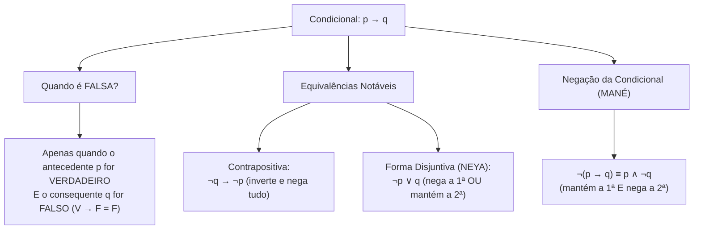
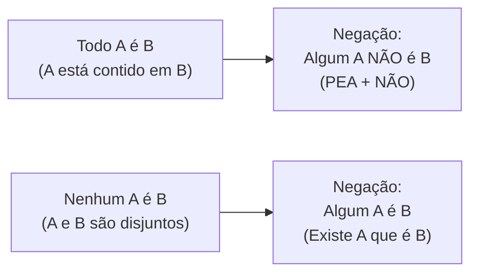

# 05 - Lógica de Argumentação e Conclusões Válidas

> **Matéria:** Matemática e Raciocínio Lógico  
> **Cargos:** A01 – Técnico de Controle Externo (Adm) / B02 – Técnico de Controle Externo (TI)  
> **Arquivo:** `05_logica_de_argumentacao_e_conclusoes_validas.md`  
> **Status:** 🟢 Teoria Aprofundada + 5 Questões FCC Comentadas (A a E)

---

## 📌 Ementa / Itens do Edital
- Compreensão do processo lógico que, a partir de um conjunto de hipóteses, conduz, de forma válida, a conclusões determinadas.
- Proposições lógicas, conectivos e tabelas-verdade.
- Equivalências e negações lógicas.
- Argumentos dedutivos, premissas, conclusão e validade.
- Silogismos categóricos e diagramas lógicos (Todo, Algum, Nenhum).

---

## 🧭 Sumário

1. [Proposições Lógicas, Princípios e Conectivos Fundamentais](#1-proposicoes-logicas-principios-e-conectivos-fundamentais)
    1. [Definição de Proposição e Sentenças Não Proposicionais](#11-definicao-de-proposicao-e-sentencas-nao-proposicionais)
    2. [Os Três Princípios Fundamentais da Lógica Clássica](#12-os-tres-principios-fundamentais-da-logica-classica)
    3. [Conectivos Lógicos e Regras da Tabela-Verdade](#13-conectivos-logicos-e-regras-da-tabela-verdade)
    4. [A Condicional: Peculiaridades e o Caso Falso Único](#14-a-condicional-peculiaridades-e-o-caso-falso-unico)
    5. [Teste 112](#Teste-112)
    6. [Teste 113](#Teste-113)
2. [Álgebra Proposicional: Negações e Equivalências Clássicas](#2-algebra-proposicional-negacoes-e-equivalencias-classicas)
    1. [Leis de De Morgan para Conjunção e Disjunção](#21-leis-de-de-morgan-para-conjuncao-e-disjuncao)
    2. [Negação da Condicional e a Regra do MANÉ](#22-negacao-da-condicional-e-a-regra-do-mane)
    3. [Equivalências Notáveis da Condicional: Contrapositiva e Disjuntiva (NEYA)](#23-equivalencias-notaveis-da-condicional-contrapositiva-e-disjuntiva-neya)
    4. [Tautologias, Contradições e Contingências](#24-tautologias-contradicoes-e-contingencias)
    5. [Teste 114](#Teste-114)
    6. [Teste 115](#Teste-115)
    7. [Teste 116](#Teste-116)
3. [Validade de Argumentos Dedutivos e Regras de Inferência](#3-validade-de-argumentos-dedutivos-e-regras-de-inferencia)
    1. [Estrutura do Argumento: Premissas e Conclusão](#31-estrutura-do-argumento-premissas-e-conclusao)
    2. [Conceito Formal de Validade vs. Verdade Empírica](#32-conceito-formal-de-validade-vs-verdade-empirica)
    3. [Principais Regras de Inferência Válidas](#33-principais-regras-de-inferencia-validas)
    4. [O Método do Encadeamento de Premissas Verdadeiras](#34-o-metodo-do-encadeamento-de-premissas-verdadeiras)
    5. [Teste 117](#Teste-117)
    6. [Teste 118](#Teste-118)
4. [Lógica de Primeira Ordem: Quantificadores e Silogismos Categóricos](#4-logica-de-primeira-ordem-quantificadores-e-silogismos-categoricos)
    1. [Quantificadores Universais e Existenciais: Todo, Nenhum e Algum](#41-quantificadores-universais-e-existenciais-todo-nenhum-e-algum)
    2. [Negação de Proposições Categóricas e a Mnemônica PEA + NÃO](#42-negacao-de-proposicoes-categoricas-e-a-mnemonica-pea-nao)
    3. [Análise de Silogismos via Diagramas de Euler-Venn](#43-analise-de-silogismos-via-diagramas-de-euler-venn)
    4. [Teste 119](#Teste-119)
    5. [Teste 120](#Teste-120)
    6. [Teste 121](#Teste-121)
5. [🌐 Fontes Oficiais e Referências Bibliográficas](#fontes-oficiais-e-referencias-bibliograficas)

---

## 1. Proposições Lógicas, Princípios e Conectivos Fundamentais

A lógica proposicional (ou lógica sentencial) é o ramo da lógica matemática dedicado ao estudo das proposições e dos modos pelos quais estas se combinam para constituir raciocínios dedutivos válidos.

### 1.1 Definição de Proposição e Sentenças Não Proposicionais

* **Proposição Lógica:** Toda oração declarativa com sujeito e predicado expressos que veicula um pensamento completo e à qual se pode atribuir, de forma unívoca, um único valor lógico: **Verdadeiro ($V$)** ou **Falso ($F$)**.
    * Exemplos: *"O TCE-GO fiscaliza as contas municipais"*; *"Goiânia é a capital do Estado de Goiás"*.
* **Sentenças Não Proposicionais (que NÃO são proposições lógicas perante concursos):**
    * Sentenças interrogativas: *"Quem relatou o processo?"*;
    * Sentenças exclamativas: *"Excelente trabalho de auditoria!"*;
    * Sentenças imperativas: *"Instrua os autos imediatamente"*;
    * Sentenças optativas (exprimem desejo): *"Deus o abençoe"*;
    * Sentenças abertas (paradoxo ou incógnita indefinida): *"Ele é auditor fiscal"* (falta definir quem é "ele"); *"$x + 5 = 12$"* (sem o valor de $x$, não é V nem F).

### 1.2 Os Três Princípios Fundamentais da Lógica Clássica

A lógica bivalente aristotélica assenta-se sobre três postulados absolutos:

1. **Princípio da Identidade:** Uma proposição é idêntica a si mesma: se ela é verdadeira, é sempre verdadeira; se é falsa, é sempre falsa ($p \implies p$).
2. **Princípio da Não Contradição:** Uma proposição não pode ser simultaneamente verdadeira e falsa sob as mesmas circunstâncias e no mesmo tempo: $\neg(p \land \neg p)$.
3. **Princípio do Terceiro Excluído:** Uma proposição só pode assumir dois valores lógicos ($V$ ou $F$), excluindo-se qualquer terceiro valor ou estado intermediário.

### 1.3 Conectivos Lógicos e Regras da Tabela-Verdade

As proposições simples combinam-se mediante operadores lógicos (conectivos) para formar proposições compostas. O número de linhas da tabela-verdade de uma proposição composta contendo $n$ proposições simples distintas é sempre dado por:
$$\text{Número de Linhas} = 2^n$$

| Conectivo | Notação Simbólica | Leitura | Condição de Verdade na Tabela-Verdade |
| :--- | :---: | :--- | :--- |
| **Negação** | $\neg p$ ou $\sim p$ | "não p" | Inverte o valor lógico original ($V \rightarrow F$; $F \rightarrow V$). |
| **Conjunção** | $p \land q$ | "p e q" | Só é **VERDADEIRA** se ambas as proposições forem verdadeiras ($V \land V = V$). |
| **Disjunção Inclusiva** | $p \lor q$ | "p ou q" | Só é **FALSA** se ambas as proposições forem falsas ($F \lor F = F$). |
| **Disjunção Exclusiva** | $p \underline{\lor} q$ | "ou p ou q" | É **VERDADEIRA** se os valores lógicos forem opostos/distintos ($V \ \underline{\lor} \ F = V$). |
| **Condicional** | $p \rightarrow q$ | "se p, então q" | Só é **FALSA** se o antecedente for $V$ e o consequente for $F$ ($V \rightarrow F = F$). |
| **Bicondicional** | $p \leftrightarrow q$ | "p se e somente se q" | É **VERDADEIRA** se ambas tiverem o mesmo valor lógico ($V \leftrightarrow V = V$; $F \leftrightarrow F = V$). |

### 1.4 A Condicional: Peculiaridades e o Caso Falso Único

A condicional $p \rightarrow q$ é a estrutura que mais induz candidatos a erro. Na condicional:

* O termo $p$ é o **antecedente** (ou condição suficiente);
* O termo $q$ é o **consequente** (ou condição necessária).
* **A Regra do Falso Único:** A condicional só é avaliada como Falsa se ocorrer a combinação $V \rightarrow F$ (o famoso mnemônico *Vera Fischer é Falsa*).
* Em qualquer outro caso ($V \rightarrow V$, $F \rightarrow V$, $F \rightarrow F$), **a condicional é necessariamente VERDADEIRA**. Note que, se a primeira parte for falsa, a condicional já é automaticamente verdadeira, independentemente do que venha depois.

---

## 2. Álgebra Proposicional: Negações e Equivalências Clássicas

Duas proposições compostas são **logicamente equivalentes** ($P \equiv Q$) quando possuem rigorosamente a mesma tabela-verdade para todas as combinações de valorações de suas componentes.

### 2.1 Leis de De Morgan para Conjunção e Disjunção

As Leis de Augustus De Morgan ditam a negação das estruturas conjuntivas e disjuntivas:

1. **Negação da Conjunção ("E"):** Nega-se a primeira, nega-se a segunda e troca-se o conectivo por "OU":
   $$\neg(p \land q) \equiv \neg p \lor \neg q$$
   *Exemplo:* A negação de *"O relatório foi concluído e o prazo foi cumprido"* é *"O relatório **não** foi concluído **OU** o prazo **não** foi cumprido"*.
2. **Negação da Disjunção Inclusiva ("OU"):** Nega-se a primeira, nega-se a segunda e troca-se o conectivo por "E":
   $$\neg(p \lor q) \equiv \neg p \land \neg q$$
   *Exemplo:* A negação de *"Houve sobrepreço ou houve desídia"* é *"**Não** houve sobrepreço **E** **não** houve desídia"*.

### 2.2 Negação da Condicional e a Regra do MANÉ

A negação de uma proposição condicional $p \rightarrow q$ é obtida pelo célebre mnemônico **MANÉ** (**MA**ntém a primeira e **NE**ga a segunda):
$$\neg(p \rightarrow q) \equiv p \land \neg q$$

> 🚨 **ALERTA DE PROVA / PEGADINHA FCC:** A negação de uma proposição do tipo *"Se p, então q"* **JAMAIS começa com a palavra 'Se'**! Se a questão solicitar a negação de uma condicional e alguma alternativa vier iniciada por *"Se..."*, elimine-a imediatamente. A negação lógica da condicional é sempre uma conjunção com o conectivo **"E"**!
>
> * Proposição: *"Se o auditor fiscaliza, a irregularidade diminui."*
> * Negação estrita: *"O auditor fiscaliza **E** a irregularidade **não** diminui."*

### 2.3 Equivalências Notáveis da Condicional: Contrapositiva e Disjuntiva (NEYA)

A FCC explora intensamente duas formas canônicas de reescrever a condicional $p \rightarrow q$:

1. **Equivalência Contrapositiva (Inverte e Nega Tudo):**
   $$p \rightarrow q \equiv \neg q \rightarrow \neg p$$
   *Exemplo:* *"Se a prestação de contas foi apresentada tempestivamente, então a certidão foi emitida"* $\equiv$ *"Se a certidão **não** foi emitida, então a prestação de contas **não** foi apresentada tempestivamente"*.
2. **Equivalência Disjuntiva (Regra do NEYA - NEga a primeira OU mantêm a segunda):**
   $$p \rightarrow q \equiv \neg p \lor q$$
   *Exemplo:* *"Se o servidor observa a moralidade, sua conduta é inatacável"* $\equiv$ *"O servidor **não** observa a moralidade **OU** sua conduta é inatacável"*.

### 2.4 Tautologias, Contradições e Contingências

* **Tautologia:** Proposição composta que é invariavelmente verdadeira em todas as linhas da sua tabela-verdade, independentemente dos valores lógicos das proposições simples (ex.: $p \lor \neg p$, princípio do terceiro excluído).
* **Contradição:** Proposição composta que é invariavelmente falsa em todas as linhas da sua tabela-verdade (ex.: $p \land \neg p$).
* **Contingência:** Proposição composta cuja tabela-verdade apresenta pelo menos um valor verdadeiro e pelo menos um valor falso.

---

## 3. Validade de Argumentos Dedutivos e Regras de Inferência

A argumentação lógica investiga se uma determinada conclusão decorre com necessidade matemática absoluta a partir de um conjunto de premissas assumidas como verdadeiras.

### 3.1 Estrutura do Argumento: Premissas e Conclusão

Um argumento dedutivo é um conjunto ordenado de proposições estruturado em:

* **Premissas ($P_1, P_2, \dots, P_n$):** Proposições que servem de ponto de partida, evidência ou suporte fático.
* **Conclusão ($C$):** Proposição final deduzida que decorre das premissas.
Representa-se simbolicamente por: $P_1, P_2, \dots, P_n \vdash C$.

### 3.2 Conceito Formal de Validade vs. Verdade Empírica

* A **validade** é uma propriedade formal e estrutural do argumento; não se confunde com a verdade material dos fatos no mundo físico.
* Um argumento dedutivo é declarado **VÁLIDO** quando é logicamente impossível que todas as suas premissas sejam simultaneamente verdadeiras e a sua conclusão seja falsa.
* Se for possível construir um cenário consistente em que todas as premissas sejam verdadeiras e a conclusão seja falsa, o argumento é categorizado como **INVÁLIDO (Falácia ou Sofisma)**.

### 3.3 Principais Regras de Inferência Válidas

1. **Modus Ponens (Afirmação do Antecedente):**
   $$\frac{p \rightarrow q, \quad p}{\therefore q}$$
2. **Modus Tollens (Negação do Consequente):**
   $$\frac{p \rightarrow q, \quad \neg q}{\therefore \neg p}$$
3. **Silogismo Disjuntivo:**
   $$\frac{p \lor q, \quad \neg p}{\therefore q}$$
4. **Silogismo Hipotético (Transitividade da Condicional):**
   $$\frac{p \rightarrow q, \quad q \rightarrow r}{\therefore p \rightarrow r}$$

### 3.4 O Método do Encadeamento de Premissas Verdadeiras

O método prático para resolver questões com múltiplas premissas condicionais na FCC consiste em:

1. Atribuir o valor lógico **VERDADEIRO ($V$)** a todas as premissas do enunciado;
2. Localizar o ponto de partida mais restrito: quase sempre uma **proposição simples isolada** ou uma **conjunção ("E")**;
3. Propagar esse valor veritativo pelas condicionais utilizando *Modus Ponens* ou *Modus Tollens*;
4. As conclusões verdadeiras necessárias deduzidas correspondem à alternativa correta.

---

## 4. Lógica de Primeira Ordem: Quantificadores e Silogismos Categóricos

A lógica categórica estuda proposições que expressam relações de inclusão total, inclusão parcial ou exclusão total entre classes e conjuntos.

### 4.1 Quantificadores Universais e Existenciais: Todo, Nenhum e Algum

* **Universal Afirmativo ("TODO A é B"):** Todo elemento de A pertence a B ($A \subset B$). O conjunto A está totalmente contido no conjunto B.
* **Universal Negativo ("NENHUM A é B"):** Nenhum elemento de A pertence a B ($A \cap B = \emptyset$). Os conjuntos A e B são mutuamente disjuntos.
* **Particular / Existencial Afirmativo ("ALGUM A é B"):** Existe pelo menos um elemento pertencente a A que também pertence a B ($A \cap B \neq \emptyset$).
* **Particular Negativo ("ALGUM A NÃO é B"):** Existe pelo menos um elemento de A que não pertence ao conjunto B.

### 4.2 Negação de Proposições Categóricas e a Mnemônica PEA + NÃO

Para negar uma proposição quantificada, deve-se alternar o tipo de quantificador (universal vira existencial, e existencial vira universal):

1. **Negação de "TODO A é B":**
    * Não é "Nenhum A é B"! Para quebrar uma afirmação universal afirmativa, basta encontrar **ao menos um contraexemplo**.
    * Aplica-se a regra mnemônica **PEA + NÃO**:
    * **P**elo menos um A não é B;
    * **E**xiste A que não é B;
    * **A**lgum A não é B.

2. **Negação de "NENHUM A é B":**
    * Basta provar que existe pelo menos um elemento na interseção: *"Algum A é B"* (ou *"Pelo menos um A é B"*).

3. **Negação de "ALGUM A é B":**
    * Nega-se pelo quantificador universal negativo: *"Nenhum A é B"*.

> 🚨 **ALERTA DE PROVA / PEGADINHA DO "TODO" VS. "NENHUM":** A alternativa mais tentadora e incorreta em provas da FCC para negar *"Todos os servidores são concursados"* é *"Nenhum servidor é concursado"*. Lembre-se: "Todo" e "Nenhum" são proposições contrárias (podem ser ambas falsas ao mesmo tempo se houver 99 concursados e 1 comissionado), mas **não são contraditórias**. A negação legítima é: *"Pelo menos um servidor não é concursado"*.

### 4.3 Análise de Silogismos via Diagramas de Euler-Venn

Para avaliar a validade de silogismos com premissas como *"Todo A é E"* e *"Algum E é P"*:

* Desenhe os círculos de conjuntos de Euler-Venn;
* O círculo $A$ está totalmente dentro de $E$;
* O círculo $P$ cruza com $E$, mas **não se pode garantir que encoste em $A$**. Ele pode estar numa região de $E$ totalmente afastada de $A$;
* Portanto, deduzir que *"Algum A é P"* ou *"Nenhum A é P"* constitui falácia de conclusão contingente. O que é logicamente correto afirmar é que a interseção pode ocorrer, mas **não é uma conclusão necessária**.

---

### Teste 001
**(FCC – TCE/GO – 2009 – Analista de Controle Externo - Gestão de Conhecimento)**
Em um levantamento bibliográfico sobre a jurisprudência usuário. relativa à responsabilidade fiscal de estados da federação, o bibliotecário deverá compilar

* **A)** ações, recursos e acórdãos.
* **B)** livros, teses e artigos de periódicos.
* **C)** leis ordinárias e complementares e decretos. informações semelhantes.
* **D)** medidas provisórias, normas e decisões. _________________________________________________________
* **E)** sentenças, proposições e atos. _________________________________________________________ 71. O catálogo de registro, também chamado de tombo, rela- ciona os documentos pela ordem cronológica de inclusão

---

> **Comentário Detalhado:**
>
> - **A)** **Incorreta.** A opção apresenta proposição em desacordo com os fundamentos teóricos e técnicos do tópico ao afirmar que "ações, recursos e acórdãos". De acordo com a teoria estudada em *2.1 Leis de De Morgan para Conjunção e Disjunção*, negação da Conjunção ("E"): Nega se a primeira, nega se a segunda e troca se o conectivo por "OU".
> - **B)** **Incorreta.** A opção apresenta proposição em desacordo com os fundamentos teóricos e técnicos do tópico ao afirmar que "livros, teses e artigos de periódicos". De acordo com a teoria estudada em *2.1 Leis de De Morgan para Conjunção e Disjunção*, $$\neg(p \land q) \equiv \neg p \lor \neg q$$.
> - **C)** **Correta.** Conforme fundamentado na seção *2.1 Leis de De Morgan para Conjunção e Disjunção* deste guia, as Leis de Augustus De Morgan ditam a negação das estruturas conjuntivas e disjuntivas. Dessa forma, está plenamente correta a assertiva da banca (FCC – TCE/GO/2009) ao estabelecer que "leis ordinárias e complementares e decretos. informações semelhantes".
> - **D)** **Incorreta.** A opção apresenta proposição em desacordo com os fundamentos teóricos e técnicos do tópico ao afirmar que "medidas provisórias, normas e decisões". De acordo com a teoria estudada em *2.1 Leis de De Morgan para Conjunção e Disjunção*, exemplo: A negação de "O relatório foi concluído e o prazo foi cumprido" é "O relatório não foi concluído OU o prazo não foi cumprido".
> - **E)** **Incorreta.** A opção apresenta proposição em desacordo com os fundamentos teóricos e técnicos do tópico ao afirmar que "sentenças, proposições e atos. 71. O catálogo de registro, também chamado de tombo, rela ciona os documentos pela...". De acordo com a teoria estudada em *4. Lógica de Primeira Ordem: Quantificadores e Silogismos Categóricos*, a lógica categórica estuda proposições que expressam relações de inclusão total, inclusão parcial ou exclusão total entre classes e conjuntos.
>
> **Gabarito: C**

---

### Teste 002
**(FGV – TCE/GO – 2024 – Analista de Controle Externo - Jurídica)**
A Assembleia Legislativa do Estado Alfa recebeu projeto de lei, encaminhado pelo Tribunal de Justiça do Estado, com o objetivo de regulamentar o pagamento de horas extraordinárias aos magistrados vinculados ao referido Tribunal. A Comissão de Constituição e Justiça, ao analisar o referido projeto, concluiu corretamente que

* **A)** o Estado Alfa tem competência legislativa para suplementar a legislação federal nessa temática.
* **B)** a matéria deveria ser disciplinada na Constituição Estadual, em simetria com o paradigma federal.
* **C)** por dizer respeito a matéria afeta aos magistrados, era necessária a apresentação de projeto de lei complementar.
* **D)** o Tribunal de Justiça carece de legitimidade para apresentar a proposição, e a Assembleia de competência para apreciá-la.
* **E)** se os servidores públicos do respectivo Estado fizerem jus ao referido pagamento, o respectivo regime jurídico deve ser aplicado subsidiariamente aos magistrados.

---

> **Comentário Detalhado:**
>
> - **A)** **Incorreta.** A opção apresenta proposição em desacordo com os fundamentos teóricos e técnicos do tópico ao afirmar que "o Estado Alfa tem competência legislativa para suplementar a legislação federal nessa temática". De acordo com a teoria estudada em *1.1 Definição de Proposição e Sentenças Não Proposicionais*, exemplos: "O TCE GO fiscaliza as contas municipais" ; "Goiânia é a capital do Estado de Goiás".
> - **B)** **Incorreta.** A opção apresenta proposição em desacordo com os fundamentos teóricos e técnicos do tópico ao afirmar que "a matéria deveria ser disciplinada na Constituição Estadual, em simetria com o paradigma federal". De acordo com a teoria estudada em *1.2 Os Três Princípios Fundamentais da Lógica Clássica*, princípio da Não Contradição: Uma proposição não pode ser simultaneamente verdadeira e falsa sob as mesmas circunstâncias e no mesmo tempo: $\neg(p \land \neg p)$.
> - **C)** **Incorreta.** A opção apresenta proposição em desacordo com os fundamentos teóricos e técnicos do tópico ao afirmar que "por dizer respeito a matéria afeta aos magistrados, era necessária a apresentação de projeto de lei complementar". De acordo com a teoria estudada em *1.4 A Condicional: Peculiaridades e o Caso Falso Único*, o termo $q$ é o consequente (ou condição necessária).
> - **D)** **Correta.** Conforme fundamentado na seção *1.1 Definição de Proposição e Sentenças Não Proposicionais* deste guia, proposição Lógica: Toda oração declarativa com sujeito e predicado expressos que veicula um pensamento completo e à qual se pode atribuir, de forma unívoca, um único valor lógico: Verdadeiro ($V$) ou Falso ($F$). Dessa forma, está plenamente correta a assertiva da banca (FGV – TCE/GO/2024) ao estabelecer que "o Tribunal de Justiça carece de legitimidade para apresentar a proposição, e a Assembleia de competência para...".
> - **E)** **Incorreta.** A opção apresenta proposição em desacordo com os fundamentos teóricos e técnicos do tópico ao afirmar que "se os servidores públicos do respectivo Estado fizerem jus ao referido pagamento, o respectivo regime jurídico...". De acordo com a teoria estudada em *4.2 Negação de Proposições Categóricas e a Mnemônica PEA + NÃO*, a alternativa mais tentadora e incorreta em provas da FCC para negar "Todos os servidores são concursados" é "Nenhum servidor é concursado" . Lembre se: "Todo" e "Nenhum" são proposições contrárias (podem ser ambas falsas ao mesmo tempo se houver 99 concursados e 1 comissionado), mas não são contraditórias. A negação legítima é: "Pelo menos um servidor não é concursado".
>
> **Gabarito: D**

---

### Teste 003
**(FGV – TCE/GO – 2024 – Analista de Controle Externo - Jurídica)**
O Chefe do Poder Executivo do Estado Alfa encaminhou o projeto de lei orçamentária anual à Assembleia Legislativa. Poucos dias depois, foi comunicado pelo Procurador-Geral de Justiça de que a proposta subscrita por este agente, referente à estrutura por ele chefiada, carecia de pequena alteração. À luz da sistemática da Constituição da República, aplicável por simetria ao Estado Alfa, é correto afirmar, em relação à alteração pretendida, que ela

* **A)** não pode ser promovida, considerando a ocorrência da preclusão consumativa no processo legislativo.
* **B)** somente pode ser promovida pelo Governador do Estado, enquanto não iniciada a votação em Plenário.
* **C)** somente pode ser promovida pelo Governador do Estado, por meio de proposição suplementar, enquanto não encerrada a apreciação do projeto pela Comissão competente.
* **D)** somente pode ser promovida pelo Procurador-Geral de Justiça, considerando a autonomia financeira do Ministério Público, enquanto não iniciada a votação em Plenário.
* **E)** somente pode ser promovida pelo Governador do Estado, por meio de mensagem, enquanto não iniciada a votação, na Comissão competente, da parte cuja alteração é proposta. Direito Administrativo

---

> **Comentário Detalhado:**
>
> - **A)** **Incorreta.** A opção apresenta proposição em desacordo com os fundamentos teóricos e técnicos do tópico ao afirmar que "não pode ser promovida, considerando a ocorrência da preclusão consumativa no processo legislativo". De acordo com a teoria estudada em *4.3 Análise de Silogismos via Diagramas de Euler-Venn*, portanto, deduzir que "Algum A é P" ou "Nenhum A é P" constitui falácia de conclusão contingente. O que é logicamente correto afirmar é que a interseção pode ocorrer, mas não é uma conclusão necessária.
> - **B)** **Incorreta.** A opção incorre em restrição indevida ao limitar o escopo conceitual ao afirmar que "somente pode ser promovida pelo Governador do Estado, enquanto não iniciada a votação em Plenário". De acordo com a teoria estudada em *1.4 A Condicional: Peculiaridades e o Caso Falso Único*, em qualquer outro caso ($V \rightarrow V$, $F \rightarrow V$, $F \rightarrow F$), a condicional é necessariamente VERDADEIRA. Note que, se a primeira parte for falsa, a condicional já é automaticamente verdadeira, independentemente do que venha depois.
> - **C)** **Incorreta.** A opção incorre em restrição indevida ao limitar o escopo conceitual ao afirmar que "somente pode ser promovida pelo Governador do Estado, por meio de proposição suplementar, enquanto não encerrada a...". De acordo com a teoria estudada em *2.2 Negação da Condicional e a Regra do MANÉ*, a negação de uma proposição do tipo "Se p, então q" JAMAIS começa com a palavra 'Se'! Se a questão solicitar a negação de uma condicional e alguma alternativa vier iniciada por "Se..." , elimine a imediatamente. A negação lógica da condicional é sempre uma conjunção com o conectivo "E"!.
> - **D)** **Incorreta.** A opção incorre em restrição indevida ao limitar o escopo conceitual ao afirmar que "somente pode ser promovida pelo Procurador Geral de Justiça, considerando a autonomia financeira do Ministério...". De acordo com a teoria estudada em *2.4 Tautologias, Contradições e Contingências*, contingência: Proposição composta cuja tabela verdade apresenta pelo menos um valor verdadeiro e pelo menos um valor falso.
> - **E)** **Correta.** Conforme fundamentado na seção *1.2 Os Três Princípios Fundamentais da Lógica Clássica* deste guia, princípio da Não Contradição: Uma proposição não pode ser simultaneamente verdadeira e falsa sob as mesmas circunstâncias e no mesmo tempo: $\neg(p \land \neg p)$. Dessa forma, está plenamente correta a assertiva da banca (FGV – TCE/GO/2024) ao estabelecer que "somente pode ser promovida pelo Governador do Estado, por meio de mensagem, enquanto não iniciada a votação, na...".
>
> **Gabarito: E**

---

### Teste 004
**(FGV – TJ/AP – 2023 – Analista Judiciario Apoio Especializado Tecnologia Da Informacao Banco De Dados)**
A Assembleia Legislativa do Estado Alfa recebeu uma proposição legislativa que tem por objeto a alteração das atribuições de certo órgão colegiado da Administração Superior do Ministério Público do Estado. Considerando os balizamentos estabelecidos pela Constituição da República a respeito das normas que estabelecem a organização, as atribuições e o estatuto de cada Ministério Público, é correto afirmar que a proposição legislativa precisa ter a natureza de:

* **A)** projeto de lei ordinária, de iniciativa privativa do governador do Estado;
* **B)** projeto de lei ordinária, de iniciativa privativa do Colégio de Procuradores de Justiça;
* **C)** projeto de lei complementar, de iniciativa privativa do procurador-geral de Justiça;
* **D)** proposta de emenda constitucional, podendo ter sido apresentada por qualquer legitimado para a reforma;
* **E)** projeto de lei complementar, podendo ter sido apresentado pelo procurador-geral de Justiça ou pelo governador do Estado.

---

> **Comentário Detalhado:**
>
> - **A)** **Incorreta.** A opção apresenta proposição em desacordo com os fundamentos teóricos e técnicos do tópico ao afirmar que "projeto de lei ordinária, de iniciativa privativa do governador do Estado". De acordo com a teoria estudada em *1.1 Definição de Proposição e Sentenças Não Proposicionais*, proposição Lógica: Toda oração declarativa com sujeito e predicado expressos que veicula um pensamento completo e à qual se pode atribuir, de forma unívoca, um único valor lógico: Verdadeiro ($V$) ou Falso ($F$).
> - **B)** **Incorreta.** A opção apresenta proposição em desacordo com os fundamentos teóricos e técnicos do tópico ao afirmar que "projeto de lei ordinária, de iniciativa privativa do Colégio de Procuradores de Justiça". De acordo com a teoria estudada em *1.1 Definição de Proposição e Sentenças Não Proposicionais*, exemplos: "O TCE GO fiscaliza as contas municipais" ; "Goiânia é a capital do Estado de Goiás".
> - **C)** **Correta.** Conforme fundamentado na seção *4.3 Análise de Silogismos via Diagramas de Euler-Venn* deste guia, portanto, deduzir que "Algum A é P" ou "Nenhum A é P" constitui falácia de conclusão contingente. O que é logicamente correto afirmar é que a interseção pode ocorrer, mas não é uma conclusão necessária. Dessa forma, está plenamente correta a assertiva da banca (FGV – TJ/AP/2023) ao estabelecer que "projeto de lei complementar, de iniciativa privativa do procurador geral de Justiça".
> - **D)** **Incorreta.** A opção promove generalização excessiva que desconsidera as condições técnicas e normativas ao afirmar que "proposta de emenda constitucional, podendo ter sido apresentada por qualquer legitimado para a reforma". De acordo com a teoria estudada em *1.2 Os Três Princípios Fundamentais da Lógica Clássica*, princípio do Terceiro Excluído: Uma proposição só pode assumir dois valores lógicos ($V$ ou $F$), excluindo se qualquer terceiro valor ou estado intermediário.
> - **E)** **Incorreta.** A opção apresenta proposição em desacordo com os fundamentos teóricos e técnicos do tópico ao afirmar que "projeto de lei complementar, podendo ter sido apresentado pelo procurador geral de Justiça ou pelo governador do...". De acordo com a teoria estudada em *1.1 Definição de Proposição e Sentenças Não Proposicionais*, sentenças Não Proposicionais (que NÃO são proposições lógicas perante concursos).
>
> **Gabarito: C**

---

### Teste 005
**(FGV – TJ/AP – 2023 – Analista Judiciario Apoio Especializado Tecnologia Da Informacao Seguranca Da Informacao)**
A equipe de gestão de riscos de um órgão público está atualizando seu Plano de Gestão de Riscos (PGR). Na atual fase de trabalho, a equipe está executando o processo de avaliação de riscos das atividades constantes do escopo do PGR, descrevendo, analisando e avaliando os riscos identificados. Durante a identificação dos riscos, a equipe deve considerar o fator:

* **A)** mudanças nos contextos externo e interno do órgão;
* **B)** natureza e magnitude das consequências;
* **C)** probabilidade de eventos e consequências;
* **D)** opções existentes para tratamento de riscos;
* **E)** recursos requeridos, incluindo contingências.

---

> **Comentário Detalhado:**
>
> - **A)** **Correta.** Conforme fundamentado na seção *1.1 Definição de Proposição e Sentenças Não Proposicionais* deste guia, sentenças interrogativas: "Quem relatou o processo?". Dessa forma, está plenamente correta a assertiva da banca (FGV – TJ/AP/2023) ao estabelecer que "mudanças nos contextos externo e interno do órgão".
> - **B)** **Incorreta.** A opção apresenta proposição em desacordo com os fundamentos teóricos e técnicos do tópico ao afirmar que "natureza e magnitude das consequências". De acordo com a teoria estudada em *1.1 Definição de Proposição e Sentenças Não Proposicionais*, sentenças exclamativas: "Excelente trabalho de auditoria!".
> - **C)** **Incorreta.** A opção apresenta proposição em desacordo com os fundamentos teóricos e técnicos do tópico ao afirmar que "probabilidade de eventos e consequências". De acordo com a teoria estudada em *4.2 Negação de Proposições Categóricas e a Mnemônica PEA + NÃO*, para negar uma proposição quantificada, deve se alternar o tipo de quantificador (universal vira existencial, e existencial vira universal).
> - **D)** **Incorreta.** A opção apresenta proposição em desacordo com os fundamentos teóricos e técnicos do tópico ao afirmar que "opções existentes para tratamento de riscos". De acordo com a teoria estudada em *Fundamentos Teóricos*, cargos: A01 – Técnico de Controle Externo (Adm) / B02 – Técnico de Controle Externo (TI).
> - **E)** **Incorreta.** A opção apresenta proposição em desacordo com os fundamentos teóricos e técnicos do tópico ao afirmar que "recursos requeridos, incluindo contingências". De acordo com a teoria estudada em *2.4 Tautologias, Contradições e Contingências*, tautologia: Proposição composta que é invariavelmente verdadeira em todas as linhas da sua tabela verdade, independentemente dos valores lógicos das proposições simples (ex.: $p \lor \neg p$, princípio do terceiro excluído).
>
> **Gabarito: A**

---

### Teste 006
**(FGV – TJ/AP – 2023 – Analista Judiciario Apoio Especializado Tecnologia Da Informacao Telecomunicacoes)**
Em contraste com as redes conectadas fisicamente, as redes sem fio são ruidosas e pouco confiáveis. Um dos padrões mais famosos para redes sem fio é o IEEE 802.11. Dentre as características das redes que usam o protocolo IEEE 802.11, é correto afirmar que:

* **A)** o protocolo IEEE 802.11 tenta resolver os problemas das estações expostas, ocultas ou transparentes;
* **B)** em ambientes abertos e sem obstáculos, quanto maior a frequência do sinal, menor a atenuação do sinal;
* **C)** o IEEE 802.11, para o acesso ao meio, procura detectar as colisões, escutando o canal durante as transmissões;
* **D)** a probabilidade de um quadro trafegar por essas redes com sucesso aumenta com o aumento do tamanho do quadro;
* **E)** o IEEE 802.11, para o acesso ao meio, procura evitar as colisões, enviando quadros de aviso antes das transmissões.

---

> **Comentário Detalhado:**
>
> - **A)** **Incorreta.** A opção apresenta proposição em desacordo com os fundamentos teóricos e técnicos do tópico ao afirmar que "o protocolo IEEE 802.11 tenta resolver os problemas das estações expostas, ocultas ou transparentes". De acordo com a teoria estudada em *3.4 O Método do Encadeamento de Premissas Verdadeiras*, o método prático para resolver questões com múltiplas premissas condicionais na FCC consiste em.
> - **B)** **Incorreta.** A opção apresenta proposição em desacordo com os fundamentos teóricos e técnicos do tópico ao afirmar que "em ambientes abertos e sem obstáculos, quanto maior a frequência do sinal, menor a atenuação do sinal". De acordo com a teoria estudada em *1.4 A Condicional: Peculiaridades e o Caso Falso Único*, a condicional $p \rightarrow q$ é a estrutura que mais induz candidatos a erro. Na condicional.
> - **C)** **Incorreta.** A opção apresenta proposição em desacordo com os fundamentos teóricos e técnicos do tópico ao afirmar que "o IEEE 802.11, para o acesso ao meio, procura detectar as colisões, escutando o canal durante as transmissões". De acordo com a teoria estudada em *3.4 O Método do Encadeamento de Premissas Verdadeiras*, localizar o ponto de partida mais restrito: quase sempre uma proposição simples isolada ou uma conjunção ("E").
> - **D)** **Incorreta.** A opção apresenta proposição em desacordo com os fundamentos teóricos e técnicos do tópico ao afirmar que "a probabilidade de um quadro trafegar por essas redes com sucesso aumenta com o aumento do tamanho do quadro". De acordo com a teoria estudada em *4.2 Negação de Proposições Categóricas e a Mnemônica PEA + NÃO*, a alternativa mais tentadora e incorreta em provas da FCC para negar "Todos os servidores são concursados" é "Nenhum servidor é concursado" . Lembre se: "Todo" e "Nenhum" são proposições contrárias (podem ser ambas falsas ao mesmo tempo se houver 99 concursados e 1 comissionado), mas não são contraditórias. A negação legítima é: "Pelo menos um servidor não é concursado".
> - **E)** **Correta.** Conforme fundamentado na seção *4.3 Análise de Silogismos via Diagramas de Euler-Venn* deste guia, portanto, deduzir que "Algum A é P" ou "Nenhum A é P" constitui falácia de conclusão contingente. O que é logicamente correto afirmar é que a interseção pode ocorrer, mas não é uma conclusão necessária. Dessa forma, está plenamente correta a assertiva da banca (FGV – TJ/AP/2023) ao estabelecer que "o IEEE 802.11, para o acesso ao meio, procura evitar as colisões, enviando quadros de aviso antes das transmissões".
>
> **Gabarito: E**

---

### Teste 007
**(FGV – TRT da 24º Região – 2025 – Analista Judiciário - Área Administrativa - Contabilidade)**
A Gestão de Riscos busca identificar, analisar e mitigar ameaças potenciais, garantindo a resiliência e a sustentabilidade da organização. Assinale a opção que apresenta, corretamente, o risco de conformidade.

* **A)** Trata-se do risco de perdas financeiras geradas por falhas tecnológicas, como interrupções em sistemas e ataques cibernéticos.
* **B)** Representa a probabilidade de perdas decorrentes do não cumprimento de leis, normas e regulamentos, internos ou externos, podendo afetar financeiramente a organização.
* **C)** Refere-se ao risco associado à variação de mercado e às flutuações cambiais, que impactam diretamente o desempenho financeiro da organização.
* **D)** Diz respeito aos riscos operacionais relacionados à má alocação de recursos humanos e à deficiência na comunicação interna.
* **E)** Está ligado exclusivamente à gestão de contratos e ao descumprimento de cláusulas contratuais por parte de fornecedores terceirizados.

---

> **Comentário Detalhado:**
>
> - **A)** **Incorreta.** A opção apresenta proposição em desacordo com os fundamentos teóricos e técnicos do tópico ao afirmar que "Trata se do risco de perdas financeiras geradas por falhas tecnológicas, como interrupções em sistemas e ataques...". De acordo com a teoria estudada em *2.1 Leis de De Morgan para Conjunção e Disjunção*, as Leis de Augustus De Morgan ditam a negação das estruturas conjuntivas e disjuntivas.
> - **B)** **Correta.** Conforme fundamentado na seção *3.1 Estrutura do Argumento: Premissas e Conclusão* deste guia, representa se simbolicamente por: $P 1, P 2, \dots, P n \vdash C$. Dessa forma, está plenamente correta a assertiva da banca (FGV – TRT da 24º Região/2025) ao estabelecer que "Representa a probabilidade de perdas decorrentes do não cumprimento de leis, normas e regulamentos, internos ou...".
> - **C)** **Incorreta.** A opção apresenta proposição em desacordo com os fundamentos teóricos e técnicos do tópico ao afirmar que "Refere se ao risco associado à variação de mercado e às flutuações cambiais, que impactam diretamente o desempenho...". De acordo com a teoria estudada em *2.1 Leis de De Morgan para Conjunção e Disjunção*, negação da Conjunção ("E"): Nega se a primeira, nega se a segunda e troca se o conectivo por "OU".
> - **D)** **Incorreta.** A opção apresenta proposição em desacordo com os fundamentos teóricos e técnicos do tópico ao afirmar que "Diz respeito aos riscos operacionais relacionados à má alocação de recursos humanos e à deficiência na comunicação...". De acordo com a teoria estudada em *2.1 Leis de De Morgan para Conjunção e Disjunção*, $$\neg(p \land q) \equiv \neg p \lor \neg q$$.
> - **E)** **Incorreta.** A opção incorre em restrição indevida ao limitar o escopo conceitual ao afirmar que "Está ligado exclusivamente à gestão de contratos e ao descumprimento de cláusulas contratuais por parte de...". De acordo com a teoria estudada em *1.4 A Condicional: Peculiaridades e o Caso Falso Único*, em qualquer outro caso ($V \rightarrow V$, $F \rightarrow V$, $F \rightarrow F$), a condicional é necessariamente VERDADEIRA. Note que, se a primeira parte for falsa, a condicional já é automaticamente verdadeira, independentemente do que venha depois.
>
> **Gabarito: B**

---

### Teste 008
**(FGV – TRT da 24º Região – 2025 – Analista Judiciário - Área Administrativa - Sem Especialidade)**
Um problema importante em inferência estatística decorre da necessidade de se obter uma amostra de uma determinada população para se estudar determinado fenômeno. Nesse caso, um problema crucial é se obter uma mostra que seja, em algum sentido, representativa da população em estudo, o que nos leva a pensar em como nossa amostra pode ser obtida. Um método importante, nesse sentido, é a amostragem aleatória simples, na qual

* **A)** a população apresenta uma subdivisão em pequenos grupos, e é possível e conveniente sortear um número suficiente desses grupos, cujos elementos constituirão a amostra.
* **B)** a população se divide em subpopulações, de tal modo que podemos especificar quantos elementos da amostra serão retirados em cada subpopulação.
* **C)** todos os elementos da população têm igual probabilidade de pertencer à amostra, e todas as possíveis amostras têm também igual probabilidade de ocorrer.
* **D)** a população pode ser ordenada e cada elemento da amostra é obtido a partir de uma escolha sistemática e periódica.
* **E)** a amostra é retirada em diversas etapas sucessivas e, dependendo dos resultados obtidos, etapas suplementares são necessárias ou dispensadas.

---

> **Comentário Detalhado:**
>
> - **A)** **Incorreta.** A opção apresenta proposição em desacordo com os fundamentos teóricos e técnicos do tópico ao afirmar que "a população apresenta uma subdivisão em pequenos grupos, e é possível e conveniente sortear um número suficiente...". De acordo com a teoria estudada em *3.2 Conceito Formal de Validade vs. Verdade Empírica*, se for possível construir um cenário consistente em que todas as premissas sejam verdadeiras e a conclusão seja falsa, o argumento é categorizado como INVÁLIDO (Falácia ou Sofisma).
> - **B)** **Incorreta.** A opção apresenta proposição em desacordo com os fundamentos teóricos e técnicos do tópico ao afirmar que "a população se divide em subpopulações, de tal modo que podemos especificar quantos elementos da amostra serão...". De acordo com a teoria estudada em *3. Validade de Argumentos Dedutivos e Regras de Inferência*, a argumentação lógica investiga se uma determinada conclusão decorre com necessidade matemática absoluta a partir de um conjunto de premissas assumidas como verdadeiras.
> - **C)** **Correta.** Conforme fundamentado na seção *4.3 Análise de Silogismos via Diagramas de Euler-Venn* deste guia, portanto, deduzir que "Algum A é P" ou "Nenhum A é P" constitui falácia de conclusão contingente. O que é logicamente correto afirmar é que a interseção pode ocorrer, mas não é uma conclusão necessária. Dessa forma, está plenamente correta a assertiva da banca (FGV – TRT da 24º Região/2025) ao estabelecer que "todos os elementos da população têm igual probabilidade de pertencer à amostra, e todas as possíveis amostras têm...".
> - **D)** **Incorreta.** A opção apresenta proposição em desacordo com os fundamentos teóricos e técnicos do tópico ao afirmar que "a população pode ser ordenada e cada elemento da amostra é obtido a partir de uma escolha sistemática e periódica". De acordo com a teoria estudada em *1.2 Os Três Princípios Fundamentais da Lógica Clássica*, princípio da Não Contradição: Uma proposição não pode ser simultaneamente verdadeira e falsa sob as mesmas circunstâncias e no mesmo tempo: $\neg(p \land \neg p)$.
> - **E)** **Incorreta.** A opção apresenta proposição em desacordo com os fundamentos teóricos e técnicos do tópico ao afirmar que "a amostra é retirada em diversas etapas sucessivas e, dependendo dos resultados obtidos, etapas suplementares são...". De acordo com a teoria estudada em *3.4 O Método do Encadeamento de Premissas Verdadeiras*, as conclusões verdadeiras necessárias deduzidas correspondem à alternativa correta.
>
> **Gabarito: C**

---

### Teste 009
**(FGV – TRT 1ª – 2024 – Analista Judiciário - Área Administrativa)**
Recentemente, o Supremo Tribunal Federal determinou a prorrogação da vigência da Lei de Cotas em concursos públicos federais até que o Congresso Nacional aprove uma nova norma sobre a matéria, diante da proximidade do respectivo termo. Tal orientação teve por fundamento determinado princípio implícito na Constituição da República, tendo em vista os certames ainda em andamento, dentre outros aspectos, o que importaria na probabilidade de multiplicação de litígios judiciais. É correto afirmar que o referido princípio é o da:

* **A)** moralidade;
* **B)** publicidade;
* **C)** impessoalidade;
* **D)** segurança jurídica;
* **E)** eficiência.

---

> **Comentário Detalhado:**
>
> - **A)** **Incorreta.** A opção apresenta proposição em desacordo com os fundamentos teóricos e técnicos do tópico ao afirmar que "moralidade". De acordo com a teoria estudada em *2.3 Equivalências Notáveis da Condicional: Contrapositiva e Disjuntiva (NEYA)*, exemplo: "Se o servidor observa a moralidade, sua conduta é inatacável" $\equiv$ "O servidor não observa a moralidade OU sua conduta é inatacável".
> - **B)** **Incorreta.** A opção apresenta proposição em desacordo com os fundamentos teóricos e técnicos do tópico ao afirmar que "publicidade". De acordo com a teoria estudada em *1.1 Definição de Proposição e Sentenças Não Proposicionais*, sentenças Não Proposicionais (que NÃO são proposições lógicas perante concursos).
> - **C)** **Incorreta.** A opção apresenta proposição em desacordo com os fundamentos teóricos e técnicos do tópico ao afirmar que "impessoalidade". De acordo com a teoria estudada em *1.4 A Condicional: Peculiaridades e o Caso Falso Único*, o termo $p$ é o antecedente (ou condição suficiente).
> - **D)** **Correta.** Conforme fundamentado na seção *4.3 Análise de Silogismos via Diagramas de Euler-Venn* deste guia, portanto, deduzir que "Algum A é P" ou "Nenhum A é P" constitui falácia de conclusão contingente. O que é logicamente correto afirmar é que a interseção pode ocorrer, mas não é uma conclusão necessária. Dessa forma, está plenamente correta a assertiva da banca (FGV – TRT 1ª/2024) ao estabelecer que "segurança jurídica".
> - **E)** **Incorreta.** A opção apresenta proposição em desacordo com os fundamentos teóricos e técnicos do tópico ao afirmar que "eficiência". De acordo com a teoria estudada em *1.4 A Condicional: Peculiaridades e o Caso Falso Único*, o termo $q$ é o consequente (ou condição necessária).
>
> **Gabarito: D**

---

### Teste 010
**(FGV – TRF/1 – 2024 – Analista Judiciario Area Apoio Especializado Especialidade Suporte Em Tecnologia Da Informacao)**
João, especialista em gestão pública, foi consultado pela deputada federal Maria em relação ao modelo de gestão a ser adotado na seguridade social, o que iria subsidiar a elaboração de uma proposição legislativa que pretendia apresentar. Foi corretamente informado a Maria que a referida gestão:

* **A)** deve ser centralizada na União, de modo a assegurar a uniformidade do sistema;
* **B)** será delineada pelo Congresso Nacional, podendo ser centralizada ou descentralizada;
* **C)** deve contar com a participação do governo e dos segurados do sistema nos órgãos colegiados;
* **D)** deve contar com a participação dos trabalhadores, dos empregadores, dos aposentados e do governo nos órgãos colegiados;
* **E)** deve contar com a participação da sociedade civil, dos trabalhadores, dos empregadores, dos aposentados e do governo nos órgãos colegiados.

---

> **Comentário Detalhado:**
>
> - **A)** **Incorreta.** A opção apresenta proposição em desacordo com os fundamentos teóricos e técnicos do tópico ao afirmar que "deve ser centralizada na União, de modo a assegurar a uniformidade do sistema". De acordo com a teoria estudada em *1.2 Os Três Princípios Fundamentais da Lógica Clássica*, princípio da Não Contradição: Uma proposição não pode ser simultaneamente verdadeira e falsa sob as mesmas circunstâncias e no mesmo tempo: $\neg(p \land \neg p)$.
> - **B)** **Incorreta.** A opção apresenta proposição em desacordo com os fundamentos teóricos e técnicos do tópico ao afirmar que "será delineada pelo Congresso Nacional, podendo ser centralizada ou descentralizada". De acordo com a teoria estudada em *4.2 Negação de Proposições Categóricas e a Mnemônica PEA + NÃO*, a alternativa mais tentadora e incorreta em provas da FCC para negar "Todos os servidores são concursados" é "Nenhum servidor é concursado" . Lembre se: "Todo" e "Nenhum" são proposições contrárias (podem ser ambas falsas ao mesmo tempo se houver 99 concursados e 1 comissionado), mas não são contraditórias. A negação legítima é: "Pelo menos um servidor não é concursado".
> - **C)** **Incorreta.** A opção apresenta proposição em desacordo com os fundamentos teóricos e técnicos do tópico ao afirmar que "deve contar com a participação do governo e dos segurados do sistema nos órgãos colegiados". De acordo com a teoria estudada em *1.1 Definição de Proposição e Sentenças Não Proposicionais*, proposição Lógica: Toda oração declarativa com sujeito e predicado expressos que veicula um pensamento completo e à qual se pode atribuir, de forma unívoca, um único valor lógico: Verdadeiro ($V$) ou Falso ($F$).
> - **D)** **Correta.** Conforme fundamentado na seção *4.2 Negação de Proposições Categóricas e a Mnemônica PEA + NÃO* deste guia, para negar uma proposição quantificada, deve se alternar o tipo de quantificador (universal vira existencial, e existencial vira universal). Dessa forma, está plenamente correta a assertiva da banca (FGV – TRF/1/2024) ao estabelecer que "deve contar com a participação dos trabalhadores, dos empregadores, dos aposentados e do governo nos órgãos...".
> - **E)** **Incorreta.** A opção apresenta proposição em desacordo com os fundamentos teóricos e técnicos do tópico ao afirmar que "deve contar com a participação da sociedade civil, dos trabalhadores, dos empregadores, dos aposentados e do...". De acordo com a teoria estudada em *1.1 Definição de Proposição e Sentenças Não Proposicionais*, exemplos: "O TCE GO fiscaliza as contas municipais" ; "Goiânia é a capital do Estado de Goiás".
>
> **Gabarito: D**

---

### Teste 011
**(FGV – TRF/1 – 2024 – Analista Judiciario Area Apoio Especializado Especialidade Suporte Em Tecnologia Da Informacao)**
A analista Maria é a gerente de um projeto do TRF1 em que foi identificado grande número de riscos, com elevada gravidade. A fim de diminuir o risco, a gerente solicitou que a equipe do projeto confeccionasse um conjunto de respostas para cada um dos riscos identificados. Após a confecção do conjunto de respostas, Maria determinou que o risco residual fosse revisado. A gerente do projeto deve solicitar a revisão do planejamento de respostas aos riscos até que:

* **A)** o risco residual seja baixo;
* **B)** todos os riscos tenham baixo impacto;
* **C)** todos os riscos tenham baixa probabilidade;
* **D)** todos os riscos tenham sido mitigados;
* **E)** o risco residual seja compatível com o apetite ao risco da organização.

---

> **Comentário Detalhado:**
>
> - **A)** **Incorreta.** A opção apresenta proposição em desacordo com os fundamentos teóricos e técnicos do tópico ao afirmar que "o risco residual seja baixo". De acordo com a teoria estudada em *4.2 Negação de Proposições Categóricas e a Mnemônica PEA + NÃO*, para negar uma proposição quantificada, deve se alternar o tipo de quantificador (universal vira existencial, e existencial vira universal).
> - **B)** **Incorreta.** A opção apresenta proposição em desacordo com os fundamentos teóricos e técnicos do tópico ao afirmar que "todos os riscos tenham baixo impacto". De acordo com a teoria estudada em *1.3 Conectivos Lógicos e Regras da Tabela-Verdade*, as proposições simples combinam se mediante operadores lógicos (conectivos) para formar proposições compostas. O número de linhas da tabela verdade de uma proposição composta contendo $n$ proposições simples distintas é sempre dado por.
> - **C)** **Incorreta.** A opção apresenta proposição em desacordo com os fundamentos teóricos e técnicos do tópico ao afirmar que "todos os riscos tenham baixa probabilidade". De acordo com a teoria estudada em *1.3 Conectivos Lógicos e Regras da Tabela-Verdade*, $$\text{Número de Linhas} = 2^n$$.
> - **D)** **Incorreta.** A opção apresenta proposição em desacordo com os fundamentos teóricos e técnicos do tópico ao afirmar que "todos os riscos tenham sido mitigados". De acordo com a teoria estudada em *3. Validade de Argumentos Dedutivos e Regras de Inferência*, a argumentação lógica investiga se uma determinada conclusão decorre com necessidade matemática absoluta a partir de um conjunto de premissas assumidas como verdadeiras.
> - **E)** **Correta.** Conforme fundamentado na seção *2.2 Negação da Condicional e a Regra do MANÉ* deste guia, a negação de uma proposição do tipo "Se p, então q" JAMAIS começa com a palavra 'Se'! Se a questão solicitar a negação de uma condicional e alguma alternativa vier iniciada por "Se..." , elimine a imediatamente. A negação lógica da condicional é sempre uma conjunção com o conectivo "E"!. Dessa forma, está plenamente correta a assertiva da banca (FGV – TRF/1/2024) ao estabelecer que "o risco residual seja compatível com o apetite ao risco da organização".
>
> **Gabarito: E**

---

### Teste 012
**(CEBRASPE – STF – 2013 – Analista Judiciario Suporte Em Tecnologia Da Informacao)**
Incidente de segurança da informação é um evento simples ou uma série de eventos indesejados ou inesperados, que tenham uma grande probabilidade de comprometer as operações do negócio e ameaçar a segurança da informação.

* **C)** Certo
* **E)** Errado

---

> **Comentário Detalhado:**
>
> - **C)** **Correta.** O item está **Certo**. Conforme fundamentado na seção *🌐 Fontes Oficiais e Referências Bibliográficas*, khan Academy Brasil Pré Álgebra: Conjuntos e Diagramas de Venn Operações de união, interseção e inclusão aplicadas a silogismos categóricos. Dessa forma, está plenamente correta a assertiva da banca (CEBRASPE – STF/2013) ao afirmar que "Incidente de segurança da informação é um evento simples ou uma série de eventos indesejados ou inesperados...".
> - **E)** **Incorreta.** A assertiva não incorre em erro conceitual, guardando conformidade com a teoria estudada.
>
> **Gabarito: C**

---

### Teste 013
**(FGV – TJ/MT – 2024 – Analista Judiciario Tecnologia Da Informacao)**
Determinado Juiz de Direito do Estado de Mato Grosso constatou que o Código de Normas da Corregedoria-Geral da Justiça não disciplinava uma situação que vinha se apresentando de modo recorrente na unidade judicial da qual era titular. À luz do Código de Normas da Corregedoria-Geral da Justiça do Estado de Mato Grosso, é correto afirmar que o referido magistrado pode

* **A)** apresentar proposta de alteração do código de normas por meio da comissão de participação legislativa.
* **B)** editar portarias ou ordens de serviço, cuja eficácia pode vir a ser suspensa pelo Corregedor-Geral da Justiça.
* **C)** editar portarias ou ordens de serviço, que somente terão eficácia após aprovação do Corregedor-Geral da Justiça.
* **D)** propor ao Corregedor-Geral da Justiça a edição de portaria ou ordem de serviço complementar, fornecendo minuta da proposição.
* **E)** despachar com o Corregedor-Geral da Justiça, que aprovará ou rejeitará, em decisão fundamentada, a proposta de regulamentação editada pelo magistrado.

---

> **Comentário Detalhado:**
>
> - **A)** **Incorreta.** A opção apresenta proposição em desacordo com os fundamentos teóricos e técnicos do tópico ao afirmar que "apresentar proposta de alteração do código de normas por meio da comissão de participação legislativa". De acordo com a teoria estudada em *1.1 Definição de Proposição e Sentenças Não Proposicionais*, proposição Lógica: Toda oração declarativa com sujeito e predicado expressos que veicula um pensamento completo e à qual se pode atribuir, de forma unívoca, um único valor lógico: Verdadeiro ($V$) ou Falso ($F$).
> - **B)** **Incorreta.** A opção apresenta proposição em desacordo com os fundamentos teóricos e técnicos do tópico ao afirmar que "editar portarias ou ordens de serviço, cuja eficácia pode vir a ser suspensa pelo Corregedor Geral da Justiça". De acordo com a teoria estudada em *1.2 Os Três Princípios Fundamentais da Lógica Clássica*, princípio da Não Contradição: Uma proposição não pode ser simultaneamente verdadeira e falsa sob as mesmas circunstâncias e no mesmo tempo: $\neg(p \land \neg p)$.
> - **C)** **Correta.** Conforme fundamentado na seção *4.3 Análise de Silogismos via Diagramas de Euler-Venn* deste guia, portanto, deduzir que "Algum A é P" ou "Nenhum A é P" constitui falácia de conclusão contingente. O que é logicamente correto afirmar é que a interseção pode ocorrer, mas não é uma conclusão necessária. Dessa forma, está plenamente correta a assertiva da banca (FGV – TJ/MT/2024) ao estabelecer que "editar portarias ou ordens de serviço, que somente terão eficácia após aprovação do Corregedor Geral da Justiça".
> - **D)** **Incorreta.** A opção apresenta proposição em desacordo com os fundamentos teóricos e técnicos do tópico ao afirmar que "propor ao Corregedor Geral da Justiça a edição de portaria ou ordem de serviço complementar, fornecendo minuta da...". De acordo com a teoria estudada em *4. Lógica de Primeira Ordem: Quantificadores e Silogismos Categóricos*, a lógica categórica estuda proposições que expressam relações de inclusão total, inclusão parcial ou exclusão total entre classes e conjuntos.
> - **E)** **Incorreta.** A opção apresenta proposição em desacordo com os fundamentos teóricos e técnicos do tópico ao afirmar que "despachar com o Corregedor Geral da Justiça, que aprovará ou rejeitará, em decisão fundamentada, a proposta de...". De acordo com a teoria estudada em *1.2 Os Três Princípios Fundamentais da Lógica Clássica*, princípio do Terceiro Excluído: Uma proposição só pode assumir dois valores lógicos ($V$ ou $F$), excluindo se qualquer terceiro valor ou estado intermediário.
>
> **Gabarito: C**

---

### Teste 014
**(FCC – TRT 1ª – 2014 – Analista Judiciário - Tecnologia da Informação)**
O premente esgotamento dos endereços IPv4 desenca- dados, o que aumenta o seu desempenho. deou a proposição do IPv6 que possui endereços de 128 bits. Para postergar o esgotamento, uma solução pa-

* **A)** NAS e CIFS.
* **B)** NAS e FibreChannel.
* **C)** DAS e NFS.
* **D)** SAN e NFS.
* **E)** SAN e FoE.

---

> **Comentário Detalhado:**
>
> - **A)** **Incorreta.** A opção apresenta proposição em desacordo com os fundamentos teóricos e técnicos do tópico ao afirmar que "NAS e CIFS". De acordo com a teoria estudada em *1.1 Definição de Proposição e Sentenças Não Proposicionais*, exemplos: "O TCE GO fiscaliza as contas municipais" ; "Goiânia é a capital do Estado de Goiás".
> - **B)** **Incorreta.** A opção apresenta proposição em desacordo com os fundamentos teóricos e técnicos do tópico ao afirmar que "NAS e FibreChannel". De acordo com a teoria estudada em *1.1 Definição de Proposição e Sentenças Não Proposicionais*, sentenças Não Proposicionais (que NÃO são proposições lógicas perante concursos).
> - **C)** **Incorreta.** A opção apresenta proposição em desacordo com os fundamentos teóricos e técnicos do tópico ao afirmar que "DAS e NFS". De acordo com a teoria estudada em *1.1 Definição de Proposição e Sentenças Não Proposicionais*, sentenças interrogativas: "Quem relatou o processo?".
> - **D)** **Correta.** Conforme fundamentado na seção *1.1 Definição de Proposição e Sentenças Não Proposicionais* deste guia, proposição Lógica: Toda oração declarativa com sujeito e predicado expressos que veicula um pensamento completo e à qual se pode atribuir, de forma unívoca, um único valor lógico: Verdadeiro ($V$) ou Falso ($F$). Dessa forma, está plenamente correta a assertiva da banca (FCC – TRT 1ª/2014) ao estabelecer que "SAN e NFS".
> - **E)** **Incorreta.** A opção apresenta proposição em desacordo com os fundamentos teóricos e técnicos do tópico ao afirmar que "SAN e FoE". De acordo com a teoria estudada em *1.1 Definição de Proposição e Sentenças Não Proposicionais*, sentenças exclamativas: "Excelente trabalho de auditoria!".
>
> **Gabarito: D**

---

### Teste 015
**(FCC – TRT 13ª – 2014 – Analista Judiciário - Tecnologia da Informação)**
É sabido que um dos motivantes para a proposição do IPv6 para substituir o IPv4 foi a capacidade limitada de endereçamento do IPv4. Entretanto, e aproveitando a oportunidade para melhorar a funcionalidade do protocolo IP, outros recursos foram modificados ou introduzidos no IPv6. Dentre eles,

* **A)** a introdução do recurso de QoS (Qualidade de Serviço) utilizando o campo Flow Label.
* **B)** o uso do ARP incorporado no campo EXT do cabeçalho IPv6.
* **C)** a redução do tamanho dos fragmentos dos pacotes para minimizar os erros de transmissão.
* **D)** a incorporação do serviço TCP para fragmentar os pacotes no roteador.
* **E)** o uso de endereços Broadcast ao invés de Multicast para aumentar a eficiência.

---

> **Comentário Detalhado:**
>
> - **A)** **Correta.** Conforme fundamentado na seção *3.4 O Método do Encadeamento de Premissas Verdadeiras* deste guia, propagar esse valor veritativo pelas condicionais utilizando Modus Ponens ou Modus Tollens. Dessa forma, está plenamente correta a assertiva da banca (FCC – TRT 13ª/2014) ao estabelecer que "a introdução do recurso de QoS (Qualidade de Serviço) utilizando o campo Flow Label".
> - **B)** **Incorreta.** A opção apresenta proposição em desacordo com os fundamentos teóricos e técnicos do tópico ao afirmar que "o uso do ARP incorporado no campo EXT do cabeçalho IPv6". De acordo com a teoria estudada em *🌐 Fontes Oficiais e Referências Bibliográficas*, cOPI, Irving M. Introdução à Lógica. 2. ed. São Paulo: Mestre Jou, 1978. (Cap. 6 e 7 Silogismos Categóricos e Diagramas de Venn).
> - **C)** **Incorreta.** A opção apresenta proposição em desacordo com os fundamentos teóricos e técnicos do tópico ao afirmar que "a redução do tamanho dos fragmentos dos pacotes para minimizar os erros de transmissão". De acordo com a teoria estudada em *🌐 Fontes Oficiais e Referências Bibliográficas*, mORTARI, Cezar A. Introdução à Lógica. 2. ed. São Paulo: Editora Unesp, 2016. (Cap. 9 Teoria da Argumentação e Validade Dedutiva).
> - **D)** **Incorreta.** A opção apresenta proposição em desacordo com os fundamentos teóricos e técnicos do tópico ao afirmar que "a incorporação do serviço TCP para fragmentar os pacotes no roteador". De acordo com a teoria estudada em *1.1 Definição de Proposição e Sentenças Não Proposicionais*, proposição Lógica: Toda oração declarativa com sujeito e predicado expressos que veicula um pensamento completo e à qual se pode atribuir, de forma unívoca, um único valor lógico: Verdadeiro ($V$) ou Falso ($F$).
> - **E)** **Incorreta.** A opção apresenta proposição em desacordo com os fundamentos teóricos e técnicos do tópico ao afirmar que "o uso de endereços Broadcast ao invés de Multicast para aumentar a eficiência". De acordo com a teoria estudada em *1.1 Definição de Proposição e Sentenças Não Proposicionais*, exemplos: "O TCE GO fiscaliza as contas municipais" ; "Goiânia é a capital do Estado de Goiás".
>
> **Gabarito: A**

---

### Teste 016
**(FGV – TCE/PA – 2024 – Auditor de Controle Externo - Administrativa - Administração)**
O Presidente da República apresentou projeto de lei complementar versando sobre matéria de sua iniciativa exclusiva, estranha à sistemática orçamentária. No âmbito da Câmara dos Deputados, foi aprovada emenda que estendia o alcance da proposição legislativa e acarretava aumento de despesa obrigatória, sendo indicada a respectiva fonte de custeio. Após o trâmite regular, o projeto foi aprovado nas duas Casas do Congresso Nacional, mas foi vetado pelo Presidente da República. O veto foi derrubado pelo Poder Legislativo e, ato contínuo, foi promulgada a Lei nº X pelo Presidente do Senado Federal. Com base nas normas constitucionais afetas ao processo legislativo, é correto afirmar que a narrativa

* **A)** não apresenta nenhuma incorreção.
* **B)** somente apresenta incorreção em relação à emenda aprovada pela Câmara dos Deputados.
* **C)** somente apresenta incorreção em relação à promulgação realizada pelo Presidente do Senado Federal.
* **D)** somente apresenta incorreção em relação à promulgação, que deveria ser realizada em momento anterior à derrubada do veto.
* **E)** somente apresenta incorreção em relação à emenda aprovada pela Câmara dos Deputados, e à promulgação realizada pelo Presidente do Senado Federal.

---

> **Comentário Detalhado:**
>
> - **A)** **Incorreta.** A opção apresenta proposição em desacordo com os fundamentos teóricos e técnicos do tópico ao afirmar que "não apresenta nenhuma incorreção". De acordo com a teoria estudada em *4.3 Análise de Silogismos via Diagramas de Euler-Venn*, portanto, deduzir que "Algum A é P" ou "Nenhum A é P" constitui falácia de conclusão contingente. O que é logicamente correto afirmar é que a interseção pode ocorrer, mas não é uma conclusão necessária.
> - **B)** **Incorreta.** A opção incorre em restrição indevida ao limitar o escopo conceitual ao afirmar que "somente apresenta incorreção em relação à emenda aprovada pela Câmara dos Deputados". De acordo com a teoria estudada em *1.1 Definição de Proposição e Sentenças Não Proposicionais*, sentenças interrogativas: "Quem relatou o processo?".
> - **C)** **Incorreta.** A opção incorre em restrição indevida ao limitar o escopo conceitual ao afirmar que "somente apresenta incorreção em relação à promulgação realizada pelo Presidente do Senado Federal". De acordo com a teoria estudada em *1.3 Conectivos Lógicos e Regras da Tabela-Verdade*, disjunção Exclusiva: $p \underline{\lor} q$ — "ou p ou q" — É VERDADEIRA se os valores lógicos forem opostos/distintos ($V \ \underline{\lor} \ F = V$).
> - **D)** **Incorreta.** A opção incorre em restrição indevida ao limitar o escopo conceitual ao afirmar que "somente apresenta incorreção em relação à promulgação, que deveria ser realizada em momento anterior à derrubada...". De acordo com a teoria estudada em *1.2 Os Três Princípios Fundamentais da Lógica Clássica*, princípio da Não Contradição: Uma proposição não pode ser simultaneamente verdadeira e falsa sob as mesmas circunstâncias e no mesmo tempo: $\neg(p \land \neg p)$.
> - **E)** **Correta.** Conforme fundamentado na seção *2.4 Tautologias, Contradições e Contingências* deste guia, contingência: Proposição composta cuja tabela verdade apresenta pelo menos um valor verdadeiro e pelo menos um valor falso. Dessa forma, está plenamente correta a assertiva da banca (FGV – TCE/PA/2024) ao estabelecer que "somente apresenta incorreção em relação à emenda aprovada pela Câmara dos Deputados, e à promulgação realizada...".
>
> **Gabarito: E**

---

### Teste 017
**(FGV – TCE/PA – 2024 – Auditor de Controle Externo - Administrativa - Administração)**
Na população de determinado município sobressaíram discussões quanto à necessidade do incremento da economia local, mais propriamente dos microempreendedores. Após análises e discussões com os diferentes atores públicos, a Administração Pública decidiu implementar política de concessão de crédito mediante agência pública de fomento a ser criada. Para isso foi realizado planejamento inicial e apresentada proposição legislativa junto ao parlamento local para criação da agência, previsão orçamentária e autorização da instituição das linhas de crédito. A situação apresentada se refere à seguinte etapa do ciclo das políticas públicas:

* **A)** predefinição do problema público.
* **B)** formação da agenda pública.
* **C)** elaboração da política pública.
* **D)** formulação da política pública.
* **E)** implementação da política pública.

---

> **Comentário Detalhado:**
>
> - **A)** **Incorreta.** A opção apresenta proposição em desacordo com os fundamentos teóricos e técnicos do tópico ao afirmar que "predefinição do problema público". De acordo com a teoria estudada em *4.2 Negação de Proposições Categóricas e a Mnemônica PEA + NÃO*, a alternativa mais tentadora e incorreta em provas da FCC para negar "Todos os servidores são concursados" é "Nenhum servidor é concursado" . Lembre se: "Todo" e "Nenhum" são proposições contrárias (podem ser ambas falsas ao mesmo tempo se houver 99 concursados e 1 comissionado), mas não são contraditórias. A negação legítima é: "Pelo menos um servidor não é concursado".
> - **B)** **Incorreta.** A opção apresenta proposição em desacordo com os fundamentos teóricos e técnicos do tópico ao afirmar que "formação da agenda pública". De acordo com a teoria estudada em *1.2 Os Três Princípios Fundamentais da Lógica Clássica*, princípio da Não Contradição: Uma proposição não pode ser simultaneamente verdadeira e falsa sob as mesmas circunstâncias e no mesmo tempo: $\neg(p \land \neg p)$.
> - **C)** **Incorreta.** A opção apresenta proposição em desacordo com os fundamentos teóricos e técnicos do tópico ao afirmar que "elaboração da política pública". De acordo com a teoria estudada em *3.4 O Método do Encadeamento de Premissas Verdadeiras*, localizar o ponto de partida mais restrito: quase sempre uma proposição simples isolada ou uma conjunção ("E").
> - **D)** **Correta.** Conforme fundamentado na seção *1.3 Conectivos Lógicos e Regras da Tabela-Verdade* deste guia, as proposições simples combinam se mediante operadores lógicos (conectivos) para formar proposições compostas. O número de linhas da tabela verdade de uma proposição composta contendo $n$ proposições simples distintas é sempre dado por. Dessa forma, está plenamente correta a assertiva da banca (FGV – TCE/PA/2024) ao estabelecer que "formulação da política pública".
> - **E)** **Incorreta.** A opção apresenta proposição em desacordo com os fundamentos teóricos e técnicos do tópico ao afirmar que "implementação da política pública". De acordo com a teoria estudada em *2.4 Tautologias, Contradições e Contingências*, tautologia: Proposição composta que é invariavelmente verdadeira em todas as linhas da sua tabela verdade, independentemente dos valores lógicos das proposições simples (ex.: $p \lor \neg p$, princípio do terceiro excluído).
>
> **Gabarito: D**

---

### Teste 018
**(FGV – TCE/PA – 2024 – Auditor de Controle Externo - Administrativa - Ciência de Dados)**
Diferentes técnicas de classificação são utilizadas em aprendizado de máquina para organizar e categorizar dados de acordo com características predefinidas. Com respeito a técnicas de classificação em aprendizado de máquina, analise as afirmativas a seguir. I. A regressão logística determina um hiperplano no espaço 𝑛- dimensional para separar as instâncias de dados de entrada em partições de acordo com suas classes. II. As máquinas de vetores de suporte (Support Vector Machines - SVM) consistem em uma abordagem probabilística, determinando uma distribuição de probabilidades de que uma nova instância de dados de entrada pertença as respectivas classes. III. O algoritmo K vizinhos mais próximos (K Nearest Neighbors - KNN) classifica uma nova instância de dados de entrada conforme a classe das instâncias mais próximas já observadas. Está correto o que se afirma em

* **A)** I, apenas.
* **B)** II, apenas.
* **C)** III, apenas.
* **D)** I e II, apenas.
* **E)** I, II e III.

---

> **Comentário Detalhado:**
>
> - **A)** **Incorreta.** A opção incorre em restrição indevida ao limitar o escopo conceitual ao afirmar que "I, apenas". De acordo com a teoria estudada em *3.1 Estrutura do Argumento: Premissas e Conclusão*, premissas ($P 1, P 2, \dots, P n$): Proposições que servem de ponto de partida, evidência ou suporte fático.
> - **B)** **Incorreta.** A opção incorre em restrição indevida ao limitar o escopo conceitual ao afirmar que "II, apenas". De acordo com a teoria estudada em *4. Lógica de Primeira Ordem: Quantificadores e Silogismos Categóricos*, a lógica categórica estuda proposições que expressam relações de inclusão total, inclusão parcial ou exclusão total entre classes e conjuntos.
> - **C)** **Correta.** Conforme fundamentado na seção *4.3 Análise de Silogismos via Diagramas de Euler-Venn* deste guia, portanto, deduzir que "Algum A é P" ou "Nenhum A é P" constitui falácia de conclusão contingente. O que é logicamente correto afirmar é que a interseção pode ocorrer, mas não é uma conclusão necessária. Dessa forma, está plenamente correta a assertiva da banca (FGV – TCE/PA/2024) ao estabelecer que "III, apenas".
> - **D)** **Incorreta.** A opção incorre em restrição indevida ao limitar o escopo conceitual ao afirmar que "I e II, apenas". De acordo com a teoria estudada em *1.4 A Condicional: Peculiaridades e o Caso Falso Único*, a condicional $p \rightarrow q$ é a estrutura que mais induz candidatos a erro. Na condicional.
> - **E)** **Incorreta.** A opção apresenta proposição em desacordo com os fundamentos teóricos e técnicos do tópico ao afirmar que "I, II e III". De acordo com a teoria estudada em *3.4 O Método do Encadeamento de Premissas Verdadeiras*, localizar o ponto de partida mais restrito: quase sempre uma proposição simples isolada ou uma conjunção ("E").
>
> **Gabarito: C**

---

### Teste 019
**(FGV – TCE/PA – 2024 – Auditor de Controle Externo - Administrativa - Direito)**
De acordo com o site oficial do Senado, As emendas feitas ao Orçamento Geral da União, denominado de Lei Orçamentária Anual (LOA) – enviada pelo Executivo ao Congresso anualmente –, são propostas por meio das quais os parlamentares podem opinar ou influir na alocação de recursos públicos em função de compromissos políticos que assumiram durante seu mandato, tanto junto aos estados e municípios quanto a instituições. Tais emendas podem acrescentar, suprimir ou modificar determinados itens (rubricas) do projeto de lei orçamentária enviado pelo Executivo. (Fonte: Agência Senado) Consideram-se emenda de remanejamento ao orçamento a

* **A)** que acrescenta ou inclui dotações e, simultaneamente, como fonte de recursos, anula valor equivalente proveniente de outras dotações e de verbas da chamada Reserva de Recursos.
* **B)** que propõe, exclusivamente, a redução de dotações constantes do projeto.
* **C)** destinada à recomposição do orçamento, objetivando corrigir erros e omissões de ordem técnica ou legal.
* **D)** que tem por finalidade alterar o texto da proposição (projetos às leis orçamentárias) ou de seus anexos, sem alterar valores das dotações orçamentárias.
* **E)** que propõe acréscimo ou inclui dotações e, simultaneamente, como fonte exclusiva de recursos, anula dotações equivalentes, exceto as reservas de contingência.

---

> **Comentário Detalhado:**
>
> - **A)** **Incorreta.** A opção apresenta proposição em desacordo com os fundamentos teóricos e técnicos do tópico ao afirmar que "que acrescenta ou inclui dotações e, simultaneamente, como fonte de recursos, anula valor equivalente proveniente...". De acordo com a teoria estudada em *2.4 Tautologias, Contradições e Contingências*, contingência: Proposição composta cuja tabela verdade apresenta pelo menos um valor verdadeiro e pelo menos um valor falso.
> - **B)** **Incorreta.** A opção incorre em restrição indevida ao limitar o escopo conceitual ao afirmar que "que propõe, exclusivamente, a redução de dotações constantes do projeto". De acordo com a teoria estudada em *2. Álgebra Proposicional: Negações e Equivalências Clássicas*, duas proposições compostas são logicamente equivalentes ($P \equiv Q$) quando possuem rigorosamente a mesma tabela verdade para todas as combinações de valorações de suas componentes.
> - **C)** **Incorreta.** A opção apresenta proposição em desacordo com os fundamentos teóricos e técnicos do tópico ao afirmar que "destinada à recomposição do orçamento, objetivando corrigir erros e omissões de ordem técnica ou legal". De acordo com a teoria estudada em *1.2 Os Três Princípios Fundamentais da Lógica Clássica*, princípio da Não Contradição: Uma proposição não pode ser simultaneamente verdadeira e falsa sob as mesmas circunstâncias e no mesmo tempo: $\neg(p \land \neg p)$.
> - **D)** **Incorreta.** A opção apresenta proposição em desacordo com os fundamentos teóricos e técnicos do tópico ao afirmar que "que tem por finalidade alterar o texto da proposição (projetos às leis orçamentárias) ou de seus anexos, sem...". De acordo com a teoria estudada em *1.2 Os Três Princípios Fundamentais da Lógica Clássica*, princípio do Terceiro Excluído: Uma proposição só pode assumir dois valores lógicos ($V$ ou $F$), excluindo se qualquer terceiro valor ou estado intermediário.
> - **E)** **Correta.** Conforme fundamentado na seção *1.3 Conectivos Lógicos e Regras da Tabela-Verdade* deste guia, disjunção Exclusiva: $p \underline{\lor} q$ — "ou p ou q" — É VERDADEIRA se os valores lógicos forem opostos/distintos ($V \ \underline{\lor} \ F = V$). Dessa forma, está plenamente correta a assertiva da banca (FGV – TCE/PA/2024) ao estabelecer que "que propõe acréscimo ou inclui dotações e, simultaneamente, como fonte exclusiva de recursos, anula dotações...".
>
> **Gabarito: E**

---

### Teste 020
**(FGV – TCE/PA – 2024 – Auditor de Controle Externo - Administrativa - Engenharia Telecomunicação)**
Considerando o processo de gerenciamento de risco de acordo com a Norma ABNT NBR ISO 31000:2018, leia o seguinte fragmento: Seu propósito é compreender a natureza do risco e suas características, incluindo o nível de risco. Além disso, envolve a consideração detalhada de incertezas, fontes de risco, consequências, probabilidade, eventos, cenários, controles e sua eficácia. A definição acima se refere ao conceito de

* **A)** Análise de riscos
* **B)** Identificação de riscos
* **C)** Tratamento de riscos
* **D)** Monitoramento e registro de riscos
* **E)** Avaliação de riscos

---

> **Comentário Detalhado:**
>
> - **A)** **Correta.** Conforme fundamentado na seção *🌐 Fontes Oficiais e Referências Bibliográficas* deste guia, oBMEP / IMPA Apostila 2 do PIC: Métodos de Contagem e Lógica Formal Diagramas de Euler Venn, diagramação de conjuntos e análise dedutiva formal. Dessa forma, está plenamente correta a assertiva da banca (FGV – TCE/PA/2024) ao estabelecer que "Análise de riscos".
> - **B)** **Incorreta.** A opção apresenta proposição em desacordo com os fundamentos teóricos e técnicos do tópico ao afirmar que "Identificação de riscos". De acordo com a teoria estudada em *4.3 Análise de Silogismos via Diagramas de Euler-Venn*, para avaliar a validade de silogismos com premissas como "Todo A é E" e "Algum E é P".
> - **C)** **Incorreta.** A opção apresenta proposição em desacordo com os fundamentos teóricos e técnicos do tópico ao afirmar que "Tratamento de riscos". De acordo com a teoria estudada em *4.3 Análise de Silogismos via Diagramas de Euler-Venn*, desenhe os círculos de conjuntos de Euler Venn.
> - **D)** **Incorreta.** A opção apresenta proposição em desacordo com os fundamentos teóricos e técnicos do tópico ao afirmar que "Monitoramento e registro de riscos". De acordo com a teoria estudada em *4.3 Análise de Silogismos via Diagramas de Euler-Venn*, o círculo $A$ está totalmente dentro de $E$.
> - **E)** **Incorreta.** A opção apresenta proposição em desacordo com os fundamentos teóricos e técnicos do tópico ao afirmar que "Avaliação de riscos". De acordo com a teoria estudada em *4.3 Análise de Silogismos via Diagramas de Euler-Venn*, o círculo $P$ cruza com $E$, mas não se pode garantir que encoste em $A$. Ele pode estar numa região de $E$ totalmente afastada de $A$.
>
> **Gabarito: A**

---

### Teste 021
**(FGV – TCE/PA – 2024 – Auditor de Controle Externo - Administrativa - Gestão Governamental)**
Diversas organizações não governamentais, com sede e operações no Estado do Pará, consultaram um especialista em relação à forma de operacionalização da iniciativa popular na forma como disciplinada pela Constituição do Pará. Elas almejavam saber se seus associados poderiam apresentar proposições legislativas, bem como que proposições poderiam ser apresentadas. O especialista respondeu corretamente que

* **A)** apenas projetos de lei, ordinária ou complementar, podem ter iniciativa popular.
* **B)** podem ter iniciativa popular tanto projetos de lei como propostas de emenda constitucional.
* **C)** os projetos de lei de iniciativa popular devem ser subscritos, no mínimo, por dez por cento do eleitorado do Estado.
* **D)** os projetos de lei de iniciativa popular devem ser subscritos, no mínimo, por quinze por cento do eleitorado do Estado.
* **E)** os projetos de lei de iniciativa popular devem ser subscritos, no mínimo, por três décimos por cento do eleitorado do Estado, distribuídos, no mínimo, por dez municípios.

---

> **Comentário Detalhado:**
>
> - **A)** **Incorreta.** A opção incorre em restrição indevida ao limitar o escopo conceitual ao afirmar que "apenas projetos de lei, ordinária ou complementar, podem ter iniciativa popular". De acordo com a teoria estudada em *🌐 Fontes Oficiais e Referências Bibliográficas*, khan Academy Brasil Pré Álgebra: Conjuntos e Diagramas de Venn Operações de união, interseção e inclusão aplicadas a silogismos categóricos.
> - **B)** **Correta.** Conforme fundamentado na seção *4.2 Negação de Proposições Categóricas e a Mnemônica PEA + NÃO* deste guia, a alternativa mais tentadora e incorreta em provas da FCC para negar "Todos os servidores são concursados" é "Nenhum servidor é concursado" . Lembre se: "Todo" e "Nenhum" são proposições contrárias (podem ser ambas falsas ao mesmo tempo se houver 99 concursados e 1 comissionado), mas não são contraditórias. A negação legítima é: "Pelo menos um servidor não é concursado". Dessa forma, está plenamente correta a assertiva da banca (FGV – TCE/PA/2024) ao estabelecer que "podem ter iniciativa popular tanto projetos de lei como propostas de emenda constitucional".
> - **C)** **Incorreta.** A opção apresenta proposição em desacordo com os fundamentos teóricos e técnicos do tópico ao afirmar que "os projetos de lei de iniciativa popular devem ser subscritos, no mínimo, por dez por cento do eleitorado do Estado". De acordo com a teoria estudada em *1.2 Os Três Princípios Fundamentais da Lógica Clássica*, princípio da Não Contradição: Uma proposição não pode ser simultaneamente verdadeira e falsa sob as mesmas circunstâncias e no mesmo tempo: $\neg(p \land \neg p)$.
> - **D)** **Incorreta.** A opção apresenta proposição em desacordo com os fundamentos teóricos e técnicos do tópico ao afirmar que "os projetos de lei de iniciativa popular devem ser subscritos, no mínimo, por quinze por cento do eleitorado do...". De acordo com a teoria estudada em *1.1 Definição de Proposição e Sentenças Não Proposicionais*, proposição Lógica: Toda oração declarativa com sujeito e predicado expressos que veicula um pensamento completo e à qual se pode atribuir, de forma unívoca, um único valor lógico: Verdadeiro ($V$) ou Falso ($F$).
> - **E)** **Incorreta.** A opção apresenta proposição em desacordo com os fundamentos teóricos e técnicos do tópico ao afirmar que "os projetos de lei de iniciativa popular devem ser subscritos, no mínimo, por três décimos por cento do eleitorado...". De acordo com a teoria estudada em *1.2 Os Três Princípios Fundamentais da Lógica Clássica*, a lógica bivalente aristotélica assenta se sobre três postulados absolutos.
>
> **Gabarito: B**

---

### Teste 022
**(FGV – TCE/PI – 2025 – Auditor de Controle Externo - Controle Externo - Específica de Área Comum)**
Numa determinada população, 40% das famílias moram em locais sem acesso a saneamento básico. Se quatro famílias dessa população forem sorteadas ao acaso, sem reposição, a probabilidade de que duas morem em locais sem saneamento básico é, aproximadamente, igual a

* **A)** 0,25.
* **B)** 0,30.
* **C)** 0,35.
* **D)** 0,40.
* **E)** 0,45.

---

> **Comentário Detalhado:**
>
> - **A)** **Incorreta.** A opção apresenta proposição em desacordo com os fundamentos teóricos e técnicos do tópico ao afirmar que "0,25". De acordo com a teoria estudada em *2. Álgebra Proposicional: Negações e Equivalências Clássicas*, duas proposições compostas são logicamente equivalentes ($P \equiv Q$) quando possuem rigorosamente a mesma tabela verdade para todas as combinações de valorações de suas componentes.
> - **B)** **Incorreta.** A opção apresenta proposição em desacordo com os fundamentos teóricos e técnicos do tópico ao afirmar que "0,30". De acordo com a teoria estudada em *2.3 Equivalências Notáveis da Condicional: Contrapositiva e Disjuntiva (NEYA)*, a FCC explora intensamente duas formas canônicas de reescrever a condicional $p \rightarrow q$.
> - **C)** **Correta.** Conforme fundamentado na seção *3. Validade de Argumentos Dedutivos e Regras de Inferência* deste guia, a argumentação lógica investiga se uma determinada conclusão decorre com necessidade matemática absoluta a partir de um conjunto de premissas assumidas como verdadeiras. Dessa forma, está plenamente correta a assertiva da banca (FGV – TCE/PI/2025) ao estabelecer que "0,35".
> - **D)** **Incorreta.** A opção apresenta proposição em desacordo com os fundamentos teóricos e técnicos do tópico ao afirmar que "0,40". De acordo com a teoria estudada em *1.3 Conectivos Lógicos e Regras da Tabela-Verdade*, conjunção: $p \land q$ — "p e q" — Só é VERDADEIRA se ambas as proposições forem verdadeiras ($V \land V = V$).
> - **E)** **Incorreta.** A opção apresenta proposição em desacordo com os fundamentos teóricos e técnicos do tópico ao afirmar que "0,45". De acordo com a teoria estudada em *1.3 Conectivos Lógicos e Regras da Tabela-Verdade*, disjunção Inclusiva: $p \lor q$ — "p ou q" — Só é FALSA se ambas as proposições forem falsas ($F \lor F = F$).
>
> **Gabarito: C**

---

### Teste 023
**(FGV – TCE/PA – 2024 – Auditor de Controle Externo - Fiscalização - Ciências Atuariais)**
Foi instituído um grupo de trabalho no âmbito do Poder Executivo do Estado Alfa, com o objetivo de elaborar anteprojeto de proposição legislativa destinada a promover alterações no regime próprio de previdência social, especificamente direcionadas aos servidores públicos com deficiência que fossem ocupantes de cargos de provimento efetivo. As medidas propostas no anteprojeto são as seguintes: I. a avaliação da deficiência seria realizada não só nos planos físico e mental, mas em uma perspectiva biopsicossocial; II. o cômputo, como tempo de contribuição, dos períodos de férias e licença especial não fruídos pelos servidores até o requerimento de aposentadoria; e III. esses servidores, conforme o grau da deficiência, podem se aposentar com idade inferior aos servidores que não possuem deficiência. A assessoria do Chefe do Poder Executivo, ao analisar a conformidade, com a Constituição da República, das três alterações propostas, concluiu corretamente que

* **A)** todas apresentam conformidade constitucional.
* **B)** apenas a alteração I apresenta conformidade constitucional.
* **C)** apenas a alteração II apresenta conformidade constitucional.
* **D)** apenas as alterações I e III apresentam conformidade constitucional.
* **E)** apenas as alterações II e III apresentam conformidade constitucional.

---

> **Comentário Detalhado:**
>
> - **A)** **Incorreta.** A opção apresenta proposição em desacordo com os fundamentos teóricos e técnicos do tópico ao afirmar que "todas apresentam conformidade constitucional". De acordo com a teoria estudada em *2. Álgebra Proposicional: Negações e Equivalências Clássicas*, duas proposições compostas são logicamente equivalentes ($P \equiv Q$) quando possuem rigorosamente a mesma tabela verdade para todas as combinações de valorações de suas componentes.
> - **B)** **Incorreta.** A opção incorre em restrição indevida ao limitar o escopo conceitual ao afirmar que "apenas a alteração I apresenta conformidade constitucional". De acordo com a teoria estudada em *2.4 Tautologias, Contradições e Contingências*, contingência: Proposição composta cuja tabela verdade apresenta pelo menos um valor verdadeiro e pelo menos um valor falso.
> - **C)** **Incorreta.** A opção incorre em restrição indevida ao limitar o escopo conceitual ao afirmar que "apenas a alteração II apresenta conformidade constitucional". De acordo com a teoria estudada em *1.2 Os Três Princípios Fundamentais da Lógica Clássica*, princípio da Não Contradição: Uma proposição não pode ser simultaneamente verdadeira e falsa sob as mesmas circunstâncias e no mesmo tempo: $\neg(p \land \neg p)$.
> - **D)** **Correta.** Conforme fundamentado na seção *4.2 Negação de Proposições Categóricas e a Mnemônica PEA + NÃO* deste guia, a alternativa mais tentadora e incorreta em provas da FCC para negar "Todos os servidores são concursados" é "Nenhum servidor é concursado" . Lembre se: "Todo" e "Nenhum" são proposições contrárias (podem ser ambas falsas ao mesmo tempo se houver 99 concursados e 1 comissionado), mas não são contraditórias. A negação legítima é: "Pelo menos um servidor não é concursado". Dessa forma, está plenamente correta a assertiva da banca (FGV – TCE/PA/2024) ao estabelecer que "apenas as alterações I e III apresentam conformidade constitucional".
> - **E)** **Incorreta.** A opção incorre em restrição indevida ao limitar o escopo conceitual ao afirmar que "apenas as alterações II e III apresentam conformidade constitucional". De acordo com a teoria estudada em *1.1 Definição de Proposição e Sentenças Não Proposicionais*, sentenças exclamativas: "Excelente trabalho de auditoria!".
>
> **Gabarito: D**

---

### Teste 024
**(FGV – TCE/SC – 2026 – Auditor Fiscal de Controle Externo - Ciências Atuariais)**
Um plano de benefícios adota o regime financeiro de Repartição de Capitais de Cobertura para a renda vitalícia de aposentadoria por invalidez. Considere que o benefício é devido no início do ano da entrada em invalidez. Para um grupo de segurados de idade x, dispõe-se das seguintes informações: Salários no ano (base de contribuição): R$ 1.000.000,00 • Probabilidade de entrada em Invalidez: i = 0,005 x • Probabilidade de mortalidade de inválido: 𝑞𝑖 = 0,01 𝑥 • Anuidade vitalícia de inválido 𝑎̈𝑖 =: 12,000 𝑥 O custo normal (em R$) necessário para financiar o capital de cobertura dos eventos que ocorrerão no ano para esses participantes de idade x é de

* **A)** 50.
* **B)** 600.
* **C)** 5.000.
* **D)** 60.000.
* **E)** 500.000.

---

> **Comentário Detalhado:**
>
> - **A)** **Incorreta.** A opção apresenta proposição em desacordo com os fundamentos teóricos e técnicos do tópico ao afirmar que "50". De acordo com a teoria estudada em *3.2 Conceito Formal de Validade vs. Verdade Empírica*, se for possível construir um cenário consistente em que todas as premissas sejam verdadeiras e a conclusão seja falsa, o argumento é categorizado como INVÁLIDO (Falácia ou Sofisma).
> - **B)** **Incorreta.** A opção apresenta proposição em desacordo com os fundamentos teóricos e técnicos do tópico ao afirmar que "600". De acordo com a teoria estudada em *Fundamentos Teóricos*, cargos: A01 – Técnico de Controle Externo (Adm) / B02 – Técnico de Controle Externo (TI).
> - **C)** **Correta.** Conforme fundamentado na seção *1.1 Definição de Proposição e Sentenças Não Proposicionais* deste guia, exemplos: "O TCE GO fiscaliza as contas municipais" ; "Goiânia é a capital do Estado de Goiás". Dessa forma, está plenamente correta a assertiva da banca (FGV – TCE/SC/2026) ao estabelecer que "5.000".
> - **D)** **Incorreta.** A opção apresenta proposição em desacordo com os fundamentos teóricos e técnicos do tópico ao afirmar que "60.000". De acordo com a teoria estudada em *Fundamentos Teóricos*, status: 🟢 Teoria Aprofundada + 5 Questões FCC Comentadas (A a E).
> - **E)** **Incorreta.** A opção apresenta proposição em desacordo com os fundamentos teóricos e técnicos do tópico ao afirmar que "500.000". De acordo com a teoria estudada em *1. Proposições Lógicas, Princípios e Conectivos Fundamentais*, a lógica proposicional (ou lógica sentencial) é o ramo da lógica matemática dedicado ao estudo das proposições e dos modos pelos quais estas se combinam para constituir raciocínios dedutivos válidos.
>
> **Gabarito: C**

---

### Teste 025
**(FGV – TCE/SC – 2026 – Auditor Fiscal de Controle Externo - Ciências da Computação, Sistemas de Informação...)**
O Tribunal quer reduzir o número de incidentes repetitivos em sua Central de Serviços. O Auditor sugere focar na identificação da causa raiz desses incidentes. No ITIL 4, a prática que tem como objetivo principal reduzir a probabilidade e o impacto de incidentes por meio da identificação de suas causas reais e do gerenciamento de soluções de contorno é o(a)

* **A)** Gerenciamento de Incidentes.
* **B)** Gerenciamento de Problemas.
* **C)** Gerenciamento de Mudanças.
* **D)** Central de Serviços.
* **E)** Gerenciamento de Nível de Serviço.

---

> **Comentário Detalhado:**
>
> - **A)** **Incorreta.** A opção apresenta proposição em desacordo com os fundamentos teóricos e técnicos do tópico ao afirmar que "Gerenciamento de Incidentes". De acordo com a teoria estudada em *1.3 Conectivos Lógicos e Regras da Tabela-Verdade*, $$\text{Número de Linhas} = 2^n$$.
> - **B)** **Correta.** Conforme fundamentado na seção *1.3 Conectivos Lógicos e Regras da Tabela-Verdade* deste guia, as proposições simples combinam se mediante operadores lógicos (conectivos) para formar proposições compostas. O número de linhas da tabela verdade de uma proposição composta contendo $n$ proposições simples distintas é sempre dado por. Dessa forma, está plenamente correta a assertiva da banca (FGV – TCE/SC/2026) ao estabelecer que "Gerenciamento de Problemas".
> - **C)** **Incorreta.** A opção apresenta proposição em desacordo com os fundamentos teóricos e técnicos do tópico ao afirmar que "Gerenciamento de Mudanças". De acordo com a teoria estudada em *Fundamentos Teóricos*, cargos: A01 – Técnico de Controle Externo (Adm) / B02 – Técnico de Controle Externo (TI).
> - **D)** **Incorreta.** A opção apresenta proposição em desacordo com os fundamentos teóricos e técnicos do tópico ao afirmar que "Central de Serviços". De acordo com a teoria estudada em *Fundamentos Teóricos*, status: 🟢 Teoria Aprofundada + 5 Questões FCC Comentadas (A a E).
> - **E)** **Incorreta.** A opção apresenta proposição em desacordo com os fundamentos teóricos e técnicos do tópico ao afirmar que "Gerenciamento de Nível de Serviço". De acordo com a teoria estudada em *1. Proposições Lógicas, Princípios e Conectivos Fundamentais*, a lógica proposicional (ou lógica sentencial) é o ramo da lógica matemática dedicado ao estudo das proposições e dos modos pelos quais estas se combinam para constituir raciocínios dedutivos válidos.
>
> **Gabarito: B**

---

### Teste 026
**(FGV – TRT/DA – 2025 – Tecnico Judiciario Area Administrativa Agente Da Policia Judicial)**
Seis homens e oito mulheres estão reunidos. Uma comissão de três pessoas será formada, entre essas pessoas, para compor um grupo de trabalho. A probabilidade de que a comissão seja composta por duas mulheres e um homem é igual a

* **A)** 3/8.
* **B)** 5/12.
* **C)** 6/13.
* **D)** 8/15.
* **E)** 9/16.

---

> **Comentário Detalhado:**
>
> - **A)** **Incorreta.** A opção apresenta proposição em desacordo com os fundamentos teóricos e técnicos do tópico ao afirmar que "3/8". De acordo com a teoria estudada em *2. Álgebra Proposicional: Negações e Equivalências Clássicas*, duas proposições compostas são logicamente equivalentes ($P \equiv Q$) quando possuem rigorosamente a mesma tabela verdade para todas as combinações de valorações de suas componentes.
> - **B)** **Incorreta.** A opção apresenta proposição em desacordo com os fundamentos teóricos e técnicos do tópico ao afirmar que "5/12". De acordo com a teoria estudada em *2.3 Equivalências Notáveis da Condicional: Contrapositiva e Disjuntiva (NEYA)*, a FCC explora intensamente duas formas canônicas de reescrever a condicional $p \rightarrow q$.
> - **C)** **Correta.** Conforme fundamentado na seção *1.1 Definição de Proposição e Sentenças Não Proposicionais* deste guia, sentenças exclamativas: "Excelente trabalho de auditoria!". Dessa forma, está plenamente correta a assertiva da banca (FGV – TRT/DA/2025) ao estabelecer que "6/13".
> - **D)** **Incorreta.** A opção apresenta proposição em desacordo com os fundamentos teóricos e técnicos do tópico ao afirmar que "8/15". De acordo com a teoria estudada em *1.2 Os Três Princípios Fundamentais da Lógica Clássica*, a lógica bivalente aristotélica assenta se sobre três postulados absolutos.
> - **E)** **Incorreta.** A opção apresenta proposição em desacordo com os fundamentos teóricos e técnicos do tópico ao afirmar que "9/16". De acordo com a teoria estudada em *1.2 Os Três Princípios Fundamentais da Lógica Clássica*, princípio da Identidade: Uma proposição é idêntica a si mesma: se ela é verdadeira, é sempre verdadeira; se é falsa, é sempre falsa ($p \implies p$).
>
> **Gabarito: C**

---

## 🌐 Fontes Oficiais e Referências Bibliográficas

* [Portal da Matemática OBMEP / IMPA - Módulo de Noções de Lógica e Argumentação](https://portaldaobmep.impa.br/index.php/modulo/ver?modulo=1059) - Validade de argumentos, silogismos, quantificadores (todo, algum, nenhum) e diagramas lógicos.
* [OBMEP / IMPA - Apostila 2 do PIC: Métodos de Contagem e Lógica Formal](https://www.obmep.org.br/docs/apostila2.pdf) - Diagramas de Euler-Venn, diagramação de conjuntos e análise dedutiva formal.
* [Khan Academy Brasil - Álgebra: Raciocínio Lógico e Argumentação Dedutiva](https://pt.khanacademy.org/math/algebra) - Construção de demonstrações, equivalências lógicas fundamentais e leis de De Morgan.
* [Khan Academy Brasil - Pré-Álgebra: Conjuntos e Diagramas de Venn](https://pt.khanacademy.org/math/pre-algebra) - Operações de união, interseção e inclusão aplicadas a silogismos categóricos.
* ALENCAR FILHO, Edgard de. **Iniciação à Lógica Matemática**. São Paulo: Nobel, 2002. (Cap. 8 e 9 - Argumentação Lógica, Regras de Inferência e Silogismos).
* COPI, Irving M. **Introdução à Lógica**. 2. ed. São Paulo: Mestre Jou, 1978. (Cap. 6 e 7 - Silogismos Categóricos e Diagramas de Venn).
* MORTARI, Cezar A. **Introdução à Lógica**. 2. ed. São Paulo: Editora Unesp, 2016. (Cap. 9 - Teoria da Argumentação e Validade Dedutiva).
