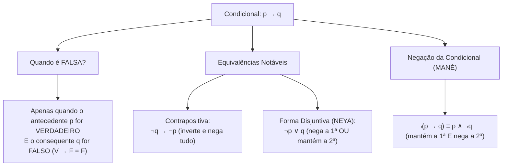
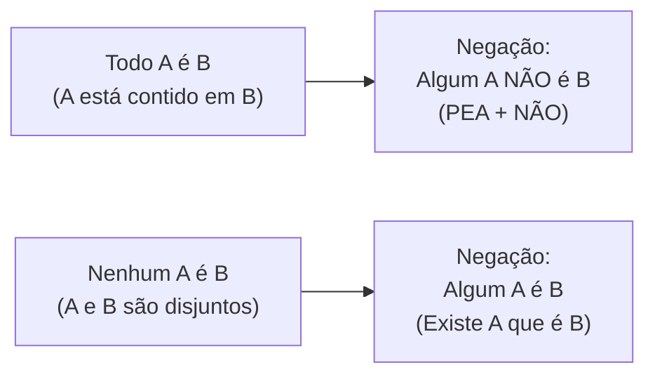

# 05 - Lógica de Argumentação e Conclusões Válidas

> **Matéria:** Matemática e Raciocínio Lógico  
> **Cargos:** A01 – Técnico de Controle Externo (Adm) / B02 – Técnico de Controle Externo (TI)  
> **Arquivo:** `05_logica_de_argumentacao_e_conclusoes_validas.md`  
> **Status:** 🟢 Teoria Aprofundada + 5 Questões FCC Comentadas (A a E)

---

## 📌 Ementa / Itens do Edital
- Compreensão do processo lógico que, a partir de um conjunto de hipóteses, conduz, de forma válida, a conclusões determinadas.
- Proposições lógicas, conectivos e tabelas-verdade.
- Equivalências e negações lógicas.
- Argumentos dedutivos, premissas, conclusão e validade.
- Silogismos categóricos e diagramas lógicos (Todo, Algum, Nenhum).

---

## 🧭 Sumário

1. [Proposições Lógicas, Princípios e Conectivos Fundamentais](#1-proposicoes-logicas-principios-e-conectivos-fundamentais)
    1. [Definição de Proposição e Sentenças Não Proposicionais](#11-definicao-de-proposicao-e-sentencas-nao-proposicionais)
    2. [Os Três Princípios Fundamentais da Lógica Clássica](#12-os-tres-principios-fundamentais-da-logica-classica)
    3. [Conectivos Lógicos e Regras da Tabela-Verdade](#13-conectivos-logicos-e-regras-da-tabela-verdade)
    4. [A Condicional: Peculiaridades e o Caso Falso Único](#14-a-condicional-peculiaridades-e-o-caso-falso-unico)
    5. [Teste 112](#Teste-112)
    6. [Teste 113](#Teste-113)
2. [Álgebra Proposicional: Negações e Equivalências Clássicas](#2-algebra-proposicional-negacoes-e-equivalencias-classicas)
    1. [Leis de De Morgan para Conjunção e Disjunção](#21-leis-de-de-morgan-para-conjuncao-e-disjuncao)
    2. [Negação da Condicional e a Regra do MANÉ](#22-negacao-da-condicional-e-a-regra-do-mane)
    3. [Equivalências Notáveis da Condicional: Contrapositiva e Disjuntiva (NEYA)](#23-equivalencias-notaveis-da-condicional-contrapositiva-e-disjuntiva-neya)
    4. [Tautologias, Contradições e Contingências](#24-tautologias-contradicoes-e-contingencias)
    5. [Teste 114](#Teste-114)
    6. [Teste 115](#Teste-115)
    7. [Teste 116](#Teste-116)
3. [Validade de Argumentos Dedutivos e Regras de Inferência](#3-validade-de-argumentos-dedutivos-e-regras-de-inferencia)
    1. [Estrutura do Argumento: Premissas e Conclusão](#31-estrutura-do-argumento-premissas-e-conclusao)
    2. [Conceito Formal de Validade vs. Verdade Empírica](#32-conceito-formal-de-validade-vs-verdade-empirica)
    3. [Principais Regras de Inferência Válidas](#33-principais-regras-de-inferencia-validas)
    4. [O Método do Encadeamento de Premissas Verdadeiras](#34-o-metodo-do-encadeamento-de-premissas-verdadeiras)
    5. [Teste 117](#Teste-117)
    6. [Teste 118](#Teste-118)
4. [Lógica de Primeira Ordem: Quantificadores e Silogismos Categóricos](#4-logica-de-primeira-ordem-quantificadores-e-silogismos-categoricos)
    1. [Quantificadores Universais e Existenciais: Todo, Nenhum e Algum](#41-quantificadores-universais-e-existenciais-todo-nenhum-e-algum)
    2. [Negação de Proposições Categóricas e a Mnemônica PEA + NÃO](#42-negacao-de-proposicoes-categoricas-e-a-mnemonica-pea-nao)
    3. [Análise de Silogismos via Diagramas de Euler-Venn](#43-analise-de-silogismos-via-diagramas-de-euler-venn)
    4. [Teste 119](#Teste-119)
    5. [Teste 120](#Teste-120)
    6. [Teste 121](#Teste-121)
5. [🌐 Fontes Oficiais e Referências Bibliográficas](#fontes-oficiais-e-referencias-bibliograficas)

---

## 1. Proposições Lógicas, Princípios e Conectivos Fundamentais

A lógica proposicional (ou lógica sentencial) é o ramo da lógica matemática dedicado ao estudo das proposições e dos modos pelos quais estas se combinam para constituir raciocínios dedutivos válidos.

### 1.1 Definição de Proposição e Sentenças Não Proposicionais

* **Proposição Lógica:** Toda oração declarativa com sujeito e predicado expressos que veicula um pensamento completo e à qual se pode atribuir, de forma unívoca, um único valor lógico: **Verdadeiro ($V$)** ou **Falso ($F$)**.
    * Exemplos: *"O TCE-GO fiscaliza as contas municipais"*; *"Goiânia é a capital do Estado de Goiás"*.
* **Sentenças Não Proposicionais (que NÃO são proposições lógicas perante concursos):**
    * Sentenças interrogativas: *"Quem relatou o processo?"*;
    * Sentenças exclamativas: *"Excelente trabalho de auditoria!"*;
    * Sentenças imperativas: *"Instrua os autos imediatamente"*;
    * Sentenças optativas (exprimem desejo): *"Deus o abençoe"*;
    * Sentenças abertas (paradoxo ou incógnita indefinida): *"Ele é auditor fiscal"* (falta definir quem é "ele"); *"$x + 5 = 12$"* (sem o valor de $x$, não é V nem F).

### 1.2 Os Três Princípios Fundamentais da Lógica Clássica

A lógica bivalente aristotélica assenta-se sobre três postulados absolutos:

1. **Princípio da Identidade:** Uma proposição é idêntica a si mesma: se ela é verdadeira, é sempre verdadeira; se é falsa, é sempre falsa ($p \implies p$).
2. **Princípio da Não Contradição:** Uma proposição não pode ser simultaneamente verdadeira e falsa sob as mesmas circunstâncias e no mesmo tempo: $\neg(p \land \neg p)$.
3. **Princípio do Terceiro Excluído:** Uma proposição só pode assumir dois valores lógicos ($V$ ou $F$), excluindo-se qualquer terceiro valor ou estado intermediário.

### 1.3 Conectivos Lógicos e Regras da Tabela-Verdade

As proposições simples combinam-se mediante operadores lógicos (conectivos) para formar proposições compostas. O número de linhas da tabela-verdade de uma proposição composta contendo $n$ proposições simples distintas é sempre dado por:
$$\text{Número de Linhas} = 2^n$$

| Conectivo | Notação Simbólica | Leitura | Condição de Verdade na Tabela-Verdade |
| :--- | :---: | :--- | :--- |
| **Negação** | $\neg p$ ou $\sim p$ | "não p" | Inverte o valor lógico original ($V \rightarrow F$; $F \rightarrow V$). |
| **Conjunção** | $p \land q$ | "p e q" | Só é **VERDADEIRA** se ambas as proposições forem verdadeiras ($V \land V = V$). |
| **Disjunção Inclusiva** | $p \lor q$ | "p ou q" | Só é **FALSA** se ambas as proposições forem falsas ($F \lor F = F$). |
| **Disjunção Exclusiva** | $p \underline{\lor} q$ | "ou p ou q" | É **VERDADEIRA** se os valores lógicos forem opostos/distintos ($V \ \underline{\lor} \ F = V$). |
| **Condicional** | $p \rightarrow q$ | "se p, então q" | Só é **FALSA** se o antecedente for $V$ e o consequente for $F$ ($V \rightarrow F = F$). |
| **Bicondicional** | $p \leftrightarrow q$ | "p se e somente se q" | É **VERDADEIRA** se ambas tiverem o mesmo valor lógico ($V \leftrightarrow V = V$; $F \leftrightarrow F = V$). |

### 1.4 A Condicional: Peculiaridades e o Caso Falso Único

A condicional $p \rightarrow q$ é a estrutura que mais induz candidatos a erro. Na condicional:

* O termo $p$ é o **antecedente** (ou condição suficiente);
* O termo $q$ é o **consequente** (ou condição necessária).
* **A Regra do Falso Único:** A condicional só é avaliada como Falsa se ocorrer a combinação $V \rightarrow F$ (o famoso mnemônico *Vera Fischer é Falsa*).
* Em qualquer outro caso ($V \rightarrow V$, $F \rightarrow V$, $F \rightarrow F$), **a condicional é necessariamente VERDADEIRA**. Note que, se a primeira parte for falsa, a condicional já é automaticamente verdadeira, independentemente do que venha depois.

---

### Teste 112
**(FCC – TRT 15ª – 2015 – Analista Judiciário - Tecnologia da Informação)**
O termo entre parênteses preenche corretamente a lacuna da frase em:

* **A)** reconhece o mérito das mudanças políticas de então, ironizando a hierarquia social que antes predominava entre escravo e senhor.
* **B)** mostra como um avanço social, na verdade, beneficia a todos: o escravo se torna livre, seu antigo dono adquire prestígio social.
* **C)** reflete o entusiasmo com que foi tomada a libertação dos escravos no Brasil, a partir do relato de uma situação particular.
* **D)** faz ressalvas ao processo político que envolveu o fim da escravidão, visto que os títulos concedidos não possuíam valor legal.
* **E)** trata o fim da escravidão com ironia, mostrando como uma simples carta de alforria não significava mudança da condição social do escravo.

---

> **Comentário Detalhado:**
>
> - **A)** **Correta.** Conforme fundamentado na seção *1.3 Conectivos Lógicos e Regras da Tabela-Verdade* deste guia, condicional: $p \rightarrow q$ — "se p, então q" — Só é FALSA se o antecedente for $V$ e o consequente for $F$ ($V \rightarrow F = F$). Dessa forma, está plenamente correta a assertiva da banca (FCC – TRT 15ª/2015) ao estabelecer que "reconhece o mérito das mudanças políticas de então, ironizando a hierarquia social que antes predominava entre...".
> - **B)** **Incorreta.** A opção apresenta proposição em desacordo com os fundamentos teóricos e técnicos do tópico ao afirmar que "mostra como um avanço social, na verdade, beneficia a todos: o escravo se torna livre, seu antigo dono adquire...". De acordo com a teoria estudada em *2.2 Negação da Condicional e a Regra do MANÉ*, a negação de uma proposição do tipo *"Se p, então q"* JAMAIS começa com a palavra 'Se'! Se a questão solicitar a negação de uma condicional e alguma alternativa vier iniciada por *"Se..."*, elimine-a imediatamente.
> - **C)** **Incorreta.** A opção apresenta proposição em desacordo com os fundamentos teóricos e técnicos do tópico ao afirmar que "reflete o entusiasmo com que foi tomada a libertação dos escravos no Brasil, a partir do relato de uma situação...". De acordo com a teoria estudada em *3. Validade de Argumentos Dedutivos e Regras de Inferência*, a argumentação lógica investiga se uma determinada conclusão decorre com necessidade matemática absoluta a partir de um conjunto de premissas assumidas como verdadeiras.
> - **D)** **Incorreta.** A opção apresenta proposição em desacordo com os fundamentos teóricos e técnicos do tópico ao afirmar que "faz ressalvas ao processo político que envolveu o fim da escravidão, visto que os títulos concedidos não possuíam...". De acordo com a teoria estudada em *1.1 Definição de Proposição e Sentenças Não Proposicionais*, sentenças interrogativas: *"Quem relatou o processo?"*.
> - **E)** **Incorreta.** A opção apresenta proposição em desacordo com os fundamentos teóricos e técnicos do tópico ao afirmar que "trata o fim da escravidão com ironia, mostrando como uma simples carta de alforria não significava mudança da...". De acordo com a teoria estudada em *1.4 A Condicional: Peculiaridades e o Caso Falso Único*, o termo $p$ é o antecedente (ou condição suficiente).
>
> **Gabarito: A**

---

### Teste 113
**(FCC – TRT 11ª – 2017 – Analista Judiciário - Tecnologia da Informação)**
É legítimo afirmar: no texto,

* **A)** Transpondo a voz passiva presente na frase para a voz ativa, a forma correta a ser grafada é “têm acompanhado”.
* **B)** A retirada da vírgula após a palavra reiteradamente prejudica o sentido original da frase.
* **C)** A expressão Visível a olho nu, que constitui caracterização da palavra que a antecede, dá oportunidade para que se introduza outro argumento a favor da ideia expressa por notório.
* **D)** Se o assunto fosse não um processo, mas “processos”, a correção exigiria a forma “se tratam de processos”.
* **E)** O verbo “haver”, na frase, está empregado como indica o seguinte verbete do Dicionário eletrônico Houaiss: transitivo direto [impessoal] ter transcorrido ou ser decorrido (tempo).

---

> **Comentário Detalhado:**
>
> - **A)** **Incorreta.** A opção apresenta proposição em desacordo com os fundamentos teóricos e técnicos do tópico ao afirmar que "Transpondo a voz passiva presente na frase para a voz ativa, a forma correta a ser grafada é “têm acompanhado”". De acordo com a teoria estudada em *1.1 Definição de Proposição e Sentenças Não Proposicionais*, sentenças interrogativas: *"Quem relatou o processo?"*.
> - **B)** **Incorreta.** A opção apresenta proposição em desacordo com os fundamentos teóricos e técnicos do tópico ao afirmar que "A retirada da vírgula após a palavra reiteradamente prejudica o sentido original da frase". De acordo com a teoria estudada em *1.3 Conectivos Lógicos e Regras da Tabela-Verdade*, negação: $\neg p$ ou $\sim p$ — "não p" — Inverte o valor lógico original ($V \rightarrow F$; $F \rightarrow V$).
> - **C)** **Incorreta.** A opção apresenta proposição em desacordo com os fundamentos teóricos e técnicos do tópico ao afirmar que "A expressão Visível a olho nu, que constitui caracterização da palavra que a antecede, dá oportunidade para que se...". De acordo com a teoria estudada em *4.3 Análise de Silogismos via Diagramas de Euler-Venn*, portanto, deduzir que *"Algum A é P"* ou *"Nenhum A é P"* constitui falácia de conclusão contingente. O que é logicamente correto afirmar é que a interseção pode ocorrer, mas não é uma conclusão necessária.
> - **D)** **Correta.** Conforme fundamentado na seção *1.1 Definição de Proposição e Sentenças Não Proposicionais* deste guia, proposição Lógica: Toda oração declarativa com sujeito e predicado expressos que veicula um pensamento completo e à qual se pode atribuir, de forma unívoca, um único valor lógico: Verdadeiro ($V$) ou Falso ($F$). Dessa forma, está plenamente correta a assertiva da banca (FCC – TRT 11ª/2017) ao estabelecer que "Se o assunto fosse não um processo, mas “processos”, a correção exigiria a forma “se tratam de processos”".
> - **E)** **Incorreta.** A opção apresenta proposição em desacordo com os fundamentos teóricos e técnicos do tópico ao afirmar que "O verbo “haver”, na frase, está empregado como indica o seguinte verbete do Dicionário eletrônico Houaiss...". De acordo com a teoria estudada em *1.2 Os Três Princípios Fundamentais da Lógica Clássica*, princípio da Não Contradição: Uma proposição não pode ser simultaneamente verdadeira e falsa sob as mesmas circunstâncias e no mesmo tempo: $\neg(p \land \neg p)$.
>
> **Gabarito: D**

---

## 2. Álgebra Proposicional: Negações e Equivalências Clássicas

Duas proposições compostas são **logicamente equivalentes** ($P \equiv Q$) quando possuem rigorosamente a mesma tabela-verdade para todas as combinações de valorações de suas componentes.

### 2.1 Leis de De Morgan para Conjunção e Disjunção

As Leis de Augustus De Morgan ditam a negação das estruturas conjuntivas e disjuntivas:

1. **Negação da Conjunção ("E"):** Nega-se a primeira, nega-se a segunda e troca-se o conectivo por "OU":
   $$\neg(p \land q) \equiv \neg p \lor \neg q$$
   *Exemplo:* A negação de *"O relatório foi concluído e o prazo foi cumprido"* é *"O relatório **não** foi concluído **OU** o prazo **não** foi cumprido"*.
2. **Negação da Disjunção Inclusiva ("OU"):** Nega-se a primeira, nega-se a segunda e troca-se o conectivo por "E":
   $$\neg(p \lor q) \equiv \neg p \land \neg q$$
   *Exemplo:* A negação de *"Houve sobrepreço ou houve desídia"* é *"**Não** houve sobrepreço **E** **não** houve desídia"*.

### 2.2 Negação da Condicional e a Regra do MANÉ

A negação de uma proposição condicional $p \rightarrow q$ é obtida pelo célebre mnemônico **MANÉ** (**MA**ntém a primeira e **NE**ga a segunda):
$$\neg(p \rightarrow q) \equiv p \land \neg q$$

> 🚨 **ALERTA DE PROVA / PEGADINHA FCC:** A negação de uma proposição do tipo *"Se p, então q"* **JAMAIS começa com a palavra 'Se'**! Se a questão solicitar a negação de uma condicional e alguma alternativa vier iniciada por *"Se..."*, elimine-a imediatamente. A negação lógica da condicional é sempre uma conjunção com o conectivo **"E"**!
>
> * Proposição: *"Se o auditor fiscaliza, a irregularidade diminui."*
> * Negação estrita: *"O auditor fiscaliza **E** a irregularidade **não** diminui."*

### 2.3 Equivalências Notáveis da Condicional: Contrapositiva e Disjuntiva (NEYA)

A FCC explora intensamente duas formas canônicas de reescrever a condicional $p \rightarrow q$:

1. **Equivalência Contrapositiva (Inverte e Nega Tudo):**
   $$p \rightarrow q \equiv \neg q \rightarrow \neg p$$
   *Exemplo:* *"Se a prestação de contas foi apresentada tempestivamente, então a certidão foi emitida"* $\equiv$ *"Se a certidão **não** foi emitida, então a prestação de contas **não** foi apresentada tempestivamente"*.
2. **Equivalência Disjuntiva (Regra do NEYA - NEga a primeira OU mantêm a segunda):**
   $$p \rightarrow q \equiv \neg p \lor q$$
   *Exemplo:* *"Se o servidor observa a moralidade, sua conduta é inatacável"* $\equiv$ *"O servidor **não** observa a moralidade **OU** sua conduta é inatacável"*.

### 2.4 Tautologias, Contradições e Contingências

* **Tautologia:** Proposição composta que é invariavelmente verdadeira em todas as linhas da sua tabela-verdade, independentemente dos valores lógicos das proposições simples (ex.: $p \lor \neg p$, princípio do terceiro excluído).
* **Contradição:** Proposição composta que é invariavelmente falsa em todas as linhas da sua tabela-verdade (ex.: $p \land \neg p$).
* **Contingência:** Proposição composta cuja tabela-verdade apresenta pelo menos um valor verdadeiro e pelo menos um valor falso.

---

### Teste 114
**(FGV – TJ/AP – 2023 – Analista Judiciario Apoio Especializado Tecnologia Da Informacao Desenvolvimento De Sistemas)**
A analista Joelma está desenvolvendo o web service tjapRest utilizando o Spring Boot. Determinadas operações de tjapRest devem ser executadas assincronamente. Para implementar as operações assíncronas de forma simples e direta, Joelma recorreu a duas anotações padrões do Spring. A primeira anotação habilita o suporte do Spring à execução de métodos assíncronos. A segunda anotação marca determinado método como um candidato à execução assíncrona. Joelma recorreu às anotações do Spring:

* **A)** @EnableAsync e @Async;
* **B)** @AsyncConfigurer e @Async;
* **C)** @EnableAsync e @Asynchronous;
* **D)** @AsyncConfigurer e @EnableAsync;
* **E)** @AsyncConfigurer e @Asynchronous.

---

> **Comentário Detalhado:**
>
> - **A)** **Correta.** Conforme fundamentado na seção *2.1 Leis de De Morgan para Conjunção e Disjunção* deste guia, negação da Conjunção ("E"): Nega-se a primeira, nega-se a segunda e troca-se o conectivo por "OU". Dessa forma, está plenamente correta a assertiva da banca (FGV – TJ/AP/2023) ao estabelecer que "@EnableAsync e @Async".
> - **B)** **Incorreta.** A opção apresenta proposição em desacordo com os fundamentos teóricos e técnicos do tópico ao afirmar que "@AsyncConfigurer e @Async". De acordo com a teoria estudada em *2.1 Leis de De Morgan para Conjunção e Disjunção*, negação da Disjunção Inclusiva ("OU"): Nega-se a primeira, nega-se a segunda e troca-se o conectivo por "E".
> - **C)** **Incorreta.** A opção apresenta proposição em desacordo com os fundamentos teóricos e técnicos do tópico ao afirmar que "@EnableAsync e @Asynchronous". De acordo com a teoria estudada em *2.2 Negação da Condicional e a Regra do MANÉ*, a negação de uma proposição condicional $p \rightarrow q$ é obtida pelo célebre mnemônico MANÉ (MAntém a primeira e NEga a segunda).
> - **D)** **Incorreta.** A opção apresenta proposição em desacordo com os fundamentos teóricos e técnicos do tópico ao afirmar que "@AsyncConfigurer e @EnableAsync". De acordo com a teoria estudada em *2.3 Equivalências Notáveis da Condicional: Contrapositiva e Disjuntiva (NEYA)*, equivalência Disjuntiva (Regra do NEYA - NEga a primeira OU mantêm a segunda).
> - **E)** **Incorreta.** A opção apresenta proposição em desacordo com os fundamentos teóricos e técnicos do tópico ao afirmar que "@AsyncConfigurer e @Asynchronous". De acordo com a teoria estudada em *3.4 O Método do Encadeamento de Premissas Verdadeiras*, propagar esse valor veritativo pelas condicionais utilizando *Modus Ponens* ou *Modus Tollens*.
>
> **Gabarito: A**

---

### Teste 115
**(FCC – TRT 13ª – 2014 – Analista Judiciário - Tecnologia da Informação)**
Considere o seguinte caso: Observando o trâmite de processos no tribunal, Marta percebeu que tanto advogados quanto juízes realizavam análises nos diversos pareceres constantes dos processos. Com sua experiência como analista ela deduziu que uma possível informatização dos processos poderia contemplar uma classe chamada Advogado e outra chamada Juiz, tendo como base uma classe comum chamada Pessoa, com um método chamado AnalisarParecer. Este método (definido na classe comum) se comportaria de maneira diferente para as chamadas feitas a partir de uma instância de Advogado e para as chamadas feitas a partir de uma instância de Juiz, em razão deles terem responsabilidades diferentes em sua forma de analisar e opinar sobre os pareceres. Pela observação do método e seu comportamento, o princípio da orientação a objetos aplicável no caso, fundamentalmente, é

* **A)** a comunicabilidade.
* **B)** o encapsulameto.
* **C)** a visibilidade.
* **D)** o polimorfismo.
* **E)** a estereotipagem.

---

> **Comentário Detalhado:**
>
> - **A)** **Incorreta.** A opção apresenta proposição em desacordo com os fundamentos teóricos e técnicos do tópico ao afirmar que "a comunicabilidade". De acordo com a teoria estudada em *1.1 Definição de Proposição e Sentenças Não Proposicionais*, proposição Lógica: Toda oração declarativa com sujeito e predicado expressos que veicula um pensamento completo e à qual se pode atribuir, de forma unívoca, um único valor lógico: Verdadeiro ($V$) ou Falso ($F$).
> - **B)** **Incorreta.** A opção apresenta proposição em desacordo com os fundamentos teóricos e técnicos do tópico ao afirmar que "o encapsulameto". De acordo com a teoria estudada em *3. Validade de Argumentos Dedutivos e Regras de Inferência*, a argumentação lógica investiga se uma determinada conclusão decorre com necessidade matemática absoluta a partir de um conjunto de premissas assumidas como verdadeiras.
> - **C)** **Incorreta.** A opção apresenta proposição em desacordo com os fundamentos teóricos e técnicos do tópico ao afirmar que "a visibilidade". De acordo com a teoria estudada em *3.2 Conceito Formal de Validade vs. Verdade Empírica*, se for possível construir um cenário consistente em que todas as premissas sejam verdadeiras e a conclusão seja falsa, o argumento é categorizado como INVÁLIDO (Falácia ou Sofisma).
> - **D)** **Correta.** Conforme fundamentado na seção *2.4 Tautologias, Contradições e Contingências* deste guia, tautologia: Proposição composta que é invariavelmente verdadeira em todas as linhas da sua tabela-verdade, independentemente dos valores lógicos das proposições simples (ex.: $p \lor \neg p$, princípio do terceiro excluído). Dessa forma, está plenamente correta a assertiva da banca (FCC – TRT 13ª/2014) ao estabelecer que "o polimorfismo".
> - **E)** **Incorreta.** A opção apresenta proposição em desacordo com os fundamentos teóricos e técnicos do tópico ao afirmar que "a estereotipagem". De acordo com a teoria estudada em *1.2 Os Três Princípios Fundamentais da Lógica Clássica*, princípio da Identidade: Uma proposição é idêntica a si mesma: se ela é verdadeira, é sempre verdadeira; se é falsa, é sempre falsa ($p \implies p$).
>
> **Gabarito: D**

---

### Teste 116
**(FCC – TRT 14ª – 2016 – Analista Judiciário - Apoio Especializado - Tecnologia da Informação)**
Utilizando instruções da PL/SQL, no Oracle 11g, é possível conceder ou remover privilégios de objeto a outros usuários. É correto afirmar:

* **A)** não será possível restaurar um backup do banco de dados, pois os control files, datafiles e online redo log files foram perdidos.
* **B)** será possível restaurar um backup do banco de dados utilizando o aplicativo DUMP ou RESTORE a partir da flash recovery area.
* **C)** não será possível restaurar um banco de dados porque o servidor sempre fica off-line quando o disco é danificado, impedindo o acesso à flash recovery area.
* **D)** será possível restaurar um backup RMAN em conjunto com os archive redo log files contidos na flash recovery area.
* **E)** não será possível restaurar o banco de dados, pois o software Oracle foi corrompido e o disco no qual se localizavam os arquivos do banco de dados foi danificado.

---

> **Comentário Detalhado:**
>
> - **A)** **Incorreta.** A opção apresenta proposição em desacordo com os fundamentos teóricos e técnicos do tópico ao afirmar que "não será possível restaurar um backup do banco de dados, pois os control files, datafiles e online redo log files...". De acordo com a teoria estudada em *3.4 O Método do Encadeamento de Premissas Verdadeiras*, propagar esse valor veritativo pelas condicionais utilizando *Modus Ponens* ou *Modus Tollens*.
> - **B)** **Correta.** Conforme fundamentado na seção *3.2 Conceito Formal de Validade vs. Verdade Empírica* deste guia, se for possível construir um cenário consistente em que todas as premissas sejam verdadeiras e a conclusão seja falsa, o argumento é categorizado como INVÁLIDO (Falácia ou Sofisma). Dessa forma, está plenamente correta a assertiva da banca (FCC – TRT 14ª/2016) ao estabelecer que "será possível restaurar um backup do banco de dados utilizando o aplicativo DUMP ou RESTORE a partir da flash...".
> - **C)** **Incorreta.** A opção promove generalização excessiva que desconsidera as condições técnicas e normativas ao afirmar que "não será possível restaurar um banco de dados porque o servidor sempre fica off-line quando o disco é danificado...". De acordo com a teoria estudada em *3. Validade de Argumentos Dedutivos e Regras de Inferência*, a argumentação lógica investiga se uma determinada conclusão decorre com necessidade matemática absoluta a partir de um conjunto de premissas assumidas como verdadeiras.
> - **D)** **Incorreta.** A opção apresenta proposição em desacordo com os fundamentos teóricos e técnicos do tópico ao afirmar que "será possível restaurar um backup RMAN em conjunto com os archive redo log files contidos na flash recovery area". De acordo com a teoria estudada em *3.1 Estrutura do Argumento: Premissas e Conclusão*, um argumento dedutivo é um conjunto ordenado de proposições estruturado em.
> - **E)** **Incorreta.** A opção apresenta proposição em desacordo com os fundamentos teóricos e técnicos do tópico ao afirmar que "não será possível restaurar o banco de dados, pois o software Oracle foi corrompido e o disco no qual se...". De acordo com a teoria estudada em *4.3 Análise de Silogismos via Diagramas de Euler-Venn*, portanto, deduzir que *"Algum A é P"* ou *"Nenhum A é P"* constitui falácia de conclusão contingente. O que é logicamente correto afirmar é que a interseção pode ocorrer, mas não é uma conclusão necessária.
>
> **Gabarito: B**

---

## 3. Validade de Argumentos Dedutivos e Regras de Inferência

A argumentação lógica investiga se uma determinada conclusão decorre com necessidade matemática absoluta a partir de um conjunto de premissas assumidas como verdadeiras.

### 3.1 Estrutura do Argumento: Premissas e Conclusão

Um argumento dedutivo é um conjunto ordenado de proposições estruturado em:

* **Premissas ($P_1, P_2, \dots, P_n$):** Proposições que servem de ponto de partida, evidência ou suporte fático.
* **Conclusão ($C$):** Proposição final deduzida que decorre das premissas.
Representa-se simbolicamente por: $P_1, P_2, \dots, P_n \vdash C$.

### 3.2 Conceito Formal de Validade vs. Verdade Empírica

* A **validade** é uma propriedade formal e estrutural do argumento; não se confunde com a verdade material dos fatos no mundo físico.
* Um argumento dedutivo é declarado **VÁLIDO** quando é logicamente impossível que todas as suas premissas sejam simultaneamente verdadeiras e a sua conclusão seja falsa.
* Se for possível construir um cenário consistente em que todas as premissas sejam verdadeiras e a conclusão seja falsa, o argumento é categorizado como **INVÁLIDO (Falácia ou Sofisma)**.

### 3.3 Principais Regras de Inferência Válidas

1. **Modus Ponens (Afirmação do Antecedente):**
   $$\frac{p \rightarrow q, \quad p}{\therefore q}$$
2. **Modus Tollens (Negação do Consequente):**
   $$\frac{p \rightarrow q, \quad \neg q}{\therefore \neg p}$$
3. **Silogismo Disjuntivo:**
   $$\frac{p \lor q, \quad \neg p}{\therefore q}$$
4. **Silogismo Hipotético (Transitividade da Condicional):**
   $$\frac{p \rightarrow q, \quad q \rightarrow r}{\therefore p \rightarrow r}$$

### 3.4 O Método do Encadeamento de Premissas Verdadeiras

O método prático para resolver questões com múltiplas premissas condicionais na FCC consiste em:

1. Atribuir o valor lógico **VERDADEIRO ($V$)** a todas as premissas do enunciado;
2. Localizar o ponto de partida mais restrito: quase sempre uma **proposição simples isolada** ou uma **conjunção ("E")**;
3. Propagar esse valor veritativo pelas condicionais utilizando *Modus Ponens* ou *Modus Tollens*;
4. As conclusões verdadeiras necessárias deduzidas correspondem à alternativa correta.

---

### Teste 117
**(FGV – TJ/MT – 2024 – Analista Judiciario Tecnologia Da Informacao)**
Um firewall é uma ferramenta essencial para proteger uma rede de computadores contra acessos não autorizados e ameaças externas. O papel de um firewall em uma rede de computadores é

* **A)** permitir o tráfego de dados sem qualquer restrição, garantindo que a rede esteja sempre disponível para comunicação.
* **B)** bloquear todo o tráfego de dados proveniente de redes externas, sem qualquer exceção, para proteger os dados da rede interna.
* **C)** monitorar e controlar o tráfego de rede com base em um conjunto de regras de segurança definidas, permitindo ou bloqueando o tráfego conforme a política configurada.
* **D)** substituir a necessidade de criptografia em redes, garantindo que todos os dados sejam transmitidos de forma segura.
* **E)** impedir que dispositivos internos da rede se comuniquem entre si, restringindo a troca de dados entre os usuários. REDAÇÃO As questões urbanas que afetam a sociedade surgiram com o intenso processo de urbanização que aconteceu nos países em diferentes épocas. No Brasil, por exemplo, o êxodo rural e o consequente aumento populacional das cidades ganharam evidência a partir da metade do século XX, menos de cem anos atrás. Diferentemente de outras nações desenvolvidas, que apresentam planejamento urbano, o nascimento dos municípios brasileiros aconteceu sem organização prévia: os indivíduos se instalavam onde e como era possível. Com isso, uma série de fatores negativos surgiram. Hoje, a população urbana enfrenta uma série de diferentes problemas. Selecione os que lhe parecem mais graves, trace um panorama sobre suas causas e apresente medidas para reduzi-los, num texto de extensão entre 20 e 30 linhas, em modelo dissertativo-argumentativo, em linguagem culta.

---

> **Comentário Detalhado:**
>
> - **A)** **Incorreta.** A opção promove generalização excessiva que desconsidera as condições técnicas e normativas ao afirmar que "permitir o tráfego de dados sem qualquer restrição, garantindo que a rede esteja sempre disponível para comunicação". De acordo com a teoria estudada em *1.3 Conectivos Lógicos e Regras da Tabela-Verdade*, as proposições simples combinam-se mediante operadores lógicos (conectivos) para formar proposições compostas. O número de linhas da tabela-verdade de uma proposição composta contendo $n$ proposições simples distintas é sempre dado por.
> - **B)** **Incorreta.** A opção promove generalização excessiva que desconsidera as condições técnicas e normativas ao afirmar que "bloquear todo o tráfego de dados proveniente de redes externas, sem qualquer exceção, para proteger os dados da...". De acordo com a teoria estudada em *1.2 Os Três Princípios Fundamentais da Lógica Clássica*, princípio do Terceiro Excluído: Uma proposição só pode assumir dois valores lógicos ($V$ ou $F$), excluindo-se qualquer terceiro valor ou estado intermediário.
> - **C)** **Correta.** Conforme fundamentado na seção *3. Validade de Argumentos Dedutivos e Regras de Inferência* deste guia, a argumentação lógica investiga se uma determinada conclusão decorre com necessidade matemática absoluta a partir de um conjunto de premissas assumidas como verdadeiras. Dessa forma, está plenamente correta a assertiva da banca (FGV – TJ/MT/2024) ao estabelecer que "monitorar e controlar o tráfego de rede com base em um conjunto de regras de segurança definidas, permitindo ou...".
> - **D)** **Incorreta.** A opção apresenta proposição em desacordo com os fundamentos teóricos e técnicos do tópico ao afirmar que "substituir a necessidade de criptografia em redes, garantindo que todos os dados sejam transmitidos de forma segura". De acordo com a teoria estudada em *1.1 Definição de Proposição e Sentenças Não Proposicionais*, proposição Lógica: Toda oração declarativa com sujeito e predicado expressos que veicula um pensamento completo e à qual se pode atribuir, de forma unívoca, um único valor lógico: Verdadeiro ($V$) ou Falso ($F$).
> - **E)** **Incorreta.** A opção apresenta proposição em desacordo com os fundamentos teóricos e técnicos do tópico ao afirmar que "impedir que dispositivos internos da rede se comuniquem entre si, restringindo a troca de dados entre os usuários...". De acordo com a teoria estudada em *4.1 Quantificadores Universais e Existenciais: Todo, Nenhum e Algum*, particular Negativo ("ALGUM A NÃO é B"): Existe pelo menos um elemento de A que não pertence ao conjunto B.
>
> **Gabarito: C**

---

### Teste 118
**(FGV – TCE/PA – 2024 – Auditor de Controle Externo - Administrativa - Direito)**
A Alfa Químicas do Pará é uma empresa que comercializa e distribui insumos industriais para diversos segmentos do mercado e se localiza na confluência do rio Beta com o manancial de captação de água do sistema de abastecimento público de 3 (três) cidades. Um dos produtos que a empresa comercializa é a substância tolueno, um líquido incolor, volátil, com odor característico, amplamente utilizado como solvente em indústrias que vão desde a produção de tintas e vernizes até a fabricação de produtos farmacêuticos e de borracha. No entanto, apesar de sua utilidade, o tolueno apresenta sérios riscos para a saúde humana e para o meio ambiente, alguns já conhecidos e outros ainda não comprovados por evidências científicas. Um dos funcionários da empresa Alfa Químicas do Pará, discordando da forma como estava sendo conduzido o processo de armazenamento do tolueno, denunciou-a à Secretaria de Meio Ambiente e Sustentabilidade do Pará, dando conta de que existiam tanques de armazenamento com má conservação e que estavam sendo feitas descargas industriais inadequadas. Após investigação, ficou constatada a presença de efluentes com a substância tolueno, sem qualquer tratamento, nas galerias de águas pluviais cujo curso, conforme planta industrial, desemboca no rio Beta. A empresa cessou as atividades alguns meses após o ajuizamento da ação civil pública pelo Ministério Público, que ocorreu 5 (cinco) anos após a ocorrência do fato constatado. Dessa forma, à luz dos Princípios do Direito Ambiental, da Política Nacional do Meio Ambiente – Lei nº 6938/81 e da jurisprudência dos Tribunais Superiores sobre a matéria, assinale a afirmativa correta.

* **A)** A situação narrada caracteriza infração ambiental, passível de aplicação de sanções como a multa administrativa. Todavia, a demanda de reparação civil daí decorrente exige não apenas a ocorrência de infração, mas também que seja demonstrado o dano efetivo, observado o prazo prescricional de 10 (dez) anos.
* **B)** Diante dos princípios da precaução e da prevenção e dado o alto grau de risco que a atividade de despejo de efluentes contaminados, sem qualquer tratamento, em rio com ponto de confluência com manancial de captação para abastecimento público representa para o meio ambiente e a saúde humana, a ausência de nova prova técnica pericial do dano na fase processual pela parte autora não inviabiliza o reconhecimento do dever de reparação ambiental.
* **C)** Eventual ausência de realização de perícia judicial, em razão do grande tempo transcorrido para ajuizamento da ação e do fato de a empresa já ter finalizado suas atividades inviabiliza o reconhecimento do dever de reparação ambiental. Ademais, houve perda do interesse de agir, diante do encerramento das atividades da empresa.
* **D)** A inversão do ônus da prova não se aplica à presente hipótese, tendo em vista que não há prova cabal da presença de tolueno ao longo do rio Beta. Assim, não é possível especificar minimamente qual marca deletéria o despejo do efluente contaminado por tolueno impactou no ambiente de entorno e à saúde humana.
* **E)** Com base no ordenamento jurídico brasileiro, a regra geral é a de que a pretensão de exigir a reparação dos danos seja submetida à prescrição. Portanto, a despeito de a Constituição e leis ordinárias não disporem acerca do prazo prescricional para a reparação de danos civis ambientais, os tribunais superiores entendem que vigora a regra da estipulação de prazo de 5 anos para pretensão em matéria ambiental.

---

> **Comentário Detalhado:**
>
> - **A)** **Incorreta.** A opção incorre em restrição indevida ao limitar o escopo conceitual ao afirmar que "A situação narrada caracteriza infração ambiental, passível de aplicação de sanções como a multa administrativa...". De acordo com a teoria estudada em *1.4 A Condicional: Peculiaridades e o Caso Falso Único*, em qualquer outro caso ($V \rightarrow V$, $F \rightarrow V$, $F \rightarrow F$), a condicional é necessariamente VERDADEIRA. Note que, se a primeira parte for falsa, a condicional já é automaticamente verdadeira, independentemente do que venha depois.
> - **B)** **Correta.** Conforme fundamentado na seção *1.2 Os Três Princípios Fundamentais da Lógica Clássica* deste guia, princípio do Terceiro Excluído: Uma proposição só pode assumir dois valores lógicos ($V$ ou $F$), excluindo-se qualquer terceiro valor ou estado intermediário. Dessa forma, está plenamente correta a assertiva da banca (FGV – TCE/PA/2024) ao estabelecer que "Diante dos princípios da precaução e da prevenção e dado o alto grau de risco que a atividade de despejo de...".
> - **C)** **Incorreta.** A opção apresenta proposição em desacordo com os fundamentos teóricos e técnicos do tópico ao afirmar que "Eventual ausência de realização de perícia judicial, em razão do grande tempo transcorrido para ajuizamento da...". De acordo com a teoria estudada em *1.2 Os Três Princípios Fundamentais da Lógica Clássica*, princípio da Não Contradição: Uma proposição não pode ser simultaneamente verdadeira e falsa sob as mesmas circunstâncias e no mesmo tempo: $\neg(p \land \neg p)$.
> - **D)** **Incorreta.** A opção apresenta proposição em desacordo com os fundamentos teóricos e técnicos do tópico ao afirmar que "A inversão do ônus da prova não se aplica à presente hipótese, tendo em vista que não há prova cabal da presença...". De acordo com a teoria estudada em *1.2 Os Três Princípios Fundamentais da Lógica Clássica*, a lógica bivalente aristotélica assenta-se sobre três postulados absolutos.
> - **E)** **Incorreta.** A opção apresenta proposição em desacordo com os fundamentos teóricos e técnicos do tópico ao afirmar que "Com base no ordenamento jurídico brasileiro, a regra geral é a de que a pretensão de exigir a reparação dos danos...". De acordo com a teoria estudada em *2.1 Leis de De Morgan para Conjunção e Disjunção*, *Exemplo:* A negação de *"O relatório foi concluído e o prazo foi cumprido"* é *"O relatório não foi concluído OU o prazo não foi cumprido"*.
>
> **Gabarito: B**

---

## 4. Lógica de Primeira Ordem: Quantificadores e Silogismos Categóricos

A lógica categórica estuda proposições que expressam relações de inclusão total, inclusão parcial ou exclusão total entre classes e conjuntos.

### 4.1 Quantificadores Universais e Existenciais: Todo, Nenhum e Algum

* **Universal Afirmativo ("TODO A é B"):** Todo elemento de A pertence a B ($A \subset B$). O conjunto A está totalmente contido no conjunto B.
* **Universal Negativo ("NENHUM A é B"):** Nenhum elemento de A pertence a B ($A \cap B = \emptyset$). Os conjuntos A e B são mutuamente disjuntos.
* **Particular / Existencial Afirmativo ("ALGUM A é B"):** Existe pelo menos um elemento pertencente a A que também pertence a B ($A \cap B \neq \emptyset$).
* **Particular Negativo ("ALGUM A NÃO é B"):** Existe pelo menos um elemento de A que não pertence ao conjunto B.

### 4.2 Negação de Proposições Categóricas e a Mnemônica PEA + NÃO

Para negar uma proposição quantificada, deve-se alternar o tipo de quantificador (universal vira existencial, e existencial vira universal):

1. **Negação de "TODO A é B":**
    * Não é "Nenhum A é B"! Para quebrar uma afirmação universal afirmativa, basta encontrar **ao menos um contraexemplo**.
    * Aplica-se a regra mnemônica **PEA + NÃO**:
    * **P**elo menos um A não é B;
    * **E**xiste A que não é B;
    * **A**lgum A não é B.

2. **Negação de "NENHUM A é B":**
    * Basta provar que existe pelo menos um elemento na interseção: *"Algum A é B"* (ou *"Pelo menos um A é B"*).

3. **Negação de "ALGUM A é B":**
    * Nega-se pelo quantificador universal negativo: *"Nenhum A é B"*.

> 🚨 **ALERTA DE PROVA / PEGADINHA DO "TODO" VS. "NENHUM":** A alternativa mais tentadora e incorreta em provas da FCC para negar *"Todos os servidores são concursados"* é *"Nenhum servidor é concursado"*. Lembre-se: "Todo" e "Nenhum" são proposições contrárias (podem ser ambas falsas ao mesmo tempo se houver 99 concursados e 1 comissionado), mas **não são contraditórias**. A negação legítima é: *"Pelo menos um servidor não é concursado"*.

### 4.3 Análise de Silogismos via Diagramas de Euler-Venn

Para avaliar a validade de silogismos com premissas como *"Todo A é E"* e *"Algum E é P"*:

* Desenhe os círculos de conjuntos de Euler-Venn;
* O círculo $A$ está totalmente dentro de $E$;
* O círculo $P$ cruza com $E$, mas **não se pode garantir que encoste em $A$**. Ele pode estar numa região de $E$ totalmente afastada de $A$;
* Portanto, deduzir que *"Algum A é P"* ou *"Nenhum A é P"* constitui falácia de conclusão contingente. O que é logicamente correto afirmar é que a interseção pode ocorrer, mas **não é uma conclusão necessária**.

---

### Teste 119
**(FGV – TCE/SC – 2026 – Auditor Fiscal de Controle Externo - Economia)**
A estabilização monetária promovida pelo Plano Real alterou de forma importante a dinâmica social brasileira ao reduzir a corrosão inflacionária que incidia com maior intensidade sobre os grupos de menor renda, o que contribuiu para a queda da pobreza absoluta, especialmente no período imediatamente posterior a 1994. Entretanto, a melhora distributiva nos anos finais da década de 1990 foi mais limitada do que às vezes se supõe, pois o coeficiente de Gini permaneceu em torno de 0,60, sem trajetória contínua de queda, ao mesmo tempo em que o mercado de trabalho foi marcado por desemprego mais elevado, avanço da informalidade e maior flexibilização das relações de trabalho. Já na década de 2000, a redução da desigualdade tornou-se mais nítida, associada ao aumento da renda do trabalho, à formalização do emprego, à valorização real do salário mínimo e à expansão das transferências governamentais para os estratos mais pobres. Com base nesse processo histórico, assinale a afirmativa correta.

* **A)** A partir de 1995, a principal razão para a queda contínua e intensa da desigualdade foi a liberalização econômica dos anos 1990, que reduziu o desemprego, ampliou a formalização e derrubou de forma persistente o coeficiente de Gini ainda no governo FHC.
* **B)** A estabilização monetária reduziu a pobreza após 1995, mas a queda mais consistente da desigualdade ocorreu apenas nos anos 2000, com melhora do mercado de trabalho e expansão das transferências sociais.
* **C)** A partir de 1995, a pobreza caiu porque o crescimento econômico da segunda metade dos anos 1990 foi elevado e sustentado, sendo esse o fator decisivo tanto para a redução da pobreza quanto para a forte queda do índice de Gini já naquela década.
* **D)** A partir de 1995, a redução da inflação teve pouco efeito sobre a pobreza, pois o principal determinante da melhora distributiva foi a imediata queda da informalidade e do desemprego urbano observada ainda entre 1995 e 1998.
* **E)** A partir de 1995, a desigualdade aumentou no curto prazo e depois caiu apenas em razão da expansão do crédito ao consumo, sem relação relevante com salário mínimo, formalização do emprego ou transferências governamentais.

---

> **Comentário Detalhado:**
>
> - **A)** **Incorreta.** A opção apresenta proposição em desacordo com os fundamentos teóricos e técnicos do tópico ao afirmar que "A partir de 1995, a principal razão para a queda contínua e intensa da desigualdade foi a liberalização econômica...". De acordo com a teoria estudada em *1.1 Definição de Proposição e Sentenças Não Proposicionais*, proposição Lógica: Toda oração declarativa com sujeito e predicado expressos que veicula um pensamento completo e à qual se pode atribuir, de forma unívoca, um único valor lógico: Verdadeiro ($V$) ou Falso ($F$).
> - **B)** **Incorreta.** A opção incorre em restrição indevida ao limitar o escopo conceitual ao afirmar que "A estabilização monetária reduziu a pobreza após 1995, mas a queda mais consistente da desigualdade ocorreu apenas...". De acordo com a teoria estudada em *1.1 Definição de Proposição e Sentenças Não Proposicionais*, sentenças exclamativas: *"Excelente trabalho de auditoria!"*.
> - **C)** **Incorreta.** A opção apresenta proposição em desacordo com os fundamentos teóricos e técnicos do tópico ao afirmar que "A partir de 1995, a pobreza caiu porque o crescimento econômico da segunda metade dos anos 1990 foi elevado e...". De acordo com a teoria estudada em *2.1 Leis de De Morgan para Conjunção e Disjunção*, *Exemplo:* A negação de *"O relatório foi concluído e o prazo foi cumprido"* é *"O relatório não foi concluído OU o prazo não foi cumprido"*.
> - **D)** **Incorreta.** A opção apresenta proposição em desacordo com os fundamentos teóricos e técnicos do tópico ao afirmar que "A partir de 1995, a redução da inflação teve pouco efeito sobre a pobreza, pois o principal determinante da...". De acordo com a teoria estudada em *4. Lógica de Primeira Ordem: Quantificadores e Silogismos Categóricos*, a lógica categórica estuda proposições que expressam relações de inclusão total, inclusão parcial ou exclusão total entre classes e conjuntos.
> - **E)** **Correta.** Conforme fundamentado na seção *3. Validade de Argumentos Dedutivos e Regras de Inferência* deste guia, a argumentação lógica investiga se uma determinada conclusão decorre com necessidade matemática absoluta a partir de um conjunto de premissas assumidas como verdadeiras. Dessa forma, está plenamente correta a assertiva da banca (FGV – TCE/SC/2026) ao estabelecer que "A partir de 1995, a desigualdade aumentou no curto prazo e depois caiu apenas em razão da expansão do crédito ao...".
>
> **Gabarito: E**

---

### Teste 120
**(FCC – TCE/GO – 2009 – Analista de Controle Externo - Gestão de Conhecimento)**
Nas atividades culturais realizadas no âmbito da biblioteca _________________________________________________________ são utilizadas várias técnicas e instrumentos combinados. 69. Considere as afirmativas abaixo sobre catalogação. Na perspectiva da ação cultural, como proposta por José I. Enquanto o AACR-2 é usado para descrever Teixeira Coelho Neto, essas atividades devem fisicamente um documento e definir a forma das suas entradas, o padrão MARC organiza esses

* **A)** alavancar a produção cultural, em que os parti- mesmos dados para que possam ser processados cipantes são sujeitos do processo. por linguagens de marcação.
* **B)** ter princípio, meio e fim predeterminados, visando a II. Os Requisitos Funcionais para Registros Bibliográfi- realização de um produto. cos podem ser entendidos como um modelo con- ceitual que reestrutura os registros bibliográficos
* **C)** partir de um projeto da instituição e envolver os baseado na necessidade dos usuários. usuários como seus receptores. III. De acordo com o AACR-2, quando uma obra tem
* **D)** divertir o público e promover formas de lazer que mais de três autores, a entrada principal é pelo incluam programas de leitura e de arte. primeiro autor, seguido da expressão “et al”.
* **E)** facilitar o uso de instalações e meios ao desenvol- IV. O AACR-2 especifica três níveis para a descrição vimento de eventos culturais. catalográfica, o que dá às bibliotecas certa flexibili- _________________________________________________________ dade para determinar a sua política de catalogação.

---

> **Comentário Detalhado:**
>
> - **A)** **Incorreta.** A opção apresenta proposição em desacordo com os fundamentos teóricos e técnicos do tópico ao afirmar que "alavancar a produção cultural, em que os parti- mesmos dados para que possam ser processados cipantes são sujeitos...". De acordo com a teoria estudada em *4.2 Negação de Proposições Categóricas e a Mnemônica PEA + NÃO*, lembre-se: "Todo" e "Nenhum" são proposições contrárias (podem ser ambas falsas ao mesmo tempo se houver 99 concursados e 1 comissionado), mas não são contraditórias. A negação legítima é: *"Pelo menos um servidor não é concursado"*.
> - **B)** **Incorreta.** A opção apresenta proposição em desacordo com os fundamentos teóricos e técnicos do tópico ao afirmar que "ter princípio, meio e fim predeterminados, visando a II. Os Requisitos Funcionais para Registros Bibliográfi-...". De acordo com a teoria estudada em *1.2 Os Três Princípios Fundamentais da Lógica Clássica*, princípio da Não Contradição: Uma proposição não pode ser simultaneamente verdadeira e falsa sob as mesmas circunstâncias e no mesmo tempo: $\neg(p \land \neg p)$.
> - **C)** **Correta.** Conforme fundamentado na seção *3. Validade de Argumentos Dedutivos e Regras de Inferência* deste guia, a argumentação lógica investiga se uma determinada conclusão decorre com necessidade matemática absoluta a partir de um conjunto de premissas assumidas como verdadeiras. Dessa forma, está plenamente correta a assertiva da banca (FCC – TCE/GO/2009) ao estabelecer que "partir de um projeto da instituição e envolver os baseado na necessidade dos usuários. usuários como seus...".
> - **D)** **Incorreta.** A opção apresenta proposição em desacordo com os fundamentos teóricos e técnicos do tópico ao afirmar que "divertir o público e promover formas de lazer que mais de três autores, a entrada principal é pelo incluam...". De acordo com a teoria estudada em *1.3 Conectivos Lógicos e Regras da Tabela-Verdade*, conectivo: Notação Simbólica — Leitura — Condição de Verdade na Tabela-Verdade.
> - **E)** **Incorreta.** A opção apresenta proposição em desacordo com os fundamentos teóricos e técnicos do tópico ao afirmar que "facilitar o uso de instalações e meios ao desenvol- IV. O AACR-2 especifica três níveis para a descrição vimento...". De acordo com a teoria estudada em *1.2 Os Três Princípios Fundamentais da Lógica Clássica*, a lógica bivalente aristotélica assenta-se sobre três postulados absolutos.
>
> **Gabarito: C**

---

### Teste 121
**(FGV – TJ/DFT – 2022 – Analista Judiciario Suporte Em Tecnologia Da Informacao)**
“Justiça é consciência, não uma consciência pessoal, mas a consciência de toda a humanidade. Aqueles que reconhecem claramente a voz de suas próprias consciências normalmente reconhecem também a voz da justiça.” (Alexander Solzhenitsyn) A afirmação que está de acordo com a estruturação e a significação desse pensamento é:

* **A)** a conjunção “mas” mostra uma oposição entre “consciência” e “consciência de toda a humanidade”;
* **B)** ao dizer que justiça é a consciência de toda a humanidade, o autor mostra uma marca da justiça: a imparcialidade;
* **C)** o segmento “não uma consciência pessoal” corrige o erro do emprego do termo “consciência” no trecho anterior;
* **D)** o segundo período amplia a informação do texto, uma espécie de consequência da afirmação anterior;
* **E)** o termo “normalmente” indica que o processo de reconhecimento ocorre de forma particular em cada cidadão.

---

> **Comentário Detalhado:**
>
> - **A)** **Incorreta.** A opção apresenta proposição em desacordo com os fundamentos teóricos e técnicos do tópico ao afirmar que "a conjunção “mas” mostra uma oposição entre “consciência” e “consciência de toda a humanidade”". De acordo com a teoria estudada em *1.1 Definição de Proposição e Sentenças Não Proposicionais*, proposição Lógica: Toda oração declarativa com sujeito e predicado expressos que veicula um pensamento completo e à qual se pode atribuir, de forma unívoca, um único valor lógico: Verdadeiro ($V$) ou Falso ($F$).
> - **B)** **Incorreta.** A opção apresenta proposição em desacordo com os fundamentos teóricos e técnicos do tópico ao afirmar que "ao dizer que justiça é a consciência de toda a humanidade, o autor mostra uma marca da justiça: a imparcialidade". De acordo com a teoria estudada em *4. Lógica de Primeira Ordem: Quantificadores e Silogismos Categóricos*, a lógica categórica estuda proposições que expressam relações de inclusão total, inclusão parcial ou exclusão total entre classes e conjuntos.
> - **C)** **Incorreta.** A opção apresenta proposição em desacordo com os fundamentos teóricos e técnicos do tópico ao afirmar que "o segmento “não uma consciência pessoal” corrige o erro do emprego do termo “consciência” no trecho anterior". De acordo com a teoria estudada em *1.4 A Condicional: Peculiaridades e o Caso Falso Único*, a condicional $p \rightarrow q$ é a estrutura que mais induz candidatos a erro. Na condicional.
> - **D)** **Correta.** Conforme fundamentado na seção *4.2 Negação de Proposições Categóricas e a Mnemônica PEA + NÃO* deste guia, não é "Nenhum A é B"! Para quebrar uma afirmação universal afirmativa, basta encontrar ao menos um contraexemplo. Dessa forma, está plenamente correta a assertiva da banca (FGV – TJ/DFT/2022) ao estabelecer que "o segundo período amplia a informação do texto, uma espécie de consequência da afirmação anterior".
> - **E)** **Incorreta.** A opção apresenta proposição em desacordo com os fundamentos teóricos e técnicos do tópico ao afirmar que "o termo “normalmente” indica que o processo de reconhecimento ocorre de forma particular em cada cidadão". De acordo com a teoria estudada em *4.1 Quantificadores Universais e Existenciais: Todo, Nenhum e Algum*, particular / Existencial Afirmativo ("ALGUM A é B"): Existe pelo menos um elemento pertencente a A que também pertence a B ($A \cap B \neq \emptyset$).
>
> **Gabarito: D**

---

## 🌐 Fontes Oficiais e Referências Bibliográficas

* [Portal da Matemática OBMEP / IMPA - Módulo de Noções de Lógica e Argumentação](https://portaldaobmep.impa.br/index.php/modulo/ver?modulo=1059) - Validade de argumentos, silogismos, quantificadores (todo, algum, nenhum) e diagramas lógicos.
* [OBMEP / IMPA - Apostila 2 do PIC: Métodos de Contagem e Lógica Formal](https://www.obmep.org.br/docs/apostila2.pdf) - Diagramas de Euler-Venn, diagramação de conjuntos e análise dedutiva formal.
* [Khan Academy Brasil - Álgebra: Raciocínio Lógico e Argumentação Dedutiva](https://pt.khanacademy.org/math/algebra) - Construção de demonstrações, equivalências lógicas fundamentais e leis de De Morgan.
* [Khan Academy Brasil - Pré-Álgebra: Conjuntos e Diagramas de Venn](https://pt.khanacademy.org/math/pre-algebra) - Operações de união, interseção e inclusão aplicadas a silogismos categóricos.
* ALENCAR FILHO, Edgard de. **Iniciação à Lógica Matemática**. São Paulo: Nobel, 2002. (Cap. 8 e 9 - Argumentação Lógica, Regras de Inferência e Silogismos).
* COPI, Irving M. **Introdução à Lógica**. 2. ed. São Paulo: Mestre Jou, 1978. (Cap. 6 e 7 - Silogismos Categóricos e Diagramas de Venn).
* MORTARI, Cezar A. **Introdução à Lógica**. 2. ed. São Paulo: Editora Unesp, 2016. (Cap. 9 - Teoria da Argumentação e Validade Dedutiva).
