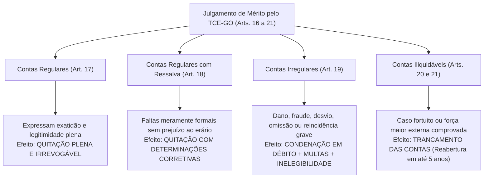
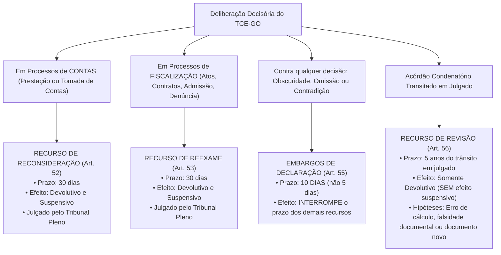

# 02 - Lei Orgânica do TCE-GO (Lei Estadual nº 16.168/2007)

> **Matéria:** Legislação Institucional  
> **Cargos:** A01 – Técnico de Controle Externo (Adm) / B02 – Técnico de Controle Externo (TI)  
> **Arquivo:** `02_lei_organica_tce_go_lei_16168_2007.md`  
> **Ato Normativo:** Lei Estadual nº 16.168, de 11 de dezembro de 2007 (atualizada pelas Leis Estaduais nº 21.050/2021, 23.120/2024 e 23.413/2025)

---

## 📌 Ementa / Itens do Edital
- Lei Orgânica do Tribunal de Contas do Estado de Goiás (Lei Estadual nº 16.168/2007 e alterações):
    - Natureza jurídica, sede, jurisdição, autonomia institucional e competências finalísticas privativas;
    - Jurisdicionados: rol legal dos agentes, gestores, entidades públicas e privadas sujeitas à fiscalização do TCE-GO;
    - Instrumentos de fiscalização externa: auditorias, inspeções, acompanhamentos, monitoramentos e levantamentos;
    - Apreciação e registro de atos sujeitos a controle: admissão de pessoal (concursos) e concessão de aposentadorias, reformas e pensões (ato administrativo complexo);
    - Fiscalização de procedimentos licitatórios, editais, contratos administrativos, convênios, parcerias do terceiro setor (OSs, OSCIPs e MROSC) e instrumentos congêneres;
    - Tomada e Prestação de Contas Ordinárias dos ordenadores de despesas estaduais;
    - Tomada de Contas Especial (TCE): pressupostos materiais cumulativos de instauração, responsabilidade solidária da autoridade administrativa omissa, limite de alçada para dispensa por economia processual e prazo decadencial decenal;
    - Classificação técnica do julgamento de contas:
    - Contas Regulares (quitação plena);
    - Contas Regulares com Ressalva (impropriedades formais sem dano ao erário, determinações saneadoras);
    - Contas Irregulares (dano, desfalque, desvio, grave infração legal ou reincidência; imputação de débito, multa e inelegibilidade da LC 64/90);
    - Contas Iliquidáveis (caso fortuito ou força maior, trancamento das contas e prazo de desarquivamento em até 5 anos);
    - Medidas Cautelares no processo de controle externo: requisitos (*fumus boni iuris* e *periculum in mora*), indisponibilidade de bens, afastamento provisório de responsáveis e suspensão de atos/licitações;
    - Poder Sancionatório do TCE-GO:
    - Imputação de débito (ressarcimento do erário atualizado com juros; título executivo extrajudicial);
    - Multas sancionatórias simples (por infração grave, obstrução, descumprimento de prazos/diligências);
    - Multa proporcional ao dano (até 100% do débito apurado);
    - Inabilitação para o exercício de cargo em comissão ou função de confiança (até 5 anos);
    - Declaração de inidoneidade para licitar e contratar com a Administração Pública Estadual (até 5 anos);
    - Processo e Procedimento no Controle Externo: contraditório, ampla defesa, prazos processuais e comunicações;
    - Sistema Recursal da Lei Orgânica:
    - Recurso de Reconsideração (processos de contas; 30 dias; efeitos devolutivo e suspensivo);
    - Recurso de Reexame (processos de fiscalização de atos/contratos, pessoal, denúncia e representação; 30 dias; efeitos devolutivo e suspensivo);
    - Embargos de Declaração (obscuridade, contradição ou omissão; 10 dias; interrompe prazo dos demais recursos);
    - Recurso de Revisão (natureza rescisória; 5 anos do trânsito em julgado; sem efeito suspensivo; erro de cálculo, falsidade documental ou documento novo superveniente);
    - Regime de Prescrição da pretensão punitiva e de ressarcimento (prazo quinquenal de 5 anos e prescrição intercorrente trienal).

---

## 🧭 Sumário

1. [Natureza, Jurisdição e Competências Constitucionais e Legais (Arts. 1º a 4º)](#1-natureza-jurisdicao-e-competencias-constitucionais-e-legais-arts-1o-a-4o)
    1. [Natureza Jurídica, Sedes e Autonomias Constitucionais](#11-natureza-juridica-sedes-e-autonomias-constitucionais)
    2. [Rol Legal dos Jurisdicionados e Responsabilidade dos Sucessores](#12-rol-legal-dos-jurisdicionados-e-responsabilidade-dos-sucessores)
    3. [Competências Finalísticas Privativas do TCE-GO](#13-competencias-finalisticas-privativas-do-tce-go)
    4. [Teste 132](#Teste-132)
2. [Instrumentos de Fiscalização Externa (Arts. 5º a 10)](#2-instrumentos-de-fiscalizacao-externa-arts-5o-a-10)
    1. [Quadro Diferencial dos Instrumentos Operacionais de Controle](#21-quadro-diferencial-dos-instrumentos-operacionais-de-controle)
    2. [Fiscalização de Atos de Admissão, Concessão de Aposentadorias e Pensões](#22-fiscalizacao-de-atos-de-admissao-concessao-de-aposentadorias-e-pensoes)
    3. [Controle de Editais, Licitações, Contratos e Parcerias com o Terceiro Setor](#23-controle-de-editais-licitacoes-contratos-e-parcerias-com-o-terceiro-setor)
    4. [Teste 133](#Teste-133)
3. [Julgamento de Contas e Tomada de Contas Especial (Arts. 11 a 28)](#3-julgamento-de-contas-e-tomada-de-contas-especial-arts-11-a-28)
    1. [Prestação de Contas Ordinária dos Ordenadores de Despesas](#31-prestacao-de-contas-ordinaria-dos-ordenadores-de-despesas)
    2. [Tomada de Contas Especial: Pressupostos, Solidariedade e Decadência](#32-tomada-de-contas-especial-pressupostos-solidariedade-e-decadencia)
    3. [Classificação Técnica das Decisões de Contas: Regulares, Regulares com Ressalva, Irregulares e Iliquidáveis](#33-classificacao-tecnica-das-decisoes-de-contas-regulares-regulares-com-ressalva-irregulares-e-iliquidaveis)
    4. [Teste 134](#Teste-134)
    5. [Teste 135](#Teste-135)
4. [Medidas Cautelares e Poder Sancionatório do TCE-GO (Arts. 41 a 47)](#4-medidas-cautelares-e-poder-sancionatorio-do-tce-go-arts-41-a-47)
    1. [Medidas Cautelares: Suspensão, Afastamento e Indisponibilidade de Bens](#41-medidas-cautelares-suspensao-afastamento-e-indisponibilidade-de-bens)
    2. [Imputação de Débito e Eficácia Executiva Extrajudicial](#42-imputacao-de-debito-e-eficacia-executiva-extrajudicial)
    3. [Regime das Multas Sancionatórias e Proporcionais ao Dano](#43-regime-das-multas-sancionatorias-e-proporcionais-ao-dano)
    4. [Inabilitação para Cargo em Comissão e Declaração de Inidoneidade](#44-inabilitacao-para-cargo-em-comissao-e-declaracao-de-inidoneidade)
    5. [Teste 136](#Teste-136)
    6. [Teste 137](#Teste-137)
5. [Processo, Prazos e Sistema Recursal da Lei Orgânica (Arts. 50 a 65)](#5-processo-prazos-e-sistema-recursal-da-lei-organica-arts-50-a-65)
    1. [Devido Processo Legal, Contraditório e Prazos de Defesa](#51-devido-processo-legal-contraditorio-e-prazos-de-defesa)
    2. [Sistema Recursal Taxativo: Reconsideração, Reexame, Embargos e Revisão](#52-sistema-recursal-taxativo-reconsideracao-reexame-embargos-e-revisao)
    3. [Regime da Prescrição Punitiva e Ressarcitória no TCE-GO](#53-regime-da-prescricao-punitiva-e-ressarcitoria-no-tce-go)
    4. [Teste 138](#Teste-138)
    5. [Teste 139](#Teste-139)
    6. [Teste 140](#Teste-140)
    7. [Teste 141](#Teste-141)
6. [Fontes Oficiais e Referências Bibliográficas](#6-fontes-oficiais-e-referencias-bibliograficas)

---

## 1. Natureza, Jurisdição e Competências Constitucionais e Legais (Arts. 1º a 4º)

### 1.1 Natureza Jurídica, Sedes e Autonomias Constitucionais
O Tribunal de Contas do Estado de Goiás (TCE-GO), criado pela ordem constitucional e disciplinado no plano infraconstitucional pela **Lei Estadual nº 16.168, de 11 de dezembro de 2007** (Lei Orgânica do TCE-GO), é órgão público constitucional autônomo, investido da missão republicana de controle externo contábil, financeiro, orçamentário, operacional e patrimonial do Estado de Goiás.

- **Sede e Jurisdição Territorial:** Tem sede na Capital do Estado (Goiânia) e exerce **jurisdição própria e privativa em todo o território estadual de Goiás**, alcançando todos os responsáveis por dinheiros, bens e valores públicos da administração estadual direta e indireta.
- **Autonomias:** Goza de **autonomia funcional, administrativa e financeira**, com autogoverno (eleição de seu Presidente, Vice-Presidente e Corregedor-Geral pelo Tribunal Pleno), iniciativa privativa de leis para organização de seus serviços e cargos de seu quadro técnico, e competência para executar suas dotações orçamentárias de acordo com a programação financeira.

### 1.2 Rol Legal dos Jurisdicionados e Responsabilidade dos Sucessores
Estão expressamente submetidos à jurisdição fiscalizatória do TCE-GO, nos termos do artigo 4º da Lei Estadual nº 16.168/2007:

1. Qualquer pessoa física ou jurídica, pública ou privada, que utilize, arrecade, guarde, gerencie ou administre dinheiros, bens ou valores públicos estaduais ou pelos quais o Estado de Goiás responda;
2. Todos os gestores, ordenadores de despesas e agentes dos Poderes Executivo, Legislativo e Judiciário, do Ministério Público Estadual, da Defensoria Pública do Estado e dos Tribunais e Conselhos vinculados ao Estado;
3. Dirigentes de autarquias, fundações públicas estaduais, empresas públicas e sociedades de economia mista sob controle acionário do Estado de Goiás;
4. Dirigentes de entidades privadas recebedoras de recursos estaduais sob qualquer título: subvenções sociais, auxílios, convênios de cooperação, contratos de gestão (Organizações Sociais - OSs), termos de parceria (OSCIPs) ou termos de colaboração e fomento (Marco Regulatório das Organizações da Sociedade Civil - MROSC / Lei Federal nº 13.019/2014);
5. Qualquer pessoa que der causa a perda, extravio, desfalque ou desvio de bens e valores públicos estaduais;
6. **Responsabilidade dos Sucessores (Art. 4º, parágrafo único):** A obrigação de reparar o dano causado ao erário e as dívidas decorrentes de acórdãos condenatórios do Tribunal estendem-se aos sucessores e herdeiros do administrador ou responsável, **até o limite do valor do patrimônio que lhes tenha sido transferido** pela sucessão causa mortis.

> 🚨 **ALERTA DE PROVA / PEGADINHA FCC:** O TCE-GO possui jurisdição estritamente sobre a esfera **ESTADUAL**. Ele **NÃO fiscaliza recursos municipais próprios** dos 246 municípios goianos — estes são de competência privativa do **TCM-GO** (Tribunal de Contas dos Municípios do Estado de Goiás). Todavia, se o Estado de Goiás repassar recursos voluntários a um Município via convênio, o TCE-GO tem jurisdição sobre o convênio estadual! Quanto aos sucessores, atente-se à pegadinha de afirmar que os herdeiros respondem com seus próprios bens: a responsabilidade é estritamente intra vires hereditatis (limitada ao valor do quinhão hereditário recebido).

### 1.3 Competências Finalísticas Privativas do TCE-GO
Nos moldes dos artigos 1º a 3º da Lei nº 16.168/2007, compete privativamente ao TCE-GO:

- Apreciar as contas anuais prestadas pelo Governador do Estado mediante Parecer Prévio em 60 dias;
- Julgar as contas dos administradores e demais responsáveis por recursos estaduais;
- Apreciar, para fins de registro, a legalidade dos atos de admissão de pessoal e das concessões iniciais de aposentadorias, reformas e pensões;
- Realizar, por iniciativa própria ou a pedido da Assembleia Legislativa, auditorias e inspeções;
- Fiscalizar a aplicação de quaisquer recursos repassados pelo Estado a Municípios ou entidades privadas;
- Prestar as informações solicitadas pela Assembleia Legislativa sobre a fiscalização contábil e orçamentária;
- Aplicar sanções e fixar prazos para adoção de medidas corretivas em atos ilegais;
- Emitir pronunciamento em caráter normativo em resposta a **Consultas** formuladas por autoridades legitimadas (sem analisar casos concretos).

---

### Teste 132
**(FGV – TCE-PI – Auditor de Controle Externo Controle Externo Especifica de Area Comum – 2025)**
O TCE-PI, no exercício do controle externo da Administração Pública, tem competência para controlar as contas dos administradores e demais responsáveis por dinheiros, bens e valores da Administração direta e indireta e as contas daqueles que derem causa a perda, extravio ou outra irregularidade de que resulte prejuízo ao erário. Em alguns casos, o TCE-PI julga diretamente as contas, e, em outros casos, apenas as aprecia, mediante parecer prévio, cabendo ao Poder Legislativo o seu julgamento. Nesses termos, considere os seguintes órgãos e agentes públicos: I. Mesa Diretora da Assembleia Legislativa. II. Presidente do Tribunal de Justiça. III. Presidente do TCE-PI. IV. Prefeito(a) de Teresina-PI. V. Governador(a) do Estado do Piauí. Caberá ao TCE-PI julgar as contas apenas de

* **A)** II e III.
* **B)** II e IV.
* **C)** I, II e III.
* **D)** I, IV e V.
* **E)** I, II, III e IV.

---

> **Comentário Detalhado:**
>
> - **A)** **Incorreta.** A opção apresenta proposição em desacordo com os fundamentos teóricos e técnicos do tópico ao afirmar que "II e III". De acordo com a teoria estudada em *1.2 Rol Legal dos Jurisdicionados e Responsabilidade dos Sucessores*, qualquer pessoa que der causa a perda, extravio, desfalque ou desvio de bens e valores públicos estaduais.
> - **B)** **Correta.** Conforme fundamentado na seção *1.1 Natureza Jurídica, Sedes e Autonomias Constitucionais* deste guia, sede e Jurisdição Territorial: Tem sede na Capital do Estado (Goiânia) e exerce jurisdição própria e privativa em todo o território estadual de Goiás, alcançando todos os responsáveis por dinheiros, bens e valores públicos da administração estadual direta e indireta. Dessa forma, está plenamente correta a assertiva da banca (FGV – TCE-PI/2025) ao estabelecer que "II e IV".
> - **C)** **Incorreta.** A opção apresenta proposição em desacordo com os fundamentos teóricos e técnicos do tópico ao afirmar que "I, II e III". De acordo com a teoria estudada em *1.3 Competências Finalísticas Privativas do TCE-GO*, apreciar as contas anuais prestadas pelo Governador do Estado mediante Parecer Prévio em 60 dias.
> - **D)** **Incorreta.** A opção apresenta proposição em desacordo com os fundamentos teóricos e técnicos do tópico ao afirmar que "I, IV e V". De acordo com a teoria estudada em *1.3 Competências Finalísticas Privativas do TCE-GO*, julgar as contas dos administradores e demais responsáveis por recursos estaduais.
> - **E)** **Incorreta.** A opção apresenta proposição em desacordo com os fundamentos teóricos e técnicos do tópico ao afirmar que "I, II, III e IV". De acordo com a teoria estudada em *1.2 Rol Legal dos Jurisdicionados e Responsabilidade dos Sucessores*, qualquer pessoa física ou jurídica, pública ou privada, que utilize, arrecade, guarde, gerencie ou administre dinheiros, bens ou valores públicos estaduais ou pelos quais o Estado de Goiás responda.
>
> **Gabarito: B**

---

## 2. Instrumentos de Fiscalização Externa (Arts. 5º a 10)

### 2.1 Quadro Diferencial dos Instrumentos Operacionais de Controle
Para concretizar as diretrizes da fiscalização contábil, orçamentária e operacional, o corpo técnico do TCE-GO atua por meio de cinco instrumentos procedimentais formais:

| Instrumento Formal | Finalidade e Âmbito de Aplicação | Momento Temporal / Característica |
| :--- | :--- | :--- |
| **Auditoria** | Exame aprofundado, abrangente e estruturado da gestão orçamentária, contábil, financeira, patrimonial ou operacional de órgãos e programas. | Prevista no **Plano Anual de Fiscalização (PAF)** (ordinária) ou decorrente de fato grave superveniente (extraordinária). |
| **Inspeção** | Verificação *in loco* pontual destinada a suprir omissões, esclarecer fatos duvidosos levantados em auditorias ou apurar **denúncias e representações urgentes**. | Ação pontual, emergencial e de tiro curto sobre objeto determinado. |
| **Acompanhamento** | Fiscalização concomitante, simultânea e contínua dos atos de gestão pública ao longo do exercício orçamentário. | Realizado **em tempo real** no curso do exercício financeiro. |
| **Monitoramento** | Verificação do efetivo cumprimento e do resultado prático das decisões, acórdãos e recomendações emanadas do Tribunal. | Atuação **posterior** para averiguar a eficácia e obediência às determinações do Pleno. |
| **Levantamento** | Mapeamento prévio de áreas, processos de trabalho, sistemas corporativos e estrutura de controle de jurisdicionados. | Fase preliminar de diagnóstico para identificar riscos e subsidiar a elaboração de futuras auditorias. |

> ⭐ **IMPORTANTE / DISTINÇÃO RECORRENTE DA FCC:** A FCC adora cobrar a distinção conceitual entre *Monitoramento* e *Levantamento*. Memorize a regra mnemônica: **Levantamento** é o diagnóstico prévio (*antes* da auditoria, para mapear riscos); **Monitoramento** é o acompanhamento posterior (*depois* do acórdão, para checar se o gestor cumpriu as determinações expedidas pela Corte de Contas).

### 2.2 Fiscalização de Atos de Admissão, Concessão de Aposentadorias e Pensões
O TCE-GO examina a legalidade dos atos de admissão de pessoal na administração pública estadual (efetivos e empregados públicos), ressalvadas expressamente as nomeações para **cargos em comissão de livre nomeação e exoneração**.

- **Registro de Aposentadorias e Pensões:** Caracteriza-se como ato administrativo complexo. O deferimento pelo órgão ou entidade previdenciária de origem constitui apenas etapa inicial, aperfeiçoando-se com o registro definitivo concedido pelo Tribunal de Contas.
- O prazo para o exame do ato concessório é de **cinco anos**, findos os quais, sem decisão do Tribunal, opera-se a estabilização para efeito de garantia do contraditório e ampla defesa (Tema 445 do STF).

### 2.3 Controle de Editais, Licitações, Contratos e Parcerias com o Terceiro Setor
O Tribunal fiscaliza procedimentos de licitação, editais, atas de registro de preços, contratos administrativos e instrumentos congêneres de órgãos estaduais.

- O TCE-GO possui atribuição legal para analisar a minuta de editais de concessões, parcerias público-privadas (PPPs) e grandes contratações públicas, determinando ajustes saneadores quando identificadas cláusulas restritivas da competitividade.
- Nas parcerias com o Terceiro Setor (Organizações Sociais de Saúde, Educação, etc.), a fiscalização do TCE-GO debruça-se sobre o atingimento de metas pactuadas nos **Contratos de Gestão**, a regularidade dos processos de contratação de terceiros pelas OSs e o cumprimento dos limites de despesas com pessoal e custeio.

---

### Teste 133
**(FGV – TJ-SC – Analista Administrativo – 2026)**
A Lei nº 13.019/2014, denominada Marco Regulatório das Organizações da Sociedade Civil (MROSC), estabelece o regime jurídico das parcerias entre a Administração Pública e as organizações da sociedade civil, instituindo três instrumentos jurídicos distintos para a formalização dessas parcerias. Relacione os instrumentos jurídicos previstos no MROSC às respectivas características. Instrumento Característica 1. Termo de colaboração ( ) Adotado em parcerias que envolvem transferência de recursos financeiros e cujo plano de trabalho é proposto pela Administração Pública 2. Termo de fomento ( ) Adotado em parcerias que não envolvem transferência de recursos financeiros entre os parceiros 3. Acordo de cooperação ( ) Adotado em parcerias que envolvem transferência de recursos financeiros e cujo plano de trabalho é proposto pela organização da sociedade civil Assinale a opção que indica a relação correta, na ordem apresentada.

* **A)** 1 – 2 – 3.
* **B)** 2 – 3 – 1.
* **C)** 1 – 3 – 2.
* **D)** 3 – 1 – 2.
* **E)** 2 – 1 – 3.

---

> **Comentário Detalhado:**
>
> - **A)** **Incorreta.** A opção apresenta proposição em desacordo com os fundamentos teóricos e técnicos do tópico ao afirmar que "1 – 2 – 3". De acordo com a teoria estudada em *2.1 Quadro Diferencial dos Instrumentos Operacionais de Controle*, instrumento Formal: Finalidade e Âmbito de Aplicação — Momento Temporal / Característica.
> - **B)** **Incorreta.** A opção apresenta proposição em desacordo com os fundamentos teóricos e técnicos do tópico ao afirmar que "2 – 3 – 1". De acordo com a teoria estudada em *1.1 Natureza Jurídica, Sedes e Autonomias Constitucionais*, o Tribunal de Contas do Estado de Goiás (TCE-GO), criado pela ordem constitucional e disciplinado no plano infraconstitucional pela Lei Estadual nº 16.168, de 11 de dezembro de 2007 (Lei Orgânica do TCE-GO), é órgão público constitucional autônomo, investido da missão republicana de controle externo contábil, financeiro, orçamentário, operacional e patrimonial do Estado de Goiás.
> - **C)** **Incorreta.** A opção apresenta proposição em desacordo com os fundamentos teóricos e técnicos do tópico ao afirmar que "1 – 3 – 2". De acordo com a teoria estudada em *2.3 Controle de Editais, Licitações, Contratos e Parcerias com o Terceiro Setor*, nas parcerias com o Terceiro Setor (Organizações Sociais de Saúde, Educação, etc.), a fiscalização do TCE-GO debruça-se sobre o atingimento de metas pactuadas nos Contratos de Gestão, a regularidade dos processos de contratação de terceiros pelas OSs e o cumprimento dos limites de despesas com pessoal e custeio.
> - **D)** **Correta.** Conforme fundamentado na seção *1.2 Rol Legal dos Jurisdicionados e Responsabilidade dos Sucessores* deste guia, dirigentes de entidades privadas recebedoras de recursos estaduais sob qualquer título: subvenções sociais, auxílios, convênios de cooperação, contratos de gestão (Organizações Sociais - OSs), termos de parceria (OSCIPs) ou termos de colaboração e fomento (Marco Regulatório das Organizações da Sociedade Civil - MROSC / Lei Federal nº 13.019/2014). Dessa forma, está plenamente correta a assertiva da banca (FGV – TJ-SC/2026) ao estabelecer que "3 – 1 – 2".
> - **E)** **Incorreta.** A opção apresenta proposição em desacordo com os fundamentos teóricos e técnicos do tópico ao afirmar que "2 – 1 – 3". De acordo com a teoria estudada em *2.1 Quadro Diferencial dos Instrumentos Operacionais de Controle*, levantamento: Mapeamento prévio de áreas, processos de trabalho, sistemas corporativos e estrutura de controle de jurisdicionados. — Fase preliminar de diagnóstico para identificar riscos e subsidiar a elaboração de futuras auditorias.
>
> **Gabarito: D**

---

## 3. Julgamento de Contas e Tomada de Contas Especial (Arts. 11 a 28)

### 3.1 Prestação de Contas Ordinária dos Ordenadores de Despesas
Anualmente, todos os titulares de órgãos da administração direta, autarquias, fundações e dirigentes de empresas estatais estaduais devem apresentar ao TCE-GO a sua **Prestação de Contas Ordinária**.
As contas são organizadas sob a forma de demonstrativos contábeis, relatórios de execução orçamentária e relatório conclusivo do órgão de controle interno, submetendo-se à instrução das unidades técnicas especializadas da Corte e parecer do Ministério Público de Contas antes do julgamento final pelo Tribunal Pleno ou por uma de suas Câmaras.

### 3.2 Tomada de Contas Especial: Pressupostos, Solidariedade e Decadência
A **Tomada de Contas Especial (TCE)** é um processo de controle externo extraordinário e coercitivo instaurado diante da caracterização de dano ao erário estadual.

1. **Pressupostos Materiais Obrigatórios de Instauração (Art. 11):**
    - Omissão culposa ou dolosa no dever de prestar contas;
    - Não comprovação da aplicação dos recursos repassados pelo Estado;
    - Ocorrência de desfalque, desvio, alcance ou extravio de bens ou valores públicos;
    - Prática de qualquer ato ilegal, ilegítimo ou antieconômico do qual resulte comprovado prejuízo financeiro ao erário estadual.

2. **Esgotamento das Providências Internas:** A instauração formal da TCE pressupõe o insucesso das medidas administrativas internas deflagradas no próprio órgão de origem para notificar o devedor e reaver amigavelmente os valores lesados.
3. **Responsabilidade Solidária da Autoridade Omissa (Art. 11, § 1º):** A autoridade administrativa máxima do órgão ou entidade jurisdicionada tem o dever legal inafastável de instaurar a TCE diante da notícia fundamentada de dano ou desvio. Caso se omita culposamente, **responderá solidariamente** pelo valor total do prejuízo apurado perante o Tribunal de Contas!
4. **Dispensa de Encaminhamento por Economia Processual:** O Plenário do TCE-GO edita anualmente instruções normativas fixando **valor de alçada mínimo** (montante mínimo de prejuízo) abaixo do qual a TCE não deve ser remetida à Corte, para evitar que o custo operacional do processamento administrativo supere o próprio montante a ser recuperado (salvo casos de reincidência dolosa do gestor).
5. **Decadência Decenal (10 Anos):** Salvo expressa determinação em contrário do Tribunal, fica **dispensada a instauração da Tomada de Contas Especial** quando houver transcorrido prazo superior a **10 (dez) anos** entre a data presumida do fato lesivo e a primeira notificação formal válida do responsável pelo órgão administrativo, por restar manifestamente inviabilizado o exercício pleno do contraditório e da ampla defesa pelo longo decurso do tempo.

### 3.3 Classificação Técnica das Decisões de Contas: Regulares, Regulares com Ressalva, Irregulares e Iliquidáveis
Ao julgar as tomadas ou prestações de contas, o TCE-GO proferirá decisão terminativa ou definitiva, classificando as contas em uma das quatro hipóteses taxativas dos artigos 16 a 21 da LOTCE:

| Classificação das Contas | Hipóteses Materiais Enquadradas | Consequências Jurídicas e Decisórias |
| :--- | :--- | :--- |
| **Regulares** (Art. 17) | Demonstram de forma cristalina a exatidão dos demonstrativos, a legalidade, legitimidade e economicidade dos atos de gestão financeira e orçamentária praticados. | O Tribunal confere **quitação plena e irrestrita** ao gestor, exonerando-o da responsabilidade pelo exercício examinado. |
| **Regulares com Ressalva** (Art. 18) | Evidenciam impropriedades de natureza meramente formal ou falhas burocráticas que **não resultaram em dano ao patrimônio público** nem revelam conduta de má-fé. | O Tribunal confere **quitação**, expedindo determinações e recomendações preventivas para que as falhas sejam expurgadas nos períodos seguintes. |
| **Irregulares** (Art. 19) | a) Omissão injustificada na prestação de contas; b) Prática de ato de gestão ilegal, ilegítimo ou antieconômico, ou infração grave a norma legal; c) Dano ao erário resultante de ato de gestão ilegítimo ou desfalque/desvio; d) Reincidência no descumprimento de determinações anteriores do Tribunal. | - **Condenação em débito** (ressarcimento); - Aplicação de multas simples ou proporcionais; - Inabilitação para cargos comissionados e inidoneidade; - Remessa ao MPE (para ACP por Improbidade); - Envio à Justiça Eleitoral (**inelegibilidade** da LC 64/90, caso a conduta configure ato doloso de improbidade administrativa). |
| **Iliquidáveis** (Arts. 20 e 21) | Ocorrência de **caso fortuito ou força maior**, comprovadamente alheio à vontade do responsável, que torne **materialmente impossível** a apuração do mérito das contas (ex.: desastre natural, enchente súbita ou incêndio que destrua integralmente os arquivos). | O Tribunal ordena o **trancamento das contas** e o arquivamento do feito. Caso surjam novos elementos ou provas no prazo decadencial de **cinco (5) anos**, o processo é desentranhado e julgado pelo mérito; esgotado o quinquênio, o arquivamento torna-se definitivo. |

> 🚨 **ALERTA DE PROVA / PEGADINHA FCC:** Fique atento: o desaparecimento ou extravio de documentos por desídia, culpa ou desleixo do ordenador de despesas **NÃO autoriza a classificação como iliquidável**! Se o gestor não comprova força maior cabal, suas contas são julgadas **IRREGULARES** por omissão e falta de comprovação de gastos. Contas iliquidáveis decorrem estritamente de caso fortuito ou força maior comprovados.

---

### Teste 134
**(FGV – TCE-SC – Auditor Fiscal de Controle Externo Administracao – 2026)**
Maria de Lourdes, Auditora Fiscal de Controle Externo do Tribunal de Contas do Estado de Santa Catarina, no exercício de suas atribuições privativas de fiscalização, analisou minuciosamente as contas de determinado gestor público municipal, tendo emitido ao final sua opinio. Considerando as formas de julgamento das contas, nos termos da Lei Orgânica do Tribunal de Contas de Santa Catarina (LC 202/2000), é correto afirmar que as contas serão julgadas

* **A)** regulares com ressalva, quando evidenciarem impropriedade ou qualquer outra falta de natureza formal de que não resulte dano ao erário.
* **B)** irregulares, quando comprovada a omissão no dever de prestar contas, desde que a atuação tenha se dado de forma dolosa ou em estado de culpa consciente.
* **C)** regulares com ressalva, quando evidenciarem impropriedade ou qualquer outra falta de natureza formal de que não resulte dano ao erário ou contrarie os princípios da Administração Pública.
* **D)** irregulares, se comprovado desfalque, desvio de dinheiro, bens ou valores públicos, desde que não seja objeto de acordo de leniência, transação penal ou outra forma de composição civil dos danos.
* **E)** regulares, quando expressarem, de forma clara e objetiva, a exatidão dos demonstrativos contábeis, a legalidade, a legitimidade e a economicidade dos atos de gestão do responsável, ainda que evidenciem irregularidades leves e moderadas.

---

> **Comentário Detalhado:**
>
> - **A)** **Incorreta.** A opção promove generalização excessiva que desconsidera as condições técnicas e normativas ao afirmar que "regulares com ressalva, quando evidenciarem impropriedade ou qualquer outra falta de natureza formal de que não...". De acordo com a teoria estudada em *3.1 Prestação de Contas Ordinária dos Ordenadores de Despesas*, as contas são organizadas sob a forma de demonstrativos contábeis, relatórios de execução orçamentária e relatório conclusivo do órgão de controle interno, submetendo-se à instrução das unidades técnicas especializadas da Corte e parecer do Ministério Público de Contas antes do julgamento final pelo Tribunal Pleno ou por uma de suas Câmaras.
> - **B)** **Incorreta.** A opção apresenta proposição em desacordo com os fundamentos teóricos e técnicos do tópico ao afirmar que "irregulares, quando comprovada a omissão no dever de prestar contas, desde que a atuação tenha se dado de forma...". De acordo com a teoria estudada em *3.3 Classificação Técnica das Decisões de Contas: Regulares, Regulares com Ressalva, Irregulares e Iliquidáveis*, fique atento: o desaparecimento ou extravio de documentos por desídia, culpa ou desleixo do ordenador de despesas NÃO autoriza a classificação como iliquidável! Se o gestor não comprova força maior cabal, suas contas são julgadas IRREGULARES por omissão e falta de comprovação de gastos.
> - **C)** **Incorreta.** A opção promove generalização excessiva que desconsidera as condições técnicas e normativas ao afirmar que "regulares com ressalva, quando evidenciarem impropriedade ou qualquer outra falta de natureza formal de que não...". De acordo com a teoria estudada em *3.3 Classificação Técnica das Decisões de Contas: Regulares, Regulares com Ressalva, Irregulares e Iliquidáveis*, regulares com Ressalva (Art. 18): Evidenciam impropriedades de natureza meramente formal ou falhas burocráticas que não resultaram em dano ao patrimônio público nem revelam conduta de má-fé. — O Tribunal confere quitação, expedindo determinações e recomendações preventivas para que as falhas sejam expurgadas nos períodos seguintes.
> - **D)** **Incorreta.** A opção apresenta proposição em desacordo com os fundamentos teóricos e técnicos do tópico ao afirmar que "irregulares, se comprovado desfalque, desvio de dinheiro, bens ou valores públicos, desde que não seja objeto de...". De acordo com a teoria estudada em *3.2 Tomada de Contas Especial: Pressupostos, Solidariedade e Decadência*, ocorrência de desfalque, desvio, alcance ou extravio de bens ou valores públicos.
> - **E)** **Correta.** Conforme fundamentado na seção *3.3 Classificação Técnica das Decisões de Contas: Regulares, Regulares com Ressalva, Irregulares e Iliquidáveis* deste guia, regulares (Art. 17): Demonstram de forma cristalina a exatidão dos demonstrativos, a legalidade, legitimidade e economicidade dos atos de gestão financeira e orçamentária praticados. — O Tribunal confere quitação plena e irrestrita ao gestor, exonerando-o da responsabilidade pelo exercício examinado. Dessa forma, está plenamente correta a assertiva da banca (FGV – TCE-SC/2026) ao estabelecer que "regulares, quando expressarem, de forma clara e objetiva, a exatidão dos demonstrativos contábeis, a legalidade, a...".
>
> **Gabarito: E**

---

### Teste 135
**(FGV – TCE-PA – Auditor de Controle Externo Administrativa Administracao – 2024)**
O Tribunal de Contas do Estado do Pará, em processo de tomada de contas, realizou imputação de débito a Antônio, que atuara como ordenador de despesas no âmbito de uma fundação pública estadual. Após a emissão da certidão de débito, constatou-se que o custo da cobrança seria superior ao valor do ressarcimento. Em situação dessa natureza, à luz do disposto na Lei Complementar estadual nº 81/2012, é correto afirmar que

* **A)** pode ser determinado o arquivamento do processo, com cancelamento do débito, sendo dada quitação a Antônio.
* **B)** deve ser determinado o arquivamento do processo, com cancelamento do débito, não sendo dada quitação a Antônio.
* **C)** pode ser determinado o arquivamento do processo, sem cancelamento do débito, não sendo dada quitação a Antônio.
* **D)** deve-se prosseguir com as medidas direcionadas à cobrança, considerando a natureza repressiva e pedagógica da condenação.
* **E)** pode ser determinado o arquivamento do processo, desde que Antônio não tenha sido beneficiado por medida similar nos cinco anos anteriores.

---

> **Comentário Detalhado:**
>
> - **A)** **Incorreta.** A opção apresenta proposição em desacordo com os fundamentos teóricos e técnicos do tópico ao afirmar que "pode ser determinado o arquivamento do processo, com cancelamento do débito, sendo dada quitação a Antônio". De acordo com a teoria estudada em *3.2 Tomada de Contas Especial: Pressupostos, Solidariedade e Decadência*, dispensa de Encaminhamento por Economia Processual: O Plenário do TCE-GO edita anualmente instruções normativas fixando valor de alçada mínimo (montante mínimo de prejuízo) abaixo do qual a TCE não deve ser remetida à Corte, para evitar que o custo operacional do processamento administrativo supere o próprio montante a ser recuperado (salvo casos de reincidência dolosa do gestor).
> - **B)** **Incorreta.** A opção apresenta proposição em desacordo com os fundamentos teóricos e técnicos do tópico ao afirmar que "deve ser determinado o arquivamento do processo, com cancelamento do débito, não sendo dada quitação a Antônio". De acordo com a teoria estudada em *5.1 Devido Processo Legal, Contraditório e Prazos de Defesa*, prazo Geral de Resposta / Defesa: Citado o responsável ou notificado o interessado para justificar irregularidades ou recolher o débito, o prazo geral assinado para apresentação de defesa formal é de 30 (trinta) dias.
> - **C)** **Correta.** Conforme fundamentado na seção *3.3 Classificação Técnica das Decisões de Contas: Regulares, Regulares com Ressalva, Irregulares e Iliquidáveis* deste guia, caso surjam novos elementos ou provas no prazo decadencial de cinco (5) anos, o processo é desentranhado e julgado pelo mérito; esgotado o quinquênio, o arquivamento torna-se definitivo. Dessa forma, está plenamente correta a assertiva da banca (FGV – TCE-PA/2024) ao estabelecer que "pode ser determinado o arquivamento do processo, sem cancelamento do débito, não sendo dada quitação a Antônio".
> - **D)** **Incorreta.** A opção apresenta proposição em desacordo com os fundamentos teóricos e técnicos do tópico ao afirmar que "deve-se prosseguir com as medidas direcionadas à cobrança, considerando a natureza repressiva e pedagógica da...". De acordo com a teoria estudada em *3.3 Classificação Técnica das Decisões de Contas: Regulares, Regulares com Ressalva, Irregulares e Iliquidáveis*, irregulares (Art. 19): a) Omissão injustificada na prestação de contas;` `b) Prática de ato de gestão ilegal, ilegítimo ou antieconômico, ou infração grave a norma legal;` `c) Dano ao erário resultante de ato de gestão ilegítimo ou desfalque/desvio;` `d) Reincidência no descumprimento de determinações anteriores do Tribunal. — - Condenação em débito (ressarcimento);` `- Aplicação de multas simples ou proporcionais;` `- Inabilitação para cargos comissionados e inidoneidade;` `- Remessa ao MPE (para ACP por Improbidade);` `- Envio à Justiça Eleitoral (inelegibilidade da LC 64/90, caso a conduta configure ato doloso de improbidade administrativa).
> - **E)** **Incorreta.** A opção apresenta proposição em desacordo com os fundamentos teóricos e técnicos do tópico ao afirmar que "pode ser determinado o arquivamento do processo, desde que Antônio não tenha sido beneficiado por medida similar...". De acordo com a teoria estudada em *3.2 Tomada de Contas Especial: Pressupostos, Solidariedade e Decadência*, a Tomada de Contas Especial (TCE) é um processo de controle externo extraordinário e coercitivo instaurado diante da caracterização de dano ao erário estadual.
>
> **Gabarito: C**

---

## 4. Medidas Cautelares e Poder Sancionatório do TCE-GO (Arts. 41 a 47)

### 4.1 Medidas Cautelares: Suspensão, Afastamento e Indisponibilidade de Bens
No curso de fiscalizações ou processos de contas, havendo receio fundamentado de dano irreparável ao erário (*periculum in mora*) e plausibilidade jurídica da ilicitude (*fumus boni iuris*), o Relator ou o Tribunal Pleno poderá expedir **medidas cautelares preparatórias ou incidentais**:

1. **Suspensão Cautelar de Licitação ou Contrato:** Paralisação imediata de certames ou atos administrativos irregulares até o julgamento definitivo;
2. **Afastamento Provisório de Responsáveis:** Quando comprovado que a permanência do investigado no cargo público poderá embaraçar a colheita de provas ou fraudar a instrução, sem prejuízo de seus vencimentos e subsídios funcionais;
3. **Indisponibilidade Provisória de Bens:** Bloqueio acautelatório de bens do responsável, em valor suficiente para garantir a integral recomposição do prejuízo apurado.

### 4.2 Imputação de Débito e Eficácia Executiva Extrajudicial
A imputação de débito constitui provimento de recomposição patrimonial que obriga o agente condenado a recolher aos cofres públicos o montante do prejuízo verificado, monetariamente corrigido e acrescido de juros de mora legais (Art. 41 c/c Art. 47).

- A decisão proferida pelo TCE-GO que imputa débito ou comina penalidade de multa tem **eficácia de título executivo extrajudicial**, apto a amparar a propositura direta de Ação de Execução Fiscal pela Procuradoria-Geral do Estado (PGE-GO).

### 4.3 Regime das Multas Sancionatórias e Proporcionais ao Dano
O TCE-GO dispõe de competência legal para impor duas espécies de multas:

- **Multa Proporcional ao Dano (Art. 42):** Nos casos em que o responsável for julgado em débito, o Tribunal poderá aplicar-lhe multa proporcional de até **100% (cem por cento)** do valor atualizado do prejuízo financeiro causado ao erário. Essa sanção é cumulável com a obrigação de restituição do débito, não configurando *bis in idem*.
- **Multa Sancionatória Simples (Art. 43):** Cominada nas situações de desrespeito à autoridade das deliberações da Corte, mesmo sem ocorrência de dano patrimonial direto:
    - Grave infração a preceito constitucional, legal ou regulamentar de natureza financeira, contábil ou patrimonial;
    - Não atendimento, sem justa causa, de diligência, notificação ou prazo assinado pelo Relator;
    - Obstrução ao livre exercício de inspeções e auditorias determinadas pela Corte;
    - Sonegação de livros, contratos, notas fiscais e documentos requisitados em diligência de controle externo;
    - Reincidência no descumprimento de ordens ou recomendações do Tribunal.

### 4.4 Inabilitação para Cargo em Comissão e Declaração de Inidoneidade
Em casos revestidos de especial gravidade, o Tribunal Pleno do TCE-GO poderá deliberar pelas seguintes medidas gravosas de idoneidade administrativa:

- **Inabilitação para o Exercício de Cargo em Comissão ou Função de Confiança (Art. 43, parágrafo único):** Pelo prazo de até **cinco (5) anos**, impedindo a nomeação do apenado para funções de chefia, direção e assessoramento em qualquer órgão ou entidade da administração estadual de Goiás;
- **Declaração de Inidoneidade para Licitar e Contratar com a Administração Pública Estadual (Art. 44):** Pelo prazo de até **cinco (5) anos**, imposta a empresas, consórcios e pessoas físicas que tenham perpetrado fraude comprovada em certames licitatórios ou contratos públicos perante órgãos sob controle do TCE-GO.

---

### Teste 136
**(FGV – TCE-PA – Auditor de Controle Externo Administrativa Administracao – 2024)**
José, diretor de uma fundação pública de um órgão estadual jurisdicionado ao TCE-PA, praticou ato ilegítimo e antieconômico do qual não resultou danos ao erário, razão pela qual o Tribunal julgou as suas contas regulares com ressalva, lhe impondo o cumprimento de determinações para execução de medidas necessárias à correção das faltas identificadas e lhe aplicando multa no valor de 5.000 (cinco mil) Unidades Padrão Fiscal do Estado do Pará. Nessa situação, o Tribunal deverá conferir a José certificado de quitação

* **A)** plena do responsável para com o erário estadual
* **B)** condicionado ao atendimento de medidas necessárias à correção das impropriedades ou faltas identificadas
* **C)** somente após a comprovação do pagamento integral da multa imposta, alertando-o de que a reincidência poderá acarretar a irregularidade das contas subsequentes.
* **D)** plena do responsável condicionada ao cumprimento das determinações.
* **E)** somente após o cumprimento das determinações. Módulo III - Conhecimentos Específicos Avançados

---

> **Comentário Detalhado:**
>
> - **A)** **Incorreta.** A opção apresenta proposição em desacordo com os fundamentos teóricos e técnicos do tópico ao afirmar que "plena do responsável para com o erário estadual". De acordo com a teoria estudada em *4.3 Regime das Multas Sancionatórias e Proporcionais ao Dano*, multa Proporcional ao Dano (Art. 42): Nos casos em que o responsável for julgado em débito, o Tribunal poderá aplicar-lhe multa proporcional de até 100% (cem por cento) do valor atualizado do prejuízo financeiro causado ao erário.
> - **B)** **Incorreta.** A opção apresenta proposição em desacordo com os fundamentos teóricos e técnicos do tópico ao afirmar que "condicionado ao atendimento de medidas necessárias à correção das impropriedades ou faltas identificadas". De acordo com a teoria estudada em *3.3 Classificação Técnica das Decisões de Contas: Regulares, Regulares com Ressalva, Irregulares e Iliquidáveis*, regulares com Ressalva (Art. 18): Evidenciam impropriedades de natureza meramente formal ou falhas burocráticas que não resultaram em dano ao patrimônio público nem revelam conduta de má-fé. — O Tribunal confere quitação, expedindo determinações e recomendações preventivas para que as falhas sejam expurgadas nos períodos seguintes.
> - **C)** **Correta.** Conforme fundamentado na seção *3.3 Classificação Técnica das Decisões de Contas: Regulares, Regulares com Ressalva, Irregulares e Iliquidáveis* deste guia, irregulares (Art. 19): a) Omissão injustificada na prestação de contas;` `b) Prática de ato de gestão ilegal, ilegítimo ou antieconômico, ou infração grave a norma legal;` `c) Dano ao erário resultante de ato de gestão ilegítimo ou desfalque/desvio;` `d) Reincidência no descumprimento de determinações anteriores do Tribunal. — - Condenação em débito (ressarcimento);` `- Aplicação de multas simples ou proporcionais;` `- Inabilitação para cargos comissionados e inidoneidade;` `- Remessa ao MPE (para ACP por Improbidade);` `- Envio à Justiça Eleitoral (inelegibilidade da LC 64/90, caso a conduta configure ato doloso de improbidade administrativa). Dessa forma, está plenamente correta a assertiva da banca (FGV – TCE-PA/2024) ao estabelecer que "somente após a comprovação do pagamento integral da multa imposta, alertando-o de que a reincidência poderá...".
> - **D)** **Incorreta.** A opção apresenta proposição em desacordo com os fundamentos teóricos e técnicos do tópico ao afirmar que "plena do responsável condicionada ao cumprimento das determinações". De acordo com a teoria estudada em *4.1 Medidas Cautelares: Suspensão, Afastamento e Indisponibilidade de Bens*, indisponibilidade Provisória de Bens: Bloqueio acautelatório de bens do responsável, em valor suficiente para garantir a integral recomposição do prejuízo apurado.
> - **E)** **Incorreta.** A opção incorre em restrição indevida ao limitar o escopo conceitual ao afirmar que "somente após o cumprimento das determinações. Módulo III - Conhecimentos Específicos Avançados". De acordo com a teoria estudada em *2.1 Quadro Diferencial dos Instrumentos Operacionais de Controle*, monitoramento: Verificação do efetivo cumprimento e do resultado prático das decisões, acórdãos e recomendações emanadas do Tribunal. — Atuação posterior para averiguar a eficácia e obediência às determinações do Pleno.
>
> **Gabarito: C**

---

### Teste 137
**(FGV – TCE-GO – Analista de Controle Externo Ciencias Contabeis – 2024)**
As competências do Tribunal de Contas do Estado estão previstas nos artigos 25 e 26 da Constituição do Estado de Goiás e no art. 1° da Lei n° 16.168, de 11 de dezembro de 2007 Lei Orgânica do Tribunal de Contas do Estado (LOTCE). Sobre as competências do TCE-GO, analise os itens a seguir: I. As decisões do Tribunal de que resulte imputação de débito ou multa terão eficácia de título executivo. II. O TCE-GO terá amplo poder de investigação, cabendo-lhe requisitar e examinar, diretamente ou por meio de seu corpo técnico, a qualquer tempo, todos os elementos necessários ao exercício de suas atribuições, não lhe podendo ser sonegado processo, documento ou informação, a qualquer pretexto, sob pena de responsabilidade. III. O Tribunal de Contas prestará contas anuais à Assembleia Legislativa, bem como encaminhará relatórios mensais e anual de suas atividades. Está correto o que se afirma em

* **A)** I, apenas.
* **B)** I e II, apenas.
* **C)** I e III, apenas.
* **D)** II e III, apenas.
* **E)** I, II e III.

---

> **Comentário Detalhado:**
>
> - **A)** **Correta.** Conforme fundamentado na seção *4.2 Imputação de Débito e Eficácia Executiva Extrajudicial* deste guia, a decisão proferida pelo TCE-GO que imputa débito ou comina penalidade de multa tem eficácia de título executivo extrajudicial, apto a amparar a propositura direta de Ação de Execução Fiscal pela Procuradoria-Geral do Estado (PGE-GO). Dessa forma, está plenamente correta a assertiva da banca (FGV – TCE-GO/2024) ao estabelecer que "I, apenas".
> - **B)** **Incorreta.** A opção incorre em restrição indevida ao limitar o escopo conceitual ao afirmar que "I e II, apenas". De acordo com a teoria estudada em *1.1 Natureza Jurídica, Sedes e Autonomias Constitucionais*, o Tribunal de Contas do Estado de Goiás (TCE-GO), criado pela ordem constitucional e disciplinado no plano infraconstitucional pela Lei Estadual nº 16.168, de 11 de dezembro de 2007 (Lei Orgânica do TCE-GO), é órgão público constitucional autônomo, investido da missão republicana de controle externo contábil, financeiro, orçamentário, operacional e patrimonial do Estado de Goiás.
> - **C)** **Incorreta.** A opção incorre em restrição indevida ao limitar o escopo conceitual ao afirmar que "I e III, apenas". De acordo com a teoria estudada em *1.2 Rol Legal dos Jurisdicionados e Responsabilidade dos Sucessores*, estão expressamente submetidos à jurisdição fiscalizatória do TCE-GO, nos termos do artigo 4º da Lei Estadual nº 16.168/2007.
> - **D)** **Incorreta.** A opção incorre em restrição indevida ao limitar o escopo conceitual ao afirmar que "II e III, apenas". De acordo com a teoria estudada em *1.3 Competências Finalísticas Privativas do TCE-GO*, nos moldes dos artigos 1º a 3º da Lei nº 16.168/2007, compete privativamente ao TCE-GO.
> - **E)** **Incorreta.** A opção apresenta proposição em desacordo com os fundamentos teóricos e técnicos do tópico ao afirmar que "I, II e III". De acordo com a teoria estudada em *1.2 Rol Legal dos Jurisdicionados e Responsabilidade dos Sucessores*, dirigentes de entidades privadas recebedoras de recursos estaduais sob qualquer título: subvenções sociais, auxílios, convênios de cooperação, contratos de gestão (Organizações Sociais - OSs), termos de parceria (OSCIPs) ou termos de colaboração e fomento (Marco Regulatório das Organizações da Sociedade Civil - MROSC / Lei Federal nº 13.019/2014).
>
> **Gabarito: A**

---

## 5. Processo, Prazos e Sistema Recursal da Lei Orgânica (Arts. 50 a 65)

### 5.1 Devido Processo Legal, Contraditório e Prazos de Defesa
Os processos perante o Tribunal de Contas observam estritamente o devido processo legal constitucional, com publicidade das pautas de julgamento, intimações regulares e garantia de contraditório e ampla defesa.

- **Prazo Geral de Resposta / Defesa:** Citado o responsável ou notificado o interessado para justificar irregularidades ou recolher o débito, o prazo geral assinado para apresentação de defesa formal é de **30 (trinta) dias**.

### 5.2 Sistema Recursal Taxativo: Reconsideração, Reexame, Embargos e Revisão
O rol recursal da Lei Orgânica do TCE-GO é estritamente legal e desenhado com competências específicas:

| Espécie Recursal | Matéria / Cabimento Específico | Prazo Legal | Efeitos Processuais | Julgador Competente |
| :--- | :--- | :--- | :--- | :--- |
| **Recurso de Reconsideração** (Art. 52) | Cabe exclusivamente contra deliberação definitiva proferida em **processos de tomada ou prestação de contas**. Interponível apenas uma vez. | **30 dias** | Devolutivo e **Suspensivo** | **Tribunal Pleno** |
| **Recurso de Reexame** (Art. 53) | Cabe contra decisões definitivas proferidas em processos de **fiscalização de atos, editais, licitações, contratos administrativos, atos sujeitos a registro (pessoal e aposentadoria), denúncias e representações**. | **30 dias** | Devolutivo e **Suspensivo** | **Tribunal Pleno** |
| **Embargos de Declaração** (Art. 55) | Oponíveis contra decisões monocráticas ou acórdãos para suprir **omissão**, aclarar **obscuridade** ou eliminar **contradição**. | **10 dias** | Devolutivo próprio; **interrompe** a contagem do prazo para outros recursos. | O mesmo prolator da deliberação recorrida (Relator ou Colegiado). |
| **Recurso de Revisão** (Art. 56) | Ação rescisória autônoma contra decisão de mérito transitada em julgado, com base restrita em: 1) erro de cálculo; 2) falsidade documental comprovada; 3) surgimento de documentos novos e relevantes supervenientes. | **5 anos** (do trânsito em julgado) | **Apenas efeito devolutivo** (não suspende a cobrança executiva da condenação). | **Tribunal Pleno** |

> 🚨 **ALERTA DE PROVA / PEGADINHA FCC:** Memorize as duas diferenças capitais que derrubam candidatos:
>
> 1. Embargos de Declaração na Lei Orgânica têm prazo de **10 DIAS** (o CPC prevê 5 dias; a FCC coloca 5 dias para o candidato errar!). Os embargos **interrompem** (zeram) o prazo dos demais recursos.
> 2. O recurso contra processo de **contas** chama-se *Reconsideração*; o recurso contra processos de **atos, contratos, editais e pessoal** chama-se *Reexame*.

### 5.3 Regime da Prescrição Punitiva e Ressarcitória no TCE-GO
Em consonância com as teses vinculantes fixadas pelo Supremo Tribunal Federal (Temas 899 e 1021) e normativos do Tribunal:

- **Prescrição Geral Quinquenal (5 anos):** A pretensão punitiva (aplicação de multas e sanções de inabilitação/inidoneidade) e a pretensão de cobrança de débitos decorrentes de títulos do TCE prescrevem em **cinco (5) anos**, contados da data da ocorrência do fato ou da cessação da conduta irregular.
- **Prescrição Intercorrente Trienal (3 anos):** Incide a prescrição intercorrente caso o processo administrativo de controle externo permaneça paralisado por mais de **três (3) anos** ininterruptos, pendente de despacho ou deliberação da autoridade instrutória.

---

### Teste 138
**(FGV – TCE-PA – Auditor de Controle Externo Administrativa Gestao Governamental – 2024)**
Após o devido processo legal, a Sociedade Transgressora sofreu a aplicação de penalidade prevista na Lei nº 12.846/2011, em decorrência da prática de ato lesivo à Administração Pública, mas está analisando a extensão dos efeitos da sanção, com relação aos dirigentes e administradores, ou eventualmente para outra sociedade, caso venha a promover uma alteração societária, considerando que desde antes da penalidade vinha analisando a possibilidade de promover uma fusão ou cisão. Diante dessa situação hipotética, à luz da norma em questão é correto afirmar que

* **A)** a penalidade aplicada à pessoa jurídica é automaticamente estendida aos seus administradores e dirigentes, independentemente de sua culpabilidade.
* **B)** apenas as sanções aplicadas na esfera judicial podem ser estendidas para os administradores ou dirigentes ou mesmo para outra sociedade nas hipóteses de alteração contratual, transformação, fusão ou cisão.
* **C)** a aplicação de penalidade com fulcro na lei em questão é pessoal, de modo que não subsiste a responsabilidade da pessoa jurídica na hipótese de alteração contratual, transformação, incorporação, fusão ou cisão societária.
* **D)** considerando que a responsabilização da pessoa jurídica depende da responsabilidade individual de pessoas naturais, as penalidades aplicadas subsistem nas hipóteses de alteração societária, caso tais indivíduos venham a integrar o novo quadro societário.
* **E)** inexistindo simulação ou evidente intuito de fraude, na hipótese de eventual fusão e incorporação, a responsabilidade da sucessora será restrita à obrigação de pagamento de multa e reparação integral do dano causado, até o limite do patrimônio transferido, não lhe sendo aplicáveis as demais sanções previstas na lei em comento. Legislação Específica

---

> **Comentário Detalhado:**
>
> - **A)** **Incorreta.** A opção apresenta proposição em desacordo com os fundamentos teóricos e técnicos do tópico ao afirmar que "a penalidade aplicada à pessoa jurídica é automaticamente estendida aos seus administradores e dirigentes...". De acordo com a teoria estudada em *1.2 Rol Legal dos Jurisdicionados e Responsabilidade dos Sucessores*, dirigentes de entidades privadas recebedoras de recursos estaduais sob qualquer título: subvenções sociais, auxílios, convênios de cooperação, contratos de gestão (Organizações Sociais - OSs), termos de parceria (OSCIPs) ou termos de colaboração e fomento (Marco Regulatório das Organizações da Sociedade Civil - MROSC / Lei Federal nº 13.019/2014).
> - **B)** **Incorreta.** A opção incorre em restrição indevida ao limitar o escopo conceitual ao afirmar que "apenas as sanções aplicadas na esfera judicial podem ser estendidas para os administradores ou dirigentes ou mesmo...". De acordo com a teoria estudada em *1.3 Competências Finalísticas Privativas do TCE-GO*, julgar as contas dos administradores e demais responsáveis por recursos estaduais.
> - **C)** **Incorreta.** A opção apresenta proposição em desacordo com os fundamentos teóricos e técnicos do tópico ao afirmar que "a aplicação de penalidade com fulcro na lei em questão é pessoal, de modo que não subsiste a responsabilidade da...". De acordo com a teoria estudada em *3.3 Classificação Técnica das Decisões de Contas: Regulares, Regulares com Ressalva, Irregulares e Iliquidáveis*, irregulares (Art. 19): a) Omissão injustificada na prestação de contas;` `b) Prática de ato de gestão ilegal, ilegítimo ou antieconômico, ou infração grave a norma legal;` `c) Dano ao erário resultante de ato de gestão ilegítimo ou desfalque/desvio;` `d) Reincidência no descumprimento de determinações anteriores do Tribunal. — - Condenação em débito (ressarcimento);` `- Aplicação de multas simples ou proporcionais;` `- Inabilitação para cargos comissionados e inidoneidade;` `- Remessa ao MPE (para ACP por Improbidade);` `- Envio à Justiça Eleitoral (inelegibilidade da LC 64/90, caso a conduta configure ato doloso de improbidade administrativa).
> - **D)** **Incorreta.** A opção apresenta proposição em desacordo com os fundamentos teóricos e técnicos do tópico ao afirmar que "considerando que a responsabilização da pessoa jurídica depende da responsabilidade individual de pessoas...". De acordo com a teoria estudada em *4.4 Inabilitação para Cargo em Comissão e Declaração de Inidoneidade*, declaração de Inidoneidade para Licitar e Contratar com a Administração Pública Estadual (Art. 44): Pelo prazo de até cinco (5) anos, imposta a empresas, consórcios e pessoas físicas que tenham perpetrado fraude comprovada em certames licitatórios ou contratos públicos perante órgãos sob controle do TCE-GO.
> - **E)** **Correta.** Conforme fundamentado na seção *1.2 Rol Legal dos Jurisdicionados e Responsabilidade dos Sucessores* deste guia, responsabilidade dos Sucessores (Art. 4º, parágrafo único): A obrigação de reparar o dano causado ao erário e as dívidas decorrentes de acórdãos condenatórios do Tribunal estendem-se aos sucessores e herdeiros do administrador ou responsável, até o limite do valor do patrimônio que lhes tenha sido transferido pela sucessão causa mortis. Dessa forma, está plenamente correta a assertiva da banca (FGV – TCE-PA/2024) ao estabelecer que "inexistindo simulação ou evidente intuito de fraude, na hipótese de eventual fusão e incorporação, a...".
>
> **Gabarito: E**

---

### Teste 139
**(FGV – TCE-PA – Auditor de Controle Externo Administrativa Gestao Governamental – 2024)**
Em processo de representação apresentado por Membro do Ministério Público de Contas junto ao TCE-PA, o Relator deferiu pedido de medida cautelar em que determinou ao gestor do órgão jurisdicionado que não realizasse os pagamentos decorrentes do contrato impugnado na referida representação até que houvesse decisão definitiva pelo Tribunal. Em face da decisão do Relator cabe recurso de

* **A)** agravo regimental, sem efeito suspensivo, no prazo de 5 (cinco) dias.
* **B)** reconsideração, sem efeito suspensivo, no prazo de 10 (dez) dias.
* **C)** reexame, no prazo de 5 (cinco) anos.
* **D)** embago de declaração, com efeito suspensivo.
* **E)** incidente de constitucionalidade.

---

> **Comentário Detalhado:**
>
> - **A)** **Correta.** Conforme fundamentado na seção *2.2 Fiscalização de Atos de Admissão, Concessão de Aposentadorias e Pensões* deste guia, o prazo para o exame do ato concessório é de cinco anos, findos os quais, sem decisão do Tribunal, opera-se a estabilização para efeito de garantia do contraditório e ampla defesa (Tema 445 do STF). Dessa forma, está plenamente correta a assertiva da banca (FGV – TCE-PA/2024) ao estabelecer que "agravo regimental, sem efeito suspensivo, no prazo de 5 (cinco) dias".
> - **B)** **Incorreta.** A opção apresenta proposição em desacordo com os fundamentos teóricos e técnicos do tópico ao afirmar que "reconsideração, sem efeito suspensivo, no prazo de 10 (dez) dias". De acordo com a teoria estudada em *5.2 Sistema Recursal Taxativo: Reconsideração, Reexame, Embargos e Revisão*, recurso de Reconsideração (Art. 52): Cabe exclusivamente contra deliberação definitiva proferida em processos de tomada ou prestação de contas. Interponível apenas uma vez. — 30 dias — Devolutivo e Suspensivo — Tribunal Pleno.
> - **C)** **Incorreta.** A opção apresenta proposição em desacordo com os fundamentos teóricos e técnicos do tópico ao afirmar que "reexame, no prazo de 5 (cinco) anos". De acordo com a teoria estudada em *5.2 Sistema Recursal Taxativo: Reconsideração, Reexame, Embargos e Revisão*, recurso de Reexame (Art. 53): Cabe contra decisões definitivas proferidas em processos de fiscalização de atos, editais, licitações, contratos administrativos, atos sujeitos a registro (pessoal e aposentadoria), denúncias e representações. — 30 dias — Devolutivo e Suspensivo — Tribunal Pleno.
> - **D)** **Incorreta.** A opção apresenta proposição em desacordo com os fundamentos teóricos e técnicos do tópico ao afirmar que "embago de declaração, com efeito suspensivo". De acordo com a teoria estudada em *4.4 Inabilitação para Cargo em Comissão e Declaração de Inidoneidade*, inabilitação para o Exercício de Cargo em Comissão ou Função de Confiança (Art. 43, parágrafo único): Pelo prazo de até cinco (5) anos, impedindo a nomeação do apenado para funções de chefia, direção e assessoramento em qualquer órgão ou entidade da administração estadual de Goiás.
> - **E)** **Incorreta.** A opção apresenta proposição em desacordo com os fundamentos teóricos e técnicos do tópico ao afirmar que "incidente de constitucionalidade". De acordo com a teoria estudada em *5.2 Sistema Recursal Taxativo: Reconsideração, Reexame, Embargos e Revisão*, recurso de Revisão (Art. 56): Ação rescisória autônoma contra decisão de mérito transitada em julgado, com base restrita em: 1) erro de cálculo; 2) falsidade documental comprovada; 3) surgimento de documentos novos e relevantes supervenientes. — 5 anos (do trânsito em julgado) — Apenas efeito devolutivo (não suspende a cobrança executiva da condenação). — Tribunal Pleno.
>
> **Gabarito: A**

---

### Teste 140
**(FGV – TCE-GO – Analista de Controle Externo Ciencias Contabeis – 2024)**
Um município brasileiro fictício promulgou lei instituindo nova modalidade de licitação denominada pife. Em seguimento, a novel legislação foi regulamentada pelo Prefeito Municipal e três editais de licitação, com a nova modalidade, foram publicados com o objetivo de contratar obras públicas. O Corpo de Auditoria do Tribunal de Contas com jurisdição sobre o município examinou o caso e, considerando o disposto no artigo 22, XXVII da Constituição Federal que atribui competência privativa à União para legislar sobre normas gerais de licitação e contratação, em todas as modalidades, para as administrações públicas diretas e indireta de todos os entes federados, representou ao Plenário quanto a constitucionalidade da norma. Tendo por orientação o prescrito na Súmula 347 do Supremo Tribunal Federal, é correto afirmar que a representação deve ser

* **A)** conhecida, uma vez cumprir os requisitos de legitimidade, porém não provida, uma vez que falece competência aos Tribunais de Contas para apreciação da constitucionalidade de leis.
* **B)** conhecida, uma vez cumprir os requisitos de legitimidade, e parcialmente provida, uma vez que o Tribunal de Contas poderá determinar a sustação dos editais de licitação, contudo não poderá se pronunciar quanto a lei e o decreto, haja vista falecer competência para apreciação da constitucionalidade.
* **C)** conhecida, uma vez cumprir os requisitos de legitimidade, e provida, determinando-se a sustação dos três editais e que a Administração Pública se abstenha de aplicar as referidas lei e regulamentação às suas licitações, uma vez que atos doravante praticados com base nos referidos normativos serão considerados como irregulares e implicarão na responsabilização pessoal dos agentes que lhes derem causa.
* **D)** conhecida, uma vez cumprir os requisitos de legitimidade, e provida, determinando-se a sustação dos três editais e, quanto as normas, somente sendo possível, representar ao poder competente à apreciação da inconstitucionalidade.
* **E)** conhecida e provida, sendo declarada a inconstitucionalidade da norma com efeito erga omnes.

---

> **Comentário Detalhado:**
>
> - **A)** **Incorreta.** A opção apresenta proposição em desacordo com os fundamentos teóricos e técnicos do tópico ao afirmar que "conhecida, uma vez cumprir os requisitos de legitimidade, porém não provida, uma vez que falece competência aos...". De acordo com a teoria estudada em *1.1 Natureza Jurídica, Sedes e Autonomias Constitucionais*, autonomias: Goza de autonomia funcional, administrativa e financeira, com autogoverno (eleição de seu Presidente, Vice-Presidente e Corregedor-Geral pelo Tribunal Pleno), iniciativa privativa de leis para organização de seus serviços e cargos de seu quadro técnico, e competência para executar suas dotações orçamentárias de acordo com a programação financeira.
> - **B)** **Correta.** Conforme fundamentado na seção *1.2 Rol Legal dos Jurisdicionados e Responsabilidade dos Sucessores* deste guia, todavia, se o Estado de Goiás repassar recursos voluntários a um Município via convênio, o TCE-GO tem jurisdição sobre o convênio estadual! Quanto aos sucessores, atente-se à pegadinha de afirmar que os herdeiros respondem com seus próprios bens: a responsabilidade é estritamente intra vires hereditatis (limitada ao valor do quinhão hereditário recebido). Dessa forma, está plenamente correta a assertiva da banca (FGV – TCE-GO/2024) ao estabelecer que "conhecida, uma vez cumprir os requisitos de legitimidade, e parcialmente provida, uma vez que o Tribunal de Contas...".
> - **C)** **Incorreta.** A opção apresenta proposição em desacordo com os fundamentos teóricos e técnicos do tópico ao afirmar que "conhecida, uma vez cumprir os requisitos de legitimidade, e provida, determinando-se a sustação dos três editais e...". De acordo com a teoria estudada em *3.3 Classificação Técnica das Decisões de Contas: Regulares, Regulares com Ressalva, Irregulares e Iliquidáveis*, regulares (Art. 17): Demonstram de forma cristalina a exatidão dos demonstrativos, a legalidade, legitimidade e economicidade dos atos de gestão financeira e orçamentária praticados. — O Tribunal confere quitação plena e irrestrita ao gestor, exonerando-o da responsabilidade pelo exercício examinado.
> - **D)** **Incorreta.** A opção incorre em restrição indevida ao limitar o escopo conceitual ao afirmar que "conhecida, uma vez cumprir os requisitos de legitimidade, e provida, determinando-se a sustação dos três editais...". De acordo com a teoria estudada em *2.3 Controle de Editais, Licitações, Contratos e Parcerias com o Terceiro Setor*, o TCE-GO possui atribuição legal para analisar a minuta de editais de concessões, parcerias público-privadas (PPPs) e grandes contratações públicas, determinando ajustes saneadores quando identificadas cláusulas restritivas da competitividade.
> - **E)** **Incorreta.** A opção apresenta proposição em desacordo com os fundamentos teóricos e técnicos do tópico ao afirmar que "conhecida e provida, sendo declarada a inconstitucionalidade da norma com efeito erga omnes". De acordo com a teoria estudada em *2.3 Controle de Editais, Licitações, Contratos e Parcerias com o Terceiro Setor*, o Tribunal fiscaliza procedimentos de licitação, editais, atas de registro de preços, contratos administrativos e instrumentos congêneres de órgãos estaduais.
>
> **Gabarito: B**

---

### Teste 141
**(FGV – TCE-GO – Analista de Controle Externo Juridica – 2024)**
Em decorrência da verificação em processo de tomada especial de contas de fraude à lei e confusão patrimonial entre sociedade e sócios da sociedade Ômega, certo Tribunal de Contas determinou, após o devido processo administrativo, a desconsideração da personalidade jurídica da mencionada sociedade, viabilizando que a imposição de ressarcimento ao erário alcançasse o patrimônio de seus sócios, para fins de resguardar o resultado útil do processo, mediante a garantia do contraditório e da ampla defesa. Diante dessa situação hipotética, à luz da orientação do Supremo Tribunal Federal, é correto afirmar que a medida determinada no âmbito do controle realizado pela Corte de Contas é

* **A)** inconstitucional, na medida em que viola a propriedade privada e a livre iniciativa.
* **B)** constitucional, por se lhe reconhecer todos os poderes inerentes à atividade jurisdicional.
* **C)** inconstitucional, considerando que não está especificada dentre as suas atribuições na forma em que delimitada na Constituição.
* **D)** inconstitucional, pois tal desconsideração da personalidade jurídica apenas poderia ser determinada pelo Poder Judiciário.
* **E)** constitucional, porque abarcada pelo poder geral de cautela que lhe é reconhecido com base na teoria dos poderes implícitos.

---

> **Comentário Detalhado:**
>
> - **A)** **Correta.** Conforme fundamentado na seção *5.1 Devido Processo Legal, Contraditório e Prazos de Defesa* deste guia, os processos perante o Tribunal de Contas observam estritamente o devido processo legal constitucional, com publicidade das pautas de julgamento, intimações regulares e garantia de contraditório e ampla defesa. Dessa forma, está plenamente correta a assertiva da banca (FGV – TCE-GO/2024) ao estabelecer que "inconstitucional, na medida em que viola a propriedade privada e a livre iniciativa".
> - **B)** **Incorreta.** A opção apresenta proposição em desacordo com os fundamentos teóricos e técnicos do tópico ao afirmar que "constitucional, por se lhe reconhecer todos os poderes inerentes à atividade jurisdicional". De acordo com a teoria estudada em *1.1 Natureza Jurídica, Sedes e Autonomias Constitucionais*, o Tribunal de Contas do Estado de Goiás (TCE-GO), criado pela ordem constitucional e disciplinado no plano infraconstitucional pela Lei Estadual nº 16.168, de 11 de dezembro de 2007 (Lei Orgânica do TCE-GO), é órgão público constitucional autônomo, investido da missão republicana de controle externo contábil, financeiro, orçamentário, operacional e patrimonial do Estado de Goiás.
> - **C)** **Incorreta.** A opção apresenta proposição em desacordo com os fundamentos teóricos e técnicos do tópico ao afirmar que "inconstitucional, considerando que não está especificada dentre as suas atribuições na forma em que delimitada na...". De acordo com a teoria estudada em *3.2 Tomada de Contas Especial: Pressupostos, Solidariedade e Decadência*, decadência Decenal (10 Anos): Salvo expressa determinação em contrário do Tribunal, fica dispensada a instauração da Tomada de Contas Especial quando houver transcorrido prazo superior a 10 (dez) anos entre a data presumida do fato lesivo e a primeira notificação formal válida do responsável pelo órgão administrativo, por restar manifestamente inviabilizado o exercício pleno do contraditório e da ampla defesa pelo longo decurso do tempo.
> - **D)** **Incorreta.** A opção incorre em restrição indevida ao limitar o escopo conceitual ao afirmar que "inconstitucional, pois tal desconsideração da personalidade jurídica apenas poderia ser determinada pelo Poder...". De acordo com a teoria estudada em *1.2 Rol Legal dos Jurisdicionados e Responsabilidade dos Sucessores*, qualquer pessoa física ou jurídica, pública ou privada, que utilize, arrecade, guarde, gerencie ou administre dinheiros, bens ou valores públicos estaduais ou pelos quais o Estado de Goiás responda.
> - **E)** **Incorreta.** A opção apresenta proposição em desacordo com os fundamentos teóricos e técnicos do tópico ao afirmar que "constitucional, porque abarcada pelo poder geral de cautela que lhe é reconhecido com base na teoria dos poderes...". De acordo com a teoria estudada em *5.1 Devido Processo Legal, Contraditório e Prazos de Defesa*, prazo Geral de Resposta / Defesa: Citado o responsável ou notificado o interessado para justificar irregularidades ou recolher o débito, o prazo geral assinado para apresentação de defesa formal é de 30 (trinta) dias.
>
> **Gabarito: A**

---

## 6. Fontes Oficiais e Referências Bibliográficas

* [Lei Estadual nº 16.168/2007 - Lei Orgânica do TCE-GO (Casa Civil/GO)](https://legisla.casacivil.go.gov.br/pesquisa_legislacao/86708/lei-16168) - Texto integral compilado com competências, prazos processuais e sanções.
* [Constituição do Estado de Goiás - Seção de Fiscalização (Casa Civil/GO)](https://legisla.casacivil.go.gov.br/constituicao-estadual) - Disposições constitucionais estaduais sobre a fiscalização dos municípios e do Estado.
* [Portal Institucional do TCE-GO - Competências Institucionais e Jurisdição](https://portal.tce.go.gov.br/competencias) - Descrição oficial das competências originárias e derivadas da Lei Orgânica.
* [Portal Institucional do TCE-GO - TCE-Juris: Atos Normativos e Resoluções](https://portal.tce.go.gov.br/tce-juris/atos-normativos-do-tce-go) - Repositório oficial de deliberações, resoluções e instruções normativas do TCE-GO.
* [Portal Institucional do TCE-GO - Consolidação Normativa do TCE-GO](https://portal.tce.go.gov.br/tce-juris/consolidacao-normativa) - Normas consolidadas sobre processos de contas e fiscalizações.
* CHAVES, Francisco Eduardo Carrilho. **Controle Externo da Gestão Pública**. 3. ed. Niterói: Impetus, 2017. (Cap. 6 - Procedimentos e Sanções nos Tribunais de Contas).
* MOTTA, Fabrício. **Tribunais de Contas: Controle Externo e Democracia**. Belo Horizonte: Fórum, 2020. (Cap. 3 - Lei Orgânica e Autonomia dos TCs).
* MEDAUAR, Odete. **Direito Administrativo Moderno**. 22. ed. São Paulo: Revista dos Tribunais, 2021. (Cap. 14 - O Controle Externo e os TCs).
