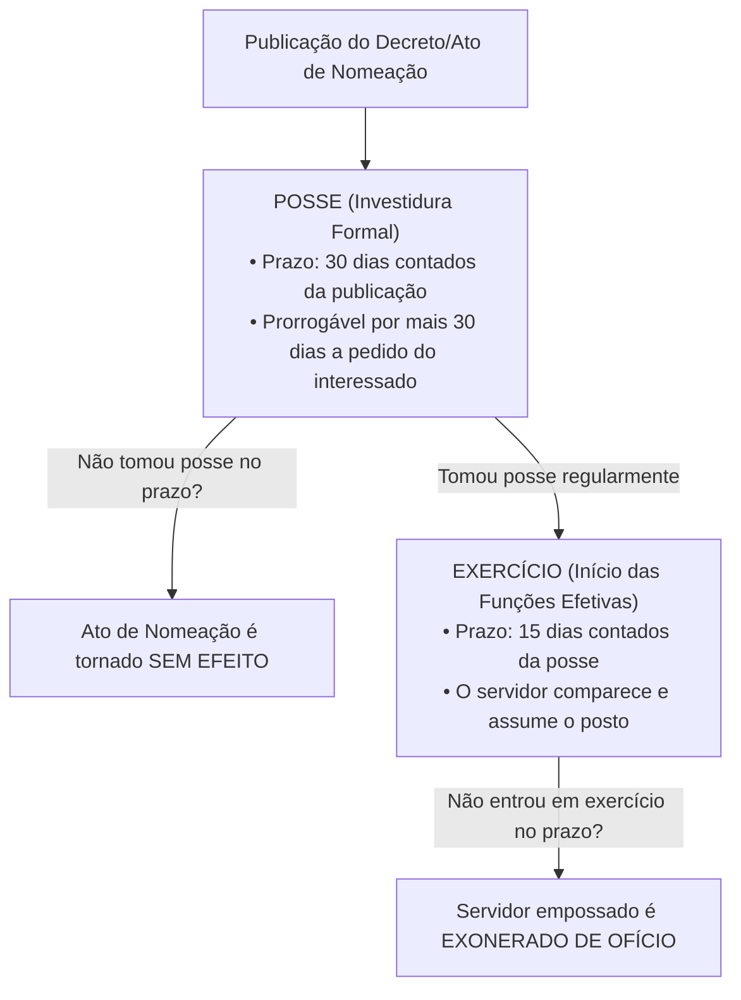
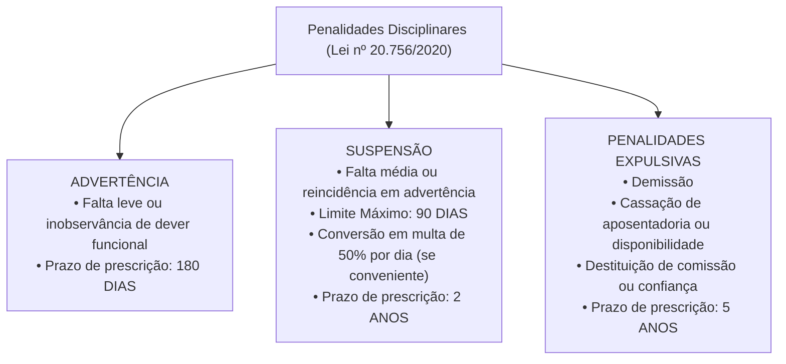

# 04 - Regime Jurídico dos Servidores e PCCR do TCE-GO

> **Matéria:** Legislação Institucional  
> **Cargos:** A01 – Técnico de Controle Externo (Adm) / B02 – Técnico de Controle Externo (TI)  
> **Arquivo:** `04_regime_juridico_servidores_e_pccr_leis_20756_e_15122.md`  
> **Atos Normativos:** Lei Estadual nº 20.756, de 28 de janeiro de 2020 (Estatuto Geral dos Servidores Públicos Civis do Estado de Goiás) e Lei Estadual nº 15.122, de 04 de fevereiro de 2005 (Plano de Cargos, Carreiras e Remuneração do TCE-GO)

---

## 📌 Ementa / Itens do Edital
- Regime Jurídico dos Servidores Públicos Civis do Estado de Goiás (Lei Estadual nº 20.756/2020):
    - Disposições preliminares: conceito de servidor público, cargo público de provimento efetivo e em comissão, classe, padrão e quadro de pessoal;
    - Provimento de cargos públicos: forma originária (nomeação) e formas derivadas (reintegração, recondução, reversão, aproveitamento e readaptação);
    - Concurso público: requisitos, validade, prorrogação e reserva legal de vagas para pessoas com deficiência;
    - Posse e Exercício: requisitos legais, prazos rigorosos (30 dias para posse e 15 dias para exercício) e consequências jurídicas do não comparecimento (ato sem efeito x exoneração de ofício);
    - Estágio Probatório: período de 3 (três) anos (36 meses) de efetivo exercício, comissão de avaliação, critérios taxativos avaliados e consequências da inaptidão (exoneração ou recondução);
    - Estabilidade constitucional e hipóteses de perda do cargo público;
    - Vacância do cargo público: exoneração, demissão, readaptação, aposentadoria, posse em outro cargo inacumulável e falecimento;
    - Direitos e vantagens pecuniárias: vencimento básico, remuneração, indenizações (diárias, ajuda de custo e transporte), gratificações e adicionais;
    - Regime de férias, licenças e afastamentos remunerados e não remunerados;
    - Regime Disciplinar: deveres funcionais, vedações e proibições;
    - Penalidades disciplinares: advertência, suspensão (limite máximo de 90 dias e conversão em multa), demissão, cassação de aposentadoria ou disponibilidade e destituição de cargo em comissão ou função de confiança;
    - Prescrição da pretensão punitiva disciplinar: prazos de 5 anos, 2 anos e 180 dias; termo inicial e causas de interrupção;
    - Processo Administrativo Disciplinar (PAD) e Sindicância: fases procedimentais (instauração, inquérito administrativo com instrução, defesa e relatório, e julgamento);
- Plano de Cargos, Carreiras e Remuneração dos Servidores do TCE-GO (Lei Estadual nº 15.122/2005 e alterações):
    - Estrutura da Carreira de Controle Externo: Analista de Controle Externo e Técnico de Controle Externo (Especialidades Administrativa e TI);
    - Atribuições típicas do cargo de Técnico de Controle Externo;
    - Desenvolvimento funcional: Progressão Funcional (horizontal, entre padrões da mesma classe) e Promoção Funcional (vertical, entre classes da carreira);
    - Requisitos de interstício temporal, avaliação periódica de desempenho e capacitação continuada na Escola Superior de Controle Externo do TCE-GO;
    - Estrutura remuneratória: vencimento base, Gratificação de Controle Externo (GCE) e adicional de qualificação.

---

## 🧭 Sumário

1. [Estatuto dos Servidores Públicos Civis do Estado de Goiás (Lei nº 20.756/2020)](#1-estatuto-dos-servidores-publicos-civis-do-estado-de-goias-lei-no-207562020)
    1. [Conceito de Servidor, Cargo Público e Formas de Provimento](#11-conceito-de-servidor-cargo-publico-e-formas-de-provimento)
    2. [Posse e Exercício: Prazos e Consequências do Descumprimento](#12-posse-e-exercicio-prazos-e-consequencias-do-descumprimento)
    3. [Estágio Probatório, Fatores de Avaliação e Hipóteses de Inaptidão](#13-estagio-probatorio-fatores-de-avaliacao-e-hipoteses-de-inaptidao)
    4. [Vacância do Cargo Público](#14-vacancia-do-cargo-publico)
    5. [Direitos, Vantagens Pecuniárias, Férias e Licenças](#15-direitos-vantagens-pecuniarias-ferias-e-licencas)
    6. [Regime Disciplinar: Deveres, Proibições e Penalidades](#16-regime-disciplinar-deveres-proibicoes-e-penalidades)
    7. [Prescrição da Pretensão Punitiva Disciplinar](#17-prescricao-da-pretensao-punitiva-disciplinar)
    8. [Sindicância e Processo Administrativo Disciplinar (PAD)](#18-sindicancia-e-processo-administrativo-disciplinar-pad)
    9. [Teste 152](#Teste-152)
    10. [Teste 153](#Teste-153)
    11. [Teste 154](#Teste-154)
    12. [Teste 155](#Teste-155)
    13. [Teste 156](#Teste-156)
    14. [Teste 157](#Teste-157)
    15. [Teste 158](#Teste-158)
    16. [Teste 159](#Teste-159)
2. [Plano de Cargos, Carreiras e Remuneração do TCE-GO (Lei nº 15.122/2005)](#2-plano-de-cargos-carreiras-e-remuneracao-do-tce-go-lei-no-151222005)
    1. [Estrutura do Quadro Efetivo do TCE-GO](#21-estrutura-do-quadro-efetivo-do-tce-go)
    2. [Atribuições Legais do Técnico de Controle Externo](#22-atribuicoes-legais-do-tecnico-de-controle-externo)
    3. [Desenvolvimento Funcional: Progressão Horizontal vs. Promoção Vertical](#23-desenvolvimento-funcional-progressao-horizontal-vs-promocao-vertical)
    4. [Estrutura Remuneratória e Vantagens Específicas do Tribunal](#24-estrutura-remuneratoria-e-vantagens-especificas-do-tribunal)
    5. [Teste 160](#Teste-160)
    6. [Teste 161](#Teste-161)
3. [Fontes Oficiais e Referências Bibliográficas](#3-fontes-oficiais-e-referencias-bibliograficas)

---

## 1. Estatuto dos Servidores Públicos Civis do Estado de Goiás (Lei nº 20.756/2020)

### 1.1 Conceito de Servidor, Cargo Público e Formas de Provimento
A **Lei Estadual nº 20.756, de 28 de janeiro de 2020**, estabelece o regime jurídico único dos servidores públicos civis da administração direta, autárquica e fundacional dos Poderes Executivo, Legislativo e Judiciário do Estado de Goiás, aplicando-se também aos servidores dos Tribunais de Contas (TCE-GO e TCM-GO) e do Ministério Público.

- **Servidor Público:** É a pessoa legalmente investida em cargo público estadual.
- **Cargo Público:** Conjunto de atribuições, deveres e responsabilidades cometidos a um servidor, criado por lei, em número certo, com denominação própria e subsídio ou vencimento pago pelos cofres públicos. Podem ser de **provimento efetivo** (exige concurso público) ou **em comissão** (de livre nomeação e livre exoneração).
- **Forma Originária de Provimento:** A **nomeação** é a única forma de provimento originário.
- **Formas Derivadas de Provimento:** Pressupõem vínculo funcional anterior do servidor com a Administração estadual:

| Forma de Provimento Derivado | Conceito e Hipótese Legal | Regra de Retorno e Direitos Pecuniários |
| :--- | :--- | :--- |
| **Reintegração** | Retorno do servidor público **estável** ao cargo anteriormente ocupado quando sua **demissão for invalidada** por decisão judicial transitada em julgado ou administrativa. | O servidor é reintegrado com **ressarcimento integral** de todos os vencimentos, remunerações e vantagens retroativas a que faria jus. |
| **Recondução** | Retorno do servidor público **estável** ao cargo de origem anteriormente ocupado, decorrente de: 1) **Inabilitação em estágio probatório** de outro cargo público; ou 2) Retorno do titular daquele cargo em virtude de reintegração. | Retorno formal **sem direito a qualquer indenização** financeira pelo período em que esteve fora. |
| **Reversão** | Retorno à atividade do servidor **aposentado**: a) *De ofício:* quando junta médica oficial declara insubsistentes os motivos da aposentadoria por incapacidade permanente; b) *A pedido:* voluntária, no interesse da administração, desde que haja cargo vago, o servidor seja estável e conte menos de 70 anos. | Volta à atividade na mesma classe e padrão em que se aposentou. |
| **Readaptação** | Investidura do servidor em cargo de atribuições e responsabilidades compatíveis com a **limitação física ou mental superveniente** sofrida, verificada em perícia médica oficial. | Caso o cargo de readaptação tenha remuneração inferior, o servidor mantém a remuneração do cargo de origem. |
| **Aproveitamento** | Retorno compulsório à atividade do servidor que se encontrava em **disponibilidade** (em razão de extinção do cargo ou de declaração de sua desnecessidade). | Aproveitado obrigatoriamente em cargo de atribuições e vencimentos compatíveis. |

### 1.2 Posse e Exercício: Prazos e Consequências do Descumprimento
A investidura no cargo público consuma-se com a **posse**, momento solene no qual o servidor presta compromisso de bem servir e assina o termo formal perante a autoridade competente:

- **Prazos Oficiais:**
    - **Posse:** Deve ocorrer no prazo de **trinta (30) dias** contados da data da publicação oficial do ato de provimento (nomeação), prorrogável por igual período a requerimento justificado do interessado.
    - **Exercício:** É o efetivo desempenho das atribuições do cargo público. O prazo para o servidor empossado entrar em exercício é de **quinze (15) dias**, contados da data da posse.
- **Distinção Crítica das Consequências:**
    - Se o nomeado **NÃO tomar posse** no prazo legal de 30 dias: o ato de nomeação será tornado **SEM EFEITO** (a pessoa ainda não é servidora, logo não se pode exonerar quem nunca tomou posse!).
    - Se o nomeado **tomar posse, mas NÃO entrar em exercício** no prazo legal de 15 dias: o servidor será **EXONERADO DE OFÍCIO**.

> 🚨 **ALERTA DE PROVA / PEGADINHA FCC:** A banca FCC rotineiramente inverte as consequências: afirma que quem não toma posse é exonerado, ou que quem não entra em exercício tem o ato tornado sem efeito. Grave esta correlação imediata: **Não tomou posse $\rightarrow$ ato SEM EFEITO**. **Tomou posse mas não entrou em exercício $\rightarrow$ EXONERAÇÃO DE OFÍCIO**.

### 1.3 Estágio Probatório, Fatores de Avaliação e Hipóteses de Inaptidão
Ao entrar em exercício, o servidor nomeado para cargo de provimento efetivo cumpre **estágio probatório por período de 3 (três) anos** (36 meses) de efetivo exercício, durante o qual sua aptidão e idoneidade serão avaliadas por comissão constituída para essa finalidade.

- **Critérios Legais Avaliados no Estágio (Art. 31 da Lei nº 20.756/2020):**
    1. **Assiduidade**;
    2. **Pontualidade**;
    3. **Disciplina**;
    4. **Iniciativa**;
    5. **Produtividade e qualidade** no trabalho;
    6. **Responsabilidade**.

- **Consequências da Inaptidão / Reprovação no Estágio Probatório:**
    - Se o servidor era **recém-ingressante** no serviço público (não possuía estabilidade anterior no Estado de Goiás): é **exonerado de ofício** daquele cargo;
    - Se o servidor **já era estável** em cargo público estadual anterior: é **reconduzido** ao cargo de origem anteriormente ocupado, sem direito a indenização.

### 1.4 Vacância do Cargo Público
A vacância de cargo público decorre de fatos funcionais taxativos previstos em lei:

1. **Exoneração:** Não tem caráter punitivo. Pode ocorrer a pedido do próprio servidor ou de ofício (quando não satisfeitas as condições do estágio probatório, quando o servidor empossado não entrar em exercício, ou para ajuste fiscal do art. 169 da CF);
2. **Demissão:** Penalidade disciplinar de caráter punitivo imposta pela prática de falta funcional de natureza grave;
3. **Readaptação:** Provimento no novo cargo compatível com a limitação e vacância simultânea do cargo originário;
4. **Aposentadoria:** Voluntária, por incapacidade permanente para o trabalho ou compulsória aos 75 anos de idade;
5. **Posse em outro cargo público inacumulável;**
6. **Falecimento.**

### 1.5 Direitos, Vantagens Pecuniárias, Férias e Licenças
- **Vencimento vs. Remuneração:**
    - *Vencimento:* É a retribuição pecuniária básica fixada em lei para o padrão ocupado pelo servidor no cargo público efetivo.
    - *Remuneração:* É o vencimento do cargo efetivo acrescido das vantagens pecuniárias de caráter permanente estabelecidas em lei.
- **Indenizações (Não incorporam aos proventos nem sofrem incidência de imposto de renda ou previdência):**
    - **Diárias:** Indenização por despesas extraordinárias de alimentação e pousada quando o servidor se desloca a serviço do seu município de lotação;
    - **Ajuda de Custo:** Indenização para cobrir despesas de mudança e instalação quando o servidor for transferido de ofício para ter exercício em nova localidade;
    - **Indenização de Transporte:** Paga ao servidor que realizar despesas com a utilização de meio próprio de locomoção para execução de serviços externos.
- **Férias:** O servidor faz jus a **30 (trinta) dias de férias anuais** remuneradas, pagas com acréscimo de **1/3 (um terço) constitucional**. É vedada a acumulação de mais de dois períodos de férias por absoluta necessidade do serviço.
- **Licenças Estatutárias:** Licença para tratamento da própria saúde; por motivo de doença em pessoa da família; maternidade (180 dias); paternidade (20 dias); capacitação profissional (até 3 meses a cada quinquênio trabalhado); e para desempenho de mandato classista.

### 1.6 Regime Disciplinar: Deveres, Proibições e Penalidades

- **Advertência:** Aplicada por escrito em caso de inobservância de dever funcional ou falta leve, para a qual a lei não comine expressamente sanção mais gravosa.
- **Suspensão:** Aplicada em caso de reincidência em falta punida com advertência ou prática de falta média.
    - **Limite Temporal Rigoroso:** A suspensão **não pode exceder a noventa (90) dias**.
    - **Conversão em Multa:** Quando houver conveniência para o serviço público, a penalidade de suspensão poderá ser convertida em multa na base de **50% (cinquenta por cento)** por dia de remuneração, ficando o servidor obrigado a permanecer em serviço.
- **Demissão:** Penalidade expulsiva aplicável nos casos de infrações disciplinares gravíssimas:
    - Crime contra a administração pública e improbidade administrativa;
    - **Abandono de Cargo:** Ausência intencional do servidor ao serviço por mais de **trinta (30) dias consecutivos**;
    - **Inassiduidade Habitual:** Falta injustificada ao serviço por **sessenta (60) dias interpolados** durante o período de doze meses;
    - Corrupção passiva, concussão, recebimento de propina, aceitação de vantagem indevida ou revelação de segredo funcional de que tenha conhecimento em razão do cargo.
- **Cassação de Aposentadoria ou Disponibilidade:** Aplicada ao inativo que tenha praticado, na atividade, falta grave para a qual seja cominada a pena de demissão.

> 🚨 **ALERTA DE PROVA / PEGADINHA FCC:** Grave a distinção entre abandono e inassiduidade:
>
> - **Abandono de Cargo:** mais de **30 dias consecutivos**.
> - **Inassiduidade Habitual:** **60 dias interpolados** em 12 meses.
> Ambas as condutas são faltas graves sancionadas compulsoriamente com **DEMISSÃO** após apuração formal em PAD.

### 1.7 Prescrição da Pretensão Punitiva Disciplinar
A ação disciplinar para imposição de penalidades aos servidores públicos prescreve nos seguintes prazos legais:

- **Cinco (5) anos:** Para infrações disciplinares puníveis com **demissão**, **cassação de aposentadoria ou disponibilidade** e **destituição de cargo em comissão ou função de confiança**;
- **Dois (2) anos:** Para infrações puníveis com **suspensão**;
- **Cento e oitenta (180) dias:** Para infrações puníveis com **advertência**.
- **Termo Inicial:** O prazo prescricional começa a correr na data em que a autoridade competente para instaurar o processo disciplinar **toma conhecimento formal do fato**.
- **Interrupção:** A publicação do ato de instauração de sindicância ou do Processo Administrativo Disciplinar (PAD) **interrompe** a contagem do prazo de prescrição da pretensão punitiva.

### 1.8 Sindicância e Processo Administrativo Disciplinar (PAD)
O PAD é o procedimento contraditório formal destinado a apurar a responsabilidade de servidor público por infração funcional praticada no exercício de suas atribuições:

- Desenvolve-se nas seguintes fases sequenciais:
    1. **Instauração:** Publicação da portaria designando comissão processante tripartite (composta por três servidores estáveis);
    2. **Inquérito Administrativo:** Subdivide-se em instrução probatória (oitiva de testemunhas, juntada de perícias e documentos), defesa (citação do acusado para apresentação de defesa escrita) e relatório conclusivo minucioso da comissão;
    3. **Julgamento:** Decisão fundamentada proferida pela autoridade competente para a aplicação da penalidade.

---

### Teste 001
**(FGV – TCE/GO – 2024 – Analista de Controle Externo - Ciências Contábeis)**
Pedro, servidor ocupante de cargo de provimento efetivo no Estado de Goiás, em exercício há cinco anos ininterruptos, após regular processo administrativo-disciplinar, veio a ser demitido. O cargo que ocupava, por sua vez, de nomenclatura X, foi transformado no cargo Y, que passou a ser ocupado por Maria. A demissão de Pedro, no entanto, foi invalidada pelo Poder Judiciário. De acordo com a Lei Estadual nº 20.756/2020, é correto afirmar que ocorrerá

* **A)** a recondução de Pedro.
* **B)** a reintegração de Pedro.
* **C)** a disponibilidade de Pedro.
* **D)** o reaproveitamento de Pedro.
* **E)** o retorno de Pedro, e Maria será exonerada.

---

> **Comentário Detalhado:**
>
> - **A)** **Incorreta.** A opção apresenta proposição em desacordo com os fundamentos teóricos e técnicos do tópico ao afirmar que "a recondução de Pedro". De acordo com a teoria estudada em *1.1 Conceito de Servidor, Cargo Público e Formas de Provimento*, recondução: Retorno do servidor público estável ao cargo de origem anteriormente ocupado, decorrente de: 1) Inabilitação em estágio probatório de outro cargo público; ou 2) Retorno do titular daquele cargo em virtude de reintegração. — Retorno formal sem direito a qualquer indenização financeira pelo período em que esteve fora.
> - **B)** **Correta.** Conforme fundamentado na seção *1.1 Conceito de Servidor, Cargo Público e Formas de Provimento* deste guia, reintegração: Retorno do servidor público estável ao cargo anteriormente ocupado quando sua demissão for invalidada por decisão judicial transitada em julgado ou administrativa. — O servidor é reintegrado com ressarcimento integral de todos os vencimentos, remunerações e vantagens retroativas a que faria jus. Dessa forma, está plenamente correta a assertiva da banca (FGV – TCE/GO/2024) ao estabelecer que "a reintegração de Pedro".
> - **C)** **Incorreta.** A opção apresenta proposição em desacordo com os fundamentos teóricos e técnicos do tópico ao afirmar que "a disponibilidade de Pedro". De acordo com a teoria estudada em *1.7 Prescrição da Pretensão Punitiva Disciplinar*, cinco (5) anos: Para infrações disciplinares puníveis com demissão, cassação de aposentadoria ou disponibilidade e destituição de cargo em comissão ou função de confiança.
> - **D)** **Incorreta.** A opção apresenta proposição em desacordo com os fundamentos teóricos e técnicos do tópico ao afirmar que "o reaproveitamento de Pedro". De acordo com a teoria estudada em *1.1 Conceito de Servidor, Cargo Público e Formas de Provimento*, a Lei Estadual nº 20.756, de 28 de janeiro de 2020, estabelece o regime jurídico único dos servidores públicos civis da administração direta, autárquica e fundacional dos Poderes Executivo, Legislativo e Judiciário do Estado de Goiás, aplicando se também aos servidores dos Tribunais de Contas (TCE GO e TCM GO) e do Ministério Público.
> - **E)** **Incorreta.** A opção apresenta proposição em desacordo com os fundamentos teóricos e técnicos do tópico ao afirmar que "o retorno de Pedro, e Maria será exonerada". De acordo com a teoria estudada em *3. Fontes Oficiais e Referências Bibliográficas*, dI PIETRO, Maria Sylvia Zanella. Direito Administrativo. 37. ed. Rio de Janeiro: Forense, 2024. (Cap. 14 Servidores Públicos e Regime Estatutário).
>
> **Gabarito: B**

---

### Teste 002
**(FGV – TCE/GO – 2024 – Analista de Controle Externo - Ciências Contábeis)**
João, servidor público ocupante de cargo em comissão no âmbito do poder Executivo do Estado de Goiás, foi afastado da direção do órgão público X, em razão de permissivo constante da Lei estadual nº 20.756/2020. Maria, por sua vez, que dirigia o órgão público Y, foi informada que iria substituir João. Nessa situação, é correto afirmar que Maria, ao ser designada para substituir João

* **A)** continuará no órgão público Y, e receberá a integralidade da retribuição estipendial do cargo de João, paga proporcionalmente aos dias de efetiva substituição.
* **B)** continuará no órgão público Y, e poderá optar pela remuneração integral do cargo de João, ao invés daquela correspondente ao cargo que ocupa.
* **C)** continuará no órgão publico Y, e receberá 60% da retribuição estipendial do cargo de João, paga proporcionalmente aos dias de efetiva substituição.
* **D)** continuará no órgão público Y, e não fará jus a qualquer retribuição estipendial pela acumulação do órgão público x.
* **E)** será afastada do órgão público Y, em razão da vedação à acumulação de cargos.

---

> **Comentário Detalhado:**
>
> - **A)** **Incorreta.** A opção apresenta proposição em desacordo com os fundamentos teóricos e técnicos do tópico ao afirmar que "continuará no órgão público Y, e receberá a integralidade da retribuição estipendial do cargo de João, paga...". De acordo com a teoria estudada em *1.5 Direitos, Vantagens Pecuniárias, Férias e Licenças*, vencimento: É a retribuição pecuniária básica fixada em lei para o padrão ocupado pelo servidor no cargo público efetivo.
> - **B)** **Incorreta.** A opção apresenta proposição em desacordo com os fundamentos teóricos e técnicos do tópico ao afirmar que "continuará no órgão público Y, e poderá optar pela remuneração integral do cargo de João, ao invés daquela...". De acordo com a teoria estudada em *1.6 Regime Disciplinar: Deveres, Proibições e Penalidades*, conversão em Multa: Quando houver conveniência para o serviço público, a penalidade de suspensão poderá ser convertida em multa na base de 50% (cinquenta por cento) por dia de remuneração, ficando o servidor obrigado a permanecer em serviço.
> - **C)** **Correta.** Conforme fundamentado na seção *1.1 Conceito de Servidor, Cargo Público e Formas de Provimento* deste guia, a Lei Estadual nº 20.756, de 28 de janeiro de 2020, estabelece o regime jurídico único dos servidores públicos civis da administração direta, autárquica e fundacional dos Poderes Executivo, Legislativo e Judiciário do Estado de Goiás, aplicando se também aos servidores dos Tribunais de Contas (TCE GO e TCM GO) e do Ministério Público. Dessa forma, está plenamente correta a assertiva da banca (FGV – TCE/GO/2024) ao estabelecer que "continuará no órgão publico Y, e receberá 60% da retribuição estipendial do cargo de João, paga proporcionalmente...".
> - **D)** **Incorreta.** A opção promove generalização excessiva que desconsidera as condições técnicas e normativas ao afirmar que "continuará no órgão público Y, e não fará jus a qualquer retribuição estipendial pela acumulação do órgão público x". De acordo com a teoria estudada em *1.5 Direitos, Vantagens Pecuniárias, Férias e Licenças*, férias: O servidor faz jus a 30 (trinta) dias de férias anuais remuneradas, pagas com acréscimo de 1/3 (um terço) constitucional. É vedada a acumulação de mais de dois períodos de férias por absoluta necessidade do serviço.
> - **E)** **Incorreta.** A opção apresenta proposição em desacordo com os fundamentos teóricos e técnicos do tópico ao afirmar que "será afastada do órgão público Y, em razão da vedação à acumulação de cargos". De acordo com a teoria estudada em *Fundamentos Teóricos*, atos Normativos: Lei Estadual nº 20.756, de 28 de janeiro de 2020 (Estatuto Geral dos Servidores Públicos Civis do Estado de Goiás) e Lei Estadual nº 15.122, de 04 de fevereiro de 2005 (Plano de Cargos, Carreiras e Remuneração do TCE GO).
>
> **Gabarito: C**

---

### Teste 003
**(FGV – TCE/GO – 2024 – Analista de Controle Externo - Jurídica)**
Após ser aprovado em concurso público para cargo efetivo de determinada autarquia do Estado de Goiás, Josivaldo passou a perquirir os diversos aspectos atinentes ao provimento previstos na Lei Estadual nº 20.756/2020 (Regime Jurídico dos Servidores Públicos Civis do Estado de Goiás), situação em que verificou corretamente que

* **A)** o ato de provimento de cargo público compete ao Chefe do Poder Executivo, mediante decreto.
* **B)** é cabível a edição de atos de nomeação, admissão ou contratação, posse ou exercício com efeito retroativo.
* **C)** são formas de provimento de cargo público apenas a nomeação, a recondução e a reintegração.
* **D)** as funções de confiança são de livre nomeação e exoneração, não sendo, portanto, privativas de servidores ocupantes de cargos de provimento efetivo.
* **E)** os requisitos para investidura em cargo público de provimento efetivo devem ser comprovados por ocasião da homologação do respectivo concurso público.

---

> **Comentário Detalhado:**
>
> - **A)** **Correta.** Conforme fundamentado na seção *1.1 Conceito de Servidor, Cargo Público e Formas de Provimento* deste guia, a Lei Estadual nº 20.756, de 28 de janeiro de 2020, estabelece o regime jurídico único dos servidores públicos civis da administração direta, autárquica e fundacional dos Poderes Executivo, Legislativo e Judiciário do Estado de Goiás, aplicando se também aos servidores dos Tribunais de Contas (TCE GO e TCM GO) e do Ministério Público. Dessa forma, está plenamente correta a assertiva da banca (FGV – TCE/GO/2024) ao estabelecer que "o ato de provimento de cargo público compete ao Chefe do Poder Executivo, mediante decreto".
> - **B)** **Incorreta.** A opção apresenta proposição em desacordo com os fundamentos teóricos e técnicos do tópico ao afirmar que "é cabível a edição de atos de nomeação, admissão ou contratação, posse ou exercício com efeito retroativo". De acordo com a teoria estudada em *1.2 Posse e Exercício: Prazos e Consequências do Descumprimento*, nomeacao["Publicação do Decreto/Ato de Nomeação"].
> - **C)** **Incorreta.** A opção incorre em restrição indevida ao limitar o escopo conceitual ao afirmar que "são formas de provimento de cargo público apenas a nomeação, a recondução e a reintegração". De acordo com a teoria estudada em *1.1 Conceito de Servidor, Cargo Público e Formas de Provimento*, recondução: Retorno do servidor público estável ao cargo de origem anteriormente ocupado, decorrente de: 1) Inabilitação em estágio probatório de outro cargo público; ou 2) Retorno do titular daquele cargo em virtude de reintegração. — Retorno formal sem direito a qualquer indenização financeira pelo período em que esteve fora.
> - **D)** **Incorreta.** A opção apresenta proposição em desacordo com os fundamentos teóricos e técnicos do tópico ao afirmar que "as funções de confiança são de livre nomeação e exoneração, não sendo, portanto, privativas de servidores...". De acordo com a teoria estudada em *1.1 Conceito de Servidor, Cargo Público e Formas de Provimento*, cargo Público: Conjunto de atribuições, deveres e responsabilidades cometidos a um servidor, criado por lei, em número certo, com denominação própria e subsídio ou vencimento pago pelos cofres públicos. Podem ser de provimento efetivo (exige concurso público) ou em comissão (de livre nomeação e livre exoneração).
> - **E)** **Incorreta.** A opção apresenta proposição em desacordo com os fundamentos teóricos e técnicos do tópico ao afirmar que "os requisitos para investidura em cargo público de provimento efetivo devem ser comprovados por ocasião da...". De acordo com a teoria estudada em *3. Fontes Oficiais e Referências Bibliográficas*, lei Estadual nº 20.756/2020 Estatuto dos Servidores de Goiás (Casa Civil/GO) Texto compilado do regime jurídico dos servidores públicos civis estaduais.
>
> **Gabarito: A**

---

## 2. Plano de Cargos, Carreiras e Remuneração do TCE-GO (Lei nº 15.122/2005)

### 2.1 Estrutura do Quadro Efetivo do TCE-GO
A **Lei Estadual nº 15.122, de 04 de fevereiro de 2005**, organiza o Plano de Cargos, Carreiras e Remuneração (PCCR) dos servidores do Tribunal de Contas do Estado de Goiás. O quadro de provimento efetivo do TCE-GO é estruturado em duas carreiras técnicas:

1. **Analista de Controle Externo:** Nível de escolaridade superior. Atuação finalística em auditorias, inspeções, instrução técnica de processos complexos de contas e fiscalização orçamentária e operacional.
2. **Técnico de Controle Externo:** Nível técnico/intermediário superior. Compreende especialidades voltadas ao suporte operacional, instrução procedimental e gestão de sistemas:
    - **Especialidade Técnico Administrativo (Cargo A01):** Gestão administrativa, apoio ao processamento de autos, gestão de contratos internos, compras, almoxarifado, patrimônio e apoio aos gabinetes de Conselheiros e Secretarias de Câmaras;
    - **Especialidade Tecnologia da Informação (Cargo B02):** Suporte técnico operacional de infraestrutura de TI, atendimento aos usuários de sistemas internos, gerenciamento de redes, segurança da informação, suporte a bancos de dados e desenvolvimento/manutenção de softwares de auditoria eletrônica.

### 2.2 Atribuições Legais do Técnico de Controle Externo
Nos termos da Lei nº 15.122/2005 e regulamentos internos da Corte, incumbe ao Técnico de Controle Externo:

- Executar atividades e rotinas de nível técnico voltadas ao apoio do controle externo e da administração geral do Tribunal;
- Operacionalizar softwares de triagem, alimentação de bancos de dados processuais e gestão eletrônica de autos;
- Prestar suporte logístico e administrativo às equipes de fiscalização e inspeção externa;
- Elaborar expedientes, certidões, intimações, notificações e relatórios de suporte administrativo;
- Na especialidade de TI (B02): garantir a estabilidade operacional dos sistemas informatizados, segurança de dados corporativos e funcionamento dos recursos tecnológicos utilizados pelos auditores e membros da Corte.

### 2.3 Desenvolvimento Funcional: Progressão Horizontal vs. Promoção Vertical
A evolução dos servidores nas carreiras do TCE-GO dá-se sob duas modalidades distintas:

| Modalidade de Evolução | Conceito no PCCR | Requisitos Exigidos na Lei nº 15.122/2005 |
| :--- | :--- | :--- |
| **Progressão Funcional** | Movimentação horizontal do servidor de um **padrão de vencimento para o subsequente**, dentro dos limites da **mesma classe** da carreira. | 1. Cumprimento do **interstício mínimo de efetivo exercício** no padrão anterior; 2. Resultado satisfatório na **avaliação periódica de desempenho**. |
| **Promoção Funcional** | Movimentação vertical do servidor do **último padrão de uma classe para o padrão inicial da classe imediatamente superior**. | 1. Cumprimento do interstício mínimo de efetivo exercício no último padrão da classe; 2. Resultado satisfatório na avaliação periódica de desempenho; 3. Participação e aprovação em cursos de **capacitação continuada e aperfeiçoamento profissional** promovidos ou homologados pela **Escola Superior de Controle Externo (Escola de Contas)** do TCE-GO. |

> ⭐ **IMPORTANTE / VEDAÇÃO DE CONCURSO INTERNO:** A evolução funcional entre classes (promoção) ocorre estritamente dentro da mesma carreira para a qual o servidor prestou concurso público originário. É vedada a mudança de Técnico para Analista sem novo concurso público de provas e títulos (Súmula Vinculante nº 43 do STF).

### 2.4 Estrutura Remuneratória e Vantagens Específicas do Tribunal
A remuneração dos servidores efetivos do TCE-GO é composta por:

- **Vencimento Básico:** Fixado nas tabelas salariais da Lei nº 15.122/2005 de acordo com a classe e padrão de evolução;
- **Gratificação de Controle Externo (GCE):** Vantagem pecuniária vinculada ao exercício de atividades de fiscalização e suporte técnico no âmbito da Corte de Contas;
- **Adicional de Qualificação:** Concedido em percentuais legais com base na conclusão de cursos de pós-graduação (*lato sensu*, mestrado ou doutorado) em áreas de interesse do Tribunal de Contas, incentivando o contínuo aprimoramento técnico do corpo de servidores.

---

## 3. Fontes Oficiais e Referências Bibliográficas

* [Lei Estadual nº 20.756/2020 - Estatuto dos Servidores de Goiás (Casa Civil/GO)](https://legisla.casacivil.go.gov.br/pesquisa_legislacao/100979/lei-20756) - Texto compilado do regime jurídico dos servidores públicos civis estaduais.
* [Lei Estadual nº 15.122/2005 - PCCR do TCE-GO (Casa Civil/GO)](https://legisla.casacivil.go.gov.br/pesquisa_legislacao/80023/lei-15122) - Plano de Carreira, Cargos e Vencimentos dos Servidores do TCE-GO.
* [Constituição do Estado de Goiás - Seção dos Servidores Públicos (Casa Civil/GO)](https://legisla.casacivil.go.gov.br/constituicao-estadual) - Direitos, estabilidade e vencimentos no serviço público estadual.
* [Portal Institucional do TCE-GO - Competências e Estrutura Funcional](https://portal.tce.go.gov.br/competencias) - Quadro permanente de servidores e organização interna do Tribunal.
* [Lei Estadual nº 16.168/2007 - Lei Orgânica do TCE-GO (Casa Civil/GO)](https://legisla.casacivil.go.gov.br/pesquisa_legislacao/86708/lei-16168) - Disposições sobre a gestão do quadro de servidores e auditores.
* DI PIETRO, Maria Sylvia Zanella. **Direito Administrativo**. 37. ed. Rio de Janeiro: Forense, 2024. (Cap. 14 - Servidores Públicos e Regime Estatutário).
* CARVALHO FILHO, José dos Santos. **Manual de Direito Administrativo**. 38. ed. Barueri: Atlas, 2024. (Cap. 12 - Agentes Públicos e Regime Jurídico).
* ALEXANDRINO, Marcelo; PAULO, Vicente. **Direito Administrativo Descomplicado**. 32. ed. São Paulo: Método, 2024. (Cap. 8 - Provimento, Vacância e Direitos dos Servidores).
