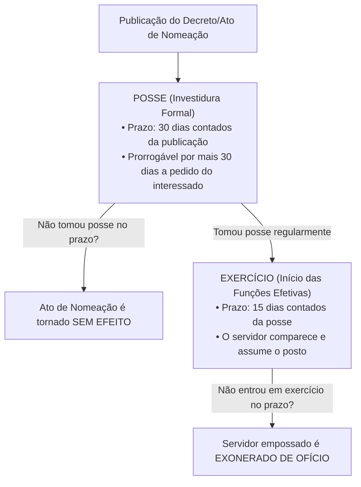
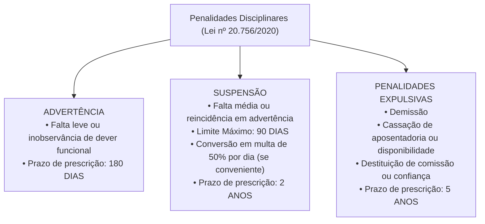

# 04 - Regime Jurídico dos Servidores e PCCR do TCE-GO

> **Matéria:** Legislação Institucional  
> **Cargos:** A01 – Técnico de Controle Externo (Adm) / B02 – Técnico de Controle Externo (TI)  
> **Arquivo:** `04_regime_juridico_servidores_e_pccr_leis_20756_e_15122.md`  
> **Atos Normativos:** Lei Estadual nº 20.756, de 28 de janeiro de 2020 (Estatuto Geral dos Servidores Públicos Civis do Estado de Goiás) e Lei Estadual nº 15.122, de 04 de fevereiro de 2005 (Plano de Cargos, Carreiras e Remuneração do TCE-GO)

---

## 📌 Ementa / Itens do Edital
- Regime Jurídico dos Servidores Públicos Civis do Estado de Goiás (Lei Estadual nº 20.756/2020):
    - Disposições preliminares: conceito de servidor público, cargo público de provimento efetivo e em comissão, classe, padrão e quadro de pessoal;
    - Provimento de cargos públicos: forma originária (nomeação) e formas derivadas (reintegração, recondução, reversão, aproveitamento e readaptação);
    - Concurso público: requisitos, validade, prorrogação e reserva legal de vagas para pessoas com deficiência;
    - Posse e Exercício: requisitos legais, prazos rigorosos (30 dias para posse e 15 dias para exercício) e consequências jurídicas do não comparecimento (ato sem efeito x exoneração de ofício);
    - Estágio Probatório: período de 3 (três) anos (36 meses) de efetivo exercício, comissão de avaliação, critérios taxativos avaliados e consequências da inaptidão (exoneração ou recondução);
    - Estabilidade constitucional e hipóteses de perda do cargo público;
    - Vacância do cargo público: exoneração, demissão, readaptação, aposentadoria, posse em outro cargo inacumulável e falecimento;
    - Direitos e vantagens pecuniárias: vencimento básico, remuneração, indenizações (diárias, ajuda de custo e transporte), gratificações e adicionais;
    - Regime de férias, licenças e afastamentos remunerados e não remunerados;
    - Regime Disciplinar: deveres funcionais, vedações e proibições;
    - Penalidades disciplinares: advertência, suspensão (limite máximo de 90 dias e conversão em multa), demissão, cassação de aposentadoria ou disponibilidade e destituição de cargo em comissão ou função de confiança;
    - Prescrição da pretensão punitiva disciplinar: prazos de 5 anos, 2 anos e 180 dias; termo inicial e causas de interrupção;
    - Processo Administrativo Disciplinar (PAD) e Sindicância: fases procedimentais (instauração, inquérito administrativo com instrução, defesa e relatório, e julgamento);
- Plano de Cargos, Carreiras e Remuneração dos Servidores do TCE-GO (Lei Estadual nº 15.122/2005 e alterações):
    - Estrutura da Carreira de Controle Externo: Analista de Controle Externo e Técnico de Controle Externo (Especialidades Administrativa e TI);
    - Atribuições típicas do cargo de Técnico de Controle Externo;
    - Desenvolvimento funcional: Progressão Funcional (horizontal, entre padrões da mesma classe) e Promoção Funcional (vertical, entre classes da carreira);
    - Requisitos de interstício temporal, avaliação periódica de desempenho e capacitação continuada na Escola Superior de Controle Externo do TCE-GO;
    - Estrutura remuneratória: vencimento base, Gratificação de Controle Externo (GCE) e adicional de qualificação.

---

## 🧭 Sumário

1. [Estatuto dos Servidores Públicos Civis do Estado de Goiás (Lei nº 20.756/2020)](#1-estatuto-dos-servidores-publicos-civis-do-estado-de-goias-lei-no-207562020)
    1. [Conceito de Servidor, Cargo Público e Formas de Provimento](#11-conceito-de-servidor-cargo-publico-e-formas-de-provimento)
    2. [Posse e Exercício: Prazos e Consequências do Descumprimento](#12-posse-e-exercicio-prazos-e-consequencias-do-descumprimento)
    3. [Estágio Probatório, Fatores de Avaliação e Hipóteses de Inaptidão](#13-estagio-probatorio-fatores-de-avaliacao-e-hipoteses-de-inaptidao)
    4. [Vacância do Cargo Público](#14-vacancia-do-cargo-publico)
    5. [Direitos, Vantagens Pecuniárias, Férias e Licenças](#15-direitos-vantagens-pecuniarias-ferias-e-licencas)
    6. [Regime Disciplinar: Deveres, Proibições e Penalidades](#16-regime-disciplinar-deveres-proibicoes-e-penalidades)
    7. [Prescrição da Pretensão Punitiva Disciplinar](#17-prescricao-da-pretensao-punitiva-disciplinar)
    8. [Sindicância e Processo Administrativo Disciplinar (PAD)](#18-sindicancia-e-processo-administrativo-disciplinar-pad)
    9. [Teste 152](#Teste-152)
    10. [Teste 153](#Teste-153)
    11. [Teste 154](#Teste-154)
    12. [Teste 155](#Teste-155)
    13. [Teste 156](#Teste-156)
    14. [Teste 157](#Teste-157)
    15. [Teste 158](#Teste-158)
    16. [Teste 159](#Teste-159)
2. [Plano de Cargos, Carreiras e Remuneração do TCE-GO (Lei nº 15.122/2005)](#2-plano-de-cargos-carreiras-e-remuneracao-do-tce-go-lei-no-151222005)
    1. [Estrutura do Quadro Efetivo do TCE-GO](#21-estrutura-do-quadro-efetivo-do-tce-go)
    2. [Atribuições Legais do Técnico de Controle Externo](#22-atribuicoes-legais-do-tecnico-de-controle-externo)
    3. [Desenvolvimento Funcional: Progressão Horizontal vs. Promoção Vertical](#23-desenvolvimento-funcional-progressao-horizontal-vs-promocao-vertical)
    4. [Estrutura Remuneratória e Vantagens Específicas do Tribunal](#24-estrutura-remuneratoria-e-vantagens-especificas-do-tribunal)
    5. [Teste 160](#Teste-160)
    6. [Teste 161](#Teste-161)
3. [Fontes Oficiais e Referências Bibliográficas](#3-fontes-oficiais-e-referencias-bibliograficas)

---

## 1. Estatuto dos Servidores Públicos Civis do Estado de Goiás (Lei nº 20.756/2020)

### 1.1 Conceito de Servidor, Cargo Público e Formas de Provimento
A **Lei Estadual nº 20.756, de 28 de janeiro de 2020**, estabelece o regime jurídico único dos servidores públicos civis da administração direta, autárquica e fundacional dos Poderes Executivo, Legislativo e Judiciário do Estado de Goiás, aplicando-se também aos servidores dos Tribunais de Contas (TCE-GO e TCM-GO) e do Ministério Público.

- **Servidor Público:** É a pessoa legalmente investida em cargo público estadual.
- **Cargo Público:** Conjunto de atribuições, deveres e responsabilidades cometidos a um servidor, criado por lei, em número certo, com denominação própria e subsídio ou vencimento pago pelos cofres públicos. Podem ser de **provimento efetivo** (exige concurso público) ou **em comissão** (de livre nomeação e livre exoneração).
- **Forma Originária de Provimento:** A **nomeação** é a única forma de provimento originário.
- **Formas Derivadas de Provimento:** Pressupõem vínculo funcional anterior do servidor com a Administração estadual:

| Forma de Provimento Derivado | Conceito e Hipótese Legal | Regra de Retorno e Direitos Pecuniários |
| :--- | :--- | :--- |
| **Reintegração** | Retorno do servidor público **estável** ao cargo anteriormente ocupado quando sua **demissão for invalidada** por decisão judicial transitada em julgado ou administrativa. | O servidor é reintegrado com **ressarcimento integral** de todos os vencimentos, remunerações e vantagens retroativas a que faria jus. |
| **Recondução** | Retorno do servidor público **estável** ao cargo de origem anteriormente ocupado, decorrente de: 1) **Inabilitação em estágio probatório** de outro cargo público; ou 2) Retorno do titular daquele cargo em virtude de reintegração. | Retorno formal **sem direito a qualquer indenização** financeira pelo período em que esteve fora. |
| **Reversão** | Retorno à atividade do servidor **aposentado**: a) *De ofício:* quando junta médica oficial declara insubsistentes os motivos da aposentadoria por incapacidade permanente; b) *A pedido:* voluntária, no interesse da administração, desde que haja cargo vago, o servidor seja estável e conte menos de 70 anos. | Volta à atividade na mesma classe e padrão em que se aposentou. |
| **Readaptação** | Investidura do servidor em cargo de atribuições e responsabilidades compatíveis com a **limitação física ou mental superveniente** sofrida, verificada em perícia médica oficial. | Caso o cargo de readaptação tenha remuneração inferior, o servidor mantém a remuneração do cargo de origem. |
| **Aproveitamento** | Retorno compulsório à atividade do servidor que se encontrava em **disponibilidade** (em razão de extinção do cargo ou de declaração de sua desnecessidade). | Aproveitado obrigatoriamente em cargo de atribuições e vencimentos compatíveis. |

### 1.2 Posse e Exercício: Prazos e Consequências do Descumprimento
A investidura no cargo público consuma-se com a **posse**, momento solene no qual o servidor presta compromisso de bem servir e assina o termo formal perante a autoridade competente:

- **Prazos Oficiais:**
    - **Posse:** Deve ocorrer no prazo de **trinta (30) dias** contados da data da publicação oficial do ato de provimento (nomeação), prorrogável por igual período a requerimento justificado do interessado.
    - **Exercício:** É o efetivo desempenho das atribuições do cargo público. O prazo para o servidor empossado entrar em exercício é de **quinze (15) dias**, contados da data da posse.
- **Distinção Crítica das Consequências:**
    - Se o nomeado **NÃO tomar posse** no prazo legal de 30 dias: o ato de nomeação será tornado **SEM EFEITO** (a pessoa ainda não é servidora, logo não se pode exonerar quem nunca tomou posse!).
    - Se o nomeado **tomar posse, mas NÃO entrar em exercício** no prazo legal de 15 dias: o servidor será **EXONERADO DE OFÍCIO**.

> 🚨 **ALERTA DE PROVA / PEGADINHA FCC:** A banca FCC rotineiramente inverte as consequências: afirma que quem não toma posse é exonerado, ou que quem não entra em exercício tem o ato tornado sem efeito. Grave esta correlação imediata: **Não tomou posse $\rightarrow$ ato SEM EFEITO**. **Tomou posse mas não entrou em exercício $\rightarrow$ EXONERAÇÃO DE OFÍCIO**.

### 1.3 Estágio Probatório, Fatores de Avaliação e Hipóteses de Inaptidão
Ao entrar em exercício, o servidor nomeado para cargo de provimento efetivo cumpre **estágio probatório por período de 3 (três) anos** (36 meses) de efetivo exercício, durante o qual sua aptidão e idoneidade serão avaliadas por comissão constituída para essa finalidade.

- **Critérios Legais Avaliados no Estágio (Art. 31 da Lei nº 20.756/2020):**
    1. **Assiduidade**;
    2. **Pontualidade**;
    3. **Disciplina**;
    4. **Iniciativa**;
    5. **Produtividade e qualidade** no trabalho;
    6. **Responsabilidade**.

- **Consequências da Inaptidão / Reprovação no Estágio Probatório:**
    - Se o servidor era **recém-ingressante** no serviço público (não possuía estabilidade anterior no Estado de Goiás): é **exonerado de ofício** daquele cargo;
    - Se o servidor **já era estável** em cargo público estadual anterior: é **reconduzido** ao cargo de origem anteriormente ocupado, sem direito a indenização.

### 1.4 Vacância do Cargo Público
A vacância de cargo público decorre de fatos funcionais taxativos previstos em lei:

1. **Exoneração:** Não tem caráter punitivo. Pode ocorrer a pedido do próprio servidor ou de ofício (quando não satisfeitas as condições do estágio probatório, quando o servidor empossado não entrar em exercício, ou para ajuste fiscal do art. 169 da CF);
2. **Demissão:** Penalidade disciplinar de caráter punitivo imposta pela prática de falta funcional de natureza grave;
3. **Readaptação:** Provimento no novo cargo compatível com a limitação e vacância simultânea do cargo originário;
4. **Aposentadoria:** Voluntária, por incapacidade permanente para o trabalho ou compulsória aos 75 anos de idade;
5. **Posse em outro cargo público inacumulável;**
6. **Falecimento.**

### 1.5 Direitos, Vantagens Pecuniárias, Férias e Licenças
- **Vencimento vs. Remuneração:**
    - *Vencimento:* É a retribuição pecuniária básica fixada em lei para o padrão ocupado pelo servidor no cargo público efetivo.
    - *Remuneração:* É o vencimento do cargo efetivo acrescido das vantagens pecuniárias de caráter permanente estabelecidas em lei.
- **Indenizações (Não incorporam aos proventos nem sofrem incidência de imposto de renda ou previdência):**
    - **Diárias:** Indenização por despesas extraordinárias de alimentação e pousada quando o servidor se desloca a serviço do seu município de lotação;
    - **Ajuda de Custo:** Indenização para cobrir despesas de mudança e instalação quando o servidor for transferido de ofício para ter exercício em nova localidade;
    - **Indenização de Transporte:** Paga ao servidor que realizar despesas com a utilização de meio próprio de locomoção para execução de serviços externos.
- **Férias:** O servidor faz jus a **30 (trinta) dias de férias anuais** remuneradas, pagas com acréscimo de **1/3 (um terço) constitucional**. É vedada a acumulação de mais de dois períodos de férias por absoluta necessidade do serviço.
- **Licenças Estatutárias:** Licença para tratamento da própria saúde; por motivo de doença em pessoa da família; maternidade (180 dias); paternidade (20 dias); capacitação profissional (até 3 meses a cada quinquênio trabalhado); e para desempenho de mandato classista.

### 1.6 Regime Disciplinar: Deveres, Proibições e Penalidades

- **Advertência:** Aplicada por escrito em caso de inobservância de dever funcional ou falta leve, para a qual a lei não comine expressamente sanção mais gravosa.
- **Suspensão:** Aplicada em caso de reincidência em falta punida com advertência ou prática de falta média.
    - **Limite Temporal Rigoroso:** A suspensão **não pode exceder a noventa (90) dias**.
    - **Conversão em Multa:** Quando houver conveniência para o serviço público, a penalidade de suspensão poderá ser convertida em multa na base de **50% (cinquenta por cento)** por dia de remuneração, ficando o servidor obrigado a permanecer em serviço.
- **Demissão:** Penalidade expulsiva aplicável nos casos de infrações disciplinares gravíssimas:
    - Crime contra a administração pública e improbidade administrativa;
    - **Abandono de Cargo:** Ausência intencional do servidor ao serviço por mais de **trinta (30) dias consecutivos**;
    - **Inassiduidade Habitual:** Falta injustificada ao serviço por **sessenta (60) dias interpolados** durante o período de doze meses;
    - Corrupção passiva, concussão, recebimento de propina, aceitação de vantagem indevida ou revelação de segredo funcional de que tenha conhecimento em razão do cargo.
- **Cassação de Aposentadoria ou Disponibilidade:** Aplicada ao inativo que tenha praticado, na atividade, falta grave para a qual seja cominada a pena de demissão.

> 🚨 **ALERTA DE PROVA / PEGADINHA FCC:** Grave a distinção entre abandono e inassiduidade:
>
> - **Abandono de Cargo:** mais de **30 dias consecutivos**.
> - **Inassiduidade Habitual:** **60 dias interpolados** em 12 meses.
> Ambas as condutas são faltas graves sancionadas compulsoriamente com **DEMISSÃO** após apuração formal em PAD.

### 1.7 Prescrição da Pretensão Punitiva Disciplinar
A ação disciplinar para imposição de penalidades aos servidores públicos prescreve nos seguintes prazos legais:

- **Cinco (5) anos:** Para infrações disciplinares puníveis com **demissão**, **cassação de aposentadoria ou disponibilidade** e **destituição de cargo em comissão ou função de confiança**;
- **Dois (2) anos:** Para infrações puníveis com **suspensão**;
- **Cento e oitenta (180) dias:** Para infrações puníveis com **advertência**.
- **Termo Inicial:** O prazo prescricional começa a correr na data em que a autoridade competente para instaurar o processo disciplinar **toma conhecimento formal do fato**.
- **Interrupção:** A publicação do ato de instauração de sindicância ou do Processo Administrativo Disciplinar (PAD) **interrompe** a contagem do prazo de prescrição da pretensão punitiva.

### 1.8 Sindicância e Processo Administrativo Disciplinar (PAD)
O PAD é o procedimento contraditório formal destinado a apurar a responsabilidade de servidor público por infração funcional praticada no exercício de suas atribuições:

- Desenvolve-se nas seguintes fases sequenciais:
    1. **Instauração:** Publicação da portaria designando comissão processante tripartite (composta por três servidores estáveis);
    2. **Inquérito Administrativo:** Subdivide-se em instrução probatória (oitiva de testemunhas, juntada de perícias e documentos), defesa (citação do acusado para apresentação de defesa escrita) e relatório conclusivo minucioso da comissão;
    3. **Julgamento:** Decisão fundamentada proferida pela autoridade competente para a aplicação da penalidade.

---

### Teste 152
**(FGV – TCE/SC – 2026 – Auditor Fiscal de Controle Externo - Administração)**
Pedro, servidor do Estado de Santa Catarina, se desentende com Carlos, colega de trabalho da mesma instituição, em razão de divergências acerca do encaminhamento a ser dado em determinado processo administrativo. Em razão disso, fora do horário de trabalho e longe da repartição pública, Pedro ofende a integridade física de Carlos, que sofre lesões corporais leves. Nesse contexto, considerando as disposições acerca de infrações disciplinares constantes no Estatuto dos Servidores Públicos Civis do Estado de Santa Catarina (Lei nº 6.745/1985), é correto afirmar que Pedro

* **A)** não sofrerá qualquer pena disciplinar, visto que os fatos ocorreram fora das dependências da repartição pública, o que afasta o nexo de causalidade e, consequentemente, a responsabilização.
* **B)** será punido com a pena de demissão simples, haja vista que a ofensa física, embora fora do serviço, ocorreu em razão dele, não estando evidenciada hipótese de legítima defesa.
* **C)** será punido com a pena de suspensão até 30 (trinta) dias, haja vista que a ofensa física ocorrida fora da repartição pública e com resultado lesão corporal leve afasta punição mais gravosa.
* **D)** será punido com a pena de demissão qualificada, haja vista que a ofensa física, embora fora do serviço, ocorreu em razão dele, não estando evidenciada hipótese de legítima defesa.
* **E)** será punido com a pena de suspensão até 10 (dez) dias, haja vista que a ofensa física ocorrida fora da repartição pública e com resultado lesão corporal leve afasta punição mais gravosa.

---

> **Comentário Detalhado:**
>
> - **A)** **Incorreta.** A opção promove generalização excessiva que desconsidera as condições técnicas e normativas ao afirmar que "não sofrerá qualquer pena disciplinar, visto que os fatos ocorreram fora das dependências da repartição pública, o...". De acordo com a teoria estudada em *1.1 Conceito de Servidor, Cargo Público e Formas de Provimento*, recondução: Retorno do servidor público estável ao cargo de origem anteriormente ocupado, decorrente de: 1) Inabilitação em estágio probatório de outro cargo público; ou 2) Retorno do titular daquele cargo em virtude de reintegração. — Retorno formal sem direito a qualquer indenização financeira pelo período em que esteve fora.
> - **B)** **Correta.** Conforme fundamentado na seção *1.6 Regime Disciplinar: Deveres, Proibições e Penalidades* deste guia, cassação de Aposentadoria ou Disponibilidade: Aplicada ao inativo que tenha praticado, na atividade, falta grave para a qual seja cominada a pena de demissão. Dessa forma, está plenamente correta a assertiva da banca (FGV – TCE/SC/2026) ao estabelecer que "será punido com a pena de demissão simples, haja vista que a ofensa física, embora fora do serviço, ocorreu em...".
> - **C)** **Incorreta.** A opção apresenta proposição em desacordo com os fundamentos teóricos e técnicos do tópico ao afirmar que "será punido com a pena de suspensão até 30 (trinta) dias, haja vista que a ofensa física ocorrida fora da...". De acordo com a teoria estudada em *1.6 Regime Disciplinar: Deveres, Proibições e Penalidades*, advertência: Aplicada por escrito em caso de inobservância de dever funcional ou falta leve, para a qual a lei não comine expressamente sanção mais gravosa.
> - **D)** **Incorreta.** A opção apresenta proposição em desacordo com os fundamentos teóricos e técnicos do tópico ao afirmar que "será punido com a pena de demissão qualificada, haja vista que a ofensa física, embora fora do serviço, ocorreu em...". De acordo com a teoria estudada em *1.1 Conceito de Servidor, Cargo Público e Formas de Provimento*, readaptação: Investidura do servidor em cargo de atribuições e responsabilidades compatíveis com a limitação física ou mental superveniente sofrida, verificada em perícia médica oficial. — Caso o cargo de readaptação tenha remuneração inferior, o servidor mantém a remuneração do cargo de origem.
> - **E)** **Incorreta.** A opção apresenta proposição em desacordo com os fundamentos teóricos e técnicos do tópico ao afirmar que "será punido com a pena de suspensão até 10 (dez) dias, haja vista que a ofensa física ocorrida fora da repartição...". De acordo com a teoria estudada em *1.6 Regime Disciplinar: Deveres, Proibições e Penalidades*, conversão em Multa: Quando houver conveniência para o serviço público, a penalidade de suspensão poderá ser convertida em multa na base de 50% (cinquenta por cento) por dia de remuneração, ficando o servidor obrigado a permanecer em serviço.
>
> **Gabarito: B**

---

### Teste 153
**(FGV – TRT 16ª – 2022 – Analista Judiciário (Área Administrativa - Tecnologia da Informação))**
Pedro, servidor público federal ocupante de cargo de provimento efetivo, respondia a processo administrativo disciplinar sob a imputação de ter desviado recursos públicos. Para sua surpresa, pouco tempo depois, antes da conclusão do processo administrativo, tornou-se réu em um processo criminal, sendo acusado com base nos mesmos fatos. Considerando a sistemática estabelecida no regime jurídico dos servidores públicos civis da União,

* **A)** Pedro não poderia ser responsabilizado em duas instâncias distintas com base nos mesmos fatos.
* **B)** Pedro somente poderia ser responsabilizado perante a instância criminal após o trânsito em julgado da decisão proferida na instância administrativa.
* **C)** Pedro somente poderia ser responsabilizado perante a instância administrativa após o trânsito em julgado da decisão proferida na instância criminal.
* **D)** a responsabilização administrativa e a penal se interpenetram caso seja reconhecida, em uma ou outra, que o fato não existiu ou que Pedro não foi o seu autor.
* **E)** a responsabilidade administrativa de Pedro será afastada no caso de absolvição criminal que negue a existência do fato ou sua autoria, mas a recíproca não é verdadeira em se tratando de absolvição administrativa.

---

> **Comentário Detalhado:**
>
> - **A)** **Incorreta.** A opção apresenta proposição em desacordo com os fundamentos teóricos e técnicos do tópico ao afirmar que "Pedro não poderia ser responsabilizado em duas instâncias distintas com base nos mesmos fatos". De acordo com a teoria estudada em *1.6 Regime Disciplinar: Deveres, Proibições e Penalidades*, conversão em Multa: Quando houver conveniência para o serviço público, a penalidade de suspensão poderá ser convertida em multa na base de 50% (cinquenta por cento) por dia de remuneração, ficando o servidor obrigado a permanecer em serviço.
> - **B)** **Incorreta.** A opção incorre em restrição indevida ao limitar o escopo conceitual ao afirmar que "Pedro somente poderia ser responsabilizado perante a instância criminal após o trânsito em julgado da decisão...". De acordo com a teoria estudada em *1.1 Conceito de Servidor, Cargo Público e Formas de Provimento*, reintegração: Retorno do servidor público estável ao cargo anteriormente ocupado quando sua demissão for invalidada por decisão judicial transitada em julgado ou administrativa. — O servidor é reintegrado com ressarcimento integral de todos os vencimentos, remunerações e vantagens retroativas a que faria jus.
> - **C)** **Incorreta.** A opção incorre em restrição indevida ao limitar o escopo conceitual ao afirmar que "Pedro somente poderia ser responsabilizado perante a instância administrativa após o trânsito em julgado da...". De acordo com a teoria estudada em *1.8 Sindicância e Processo Administrativo Disciplinar (PAD)*, julgamento: Decisão fundamentada proferida pela autoridade competente para a aplicação da penalidade.
> - **D)** **Incorreta.** A opção apresenta proposição em desacordo com os fundamentos teóricos e técnicos do tópico ao afirmar que "a responsabilização administrativa e a penal se interpenetram caso seja reconhecida, em uma ou outra, que o fato...". De acordo com a teoria estudada em *1.1 Conceito de Servidor, Cargo Público e Formas de Provimento*, a Lei Estadual nº 20.756, de 28 de janeiro de 2020, estabelece o regime jurídico único dos servidores públicos civis da administração direta, autárquica e fundacional dos Poderes Executivo, Legislativo e Judiciário do Estado de Goiás, aplicando-se também aos servidores dos Tribunais de Contas (TCE-GO e TCM-GO) e do Ministério Público.
> - **E)** **Correta.** Conforme fundamentado na seção *1.8 Sindicância e Processo Administrativo Disciplinar (PAD)* deste guia, o PAD é o procedimento contraditório formal destinado a apurar a responsabilidade de servidor público por infração funcional praticada no exercício de suas atribuições. Dessa forma, está plenamente correta a assertiva da banca (FGV – TRT 16ª/2022) ao estabelecer que "a responsabilidade administrativa de Pedro será afastada no caso de absolvição criminal que negue a existência do...".
>
> **Gabarito: E**

---

### Teste 154
**(FGV – TCE/GO – 2024 – Analista de Controle Externo - Jurídica)**
Após ser aprovado em concurso público para cargo efetivo de determinada autarquia do Estado de Goiás, Josivaldo passou a perquirir os diversos aspectos atinentes ao provimento previstos na Lei Estadual nº 20.756/2020 (Regime Jurídico dos Servidores Públicos Civis do Estado de Goiás), situação em que verificou corretamente que

* **A)** o ato de provimento de cargo público compete ao Chefe do Poder Executivo, mediante decreto.
* **B)** é cabível a edição de atos de nomeação, admissão ou contratação, posse ou exercício com efeito retroativo.
* **C)** são formas de provimento de cargo público apenas a nomeação, a recondução e a reintegração.
* **D)** as funções de confiança são de livre nomeação e exoneração, não sendo, portanto, privativas de servidores ocupantes de cargos de provimento efetivo.
* **E)** os requisitos para investidura em cargo público de provimento efetivo devem ser comprovados por ocasião da homologação do respectivo concurso público.

---

> **Comentário Detalhado:**
>
> - **A)** **Correta.** Conforme fundamentado na seção *1.1 Conceito de Servidor, Cargo Público e Formas de Provimento* deste guia, a Lei Estadual nº 20.756, de 28 de janeiro de 2020, estabelece o regime jurídico único dos servidores públicos civis da administração direta, autárquica e fundacional dos Poderes Executivo, Legislativo e Judiciário do Estado de Goiás, aplicando-se também aos servidores dos Tribunais de Contas (TCE-GO e TCM-GO) e do Ministério Público. Dessa forma, está plenamente correta a assertiva da banca (FGV – TCE/GO/2024) ao estabelecer que "o ato de provimento de cargo público compete ao Chefe do Poder Executivo, mediante decreto".
> - **B)** **Incorreta.** A opção apresenta proposição em desacordo com os fundamentos teóricos e técnicos do tópico ao afirmar que "é cabível a edição de atos de nomeação, admissão ou contratação, posse ou exercício com efeito retroativo". De acordo com a teoria estudada em *1.2 Posse e Exercício: Prazos e Consequências do Descumprimento*, se o nomeado NÃO tomar posse no prazo legal de 30 dias: o ato de nomeação será tornado SEM EFEITO (a pessoa ainda não é servidora, logo não se pode exonerar quem nunca tomou posse!).
> - **C)** **Incorreta.** A opção incorre em restrição indevida ao limitar o escopo conceitual ao afirmar que "são formas de provimento de cargo público apenas a nomeação, a recondução e a reintegração". De acordo com a teoria estudada em *1.1 Conceito de Servidor, Cargo Público e Formas de Provimento*, recondução: Retorno do servidor público estável ao cargo de origem anteriormente ocupado, decorrente de: 1) Inabilitação em estágio probatório de outro cargo público; ou 2) Retorno do titular daquele cargo em virtude de reintegração. — Retorno formal sem direito a qualquer indenização financeira pelo período em que esteve fora.
> - **D)** **Incorreta.** A opção apresenta proposição em desacordo com os fundamentos teóricos e técnicos do tópico ao afirmar que "as funções de confiança são de livre nomeação e exoneração, não sendo, portanto, privativas de servidores...". De acordo com a teoria estudada em *1.1 Conceito de Servidor, Cargo Público e Formas de Provimento*, podem ser de provimento efetivo (exige concurso público) ou em comissão (de livre nomeação e livre exoneração).
> - **E)** **Incorreta.** A opção apresenta proposição em desacordo com os fundamentos teóricos e técnicos do tópico ao afirmar que "os requisitos para investidura em cargo público de provimento efetivo devem ser comprovados por ocasião da...". De acordo com a teoria estudada em *2.1 Estrutura do Quadro Efetivo do TCE-GO*, a Lei Estadual nº 15.122, de 04 de fevereiro de 2005, organiza o Plano de Cargos, Carreiras e Remuneração (PCCR) dos servidores do Tribunal de Contas do Estado de Goiás. O quadro de provimento efetivo do TCE-GO é estruturado em duas carreiras técnicas.
>
> **Gabarito: A**

---

### Teste 155
**(FGV – TCE/PA – 2024 – Auditor de Controle Externo - Administrativa - Administração)**
João e Maria são servidores públicos estáveis do Estado do Pará que cometeram infrações funcionais, sendo certo que aquela cometida por João enseja a penalidade de demissão, enquanto a de Maria é punível, em princípio, com repreensão, considerando que ela nunca sofreu penalidade em decorrência do exercício de suas atribuições. Ambos estão interessados em formular um Termo de Ajustamento Disciplinar (TAD), na forma da atual redação da Lei nº 5.810/1994, sendo correto afirmar, acerca do tema, em consonância com as peculiaridades narradas, que

* **A)** o TAD não pode ser formalizado em nenhum dos casos, na medida em que aplicável nas hipóteses em que caracterizada mera irregularidade, pois nenhuma sanção pode ser substituída pelo aludido instrumento consensual.
* **B)** no caso de Maria poderá ser formalizado o TAD, que depende de pedido a ser formalizado pela interessada, o qual não pode ser recusado pela Administração, devendo ela se comprometer a ajustar sua conduta e a observar os deveres e proibições previstos na legislação vigente, mas a sua formalização na situação de João dependeria de sua aposentadoria.
* **C)** apenas João poderá formalizar o TAD, que deve ser proposto pela Administração, mas depende de sua aceitação expressa no sentido de se comprometer a ajustar sua conduta e a observar os deveres e proibições previstos na legislação vigente, não sendo aplicável na situação de Maria, em razão da respectiva penalidade.
* **D)** o TAD pode ser formalizado em ambos os casos, de ofício ou a pedido dos interessados, constituindo direito subjetivo dos interessados, que devem se comprometer a ajustar sua conduta e a observar os deveres e proibições previstos na legislação vigente.
* **E)** no caso de João não é cabível a formalização do TAD, já na situação de Maria é possível a sua formalização, a pedido ou de ofício pelas autoridades competentes, dependendo de sua aceitação formal, no sentido de se comprometer a ajustar sua conduta e a observar os deveres e proibições previstos na legislação vigente. Legislação Específica

---

> **Comentário Detalhado:**
>
> - **A)** **Incorreta.** A opção apresenta proposição em desacordo com os fundamentos teóricos e técnicos do tópico ao afirmar que "o TAD não pode ser formalizado em nenhum dos casos, na medida em que aplicável nas hipóteses em que caracterizada...". De acordo com a teoria estudada em *1.6 Regime Disciplinar: Deveres, Proibições e Penalidades*, demissão: Penalidade expulsiva aplicável nos casos de infrações disciplinares gravíssimas.
> - **B)** **Incorreta.** A opção apresenta proposição em desacordo com os fundamentos teóricos e técnicos do tópico ao afirmar que "no caso de Maria poderá ser formalizado o TAD, que depende de pedido a ser formalizado pela interessada, o qual...". De acordo com a teoria estudada em *1.6 Regime Disciplinar: Deveres, Proibições e Penalidades*, conversão em Multa: Quando houver conveniência para o serviço público, a penalidade de suspensão poderá ser convertida em multa na base de 50% (cinquenta por cento) por dia de remuneração, ficando o servidor obrigado a permanecer em serviço.
> - **C)** **Incorreta.** A opção incorre em restrição indevida ao limitar o escopo conceitual ao afirmar que "apenas João poderá formalizar o TAD, que deve ser proposto pela Administração, mas depende de sua aceitação...". De acordo com a teoria estudada em *1.1 Conceito de Servidor, Cargo Público e Formas de Provimento*, reversão: Retorno à atividade do servidor aposentado: a) *De ofício:* quando junta médica oficial declara insubsistentes os motivos da aposentadoria por incapacidade permanente; b) *A pedido:* voluntária, no interesse da administração, desde que haja cargo vago, o servidor seja estável e conte menos de 70 anos. — Volta à atividade na mesma classe e padrão em que se aposentou.
> - **D)** **Incorreta.** A opção apresenta proposição em desacordo com os fundamentos teóricos e técnicos do tópico ao afirmar que "o TAD pode ser formalizado em ambos os casos, de ofício ou a pedido dos interessados, constituindo direito...". De acordo com a teoria estudada em *1.4 Vacância do Cargo Público*, exoneração: Não tem caráter punitivo. Pode ocorrer a pedido do próprio servidor ou de ofício (quando não satisfeitas as condições do estágio probatório, quando o servidor empossado não entrar em exercício, ou para ajuste fiscal do art. 169 da CF).
> - **E)** **Correta.** Conforme fundamentado na seção *1.6 Regime Disciplinar: Deveres, Proibições e Penalidades* deste guia, corrupção passiva, concussão, recebimento de propina, aceitação de vantagem indevida ou revelação de segredo funcional de que tenha conhecimento em razão do cargo. Dessa forma, está plenamente correta a assertiva da banca (FGV – TCE/PA/2024) ao estabelecer que "no caso de João não é cabível a formalização do TAD, já na situação de Maria é possível a sua formalização, a...".
>
> **Gabarito: E**

---

### Teste 156
**(FGV – TRT 16ª – 2022 – Analista Judiciário (Área Administrativa - Tecnologia da Informação))**
Ana, servidora pública federal, solicitou o seu afastamento para participar de programa de pós-graduação stricto sensu no País. À luz da disciplina estabelecida no regime jurídico dos servidores públicos civis da União, a pretensão de Ana, preenchidos outros requisitos eventualmente exigidos,

* **A)** pode ser acolhida, mas apenas se Ana for ocupante de cargo de provimento efetivo.
* **B)** pode ser acolhida, caso Ana jamais tenha se afastado por licença para tratar de assuntos particulares.
* **C)** não pode ser acolhida, pois a legislação de regência somente permite o afastamento para participar de programa de pós- graduação lato sensu.
* **D)** pode ser acolhida, caso Ana seja titular de cargo no respectivo órgão ou entidade há pelo menos 5 (cinco) anos, incluído o período de estágio probatório.
* **E)** pode ser acolhida, desde que Ana se comprometa a permanecer no exercício de suas funções, após o retorno, por período correspondente ao dobro do afastamento concedido.

---

> **Comentário Detalhado:**
>
> - **A)** **Correta.** Conforme fundamentado na seção *1.1 Conceito de Servidor, Cargo Público e Formas de Provimento* deste guia, podem ser de provimento efetivo (exige concurso público) ou em comissão (de livre nomeação e livre exoneração). Dessa forma, está plenamente correta a assertiva da banca (FGV – TRT 16ª/2022) ao estabelecer que "pode ser acolhida, mas apenas se Ana for ocupante de cargo de provimento efetivo".
> - **B)** **Incorreta.** A opção apresenta vedação ou negativa absoluta incompatível com a regra aplicável ao afirmar que "pode ser acolhida, caso Ana jamais tenha se afastado por licença para tratar de assuntos particulares". De acordo com a teoria estudada em *1.1 Conceito de Servidor, Cargo Público e Formas de Provimento*, a Lei Estadual nº 20.756, de 28 de janeiro de 2020, estabelece o regime jurídico único dos servidores públicos civis da administração direta, autárquica e fundacional dos Poderes Executivo, Legislativo e Judiciário do Estado de Goiás, aplicando-se também aos servidores dos Tribunais de Contas (TCE-GO e TCM-GO) e do Ministério Público.
> - **C)** **Incorreta.** A opção incorre em restrição indevida ao limitar o escopo conceitual ao afirmar que "não pode ser acolhida, pois a legislação de regência somente permite o afastamento para participar de programa de...". De acordo com a teoria estudada em *2.4 Estrutura Remuneratória e Vantagens Específicas do Tribunal*, adicional de Qualificação: Concedido em percentuais legais com base na conclusão de cursos de pós-graduação (*lato sensu*, mestrado ou doutorado) em áreas de interesse do Tribunal de Contas, incentivando o contínuo aprimoramento técnico do corpo de servidores.
> - **D)** **Incorreta.** A opção apresenta proposição em desacordo com os fundamentos teóricos e técnicos do tópico ao afirmar que "pode ser acolhida, caso Ana seja titular de cargo no respectivo órgão ou entidade há pelo menos 5 (cinco) anos...". De acordo com a teoria estudada em *1.1 Conceito de Servidor, Cargo Público e Formas de Provimento*, recondução: Retorno do servidor público estável ao cargo de origem anteriormente ocupado, decorrente de: 1) Inabilitação em estágio probatório de outro cargo público; ou 2) Retorno do titular daquele cargo em virtude de reintegração. — Retorno formal sem direito a qualquer indenização financeira pelo período em que esteve fora.
> - **E)** **Incorreta.** A opção apresenta proposição em desacordo com os fundamentos teóricos e técnicos do tópico ao afirmar que "pode ser acolhida, desde que Ana se comprometa a permanecer no exercício de suas funções, após o retorno, por...". De acordo com a teoria estudada em *1.1 Conceito de Servidor, Cargo Público e Formas de Provimento*, reversão: Retorno à atividade do servidor aposentado: a) *De ofício:* quando junta médica oficial declara insubsistentes os motivos da aposentadoria por incapacidade permanente; b) *A pedido:* voluntária, no interesse da administração, desde que haja cargo vago, o servidor seja estável e conte menos de 70 anos. — Volta à atividade na mesma classe e padrão em que se aposentou.
>
> **Gabarito: A**

---

---

### Teste 157
**(FGV – TCE/SC – 2026 – Auditor Fiscal de Controle Externo - Administração)**
O sistema remuneratório dos servidores públicos brasileiros é regulado pela Constituição Federal de 1988 e por legislação infraconstitucional específica, como a Lei nº 8.112/1990, que dispõe sobre o regime jurídico dos servidores federais. Com relação ao sistema remuneratório dos servidores públicos e às normas constitucionais sobre cargos e carreiras, assinale a afirmativa correta.

* **A)** A Constituição Federal de 1988 permite a vinculação ou equiparação de quaisquer espécies remuneratórias entre servidores públicos de carreiras distintas, desde que haja lei autorizativa.
* **B)** A progressão funcional na carreira do servidor público independe de avaliação de desempenho, sendo assegurada exclusivamente pelo critério de antiguidade, conforme previsto na Constituição Federal de 1988.
* **C)** O subsídio, modalidade remuneratória prevista na Constituição Federal, é composto por parcela única, vedado o acréscimo de qualquer gratificação, adicional, abono, prêmio ou outra espécie remuneratória, salvo as exceções expressamente previstas na própria Constituição.
* **D)** O teto remuneratório fixado no art. 37, XI, da Constituição Federal aplica-se apenas aos servidores ocupantes de cargos efetivos da Administração direta federal, não alcançando autarquias, fundações e empresas públicas.
* **E)** A remuneração dos servidores públicos federais pode ser fixada ou alterada por medida provisória, desde que haja urgência e relevância devidamente justificadas pelo Poder Executivo.

---

> **Comentário Detalhado:**
>
> - **A)** **Incorreta.** A opção apresenta proposição em desacordo com os fundamentos teóricos e técnicos do tópico ao afirmar que "A Constituição Federal de 1988 permite a vinculação ou equiparação de quaisquer espécies remuneratórias entre...". De acordo com a teoria estudada em *1.1 Conceito de Servidor, Cargo Público e Formas de Provimento*, a Lei Estadual nº 20.756, de 28 de janeiro de 2020, estabelece o regime jurídico único dos servidores públicos civis da administração direta, autárquica e fundacional dos Poderes Executivo, Legislativo e Judiciário do Estado de Goiás, aplicando-se também aos servidores dos Tribunais de Contas (TCE-GO e TCM-GO) e do Ministério Público.
> - **B)** **Incorreta.** A opção incorre em restrição indevida ao limitar o escopo conceitual ao afirmar que "A progressão funcional na carreira do servidor público independe de avaliação de desempenho, sendo assegurada...". De acordo com a teoria estudada em *2.3 Desenvolvimento Funcional: Progressão Horizontal vs. Promoção Vertical*, resultado satisfatório na avaliação periódica de desempenho.
> - **C)** **Correta.** Conforme fundamentado na seção *1.1 Conceito de Servidor, Cargo Público e Formas de Provimento* deste guia, cargo Público: Conjunto de atribuições, deveres e responsabilidades cometidos a um servidor, criado por lei, em número certo, com denominação própria e subsídio ou vencimento pago pelos cofres públicos. Dessa forma, está plenamente correta a assertiva da banca (FGV – TCE/SC/2026) ao estabelecer que "O subsídio, modalidade remuneratória prevista na Constituição Federal, é composto por parcela única, vedado o...".
> - **D)** **Incorreta.** A opção incorre em restrição indevida ao limitar o escopo conceitual ao afirmar que "O teto remuneratório fixado no art. 37, XI, da Constituição Federal aplica-se apenas aos servidores ocupantes de...". De acordo com a teoria estudada em *2.1 Estrutura do Quadro Efetivo do TCE-GO*, a Lei Estadual nº 15.122, de 04 de fevereiro de 2005, organiza o Plano de Cargos, Carreiras e Remuneração (PCCR) dos servidores do Tribunal de Contas do Estado de Goiás. O quadro de provimento efetivo do TCE-GO é estruturado em duas carreiras técnicas.
> - **E)** **Incorreta.** A opção apresenta proposição em desacordo com os fundamentos teóricos e técnicos do tópico ao afirmar que "A remuneração dos servidores públicos federais pode ser fixada ou alterada por medida provisória, desde que haja...". De acordo com a teoria estudada em *2.4 Estrutura Remuneratória e Vantagens Específicas do Tribunal*, adicional de Qualificação: Concedido em percentuais legais com base na conclusão de cursos de pós-graduação (*lato sensu*, mestrado ou doutorado) em áreas de interesse do Tribunal de Contas, incentivando o contínuo aprimoramento técnico do corpo de servidores.
>
> **Gabarito: C**

---

### Teste 158
**(FGV – TRT 16ª – 2022 – Analista Judiciário (Área Administrativa - Tecnologia da Informação))**
Inês, servidora pública federal investida em cargo de direção, foi afastada de suas funções, vindo a ser substituída por Bruna, conforme dispunha o regimento interno da estrutura orgânica em que atuava. Considerando a sistemática estabelecida no regime jurídico dos servidores públicos civis da União, Bruna

* **A)** fará jus à retribuição pelo exercício do cargo de direção, desde o primeiro dia de substituição a Inês, independentemente do período de afastamento.
* **B)** somente fará jus à retribuição pelo exercício do cargo de direção caso o afastamento de Inês perdure mais de trinta dias consecutivos.
* **C)** somente fará jus à retribuição pelo exercício do cargo de direção quando deixar de ser interina e for investida no referido cargo.
* **D)** somente fará jus à retribuição pelo exercício do cargo de direção caso o afastamento de Inês perdure mais de quinze dias úteis.
* **E)** não fará jus à retribuição pelo exercício do cargo de direção, pois Inês foi tão somente afastada, não exonerada. Conhecimentos Específicos

---

> **Comentário Detalhado:**
>
> - **A)** **Incorreta.** A opção apresenta proposição em desacordo com os fundamentos teóricos e técnicos do tópico ao afirmar que "fará jus à retribuição pelo exercício do cargo de direção, desde o primeiro dia de substituição a Inês...". De acordo com a teoria estudada em *1.2 Posse e Exercício: Prazos e Consequências do Descumprimento*, posse: Deve ocorrer no prazo de trinta (30) dias contados da data da publicação oficial do ato de provimento (nomeação), prorrogável por igual período a requerimento justificado do interessado.
> - **B)** **Correta.** Conforme fundamentado na seção *1.5 Direitos, Vantagens Pecuniárias, Férias e Licenças* deste guia, férias: O servidor faz jus a 30 (trinta) dias de férias anuais remuneradas, pagas com acréscimo de 1/3 (um terço) constitucional. É vedada a acumulação de mais de dois períodos de férias por absoluta necessidade do serviço. Dessa forma, está plenamente correta a assertiva da banca (FGV – TRT 16ª/2022) ao estabelecer que "somente fará jus à retribuição pelo exercício do cargo de direção caso o afastamento de Inês perdure mais de...".
> - **C)** **Incorreta.** A opção incorre em restrição indevida ao limitar o escopo conceitual ao afirmar que "somente fará jus à retribuição pelo exercício do cargo de direção quando deixar de ser interina e for investida no...". De acordo com a teoria estudada em *1.6 Regime Disciplinar: Deveres, Proibições e Penalidades*, advertência: Aplicada por escrito em caso de inobservância de dever funcional ou falta leve, para a qual a lei não comine expressamente sanção mais gravosa.
> - **D)** **Incorreta.** A opção incorre em restrição indevida ao limitar o escopo conceitual ao afirmar que "somente fará jus à retribuição pelo exercício do cargo de direção caso o afastamento de Inês perdure mais de...". De acordo com a teoria estudada em *1.2 Posse e Exercício: Prazos e Consequências do Descumprimento*, exercício: É o efetivo desempenho das atribuições do cargo público. O prazo para o servidor empossado entrar em exercício é de quinze (15) dias, contados da data da posse.
> - **E)** **Incorreta.** A opção incorre em restrição indevida ao limitar o escopo conceitual ao afirmar que "não fará jus à retribuição pelo exercício do cargo de direção, pois Inês foi tão somente afastada, não exonerada...". De acordo com a teoria estudada em *1.1 Conceito de Servidor, Cargo Público e Formas de Provimento*, a Lei Estadual nº 20.756, de 28 de janeiro de 2020, estabelece o regime jurídico único dos servidores públicos civis da administração direta, autárquica e fundacional dos Poderes Executivo, Legislativo e Judiciário do Estado de Goiás, aplicando-se também aos servidores dos Tribunais de Contas (TCE-GO e TCM-GO) e do Ministério Público.
>
> **Gabarito: B**

---

### Teste 159
**(FGV – TJ/RR – 2024 – Analista Judiciario Gestao E Governanca De Tecnologia Da Informacao)**
No exercício de suas atribuições como analista do Tribunal de Justiça do Estado de Roraima, Geraldino opôs resistência injustificada ao andamento de determinado processo, sendo certo que nunca havia violado dever funcional anteriormente, razão pela qual foi instaurada sindicância para fins de apuração da mencionada infração. Acerca da penalidade aplicável a Geraldino na situação descrita e da sindicância, à luz do Regime Jurídico dos Servidores Públicos Civis do Estado de Roraima (Lei Complementar Estadual nº 53/2001), é correto afirmar que

* **A)** caso não se justifique a aplicação de penalidade mais grave à a Geraldino, a sanção de advertência pode resultar da sindicância, mediante a ampla defesa e o contraditório.
* **B)** a penalidade mais leve prevista para a situação em comento é a suspensão de Geraldino por sessenta dias, que pode resultar da sindicância, independentemente da ampla defesa e contraditório.
* **C)** pode ser aplicada à a Geraldino a sanção de advertência, suspensão ou demissão, que, em qualquer caso, poderá resultar da sindicância, que não exige a observância da ampla defesa e do contraditório.
* **D)** ainda que se conclua que a penalidade aplicável à a Geraldino deve ser a advertência, a imposição da sanção não pode resultar da sindicância, diante da necessidade de ampla defesa e contraditório.
* **E)** a infração cometida por Geraldino está elencada dentre aquelas que justificam a penalidade de demissão, de modo que deve ser instaurado o processo administrativo disciplinar, não podendo resultar da sindicância.

---

> **Comentário Detalhado:**
>
> - **A)** **Correta.** Conforme fundamentado na seção *1.6 Regime Disciplinar: Deveres, Proibições e Penalidades* deste guia, advertência: Aplicada por escrito em caso de inobservância de dever funcional ou falta leve, para a qual a lei não comine expressamente sanção mais gravosa. Dessa forma, está plenamente correta a assertiva da banca (FGV – TJ/RR/2024) ao estabelecer que "caso não se justifique a aplicação de penalidade mais grave à a Geraldino, a sanção de advertência pode resultar...".
> - **B)** **Incorreta.** A opção apresenta proposição em desacordo com os fundamentos teóricos e técnicos do tópico ao afirmar que "a penalidade mais leve prevista para a situação em comento é a suspensão de Geraldino por sessenta dias, que pode...". De acordo com a teoria estudada em *1.8 Sindicância e Processo Administrativo Disciplinar (PAD)*, julgamento: Decisão fundamentada proferida pela autoridade competente para a aplicação da penalidade.
> - **C)** **Incorreta.** A opção promove generalização excessiva que desconsidera as condições técnicas e normativas ao afirmar que "pode ser aplicada à a Geraldino a sanção de advertência, suspensão ou demissão, que, em qualquer caso, poderá...". De acordo com a teoria estudada em *1.6 Regime Disciplinar: Deveres, Proibições e Penalidades*, conversão em Multa: Quando houver conveniência para o serviço público, a penalidade de suspensão poderá ser convertida em multa na base de 50% (cinquenta por cento) por dia de remuneração, ficando o servidor obrigado a permanecer em serviço.
> - **D)** **Incorreta.** A opção apresenta proposição em desacordo com os fundamentos teóricos e técnicos do tópico ao afirmar que "ainda que se conclua que a penalidade aplicável à a Geraldino deve ser a advertência, a imposição da sanção não...". De acordo com a teoria estudada em *1.8 Sindicância e Processo Administrativo Disciplinar (PAD)*, o PAD é o procedimento contraditório formal destinado a apurar a responsabilidade de servidor público por infração funcional praticada no exercício de suas atribuições.
> - **E)** **Incorreta.** A opção apresenta proposição em desacordo com os fundamentos teóricos e técnicos do tópico ao afirmar que "a infração cometida por Geraldino está elencada dentre aquelas que justificam a penalidade de demissão, de modo...". De acordo com a teoria estudada em *1.8 Sindicância e Processo Administrativo Disciplinar (PAD)*, inquérito Administrativo: Subdivide-se em instrução probatória (oitiva de testemunhas, juntada de perícias e documentos), defesa (citação do acusado para apresentação de defesa escrita) e relatório conclusivo minucioso da comissão.
>
> **Gabarito: A**

---

## 2. Plano de Cargos, Carreiras e Remuneração do TCE-GO (Lei nº 15.122/2005)

### 2.1 Estrutura do Quadro Efetivo do TCE-GO
A **Lei Estadual nº 15.122, de 04 de fevereiro de 2005**, organiza o Plano de Cargos, Carreiras e Remuneração (PCCR) dos servidores do Tribunal de Contas do Estado de Goiás. O quadro de provimento efetivo do TCE-GO é estruturado em duas carreiras técnicas:

1. **Analista de Controle Externo:** Nível de escolaridade superior. Atuação finalística em auditorias, inspeções, instrução técnica de processos complexos de contas e fiscalização orçamentária e operacional.
2. **Técnico de Controle Externo:** Nível técnico/intermediário superior. Compreende especialidades voltadas ao suporte operacional, instrução procedimental e gestão de sistemas:
    - **Especialidade Técnico Administrativo (Cargo A01):** Gestão administrativa, apoio ao processamento de autos, gestão de contratos internos, compras, almoxarifado, patrimônio e apoio aos gabinetes de Conselheiros e Secretarias de Câmaras;
    - **Especialidade Tecnologia da Informação (Cargo B02):** Suporte técnico operacional de infraestrutura de TI, atendimento aos usuários de sistemas internos, gerenciamento de redes, segurança da informação, suporte a bancos de dados e desenvolvimento/manutenção de softwares de auditoria eletrônica.

### 2.2 Atribuições Legais do Técnico de Controle Externo
Nos termos da Lei nº 15.122/2005 e regulamentos internos da Corte, incumbe ao Técnico de Controle Externo:

- Executar atividades e rotinas de nível técnico voltadas ao apoio do controle externo e da administração geral do Tribunal;
- Operacionalizar softwares de triagem, alimentação de bancos de dados processuais e gestão eletrônica de autos;
- Prestar suporte logístico e administrativo às equipes de fiscalização e inspeção externa;
- Elaborar expedientes, certidões, intimações, notificações e relatórios de suporte administrativo;
- Na especialidade de TI (B02): garantir a estabilidade operacional dos sistemas informatizados, segurança de dados corporativos e funcionamento dos recursos tecnológicos utilizados pelos auditores e membros da Corte.

### 2.3 Desenvolvimento Funcional: Progressão Horizontal vs. Promoção Vertical
A evolução dos servidores nas carreiras do TCE-GO dá-se sob duas modalidades distintas:

| Modalidade de Evolução | Conceito no PCCR | Requisitos Exigidos na Lei nº 15.122/2005 |
| :--- | :--- | :--- |
| **Progressão Funcional** | Movimentação horizontal do servidor de um **padrão de vencimento para o subsequente**, dentro dos limites da **mesma classe** da carreira. | 1. Cumprimento do **interstício mínimo de efetivo exercício** no padrão anterior; 2. Resultado satisfatório na **avaliação periódica de desempenho**. |
| **Promoção Funcional** | Movimentação vertical do servidor do **último padrão de uma classe para o padrão inicial da classe imediatamente superior**. | 1. Cumprimento do interstício mínimo de efetivo exercício no último padrão da classe; 2. Resultado satisfatório na avaliação periódica de desempenho; 3. Participação e aprovação em cursos de **capacitação continuada e aperfeiçoamento profissional** promovidos ou homologados pela **Escola Superior de Controle Externo (Escola de Contas)** do TCE-GO. |

> ⭐ **IMPORTANTE / VEDAÇÃO DE CONCURSO INTERNO:** A evolução funcional entre classes (promoção) ocorre estritamente dentro da mesma carreira para a qual o servidor prestou concurso público originário. É vedada a mudança de Técnico para Analista sem novo concurso público de provas e títulos (Súmula Vinculante nº 43 do STF).

### 2.4 Estrutura Remuneratória e Vantagens Específicas do Tribunal
A remuneração dos servidores efetivos do TCE-GO é composta por:

- **Vencimento Básico:** Fixado nas tabelas salariais da Lei nº 15.122/2005 de acordo com a classe e padrão de evolução;
- **Gratificação de Controle Externo (GCE):** Vantagem pecuniária vinculada ao exercício de atividades de fiscalização e suporte técnico no âmbito da Corte de Contas;
- **Adicional de Qualificação:** Concedido em percentuais legais com base na conclusão de cursos de pós-graduação (*lato sensu*, mestrado ou doutorado) em áreas de interesse do Tribunal de Contas, incentivando o contínuo aprimoramento técnico do corpo de servidores.

---

### Teste 160
**(FGV – TCE/PA – 2024 – Auditor de Controle Externo - Administrativa - Gestão Governamental)**
Nos termos da Declaração de Lima, as Entidades Fiscalizadoras Superiores (EFS) só podem desempenhar suas tarefas objetiva e efetivamente quando são independentes da auditada. Ademais, a norma preceitua que em suas carreiras profissionais, os auditores de Entidades Fiscalizadoras Superiores não devem ser influenciados pelas organizações auditadas e não devem ser dependentes dessas organizações. Ao discorrer sobre a independência das EFS, Ismar Viana destaca que ... a independência técnico-funcional do agente de controle não se limita ao plano formal, mediante a definição, em lei, das atribuições do cargo, e da arregimentação de servidores públicos pela via do concurso específico... (2019, p.15). Para o autor, a independência das EFS se relaciona à ausência de interferências no exercício da função de controle, o que se concretiza, no plano material, pela

* **A)** garantia legal de estabilidade no serviço público.
* **B)** previsão constitucional de seleção de membros e auditores com base no nível de complexidade do cargo.
* **C)** garantia de meios para elaboração de pareceres técnicos que reflitam com fidedignidade os achados de auditoria.
* **D)** exigência de notórios conhecimentos jurídicos e contábeis, dentre outros, para seleção dos membros dos Tribunais de Contas.
* **E)** definição, em Lei, das atribuições dos membros e auditores dos Tribunais de Contas.

---

> **Comentário Detalhado:**
>
> - **A)** **Incorreta.** A opção apresenta proposição em desacordo com os fundamentos teóricos e técnicos do tópico ao afirmar que "garantia legal de estabilidade no serviço público". De acordo com a teoria estudada em *1.3 Estágio Probatório, Fatores de Avaliação e Hipóteses de Inaptidão*, se o servidor era recém-ingressante no serviço público (não possuía estabilidade anterior no Estado de Goiás): é exonerado de ofício daquele cargo.
> - **B)** **Incorreta.** A opção apresenta proposição em desacordo com os fundamentos teóricos e técnicos do tópico ao afirmar que "previsão constitucional de seleção de membros e auditores com base no nível de complexidade do cargo". De acordo com a teoria estudada em *2.2 Atribuições Legais do Técnico de Controle Externo*, na especialidade de TI (B02): garantir a estabilidade operacional dos sistemas informatizados, segurança de dados corporativos e funcionamento dos recursos tecnológicos utilizados pelos auditores e membros da Corte.
> - **C)** **Correta.** Conforme fundamentado na seção *2.1 Estrutura do Quadro Efetivo do TCE-GO* deste guia, a Lei Estadual nº 15.122, de 04 de fevereiro de 2005, organiza o Plano de Cargos, Carreiras e Remuneração (PCCR) dos servidores do Tribunal de Contas do Estado de Goiás. O quadro de provimento efetivo do TCE-GO é estruturado em duas carreiras técnicas. Dessa forma, está plenamente correta a assertiva da banca (FGV – TCE/PA/2024) ao estabelecer que "garantia de meios para elaboração de pareceres técnicos que reflitam com fidedignidade os achados de auditoria".
> - **D)** **Incorreta.** A opção apresenta proposição em desacordo com os fundamentos teóricos e técnicos do tópico ao afirmar que "exigência de notórios conhecimentos jurídicos e contábeis, dentre outros, para seleção dos membros dos Tribunais...". De acordo com a teoria estudada em *1.1 Conceito de Servidor, Cargo Público e Formas de Provimento*, a Lei Estadual nº 20.756, de 28 de janeiro de 2020, estabelece o regime jurídico único dos servidores públicos civis da administração direta, autárquica e fundacional dos Poderes Executivo, Legislativo e Judiciário do Estado de Goiás, aplicando-se também aos servidores dos Tribunais de Contas (TCE-GO e TCM-GO) e do Ministério Público.
> - **E)** **Incorreta.** A opção apresenta proposição em desacordo com os fundamentos teóricos e técnicos do tópico ao afirmar que "definição, em Lei, das atribuições dos membros e auditores dos Tribunais de Contas". De acordo com a teoria estudada em *2.2 Atribuições Legais do Técnico de Controle Externo*, nos termos da Lei nº 15.122/2005 e regulamentos internos da Corte, incumbe ao Técnico de Controle Externo.
>
> **Gabarito: C**

---

### Teste 161
**(FGV – TJ/DFT – 2022 – Analista Judiciario Suporte Em Tecnologia Da Informacao)**
Após grande mobilização dos servidores públicos do Estado Alfa, foi promulgada a Lei estadual nº XX. De acordo com esse diploma normativo, os servidores públicos, titulares de cargos de provimento efetivo, que ocupassem cargos em comissão por um período mínimo de oito anos consecutivos, fariam jus à incorporação do respectivo valor à remuneração do cargo efetivo. Irresignado com o teor da Lei estadual nº XX, o governador do Estado solicitou que fosse analisada a sua compatibilidade com a ordem constitucional, concluindo-se, corretamente, que esse diploma normativo é:

* **A)** inconstitucional, pois é vedada a incorporação de vantagens vinculadas ao exercício de função de confiança ou de cargo em comissão à remuneração do cargo efetivo;
* **B)** inconstitucional, pois a não extensão do benefício da incorporação às vantagens vinculadas ao exercício de função de confiança caracteriza distinção arbitrária;
* **C)** inconstitucional, pois somente as vantagens vinculadas ao exercício de função de confiança podem ser incorporadas à remuneração do cargo efetivo;
* **D)** constitucional, desde que seja assegurada a incorporação proporcional da vantagem caso os oito anos consecutivos não sejam integralizados;
* **E)** constitucional, pois a incorporação das vantagens recebidas pelo servidor público por longos períodos é um imperativo de segurança jurídica. ÉTICA NO SERVIÇO PÚBLICO, REGIMENTO INTERNO E LEI DE ORGANIZAÇÃO JUDICIÁRIA

---

> **Comentário Detalhado:**
>
> - **A)** **Correta.** Conforme fundamentado na seção *1.7 Prescrição da Pretensão Punitiva Disciplinar* deste guia, cinco (5) anos: Para infrações disciplinares puníveis com demissão, cassação de aposentadoria ou disponibilidade e destituição de cargo em comissão ou função de confiança. Dessa forma, está plenamente correta a assertiva da banca (FGV – TJ/DFT/2022) ao estabelecer que "inconstitucional, pois é vedada a incorporação de vantagens vinculadas ao exercício de função de confiança ou de...".
> - **B)** **Incorreta.** A opção apresenta proposição em desacordo com os fundamentos teóricos e técnicos do tópico ao afirmar que "inconstitucional, pois a não extensão do benefício da incorporação às vantagens vinculadas ao exercício de função...". De acordo com a teoria estudada em *2.1 Estrutura do Quadro Efetivo do TCE-GO*, a Lei Estadual nº 15.122, de 04 de fevereiro de 2005, organiza o Plano de Cargos, Carreiras e Remuneração (PCCR) dos servidores do Tribunal de Contas do Estado de Goiás. O quadro de provimento efetivo do TCE-GO é estruturado em duas carreiras técnicas.
> - **C)** **Incorreta.** A opção incorre em restrição indevida ao limitar o escopo conceitual ao afirmar que "inconstitucional, pois somente as vantagens vinculadas ao exercício de função de confiança podem ser incorporadas...". De acordo com a teoria estudada em *1.1 Conceito de Servidor, Cargo Público e Formas de Provimento*, podem ser de provimento efetivo (exige concurso público) ou em comissão (de livre nomeação e livre exoneração).
> - **D)** **Incorreta.** A opção apresenta proposição em desacordo com os fundamentos teóricos e técnicos do tópico ao afirmar que "constitucional, desde que seja assegurada a incorporação proporcional da vantagem caso os oito anos consecutivos...". De acordo com a teoria estudada em *1.5 Direitos, Vantagens Pecuniárias, Férias e Licenças*, férias: O servidor faz jus a 30 (trinta) dias de férias anuais remuneradas, pagas com acréscimo de 1/3 (um terço) constitucional. É vedada a acumulação de mais de dois períodos de férias por absoluta necessidade do serviço.
> - **E)** **Incorreta.** A opção apresenta proposição em desacordo com os fundamentos teóricos e técnicos do tópico ao afirmar que "constitucional, pois a incorporação das vantagens recebidas pelo servidor público por longos períodos é um...". De acordo com a teoria estudada em *1.5 Direitos, Vantagens Pecuniárias, Férias e Licenças*, *Remuneração:* É o vencimento do cargo efetivo acrescido das vantagens pecuniárias de caráter permanente estabelecidas em lei.
>
> **Gabarito: A**

---

## 3. Fontes Oficiais e Referências Bibliográficas

* [Lei Estadual nº 20.756/2020 - Estatuto dos Servidores de Goiás (Casa Civil/GO)](https://legisla.casacivil.go.gov.br/pesquisa_legislacao/100979/lei-20756) - Texto compilado do regime jurídico dos servidores públicos civis estaduais.
* [Lei Estadual nº 15.122/2005 - PCCR do TCE-GO (Casa Civil/GO)](https://legisla.casacivil.go.gov.br/pesquisa_legislacao/80023/lei-15122) - Plano de Carreira, Cargos e Vencimentos dos Servidores do TCE-GO.
* [Constituição do Estado de Goiás - Seção dos Servidores Públicos (Casa Civil/GO)](https://legisla.casacivil.go.gov.br/constituicao-estadual) - Direitos, estabilidade e vencimentos no serviço público estadual.
* [Portal Institucional do TCE-GO - Competências e Estrutura Funcional](https://portal.tce.go.gov.br/competencias) - Quadro permanente de servidores e organização interna do Tribunal.
* [Lei Estadual nº 16.168/2007 - Lei Orgânica do TCE-GO (Casa Civil/GO)](https://legisla.casacivil.go.gov.br/pesquisa_legislacao/86708/lei-16168) - Disposições sobre a gestão do quadro de servidores e auditores.
* DI PIETRO, Maria Sylvia Zanella. **Direito Administrativo**. 37. ed. Rio de Janeiro: Forense, 2024. (Cap. 14 - Servidores Públicos e Regime Estatutário).
* CARVALHO FILHO, José dos Santos. **Manual de Direito Administrativo**. 38. ed. Barueri: Atlas, 2024. (Cap. 12 - Agentes Públicos e Regime Jurídico).
* ALEXANDRINO, Marcelo; PAULO, Vicente. **Direito Administrativo Descomplicado**. 32. ed. São Paulo: Método, 2024. (Cap. 8 - Provimento, Vacância e Direitos dos Servidores).
