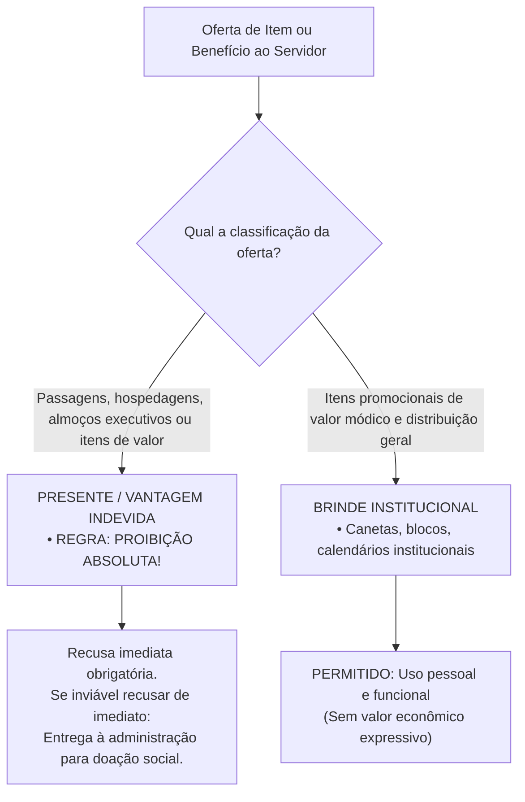
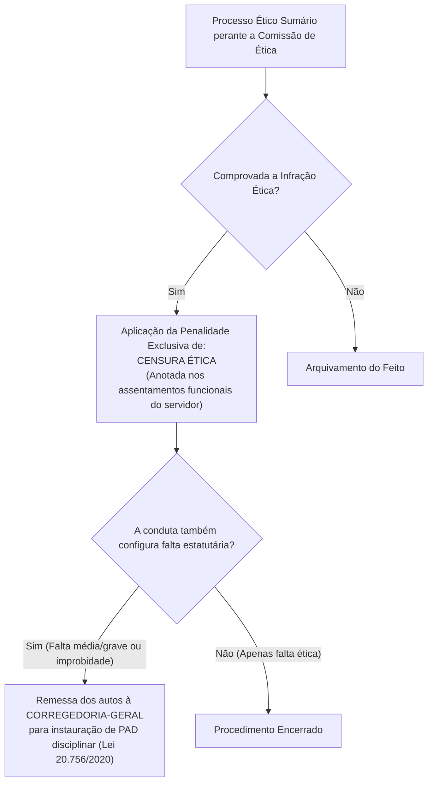

# 05 - Código de Ética dos Servidores do TCE-GO

> **Matéria:** Legislação Institucional  
> **Cargos:** A01 – Técnico de Controle Externo (Adm) / B02 – Técnico de Controle Externo (TI)  
> **Arquivo:** `05_codigo_de_etica_servidores_tce_go.md`  
> **Ato Normativo:** Código de Ética e de Conduta dos Servidores do Tribunal de Contas do Estado de Goiás (Resolução Administrativa nº 01/2014, Anexo II, e alterações normativas de integridade)

---

## 📌 Ementa / Itens do Edital
- Código de Ética dos Servidores do Tribunal de Contas do Estado de Goiás:
    - Princípios e valores deontológicos fundamentais do controle externo: dignidade, decoro, zelo, probidade, eficácia, independência, integridade, impessoalidade e imparcialidade;
    - Normas Internacionais das Entidades Fiscalizadoras Superiores (Código de Ética da INTOSAI - ISSAI 130);
    - Direitos funcionais e deveres éticos: zelo com o interesse público, urbanidade com partes e jurisdicionados, eficiência técnica e aperfeiçoamento profissional contínuo;
    - Dever indeclinável de sigilo funcional e confidencialidade: custódia de dados, processos sigilosos e vedação expressa ao uso de informações privilegiadas;
    - Conflito de interesses: conceito, prevenção, transparência e autodeclaração de impedimento e suspeição;
    - Vedações e proibições éticas expressas:
    - Vedação à antecipação de juízos de valor à imprensa ou em redes sociais sobre processos em curso;
    - Vedação ao exercício de advocacia, assessoria técnica ou consultoria a órgãos e entidades jurisdicionadas;
    - Política de aceitação de presentes x brindes: distinção legal, limites de valor econômico e destinação de itens recusáveis;
    - Comissão de Ética do TCE-GO:
    - Natureza institucional, composição e mandato de seus membros;
    - Competência consultiva e preventiva (orientação e resposta a dúvidas dos servidores);
    - Competência investigativa e processual (rito sumário, garantia do contraditório e ampla defesa);
    - Penalidade ética exclusiva: Censura Ética e anotação nos assentamentos funcionais;
    - Intersecção com o regime disciplinar: remessa de expedientes à Corregedoria-Geral para instauração de Processo Administrativo Disciplinar (PAD).

---

## 🧭 Sumário

1. [Fundamentos Deontológicos e Normas Internacionais de Auditoria](#1-fundamentos-deontologicos-e-normas-internacionais-de-auditoria)
    1. [Princípios e Valores Éticos do Controle Externo](#11-principios-e-valores-eticos-do-controle-externo)
    2. [Alinhamento com a ISSAI 130 da INTOSAI e Primazia do Interesse Público](#12-alinhamento-com-a-issai-130-da-intosai-e-primazia-do-interesse-publico)
    3. [Teste 162](#Teste-162)
2. [Deveres Éticos e Postura Funcional do Servidor do TCE-GO](#2-deveres-eticos-e-postura-funcional-do-servidor-do-tce-go)
    1. [Urbanidade, Relações Profissionais e Presteza](#21-urbanidade-relacoes-profissionais-e-presteza)
    2. [Zelo Técnico, Produtividade e Rigor Procedimental](#22-zelo-tecnico-produtividade-e-rigor-procedimental)
    3. [Dever Incondicional de Sigilo, Custódia de Dados e Vedação a Informações Privilegiadas](#23-dever-incondicional-de-sigilo-custodia-de-dados-e-vedacao-a-informacoes-privilegiadas)
    4. [Teste 163](#Teste-163)
    5. [Teste 164](#Teste-164)
3. [Proibições Éticas, Vedações e Conflito de Interesses](#3-proibicoes-eticas-vedacoes-e-conflito-de-interesses)
    1. [Vedações Expressas: Advocacia, Consultoria e Redes Sociais](#31-vedacoes-expressas-advocacia-consultoria-e-redes-sociais)
    2. [Política Institucional de Presentes vs. Brindes](#32-politica-institucional-de-presentes-vs-brindes)
    3. [Prevenção de Conflito de Interesses e Autodeclaração de Impedimento](#33-prevencao-de-conflito-de-interesses-e-autodeclaracao-de-impedimento)
    4. [Teste 165](#Teste-165)
    5. [Teste 166](#Teste-166)
    6. [Teste 167](#Teste-167)
    7. [Teste 168](#Teste-168)
4. [A Comissão de Ética do TCE-GO e o Processo Ético](#4-a-comissao-de-etica-do-tce-go-e-o-processo-etico)
    1. [Composição e Tríplice Atuação da Comissão de Ética](#41-composicao-e-triplice-atuacao-da-comissao-de-etica)
    2. [Rito Sumário Apuratório e Garantia da Ampla Defesa](#42-rito-sumario-apuratorio-e-garantia-da-ampla-defesa)
    3. [A Penalidade Exclusiva de Censura Ética e Remessa Disciplinar à Corregedoria](#43-a-penalidade-exclusiva-de-censura-etica-e-remessa-disciplinar-a-corregedoria)
    4. [Teste 169](#Teste-169)
    5. [Teste 170](#Teste-170)
    6. [Teste 171](#Teste-171)
5. [Fontes Oficiais e Referências Bibliográficas](#5-fontes-oficiais-e-referencias-bibliograficas)

---

## 1. Fundamentos Deontológicos e Normas Internacionais de Auditoria

### 1.1 Princípios e Valores Éticos do Controle Externo
O Código de Ética e de Conduta dos Servidores do Tribunal de Contas do Estado de Goiás, veiculado pela **Resolução Administrativa nº 01/2014 (Anexo II)** e complementado pelos atos de integridade institucional, estabelece as diretrizes axiológicas que regem a conduta de todos os servidores efetivos, comissionados, estagiários e colaboradores que prestam serviços ao Tribunal.

- **Dignidade, Decoro e Zelo:** O servidor público não pode dissociar sua vida funcional de sua conduta perante a sociedade; sua atuação deve refletir o prestígio e a respeitabilidade do Tribunal de Contas.
- **Probidade e Moralidade:** A atividade pública exige probidade estrita, lealdade à verdade real dos fatos apurados em fiscalizações e repúdio veemente a qualquer forma de vantagem indevida ou favorecimento escuso.
- **Independência Profissional e Imparcialidade:** Imunidade absoluta contra pressões de governantes, partidos políticos, grupos econômicos ou sindicatos; as conclusões de auditorias e instruções processuais devem apoiar-se estritamente na Constituição, nas leis e em matrizes probatórias consistentes.
- **Eficácia e Competência Técnica:** Busca contínua por aprimoramento profissional na Escola Superior de Controle Externo, aplicando os melhores padrões técnicos para elevar o rendimento do controle da despesa pública.

### 1.2 Alinhamento com a ISSAI 130 da INTOSAI e Primazia do Interesse Público
O Código de Ética do TCE-GO encontra-se em total sintonia com a **ISSAI 130 (Código de Ética da Organização Internacional das Entidades Fiscalizadoras Superiores - INTOSAI)** e com as diretrizes da Associação dos Membros dos Tribunais de Contas do Brasil (ATRICON) e do Instituto Rui Barbosa (IRB):

- **Primazia do Interesse Público:** O interesse público coletivo se sobrepõe incondicionalmente a quaisquer conveniências pessoais, partidárias, corporativas ou setoriais.
- **Cultura de Integridade e Prestação de Contas (*Accountability*):** O controle externo deve constituir modelo de integridade para toda a Administração Pública, não se tolerando complacência com desvios morais ou conflitos de interesses em suas próprias fileiras.

---

### Teste 162
**(FGV – TCE-SC – Auditor Fiscal de Controle Externo Ciencias Contabeis – 2026)**
Na era da informação, o uso responsável de redes sociais e de comunicação digital pelos servidores públicos é mandatória. Considerando as previsões expressas sobre a temática no Código de Conduta Ética dos Servidores do Tribunal de Contas do Estado de Santa Catarina (Resolução N. TC-252/2024) é correto afirmar que, ao utilizar as suas redes sociais e mídias digitais, o Auditor Fiscal de Controle Externo deve

* **A)** se abster de se identificar expressamente como servidor do Tribunal de Contas em seu perfil pessoal, o que afasta a possibilidade de penalização por eventuais manifestações fora do ambiente de trabalho.
* **B)** se abster de possuir perfis abertos ao público nas redes sociais, cautela que por si só já demonstra reserva e discrição suficientes para afastar eventuais violações de deveres funcionais.
* **C)** evitar, no seu perfil das redes sociais, pronunciamentos oficiais sobre casos decorrentes de sua atuação funcional, exceto o compartilhamento de publicações veiculadas nos perfis institucionais ou de notícias já publicadas oficialmente na página eletrônica do Tribunal de Contas.
* **D)** se abster de antecipar resultados de estudos, de projetos, de trabalhos ou de informações de caráter estratégico e funcional, antes de divulgação oficial, inclusive nos casos em que a divulgação esteja acordada com a Administração Superior, por imperativo de ética.
* **E)** evitar publicações em redes sociais que possam ser percebidas como discriminatórias em relação à raça, ao gênero, à orientação sexual, à religião e a outros valores ou direitos protegidos, e que possam comprometer os ideais defendidos pela instituição, salvo se publicadas em perfil fechado ao público e sem identificação da qualidade de servidor do TCE-SC.

---

> **Comentário Detalhado:**
>
> - **A)** **Correta.** Conforme fundamentado na seção *2.3 Dever Incondicional de Sigilo, Custódia de Dados e Vedação a Informações Privilegiadas* deste guia, proibição de Uso de Informação Privilegiada: É expressamente vedado ao servidor utilizar informação confidencial ou ainda não divulgada formalmente pela Corte de Contas para auferir vantagem pessoal direta ou indireta, para beneficiar parentes, amigos ou terceiros. Dessa forma, está plenamente correta a assertiva da banca (FGV – TCE-SC/2026) ao estabelecer que "se abster de se identificar expressamente como servidor do Tribunal de Contas em seu perfil pessoal, o que afasta...".
> - **B)** **Incorreta.** A opção apresenta proposição em desacordo com os fundamentos teóricos e técnicos do tópico ao afirmar que "se abster de possuir perfis abertos ao público nas redes sociais, cautela que por si só já demonstra reserva e...". De acordo com a teoria estudada em *3.1 Vedações Expressas: Advocacia, Consultoria e Redes Sociais*, a conduta configura grave violação ética aos deveres de sigilo e reserva. A publicidade dos achados de controle ocorre estritamente pelos canais institucionais oficiais e após o contraditório formal!.
> - **C)** **Incorreta.** A opção apresenta proposição em desacordo com os fundamentos teóricos e técnicos do tópico ao afirmar que "evitar, no seu perfil das redes sociais, pronunciamentos oficiais sobre casos decorrentes de sua atuação...". De acordo com a teoria estudada em *3.1 Vedações Expressas: Advocacia, Consultoria e Redes Sociais*, antecipação de Juízos de Valor em Redes Sociais e Imprensa: Emitir declarações públicas ou publicações em redes sociais pessoais, blogs e meios de comunicação manifestando opinião antecipada, críticas pessoais ou juízos de valor sobre processos em tramitação, decisões pendentes ou sobre gestores investigados.
> - **D)** **Incorreta.** A opção apresenta proposição em desacordo com os fundamentos teóricos e técnicos do tópico ao afirmar que "se abster de antecipar resultados de estudos, de projetos, de trabalhos ou de informações de caráter estratégico e...". De acordo com a teoria estudada em *2.3 Dever Incondicional de Sigilo, Custódia de Dados e Vedação a Informações Privilegiadas*, sigilo das Ações de Fiscalização: As etapas preliminares de inspeções e auditorias mantêm caráter reservado até a notificação formal das partes e liberação pública do relatório pelos órgãos deliberativos, sob pena de responsabilidade ética, disciplinar e criminal por quebra de segredo funcional.
> - **E)** **Incorreta.** A opção apresenta proposição em desacordo com os fundamentos teóricos e técnicos do tópico ao afirmar que "evitar publicações em redes sociais que possam ser percebidas como discriminatórias em relação à raça, ao gênero...". De acordo com a teoria estudada em *3.1 Vedações Expressas: Advocacia, Consultoria e Redes Sociais*, prática de Assédio: Qualquer atitude que configure assédio moral ou assédio sexual nas relações funcionais de trabalho.
>
> **Gabarito: A**

---

## 2. Deveres Éticos e Postura Funcional do Servidor do TCE-GO

### 2.1 Urbanidade, Relações Profissionais e Presteza
Constituem deveres inafastáveis dos servidores do TCE-GO:

- Tratar com urbanidade, respeito, civilidade e presteza todas as partes, procuradores, advogados, agentes públicos jurisdicionados e cidadãos;
- Facilitar o exercício dos direitos de fiscalização social assegurados ao cidadão;
- Atuar com neutralidade ideológica no trato das informações processuais e nas relações institucionais.

### 2.2 Zelo Técnico, Produtividade e Rigor Procedimental
O servidor do controle externo tem a obrigação de:

- Cumprir com presteza e pontualidade os prazos processuais e regimentais de instrução, elaboração de relatórios de auditoria e cumprimento de despachos;
- Fundamentar com rigor técnico todas as análises de contas, apontando com precisão os dispositivos legais transgredidos e a quantificação fidedigna do dano ao erário quando verificado;
- Zelar pela conservação dos bens públicos, equipamentos eletrônicos, bases de dados e materiais colocados à disposição para o desempenho do serviço.

### 2.3 Dever Incondicional de Sigilo, Custódia de Dados e Vedação a Informações Privilegiadas
No âmbito do TCE-GO, o manuseio de dados fiscais, bancários, orçamentários e relatórios de auditoria submete-se ao mais rígido **dever de sigilo e confidencialidade**:

- **Custódia Segura das Bases de Dados:** O servidor responde pela integridade e preservação dos arquivos eletrônicos, papéis de trabalho e informações confidenciais a que tiver acesso;
- **Proibição de Uso de Informação Privilegiada:** É expressamente vedado ao servidor utilizar informação confidencial ou ainda não divulgada formalmente pela Corte de Contas para auferir vantagem pessoal direta ou indireta, para beneficiar parentes, amigos ou terceiros;
- **Sigilo das Ações de Fiscalização:** As etapas preliminares de inspeções e auditorias mantêm caráter reservado até a notificação formal das partes e liberação pública do relatório pelos órgãos deliberativos, sob pena de responsabilidade ética, disciplinar e criminal por quebra de segredo funcional.

---

### Teste 163
**(FGV – TCE-GO – Analista de Controle Externo Ciencias Contabeis – 2024)**
A Lei nº 9.717/1998 atribui funções específicas aos Tribunais de Contas no contexto da fiscalização e controle dos regimes próprios de previdência social dos servidores públicos. Assinale a opção que indica uma função dos Tribunais de Contas constante na Lei nº 9.717/1998.

* **A)** Representar ao Poder competente sobre irregularidades ou abusos apurados, indicando o ato inquinado e definindo responsabilidades.
* **B)** Realizar inspeções e auditorias de natureza atuarial, contábil, financeira, orçamentária e patrimonial.
* **C)** Elaborar relatórios de transparência e informação social acerca das atividades da Corregedoria-Geral, contendo informações sobre os processos relativos à sua competência.
* **D)** Verificar o cumprimento dos prazos legais, regimentais e regulamentares e, no caso de não observância, propor abertura de sindicância ou de processo administrativo disciplinar.
* **E)** Manter cadastro de servidores submetidos a processo criminal ou administrativo ou punidos por infração de conduta funcional nos últimos cinco anos.

---

> **Comentário Detalhado:**
>
> - **A)** **Incorreta.** A opção apresenta proposição em desacordo com os fundamentos teóricos e técnicos do tópico ao afirmar que "Representar ao Poder competente sobre irregularidades ou abusos apurados, indicando o ato inquinado e definindo...". De acordo com a teoria estudada em *4.3 A Penalidade Exclusiva de Censura Ética e Remessa Disciplinar à Corregedoria*, encaminhamento à Corregedoria-Geral: Havendo indícios de que o ato praticado pelo servidor ultrapassa o desvio ético e enquadra-se como infração estatutária, ato de improbidade administrativa ou ilícito penal, a Comissão de Ética remeterá cópia integral do processo à Corregedoria-Geral do TCE-GO para deflagração de Processo Administrativo Disciplinar (PAD).
> - **B)** **Incorreta.** A opção apresenta proposição em desacordo com os fundamentos teóricos e técnicos do tópico ao afirmar que "Realizar inspeções e auditorias de natureza atuarial, contábil, financeira, orçamentária e patrimonial". De acordo com a teoria estudada em *2.3 Dever Incondicional de Sigilo, Custódia de Dados e Vedação a Informações Privilegiadas*, sigilo das Ações de Fiscalização: As etapas preliminares de inspeções e auditorias mantêm caráter reservado até a notificação formal das partes e liberação pública do relatório pelos órgãos deliberativos, sob pena de responsabilidade ética, disciplinar e criminal por quebra de segredo funcional.
> - **C)** **Correta.** Conforme fundamentado na seção *2.3 Dever Incondicional de Sigilo, Custódia de Dados e Vedação a Informações Privilegiadas* deste guia, proibição de Uso de Informação Privilegiada: É expressamente vedado ao servidor utilizar informação confidencial ou ainda não divulgada formalmente pela Corte de Contas para auferir vantagem pessoal direta ou indireta, para beneficiar parentes, amigos ou terceiros. Dessa forma, está plenamente correta a assertiva da banca (FGV – TCE-GO/2024) ao estabelecer que "Elaborar relatórios de transparência e informação social acerca das atividades da Corregedoria-Geral, contendo...".
> - **D)** **Incorreta.** A opção apresenta proposição em desacordo com os fundamentos teóricos e técnicos do tópico ao afirmar que "Verificar o cumprimento dos prazos legais, regimentais e regulamentares e, no caso de não observância, propor...". De acordo com a teoria estudada em *2.2 Zelo Técnico, Produtividade e Rigor Procedimental*, cumprir com presteza e pontualidade os prazos processuais e regimentais de instrução, elaboração de relatórios de auditoria e cumprimento de despachos.
> - **E)** **Incorreta.** A opção apresenta proposição em desacordo com os fundamentos teóricos e técnicos do tópico ao afirmar que "Manter cadastro de servidores submetidos a processo criminal ou administrativo ou punidos por infração de conduta...". De acordo com a teoria estudada em *2.1 Urbanidade, Relações Profissionais e Presteza*, facilitar o exercício dos direitos de fiscalização social assegurados ao cidadão.
>
> **Gabarito: C**

---

### Teste 164
**(FGV – TCE-SC – Auditor Fiscal de Controle Externo Administracao – 2026)**
Na era da informação, o uso responsável de redes sociais e de comunicação digital pelos servidores públicos é mandatório. Considerando as previsões expressas sobre a temática no Código de Conduta Ética dos Servidores do Tribunal de Contas do Estado de Santa Catarina (Resolução N. TC-252/2024) é correto afirmar que, ao utilizar as suas redes sociais e mídias digitais, o Auditor Fiscal de Controle Externo deve

* **A)** se abster de se identificar expressamente como servidor do Tribunal de Contas em seu perfil pessoal, o que afasta a possibilidade de penalização por eventuais manifestações fora do ambiente de trabalho.
* **B)** se abster de possuir perfis abertos ao público nas redes sociais, cautela que por si só já demonstra reserva e discrição suficientes para afastar eventuais violações de deveres funcionais.
* **C)** evitar, no seu perfil das redes sociais, pronunciamentos oficiais sobre casos decorrentes de sua atuação funcional, exceto o compartilhamento de publicações veiculadas nos perfis institucionais ou de notícias já publicadas oficialmente na página eletrônica do Tribunal de Contas.
* **D)** se abster de antecipar resultados de estudos, de projetos, de trabalhos ou de informações de caráter estratégico e funcional, antes de divulgação oficial, inclusive nos casos em que a divulgação esteja acordada com a Administração Superior, por imperativo de ética.
* **E)** evitar publicações em redes sociais que possam ser percebidas como discriminatórias em relação à raça, ao gênero, à orientação sexual, à religião e a outros valores ou direitos protegidos, e que possam comprometer os ideais defendidos pela instituição, salvo se publicadas em perfil fechado ao público e sem identificação da qualidade de servidor do TCE-SC.

---

> **Comentário Detalhado:**
>
> - **A)** **Correta.** Conforme fundamentado na seção *2.3 Dever Incondicional de Sigilo, Custódia de Dados e Vedação a Informações Privilegiadas* deste guia, proibição de Uso de Informação Privilegiada: É expressamente vedado ao servidor utilizar informação confidencial ou ainda não divulgada formalmente pela Corte de Contas para auferir vantagem pessoal direta ou indireta, para beneficiar parentes, amigos ou terceiros. Dessa forma, está plenamente correta a assertiva da banca (FGV – TCE-SC/2026) ao estabelecer que "se abster de se identificar expressamente como servidor do Tribunal de Contas em seu perfil pessoal, o que afasta...".
> - **B)** **Incorreta.** A opção apresenta proposição em desacordo com os fundamentos teóricos e técnicos do tópico ao afirmar que "se abster de possuir perfis abertos ao público nas redes sociais, cautela que por si só já demonstra reserva e...". De acordo com a teoria estudada em *3.1 Vedações Expressas: Advocacia, Consultoria e Redes Sociais*, a conduta configura grave violação ética aos deveres de sigilo e reserva. A publicidade dos achados de controle ocorre estritamente pelos canais institucionais oficiais e após o contraditório formal!.
> - **C)** **Incorreta.** A opção apresenta proposição em desacordo com os fundamentos teóricos e técnicos do tópico ao afirmar que "evitar, no seu perfil das redes sociais, pronunciamentos oficiais sobre casos decorrentes de sua atuação...". De acordo com a teoria estudada em *3.1 Vedações Expressas: Advocacia, Consultoria e Redes Sociais*, antecipação de Juízos de Valor em Redes Sociais e Imprensa: Emitir declarações públicas ou publicações em redes sociais pessoais, blogs e meios de comunicação manifestando opinião antecipada, críticas pessoais ou juízos de valor sobre processos em tramitação, decisões pendentes ou sobre gestores investigados.
> - **D)** **Incorreta.** A opção apresenta proposição em desacordo com os fundamentos teóricos e técnicos do tópico ao afirmar que "se abster de antecipar resultados de estudos, de projetos, de trabalhos ou de informações de caráter estratégico e...". De acordo com a teoria estudada em *2.3 Dever Incondicional de Sigilo, Custódia de Dados e Vedação a Informações Privilegiadas*, sigilo das Ações de Fiscalização: As etapas preliminares de inspeções e auditorias mantêm caráter reservado até a notificação formal das partes e liberação pública do relatório pelos órgãos deliberativos, sob pena de responsabilidade ética, disciplinar e criminal por quebra de segredo funcional.
> - **E)** **Incorreta.** A opção apresenta proposição em desacordo com os fundamentos teóricos e técnicos do tópico ao afirmar que "evitar publicações em redes sociais que possam ser percebidas como discriminatórias em relação à raça, ao gênero...". De acordo com a teoria estudada em *3.1 Vedações Expressas: Advocacia, Consultoria e Redes Sociais*, prática de Assédio: Qualquer atitude que configure assédio moral ou assédio sexual nas relações funcionais de trabalho.
>
> **Gabarito: A**

---

## 3. Proibições Éticas, Vedações e Conflito de Interesses

### 3.1 Vedações Expressas: Advocacia, Consultoria e Redes Sociais
É terminantemente proibido ao servidor do Tribunal de Contas do Estado de Goiás:

1. **Exercício da Advocacia ou Assessoria a Jurisdicionados:** Atuar, direta ou indiretamente, como procurador, consultor jurídico, assessor contábil ou preposto de quaisquer órgãos da administração pública direta ou indireta estadual, empresas públicas, consórcios, ou pessoas físicas e jurídicas sujeitas à jurisdição da Corte de Contas;
2. **Antecipação de Juízos de Valor em Redes Sociais e Imprensa:** Emitir declarações públicas ou publicações em redes sociais pessoais, blogs e meios de comunicação manifestando opinião antecipada, críticas pessoais ou juízos de valor sobre processos em tramitação, decisões pendentes ou sobre gestores investigados;
3. **Uso Privado da Estrutura do Tribunal:** Empregar servidores subordinados, bens patrimoniais, equipamentos eletrônicos ou sistemas corporativos do TCE-GO em atividades estranhas ao serviço público ou em campanhas político-partidárias;
4. **Prática de Assédio:** Qualquer atitude que configure assédio moral ou assédio sexual nas relações funcionais de trabalho.

> 🚨 **ALERTA DE PROVA / PEGADINHA FCC:** É frequente a FCC apresentar cenários de servidores do TCE que, indignados com desvios que apuram, publicam desabafos e documentos preliminares em suas redes sociais pessoais, alegando "direito de livre expressão" ou "dever de publicidade". A conduta configura **grave violação ética aos deveres de sigilo e reserva**. A publicidade dos achados de controle ocorre estritamente pelos canais institucionais oficiais e após o contraditório formal!

### 3.2 Política Institucional de Presentes vs. Brindes
A disciplina de integridade do TCE-GO estabelece fronteira nítida entre o que configura vantagem indevida (presente) e simples cortesia de divulgação institucional (brinde):

| Parâmetro Comparativo | Presente / Vantagem Financeira | Brinde Institucional |
| :--- | :--- | :--- |
| **Definição e Natureza** | Bens, serviços, transporte, passagens aéreas, estadias, jantares ou cortesias que possuam valor comercial individualizado apreciável. | Artigos promocionais de valor econômico módico e sem apelo de comercialização. |
| **Critério de Distribuição** | Destinado especificamente a um servidor público, equipe de auditoria ou gabinete determinado. | Distribuído em caráter genérico a todos os participantes de evento público, seminário ou feira institucional. |
| **Tratamento no Código de Ética** | **VEDAÇÃO ABSOLUTA**. A aceitação gera quebra de imparcialidade e enseja sanção ética, sem prejuízo de apuração por improbidade ou crime de corrupção. | **PERMITIDO**, desde que de valor módico estipulado nos normativos da Corte. |
| **Procedimento em Caso de Impossibilidade de Recusa Imediata** | O servidor tem o dever funcional de entregar o item à Diretoria de Administração para fins de incorporação ao patrimônio ou doação a entidades filantrópicas. | O servidor pode reter o item para utilização nas dependências da repartição. |

> ⭐ **IMPORTANTE / PEGADINHA DE CONCURSO:** Convite de fornecedor de TI para o servidor participar de congresso internacional com "tudo pago pela empresa" **NÃO É BRINDE**! Constitui vantagem indevida expressamente vedada pelo Código de Ética, gerando impedimento e responsabilização funcional imediata.

### 3.3 Prevenção de Conflito de Interesses e Autodeclaração de Impedimento
O conflito de interesses ocorre quando o interesse privado do servidor pode influenciar de maneira inadequada o desempenho de suas atribuições públicas no controle externo.

- **Dever de Autodeclaração:** O servidor designado para atuar em auditoria, instrução de processo de contas ou análise de licitação que possuir relação de parentesco (cônjuge, companheiro ou parentes consanguíneos ou afins até o terceiro grau) com dirigentes da entidade auditada, ou com quem mantenha litígio judicial ou interesse financeiro comum, tem a **obrigação ética de autodeclarar imediatamente o impedimento**, solicitando à chefia imediata sua substituição na equipe.

---

### Teste 165
**(FGV – TJ-SC – Analista Administrativo – 2026)**
Maria ocupa cargo de primeiro escalão em determinado ente federativo, na condição de Secretária de Estado. As normas afetas à prevenção e ao tratamento do conflito de interesses nesse ente seguem os balizamentos oferecidos pela Lei nº 12.813/2013. Maria pretende exercer determinada atividade privada de cunho econômico. Embora o exercício dessa atividade não seja vedado pelas referidas normas, Maria tem dúvida em relação à sua licitude, pois implicaria na prestação de serviços a pessoas jurídicas que têm interesse em decisões de colegiado administrativo do qual ela participa. Ao analisar a sistemática legal, Maria concluiu corretamente que

* **A)** a ausência de vedação legal ao exercício da atividade afasta a possibilidade de ser configurado o conflito de interesses.
* **B)** o interesse das pessoas jurídicas nas decisões do colegiado de que Maria participe não configura conflito de interesses.
* **C)** o conflito de interesses na situação descrita é afastado, caso Maria esteja em gozo de licença ou em período de afastamento.
* **D)** a situação descrita configura conflito de interesses, devendo ser fiscalizada por Comissão de Ética Pública instituída no âmbito do Poder Executivo do ente federativo ao qual Maria está vinculada.
* **E)** o conflito de interesses somente estará configurado se Maria divulgar ou fizer uso de informações privilegiadas obtidas no exercício funcional, para viabilizar a prestação do serviço para o qual seja contratada.

---

> **Comentário Detalhado:**
>
> - **A)** **Incorreta.** A opção apresenta proposição em desacordo com os fundamentos teóricos e técnicos do tópico ao afirmar que "a ausência de vedação legal ao exercício da atividade afasta a possibilidade de ser configurado o conflito de...". De acordo com a teoria estudada em *3.3 Prevenção de Conflito de Interesses e Autodeclaração de Impedimento*, o conflito de interesses ocorre quando o interesse privado do servidor pode influenciar de maneira inadequada o desempenho de suas atribuições públicas no controle externo.
> - **B)** **Incorreta.** A opção apresenta proposição em desacordo com os fundamentos teóricos e técnicos do tópico ao afirmar que "o interesse das pessoas jurídicas nas decisões do colegiado de que Maria participe não configura conflito de...". De acordo com a teoria estudada em *3.1 Vedações Expressas: Advocacia, Consultoria e Redes Sociais*, exercício da Advocacia ou Assessoria a Jurisdicionados: Atuar, direta ou indiretamente, como procurador, consultor jurídico, assessor contábil ou preposto de quaisquer órgãos da administração pública direta ou indireta estadual, empresas públicas, consórcios, ou pessoas físicas e jurídicas sujeitas à jurisdição da Corte de Contas.
> - **C)** **Correta.** Conforme fundamentado na seção *3.3 Prevenção de Conflito de Interesses e Autodeclaração de Impedimento* deste guia, dever de Autodeclaração: O servidor designado para atuar em auditoria, instrução de processo de contas ou análise de licitação que possuir relação de parentesco (cônjuge, companheiro ou parentes consanguíneos ou afins até o terceiro grau) com dirigentes da entidade auditada, ou com quem mantenha litígio judicial ou interesse financeiro comum, tem a obrigação ética de autodeclarar imediatamente o impedimento, solicitando à chefia imediata sua substituição na equipe. Dessa forma, está plenamente correta a assertiva da banca (FGV – TJ-SC/2026) ao estabelecer que "o conflito de interesses na situação descrita é afastado, caso Maria esteja em gozo de licença ou em período de...".
> - **D)** **Incorreta.** A opção apresenta proposição em desacordo com os fundamentos teóricos e técnicos do tópico ao afirmar que "a situação descrita configura conflito de interesses, devendo ser fiscalizada por Comissão de Ética Pública...". De acordo com a teoria estudada em *4.1 Composição e Tríplice Atuação da Comissão de Ética*, função Consultiva e Preventiva: Responde a consultas abstratas de servidores sobre conflitos de interesses e dilemas deontológicos, emitindo pareceres orientadores.
> - **E)** **Incorreta.** A opção incorre em restrição indevida ao limitar o escopo conceitual ao afirmar que "o conflito de interesses somente estará configurado se Maria divulgar ou fizer uso de informações privilegiadas...". De acordo com a teoria estudada em *2.3 Dever Incondicional de Sigilo, Custódia de Dados e Vedação a Informações Privilegiadas*, proibição de Uso de Informação Privilegiada: É expressamente vedado ao servidor utilizar informação confidencial ou ainda não divulgada formalmente pela Corte de Contas para auferir vantagem pessoal direta ou indireta, para beneficiar parentes, amigos ou terceiros.
>
> **Gabarito: C**

---

### Teste 166
**(FGV – TCE-SC – Auditor Fiscal de Controle Externo Ciencias Contabeis – 2026)**
Caio, contador, logra êxito em ser aprovado no concurso de Auditor Fiscal de Controle Externo do TCE-SC, passando a titularizar o concorrido e renomado cargo para o qual estudou por tantos anos. Após o curso de formação e o início efetivo das atividades, o titular da unidade técnica lhe distribuiu dois processos para fins de instrução. Em um deles, processo X, havia como documento anexo à defesa do jurisdicionado uma perícia realizada pelo próprio Caio, quando ainda trabalhava como contador em escritório renomado do Estado, do foi desligado antes mesmo da sua nomeação e posse no cargo público em questão. No outro, processo Y, figurava como jurisdicionado seu tio distante, com quem nunca teve laço de afetividade, de amizade ou de inimizade. Considerando as disposições do Código de Conduta Ética dos Servidores do Tribunal de Contas do Estado de Santa Catarina, é correto afirmar, com relação aos processos X e Y, que

* **A)** não está configurado conflito de interesse no exercício do cargo.
* **B)** está configurado conflito de interesse no exercício do cargo, ainda que Caio não tenha obtido qualquer vantagem ou retribuição.
* **C)** está configurado conflito de interesse no exercício do cargo com relação ao processo X, mas não em relação ao processo Y.
* **D)** está configurado conflito de interesse no exercício do cargo com relação ao processo Y, mas não em relação ao processo X.
* **E)** está configurado conflito de interesse no exercício do cargo, apenas se Caio tiver obtido vantagem ou retribuição mensuráveis.

---

> **Comentário Detalhado:**
>
> - **A)** **Incorreta.** A opção apresenta proposição em desacordo com os fundamentos teóricos e técnicos do tópico ao afirmar que "não está configurado conflito de interesse no exercício do cargo". De acordo com a teoria estudada em *3.3 Prevenção de Conflito de Interesses e Autodeclaração de Impedimento*, o conflito de interesses ocorre quando o interesse privado do servidor pode influenciar de maneira inadequada o desempenho de suas atribuições públicas no controle externo.
> - **B)** **Incorreta.** A opção promove generalização excessiva que desconsidera as condições técnicas e normativas ao afirmar que "está configurado conflito de interesse no exercício do cargo, ainda que Caio não tenha obtido qualquer vantagem ou...". De acordo com a teoria estudada em *2.3 Dever Incondicional de Sigilo, Custódia de Dados e Vedação a Informações Privilegiadas*, proibição de Uso de Informação Privilegiada: É expressamente vedado ao servidor utilizar informação confidencial ou ainda não divulgada formalmente pela Corte de Contas para auferir vantagem pessoal direta ou indireta, para beneficiar parentes, amigos ou terceiros.
> - **C)** **Correta.** Conforme fundamentado na seção *3.3 Prevenção de Conflito de Interesses e Autodeclaração de Impedimento* deste guia, dever de Autodeclaração: O servidor designado para atuar em auditoria, instrução de processo de contas ou análise de licitação que possuir relação de parentesco (cônjuge, companheiro ou parentes consanguíneos ou afins até o terceiro grau) com dirigentes da entidade auditada, ou com quem mantenha litígio judicial ou interesse financeiro comum, tem a obrigação ética de autodeclarar imediatamente o impedimento, solicitando à chefia imediata sua substituição na equipe. Dessa forma, está plenamente correta a assertiva da banca (FGV – TCE-SC/2026) ao estabelecer que "está configurado conflito de interesse no exercício do cargo com relação ao processo X, mas não em relação ao...".
> - **D)** **Incorreta.** A opção apresenta proposição em desacordo com os fundamentos teóricos e técnicos do tópico ao afirmar que "está configurado conflito de interesse no exercício do cargo com relação ao processo Y, mas não em relação ao...". De acordo com a teoria estudada em *4.3 A Penalidade Exclusiva de Censura Ética e Remessa Disciplinar à Corregedoria*, encaminhamento à Corregedoria-Geral: Havendo indícios de que o ato praticado pelo servidor ultrapassa o desvio ético e enquadra-se como infração estatutária, ato de improbidade administrativa ou ilícito penal, a Comissão de Ética remeterá cópia integral do processo à Corregedoria-Geral do TCE-GO para deflagração de Processo Administrativo Disciplinar (PAD).
> - **E)** **Incorreta.** A opção incorre em restrição indevida ao limitar o escopo conceitual ao afirmar que "está configurado conflito de interesse no exercício do cargo, apenas se Caio tiver obtido vantagem ou retribuição...". De acordo com a teoria estudada em *1.2 Alinhamento com a ISSAI 130 da INTOSAI e Primazia do Interesse Público*, o Código de Ética do TCE-GO encontra-se em total sintonia com a ISSAI 130 (Código de Ética da Organização Internacional das Entidades Fiscalizadoras Superiores - INTOSAI) e com as diretrizes da Associação dos Membros dos Tribunais de Contas do Brasil (ATRICON) e do Instituto Rui Barbosa (IRB).
>
> **Gabarito: C**

---

### Teste 167
**(FGV – TCE-SC – Auditor Fiscal de Controle Externo Administracao – 2026)**
Fundada na dignidade da pessoa humana e no valor social do trabalho, foi instituída, por meio da Resolução N. TC-254/2024, a Política de Prevenção e de Enfrentamento do Assédio Moral, do Assédio Sexual e da Discriminação no TCE/SC. No contexto de referida resolução, os atos de i) manifestar publicamente desdém ou desprezo pelo produto do trabalho, ii) gerir por estresse, por injúria ou por medo e iii) realizar premiações negativas, ameaças e cobranças exageradas, podem configurar, respectivamente:

* **A)** assédio moral, assédio moral e assédio moral organizacional.
* **B)** assédio moral, assédio sexual e assédio moral organizacional.
* **C)** assédio moral organizacional, assédio moral organizacional e assédio moral.
* **D)** assédio institucional, assédio moral organizacional e assédio institucional.
* **E)** assédio moral, assédio moral organizacional e assédio moral organizacional.

---

> **Comentário Detalhado:**
>
> - **A)** **Incorreta.** A opção apresenta proposição em desacordo com os fundamentos teóricos e técnicos do tópico ao afirmar que "assédio moral, assédio moral e assédio moral organizacional". De acordo com a teoria estudada em *4.3 A Penalidade Exclusiva de Censura Ética e Remessa Disciplinar à Corregedoria*, a competência punitiva direta da Comissão de Ética restringe-se estritamente ao âmbito moral e ético.
> - **B)** **Incorreta.** A opção apresenta proposição em desacordo com os fundamentos teóricos e técnicos do tópico ao afirmar que "assédio moral, assédio sexual e assédio moral organizacional". De acordo com a teoria estudada em *1.1 Princípios e Valores Éticos do Controle Externo*, o Código de Ética e de Conduta dos Servidores do Tribunal de Contas do Estado de Goiás, veiculado pela Resolução Administrativa nº 01/2014 (Anexo II) e complementado pelos atos de integridade institucional, estabelece as diretrizes axiológicas que regem a conduta de todos os servidores efetivos, comissionados, estagiários e colaboradores que prestam serviços ao Tribunal.
> - **C)** **Incorreta.** A opção apresenta proposição em desacordo com os fundamentos teóricos e técnicos do tópico ao afirmar que "assédio moral organizacional, assédio moral organizacional e assédio moral". De acordo com a teoria estudada em *3.2 Política Institucional de Presentes vs. Brindes*, definição e Natureza: Bens, serviços, transporte, passagens aéreas, estadias, jantares ou cortesias que possuam valor comercial individualizado apreciável. — Artigos promocionais de valor econômico módico e sem apelo de comercialização.
> - **D)** **Incorreta.** A opção apresenta proposição em desacordo com os fundamentos teóricos e técnicos do tópico ao afirmar que "assédio institucional, assédio moral organizacional e assédio institucional". De acordo com a teoria estudada em *3.2 Política Institucional de Presentes vs. Brindes*, tratamento no Código de Ética: VEDAÇÃO ABSOLUTA. A aceitação gera quebra de imparcialidade e enseja sanção ética, sem prejuízo de apuração por improbidade ou crime de corrupção. — PERMITIDO, desde que de valor módico estipulado nos normativos da Corte.
> - **E)** **Correta.** Conforme fundamentado na seção *3.1 Vedações Expressas: Advocacia, Consultoria e Redes Sociais* deste guia, prática de Assédio: Qualquer atitude que configure assédio moral ou assédio sexual nas relações funcionais de trabalho. Dessa forma, está plenamente correta a assertiva da banca (FGV – TCE-SC/2026) ao estabelecer que "assédio moral, assédio moral organizacional e assédio moral organizacional".
>
> **Gabarito: E**

---

### Teste 168
**(FGV – TCE-SC – Auditor Fiscal de Controle Externo Ciencias da Computacao Sistemas de Informacao – 2026)**
Uma vedação constante do Código de Conduta Ética dos servidores do Tribunal de Contas do Estado de Santa Catarina (Resolução nº 252/2024 do TCE-SC) é

* **A)** cooperar com qualquer organização que atente contra a dignidade da pessoa humana.
* **B)** utilizar os materiais fornecidos para a execução do trabalho com economia e consciência, evitando o desperdício e contribuindo para a sustentabilidade.
* **C)** resistir e denunciar pressões de superiores hierárquicos, de contratantes, de interessados e de outros que visem a obter quaisquer favores, benesses ou vantagens indevidas em decorrência de ações ou de omissões imorais, ilegais ou antiéticas.
* **D)** representar imediatamente à chefia ou à unidade técnica competente todo e qualquer ato ou fato que seja contrário ao interesse público, prejudicial ao Tribunal ou à sua missão institucional, de que tenha tomado conhecimento em razão do cargo ou da função.
* **E)** manter neutralidade no exercício profissional – tanto a real como a percebida –, conservando sua independência em relação às influências político-partidárias ou religiosas, de modo a evitar que essas venham a afetar – ou parecer afetar – a sua capacidade de desempenhar com imparcialidade suas responsabilidades profissionais.

---

> **Comentário Detalhado:**
>
> - **A)** **Correta.** Conforme fundamentado na seção *1.2 Alinhamento com a ISSAI 130 da INTOSAI e Primazia do Interesse Público* deste guia, o Código de Ética do TCE-GO encontra-se em total sintonia com a ISSAI 130 (Código de Ética da Organização Internacional das Entidades Fiscalizadoras Superiores - INTOSAI) e com as diretrizes da Associação dos Membros dos Tribunais de Contas do Brasil (ATRICON) e do Instituto Rui Barbosa (IRB). Dessa forma, está plenamente correta a assertiva da banca (FGV – TCE-SC/2026) ao estabelecer que "cooperar com qualquer organização que atente contra a dignidade da pessoa humana".
> - **B)** **Incorreta.** A opção apresenta proposição em desacordo com os fundamentos teóricos e técnicos do tópico ao afirmar que "utilizar os materiais fornecidos para a execução do trabalho com economia e consciência, evitando o desperdício e...". De acordo com a teoria estudada em *3.1 Vedações Expressas: Advocacia, Consultoria e Redes Sociais*, prática de Assédio: Qualquer atitude que configure assédio moral ou assédio sexual nas relações funcionais de trabalho.
> - **C)** **Incorreta.** A opção apresenta proposição em desacordo com os fundamentos teóricos e técnicos do tópico ao afirmar que "resistir e denunciar pressões de superiores hierárquicos, de contratantes, de interessados e de outros que visem a...". De acordo com a teoria estudada em *1.1 Princípios e Valores Éticos do Controle Externo*, independência Profissional e Imparcialidade: Imunidade absoluta contra pressões de governantes, partidos políticos, grupos econômicos ou sindicatos; as conclusões de auditorias e instruções processuais devem apoiar-se estritamente na Constituição, nas leis e em matrizes probatórias consistentes.
> - **D)** **Incorreta.** A opção promove generalização excessiva que desconsidera as condições técnicas e normativas ao afirmar que "representar imediatamente à chefia ou à unidade técnica competente todo e qualquer ato ou fato que seja contrário...". De acordo com a teoria estudada em *3.3 Prevenção de Conflito de Interesses e Autodeclaração de Impedimento*, dever de Autodeclaração: O servidor designado para atuar em auditoria, instrução de processo de contas ou análise de licitação que possuir relação de parentesco (cônjuge, companheiro ou parentes consanguíneos ou afins até o terceiro grau) com dirigentes da entidade auditada, ou com quem mantenha litígio judicial ou interesse financeiro comum, tem a obrigação ética de autodeclarar imediatamente o impedimento, solicitando à chefia imediata sua substituição na equipe.
> - **E)** **Incorreta.** A opção apresenta proposição em desacordo com os fundamentos teóricos e técnicos do tópico ao afirmar que "manter neutralidade no exercício profissional – tanto a real como a percebida –, conservando sua independência em...". De acordo com a teoria estudada em *3.1 Vedações Expressas: Advocacia, Consultoria e Redes Sociais*, uso Privado da Estrutura do Tribunal: Empregar servidores subordinados, bens patrimoniais, equipamentos eletrônicos ou sistemas corporativos do TCE-GO em atividades estranhas ao serviço público ou em campanhas político-partidárias.
>
> **Gabarito: A**

---

## 4. A Comissão de Ética do TCE-GO e o Processo Ético

### 4.1 Composição e Tríplice Atuação da Comissão de Ética
A Comissão de Ética do TCE-GO é órgão autônomo colegiado, instituído pela Presidência da Corte:

- **Composição:** Composta por **três (3) servidores públicos efetivos e estáveis**, designados para mandato com duração pré-fixada;
- **Tríplice Atuação Institucional:**
    1. **Função Consultiva e Preventiva:** Responde a consultas abstratas de servidores sobre conflitos de interesses e dilemas deontológicos, emitindo pareceres orientadores;
    2. **Função Educativa:** Promove campanhas institucionais de integridade, transparência e respeito à ética pública;
    3. **Função Investigativa e Judicante:** Processa e julga representações e denúncias sobre condutas antiéticas de servidores da Casa.

### 4.2 Rito Sumário Apuratório e Garantia da Ampla Defesa
O procedimento ético adota rito sumário simplificado, com garantia constitucional da ampla defesa:

1. Notificação do servidor investigado para, querendo, prestar esclarecimentos preliminares e apresentar defesa escrita no prazo regimental;
2. Produção de provas documentais e oitiva de eventuais testemunhas sob a condução da Comissão;
3. Elaboração de relatório conclusivo motivado reconhecendo a improcedência do fato ou a consumação de desvio ético.

### 4.3 A Penalidade Exclusiva de Censura Ética e Remessa Disciplinar à Corregedoria
A competência punitiva direta da Comissão de Ética restringe-se estritamente ao âmbito moral e ético:

- **A Penalidade de Censura Ética:** A única sanção que a Comissão de Ética pode aplicar diretamente ao servidor infrator é a pena de **Censura Ética**, a qual é consignada nos registros cadastrais e funcionais do servidor, gerando reflexos negativos na avaliação de desempenho para fins de promoção e na concessão de elogios.
- **Incompetência para Sanções Estatutárias:** A Comissão de Ética **NÃO pode aplicar** penas de demissão, suspensão funcional, advertência disciplinar, multa ou cassação de aposentadoria da Lei nº 20.756/2020.
- **Encaminhamento à Corregedoria-Geral:** Havendo indícios de que o ato praticado pelo servidor ultrapassa o desvio ético e enquadra-se como infração estatutária, ato de improbidade administrativa ou ilícito penal, a Comissão de Ética remeterá cópia integral do processo à **Corregedoria-Geral do TCE-GO** para deflagração de Processo Administrativo Disciplinar (PAD).

> 🚨 **ALERTA DE PROVA / PEGADINHA FCC:** Questões da FCC costumam afirmar que a Comissão de Ética "demitiu o servidor" ou "aplicou suspensão de 30 dias". Essa afirmação está **TOTALMENTE ERRADA**. A única sanção que a Comissão de Ética pode impor diretamente é a **CENSURA ÉTICA**. Suspensão e demissão são matérias privativas da esfera disciplinar processadas pela Corregedoria e julgadas pela autoridade administrativa.

---

### Teste 169
**(FGV – TRT-13 – Analista Judiciario Tecnologia da Informacao – 2022)**
Maria forneceu os seus dados pessoais para usufruir determinado benefício assistencial ofertado pelo Estado Alfa. Considerando que Maria figurava como parte interessada em um processo administrativo no qual certo órgão da Administração Pública lhe aplicara a sanção de multa, um servidor constatou que as referidas informações poderiam ser utilizadas, neste último processo, para demonstrar que Maria não tinha razão em suas alegações. À luz da sistemática estabelecida pela Lei Geral de Proteção de Dados (LGPD), é correto afirmar que

* **A)** é vedado que órgão da Administração Pública, enquanto controlador dos dados pessoais, os utilize para qualquer outro fim que não aquele indicado pelo titular.
* **B)** o princípio da universalidade das provas, contemplado na LGPD, autoriza a utilização dos dados pessoais de Maria para os fins pretendidos pelo servidor.
* **C)** como os dados pessoais foram apresentados por Maria, para o exercício regular de um direito, não poderiam ser utilizados em seu prejuízo.
* **D)** a Administração Pública, sempre que figure como operadora dos dados pessoais, pode utilizá-los da forma que melhor lhe aprouver.
* **E)** a LGPD autoriza a utilização dos dados fornecidos por Maria caso o bem jurídico a ser tutelado seja de interesse público.

---

> **Comentário Detalhado:**
>
> - **A)** **Incorreta.** A opção promove generalização excessiva que desconsidera as condições técnicas e normativas ao afirmar que "é vedado que órgão da Administração Pública, enquanto controlador dos dados pessoais, os utilize para qualquer...". De acordo com a teoria estudada em *2.3 Dever Incondicional de Sigilo, Custódia de Dados e Vedação a Informações Privilegiadas*, proibição de Uso de Informação Privilegiada: É expressamente vedado ao servidor utilizar informação confidencial ou ainda não divulgada formalmente pela Corte de Contas para auferir vantagem pessoal direta ou indireta, para beneficiar parentes, amigos ou terceiros.
> - **B)** **Incorreta.** A opção apresenta proposição em desacordo com os fundamentos teóricos e técnicos do tópico ao afirmar que "o princípio da universalidade das provas, contemplado na LGPD, autoriza a utilização dos dados pessoais de Maria...". De acordo com a teoria estudada em *3.2 Política Institucional de Presentes vs. Brindes*, procedimento em Caso de Impossibilidade de Recusa Imediata: O servidor tem o dever funcional de entregar o item à Diretoria de Administração para fins de incorporação ao patrimônio ou doação a entidades filantrópicas. — O servidor pode reter o item para utilização nas dependências da repartição.
> - **C)** **Correta.** Conforme fundamentado na seção *3.1 Vedações Expressas: Advocacia, Consultoria e Redes Sociais* deste guia, é frequente a FCC apresentar cenários de servidores do TCE que, indignados com desvios que apuram, publicam desabafos e documentos preliminares em suas redes sociais pessoais, alegando "direito de livre expressão" ou "dever de publicidade". Dessa forma, está plenamente correta a assertiva da banca (FGV – TRT-13/2022) ao estabelecer que "como os dados pessoais foram apresentados por Maria, para o exercício regular de um direito, não poderiam ser...".
> - **D)** **Incorreta.** A opção promove generalização excessiva que desconsidera as condições técnicas e normativas ao afirmar que "a Administração Pública, sempre que figure como operadora dos dados pessoais, pode utilizá-los da forma que melhor...". De acordo com a teoria estudada em *3.1 Vedações Expressas: Advocacia, Consultoria e Redes Sociais*, exercício da Advocacia ou Assessoria a Jurisdicionados: Atuar, direta ou indiretamente, como procurador, consultor jurídico, assessor contábil ou preposto de quaisquer órgãos da administração pública direta ou indireta estadual, empresas públicas, consórcios, ou pessoas físicas e jurídicas sujeitas à jurisdição da Corte de Contas.
> - **E)** **Incorreta.** A opção apresenta proposição em desacordo com os fundamentos teóricos e técnicos do tópico ao afirmar que "a LGPD autoriza a utilização dos dados fornecidos por Maria caso o bem jurídico a ser tutelado seja de interesse...". De acordo com a teoria estudada em *1.2 Alinhamento com a ISSAI 130 da INTOSAI e Primazia do Interesse Público*, primazia do Interesse Público: O interesse público coletivo se sobrepõe incondicionalmente a quaisquer conveniências pessoais, partidárias, corporativas ou setoriais.
>
> **Gabarito: C**

---

### Teste 170
**(FGV – TCE-SC – Auditor Fiscal de Controle Externo Administracao – 2026)**
Após ser aprovado no concurso de auditor fiscal de controle externo do Tribunal de Contas do Estado de Santa Catarina (TCE/SC), Carlos decidiu rememorar as normas atinentes ao uso responsável das redes sociais e mídias digitais previstas na Resolução nº 252/2024 do TCE-SC, que institui o Código de Conduta Ética dos servidores da aludida Corte de Contas, vindo a concluir corretamente que

* **A)** a ausência de identificação expressa da qualidade de servidor do Tribunal de Contas em seu perfil pessoal, torna prescindível considerar que suas interações podem ser vinculadas à Instituição em razão da função pública.
* **B)** o uso de mídias sociais durante o horário de expediente deverá ser priorizado para, dentre outras atividades, identificar demandas da sociedade e da mídia que possam ser atendidas pela Instituição.
* **C)** o descumprimento das normas relativas ao uso responsável de redes sociais e de comunicação digital pelo servidor não poderá ensejar a instauração de processo disciplinar e/ou ético, considerando serem meras recomendações.
* **D)** o servidor deve utilizar o e-mail institucional para administrar conta de perfil em qualquer rede social, para fins de facilitar a fiscalização quanto ao cumprimento dos deveres éticos impostos no âmbito da comunicação digital por parte do Tribunal de Contas.
* **E)** o servidor deve evitar compartilhamento de pronunciamentos oficiais sobre casos decorrentes de sua atuação funcional, incluindo publicações veiculadas nos perfis institucionais ou de notícias já publicadas oficialmente na página eletrônica do Tribunal de Contas.

---

> **Comentário Detalhado:**
>
> - **A)** **Incorreta.** A opção apresenta proposição em desacordo com os fundamentos teóricos e técnicos do tópico ao afirmar que "a ausência de identificação expressa da qualidade de servidor do Tribunal de Contas em seu perfil pessoal, torna...". De acordo com a teoria estudada em *2.3 Dever Incondicional de Sigilo, Custódia de Dados e Vedação a Informações Privilegiadas*, proibição de Uso de Informação Privilegiada: É expressamente vedado ao servidor utilizar informação confidencial ou ainda não divulgada formalmente pela Corte de Contas para auferir vantagem pessoal direta ou indireta, para beneficiar parentes, amigos ou terceiros.
> - **B)** **Incorreta.** A opção apresenta proposição em desacordo com os fundamentos teóricos e técnicos do tópico ao afirmar que "o uso de mídias sociais durante o horário de expediente deverá ser priorizado para, dentre outras atividades...". De acordo com a teoria estudada em *3.1 Vedações Expressas: Advocacia, Consultoria e Redes Sociais*, uso Privado da Estrutura do Tribunal: Empregar servidores subordinados, bens patrimoniais, equipamentos eletrônicos ou sistemas corporativos do TCE-GO em atividades estranhas ao serviço público ou em campanhas político-partidárias.
> - **C)** **Correta.** Conforme fundamentado na seção *4.3 A Penalidade Exclusiva de Censura Ética e Remessa Disciplinar à Corregedoria* deste guia, encaminhamento à Corregedoria-Geral: Havendo indícios de que o ato praticado pelo servidor ultrapassa o desvio ético e enquadra-se como infração estatutária, ato de improbidade administrativa ou ilícito penal, a Comissão de Ética remeterá cópia integral do processo à Corregedoria-Geral do TCE-GO para deflagração de Processo Administrativo Disciplinar (PAD). Dessa forma, está plenamente correta a assertiva da banca (FGV – TCE-SC/2026) ao estabelecer que "o descumprimento das normas relativas ao uso responsável de redes sociais e de comunicação digital pelo servidor...".
> - **D)** **Incorreta.** A opção promove generalização excessiva que desconsidera as condições técnicas e normativas ao afirmar que "o servidor deve utilizar o e-mail institucional para administrar conta de perfil em qualquer rede social, para...". De acordo com a teoria estudada em *3.1 Vedações Expressas: Advocacia, Consultoria e Redes Sociais*, a conduta configura grave violação ética aos deveres de sigilo e reserva. A publicidade dos achados de controle ocorre estritamente pelos canais institucionais oficiais e após o contraditório formal!.
> - **E)** **Incorreta.** A opção apresenta proposição em desacordo com os fundamentos teóricos e técnicos do tópico ao afirmar que "o servidor deve evitar compartilhamento de pronunciamentos oficiais sobre casos decorrentes de sua atuação...". De acordo com a teoria estudada em *3.1 Vedações Expressas: Advocacia, Consultoria e Redes Sociais*, antecipação de Juízos de Valor em Redes Sociais e Imprensa: Emitir declarações públicas ou publicações em redes sociais pessoais, blogs e meios de comunicação manifestando opinião antecipada, críticas pessoais ou juízos de valor sobre processos em tramitação, decisões pendentes ou sobre gestores investigados.
>
> **Gabarito: C**

---

### Teste 171
**(FGV – TCE-SC – Auditor Fiscal de Controle Externo Administracao – 2026)**
Caio, contador, logra êxito em ser aprovado no concurso de Auditor Fiscal de Controle Externo do TCE-SC, passando a titularizar o concorrido e renomado cargo para o qual estudou por tantos anos. Após o curso de formação e o início efetivo das atividades, o titular da unidade técnica lhe distribuiu dois processos para fins de instrução. Em um deles, processo X, havia como documento anexo à defesa do jurisdicionado uma perícia realizada pelo próprio Caio, quando ainda trabalhava como contador em escritório renomado do Estado, do qual foi desligado antes mesmo da sua nomeação e posse no cargo público em questão. No outro, processo Y, figurava como jurisdicionado seu tio distante, com quem nunca teve laço de afetividade, de amizade ou de inimizade. Considerando as disposições do Código de Conduta Ética dos Servidores do Tribunal de Contas do Estado de Santa Catarina, é correto afirmar, com relação aos processos X e Y, que

* **A)** não está configurado conflito de interesse no exercício do cargo.
* **B)** está configurado conflito de interesse no exercício do cargo, ainda que Caio não tenha obtido qualquer vantagem ou retribuição.
* **C)** está configurado conflito de interesse no exercício do cargo com relação ao processo X, mas não em relação ao processo Y.
* **D)** está configurado conflito de interesse no exercício do cargo com relação ao processo Y, mas não em relação ao processo X.
* **E)** está configurado conflito de interesse no exercício do cargo, apenas se Caio tiver obtido vantagem ou retribuição mensuráveis.

---

> **Comentário Detalhado:**
>
> - **A)** **Incorreta.** A opção apresenta proposição em desacordo com os fundamentos teóricos e técnicos do tópico ao afirmar que "não está configurado conflito de interesse no exercício do cargo". De acordo com a teoria estudada em *4.3 A Penalidade Exclusiva de Censura Ética e Remessa Disciplinar à Corregedoria*, encaminhamento à Corregedoria-Geral: Havendo indícios de que o ato praticado pelo servidor ultrapassa o desvio ético e enquadra-se como infração estatutária, ato de improbidade administrativa ou ilícito penal, a Comissão de Ética remeterá cópia integral do processo à Corregedoria-Geral do TCE-GO para deflagração de Processo Administrativo Disciplinar (PAD).
> - **B)** **Incorreta.** A opção promove generalização excessiva que desconsidera as condições técnicas e normativas ao afirmar que "está configurado conflito de interesse no exercício do cargo, ainda que Caio não tenha obtido qualquer vantagem ou...". De acordo com a teoria estudada em *2.3 Dever Incondicional de Sigilo, Custódia de Dados e Vedação a Informações Privilegiadas*, proibição de Uso de Informação Privilegiada: É expressamente vedado ao servidor utilizar informação confidencial ou ainda não divulgada formalmente pela Corte de Contas para auferir vantagem pessoal direta ou indireta, para beneficiar parentes, amigos ou terceiros.
> - **C)** **Correta.** Conforme fundamentado na seção *3.3 Prevenção de Conflito de Interesses e Autodeclaração de Impedimento* deste guia, dever de Autodeclaração: O servidor designado para atuar em auditoria, instrução de processo de contas ou análise de licitação que possuir relação de parentesco (cônjuge, companheiro ou parentes consanguíneos ou afins até o terceiro grau) com dirigentes da entidade auditada, ou com quem mantenha litígio judicial ou interesse financeiro comum, tem a obrigação ética de autodeclarar imediatamente o impedimento, solicitando à chefia imediata sua substituição na equipe. Dessa forma, está plenamente correta a assertiva da banca (FGV – TCE-SC/2026) ao estabelecer que "está configurado conflito de interesse no exercício do cargo com relação ao processo X, mas não em relação ao...".
> - **D)** **Incorreta.** A opção apresenta proposição em desacordo com os fundamentos teóricos e técnicos do tópico ao afirmar que "está configurado conflito de interesse no exercício do cargo com relação ao processo Y, mas não em relação ao...". De acordo com a teoria estudada em *3.3 Prevenção de Conflito de Interesses e Autodeclaração de Impedimento*, o conflito de interesses ocorre quando o interesse privado do servidor pode influenciar de maneira inadequada o desempenho de suas atribuições públicas no controle externo.
> - **E)** **Incorreta.** A opção incorre em restrição indevida ao limitar o escopo conceitual ao afirmar que "está configurado conflito de interesse no exercício do cargo, apenas se Caio tiver obtido vantagem ou retribuição...". De acordo com a teoria estudada em *1.2 Alinhamento com a ISSAI 130 da INTOSAI e Primazia do Interesse Público*, o Código de Ética do TCE-GO encontra-se em total sintonia com a ISSAI 130 (Código de Ética da Organização Internacional das Entidades Fiscalizadoras Superiores - INTOSAI) e com as diretrizes da Associação dos Membros dos Tribunais de Contas do Brasil (ATRICON) e do Instituto Rui Barbosa (IRB).
>
> **Gabarito: C**

---

## 5. Fontes Oficiais e Referências Bibliográficas

* [Código de Ética dos Servidores do TCE-GO (Documento Oficial TCE-GO)](https://portal.tce.go.gov.br/documents/20181/574123/C%C3%B3digo+de+%C3%89tica/056863be-6768-4c35-a6e8-ccdd40421211) - Texto oficial com deveres, vedações e funcionamento da Comissão de Ética.
* [Portal Institucional do TCE-GO - Corregedoria Geral e Ética](https://portal.tce.go.gov.br/corregedoria-geral2) - Atribuições da Corregedoria Geral e atuação da Comissão de Ética do TCE-GO.
* [Lei Estadual nº 20.756/2020 - Estatuto dos Servidores de Goiás (Casa Civil/GO)](https://legisla.casacivil.go.gov.br/pesquisa_legislacao/100979/lei-20756) - Deveres funcionais, proibições e regime disciplinar dos servidores públicos.
* [Lei Estadual nº 13.800/2001 - Processo Administrativo Estadual (Casa Civil/GO)](https://legisla.casacivil.go.gov.br/pesquisa_legislacao/81441/lei-13800) - Ritos e garantias da ampla defesa em processos de apuração ética.
* [Lei Federal nº 8.429/1992 - Lei de Improbidade Administrativa (Planalto)](https://www.planalto.gov.br/ccivil_03/leis/l8429compilada.htm) - Princípios da moralidade administrativa e sanções por enriquecimento ilícito.
* NOHARA, Irene Patrícia. **Direito Administrativo**. 11. ed. São Paulo: Atlas, 2022. (Cap. 11 - Moralidade Administrativa e Regime Disciplinar).
* CARVALHO FILHO, José dos Santos. **Manual de Direito Administrativo**. 38. ed. Barueri: Atlas, 2024. (Cap. 12 - Responsabilidade Funcional e Regime Ético).
* GARCIA, Emerson; ALVES, Rogério Pacheco. **Improbidade Administrativa**. 10. ed. São Paulo: Saraiva, 2021. (Cap. 3 - Violação aos Princípios da Administração Pública).
