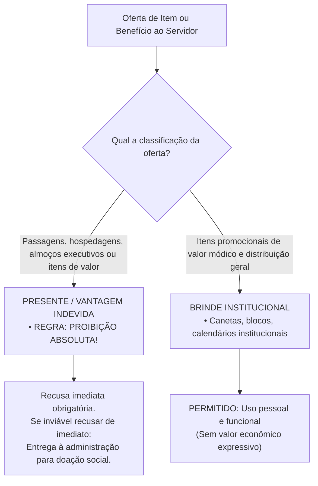
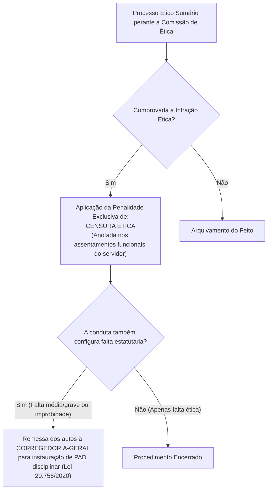

# 05 - Código de Ética dos Servidores do TCE-GO

> **Matéria:** Legislação Institucional  
> **Cargos:** A01 – Técnico de Controle Externo (Adm) / B02 – Técnico de Controle Externo (TI)  
> **Arquivo:** `05_codigo_de_etica_servidores_tce_go.md`  
> **Ato Normativo:** Código de Ética e de Conduta dos Servidores do Tribunal de Contas do Estado de Goiás (Resolução Administrativa nº 01/2014, Anexo II, e alterações normativas de integridade)

---

## 📌 Ementa / Itens do Edital
- Código de Ética dos Servidores do Tribunal de Contas do Estado de Goiás:
    - Princípios e valores deontológicos fundamentais do controle externo: dignidade, decoro, zelo, probidade, eficácia, independência, integridade, impessoalidade e imparcialidade;
    - Normas Internacionais das Entidades Fiscalizadoras Superiores (Código de Ética da INTOSAI - ISSAI 130);
    - Direitos funcionais e deveres éticos: zelo com o interesse público, urbanidade com partes e jurisdicionados, eficiência técnica e aperfeiçoamento profissional contínuo;
    - Dever indeclinável de sigilo funcional e confidencialidade: custódia de dados, processos sigilosos e vedação expressa ao uso de informações privilegiadas;
    - Conflito de interesses: conceito, prevenção, transparência e autodeclaração de impedimento e suspeição;
    - Vedações e proibições éticas expressas:
    - Vedação à antecipação de juízos de valor à imprensa ou em redes sociais sobre processos em curso;
    - Vedação ao exercício de advocacia, assessoria técnica ou consultoria a órgãos e entidades jurisdicionadas;
    - Política de aceitação de presentes x brindes: distinção legal, limites de valor econômico e destinação de itens recusáveis;
    - Comissão de Ética do TCE-GO:
    - Natureza institucional, composição e mandato de seus membros;
    - Competência consultiva e preventiva (orientação e resposta a dúvidas dos servidores);
    - Competência investigativa e processual (rito sumário, garantia do contraditório e ampla defesa);
    - Penalidade ética exclusiva: Censura Ética e anotação nos assentamentos funcionais;
    - Intersecção com o regime disciplinar: remessa de expedientes à Corregedoria-Geral para instauração de Processo Administrativo Disciplinar (PAD).

---

## 🧭 Sumário

1. [Fundamentos Deontológicos e Normas Internacionais de Auditoria](#1-fundamentos-deontologicos-e-normas-internacionais-de-auditoria)
    1. [Princípios e Valores Éticos do Controle Externo](#11-principios-e-valores-eticos-do-controle-externo)
    2. [Alinhamento com a ISSAI 130 da INTOSAI e Primazia do Interesse Público](#12-alinhamento-com-a-issai-130-da-intosai-e-primazia-do-interesse-publico)
    3. [Teste 162](#Teste-162)
2. [Deveres Éticos e Postura Funcional do Servidor do TCE-GO](#2-deveres-eticos-e-postura-funcional-do-servidor-do-tce-go)
    1. [Urbanidade, Relações Profissionais e Presteza](#21-urbanidade-relacoes-profissionais-e-presteza)
    2. [Zelo Técnico, Produtividade e Rigor Procedimental](#22-zelo-tecnico-produtividade-e-rigor-procedimental)
    3. [Dever Incondicional de Sigilo, Custódia de Dados e Vedação a Informações Privilegiadas](#23-dever-incondicional-de-sigilo-custodia-de-dados-e-vedacao-a-informacoes-privilegiadas)
    4. [Teste 163](#Teste-163)
    5. [Teste 164](#Teste-164)
3. [Proibições Éticas, Vedações e Conflito de Interesses](#3-proibicoes-eticas-vedacoes-e-conflito-de-interesses)
    1. [Vedações Expressas: Advocacia, Consultoria e Redes Sociais](#31-vedacoes-expressas-advocacia-consultoria-e-redes-sociais)
    2. [Política Institucional de Presentes vs. Brindes](#32-politica-institucional-de-presentes-vs-brindes)
    3. [Prevenção de Conflito de Interesses e Autodeclaração de Impedimento](#33-prevencao-de-conflito-de-interesses-e-autodeclaracao-de-impedimento)
    4. [Teste 165](#Teste-165)
    5. [Teste 166](#Teste-166)
    6. [Teste 167](#Teste-167)
    7. [Teste 168](#Teste-168)
4. [A Comissão de Ética do TCE-GO e o Processo Ético](#4-a-comissao-de-etica-do-tce-go-e-o-processo-etico)
    1. [Composição e Tríplice Atuação da Comissão de Ética](#41-composicao-e-triplice-atuacao-da-comissao-de-etica)
    2. [Rito Sumário Apuratório e Garantia da Ampla Defesa](#42-rito-sumario-apuratorio-e-garantia-da-ampla-defesa)
    3. [A Penalidade Exclusiva de Censura Ética e Remessa Disciplinar à Corregedoria](#43-a-penalidade-exclusiva-de-censura-etica-e-remessa-disciplinar-a-corregedoria)
    4. [Teste 169](#Teste-169)
    5. [Teste 170](#Teste-170)
    6. [Teste 171](#Teste-171)
5. [Fontes Oficiais e Referências Bibliográficas](#5-fontes-oficiais-e-referencias-bibliograficas)

---

## 1. Fundamentos Deontológicos e Normas Internacionais de Auditoria

### 1.1 Princípios e Valores Éticos do Controle Externo
O Código de Ética e de Conduta dos Servidores do Tribunal de Contas do Estado de Goiás, veiculado pela **Resolução Administrativa nº 01/2014 (Anexo II)** e complementado pelos atos de integridade institucional, estabelece as diretrizes axiológicas que regem a conduta de todos os servidores efetivos, comissionados, estagiários e colaboradores que prestam serviços ao Tribunal.

- **Dignidade, Decoro e Zelo:** O servidor público não pode dissociar sua vida funcional de sua conduta perante a sociedade; sua atuação deve refletir o prestígio e a respeitabilidade do Tribunal de Contas.
- **Probidade e Moralidade:** A atividade pública exige probidade estrita, lealdade à verdade real dos fatos apurados em fiscalizações e repúdio veemente a qualquer forma de vantagem indevida ou favorecimento escuso.
- **Independência Profissional e Imparcialidade:** Imunidade absoluta contra pressões de governantes, partidos políticos, grupos econômicos ou sindicatos; as conclusões de auditorias e instruções processuais devem apoiar-se estritamente na Constituição, nas leis e em matrizes probatórias consistentes.
- **Eficácia e Competência Técnica:** Busca contínua por aprimoramento profissional na Escola Superior de Controle Externo, aplicando os melhores padrões técnicos para elevar o rendimento do controle da despesa pública.

### 1.2 Alinhamento com a ISSAI 130 da INTOSAI e Primazia do Interesse Público
O Código de Ética do TCE-GO encontra-se em total sintonia com a **ISSAI 130 (Código de Ética da Organização Internacional das Entidades Fiscalizadoras Superiores - INTOSAI)** e com as diretrizes da Associação dos Membros dos Tribunais de Contas do Brasil (ATRICON) e do Instituto Rui Barbosa (IRB):

- **Primazia do Interesse Público:** O interesse público coletivo se sobrepõe incondicionalmente a quaisquer conveniências pessoais, partidárias, corporativas ou setoriais.
- **Cultura de Integridade e Prestação de Contas (*Accountability*):** O controle externo deve constituir modelo de integridade para toda a Administração Pública, não se tolerando complacência com desvios morais ou conflitos de interesses em suas próprias fileiras.

---

### Teste 162
**(FGV – TCE/SC – 2026 – Auditor Fiscal de Controle Externo - Administração)**
A conduta ética dos servidores públicos é fundamental para promover integridade, transparência, responsabilidade, imparcialidade, legalidade e efetividade na prestação dos serviços públicos. Durante os trabalhos de fiscalização a cargo do Tribunal, além de observar as normas de auditoria adotadas pelo TCE-SC, o Auditor Fiscal de Controle Externo, nos termos do Código de Ética e Conduta dos Servidores (Resolução nº TC-0252/2024), deverá

* **A)** se utilizar de opiniões preconcebidas, convicções político- partidárias, religiosas ou ideológicas para garantir uma maior receptividade do jurisdicionado, favorecendo o desenvolvimento dos trabalhos e a obtenção de dados.
* **B)** desde o início, se manter firme com relação às afirmações feitas pelos fiscalizados, no decorrer dos trabalhos de fiscalização, informando ponto a ponto as irregularidades tão logo sejam observadas, sobretudo no curso de fiscalizações in loco.
* **C)** evitar que interesses pessoais e interpretações tendenciosas interfiram na apresentação e no tratamento dos fatos levantados, bem como abster-se de emitir opinião preconcebida ou induzida por convicções político-partidárias, religiosas ou ideológicas.
* **D)** evitar denunciar quaisquer ações que venha a sofrer, bem como atos ou fatos que tenha conhecimento, se protelarem a decisão dos feitos, ainda que limitem sua independência ou que criem restrições à sua atuação, desde que não afetem o resultado final da fiscalização.
* **E)** evitar empreender caráter agressivo às indagações formuladas aos fiscalizados, exceto quando o jurisdicionado se mostrar reativo à fiscalização, ocasião em que deverão ser tomadas medidas mais enérgicas, exclusivamente no limite suficiente para garantir a não frustração da diligência.

---

> **Comentário Detalhado:**
>
> - **A)** **Incorreta.** A opção apresenta proposição em desacordo com os fundamentos teóricos e técnicos do tópico ao afirmar que "se utilizar de opiniões preconcebidas, convicções político- partidárias, religiosas ou ideológicas para garantir...". De acordo com a teoria estudada em *3.1 Vedações Expressas: Advocacia, Consultoria e Redes Sociais*, uso Privado da Estrutura do Tribunal: Empregar servidores subordinados, bens patrimoniais, equipamentos eletrônicos ou sistemas corporativos do TCE-GO em atividades estranhas ao serviço público ou em campanhas político-partidárias.
> - **B)** **Incorreta.** A opção apresenta proposição em desacordo com os fundamentos teóricos e técnicos do tópico ao afirmar que "desde o início, se manter firme com relação às afirmações feitas pelos fiscalizados, no decorrer dos trabalhos de...". De acordo com a teoria estudada em *3.2 Política Institucional de Presentes vs. Brindes*, tratamento no Código de Ética: VEDAÇÃO ABSOLUTA. A aceitação gera quebra de imparcialidade e enseja sanção ética, sem prejuízo de apuração por improbidade ou crime de corrupção. — PERMITIDO, desde que de valor módico estipulado nos normativos da Corte.
> - **C)** **Correta.** Conforme fundamentado na seção *3.1 Vedações Expressas: Advocacia, Consultoria e Redes Sociais* deste guia, antecipação de Juízos de Valor em Redes Sociais e Imprensa: Emitir declarações públicas ou publicações em redes sociais pessoais, blogs e meios de comunicação manifestando opinião antecipada, críticas pessoais ou juízos de valor sobre processos em tramitação, decisões pendentes ou sobre gestores investigados. Dessa forma, está plenamente correta a assertiva da banca (FGV – TCE/SC/2026) ao estabelecer que "evitar que interesses pessoais e interpretações tendenciosas interfiram na apresentação e no tratamento dos fatos...".
> - **D)** **Incorreta.** A opção apresenta proposição em desacordo com os fundamentos teóricos e técnicos do tópico ao afirmar que "evitar denunciar quaisquer ações que venha a sofrer, bem como atos ou fatos que tenha conhecimento, se protelarem...". De acordo com a teoria estudada em *1.1 Princípios e Valores Éticos do Controle Externo*, o Código de Ética e de Conduta dos Servidores do Tribunal de Contas do Estado de Goiás, veiculado pela Resolução Administrativa nº 01/2014 (Anexo II) e complementado pelos atos de integridade institucional, estabelece as diretrizes axiológicas que regem a conduta de todos os servidores efetivos, comissionados, estagiários e colaboradores que prestam serviços ao Tribunal.
> - **E)** **Incorreta.** A opção incorre em restrição indevida ao limitar o escopo conceitual ao afirmar que "evitar empreender caráter agressivo às indagações formuladas aos fiscalizados, exceto quando o jurisdicionado se...". De acordo com a teoria estudada em *2.3 Dever Incondicional de Sigilo, Custódia de Dados e Vedação a Informações Privilegiadas*, sigilo das Ações de Fiscalização: As etapas preliminares de inspeções e auditorias mantêm caráter reservado até a notificação formal das partes e liberação pública do relatório pelos órgãos deliberativos, sob pena de responsabilidade ética, disciplinar e criminal por quebra de segredo funcional.
>
> **Gabarito: C**

---

## 2. Deveres Éticos e Postura Funcional do Servidor do TCE-GO

### 2.1 Urbanidade, Relações Profissionais e Presteza
Constituem deveres inafastáveis dos servidores do TCE-GO:

- Tratar com urbanidade, respeito, civilidade e presteza todas as partes, procuradores, advogados, agentes públicos jurisdicionados e cidadãos;
- Facilitar o exercício dos direitos de fiscalização social assegurados ao cidadão;
- Atuar com neutralidade ideológica no trato das informações processuais e nas relações institucionais.

### 2.2 Zelo Técnico, Produtividade e Rigor Procedimental
O servidor do controle externo tem a obrigação de:

- Cumprir com presteza e pontualidade os prazos processuais e regimentais de instrução, elaboração de relatórios de auditoria e cumprimento de despachos;
- Fundamentar com rigor técnico todas as análises de contas, apontando com precisão os dispositivos legais transgredidos e a quantificação fidedigna do dano ao erário quando verificado;
- Zelar pela conservação dos bens públicos, equipamentos eletrônicos, bases de dados e materiais colocados à disposição para o desempenho do serviço.

### 2.3 Dever Incondicional de Sigilo, Custódia de Dados e Vedação a Informações Privilegiadas
No âmbito do TCE-GO, o manuseio de dados fiscais, bancários, orçamentários e relatórios de auditoria submete-se ao mais rígido **dever de sigilo e confidencialidade**:

- **Custódia Segura das Bases de Dados:** O servidor responde pela integridade e preservação dos arquivos eletrônicos, papéis de trabalho e informações confidenciais a que tiver acesso;
- **Proibição de Uso de Informação Privilegiada:** É expressamente vedado ao servidor utilizar informação confidencial ou ainda não divulgada formalmente pela Corte de Contas para auferir vantagem pessoal direta ou indireta, para beneficiar parentes, amigos ou terceiros;
- **Sigilo das Ações de Fiscalização:** As etapas preliminares de inspeções e auditorias mantêm caráter reservado até a notificação formal das partes e liberação pública do relatório pelos órgãos deliberativos, sob pena de responsabilidade ética, disciplinar e criminal por quebra de segredo funcional.

---

### Teste 163
**(FGV – TJ/SC – 2026 – Analista Administrativo)**
No âmbito da Resolução TJ nº 3/2021 do Tribunal de Justiça de Santa Catarina, o tratamento de dados pessoais deve ser pautado pela observância estrita das bases legais e dos princípios de proteção ao titular. Imagine que uma unidade administrativa do TJSC deseja implementar um novo sistema para o processamento de dados de magistrados e servidores, visando especificamente ao cumprimento de determinações contidas em leis federais e normas do Conselho Nacional de Justiça (CNJ). Considerando as diretrizes sobre o ciclo de vida dos dados e as hipóteses de tratamento previstas na referida Resolução e na LGPD, assinale a afirmativa que descreve corretamente a base legal e a conduta correta para esse cenário.

* **A)** O tratamento deve ser baseado exclusivamente no consentimento do titular, devendo o sistema ser interrompido caso algum servidor se recuse a autorizar a coleta dos dados.
* **B)** O tratamento poderá ser realizado com base no cumprimento de obrigação legal ou regulatória, o que dispensa a coleta de consentimento específico, desde que respeitados os princípios da finalidade e da necessidade.
* **C)** Os dados coletados para essa finalidade legal podem ser utilizados posteriormente para qualquer outro fim administrativo, uma vez que o dado já reside nos servidores do Controlador (PJSC).
* **D)** O dado pessoal sensível, por sua natureza, não pode ser tratado pelo Tribunal sob a justificativa de obrigação legal, exigindo sempre a anonimização irreversível imediata após a coleta.
* **E)** A fase de descarte do ciclo de vida do dado é facultativa para o Judiciário, sendo permitida a manutenção perpétua de dados pessoais em texto claro para fins de registro histórico, sem necessidade de avaliação de descarte. Direitos Humanos e acesso à justiça

---

> **Comentário Detalhado:**
>
> - **A)** **Incorreta.** A opção incorre em restrição indevida ao limitar o escopo conceitual ao afirmar que "O tratamento deve ser baseado exclusivamente no consentimento do titular, devendo o sistema ser interrompido caso...". De acordo com a teoria estudada em *1.1 Princípios e Valores Éticos do Controle Externo*, dignidade, Decoro e Zelo: O servidor público não pode dissociar sua vida funcional de sua conduta perante a sociedade; sua atuação deve refletir o prestígio e a respeitabilidade do Tribunal de Contas.
> - **B)** **Correta.** Conforme fundamentado na seção *3.2 Política Institucional de Presentes vs. Brindes* deste guia, tratamento no Código de Ética: VEDAÇÃO ABSOLUTA. A aceitação gera quebra de imparcialidade e enseja sanção ética, sem prejuízo de apuração por improbidade ou crime de corrupção. — PERMITIDO, desde que de valor módico estipulado nos normativos da Corte. Dessa forma, está plenamente correta a assertiva da banca (FGV – TJ/SC/2026) ao estabelecer que "O tratamento poderá ser realizado com base no cumprimento de obrigação legal ou regulatória, o que dispensa a...".
> - **C)** **Incorreta.** A opção promove generalização excessiva que desconsidera as condições técnicas e normativas ao afirmar que "Os dados coletados para essa finalidade legal podem ser utilizados posteriormente para qualquer outro fim...". De acordo com a teoria estudada em *1.1 Princípios e Valores Éticos do Controle Externo*, o Código de Ética e de Conduta dos Servidores do Tribunal de Contas do Estado de Goiás, veiculado pela Resolução Administrativa nº 01/2014 (Anexo II) e complementado pelos atos de integridade institucional, estabelece as diretrizes axiológicas que regem a conduta de todos os servidores efetivos, comissionados, estagiários e colaboradores que prestam serviços ao Tribunal.
> - **D)** **Incorreta.** A opção promove generalização excessiva que desconsidera as condições técnicas e normativas ao afirmar que "O dado pessoal sensível, por sua natureza, não pode ser tratado pelo Tribunal sob a justificativa de obrigação...". De acordo com a teoria estudada em *3.3 Prevenção de Conflito de Interesses e Autodeclaração de Impedimento*, dever de Autodeclaração: O servidor designado para atuar em auditoria, instrução de processo de contas ou análise de licitação que possuir relação de parentesco (cônjuge, companheiro ou parentes consanguíneos ou afins até o terceiro grau) com dirigentes da entidade auditada, ou com quem mantenha litígio judicial ou interesse financeiro comum, tem a obrigação ética de autodeclarar imediatamente o impedimento, solicitando à chefia imediata sua substituição na equipe.
> - **E)** **Incorreta.** A opção afasta requisito ou relação estrutural exigida pela matéria ao afirmar que "A fase de descarte do ciclo de vida do dado é facultativa para o Judiciário, sendo permitida a manutenção perpétua...". De acordo com a teoria estudada em *2.3 Dever Incondicional de Sigilo, Custódia de Dados e Vedação a Informações Privilegiadas*, custódia Segura das Bases de Dados: O servidor responde pela integridade e preservação dos arquivos eletrônicos, papéis de trabalho e informações confidenciais a que tiver acesso.
>
> **Gabarito: B**

---

### Teste 164
**(FGV – TCE/GO – 2024 – Analista de Controle Externo - Ciências Contábeis)**
Maria, servidora do Tribunal de Contas do Estado de Goiás, teve conhecimento, em sua vida privada, de que Joana, também servidora dessa estrutura orgânica, não era assídua e frequente ao serviço, o que comprometia o regular funcionamento do setor a que estava vinculada. Ao analisar o Código de Ética para os Servidores do Tribunal de Contas do Estado de Goiás, Maria concluiu corretamente que

* **A)** tem a faculdade de informar ao superior hierárquico de Joana sobre a sua conduta.
* **B)** em razão dos princípios da ética relacional, não deve se arvorar em órgão correcional de Joana.
* **C)** deve notificar a Comissão de Ética a respeito da conduta de Joana, por ser contrária ao Código de Ética.
* **D)** deve representar ao Presidente do Tribunal de Contas para que adote as providências cabíveis contra Joana, no plano estatutário.
* **E)** deve informar ao seu superior hierárquico em relação à conduta de Joana, cabendo àquele comunicar ao superior hierárquico desta última.

---

> **Comentário Detalhado:**
>
> - **A)** **Incorreta.** A opção apresenta proposição em desacordo com os fundamentos teóricos e técnicos do tópico ao afirmar que "tem a faculdade de informar ao superior hierárquico de Joana sobre a sua conduta". De acordo com a teoria estudada em *1.1 Princípios e Valores Éticos do Controle Externo*, dignidade, Decoro e Zelo: O servidor público não pode dissociar sua vida funcional de sua conduta perante a sociedade; sua atuação deve refletir o prestígio e a respeitabilidade do Tribunal de Contas.
> - **B)** **Incorreta.** A opção apresenta proposição em desacordo com os fundamentos teóricos e técnicos do tópico ao afirmar que "em razão dos princípios da ética relacional, não deve se arvorar em órgão correcional de Joana". De acordo com a teoria estudada em *4.1 Composição e Tríplice Atuação da Comissão de Ética*, a Comissão de Ética do TCE-GO é órgão autônomo colegiado, instituído pela Presidência da Corte.
> - **C)** **Correta.** Conforme fundamentado na seção *1.1 Princípios e Valores Éticos do Controle Externo* deste guia, o Código de Ética e de Conduta dos Servidores do Tribunal de Contas do Estado de Goiás, veiculado pela Resolução Administrativa nº 01/2014 (Anexo II) e complementado pelos atos de integridade institucional, estabelece as diretrizes axiológicas que regem a conduta de todos os servidores efetivos, comissionados, estagiários e colaboradores que prestam serviços ao Tribunal. Dessa forma, está plenamente correta a assertiva da banca (FGV – TCE/GO/2024) ao estabelecer que "deve notificar a Comissão de Ética a respeito da conduta de Joana, por ser contrária ao Código de Ética".
> - **D)** **Incorreta.** A opção apresenta proposição em desacordo com os fundamentos teóricos e técnicos do tópico ao afirmar que "deve representar ao Presidente do Tribunal de Contas para que adote as providências cabíveis contra Joana, no...". De acordo com a teoria estudada em *1.2 Alinhamento com a ISSAI 130 da INTOSAI e Primazia do Interesse Público*, o Código de Ética do TCE-GO encontra-se em total sintonia com a ISSAI 130 (Código de Ética da Organização Internacional das Entidades Fiscalizadoras Superiores - INTOSAI) e com as diretrizes da Associação dos Membros dos Tribunais de Contas do Brasil (ATRICON) e do Instituto Rui Barbosa (IRB).
> - **E)** **Incorreta.** A opção apresenta proposição em desacordo com os fundamentos teóricos e técnicos do tópico ao afirmar que "deve informar ao seu superior hierárquico em relação à conduta de Joana, cabendo àquele comunicar ao superior...". De acordo com a teoria estudada em *4.1 Composição e Tríplice Atuação da Comissão de Ética*, função Educativa: Promove campanhas institucionais de integridade, transparência e respeito à ética pública.
>
> **Gabarito: C**

---

## 3. Proibições Éticas, Vedações e Conflito de Interesses

### 3.1 Vedações Expressas: Advocacia, Consultoria e Redes Sociais
É terminantemente proibido ao servidor do Tribunal de Contas do Estado de Goiás:

1. **Exercício da Advocacia ou Assessoria a Jurisdicionados:** Atuar, direta ou indiretamente, como procurador, consultor jurídico, assessor contábil ou preposto de quaisquer órgãos da administração pública direta ou indireta estadual, empresas públicas, consórcios, ou pessoas físicas e jurídicas sujeitas à jurisdição da Corte de Contas;
2. **Antecipação de Juízos de Valor em Redes Sociais e Imprensa:** Emitir declarações públicas ou publicações em redes sociais pessoais, blogs e meios de comunicação manifestando opinião antecipada, críticas pessoais ou juízos de valor sobre processos em tramitação, decisões pendentes ou sobre gestores investigados;
3. **Uso Privado da Estrutura do Tribunal:** Empregar servidores subordinados, bens patrimoniais, equipamentos eletrônicos ou sistemas corporativos do TCE-GO em atividades estranhas ao serviço público ou em campanhas político-partidárias;
4. **Prática de Assédio:** Qualquer atitude que configure assédio moral ou assédio sexual nas relações funcionais de trabalho.

> 🚨 **ALERTA DE PROVA / PEGADINHA FCC:** É frequente a FCC apresentar cenários de servidores do TCE que, indignados com desvios que apuram, publicam desabafos e documentos preliminares em suas redes sociais pessoais, alegando "direito de livre expressão" ou "dever de publicidade". A conduta configura **grave violação ética aos deveres de sigilo e reserva**. A publicidade dos achados de controle ocorre estritamente pelos canais institucionais oficiais e após o contraditório formal!

### 3.2 Política Institucional de Presentes vs. Brindes
A disciplina de integridade do TCE-GO estabelece fronteira nítida entre o que configura vantagem indevida (presente) e simples cortesia de divulgação institucional (brinde):

| Parâmetro Comparativo | Presente / Vantagem Financeira | Brinde Institucional |
| :--- | :--- | :--- |
| **Definição e Natureza** | Bens, serviços, transporte, passagens aéreas, estadias, jantares ou cortesias que possuam valor comercial individualizado apreciável. | Artigos promocionais de valor econômico módico e sem apelo de comercialização. |
| **Critério de Distribuição** | Destinado especificamente a um servidor público, equipe de auditoria ou gabinete determinado. | Distribuído em caráter genérico a todos os participantes de evento público, seminário ou feira institucional. |
| **Tratamento no Código de Ética** | **VEDAÇÃO ABSOLUTA**. A aceitação gera quebra de imparcialidade e enseja sanção ética, sem prejuízo de apuração por improbidade ou crime de corrupção. | **PERMITIDO**, desde que de valor módico estipulado nos normativos da Corte. |
| **Procedimento em Caso de Impossibilidade de Recusa Imediata** | O servidor tem o dever funcional de entregar o item à Diretoria de Administração para fins de incorporação ao patrimônio ou doação a entidades filantrópicas. | O servidor pode reter o item para utilização nas dependências da repartição. |

> ⭐ **IMPORTANTE / PEGADINHA DE CONCURSO:** Convite de fornecedor de TI para o servidor participar de congresso internacional com "tudo pago pela empresa" **NÃO É BRINDE**! Constitui vantagem indevida expressamente vedada pelo Código de Ética, gerando impedimento e responsabilização funcional imediata.

### 3.3 Prevenção de Conflito de Interesses e Autodeclaração de Impedimento
O conflito de interesses ocorre quando o interesse privado do servidor pode influenciar de maneira inadequada o desempenho de suas atribuições públicas no controle externo.

- **Dever de Autodeclaração:** O servidor designado para atuar em auditoria, instrução de processo de contas ou análise de licitação que possuir relação de parentesco (cônjuge, companheiro ou parentes consanguíneos ou afins até o terceiro grau) com dirigentes da entidade auditada, ou com quem mantenha litígio judicial ou interesse financeiro comum, tem a **obrigação ética de autodeclarar imediatamente o impedimento**, solicitando à chefia imediata sua substituição na equipe.

---

### Teste 165
**(FGV – TCE/SC – 2026 – Auditor Fiscal de Controle Externo - Administração)**
Caio, contador, logra êxito em ser aprovado no concurso de Auditor Fiscal de Controle Externo do TCE-SC, passando a titularizar o concorrido e renomado cargo para o qual estudou por tantos anos. Após o curso de formação e o início efetivo das atividades, o titular da unidade técnica lhe distribuiu dois processos para fins de instrução. Em um deles, processo X, havia como documento anexo à defesa do jurisdicionado uma perícia realizada pelo próprio Caio, quando ainda trabalhava como contador em escritório renomado do Estado, do qual foi desligado antes mesmo da sua nomeação e posse no cargo público em questão. No outro, processo Y, figurava como jurisdicionado seu tio distante, com quem nunca teve laço de afetividade, de amizade ou de inimizade. Considerando as disposições do Código de Conduta Ética dos Servidores do Tribunal de Contas do Estado de Santa Catarina, é correto afirmar, com relação aos processos X e Y, que

* **A)** não está configurado conflito de interesse no exercício do cargo.
* **B)** está configurado conflito de interesse no exercício do cargo, ainda que Caio não tenha obtido qualquer vantagem ou retribuição.
* **C)** está configurado conflito de interesse no exercício do cargo com relação ao processo X, mas não em relação ao processo Y.
* **D)** está configurado conflito de interesse no exercício do cargo com relação ao processo Y, mas não em relação ao processo X.
* **E)** está configurado conflito de interesse no exercício do cargo, apenas se Caio tiver obtido vantagem ou retribuição mensuráveis.

---

> **Comentário Detalhado:**
>
> - **A)** **Incorreta.** A opção apresenta proposição em desacordo com os fundamentos teóricos e técnicos do tópico ao afirmar que "não está configurado conflito de interesse no exercício do cargo". De acordo com a teoria estudada em *2.3 Dever Incondicional de Sigilo, Custódia de Dados e Vedação a Informações Privilegiadas*, proibição de Uso de Informação Privilegiada: É expressamente vedado ao servidor utilizar informação confidencial ou ainda não divulgada formalmente pela Corte de Contas para auferir vantagem pessoal direta ou indireta, para beneficiar parentes, amigos ou terceiros.
> - **B)** **Correta.** Conforme fundamentado na seção *3.3 Prevenção de Conflito de Interesses e Autodeclaração de Impedimento* deste guia, dever de Autodeclaração: O servidor designado para atuar em auditoria, instrução de processo de contas ou análise de licitação que possuir relação de parentesco (cônjuge, companheiro ou parentes consanguíneos ou afins até o terceiro grau) com dirigentes da entidade auditada, ou com quem mantenha litígio judicial ou interesse financeiro comum, tem a obrigação ética de autodeclarar imediatamente o impedimento, solicitando à chefia imediata sua substituição na equipe. Dessa forma, está plenamente correta a assertiva da banca (FGV – TCE/SC/2026) ao estabelecer que "está configurado conflito de interesse no exercício do cargo, ainda que Caio não tenha obtido qualquer vantagem ou...".
> - **C)** **Incorreta.** A opção apresenta proposição em desacordo com os fundamentos teóricos e técnicos do tópico ao afirmar que "está configurado conflito de interesse no exercício do cargo com relação ao processo X, mas não em relação ao...". De acordo com a teoria estudada em *3.3 Prevenção de Conflito de Interesses e Autodeclaração de Impedimento*, o conflito de interesses ocorre quando o interesse privado do servidor pode influenciar de maneira inadequada o desempenho de suas atribuições públicas no controle externo.
> - **D)** **Incorreta.** A opção apresenta proposição em desacordo com os fundamentos teóricos e técnicos do tópico ao afirmar que "está configurado conflito de interesse no exercício do cargo com relação ao processo Y, mas não em relação ao...". De acordo com a teoria estudada em *1.1 Princípios e Valores Éticos do Controle Externo*, probidade e Moralidade: A atividade pública exige probidade estrita, lealdade à verdade real dos fatos apurados em fiscalizações e repúdio veemente a qualquer forma de vantagem indevida ou favorecimento escuso.
> - **E)** **Incorreta.** A opção incorre em restrição indevida ao limitar o escopo conceitual ao afirmar que "está configurado conflito de interesse no exercício do cargo, apenas se Caio tiver obtido vantagem ou retribuição...". De acordo com a teoria estudada em *1.2 Alinhamento com a ISSAI 130 da INTOSAI e Primazia do Interesse Público*, o Código de Ética do TCE-GO encontra-se em total sintonia com a ISSAI 130 (Código de Ética da Organização Internacional das Entidades Fiscalizadoras Superiores - INTOSAI) e com as diretrizes da Associação dos Membros dos Tribunais de Contas do Brasil (ATRICON) e do Instituto Rui Barbosa (IRB).
>
> **Gabarito: B**

---

### Teste 166
**(FGV – TCE/SC – 2026 – Auditor Fiscal de Controle Externo - Administração)**
Após ser aprovado no concurso de auditor fiscal de controle externo do Tribunal de Contas do Estado de Santa Catarina (TCE/SC), Carlos decidiu rememorar as normas atinentes ao uso responsável das redes sociais e mídias digitais previstas na Resolução nº 252/2024 do TCE-SC, que institui o Código de Conduta Ética dos servidores da aludida Corte de Contas, vindo a concluir corretamente que

* **A)** a ausência de identificação expressa da qualidade de servidor do Tribunal de Contas em seu perfil pessoal, torna prescindível considerar que suas interações podem ser vinculadas à Instituição em razão da função pública.
* **B)** o uso de mídias sociais durante o horário de expediente deverá ser priorizado para, dentre outras atividades, identificar demandas da sociedade e da mídia que possam ser atendidas pela Instituição.
* **C)** o descumprimento das normas relativas ao uso responsável de redes sociais e de comunicação digital pelo servidor não poderá ensejar a instauração de processo disciplinar e/ou ético, considerando serem meras recomendações.
* **D)** o servidor deve utilizar o e-mail institucional para administrar conta de perfil em qualquer rede social, para fins de facilitar a fiscalização quanto ao cumprimento dos deveres éticos impostos no âmbito da comunicação digital por parte do Tribunal de Contas.
* **E)** o servidor deve evitar compartilhamento de pronunciamentos oficiais sobre casos decorrentes de sua atuação funcional, incluindo publicações veiculadas nos perfis institucionais ou de notícias já publicadas oficialmente na página eletrônica do Tribunal de Contas.

---

> **Comentário Detalhado:**
>
> - **A)** **Incorreta.** A opção apresenta proposição em desacordo com os fundamentos teóricos e técnicos do tópico ao afirmar que "a ausência de identificação expressa da qualidade de servidor do Tribunal de Contas em seu perfil pessoal, torna...". De acordo com a teoria estudada em *2.3 Dever Incondicional de Sigilo, Custódia de Dados e Vedação a Informações Privilegiadas*, proibição de Uso de Informação Privilegiada: É expressamente vedado ao servidor utilizar informação confidencial ou ainda não divulgada formalmente pela Corte de Contas para auferir vantagem pessoal direta ou indireta, para beneficiar parentes, amigos ou terceiros.
> - **B)** **Correta.** Conforme fundamentado na seção *3.1 Vedações Expressas: Advocacia, Consultoria e Redes Sociais* deste guia, uso Privado da Estrutura do Tribunal: Empregar servidores subordinados, bens patrimoniais, equipamentos eletrônicos ou sistemas corporativos do TCE-GO em atividades estranhas ao serviço público ou em campanhas político-partidárias. Dessa forma, está plenamente correta a assertiva da banca (FGV – TCE/SC/2026) ao estabelecer que "o uso de mídias sociais durante o horário de expediente deverá ser priorizado para, dentre outras atividades...".
> - **C)** **Incorreta.** A opção apresenta proposição em desacordo com os fundamentos teóricos e técnicos do tópico ao afirmar que "o descumprimento das normas relativas ao uso responsável de redes sociais e de comunicação digital pelo servidor...". De acordo com a teoria estudada em *4.3 A Penalidade Exclusiva de Censura Ética e Remessa Disciplinar à Corregedoria*, encaminhamento à Corregedoria-Geral: Havendo indícios de que o ato praticado pelo servidor ultrapassa o desvio ético e enquadra-se como infração estatutária, ato de improbidade administrativa ou ilícito penal, a Comissão de Ética remeterá cópia integral do processo à Corregedoria-Geral do TCE-GO para deflagração de Processo Administrativo Disciplinar (PAD).
> - **D)** **Incorreta.** A opção promove generalização excessiva que desconsidera as condições técnicas e normativas ao afirmar que "o servidor deve utilizar o e-mail institucional para administrar conta de perfil em qualquer rede social, para...". De acordo com a teoria estudada em *1.1 Princípios e Valores Éticos do Controle Externo*, dignidade, Decoro e Zelo: O servidor público não pode dissociar sua vida funcional de sua conduta perante a sociedade; sua atuação deve refletir o prestígio e a respeitabilidade do Tribunal de Contas.
> - **E)** **Incorreta.** A opção apresenta proposição em desacordo com os fundamentos teóricos e técnicos do tópico ao afirmar que "o servidor deve evitar compartilhamento de pronunciamentos oficiais sobre casos decorrentes de sua atuação...". De acordo com a teoria estudada em *3.1 Vedações Expressas: Advocacia, Consultoria e Redes Sociais*, a conduta configura grave violação ética aos deveres de sigilo e reserva. A publicidade dos achados de controle ocorre estritamente pelos canais institucionais oficiais e após o contraditório formal!.
>
> **Gabarito: B**

---

### Teste 167
**(FGV – TJ/RR – 2024 – Analista Judiciario Gestao E Governanca De Tecnologia Da Informacao)**
Entre os compromissos de conduta ética previstos na Resolução TJRR/TP nº 73/2022 (Código de Ética dos Servidores do Tribunal de Justiça do Estado de Roraima), encontramos o seguinte:

* **A)** atuar com neutralidade no cumprimento de suas atribuições, sendo possível, contudo, manifestar suas influências político- partidária, religiosa ou ideológica no exercício de suas atribuições.
* **B)** zelar pelo uso correto e eficiente do patrimônio institucional, adotando práticas de economicidade e sustentabilidade, o que não abarca o combate ao desperdício de materiais utilizados no âmbito do Tribunal ou de sua missão institucional.
* **C)** tratar autoridades, superiores hierárquicos, jurisdicionados, advogados, demais servidores, terceirizados, estagiários e outros colaboradores com respeito, cordialidade, disponibilidade e senso de cooperação e justiça, inclusive quanto às limitações pessoais.
* **D)** utilizar com responsabilidade os recursos e ferramentas de Tecnologia da Informação e Comunicação, observando as normas internas, autorizando-se a utilização desses recursos para propagação e divulgação de conteúdo mesmo que atente contra a moralidade administrativa.
* **E)** representar de imediato à autoridade competente todo e qualquer ato ou fato que seja contrário ao interesse público, salvo quanto à denúncia de pressões de superiores hierárquicos que visem a obter vantagens indevidas em decorrência de ações ou omissões imorais, ilegais ou antiéticas.

---

> **Comentário Detalhado:**
>
> - **A)** **Incorreta.** A opção apresenta proposição em desacordo com os fundamentos teóricos e técnicos do tópico ao afirmar que "atuar com neutralidade no cumprimento de suas atribuições, sendo possível, contudo, manifestar suas influências...". De acordo com a teoria estudada em *1.1 Princípios e Valores Éticos do Controle Externo*, o Código de Ética e de Conduta dos Servidores do Tribunal de Contas do Estado de Goiás, veiculado pela Resolução Administrativa nº 01/2014 (Anexo II) e complementado pelos atos de integridade institucional, estabelece as diretrizes axiológicas que regem a conduta de todos os servidores efetivos, comissionados, estagiários e colaboradores que prestam serviços ao Tribunal.
> - **B)** **Incorreta.** A opção apresenta proposição em desacordo com os fundamentos teóricos e técnicos do tópico ao afirmar que "zelar pelo uso correto e eficiente do patrimônio institucional, adotando práticas de economicidade e...". De acordo com a teoria estudada em *2.2 Zelo Técnico, Produtividade e Rigor Procedimental*, zelar pela conservação dos bens públicos, equipamentos eletrônicos, bases de dados e materiais colocados à disposição para o desempenho do serviço.
> - **C)** **Correta.** Conforme fundamentado na seção *2.1 Urbanidade, Relações Profissionais e Presteza* deste guia, tratar com urbanidade, respeito, civilidade e presteza todas as partes, procuradores, advogados, agentes públicos jurisdicionados e cidadãos. Dessa forma, está plenamente correta a assertiva da banca (FGV – TJ/RR/2024) ao estabelecer que "tratar autoridades, superiores hierárquicos, jurisdicionados, advogados, demais servidores, terceirizados...".
> - **D)** **Incorreta.** A opção apresenta proposição em desacordo com os fundamentos teóricos e técnicos do tópico ao afirmar que "utilizar com responsabilidade os recursos e ferramentas de Tecnologia da Informação e Comunicação, observando as...". De acordo com a teoria estudada em *2.3 Dever Incondicional de Sigilo, Custódia de Dados e Vedação a Informações Privilegiadas*, proibição de Uso de Informação Privilegiada: É expressamente vedado ao servidor utilizar informação confidencial ou ainda não divulgada formalmente pela Corte de Contas para auferir vantagem pessoal direta ou indireta, para beneficiar parentes, amigos ou terceiros.
> - **E)** **Incorreta.** A opção promove generalização excessiva que desconsidera as condições técnicas e normativas ao afirmar que "representar de imediato à autoridade competente todo e qualquer ato ou fato que seja contrário ao interesse...". De acordo com a teoria estudada em *1.2 Alinhamento com a ISSAI 130 da INTOSAI e Primazia do Interesse Público*, o Código de Ética do TCE-GO encontra-se em total sintonia com a ISSAI 130 (Código de Ética da Organização Internacional das Entidades Fiscalizadoras Superiores - INTOSAI) e com as diretrizes da Associação dos Membros dos Tribunais de Contas do Brasil (ATRICON) e do Instituto Rui Barbosa (IRB).
>
> **Gabarito: C**

---

### Teste 168
**(FGV – TCE/PA – 2024 – Auditor de Controle Externo - Administrativa - Gestão Governamental)**
Um objetivo consagrado no Código de Ética e Disciplina dos Servidores do Tribunal de Contas do Estado do Pará (Resolução nº 18.523/2013), é o de

* **A)** fomentar a utilização de informação privilegiada após o exercício do cargo, para que o respectivo servidor possa obter dela vantagem.
* **B)** impor o sigilo de todas as informações que tramitam perante o Tribunal de Contas, diante da relevância das situações analisadas pelo órgão de controle, no exercício de suas atribuições constitucionais.
* **C)** propiciar, no campo ético, regras específicas sobre o conflito de interesses públicos e privados, de modo fazer prevalecer esses últimos sobre aqueles anteriormente mencionados.
* **D)** assegurar aos servidores do Tribunal de Contas a preservação de sua imagem, ainda que seu comportamento seja contrário as normas éticas estabelecidas pela aludida norma.
* **E)** tornar transparentes as regras éticas de conduta dos servidores do Tribunal de Contas, para que a sociedade possa aferir sua integridade e a lisura do processo de apreciação das contas públicas.

---

> **Comentário Detalhado:**
>
> - **A)** **Incorreta.** A opção apresenta proposição em desacordo com os fundamentos teóricos e técnicos do tópico ao afirmar que "fomentar a utilização de informação privilegiada após o exercício do cargo, para que o respectivo servidor possa...". De acordo com a teoria estudada em *2.3 Dever Incondicional de Sigilo, Custódia de Dados e Vedação a Informações Privilegiadas*, proibição de Uso de Informação Privilegiada: É expressamente vedado ao servidor utilizar informação confidencial ou ainda não divulgada formalmente pela Corte de Contas para auferir vantagem pessoal direta ou indireta, para beneficiar parentes, amigos ou terceiros.
> - **B)** **Incorreta.** A opção apresenta proposição em desacordo com os fundamentos teóricos e técnicos do tópico ao afirmar que "impor o sigilo de todas as informações que tramitam perante o Tribunal de Contas, diante da relevância das...". De acordo com a teoria estudada em *1.1 Princípios e Valores Éticos do Controle Externo*, dignidade, Decoro e Zelo: O servidor público não pode dissociar sua vida funcional de sua conduta perante a sociedade; sua atuação deve refletir o prestígio e a respeitabilidade do Tribunal de Contas.
> - **C)** **Incorreta.** A opção apresenta proposição em desacordo com os fundamentos teóricos e técnicos do tópico ao afirmar que "propiciar, no campo ético, regras específicas sobre o conflito de interesses públicos e privados, de modo fazer...". De acordo com a teoria estudada em *3.3 Prevenção de Conflito de Interesses e Autodeclaração de Impedimento*, dever de Autodeclaração: O servidor designado para atuar em auditoria, instrução de processo de contas ou análise de licitação que possuir relação de parentesco (cônjuge, companheiro ou parentes consanguíneos ou afins até o terceiro grau) com dirigentes da entidade auditada, ou com quem mantenha litígio judicial ou interesse financeiro comum, tem a obrigação ética de autodeclarar imediatamente o impedimento, solicitando à chefia imediata sua substituição na equipe.
> - **D)** **Incorreta.** A opção apresenta proposição em desacordo com os fundamentos teóricos e técnicos do tópico ao afirmar que "assegurar aos servidores do Tribunal de Contas a preservação de sua imagem, ainda que seu comportamento seja...". De acordo com a teoria estudada em *2.3 Dever Incondicional de Sigilo, Custódia de Dados e Vedação a Informações Privilegiadas*, custódia Segura das Bases de Dados: O servidor responde pela integridade e preservação dos arquivos eletrônicos, papéis de trabalho e informações confidenciais a que tiver acesso.
> - **E)** **Correta.** Conforme fundamentado na seção *1.1 Princípios e Valores Éticos do Controle Externo* deste guia, o Código de Ética e de Conduta dos Servidores do Tribunal de Contas do Estado de Goiás, veiculado pela Resolução Administrativa nº 01/2014 (Anexo II) e complementado pelos atos de integridade institucional, estabelece as diretrizes axiológicas que regem a conduta de todos os servidores efetivos, comissionados, estagiários e colaboradores que prestam serviços ao Tribunal. Dessa forma, está plenamente correta a assertiva da banca (FGV – TCE/PA/2024) ao estabelecer que "tornar transparentes as regras éticas de conduta dos servidores do Tribunal de Contas, para que a sociedade possa...".
>
> **Gabarito: E**

---

## 4. A Comissão de Ética do TCE-GO e o Processo Ético

### 4.1 Composição e Tríplice Atuação da Comissão de Ética
A Comissão de Ética do TCE-GO é órgão autônomo colegiado, instituído pela Presidência da Corte:

- **Composição:** Composta por **três (3) servidores públicos efetivos e estáveis**, designados para mandato com duração pré-fixada;
- **Tríplice Atuação Institucional:**
    1. **Função Consultiva e Preventiva:** Responde a consultas abstratas de servidores sobre conflitos de interesses e dilemas deontológicos, emitindo pareceres orientadores;
    2. **Função Educativa:** Promove campanhas institucionais de integridade, transparência e respeito à ética pública;
    3. **Função Investigativa e Judicante:** Processa e julga representações e denúncias sobre condutas antiéticas de servidores da Casa.

### 4.2 Rito Sumário Apuratório e Garantia da Ampla Defesa
O procedimento ético adota rito sumário simplificado, com garantia constitucional da ampla defesa:

1. Notificação do servidor investigado para, querendo, prestar esclarecimentos preliminares e apresentar defesa escrita no prazo regimental;
2. Produção de provas documentais e oitiva de eventuais testemunhas sob a condução da Comissão;
3. Elaboração de relatório conclusivo motivado reconhecendo a improcedência do fato ou a consumação de desvio ético.

### 4.3 A Penalidade Exclusiva de Censura Ética e Remessa Disciplinar à Corregedoria
A competência punitiva direta da Comissão de Ética restringe-se estritamente ao âmbito moral e ético:

- **A Penalidade de Censura Ética:** A única sanção que a Comissão de Ética pode aplicar diretamente ao servidor infrator é a pena de **Censura Ética**, a qual é consignada nos registros cadastrais e funcionais do servidor, gerando reflexos negativos na avaliação de desempenho para fins de promoção e na concessão de elogios.
- **Incompetência para Sanções Estatutárias:** A Comissão de Ética **NÃO pode aplicar** penas de demissão, suspensão funcional, advertência disciplinar, multa ou cassação de aposentadoria da Lei nº 20.756/2020.
- **Encaminhamento à Corregedoria-Geral:** Havendo indícios de que o ato praticado pelo servidor ultrapassa o desvio ético e enquadra-se como infração estatutária, ato de improbidade administrativa ou ilícito penal, a Comissão de Ética remeterá cópia integral do processo à **Corregedoria-Geral do TCE-GO** para deflagração de Processo Administrativo Disciplinar (PAD).

> 🚨 **ALERTA DE PROVA / PEGADINHA FCC:** Questões da FCC costumam afirmar que a Comissão de Ética "demitiu o servidor" ou "aplicou suspensão de 30 dias". Essa afirmação está **TOTALMENTE ERRADA**. A única sanção que a Comissão de Ética pode impor diretamente é a **CENSURA ÉTICA**. Suspensão e demissão são matérias privativas da esfera disciplinar processadas pela Corregedoria e julgadas pela autoridade administrativa.

---

### Teste 169
**(FGV – TCE/PA – 2024 – Auditor de Controle Externo - Administrativa - Gestão Governamental)**
Joana, ex-Secretária de Estado de Educação do Estado Beta, foi citada em processo de execução fundado em título extrajudicial, consistente em acórdão condenatório do Tribunal de Contas do Estado Beta, que não fora inscrito em dívida ativa pela Procuradoria-Geral do Estado. O mandado de citação foi juntado aos autos em 06/05/2024, uma segunda-feira. Vinte e dois dias depois, Joana apresentou embargos à execução, nos quais sustentou a nulidade do título executivo, ante a ausência de prévia inscrição em dívida ativa, bem como a inexistência de qualquer irregularidade em sua atuação enquanto agente política. Tomando o caso acima como premissa, assinale a afirmativa correta.

* **A)** Os embargos à execução são tempestivos, pois a execução de acórdão condenatório de Tribunal de Contas segue o rito da Lei de Execução Fiscal, independentemente de sua inscrição em dívida ativa.
* **B)** A alegação de inexistência de irregularidade em sua atuação não poderá ser examinada pelo juízo em sede de embargos à execução, pois o executado somente poderá alegar as matérias taxativamente previstas em lei.
* **C)** Conforme dispõe o Código de Processo Civil, eventual efeito suspensivo aos embargos à execução prescindirá de garantia do juízo, bastando o preenchimento dos requisitos para a concessão da tutela provisória.
* **D)** Os embargos deverão ser liminarmente rejeitados pelo juízo, com a majoração dos honorários advocatícios já fixados quando do despacho da petição inicial.
* **E)** A oposição de embargos à execução não impede que Joana, reconhecendo o crédito do Estado do Pará, comprove o depósito de trinta por cento do valor da execução e requeira o pagamento do restante em seis parcelas mensais.

---

> **Comentário Detalhado:**
>
> - **A)** **Incorreta.** A opção apresenta proposição em desacordo com os fundamentos teóricos e técnicos do tópico ao afirmar que "Os embargos à execução são tempestivos, pois a execução de acórdão condenatório de Tribunal de Contas segue o rito...". De acordo com a teoria estudada em *4.3 A Penalidade Exclusiva de Censura Ética e Remessa Disciplinar à Corregedoria*, incompetência para Sanções Estatutárias: A Comissão de Ética NÃO pode aplicar penas de demissão, suspensão funcional, advertência disciplinar, multa ou cassação de aposentadoria da Lei nº 20.756/2020.
> - **B)** **Incorreta.** A opção incorre em restrição indevida ao limitar o escopo conceitual ao afirmar que "A alegação de inexistência de irregularidade em sua atuação não poderá ser examinada pelo juízo em sede de...". De acordo com a teoria estudada em *4.3 A Penalidade Exclusiva de Censura Ética e Remessa Disciplinar à Corregedoria*, suspensão e demissão são matérias privativas da esfera disciplinar processadas pela Corregedoria e julgadas pela autoridade administrativa.
> - **C)** **Incorreta.** A opção apresenta proposição em desacordo com os fundamentos teóricos e técnicos do tópico ao afirmar que "Conforme dispõe o Código de Processo Civil, eventual efeito suspensivo aos embargos à execução prescindirá de...". De acordo com a teoria estudada em *3.3 Prevenção de Conflito de Interesses e Autodeclaração de Impedimento*, dever de Autodeclaração: O servidor designado para atuar em auditoria, instrução de processo de contas ou análise de licitação que possuir relação de parentesco (cônjuge, companheiro ou parentes consanguíneos ou afins até o terceiro grau) com dirigentes da entidade auditada, ou com quem mantenha litígio judicial ou interesse financeiro comum, tem a obrigação ética de autodeclarar imediatamente o impedimento, solicitando à chefia imediata sua substituição na equipe.
> - **D)** **Correta.** Conforme fundamentado na seção *4.3 A Penalidade Exclusiva de Censura Ética e Remessa Disciplinar à Corregedoria* deste guia, encaminhamento à Corregedoria-Geral: Havendo indícios de que o ato praticado pelo servidor ultrapassa o desvio ético e enquadra-se como infração estatutária, ato de improbidade administrativa ou ilícito penal, a Comissão de Ética remeterá cópia integral do processo à Corregedoria-Geral do TCE-GO para deflagração de Processo Administrativo Disciplinar (PAD). Dessa forma, está plenamente correta a assertiva da banca (FGV – TCE/PA/2024) ao estabelecer que "Os embargos deverão ser liminarmente rejeitados pelo juízo, com a majoração dos honorários advocatícios já fixados...".
> - **E)** **Incorreta.** A opção apresenta proposição em desacordo com os fundamentos teóricos e técnicos do tópico ao afirmar que "A oposição de embargos à execução não impede que Joana, reconhecendo o crédito do Estado do Pará, comprove o...". De acordo com a teoria estudada em *3.2 Política Institucional de Presentes vs. Brindes*, definição e Natureza: Bens, serviços, transporte, passagens aéreas, estadias, jantares ou cortesias que possuam valor comercial individualizado apreciável. — Artigos promocionais de valor econômico módico e sem apelo de comercialização.
>
> **Gabarito: D**

---

### Teste 170
**(FGV – TCE/PI – 2025 – Auditor de Controle Externo - Controle Externo - Específica de Área Comum)**
Laura, auditora do TCE-PI, foi escalada para compor a equipe que executará auditoria governamental no âmbito das políticas de combate à violência doméstica e familiar contra a mulher, tendo como órgãos auditados as delegacias especializadas no atendimento à mulher do Estado. Considerando que Laura foi vítima de violência doméstica por parte de seu ex-marido, com medida protetiva em vigor, e que a execução da auditoria lhe daria poder de fiscalizar e de influenciar a atividade administrativa dos agentes policiais que investigam seu caso, deverá a auditora, nos termos do Código de Ética dos Servidores do TCE-PI, declarar-se

* **A)** suspeita, abstendo-se de atuar de qualquer forma no processo administrativo.
* **B)** impedida, abstendo-se de atuar de qualquer forma no processo administrativo.
* **C)** impedida, podendo atuar no processo administrativo, desde que supervisionada por seus pares.
* **D)** suspeita, podendo atuar no processo administrativo, desde que supervisionada por seus pares.
* **E)** suspeita, podendo atuar no processo administrativo, desde que não tenha contato direto com o jurisdicionado. CONHECIMENTOS ESPECÍFICOS Administração Financeira e Orçamentária

---

> **Comentário Detalhado:**
>
> - **A)** **Incorreta.** A opção promove generalização excessiva que desconsidera as condições técnicas e normativas ao afirmar que "suspeita, abstendo-se de atuar de qualquer forma no processo administrativo". De acordo com a teoria estudada em *3.3 Prevenção de Conflito de Interesses e Autodeclaração de Impedimento*, dever de Autodeclaração: O servidor designado para atuar em auditoria, instrução de processo de contas ou análise de licitação que possuir relação de parentesco (cônjuge, companheiro ou parentes consanguíneos ou afins até o terceiro grau) com dirigentes da entidade auditada, ou com quem mantenha litígio judicial ou interesse financeiro comum, tem a obrigação ética de autodeclarar imediatamente o impedimento, solicitando à chefia imediata sua substituição na equipe.
> - **B)** **Correta.** Conforme fundamentado na seção *4.3 A Penalidade Exclusiva de Censura Ética e Remessa Disciplinar à Corregedoria* deste guia, encaminhamento à Corregedoria-Geral: Havendo indícios de que o ato praticado pelo servidor ultrapassa o desvio ético e enquadra-se como infração estatutária, ato de improbidade administrativa ou ilícito penal, a Comissão de Ética remeterá cópia integral do processo à Corregedoria-Geral do TCE-GO para deflagração de Processo Administrativo Disciplinar (PAD). Dessa forma, está plenamente correta a assertiva da banca (FGV – TCE/PI/2025) ao estabelecer que "impedida, abstendo-se de atuar de qualquer forma no processo administrativo".
> - **C)** **Incorreta.** A opção apresenta proposição em desacordo com os fundamentos teóricos e técnicos do tópico ao afirmar que "impedida, podendo atuar no processo administrativo, desde que supervisionada por seus pares". De acordo com a teoria estudada em *1.1 Princípios e Valores Éticos do Controle Externo*, probidade e Moralidade: A atividade pública exige probidade estrita, lealdade à verdade real dos fatos apurados em fiscalizações e repúdio veemente a qualquer forma de vantagem indevida ou favorecimento escuso.
> - **D)** **Incorreta.** A opção apresenta proposição em desacordo com os fundamentos teóricos e técnicos do tópico ao afirmar que "suspeita, podendo atuar no processo administrativo, desde que supervisionada por seus pares". De acordo com a teoria estudada em *3.2 Política Institucional de Presentes vs. Brindes*, tratamento no Código de Ética: VEDAÇÃO ABSOLUTA. A aceitação gera quebra de imparcialidade e enseja sanção ética, sem prejuízo de apuração por improbidade ou crime de corrupção. — PERMITIDO, desde que de valor módico estipulado nos normativos da Corte.
> - **E)** **Incorreta.** A opção apresenta proposição em desacordo com os fundamentos teóricos e técnicos do tópico ao afirmar que "suspeita, podendo atuar no processo administrativo, desde que não tenha contato direto com o jurisdicionado...". De acordo com a teoria estudada em *3.1 Vedações Expressas: Advocacia, Consultoria e Redes Sociais*, exercício da Advocacia ou Assessoria a Jurisdicionados: Atuar, direta ou indiretamente, como procurador, consultor jurídico, assessor contábil ou preposto de quaisquer órgãos da administração pública direta ou indireta estadual, empresas públicas, consórcios, ou pessoas físicas e jurídicas sujeitas à jurisdição da Corte de Contas.
>
> **Gabarito: B**

---

### Teste 171
**(FGV – TJ/SC – 2026 – Analista Administrativo)**
Lucas, chefe de cartório da 1ª Vara Criminal da Comarca Alfa (SC), foi convidado a palestrar perante os novos servidores do Poder Judiciário do Estado de Santa Catarina, ocasião em que abordou, dentre outras temáticas, as matérias afetas à sua competência. Nesse cenário, considerando o Código de Normas da Corregedoria- Geral da Justiça do Tribunal de Justiça do Estado de Santa Catarina (Foro Judicial), é correto afirmar que compete ao chefe do cartório

* **A)** conferir se todos os bens e valores vinculados aos autos, ou que são objeto do litígio, foram devidamente cadastrados e estão com a situação, localização e demais dados atualizados no sistema informatizado do Poder Judiciário.
* **B)** verificar, quinzenalmente, nas comarcas em que não houver central de mandados, os mandados não devolvidos dentro dos prazos assinalados e apresentar relação ao juiz da respectiva unidade.
* **C)** certificar, na tutela cautelar, o decurso de quinze dias da efetivação da medida sem a propositura da ação ou a dedução do pedido principal e fazer conclusão.
* **D)** certificar, nos autos, a ocorrência de feriado local, regional, nacional ou ponto facultativo, bem como qualquer outro fato que possa influir na contagem de prazo processual.
* **E)** expedir, a cada noventa dias, relação atualizada dos réus presos, com o número do processo, a fase em que ele se encontra, e encaminhar cópia ao juiz. Ética e Gestão no Serviço Público

---

> **Comentário Detalhado:**
>
> - **A)** **Correta.** Conforme fundamentado na seção *2.2 Zelo Técnico, Produtividade e Rigor Procedimental* deste guia, zelar pela conservação dos bens públicos, equipamentos eletrônicos, bases de dados e materiais colocados à disposição para o desempenho do serviço. Dessa forma, está plenamente correta a assertiva da banca (FGV – TJ/SC/2026) ao estabelecer que "conferir se todos os bens e valores vinculados aos autos, ou que são objeto do litígio, foram devidamente...".
> - **B)** **Incorreta.** A opção apresenta proposição em desacordo com os fundamentos teóricos e técnicos do tópico ao afirmar que "verificar, quinzenalmente, nas comarcas em que não houver central de mandados, os mandados não devolvidos dentro...". De acordo com a teoria estudada em *3.3 Prevenção de Conflito de Interesses e Autodeclaração de Impedimento*, dever de Autodeclaração: O servidor designado para atuar em auditoria, instrução de processo de contas ou análise de licitação que possuir relação de parentesco (cônjuge, companheiro ou parentes consanguíneos ou afins até o terceiro grau) com dirigentes da entidade auditada, ou com quem mantenha litígio judicial ou interesse financeiro comum, tem a obrigação ética de autodeclarar imediatamente o impedimento, solicitando à chefia imediata sua substituição na equipe.
> - **C)** **Incorreta.** A opção apresenta proposição em desacordo com os fundamentos teóricos e técnicos do tópico ao afirmar que "certificar, na tutela cautelar, o decurso de quinze dias da efetivação da medida sem a propositura da ação ou a...". De acordo com a teoria estudada em *1.1 Princípios e Valores Éticos do Controle Externo*, o Código de Ética e de Conduta dos Servidores do Tribunal de Contas do Estado de Goiás, veiculado pela Resolução Administrativa nº 01/2014 (Anexo II) e complementado pelos atos de integridade institucional, estabelece as diretrizes axiológicas que regem a conduta de todos os servidores efetivos, comissionados, estagiários e colaboradores que prestam serviços ao Tribunal.
> - **D)** **Incorreta.** A opção promove generalização excessiva que desconsidera as condições técnicas e normativas ao afirmar que "certificar, nos autos, a ocorrência de feriado local, regional, nacional ou ponto facultativo, bem como qualquer...". De acordo com a teoria estudada em *1.1 Princípios e Valores Éticos do Controle Externo*, probidade e Moralidade: A atividade pública exige probidade estrita, lealdade à verdade real dos fatos apurados em fiscalizações e repúdio veemente a qualquer forma de vantagem indevida ou favorecimento escuso.
> - **E)** **Incorreta.** A opção apresenta proposição em desacordo com os fundamentos teóricos e técnicos do tópico ao afirmar que "expedir, a cada noventa dias, relação atualizada dos réus presos, com o número do processo, a fase em que ele se...". De acordo com a teoria estudada em *4.3 A Penalidade Exclusiva de Censura Ética e Remessa Disciplinar à Corregedoria*, encaminhamento à Corregedoria-Geral: Havendo indícios de que o ato praticado pelo servidor ultrapassa o desvio ético e enquadra-se como infração estatutária, ato de improbidade administrativa ou ilícito penal, a Comissão de Ética remeterá cópia integral do processo à Corregedoria-Geral do TCE-GO para deflagração de Processo Administrativo Disciplinar (PAD).
>
> **Gabarito: A**

---

## 5. Fontes Oficiais e Referências Bibliográficas

* [Código de Ética dos Servidores do TCE-GO (Documento Oficial TCE-GO)](https://portal.tce.go.gov.br/documents/20181/574123/C%C3%B3digo+de+%C3%89tica/056863be-6768-4c35-a6e8-ccdd40421211) - Texto oficial com deveres, vedações e funcionamento da Comissão de Ética.
* [Portal Institucional do TCE-GO - Corregedoria Geral e Ética](https://portal.tce.go.gov.br/corregedoria-geral2) - Atribuições da Corregedoria Geral e atuação da Comissão de Ética do TCE-GO.
* [Lei Estadual nº 20.756/2020 - Estatuto dos Servidores de Goiás (Casa Civil/GO)](https://legisla.casacivil.go.gov.br/pesquisa_legislacao/100979/lei-20756) - Deveres funcionais, proibições e regime disciplinar dos servidores públicos.
* [Lei Estadual nº 13.800/2001 - Processo Administrativo Estadual (Casa Civil/GO)](https://legisla.casacivil.go.gov.br/pesquisa_legislacao/81441/lei-13800) - Ritos e garantias da ampla defesa em processos de apuração ética.
* [Lei Federal nº 8.429/1992 - Lei de Improbidade Administrativa (Planalto)](https://www.planalto.gov.br/ccivil_03/leis/l8429compilada.htm) - Princípios da moralidade administrativa e sanções por enriquecimento ilícito.
* NOHARA, Irene Patrícia. **Direito Administrativo**. 11. ed. São Paulo: Atlas, 2022. (Cap. 11 - Moralidade Administrativa e Regime Disciplinar).
* CARVALHO FILHO, José dos Santos. **Manual de Direito Administrativo**. 38. ed. Barueri: Atlas, 2024. (Cap. 12 - Responsabilidade Funcional e Regime Ético).
* GARCIA, Emerson; ALVES, Rogério Pacheco. **Improbidade Administrativa**. 10. ed. São Paulo: Saraiva, 2021. (Cap. 3 - Violação aos Princípios da Administração Pública).
